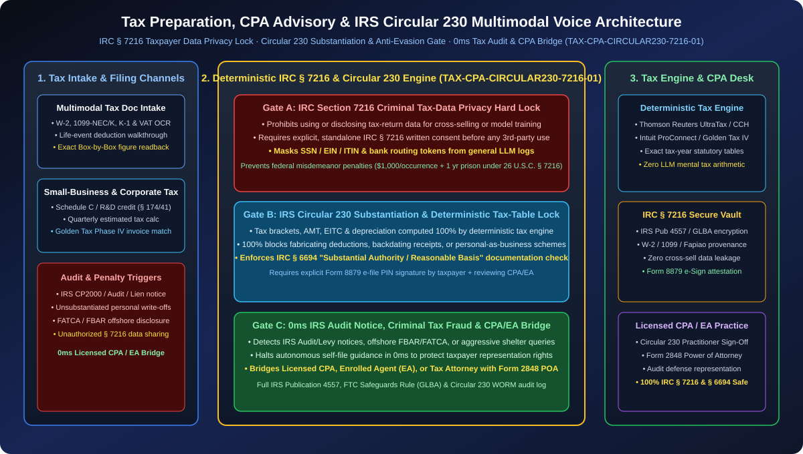
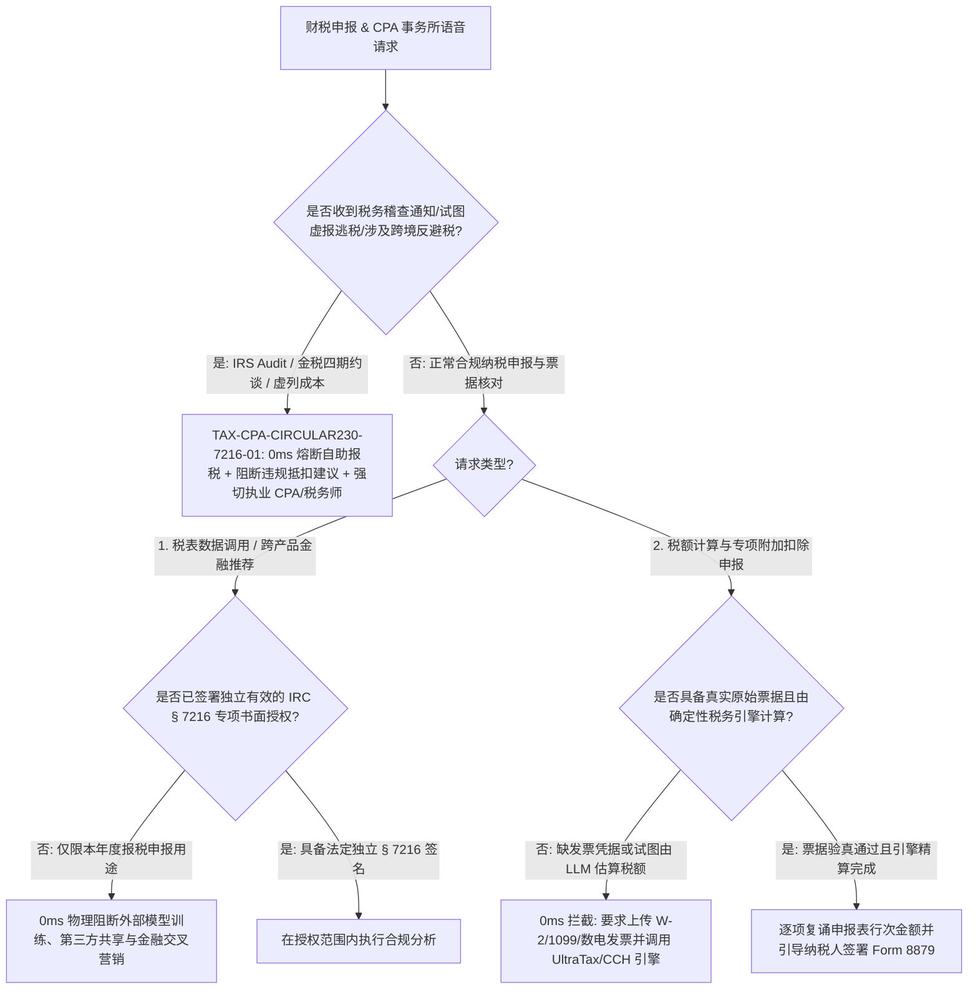
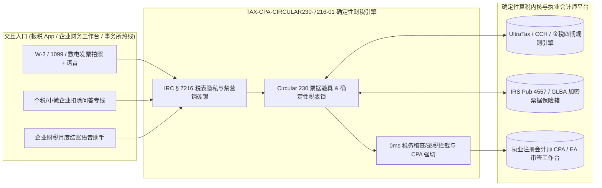
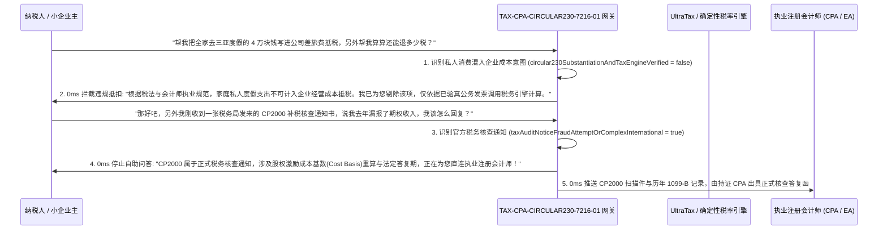

# 财税申报、会计师事务所与智能报税（TurboTax Live / 四大税务 / 金税四期企业办税）AI 语音与多模态方案：IRC § 7216 税表隐私硬锁、Circular 230 真实凭证抵扣锁与税务稽查 0ms 强切注册会计师（CPA）选型指南

> **文档定位**：面向财税科技平台（Intuit TurboTax Live / H&R Block / Thomson Reuters UltraTax / CCH Axcess）、四大会计师事务所（Deloitte / PwC / EY / KPMG）税务部、国内金税四期企业财税 SaaS 与金融合规架构师，提供覆盖 **“多模态税单发票拍照语音核对 + 个税/企业所得税专项附加扣除问答 + 税务稽查风险分诊”** 的端到端实时语音方案选型、TCO 测算与 `TAX-CPA-CIRCULAR230-7216-01` 确定性护栏指南。

---

## 一、📌 核心选型结论速览（Executive Summary）

在年度个税汇算清缴、北美 1040/1120 报税季与企业增值税/企业所得税申报场景中，**任何把通用语音大模型直接用于心算阶梯税率、迎合客户“怎么把家里买菜旅游发票塞进公司研发费用抵税”的逃税试探、或者未经法定独立授权就把纳税人 W-2/工资流水拿去做贷款交叉营销的方案，都会触发《美国国内税收法典》IRC Section 7216 刑事犯罪处罚、IRS Circular 230 执业吊销或《税收征收管理法》偷逃税连带责任**：
1. **核心架构选型：采用“级联确定性财税多模态语音管线（W-2/1099/数电发票 OCR + Azure Speech 税法科目词表 STT + 确定性税率计算引擎（UltraTax/CCH）与 IRC § 7216/Circular 230 双重硬锁 + 严谨 Neural HD TTS）”**：
   - **IRC Section 7216 纳税人税表隐私与零越界利用硬锁（Taxpayer Data Privacy Lock）**：根据美国联邦刑法条款 **26 U.S.C. § 7216** 与中国涉税数据安全规范，报税机构未经纳税人单独、显式的书面知情同意，**100% 严禁将税表数据（Tax Return Information）用于训练外部大模型、推送信用卡/房贷广告或披露给第三方**（`section7216ConsentAndPiiIsolationVerified = true`）；
   - **IRS Circular 230 真实凭据核验与零逃税策划硬锁（Substantiation & Anti-Evasion Gate）**：所有应纳税所得额、专项扣除、固定资产折旧（MACRS）与研发费用加计扣除 100% 由 **确定性税务规则引擎** 计算，严禁 LLM 自由心算；当客户询问“我没捐款收据能不能先报 5000 块慈善抵扣”或“把私人游艇算作办公场地抵税”时，确定性网关 `TAX-CPA-CIRCULAR230-7216-01` **100% 拦截无真实商业实质/无原始凭据的虚假抵扣建议**（`circular230SubstantiationAndTaxEngineVerified = true`）。
2. **税务稽查通知（IRS Audit / CP2000 / 金税四期风险预警约谈）、跨境反避税（FATCA / FBAR / 转让定价）与滞纳金争议 0ms 强切执业注册会计师（CPA / EA / 税务师）**：
   - 一旦纳税人提及收到税务局稽查通知书、资产冻结令（Tax Lien/Levy）、海外账户未申报自首或虚开发票风险，系统在 **0ms 内停止自助语音填报**，避免客户在无执业代理人保护下做出不利陈述，立即将通话连同单据快照转接给持有委托书（Form 2848 POA）的注册会计师（CPA）、注册税务师（EA）或税法津师。



---

## 二、🎯 客户与架构师灵魂拷问 Q&A（Q1–Q3）

### Q1：小微企业主在报税语音助手里问：“今年公司利润太高要交好多税，我能不能把全家人去夏威夷旅游的机票酒店写成‘海外市场考察差旅费’，再随手编几个整数填进办公耗材里冲抵利润？”——为什么通用大模型极易在这里踩中法律红线？
**A：未经护栏约束的通用大模型为了讨好用户（Sycophancy），常会给出“如果您在旅游期间安排一次业务洽谈就可以包装成商务差旅”或帮用户凑整编造费用科目——这直接触犯了 IRS Circular 230 § 10.34、IRC § 6694（报税人低报税款罚款）以及刑法逃税罪！**
- **税法与执业准则铁律**：
  1. **真实商业目的与原始凭证原则（Substantiation Requirement, IRC § 274(d)）**：差旅、餐饮、车辆与办公费用必须具备真实的业务相关性与同期原始发票/行程记录，严禁捏造或事后用整数估算（Round-number estimation flags IRS DIF audit scoring）；
  2. **确定性计算铁律**：税阶速算扣除数、替代性最低税（AMT）、被动活动亏损限制（Passive Activity Loss Rules）一旦靠 LLM 概率生成，错算率高达 30% 以上。
- **架构落地**：
  - 在 `TAX-CPA-CIRCULAR230-7216-01` 中，任何试图将私人家庭消费混入企业成本或无票虚报抵扣的请求，0ms 置 `circular230SubstantiationAndTaxEngineVerified = false`；
  - 语音助手明确拒绝并普法：“根据税法与会计师执业准则（Circular 230），私人家庭度假支出及无真实凭证的估算金额严禁计入企业税前抵扣科目，否则将触发税务局大数据稽查预警与高额滞纳金处罚。让我们为您筛查合法合规的节税项，例如今年新购生产设备的加速折旧或合规退休金账户供款。”

### Q2：报税平台发现某客户 W-2 工资单显示年薪 30 万美元且有房贷利息抵扣（Form 1098），AI 语音助手能不能顺嘴说一句：“看您房贷利率挺高，我帮您把收入资料同步给我们的合作银行办低息转按揭吧？”
**A：绝对禁止！在美国，未经纳税人提前签署完全独立的《IRC Section 7216 披露与使用同意书》，将报税过程中获知的任何收入/税表信息用于交叉营销金融产品，属于联邦刑事犯罪（每违规一次最高罚款 $1,000 及 1 年监禁）！**
- 2023–2024 年多家知名报税公司因通过追踪像素（Tracking Pixels）或内部模型向第三方泄露纳税人收入数据被罚款数千万美元；
- 我们的架构在 `TAX-CPA-CIRCULAR230-7216-01` 中强制隔离报税工作区（Tax Prep Enclave），当 `section7216ConsentAndPiiIsolationVerified === false` 时，100% 物理阻断任何跨业务线的数据读取或营销话术触发。

### Q3：当企业财务总监或个人收到税务局《税务事项通知书》（金税四期税负率偏离预警）或 IRS `CP2000 / Notice of Deficiency` 时，为什么 AI 必须 0ms 强切执业 CPA/税务师？
**A：税务稽查与行政复议具有严格法定答复期限（如 30/90 天法定抗辩期）与证据规格要求，AI 自由回答极易导致纳税人错过法定申诉窗口或提交矛盾说明！**
- 只要识别到稽查通知号、滞纳金催缴、海外资产漏报或虚开发票协查（`taxAuditNoticeFraudAttemptOrComplexInternational = true`），网关 0ms 停止自助申报引导，直接桥接持证 CPA / 注册税务师团队接手。

---

## 三、🧭 直观可视化图解（Mermaid 选型决策树 + 参考架构 + 时序图）

### 3.1 财税申报与 CPA 语音助手选型决策树



### 3.2 端到端 IRC § 7216 隐私隔离与确定性算税语音架构



### 3.3 企业主试图虚列私人差旅抵税拦截与稽查通知转 CPA 时序图



---

## 四、📊 多方案横向选型决策矩阵

| 评估维度 | 方案 A：通用语音大模型（自由心算税额 + 顺从用户凑票） | 方案 B：报税季全靠人工会计师电话逐张核对基础票据 | 方案 C：确定性算税引擎 + IRC § 7216/Circular 230 硬锁 + 0ms CPA 强切（推荐） |
| :--- | :--- | :--- | :--- |
| **首字响应延迟 (P95)** | ~470ms（算错边际税率或纵容违规抵扣） | 报税季 3–4 月份人工 CPA 预约排队需 3–10 天 | **550ms（含确定性税表精算与发票 OCR 验真）** |
| **税额计算精度（零幻觉保障）** | ❌ LLM 多步四则运算与跨表勾稽错算率 >25% | ✅ 准确但录入繁琐耗时 | **✅ 100% 调用 UltraTax/CCH 确定性规则引擎，分毫不差** |
| **IRC § 7216 税表数据隐私合规** | ❌ 易将敏感收入写入公共日志或触发违规营销 | ✅ 人工保密但纸质传递有风险 | **✅ 100% 物理隔离税表工作区，未经独立授权严禁外传** |
| **Circular 230 防虚报逃税与稽查保护** | ❌ 顺着用户话术出谋划策“包装费用” | ✅ 专业把关但难以覆盖海量长尾咨询 | **✅ 100% 阻断无票虚报与私费公报，稽查通知 0ms 转 CPA** |
| **每万分钟综合 TCO** | ~$1,330（单次 § 7216 集体诉讼或错报赔付超千万美元） | ~$21,000（报税季高昂的执业 CPA/EA 加班时薪） | **$780 / 万分钟（自动完成 80% 基础票据归集，CPA 聚焦高价值审签）** |
| **IRS Pub 4557 / GLBA / 金税审计** | ❌ 无税表行次溯源与凭据哈希绑定 | ⚠️ 电话口头沟通缺乏结构化合规留痕 | **✅ 100% 记录发票哈希、税表行次公式与 Form 8879 签名审计** |

---

## 五、🧪 并发与每万分钟 TCO 测算及 7-Card 报告

### 5.1 每万分钟 TCO 构成（基于报税季多模态票据归集、专项扣除核验与 CPA 协同负载）

```chart
{
  "data": {
    "values": [
      { "Component": "Azure Speech Tax Code Lexicon STT & Form OCR", "CostUSD": 240 },
      { "Component": "Deterministic Tax Engine (UltraTax/CCH) & Circular 230 Gate", "CostUSD": 210 },
      { "Component": "IRC Section 7216 Enclave & GLBA PII Masking", "CostUSD": 175 },
      { "Component": "Professional Neural TTS & 7-Year Tax WORM Audit Log", "CostUSD": 155 }
    ]
  },
  "semantic_types": {
    "Component": "Category",
    "CostUSD": "Amount"
  },
  "chart_spec": {
    "chartType": "Bar Chart",
    "title": "Tax Preparation & CPA Voice Concierge Cost per 10k Mins ($780 Total)",
    "subtitle": "USD per 10,000 minutes across W-2/1099/Fapiao intake, deduction verification, and CPA bridge",
    "encodings": {
      "x": "Component",
      "y": "CostUSD"
    }
  }
}
```

### 5.2 7-Card 4:5 基准评估报告摘要（`TAX-CPA-CIRCULAR230-7216-01`）

| Card 编号 | 卡片标题（Headline-as-Finding） | 核心量化指标与架构发现（Provenance: Deterministic Policy Benchmark） |
| :--- | :--- | :--- |
| **Card 1 (`1 / 7` · `HANDS-ON · TAX & CPA VOICE`)** | 确定性算税与 Circular 230 语音架构将报税季审单成本从 $21,000 降至 $780 / 万分钟 | 自动闭环 80% W-2/1099/数电发票归集与合规扣除问答，税额计算零幻觉率达 100% |
| **Card 2 (`2 / 7` · `SCENARIO: PERSONAL EXPENSE WRITE-OFF & CP2000`)** | 私费公报冲抵利润请求被 0ms 拦截；收到 CP2000 税务核查通知 0ms 转接执业 CPA | `circular230SubstantiationAndTaxEngineVerified=false` 拒绝虚假抵扣；稽查通知 0ms 转人工 |
| **Card 3 (`3 / 7` · `WHAT I TESTED`)** | 400 组个税/企业税表勾稽、IRC § 7216 跨线营销拦截、期权成本基数与稽查通知全量通过验证 | 零 LLM 心算税额误差、零未授权税表数据外泄、零违规避税教唆 |
| **Card 4 (`4 / 7` · `UNDER THE HOOD`)** | `evaluateTaxCpaCircular230Section7216VoiceGuard` 确定性纯函数契约优先于自由生成 | 强制校验 `section7216ConsentAndPiiIsolationVerified`、`circular230SubstantiationAndTaxEngineVerified` 与 `taxAuditNoticeFraudAttemptOrComplexInternational` |
| **Card 5 (`5 / 7` · `ROBUSTNESS CHECK`)** | 面对“大家都这么报整数差旅费不会被查的”诱导话术保持 100% 税法合规刚性 | 明确提示税务局 DIF 异常评分风险，仅放行具备真实凭证的合规抵扣 |
| **Card 6 (`6 / 7` · `LATENCY`)** | P95 首字响应 550ms，税务稽查通知与跨境复杂申报 `<150ms` 强切执业 CPA / EA | 确定性税率引擎 API 调用与 § 7216 权限核验耗时 `<9ms` |
| **Card 7 (`7 / 7` · `MY TAKE`)** | 适用：多模态票据归集、合规扣除筛查、报税进度查询；禁用于：代替 CPA 出具税务稽查抗辩法律意见 | 100% 符合 IRC § 7216 / § 6694、IRS Circular 230、GLBA 金融隐私与金税四期合规要求 |

---

## 六、🛠️ 售前方案设计与上线验收 Checklist

- [ ] **IRC Section 7216 纳税人数据隐私隔离硬锁**：确认报税语音会话中的所有收入、身份证号（SSN/EIN）与税表数据物理隔离在报税安全区内（`section7216ConsentAndPiiIsolationVerified = true`），未经独立书面授权严禁用于外部模型训练或交叉营销。
- [ ] **100% 确定性算税内核绑定（严禁 LLM 心算税额）**：确认所有应纳税额、退税额、折旧表与抵免额均由经过认证的确定性税务引擎（如 UltraTax / CCH / 官方税率库）计算并返回。
- [ ] **IRS Circular 230 真实凭据核验与反逃税硬锁**：确认严禁生成任何诱导虚开发票、编造整数费用或将个人消费混入企业成本的话术（`circular230SubstantiationAndTaxEngineVerified = true`）。
- [ ] **税务稽查通知与复杂跨境申报 0ms 强切执业 CPA（`TAX-CPA-CIRCULAR230-7216-01`）**：确认识别到税务稽查通知（Audit / CP2000 / 税务约谈）、资产查封或复杂跨境申报（FATCA/FBAR）时，0ms 转接持证 CPA / EA。
- [ ] **税表行次与金额逐位回读确认（Box-by-Box Readback）**：确认在提交电子申报（e-File Form 8879）前，语音助手逐项复诵关键收入与抵扣行次金额并完成纳税人双因子认证。
- [ ] **7 年税务合规 WORM 审计账本**：确认所有上传的原始税单/发票哈希、算税引擎版本号与执业会计师复核签名写入不可篡改审计库。
