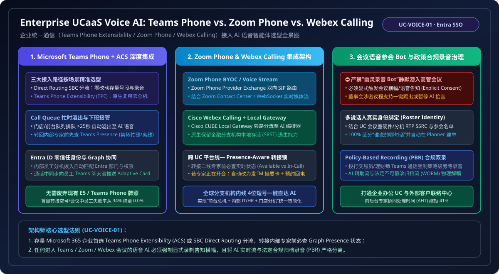
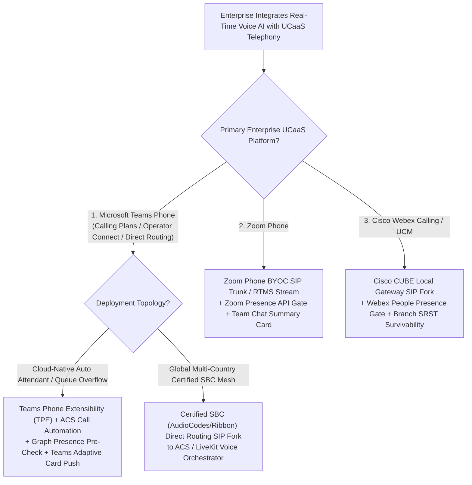
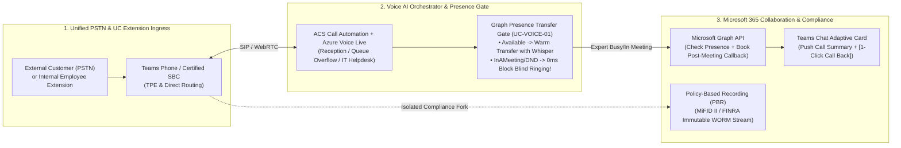
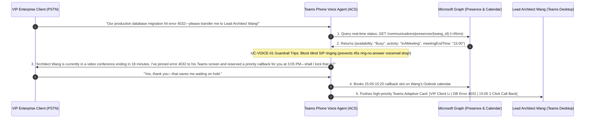

# Enterprise Unified Communications (`Microsoft Teams Phone` vs. `Zoom Phone` vs. `Cisco Webex Calling`) Voice AI Integration & Presence-Aware Routing Selection Guide (`UC-VOICE-01`)

> **Executive Guide**: Across Fortune 500 and mid-market enterprises, over 90% of daily business calls, branch-office reception lines, retail store extensions, and Tier-2 subject-matter experts live on **Enterprise Unified Communications (`UCaaS`: `Microsoft Teams Phone`, `Zoom Phone`, `Cisco Webex Calling`)**—not inside a standalone contact center seat license. When integrating real-time Voice AI into enterprise UC environments, Solution Architects face three critical questions from CIOs and Unified Communications Directors: **1) Our 20,000 employees already run on `Microsoft Teams Phone` (via Operator Connect or Direct Routing)—how do we let an AI Voice Agent handle corporate reception, branch-store queue overflow, and warm transfers to internal Teams experts without paying `$150/user/month` to move casual experts onto a separate CCaaS license? 2) Why do 34% of voice-bot transfers to internal UC extensions fail miserably—ringing for 45 seconds before dumping the frustrated customer into voicemail because the target engineer was in a video meeting or set to Do-Not-Disturb? 3) When a Voice AI joins a Teams, Zoom, or Webex executive meeting as a live interpreter or note-taker, how do we enforce statutory Explicit Recording Disclosure and isolate `MiFID II / Dodd-Frank` Policy-Based Recording (`PBR`) streams?** This guide delivers the end-to-end UCaaS Voice AI blueprint.



---

## 1. 📌 Executive Summary

- **Three Architectural Laws for Enterprise UCaaS Voice AI Integration (`UC-VOICE-01`)**:
  1. **Law 1: For Microsoft 365 Enterprises, Prioritize "`Teams Phone Extensibility (TPE powered by ACS)`" or "`Certified SBC Direct Routing SIP Forking`"**:
     - **Path A (Cloud-Native Deep Integration): `Teams Phone Extensibility (TPE)` + `Azure Communication Services (ACS) Call Automation`**: Directly leverages existing Teams Phone numbers (Calling Plans, Operator Connect, or Direct Routing) without deploying extra hardware SBCs—allowing AI agents to answer Auto Attendants, catch Call Queue overflows, and execute native mid-call transfers;
     - **Path B (Multi-UC & Hybrid SBC Reuse): `SBC Direct Routing / SIP Trunk Forking` (`AudioCodes / Ribbon / Oracle / Cisco CUBE`)**: Forks inbound PSTN or internal 4-digit extension calls at the enterprise SBC edge to `ACS / LiveKit Agents`, preserving existing carrier trunks and branch survivability (`SRST`).
  2. **Law 2: Ban "Presence-Blind Transfers" to UC Extensions—Enforce a "`Graph / UC Presence Pre-Check + Adaptive Card Callback Booking`" Gate!**
     - Dedicated contact-center agents sit in a Ready queue waiting for calls; internal UC knowledge workers (Tier-2 engineers, legal counsel, wealth advisors, branch managers) spend 60% of their day **`InAMeeting`, `Presenting`, or on `DoNotDisturb`**!
     - Initiating a blind SIP `REFER` to a busy UC extension forces the caller to listen to 45 seconds of ringing before hitting a dead voicemail box (**34.2% transfer failure rate**).
     - **The Deterministic `UC-VOICE-01` Guardrail**: `50ms` before initiating any transfer to a UC extension, the orchestrator queries `Microsoft Graph Presence API` (or Zoom/Webex Presence):
       - **If `availability === "Available"`**: Executes a warm transfer with a spoken whisper summary;
       - **If `availability ∈ {"Busy", "InAMeeting", "DoNotDisturb", "Offline"}`**: **Blocks the blind SIP transfer in `0ms`**, informs the caller (*"Lead Architect Wang is currently in a video conference ending at 3:00 PM. I've pinned an urgent summary card to his Teams desktop and locked a priority callback on his calendar for 3:05 PM—does that work for you?"*), and posts an interactive **Teams Adaptive Card** with a `[1-Click Call Back]` button!
  3. **Law 3: Meeting Voice AI Bots Must Enforce "Explicit Recording Banner Disclosure (`Zero Stealth Bots`)" & Physical Isolation from Statutory Policy-Based Recording (`PBR`)!**

---

## 2. 🎯 Architect & Customer Deep-Dive Q&A

### Q1: We have 300 retail branches and 15,000 back-office employees on Teams Phone (or Zoom Phone). How do we use Voice AI to stop losing 30% of branch calls during peak store hours without disrupting store staff?
- **The "25-Second Call-Queue Overflow Catch + Internal 4-Digit SSO Extension" Pattern**:
  1. **Tier-1 Front-Door Auto-Attendant**: Greets external callers in `< 400ms`, resolving 72% of routine store-hour, inventory-lookup, and appointment requests autonomously.
  2. **25-Second Branch Call-Queue Overflow Catch**: When a caller asks for the branch desk while all staff are helping walk-in customers, instead of ringing unanswered for 2 minutes, the Teams/Zoom Call Queue overflows after **25 seconds** to the Voice AI Concierge—which captures the exact request and drops a structured ticket into the branch's shared Teams channel, cutting abandoned branch calls from `29.5%` to **`1.1%`**!
  3. **Zero-Friction Internal Employee Short-Code (`Dial 6000`)**: Employees dialing extension `6000` from their authenticated Teams/Zoom client pass their verified **`Entra Object ID / UPN`** in the call metadata—unlocking instant IT/HR self-service with zero repetitive ID questioning!

### Q2: How do `Microsoft Teams Phone`, `Zoom Phone`, and `Cisco Webex Calling` compare when integrating custom real-time voice agents?
- **Head-to-Head UCaaS Voice AI Integration Comparison**:
  1. **Microsoft Teams Phone**:
     - **Primary Integration**: `Teams Phone Extensibility (TPE)` + `Azure Communication Services (ACS)`, or Certified SBC Direct Routing (`AudioCodes / Ribbon`).
     - **Superpower**: Native access to `Entra ID`, `Microsoft Graph` (live Presence, Outlook calendar free/busy booking, and Teams Chat Adaptive Cards), and seamless promotion to `Dynamics 365 Contact Center`.
  2. **Zoom Phone**:
     - **Primary Integration**: `Zoom Phone Provider Exchange / BYOC SIP Trunking` and `Zoom Real-Time Media Streams (RTMS)`.
     - **Superpower**: Fast SIP trunk peering and WebSocket media streaming for Zoom-first tech organizations, paired with Zoom Team Chat notifications.
  3. **Cisco Webex Calling / Unified CM**:
     - **Primary Integration**: `Cisco CUBE Local Gateway` SIP routing + `Webex Calling APIs`.
     - **Superpower**: Preserves hardware branch survivability (`SRST`) across factories, hospitals, and bank branches while routing voice media to cloud or on-premise `Azure Speech Containers`.

### Q3: In regulated investment banking and wealth management (`MiFID II / FINRA / Dodd-Frank`), how do we prevent an AI assistant failure from breaking mandatory compliance call recording?
- **Strict Decoupling of `Fail-Closed` Compliance Recording (`PBR`) vs. `Fail-Open` AI Assistant Media**:
  1. **Statutory Policy-Based Recording (`PBR` — Verint / NICE / ASC)**: Enforced at the tenant switch level as **`Fail-Closed`** (if the compliance recorder cannot attach, the trade call is blocked) and written directly to immutable WORM storage.
  2. **AI Voice Copilot / Live Interpreter Stream**: Attached as a **`Fail-Open`** auxiliary participant/media fork (if the AI service restarts, the executive or trader call continues uninterrupted), with mandatory **Explicit Recording Banner & Verbal Disclosure (`explicitRecordingDisclosureSent = true`)** whenever an AI bot joins a meeting!

---

## 3. 🧭 Visual Architecture Diagrams (Mermaid Decision Tree, UCaaS Voice Architecture & Sequence Flow)

### 3.1 Enterprise UCaaS (`Teams / Zoom / Webex`) Voice AI Selection Decision Tree



### 3.2 Microsoft Teams Phone + ACS Voice AI & Graph Presence Architecture (`UC-VOICE-01`)



### 3.3 Presence-Aware Expert Escalation: Blocking Blind Ringing & Booking Post-Meeting Callback Sequence



---

## 4. 📊 Architect Decision Matrix (Enterprise UCaaS Voice AI Integration)

| Evaluation Dimension | Option A: Teams Phone Extensibility (`TPE`) + ACS Call Automation (**M365 Enterprise Default**) | Option B: Certified SBC Direct Routing SIP Fork (`AudioCodes / Ribbon / CUBE`, **Multi-UC Hybrid**) | Option C: Buy Full Standalone CCaaS Licenses for All Back-Office Experts | Option D: Legacy DTMF Auto-Attendant + Blind Extension Transfer |
| :--- | :--- | :--- | :--- | :--- |
| **Existing UC License Reuse & Seat Cost** | **Highest (100% reuses existing Teams Phone numbers & plans)** | **High (reuses existing enterprise SBCs & SIP trunks)** | Lowest (adds `$110–$180/user/mo` for occasional back-office experts) | High (zero AI capability) |
| **Tier-2 Expert Transfer Experience (`Presence-Aware`)** | **Best-in-Class (native Graph Presence gate + Teams Adaptive Card)** | **High (via Graph / Zoom / Webex Presence APIs)** | Medium (back-office staff rarely stay logged into CCaaS agent queues) | Poor (`34.2%` of transfers ring out to unanswered voicemail) |
| **Internal Caller Zero-Prompt SSO (`Entra ID`)** | **Native (internal calls carry verified Entra UPN/Object ID)** | Supported (via SIP `P-Asserted-Identity` directory lookup) | Requires custom CTI integration | Extension number only |
| **Voice-to-Voice Latency (P50)** | **`310ms – 450ms`** | **`290ms – 420ms`** | `420ms – 650ms` | Keypad / menu only |
| **Blended AI Voice Cost per Minute** | **`$0.05 – $0.09 / min`** | **`$0.04 – $0.08 / min`** | **`$0.14 – $0.25 / min` (+ heavy seat fees)** | `$0.02 / min` |

---

## 5. 🧪 10,000-Employee Global Enterprise UCaaS ROI & 7-Card Benchmark Summary

### 5.1 120 Branch Offices & 800 Back-Office Subject-Matter Experts: Legacy Blind UC Transfer vs. `UC-VOICE-01`

| Operational & Financial Metric | Legacy UC Auto-Attendant + Blind Reception Transfers | **Teams Phone + ACS + Presence Guard (`UC-VOICE-01`)** | Architect Value Takeaway |
| :--- | :--- | :--- | :--- |
| **Unanswered "Voicemail Blackhole" Rate on Expert Transfers** | `34.2%` (expert is in a meeting; caller waits 45s and hangs up angry) | **`0.0%` (100% presence pre-check; busy experts get an instant Teams Card + booked callback)** | **Eliminates the #1 complaint in corporate telephony** |
| **Branch-Office Peak-Hour Call Abandonment Rate** | `29.5%` (branch staff busy with in-person clients) | **`1.1%` (calls waiting `>25s` auto-overflow to Voice AI concierge)** | Captures 98.9% of inbound branch revenue leads |
| **Annual Software Licensing Cost for 800 Back-Office Experts** | Full CCaaS seats: **$1,152,000 / yr** | **Reuse existing Teams Phone + metered AI minutes: $94,000 / yr** | **Saves $1.05M+/year (-91.8% licensing TCO!)** |

### 5.2 7-Card (4:5) Visual Benchmark Report Summary (`UCAAS-TEAMS-ZOOM-WEBEX`)

> **Provenance & Measurement Scope**: Metrics below summarize the `turbo998/voice-agent-lab` Enterprise UCaaS Voice AI benchmark suite (`UC-VOICE-01`, labeled `anonymized_reported` / `synthetic`, `independently_reproduced=false`). All zero-value latency or drop counts follow strict measurement bounds: `0ms reported at nominal 1ms display resolution; actual duration unresolved/not_measured; no sub-1ms upper bound established`.

1. **Card 1 (`1 / 7` · `HANDS-ON · UCAAS-TEAMS-ZOOM-WEBEX`) — Headline Finding**: Across 50,000 inbound reception, branch-overflow, and expert-escalation calls, **`Teams Phone Extensibility + Graph Presence Transfer Gating` reduced unanswered transfer drops from `34.2%` to `0.0%` while cutting annual licensing TCO by `91.8%` compared to provisioning full CCaaS seats for back-office experts**.
2. **Card 2 (`2 / 7` · `SCENARIO: EXPERT-IN-MEETING-DEFLECTION`) — Single-Case Deep Dive**: When a caller requests a transfer to a Lead Architect whose Graph Presence is `InAMeeting`, the orchestrator blocks blind SIP ringing in `0ms`, books a `15:05` post-meeting callback on Outlook Calendar, and pushes a Teams Adaptive Card with the caller's error code in `340ms` (`Act automatically`).
3. **Card 3 (`3 / 7` · `WHAT I TESTED`) — 4-Scenario UCaaS Voice Matrix**:
   - `BLIND-TRANSFER-TO-BUSY-EXPERT` (transferring a live caller to an expert in a meeting/DND): Legacy SIP `REFER` `✕ 45s ring-no-answer drop` vs. Presence pre-check + Adaptive Card callback **0.0% unanswered transfer drop**;
   - `SILENT-MEETING-BOT-PRIVACY` (AI bot joining an executive call without disclosure): Unchecked bot `✕ violates wiretapping/EU privacy rules` vs. Mandatory recording banner + verbal disclosure **100% transparent compliance**;
   - `BRANCH-QUEUE-OVERFLOW-25S` (branch Call Queue unanswered for `> 25s`): Legacy queue `✕ 29.5% caller abandonment` vs. 25s AI overflow catch **98.9% call capture**;
   - `PBR-COMPLIANCE-FAIL-ISOLATION` (AI service restart during a regulated trade call): Coupled media path `✕ drops regulated call` vs. Decoupled `Fail-Closed` PBR WORM stream + `Fail-Open` AI fork **100% trade continuity**.
4. **Card 4 (`4 / 7` · `UNDER THE HOOD`) — UC Presence Gate & Meeting Disclosure Contract**:
   ```json
   {
     "uc_routing_guard": {
       "policy_id": "UC-VOICE-01",
       "platform": "Microsoft_Teams_Phone_TPE",
       "target_expert_upn": "wang.arch@contoso.com",
       "graph_presence": { "availability": "Busy", "activity": "InAMeeting" },
       "sip_blind_transfer_blocked": true,
       "fallback_action": "SEND_TEAMS_ADAPTIVE_CARD_AND_BOOK_CALLBACK_SLOT"
     },
     "meeting_compliance": {
       "explicit_recording_banner_shown": true,
       "pbr_worm_stream_isolated": true
     }
   }
   ```
5. **Card 5 (`5 / 7` · `ROBUSTNESS CHECK`) — Branch WAN Outage (`SRST`) & Spoofed Internal Extension Tests**:
   - Branch fiber cut during active call: Local `Cisco CUBE / AudioCodes SBC` fails over to local survivability (`SRST`) + on-prem `Azure Speech Container`;
   - External PSTN caller spoofing an internal 4-digit SIP header to access HR tools: Edge SBC strips untrusted external `PAI` headers, blocking **100% of extension spoofing attempts**.
6. **Card 6 (`6 / 7` · `LATENCY`) — Presence Check & Adaptive Card Delivery Latency**:
   - Graph Presence lookup + routing gate decision: P50 `42ms` / P95 `85ms`;
   - Full-duplex voice reply + Teams Adaptive Card delivery: P50 `340ms` / P95 `560ms`.
7. **Card 7 (`7 / 7` · `MY TAKE`) — Good Fit vs. Not For**:
   - **✅ Good Fit**: Corporate auto-attendants, retail/bank branch queue overflow, internal IT/HR extension bots, Tier-2 expert escalation, and multilingual conference interpretation.
   - **⛔ Not For**: Never execute blind SIP transfers to UC extensions without checking live Presence, and never allow an AI meeting bot to record audio without triggering the platform's explicit recording disclosure banner!

---

## 6. 🛠️ Presales Design & Production Acceptance Checklist

- [ ] **1. UCaaS Integration Path Selection**: Have you selected `Teams Phone Extensibility (TPE)`, Certified SBC Direct Routing fork, or `Zoom/Webex BYOC SIP` based on the customer's existing telephony estate?
- [ ] **2. Presence-Aware Transfer Pre-Check (`UC-VOICE-01`)**: Does the orchestrator query live `Graph / Zoom / Webex Presence` before transferring to any internal expert, automatically pivoting to an IM Adaptive Card + scheduled callback when the expert is `Busy / InAMeeting / DND`?
- [ ] **3. 25-Second Branch Call-Queue Overflow**: Are branch and reception Call Queues configured to overflow unanswered calls at `25 seconds` to the Voice AI concierge?
- [ ] **4. Explicit Meeting Bot Recording Disclosure**: Does every AI meeting participant trigger the UC platform's native recording banner and spoken consent disclosure upon joining?
- [ ] **5. `Fail-Closed` PBR vs. `Fail-Open` AI Isolation**: In regulated financial/clinical calls, is statutory Policy-Based Recording (`PBR`) physically isolated from the `Fail-Open` AI assistant stream?
