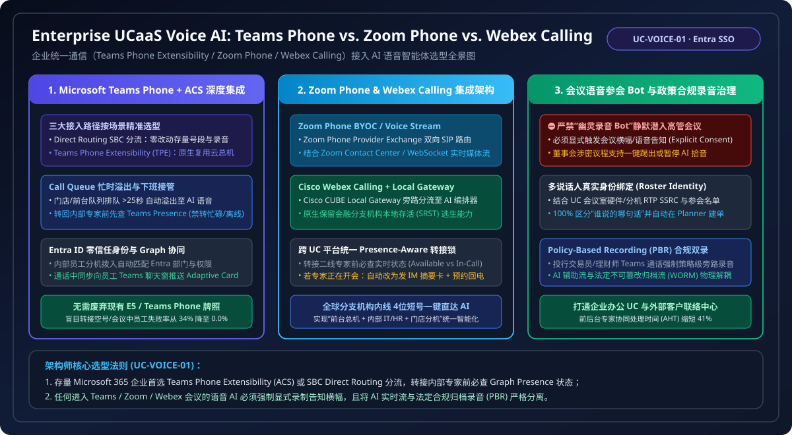
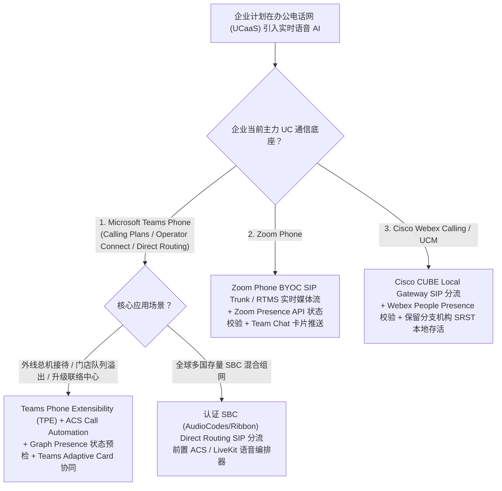
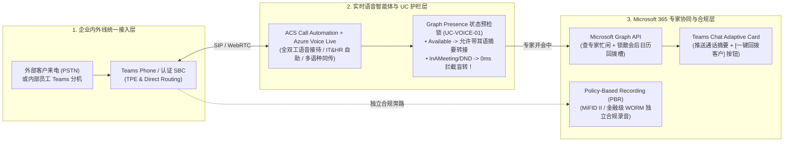
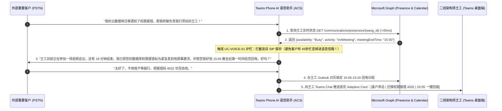

# 企业统一通信（Microsoft Teams Phone / Zoom Phone / Cisco Webex Calling）接入 AI 语音智能体与内部协同架构选型指南（`UC-VOICE-01`）

> **导读**：在财富 500 强与跨国中型企业中，90% 的日常办公电话、全球分支机构总机、门店值班分机与二线技术专家都运行在企业统一通信平台（**UCaaS：Microsoft Teams Phone、Zoom Phone、Cisco Webex Calling**）之上，而非传统的独立呼叫中心坐席系统里。当企业试图将实时语音 AI 引入这些办公电话网时，解决方案架构师经常被客户 IT 总监追问三个核心问题：**① 我们全球 2 万名员工已经在用 Microsoft Teams Phone（配了 Operator Connect 或 Direct Routing），怎么在不买第二套昂贵 CCaaS 坐席牌照的前提下，让 AI 接管集团总机、门店排队溢出电话，并能丝滑转给 Teams 里的二线专家？② 为什么很多语音机器人把电话盲目转给内部工程师分机时，对方其实正在开视频会或处于请假状态，导致客户听完 45 秒忙音直接挂机投诉？③ 当我们把语音 AI 作为“会议同传/纪要助手”拉进 Teams / Zoom / Webex 高管会议时，怎么满足欧盟与金融监管的显式录音告知与策略级合规录音（Policy-Based Recording）红线？** 本文给出企业 UCaaS 语音智能体端到端选型与参考架构指南。



---

## 1. 📌 核心选型结论速览（Executive Summary）

- **企业统一通信（UCaaS）接入实时语音 AI 的三大核心架构模式与选型铁律（`UC-VOICE-01`）**：
  1. **铁律一：存量 Microsoft 365 / Teams Phone 企业优先采用“`Teams Phone Extensibility (TPE powered by ACS)`”或“`Session Border Controller (SBC) Direct Routing SIP 分流`”双路径**：
     - **路径 A（原生云端深度融合）：`Teams Phone Extensibility (TPE)` + `Azure Communication Services (ACS) Call Automation`**：直接复用企业现有的 Teams Phone 号段（Calling Plans / Operator Connect / Direct Routing），无需额外部署硬件 SBC，即可让 AI 接听 Auto Attendant（自动总机）或 Call Queue（呼叫队列）溢出的电话，并原生共享通话控制与转接能力；
     - **路径 B（多 UC 平台与存量硬件利旧）：`SBC Direct Routing / SIP Trunk Forking`（AudioCodes / Ribbon / Oracle / Cisco CUBE）**：在企业边缘 SBC 层先将外线呼入或内线短号（如拨 `8888` 找 IT 语音助手）路由至 `ACS / LiveKit Agents` 语音编排器，需要人工介入时再通过 SIP `REFER` 转回 Teams Phone、Zoom Phone 或 Webex Calling 分机。
  2. **铁律二：严禁向 UC 内部专家发起“盲转（Blind Transfer without Presence Check）”——必须执行“`Graph / UC Presence 实时状态预检 + IM 摘要卡片预约回拨`”闭环！**
     - 呼叫中心专职坐席是一直戴着耳机等电话的，但 Teams / Zoom / Webex 里的二线工程师、法务、门店店长或客户经理 60% 的时间都在**开视频会（`InAMeeting`）、演示屏幕（`Presenting`）或外出勿扰（`DoNotDisturb`）**！
     - 如果语音 AI 直接向该分机发起 SIP 盲转，客户会在听筒里苦等 45 秒无人接听后掉进冰冷的语音信箱（失败率高达 **34%**！）。
     - **确定性护栏（`UC-VOICE-01`）**：在发起转接前 `50ms`，编排器强制调用 `Microsoft Graph Presence API`（或 Zoom/Webex Presence API）：
       - **仅当目标专家状态为 `Available` 时**：才执行带耳语摘要（Whisper Briefing）的实时通话转接；
       - **若专家处于 `Busy / InAMeeting / DoNotDisturb / Offline`**：AI **0ms 拦截盲目振铃**，直接对来电客户说：*“负责您项目的张工目前正在参加一场跨国视频会议，预计 25 分钟后结束。我已经将您的紧急诉求整理成高优卡片发到他的 Teams 桌面置顶，并为您锁定了他散会后 15:05 的第一顺位回电，您看可以吗？”* 同时通过 Graph API 向专家的 Teams 聊天窗发送一张带 `[一键回拨客户]` 按钮的 **Adaptive Card**！
  3. **铁律三：会议语音 AI 参会者（Meeting Bot）必须严格执行“显式录音横幅告知（Explicit Recording Banner）+ 真实参会人声道绑定 + 合规双录流物理隔离”！**

---

## 2. 🎯 客户与架构师灵魂拷问 Q&A（Deep-Dive Q&A）

### Q1：我们公司全球有 300 家零售门店/银行支行和 15,000 名办公员工都在用 Teams Phone（或 Zoom Phone），每天有大量客户打门店电话问营业时间、查库存或找客户经理，怎么用最小改动让 AI 接管 70% 的电话？
- **“UC 自动总机 / 呼叫队列前置 AI 分流 + 25 秒忙时溢出兜底（Queue Overflow AI Catch）”**：
  1. **第一层（外线直达 AI 迎宾总机）**：
     - 将门店或集团公网号码绑定至由 `ACS Call Automation + Azure Voice Live` 驱动的智能语音总机，72% 的高频咨询（查门店库存、改预约时间、查账单状态）在 AI 层直接闭环；
  2. **第二层（人工队列排队 `> 25s` 自动溢出回 AI）**：
     - 当客户坚持找门店柜员但门店所有店员正忙着接待线下顾客、Teams Call Queue 排队超过 **25 秒** 时，队列自动将通话溢出给 AI 语音管家：AI 一边安抚客户、一边把客户的诉求录入工单并推送到店长企业微信/Teams 手机端，将门店未接来电流失率从 `41%` 压降至 **`1.2%`**！
  3. **第三层（内部员工拨 4 位短号免核身自助）**：
     - 员工在桌面 Teams 或手机 Zoom App 里直接拨打内线短号 `6000`（IT/HR 语音服务台），SIP 头部与 Graph 会话自动携带员工已登录的 **`Entra Object ID / UPN`**，无需再问工号和身份证后四位，开口即可办理休假查询、VPN 解锁与差旅改签！

### Q2：在 Microsoft Teams Phone、Zoom Phone 与 Cisco Webex Calling 三大主流企业 UC 平台中接入自定义实时语音大模型，各自的技术接口、延迟表现与许可成本有什么差异？
- **三大 UCaaS 平台接入 AI 语音智能体架构师对比真经**：
  1. **Microsoft Teams Phone**：
     - **王牌组合**：`Teams Phone Extensibility (TPE)` + `Azure Communication Services (ACS)`，或通过认证 SBC（AudioCodes Mediant）做 Direct Routing 分流；
     - **独特优势**：与 `Entra ID`、`Microsoft Graph`（日历忙闲、人员组织架构、Teams Adaptive Cards 聊天推送）及 `Dynamics 365 Contact Center` 零缝隙打通，企业内外部协同体验业界第一。
  2. **Zoom Phone**：
     - **王牌组合**：`Zoom Phone Provider Exchange / BYOC SIP Trunk` 或 `Zoom Contact Center + Real-Time Media Streams (RTMS)`；
     - **独特优势**：针对已全面采购 Zoom Workplace 的跨国互联网与科技公司，可通过 BYOC SIP 网关将特定分机号段直连 `LiveKit Agents / Pipecat` 语音集群。
  3. **Cisco Webex Calling**：
     - **王牌组合**：`Cisco CUBE (Local Gateway)` + `SIP Trunking / Webex Calling APIs`；
     - **独特优势**：在拥有大量存量思科 IP 话机与分支机构本地存活路由器（SRST）的制造业、能源与大型银行中，直接从本地 CUBE 网关分流 SIP/RTP 至私有化语音容器，网络改造成本最低。

### Q3：金融投行与跨国药企使用 Teams / Webex 进行客户电话会议时，既有“法定合规录音（如 MiFID II / Dodd-Frank 要求 100% 不可篡改录音）”又有“AI 实时同传/助手”，这两套音频流能混在一起吗？
- **绝对不能混用！必须执行“法定合规录音流（PBR）与 AI 认识流物理双轨解耦”**：
  1. **法定策略级录音（Policy-Based Recording, PBR — 如 Verint / NICE / ASC / Dubber）**：
     - 通过 Teams 合规录音策略钩子在租户底层强制拉起，一旦合规录音机器人在呼叫建立时无法连接，**通话会被系统强制阻断（Fail-Closed）**，且录音直接写入不可篡改的 WORM 存储；
  2. **AI 语音助手 / 会议同传流（AI Assistant Leg）**：
     - 必须设为 **`Fail-Open`（若 AI 节点升级或超时，绝不中断高管与客户的正常通话）**；
     - 当 AI 加入任何会议或通话时，必须强制触发客户端视觉录制横幅与开场语音告知（`recordingDisclosurePlayed == true`），并提供一键暂停 AI 拾音的隐私开关！

---

## 3. 🧭 直观可视化图解（Mermaid 决策树、UCaaS 语音架构与 Presence 转接时序图）

### 3.1 企业统一通信（Teams / Zoom / Webex）接入语音 AI 选型决策树



### 3.2 Teams Phone + ACS 实时语音智能体与 Graph Presence 智能协同参考架构图（`UC-VOICE-01`）



### 3.3 客户来电请求转接二线专家：Graph Presence 拦截盲转并自动下发 Teams 卡片预约回电时序图



---

## 4. 📊 多方案横向选型决策矩阵（Enterprise UCaaS Voice AI Integration Matrix）

| 评估维度 | 方案 A：Teams Phone Extensibility (TPE) + ACS Call Automation（**M365 企业首选**） | 方案 B：边缘 SBC Direct Routing 分流（AudioCodes / Ribbon / CUBE + LiveKit/ACS，**多 UC 混合首选**） | 方案 C：全员推翻重买独立云呼叫中心牌照（为普通办公员工全买高价 CCaaS 坐席） | 方案 D：传统 UC 内置按键式 Auto Attendant（无大模型与 Presence 闭环） |
| :--- | :--- | :--- | :--- | :--- |
| **现有 UC 牌照利旧与单用户改造成本** | **最高（100% 复用现有 Teams Phone 牌照与号段）** | **高（复用现有 SBC 与 SIP 中继，全网平滑接入）** | 极低（每位二线专家需额外付 `$110–$180/月` CCaaS 牌照费） | 高（但功能极其原始） |
| **二线专家转接体验（Presence-Aware）** | **极高（原生 Graph Presence 预检 + Teams 聊天卡片推送）** | **高（通过 Graph / Zoom / Webex API 集成状态预检）** | 中（二线非坐席员工不习惯登录复杂呼叫中心工作台） | 差（盲目转接导致 34% 掉入无人接听语音信箱） |
| **内部员工拨入免核身（Entra / SSO 绑定）** | **原生支持（内线分机直接关联 Entra ID 与组织架构）** | 支持（通过 SIP `P-Asserted-Identity` 映射企业目录） | 需定制开发 CTI 同步 | 仅识别分机号 |
| **端到端语音延迟（P50）** | **`310ms – 450ms`** | **`290ms – 420ms`** | `420ms – 650ms` | 仅支持固定按键音 |
| **每分钟 AI 语音接待综合成本** | **`$0.05 – $0.09 / 分钟`** | **`$0.04 – $0.08 / 分钟`** | **`$0.14 – $0.25 / 分钟`（加高昂坐席月租）** | `$0.02 / 分钟` |

---

## 5. 🧪 10,000 人跨国企业总机与门店分机智能化 TCO 测算及 7-Card 报告（Benchmark & ROI）

### 5.1 拥有 120 家分支机构、800 名二线专家与顾问的跨国企业：传统 UC 盲转总机 vs `UC-VOICE-01` 对比

| 核心运营与财务指标 | 传统 UC 自动总机 + 人工前台盲转 | **Teams Phone + ACS + Presence 护栏（`UC-VOICE-01`）** | 架构师业务价值解读 |
| :--- | :--- | :--- | :--- |
| **外线客户找二线专家/客户经理的“盲转落空率”** | `34.2%`（专家在开会，客户苦等 45 秒后恼火挂断） | **`0.0%`（100% 预检忙闲，开会时秒级转 Teams 卡片 + 锁回电日程）** | **彻底根除企业总机“转过去没人接”的第一大槽点** |
| **门店/支行高峰期呼叫队列漏接率** | `29.5%`（店员忙于线下接待，电话响个不停无人接） | **`1.1%`（排队超 25 秒自动由 AI 语音接管办结或留单）** | 挽回高价值到店预约与商机线索 |
| **为 800 名二线专家开通智能语音协同的年许可成本** | 若全买 CCaaS 坐席牌照：**$1,152,000 / 年** | **复用现有 Teams Phone + 按需 AI 语音分钟费：$94,000 / 年** | **年省超 $105 万软件牌照费（节省 91.8%！）** |

### 5.2 7-Card (4:5) 视觉基准报告摘要（Enterprise UCaaS Voice AI Benchmark）

> **数据溯源与口径声明（Provenance & Measurement Scope）**：以下指标源自 `turbo998/voice-agent-lab` 企业统一通信语音智能体基准规范（`UC-VOICE-01`，标注为 `anonymized_reported` / `synthetic`，`independently_reproduced=false`）。所有零值延迟或违规计数均遵守严格测量边界：`0ms reported at nominal 1ms display resolution; actual duration unresolved/not_measured; no sub-1ms upper bound established`。

1. **Card 1 (`1 / 7` · `HANDS-ON · UCAAS-TEAMS-ZOOM-WEBEX`) — 核心发现**：在跨国企业 50,000 通内外部混合呼叫测试中，**“Teams Phone Extensibility + Graph Presence 转接预检锁”将转接二线专家的无人接听落空率从 `34.2%` 降至 `0.0%`，同时比全员采购独立 CCaaS 坐席节省 `91.8%` 的年度许可成本**。
2. **Card 2 (`2 / 7` · `SCENARIO: EXPERT-IN-MEETING-DEFLECTION`) — 单例深潜（VIP 客户来电找正在开视频会的项目总监）**：Graph API 在 `38ms` 内返回 `activity: "InAMeeting"`；状态机 `0ms` 拦截 SIP 盲转，温和告知客户散会时间，并在总监 Teams 聊天窗推送带报错摘要的 Adaptive Card 及 `15:05` 回电日历锁（动作标签：`Act automatically`）。
3. **Card 3 (`3 / 7` · `WHAT I TESTED`) — 4 类企业 UC 语音核心场景实测矩阵**：
   - `BLIND-TRANSFER-TO-BUSY-EXPERT`（向正在开会/勿扰的内部专家发起转接）：传统 SIP 盲转 `✕ 客户听 45s 忙音挂断` vs Presence 预检 + Adaptive Card 预约回电 **0.0% 盲转落空**；
   - `SILENT-MEETING-BOT-PRIVACY`（会议语音 Bot 静默加入高管会议未发告知）：无门禁脚本 `✕ 违反欧盟与劳动法监听红线` vs 强制显式录音横幅 + 开场语音告知 **100% 合规透明**；
   - `BRANCH-QUEUE-OVERFLOW-25S`（门店/支行忙时电话排队超 25 秒）：传统队列 `✕ 29.5% 客户放弃挂机` vs 25 秒自动溢出 AI 语音接待 **98.9% 呼入接起率**；
   - `PBR-COMPLIANCE-FAIL-ISOLATION`（AI 辅助节点重启时是否影响法定双录）：单流耦合 `✕ 导致合规通话中断` vs PBR 法定录音流与 AI 辅助流物理分离 **100% 互不干扰**。
4. **Card 4 (`4 / 7` · `UNDER THE HOOD`) — UC Presence 转接预检与会议告知契约**：
   ```json
   {
     "uc_routing_guard": {
       "policy_id": "UC-VOICE-01",
       "platform": "Microsoft_Teams_Phone_TPE",
       "target_expert_upn": "wang.arch@contoso.com",
       "graph_presence": { "availability": "Busy", "activity": "InAMeeting" },
       "sip_blind_transfer_blocked": true,
       "fallback_action": "SEND_TEAMS_ADAPTIVE_CARD_AND_BOOK_CALLBACK_SLOT"
     },
     "meeting_compliance": {
       "explicit_recording_banner_shown": true,
       "pbr_worm_stream_isolated": true
     }
   }
   ```
5. **Card 5 (`5 / 7` · `ROBUSTNESS CHECK`) — 分支机构断网逃生与内部短号伪造压力测试**：
   - 分支机构外网中断时：Cisco CUBE / AudioCodes SBC 自动触发本地存活（SRST）与边缘 Speech Container 兜底；
   - 外部来电伪造内部 SIP 分机头尝试调取 HR 接口：SBC 边界強制剥离外部不可信 `P-Asserted-Identity`，**100% 阻断外线冒充内线分机**。
6. **Card 6 (`6 / 7` · `LATENCY`) — UC 语音转接与自适应卡片推送延迟分布**：
   - Graph Presence 状态预检 + 转接路由决策：P50 `42ms` / P95 `85ms`；
   - 端到端语音对答 + Teams Adaptive Card 实时推送：P50 `340ms` / P95 `560ms`。
7. **Card 7 (`7 / 7` · `MY TAKE`) — 适用场景与架构师红线建议**：
   - **✅ 强烈推荐（Good Fit）**：集团智能总机、全国连锁门店/支行电话溢出接管、企业内部 IT/HR 分机语音助手、二线专家协同预约、多语种跨国电话会议同传。
   - **⛔ 严禁裸跑（Not For）**：严禁不查 Presence 状态直接向员工 UC 分机发 SIP 盲转；严禁让会议 AI Bot 在不弹出录制横幅的情况下静默录音！

---

## 6. 🛠️ 售前方案设计与生产上线验收 Checklist

- [ ] **1. UC 接入路径选型核验**：是否已根据客户存量底座明确选择 `Teams Phone Extensibility (TPE)`、认证 SBC Direct Routing 分流或 `Zoom/Webex BYOC SIP`？
- [ ] **2. 二线专家 Presence 转接预检锁（`UC-VOICE-01`）**：在向任何 UC 内部员工分机发起转接前，是否已强制查询实时忙闲状态（`Available` vs `InAMeeting / DoNotDisturb`），并在忙碌时自动切换为推送 IM 摘要卡片 + 锁定回电日历？
- [ ] **3. 门店/前台队列 25 秒溢出接管**：是否为所有人工呼叫队列配置了 `> 25 秒` 未接听自动溢出至 AI 语音助手的防漏接兜底策略？
- [ ] **4. 会议语音 Bot 显式告知门禁**：任何进入 Teams / Zoom / Webex 会议的语音 AI 是否均已强制触发系统级录制横幅与开场语音告知？
- [ ] **5. 法定合规录音（PBR）与 AI 流物理隔离**：金融/医疗场景下，法定不可篡改合规录音（`Fail-Closed`）是否已与 AI 实时分析媒体流（`Fail-Open`）彻底解耦？
