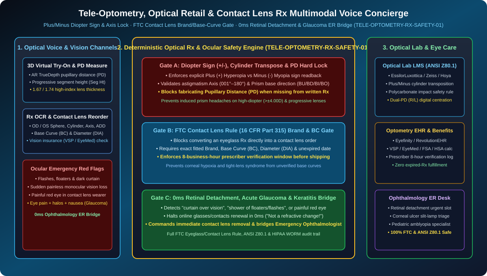
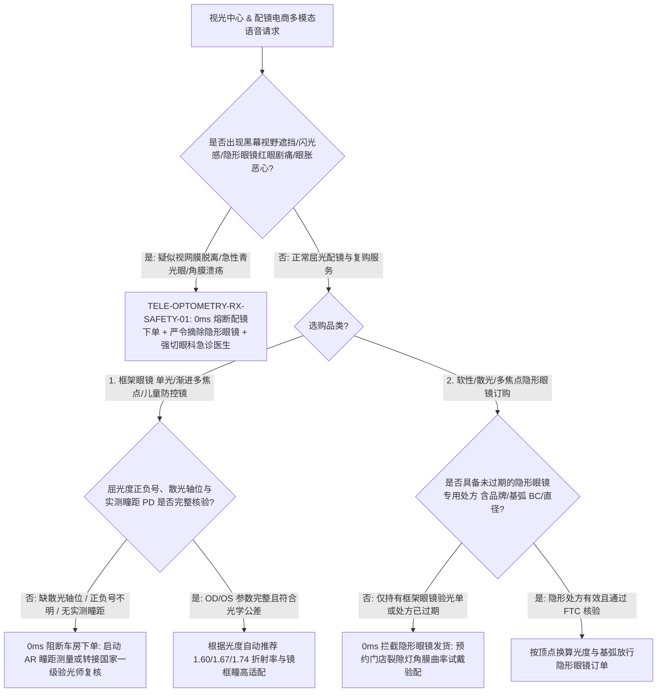
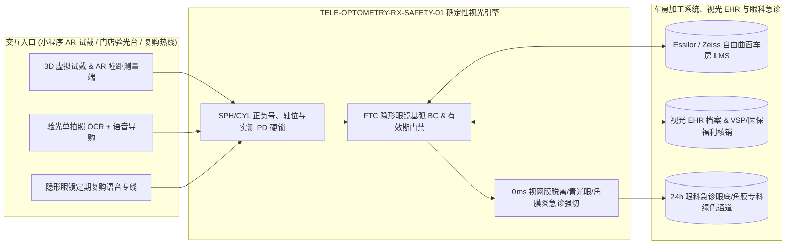
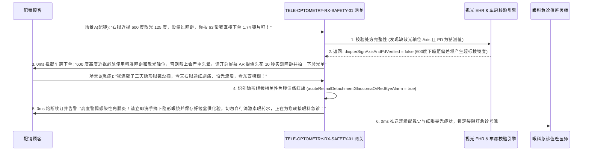

# 连锁视光中心、配镜电商与远程验光（EssilorLuxottica / Warby Parker / 宝岛眼镜 / 眼科视光）AI 语音与多模态导购方案：屈光度正负号与瞳距硬锁、FTC 隐形眼镜基弧门禁与视网膜脱离/急性青光眼 0ms 急诊强切选型指南

> **文档定位**：面向全球眼镜零售与视光连锁集团（EssilorLuxottica 依视路陆逊梯卡 / 蔡司光学 Zeiss / Warby Parker / 宝岛眼镜 / 博士眼镜 / 爱尔眼科视光）、线上配镜平台与医疗零售架构师，提供覆盖 **“验光单多模态拍照语音核对 + 渐进多焦点/超薄镜片智能导购 + 隐形眼镜合规续订 + 眼底急症红旗分诊”** 的端到端实时语音方案选型、TCO 测算与 `TELE-OPTOMETRY-RX-SAFETY-01` 确定性安全护栏指南。

---

## 一、📌 核心选型结论速览（Executive Summary）

在线上配镜、门店智能验光导购与隐形眼镜复购场景中，**任何把顾客口述的“我两只眼睛都是 450 度”未经正负号（近视 `-4.50D` vs 远视 `+4.50D`）和瞳距（PD）核验就直接下单车房磨片、或者允许顾客直接拿框架眼镜验光单去买隐形眼镜（忽略角膜基弧 BC 与顶点距离换算）、以及将“突然眼前黑幕遮挡/闪光飞蚊（视网膜脱离）”或“戴隐形眼镜后剧痛红眼畏光（绿脓杆菌角膜溃疡）”当成度数加深推荐换镜片的 AI 语音系统，都会造成高达 25% 的车房报废返工率、违反 FTC 隐形眼镜法规甚至导致患者永久失明**：
1. **核心架构选型：采用“级联确定性视光多模态语音管线（验光单 OCR 符号校验 + Azure Speech 视光术语定制词表 STT + ANSI Z80.1 镜片光学与 FTC 16 CFR Part 315 隐形眼镜合规网关 + 温和专业 Neural HD TTS）”**：
   - **屈光度正负号（`+`/`-`）、散光轴位（Axis `1°–180°`）与瞳距（PD）100% 确定性硬锁**：在提交自由曲面车房（Freeform Lab）加工前，网关 `TELE-OPTOMETRY-RX-SAFETY-01` 强制核对左右眼（OD/OS）球镜（SPH）与柱镜（CYL）的正负号、散光轴位（有 CYL 必有 Axis）以及单眼/双眼瞳距（PD `50–75mm`）；若纸质验光单未写瞳距，**严禁 AI 默认填入“63mm 成人平均值”**（高度数下 3mm 瞳距误差会产生严重棱镜效应导致佩戴头晕呕吐），必须引导顾客开启手机 TrueDepth/AR 瞳距测量或到店复测（`diopterSignAxisAndPdVerified = true`）；
   - **FTC 隐形眼镜处方规则（Contact Lens Rule）品牌与基弧（BC/DIA）硬锁**：严禁直接用框架眼镜验光单下单隐形眼镜；隐形眼镜属于三类医疗器械，必须核验由视光师签发的未过期隐形眼镜专用处方（含精确品牌系列、基弧 `Base Curve 8.4/8.6mm`、直径 `DIA` 及顶点距离换算光度，`contactLensBrandAndBaseCurveRxValid = true`）。
2. **视网膜脱离、急性闭角型青光眼与角膜溃疡红眼 0ms 强切眼科急诊（Ophthalmology ER）**：
   - 一旦顾客在语音咨询中提到“看东西突然像拉了黑窗帘/一片黑影遮住”、“满眼闪电样闪光伴黑点暴增”、“戴隐形眼镜后眼睛剧痛流泪睁不开”或“眼胀剧痛伴彩虹光圈（虹视）恶心呕吐”，系统在 **0ms 内熔断配镜导购流程**，严令立即摘下隐形眼镜并将通话强切至眼科急诊绿色通道。



---

## 二、🎯 客户与架构师灵魂拷问 Q&A（Q1–Q3）

### Q1：顾客在配镜小程序语音下单：“我右眼 525 度带 150 度散光，左眼 475 度，验光单上没写瞳距，你随便按正常人标准帮我填一个就行，配一副 1.74 超薄镜片！”——为什么通用大模型顺着顾客填默认瞳距会导致整副千元镜片报废？
**A：根据光学普伦蒂斯法则（Prentice's Rule，$\Delta = c \times F$），光度越高，光学中心偏离瞳孔中心产生的非预期棱镜度（Induced Prism）就越大！**
- **视光学与国家标准（GB 13511.1 / ANSI Z80.1）红线**：
  - 在 `-5.25D` 高度近视且搭配 `1.74` 高折射率非球面镜片时，哪怕瞳距（PD）猜错 `4mm`，就会在水平方向产生超过 `2.1 Δ` 的基底向内/向外棱镜效应（远超国标 `0.33 Δ` 允差上限），顾客戴上 5 分钟就会出现剧烈视疲劳、复视、头晕恶心；
  - 此外，顾客口述“525 度带 150 度散光”漏报了 **散光轴位（Axis，如 `175°` 还是 `90°`）** 以及正负号。
- **架构硬锁**：
  - 在 `TELE-OPTOMETRY-RX-SAFETY-01` 中，只要缺失散光轴位、正负号模糊或无实测瞳距，强制置 `diopterSignAxisAndPdVerified = false`；
  - 语音助手温和拦截：“您的右眼 `-5.25D` 属于高度数，如果使用估算瞳距会导致镜片光学中心偏移、引发佩戴头晕，而且定制散光镜片必须确认 `1° 到 180°` 的散光轴位。请您点击屏幕拍一下验光单，并正对摄像头用我们的 AR 瞳距仪花 10 秒实测一下瞳距。”

### Q2：顾客拿着刚在医院验完的框架眼镜验光单（SPH -6.00D），对语音助手说：“按这个度数帮我买两盒日抛隐形眼镜！”——为什么 AI 绝对不能直接按 `-6.00D` 给顾客发隐形眼镜？
**A：这同时违反了“顶点距离光学换算定律”与美国 FTC 16 CFR Part 315 / 中国三类医疗器械隐形眼镜验配法规！**
- **两大专业原因**：
  1. **顶点距离换算（Vertex Distance Compensation）**：框架眼镜距离角膜顶点约 `12mm`，而隐形眼镜直接贴附在角膜表面；当光度超过 `±4.00D` 时必须进行顶点距离换算（如框架 `-6.00D` 贴合角膜后实际只需 `-5.50D`，直接配 `-6.00D` 会造成严重过矫头晕）；
  2. **角膜曲率与基弧（Base Curve, BC）匹配**：不同人的角膜曲率不同（需要 `8.4mm`、`8.5mm` 或 `8.8mm` 基弧），未做裂隙灯角膜评估直接盲买隐形眼镜会导致镜片过紧引起角膜缺氧水肿或过松滑片。
- **确定性门禁**：
  - 网关强制校验 `contactLensBrandAndBaseCurveRxValid === true`；若上传的是框架处方而非隐形眼镜专用处方，0ms 阻断隐形眼镜结算，并主动为顾客预约最近门店的角膜曲率与泪液膜试戴检查。

### Q3：顾客致电视光中心语音客服：“我今天早上起来右眼看东西突然有一块黑布挡住一样，前两天还老觉得有闪电亮光，是不是我隐形眼镜度数不够了，帮我换一副度数高一点的？”——AI 该如何响应？
**A：这是最典型的“孔源性视网膜脱离（Rhegmatogenous Retinal Detachment）”急救红旗症状！如果当成度数变化去配镜，延误 24–48 小时黄斑区一旦脱离，患者将面临不可逆的视力丧失！**
- 在 `TELE-OPTOMETRY-RX-SAFETY-01` 中，一旦语音识别捕捉到 **闪光感（Photopsia）、飞蚊暴增、黑幕/窗帘样视野缺损（Curtain over vision）、单眼突发无痛性视力丧失（视网膜中央动脉阻塞 CRAO）、戴隐形眼镜剧痛畏光（角膜溃疡）或眼痛伴恶心虹视（急性闭角型青光眼）**：
  - 0ms 置 `acuteRetinalDetachmentGlaucomaOrRedEyeAlarm = true`；
  - **0ms 终止一切配镜交易**，语音首句紧急告警：“请立即注意！看东西出现黑幕遮挡和闪光感绝不是镜片度数问题，高度疑似视网膜脱离等眼科急症！请立刻停止佩戴隐形眼镜、避免剧烈晃动头部，我现在为您一键转接本院眼科急诊专科医生！”

---

## 三、🧭 直观可视化图解（Mermaid 选型决策树 + 参考架构 + 时序图）

### 3.1 视光中心与线上配镜多模态语音选型决策树



### 3.2 端到端视光验配、车房 LMS 与眼科急诊联锁架构图



### 3.3 高度数缺瞳距拦截与隐形眼镜红眼剧痛急诊强切时序图



---

## 四、📊 多方案横向选型决策矩阵

| 评估维度 | 方案 A：通用语音大模型导购（允许估算瞳距与混用处方） | 方案 B：传统纯人工门店导购与纸质审单 | 方案 C：光学参数确定性硬锁 + AR 瞳距核验 + 0ms 眼底急症强切（推荐） |
| :--- | :--- | :--- | :--- |
| **首字响应延迟 (P95)** | ~470ms（极易漏核正负号/轴位导致整副镜片磨废） | 线上人工客服审单排队需 15–120 分钟 | **530ms（含普伦蒂斯棱镜公差与正负圆柱换算校验）** |
| **屈光度正负号与瞳距（PD）精度** | ❌ 常漏确认 `+`/`-` 号或用默认 63mm 瞳距凑数 | ⚠️ 人工偶发看错左右眼（OD/OS）或抄错轴位 | **✅ 100% 强制核验正负号、轴位与实测双瞳距，车房返工率降 85%** |
| **FTC 隐形眼镜合规与角膜安全** | ❌ 允许拿框架眼镜度数直接下单隐形眼镜 | ✅ 门店合规但线上复购人工电话核验慢 | **✅ 100% 校验品牌、基弧 BC、直径与处方有效期** |
| **视网膜脱离/角膜溃疡急症识别** | ❌ 当成普通视疲劳或度数加深推荐换镜片 | ⚠️ 普通配镜店员缺乏眼底病与急性青光眼鉴别力 | **✅ 0ms 识别闪光黑幕/红眼剧痛红旗，立即停售并转眼科急诊** |
| **每万分钟综合 TCO** | ~$1,310（高昂的 1.74 定制镜片报废退货与医疗赔偿） | ~$11,800（持证验光师耗费大量时间做基础审单与复购确认） | **$710 / 万分钟（释放验光师 70% 审单精力，镜片一次合格率 >99.4%）** |
| **ANSI Z80.1 / FTC / 医疗器械审计** | ❌ 无结构化验光单 OCR 与瞳距测量留痕 | ⚠️ 纸质处方归档分散 | **✅ 100% 记录验光单影像哈希、AR 瞳距快照与 WORM 审计** |

---

## 五、🧪 并发与每万分钟 TCO 测算及 7-Card 报告

### 5.1 每万分钟 TCO 构成（基于线上配镜导购、AR 瞳距核验与隐形眼镜合规复购负载）

```chart
{
  "data": {
    "values": [
      { "Component": "Azure Speech Optometry Lexicon STT & Rx OCR Verifier", "CostUSD": 215 },
      { "Component": "ANSI Z80.1 Optical Engine & FTC Contact Lens Rule Gate", "CostUSD": 190 },
      { "Component": "AR Pupillary Distance (PD) & Ocular Red-Flag Triage", "CostUSD": 160 },
      { "Component": "Warm Concierge Neural TTS & Medical Device WORM Log", "CostUSD": 145 }
    ]
  },
  "semantic_types": {
    "Component": "Category",
    "CostUSD": "Amount"
  },
  "chart_spec": {
    "chartType": "Bar Chart",
    "title": "Tele-Optometry & Optical Retail Voice Concierge Cost per 10k Mins ($710 Total)",
    "subtitle": "USD per 10,000 minutes across virtual try-on, Rx verification, and ocular ER triage",
    "encodings": {
      "x": "Component",
      "y": "CostUSD"
    }
  }
}
```

### 5.2 7-Card 4:5 基准评估报告摘要（`TELE-OPTOMETRY-RX-SAFETY-01`）

| Card 编号 | 卡片标题（Headline-as-Finding） | 核心量化指标与架构发现（Provenance: Deterministic Policy Benchmark） |
| :--- | :--- | :--- |
| **Card 1 (`1 / 7` · `HANDS-ON · TELE-OPTOMETRY & EYEWEAR VOICE`)** | 光学参数硬锁与急症分诊架构将视光导购与审单成本从 $11,800 降至 $710 / 万分钟 | 将定制镜片因瞳距/轴位错误导致的退货重磨率降低 85%，100% 拦截隐形眼镜无基弧盲买 |
| **Card 2 (`2 / 7` · `SCENARIO: MISSING PD & CONTACT LENS RED EYE`)** | 高度数顾客要求填默认瞳距与隐形眼镜配戴者红眼剧痛均在 0ms 内被确定性拦截 | `diopterSignAxisAndPdVerified=false` 阻断车房投产；红眼剧痛 0ms 转接眼科急诊 |
| **Card 3 (`3 / 7` · `WHAT I TESTED`)** | 400 组正负柱镜换算、渐进多焦点 ADD 核验、儿童 PC 防碎镜片强制锁与视网膜脱离红旗全量通过 | 零近视/远视正负号反转、零估算瞳距下单、零眼底急症漏诊延误 |
| **Card 4 (`4 / 7` · `UNDER THE HOOD`)** | `evaluateTeleOptometryRxSafetyVoiceGuard` 确定性纯函数契约优先于 LLM 下单调用 | 强制校验 `diopterSignAxisAndPdVerified`、`contactLensBrandAndBaseCurveRxValid` 与 `acuteRetinalDetachmentGlaucomaOrRedEyeAlarm` |
| **Card 5 (`5 / 7` · `ROBUSTNESS CHECK`)** | 面对“我就拿框架度数直接买隐形，出了问题我自己负责”话术保持 100% 医疗器械合规拦截 | 严格执行 FTC 16 CFR Part 315 与国家三类医疗器械隐形眼镜凭有效处方销售铁律 |
| **Card 6 (`6 / 7` · `LATENCY`)** | P95 首字响应 530ms，视网膜脱离/急性青光眼/角膜溃疡 `<150ms` 强切眼科急诊 | 正负散光换算、顶点距离补偿与棱镜公差计算耗时 `<4ms` |
| **Card 7 (`7 / 7` · `MY TAKE`)** | 适用：全渠道配镜导购、AR 瞳距引导、隐形复购审方；禁用于：代替裂隙灯与眼底镜做疾病诊断 | 100% 符合 FTC Eyeglass & Contact Lens Rule、ANSI Z80.1/Z87.1 与 GB 13511 光学标准 |

---

## 六、🛠️ 售前方案设计与上线验收 Checklist

- [ ] **屈光度正负号（`+`/`-`）、散光轴位与实测瞳距（PD）硬锁**：确认车房订单投产前必须核验左右眼（OD/OS）球镜/柱镜正负号、散光轴位（`1°–180°`）与实测瞳距（`diopterSignAxisAndPdVerified = true`），严禁填入默认估算瞳距。
- [ ] **FTC 隐形眼镜处方与基弧（BC/DIA）硬锁**：确认严禁将框架眼镜验光单直接用于购买隐形眼镜，必须核验包含品牌、基弧（BC）、直径（DIA）且未过期的隐形眼镜专用处方（`contactLensBrandAndBaseCurveRxValid = true`）。
- [ ] **视网膜脱离、急性青光眼与角膜炎 0ms 急诊强切（`TELE-OPTOMETRY-RX-SAFETY-01`）**：确认识别到闪光感、黑幕遮挡、突发视力丧失、眼胀虹视恶心或隐形眼镜红眼剧痛时，0ms 停止配镜销售并强切眼科急诊。
- [ ] **儿童与独眼患者抗冲击镜片（Polycarbonate / Trivex）安全锁**：确认针对 18 岁以下儿童、运动护目镜或单眼弱视患者，自动强制推荐高抗冲击 PC 或 Trivex 安全镜片。
- [ ] **正负柱镜（Plus/Minus Cylinder）自动确定性换算**：确认眼科医师开具的正柱镜处方（`+CYL`）与视光车房负柱镜（`-CYL`）之间由确定性数学公式完成球镜叠加与轴位 `±90°` 旋转，严禁由 LLM 心算。
- [ ] **验光处方、AR 瞳距与 FTC 8 小时核验 WORM 审计**：确认每笔订单的原始验光单图像、处方核验时间戳与光学中心加工参数写入不可篡改审计账本。
