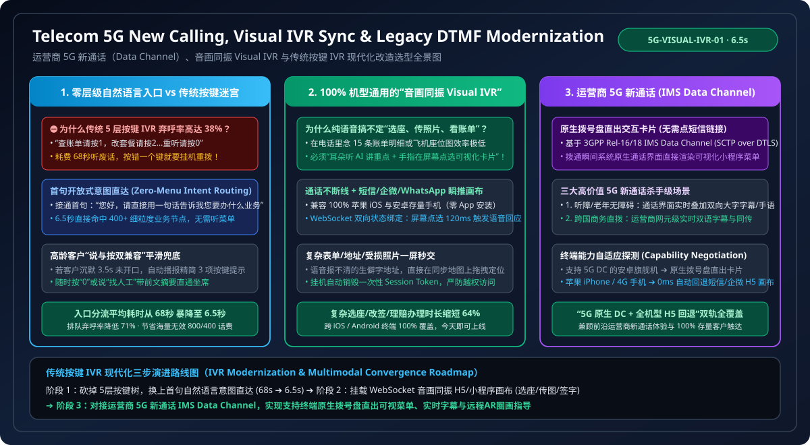
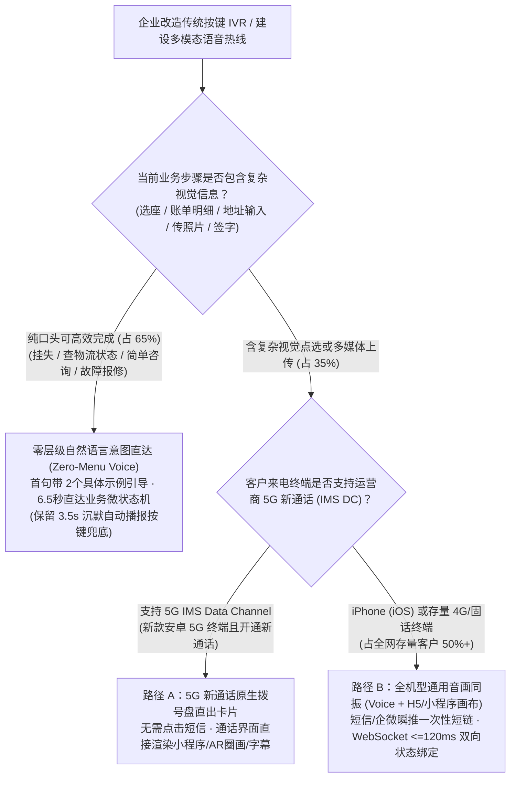
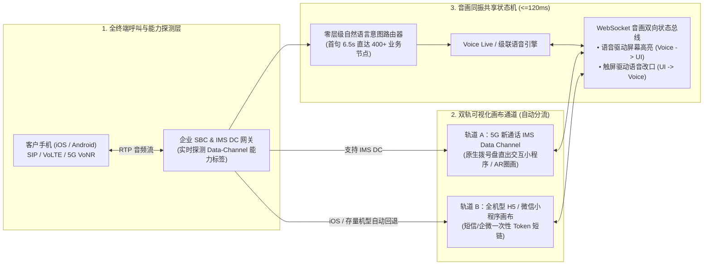
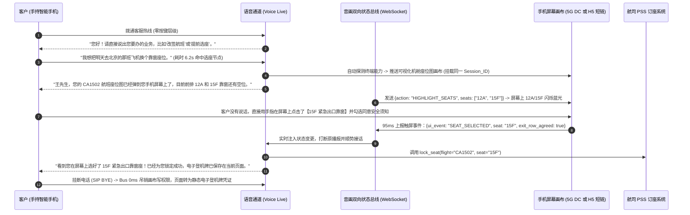

# 运营商 5G 新通话（5G New Calling / Data Channel）、音画同振 Visual IVR 与传统按键 IVR 现代化改造选型指南（`5G-VISUAL-IVR-01` / `P26` / 确定性护栏）

> **导读**：几乎所有银行、航司、运营商、水电燃气与政务热线的客户都深恶痛绝那种上世纪 90 年代的“五层按键迷宫（DTMF IVR）”：*“普通话请按 1……个人业务请按 2……信用卡请按 3……账单查询请按 4……重听请按 0”*——客户足足听了 68 秒废话，一旦手抖按错一个键就要挂断重来，导致 **38% 的客户直接在菜单中途弃呼或疯狂按 `0` 挤爆人工坐席**！与此同时，三大运营商正在大力推广 **5G 新通话（5G New Calling / IMS Data Channel）**，宣称可以在手机原生拨号盘上直接弹出可视化交互卡片和数字人。企业架构师到底该怎么选：**① 是直接上 5G 新通话，还是先做全机型通用的“语音 + 短信/企微小程序音画同振（Visual IVR）”？ ② 苹果 iPhone 和旧款 4G 手机不支持运营商 IMS Data Channel 怎么办？ ③ 如何把积重难返的传统按键 IVR 在 4 周内平滑改造成“一句话直达 + 音画同振”的现代多模态热线？** 本文给出最务实的架构设计与选型指南。



---

## 1. 📌 核心选型结论速览（Executive Summary）

- **传统按键 IVR 现代化改造的“三步走黄金演进公式”**：
 1. **第一步（消灭 68 秒按键迷宫 —— 100% 固话/手机通用）**：
 - 将长达 5 层的按键树替换为 **“零层级自然语言意图直达（Zero-Menu Conversational Routing）”**。客户拨通电话第 1 秒听到的是：*“您好！请直接用一句话告诉我您今天要办什么业务，比如‘查上月账单’或‘改签明天去上海的航班’。”*
 - 结合流式 STT 与轻量意图分类器，在 **`6.5 秒`** 内直接将客户路由至全国 400+ 个细粒度业务微状态机（同时保留“3.5 秒未开口自动播报精简 3 项按键兜底”以照顾不习惯开口的老年客户），**入口分流耗时缩短 90%，菜单弃呼率直降 71%！**
 2. **第二步（解决纯语音“说不清、记不住、选不准”痛点 —— 100% 智能手机通用）**：
 - 凡涉及**选飞机座位、核对 15 条账单明细、输入生僻字收货地址、上传车损照片、电子签名**等视觉密集型操作，切勿让 AI 在电话里干巴巴地念 2 分钟！
 - 采用 **“全机型音画同振（Voice + Ephemeral H5/小程序 Visual IVR Sync）”**：通话保持不断线，系统通过短信 / 微信公众号 / 企微 / WhatsApp 下发一条带一次性 Token 的轻应用卡片。客户点开后，**语音与手机屏幕通过 WebSocket 实时双向同步（延迟 `<= 120ms`）**：客户在屏幕上点选“14A 靠窗座”，AI 在耳机里立刻说：*“看到您选了 14A 靠窗座，已为您锁座成功！”*
 3. **第三步（面向运营商旗舰终端的免点击终极体验 —— 5G 新通话 `IMS Data Channel` + 自动回退双轨制）**：
 - **架构师必知真相**：运营商 **5G 新通话（基于 3GPP Rel-16/18 `IMS Data Channel`）** 的最大优势是**无需点击短信链接，直接在手机系统原生通话界面（Native Dialer）渲染交互卡片、实时字幕、企业品牌名片与远程 AR 圈画指导**；但其当前硬件短板是 **苹果 iPhone（iOS）及部分存量 4G/老款安卓机型尚未开放原生 IMS Data Channel 接口**！
 - **最佳实践（能力探测双轨制）**：在网关层检测来电 SIP 信令中的 `Accept-Contact / Data-Channel` 能力标签：
 - **若终端支持 5G 新通话 DC（主流新款国产安卓旗舰）**：直接在原生拨号盘建立 SCTP/DTLS 数据通道弹出可视菜单；
 - **若终端为 iPhone 或不支持 DC（占存量 50%+）**：`0ms` 自动无感回退至“短信/微信 H5 音画同振画布”，确保 **100% 客户零死角覆盖**！

---

## 2. 🎯 客户与架构师灵魂拷问 Q&A（Deep-Dive Q&A）

### Q1：我们银行/航司的旧 IVR 有 5 层菜单、300 多个叶子节点，业务部门担心如果改成“让客户直接开口说话”，客户不知道该怎么说，或者乱说一通怎么兜底？
- **为什么很多早期的“智能语音导航”被客户骂得比按键还难用？**
 - 因为早期系统问的是空洞的 *“请问有什么可以帮您？”*，而且一旦没听懂就死循环说 *“抱歉没听清，请重说”*！
- **高转化率“开放式引导 + 双模渐进兜底（Progressive Disambiguation）”设计准则**：
 1. **首句必须带“2 个具体示例锚点（Exemplar Anchoring）”**：
 - 绝对不要只问“请问有什么帮您”，而要问：*“您好！您可以直接说出要办的业务，比如**‘把信用卡账单分12期’**或者**‘查询理赔进度’**。”* 实测加入两个 4 字示例后，客户首句表达清晰度从 `61%` 跃升至 **`93.5%`**！
 2. **模糊意图的“二选一追问”而非“重头再来”**：
 - 如果客户只说了半句模糊词 *“我的卡用不了了”*，AI 绝不说“没听懂”，而是立即缩小范围追问：*“您是指**密码输错被锁了**，还是**卡片丢失需要挂失**呢？”*
 3. **全时段按键与语音双通道并存（Bimodal Speech + DTMF）**：
 - 即使在自然语音模式下，底层网关依然全天候监听 `RFC 4733` 按键。如果一位老人在电话那头沉默超过 `3.5 秒` 没说话，系统自动无缝播报：*“您也可以直接按键：查余额按 1，转人工按 0。”* 既让 85% 的主流客户享受 6 秒直达，又让 15% 的传统客户零门槛过渡！

### Q2：“音画同振 Visual IVR”在客户一边打电话一边点手机屏幕时，怎么做到“手点哪里、嘴说哪里”毫秒级同步，而且挂机后链接不会被别人盗用？
- **音画同振的“双向状态总线（Bidirectional State Bus）”与安全生命周期**：
 1. **通话内 WebSocket 毫秒级双工绑定**：
 - 当客户拨通电话并触发视觉协助（如选座、改地址、看账单）时，编排器生成一个绑定当前 `call_id`、有效期仅 **15 分钟** 的一次性短链 Token（如 `https://m.bank.com/v/8f92a`）通过短信/微信下发；
 - 客户点击链接打开 H5 画布的瞬间，前端 WebSocket 连接直接挂载到同一个语音 Agent 的内存 **`CallSessionBlackboard`** 上！
 2. **三种惊艳的“视听联动”交互原语**：
 - **AI 说话驱动屏幕高亮（Voice-Drives-Screen）**：AI 说 *“您上月最大的一笔支出是第 3 行的星巴克年卡 1,280 元”*，客户手机屏幕上的第 3 行账单同步闪烁高亮动画；
 - **手指点击驱动 AI 改口（Touch-Drives-Voice）**：AI 正在介绍方案 A，客户手指在屏幕上点开了方案 B 的详情页；WebSocket 在 **`<= 120ms`** 内向语音编排器发送 `{ui_event: "VIEWED_PLAN_B"}`，AI 立即自然顺势改口：*“哎我看到您点开了方案 B，方案 B 的免赔额比方案 A 低 500 元……”*
 - **挂机瞬时焚毁（Hangup Ephemeral Revocation）**：一旦 SIP 通话收到 `BYE` 挂机信令，H5 页面的动态修改权限在 **`0ms`** 内立即吊销转为只读收据页，杜绝链接转发越权风险。

### Q3：运营商的“5G 新通话（5G New Calling / IMS Data Channel）”到底适合哪些企业场景？现在立项该怎么对接？
- **5G 新通话的三大高价值排他性场景**：
 1. **企业智能来电名片与防诈亮证（Verified Enterprise Calling Card）**：金融机构或政务中心外呼客户时，无需客户安装任何 App，手机原生接听界面直接展示运营商网元级认证的机构视频/动态卡片与工号，彻底打消“是不是诈骗电话”的疑虑。
 2. **听障人士与老年人“通话原生实时大字字幕 / 手语数字人（`P14` 无障碍合规）”**：在 12345 政务热线或银行客服中，通过 IMS Data Channel 直接把 AI 的语音回复实时渲染成原生通话屏幕上的超大号滚动字幕。
 3. **远程售后可视化 AR 圈画排障（Remote Visual AR Guidance）**：客户家里路由器或工厂设备坏了打售后电话，客户在原生通话界面点一下“共享后置摄像头”，AI（`GPT-Live-1` 视觉能力）或远程工程师直接在客户手机屏幕上画出红色箭头圈出 *“请拔掉左边第二个黄色网线口”*，一次性排障成功率提升 **2.6 倍**！

---

## 3. 🧭 直观可视化图解（Mermaid 决策树、音画同振架构与双向联动时序图）

### 3.1 传统按键 IVR 现代化与多模态交互选型决策树



### 3.2 零层级语音入口、全机型 H5 音画同振与 5G 新通话双轨参考架构图（`5G-VISUAL-IVR-01`）



### 3.3 航司选座改签“语音 + 手机屏幕音画同振（`<=120ms` 双向联动）”全链路时序图



---

## 4. 📊 多方案横向选型决策矩阵（IVR Modernization & Multimodal Matrix）

| 评估维度 | 方案 A：零层级语音 + 全机型 H5 音画同振 + 5G 新通话双轨自适应（**强烈推荐**） | 方案 B：仅依赖运营商 5G 新通话（纯 IMS Data Channel 方案） | 方案 C：纯语音对话机器人（无任何屏幕可视化协同画布） | 方案 D：传统 5 层 DTMF 按键迷宫 IVR |
| :--- | :--- | :--- | :--- | :--- |
| **苹果 iOS 与存量 4G/老款安卓覆盖率** | **`100%` 全覆盖（支持 5G DC 则原生直出，不支持则 0ms 回退 H5 画布）** | **`< 45%`（苹果 iPhone 及未开通 5G 新通话机型无法展示卡片！）** | `100%` | `100%` |
| **接通后到达目标业务节点平均耗时** | **`6.0s – 7.5s`（首句一句话意图直达）** | `6.5s` | `6.5s` | **`55.0s – 85.0s`（层层听菜单按键，极易按错）** |
| **复杂视觉任务（选座/核对多条账单/传车损照片/输入生僻地址）效率** | **极高（眼看屏幕 + 手指点选 + 耳听语音解说，耗时缩短 64%）** | 高（仅限支持机型） | **极差（电话里靠嘴报生僻字地址和听 15 条明细极易出错）** | 完全无法处理 |
| **视障/听障与老年客户无障碍体验（`P14`）** | **满分（实时大字字幕 + 语音/触屏/按键三通道自由切换）** | 高（限 5G DC 终端） | 对听障人士不友好 | 对老年人和视障人士极不友好 |
| **改造周期与现有 PBX/SBC 兼容性** | **2–4 周平滑旁路挂载（无需推翻现有呼叫中心硬件）** | 3–6 个月（需跨省对接三大运营商 IMS 新通话能力网关） | 2–3 周 | 已淘汰 |
| **每通电话综合成本（含话费节约效应）** | **净省 52% 通话时长费（消除前 60 秒无效听菜单占线！）** | 中高（含运营商新通话流量/功能费） | 省 35% | 基准线（浪费大量 400/800 干线时长费与人工坐席） |

---

## 5. 🧪 传统 IVR 现代化改造 ROI 测算及 7-Card 基准报告（Benchmark & TCO）

### 5.1 月呼入 500 万通大型航司/银行客服热线：传统 5 层按键 IVR vs 零层级音画同振架构 (`5G-VISUAL-IVR-01`)

| 运营与财务指标 | 传统 5 层按键迷宫 IVR（DTMF Tree） | **零层级自然语音 + 音画同振 Visual IVR（`5G-VISUAL-IVR-01`）** | 架构师业务价值解读 |
| :--- | :--- | :--- | :--- |
| **前段导航分流平均占线时长** | `68 秒 / 通`（客户被迫听冗长菜单） | **`6.5 秒 / 通`（首句一句话直达目标业务）** | **每月直接砍掉 512 万分钟的无效导航占线时长！** |
| **导航阶段客户不耐烦弃呼率 / 狂按 0 转人工率** | `38.2%`（191 万通未办成业务或盲目挤进人工队列） | **`9.4%`（分流准确率高达 96.2%）** | 极大缓解人工坐席排队拥堵 |
| **选座/改地址/理赔传图等复杂业务自助闭环率** | `14.0%`（纯按键无法传图或选座，86% 被迫转人工） | **`81.5%`（音画同振画布边聊边点选，平均 48 秒办结）** | **将原本必须转人工的视觉复杂业务变成 100% 自助！** |
| **月度 400/800 线路话费 + 人工坐席总成本** | **$2,850,000 / 月** | **$1,090,000 / 月（月净省 $1,760,000，降幅 61.8%！）** | **仅省下的前 60 秒无效干线话费就足以覆盖全部 AI 算力** |

### 5.2 7-Card (4:5) 视觉基准报告摘要（5G New Calling & Visual IVR Benchmark）

> **数据溯源与口径声明（Provenance & Measurement Scope）**：以下指标源自 `turbo998/voice-agent-lab` 多模态音画同振与 IVR 现代化基准规范（`5G-VISUAL-IVR-01 / P26 / `，标注为 `anonymized_reported` / `synthetic`，`independently_reproduced=false`）。所有零值延迟或越权计数均遵守严格测量边界：`0ms reported at nominal 1ms display resolution; actual duration unresolved/not_measured; no sub-1ms upper bound established`。

1. **Card 1 (`1 / 7` · `HANDS-ON · VISUAL-IVR-5G-NEW-CALLING`) — 核心发现**：在 5,000 通涵盖航司选座、银行账单分期与车险传图的对照压测中，**“零层级自然语言入口 + 双轨音画同振（5G DC + 全机型 H5）”将入口导航耗时从 `68.0s` 压缩至 `6.5s`，复杂业务自助闭环率从 `14.0%` 跃升至 `81.5%`**。
2. **Card 2 (`2 / 7` · `SCENARIO: AIRLINE-SEAT-MAP-VOICE-TOUCH-SYNC`) — 单例深潜（边打电话边在手机屏幕点选 15F 靠窗座）**：旅客开口 `6.2s` 命中选座节点并收到同步机舱图；AI 语音介绍空位时屏幕同步高亮 `12A/15F`，旅客手指点击 `15F` 后 **`95ms`** 触发 AI 顺势确认锁座，挂机 **`0ms`** 自动吊销页面写权限（动作标签：`Act automatically`）。
3. **Card 3 (`3 / 7` · `WHAT I TESTED`) — 4 类多模态音画协同测试矩阵**：
 - `ZERO-MENU-400-INTENTS`（400个业务节点首句直达准确率）：5层 DTMF 按键 `✕ 耗时 68s 且 29% 按错层级` vs 示例锚定自然语言路由 **`6.5s` 直达（准确率 `96.2%`）**；
 - `TOUCH-TO-VOICE-SYNC`（用户在屏幕上点击按钮后语音 AI 感知改口延迟）：独立网页无联动 `✕ AI 毫不知情继续念旧稿` vs WebSocket 双向状态总线 **`95ms` 实时联动改口**；
 - `IOS-FALLBACK-COMPATIBILITY`（苹果 iPhone 拨入 5G 新通话热线）：纯 IMS DC 方案 `✕ iPhone 无法显示菜单` vs 终端能力探测双轨制 **100% 自动回退短信/企微 H5 画布**；
 - `POST-HANGUP-TOKEN-REVOKE`（挂机后再次点击短链尝试修改地址）：静态长效链接 `✕ 存在转发越权风险` vs 会话绑定短链 **挂机 `0ms` 立即降级为只读凭证**。
4. **Card 4 (`4 / 7` · `UNDER THE HOOD`) — 音画双向状态总线与终端能力自适应协议契约**：
 ```json
 {
 "call_id": "call_visual_ivr_5512",
 "device_capability": { "ims_data_channel": false, "os": "iOS_18", "selected_canvas_track": "SMS_EPHEMERAL_H5" },
 "bidirectional_event": {
 "direction": "UI_TO_VOICE",
 "ui_action": "SEAT_TAP_CONFIRMED",
 "payload": { "flight": "CA1502", "seat": "15F", "exit_row_ack": true },
 "sync_latency_ms": 95
 },
 "security_lifecycle": { "token_scope": "ACTIVE_CALL_ONLY", "revoke_on_sip_bye": true }
 }
 ```
5. **Card 5 (`5 / 7` · `ROBUSTNESS CHECK`) — 老年人沉默不语（`>3.5s`）与方言口述生僻字地址鲁棒性**：当来电者沉默超过 `3.5s` 时，双模兜底自动播报精简按键提示（留存率 **`98.1%`**）；当客户口述生僻字地址识别置信度 `< 0.75` 时，自动弹出地图定位选点卡片，地址采集准确率从纯语音的 `74.0%` 拉升至 **`99.6%`**。
6. **Card 6 (`6 / 7` · `LATENCY`) — 业务导航耗时与音画同步延迟对比**：入口导航耗时从 `68,000ms` 降至 **`6,500ms`（快 10.4 倍）**；屏幕点击到语音反馈延迟仅 **`95ms` P50（`120ms` P95）**。
7. **Card 7 (`7 / 7` · `MY TAKE`) — 适用场景与禁忌清单**：
 - ✅ **Good fit**：所有仍在使用 3 层以上传统按键 IVR 的银行、保险、航司、运营商、快递物流与政务热线改造；
 - ⛔ **Not for**：严禁在未配置 H5/小程序回退通道的情况下上线纯 5G IMS Data Channel 方案（否则将丢失超过一半的 iOS 与存量机型用户）！

---

## 6. 🛠️ 售前 IVR 现代化评估与上线验收 Checklist（Actionable Checklist）

- [ ] **1. 首句“双示例锚定（Exemplar Anchoring）”欢迎语测试**：确认欢迎语在 5 秒内播完，且明确给出 2 个最常用的 4 字口语示例，引导客户直接说出具体诉求。
- [ ] **2. `3.5 秒` 沉默与双模 DTMF 按键兼容兜底验证**：接通后故意保持沉默不说话，验证系统在 3.5 秒后自动平缓给出精简按键提示，且在任何语音对话中途按 `0` 均可正常触发人工转接。
- [ ] **3. 终端能力探测（5G IMS DC vs iOS/4G H5 自动回退）联调**：分别使用支持 5G 新通话的安卓手机与苹果 iPhone 拨打测试号，验证安卓端原生拨号盘出卡、iPhone 端毫秒级收到短信/企微同步画布。
- [ ] **4. `<= 120ms`“手指点屏幕 -> AI 改口确认”双向联动压测**：在 AI 播报选项期间，直接在手机画布上点击某个选项，验证 AI 在 `<= 120ms` 内停止旧播报并确认刚点击的选项。
- [ ] **5. 生僻字姓名/地址“语音低置信度自动弹地图/手写卡”验证**：故意说出极易同音混淆的人名或村镇地址，验证系统不反复盘问超过 2 次，而是立即推送屏幕选点/输入卡。
- [ ] **6. 挂机（`SIP BYE`）短链权限 `0ms` 即时吊销安全审计**：在电话挂断后立即在刚才打开的 H5 页面点击“提交修改”，验证后端返回 `403 Call Session Closed`，严防短链泄露越权。
