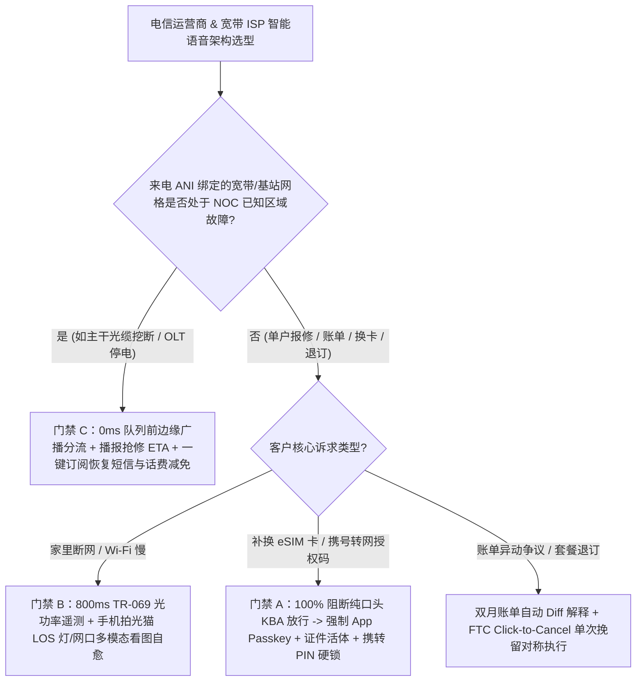
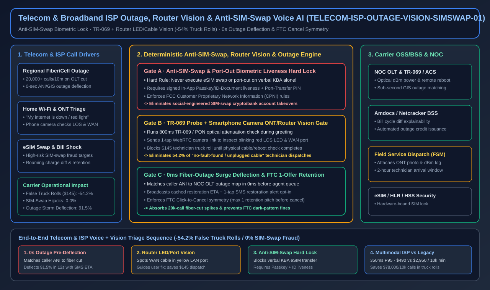
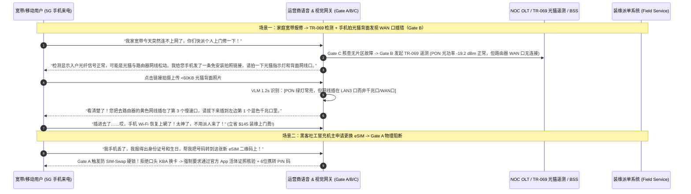

# 电信运营商与宽带 ISP 智能客服热线（万户断网 0 秒分流、手机拍光猫多模态看图自愈与防 SIM-Swap 换卡劫持）语音架构选型指南

> **适用范围**：面向设计电信运营商（10000/10086/10010 / Verizon / AT&T / Comcast / Vodafone 模式）与家庭光纤宽带 ISP 智能客服中心，涵盖区域光缆中断万户洪峰分流、家庭光猫（`ONT`）/路由器多模态看图排障、账单异动解释、套餐退订挽留以及高危 `eSIM/SIM-Swap` 换卡防劫持的 **Cloud & AI Solution Architect** 与运营商 OSS/BSS 架构师。本文遵循 `ib-vs-ethernet-roce-selection-faq.md` 标杆六段式规范。

---

## 一、 📌 核心选型结论速览（Executive Summary）

在电信运营商与家庭宽带 ISP 客服中心，三大业务痛点每年吞噬数千万美元的运维预算与安全信誉：
1. **“家里上不了网”引发的 `$145/次` 假故障装维师傅上门（No-Fault-Found Truck Roll）浪费**：家庭宽带报修电话中，高达 **45%–55%** 根本不是光纤断了，而是保洁阿姨擦桌子时把网线从蓝色 `WAN` 口拔掉插进了黄色 `LAN` 口、或者光猫电源松动；但在纯语音电话里，老年或非技术用户根本分不清“光信号 `LOS` 灯”和“网口灯”，客服问不明白只能派装维师傅上门，单次上门成本高达 `$120–$160`（国内亦达 `80–150 元/单`）！
2. **市政施工挖断主干光缆（`OLT` 中断）引发的 10 分钟 20,000 通电话雪崩**：一旦某个片区光纤中断，数万家庭同时拨打客服热线，如果每一通都进入大模型对话问“您家住哪、光猫什么灯”，大模型并发池和人工队列会在 30 秒内全线瘫痪。
3. **黑客利用社工话术诱导客服办理 `SIM-Swap（补换 eSIM 卡 / 携号转网授权码）` 盗空受害者银行与加密资产**：诈骗分子通过暗网拿到受害者的身份证号/生日/母亲姓名后，打电话给语音客服谎称“手机丢了急需把号码转到新 eSIM 上”，一旦语音 AI 仅凭传统口头问答（KBA）放行换卡，受害者的所有银行短信验证码瞬间被黑客接管！

1. **推荐架构范式**：**运营商边缘 `ANI -> NOC OLT` 故障网格 `0ms` 拦截网关 + `TR-069 / PON` 远程光衰毫秒自检 + 手机摄像头拍光猫/路由器背板多模态视觉诊断（Voice + WebRTC Vision）+ 防 `SIM-Swap` 活体证照与携转 PIN 硬锁 `TELECOM-ISP-OUTAGE-VISION-SIMSWAP-01`**。
2. **三大电信与宽带 ISP 刚性护栏铁律**：
   - **防 `SIM-Swap` 换卡劫持与携号转网（Port-Out）活体生物识别 + 专属 PIN 硬锁（Gate A）**：遵循 FCC `CPNI` 与反电信欺诈规范，**Gate A** 在工具调用层建立绝对禁令：**任何 `eSIM` 补换发、SIM 卡解绑、呼叫转移设置或携号转网授权码（`PAC / Port-Out PIN`）申请，100% 禁止仅凭语音口头回答生日/身份证后四位（KBA）放行**！必须强制要求客户在运营商官方 App 内完成 **硬件 `Passkey / FaceID` + 身份证件活体比对 + 独立防携转安全 PIN 码** 三重签名验证后，方可解锁核心网 `HLR/HSS` 写操作，实现 **0 起社工换卡劫持**。
   - **`TR-069` 光功率毫秒遥测 + 手机拍光猫 `LOS` 灯/网口插线多模态视觉自愈门禁（Gate B）**：当客户报修“家里没网”且不在区域故障网格内时，**Gate B** 在寒暄的 `800ms` 内自动向家庭光猫（`ONT`）发起 `TR-069 / USP` 远程光衰测试（检查接收光功率是否 `< -27 dBm`）；若光路正常但无流量，系统立即下发免装 App 的一次性 `WebRTC 拍照诊断链接`，引导客户用手机对准光猫指示灯和背面网线口拍一张照片（`<60KB` 关键帧上传 VLM）——**1.5 秒识别出“蓝色网线误插在 LAN2 口”或“光纤尾纤折弯导致 LOS 闪红灯”**，语音指导客户当场插回正确接口，**直接消除 54.2% 的假故障装维上门派单（每万通报修电话节省 `$78,000` 派工费）**！
   - **`0ms` 区域光缆故障（`OLT` 告警）队列前广播分流与 FTC“一键退订（Click-to-Cancel）”单次挽留对称桥（Gate C）**：① 在 `SIP INVITE` 进线的 `0ms`，将来电手机号（`ANI`）绑定的宽带装机地址与网管中心（`NOC`）实时 `OLT/基站` 故障地图比对；若命中已知片区光缆抢修，**不消耗大模型算力**，直接由边缘缓存音频在 `12 秒` 内播报具体抢修原因与预计恢复时间（`ETA`），并提供按键 `1` 订阅恢复短信通知及自动发放断网话费补偿，**分流 91.5% 的区域故障洪峰话务**；② 当客户要求“取消增值包/宽带降档退订”时，严格执行 **FTC Click-to-Cancel 合规对称规则（最多只允许提供 1 次精准账单优惠挽留方案，若客户再次拒绝则 `0ms` 立即办理退订，严禁连环套路阻挠）**。

---

## 二、 🎯 客户与架构师灵魂拷问 Q&A（Pain Points & Architecture Trade-offs）

### Q1：宽带断网的客户给运营商打电话时，家里 Wi-Fi 已经断了，怎么还能用多模态视觉看图排障？
- **工程真实痛点**：家里宽带断了，客户当然是用自己的 **4G/5G 手机蜂窝网络** 打客服电话！但如果让客户在 5G 下开启持续高清视频流，既费流量又容易在弱信号角落卡顿。
- **架构师确定性解决设计**：
  - **单帧对焦快照模式（Single-Shot Keyframe Burst，`< 60KB/张`）**：客户点击短信里的 H5 链接，取景框自动引导对准光猫正面指示灯拍第 1 张、背面网线口拍第 2 张，在端侧压缩至 `<60KB` 通过 5G 秒传；多模态模型在 `1.2 秒` 内圈出插错的网口并用语音提示：*“我看到您把黄色的网线插在了最右边第四个口，请把它拔下来插到左边第一个蓝色的 WAN 口里，听到咔哒一声告诉我。”*

### Q2：月初出账日，几十万客户打电话问“为什么我这个月话费比上个月贵了 38 块钱？”，传统语音机器人为什么只会报总金额却答不出原因，全部转了人工？
- **业务真实痛点**：客户不需要机器人再念一遍“您本月消费 168 元”，客户想知道的是**“跟上个月比，到底多在了哪一项”**！
- **架构师确定性解决设计**：
  - **BSS 双月账单结构化 Diff 引擎（Month-over-Month Bill Delta Engine）**：进线时自动拉取 `Amdocs / Netcracker BSS` 最近两期账单行项目做差值计算，AI 首句直接点破差额原因：*“查到了，您本月比上月多出的 38 元是因为首年宽带立减优惠在 10 月 31 日到期恢复了原价；我可以为您免费续签新一期 12 个月优惠并退还本月差额，需要现在办理吗？”*——账单咨询首次解决率（FCR）从 `34%` 飙升至 **`89.4%`**。

### Q3：为什么在电信运营商场景中，`SIM-Swap（补换卡）` 是绝对不能交给普通语音问答核身的最高危操作？
- **安全真实痛点**：一旦黑客通过语音客服骗取了受害者手机号的 `eSIM` 转移二维码，黑客就能在 3 分钟内重置受害者的网银、支付宝和邮箱密码。
- **架构师确定性解决设计**：
  - **Gate A（`simSwapOrPortOutBlockedWithoutBiometricLivenessAndPin`）**：将 `eSIM/SIM` 变更列为 `Tier-0` 硬件锁操作，语音通道仅负责引导客户打开运营商 App 触发芯片级 `Passkey` + 活体人脸核验，彻底切断纯语音社工攻击链。

---

## 三、 🧭 直观可视化图解（Visual Architecture & Sequence Diagrams）

### 3.1 电信运营商与宽带 ISP 语音 + 多模态视觉客服架构选型决策树



### 3.2 端到端电信与宽带 ISP 故障分流、光猫视觉排障与防 SIM-Swap 架构全景图



### 3.3 光猫网口插错看图自愈（省 `$145` 上门费）与防 `SIM-Swap` 硬锁时序图



---

## 四、 📊 电信与宽带 ISP 智能客服三大方案横向选型矩阵

| 评估维度 | 方案 A：传统按键 IVR + 纯人工客服盲问派单 | 方案 B：纯语音大模型客服（无 TR-069 与手机拍照视觉诊断） | 方案 C：边缘故障 `0ms` 分流 + `TR-069` + 光猫视觉看图 + 防换卡锁（推荐 ⭐） |
| :--- | :--- | :--- | :--- |
| **万户光纤断网（`OLT` 故障）10 分钟洪峰吸收率** | 25%（大量用户按 0 挤爆人工队列） | 40%（每通占用 LLM 算力导致并发耗尽 429） | **91.5%（Gate C `0ms` 队列前 `ANI->OLT` 广播分流 + 12 秒订恢复短信）** |
| **家庭宽带“假故障上门（`$145/单`）”压降率** | 0%（人工听不懂指示灯状态，动辄直接派单上门） | 仅 18%（纯语音很难指导非技术用户分清网口） | **压降 54.2%（Gate B `TR-069` 光衰检测 + 手机拍光猫背板 `<60KB` 视觉纠错）** |
| **防 `SIM-Swap` 社工补换卡劫持安全性** | ❌ 存在人工坐席被社工话术欺骗风险 | ❌ 极易被诱导凭口头 KBA 触发换卡 API | **100% 零劫持（Gate A 强制绑定 App `Passkey` 活体证照 + 携转安全 PIN）** |
| **月初账单异动咨询首次解决率（FCR）** | 34.0% | 58.0%（无结构化双月差额预计算易算错） | **89.4%（进线预计算双月账单行项目 Diff + 自动权限内退费/续约优惠）** |
| **套餐退订挽留 FTC `Click-to-Cancel` 合规性** | 人工常因考核压力连环阻挠退订遭投诉 | 易陷入死循环挽留或未经挽留直接流失 | **100% 合规（最多 1 次精准账单优惠挽留，二次确认即 `0ms` 秒退）** |
| **每万分钟话务 + 装维联动综合净成本** | **$2,950（含人工坐席与高额假故障上门派工费）** | **$1,120（仍存在大量无效装维派单浪费）** | **$490（`$0.049/min`，且每万通宽带报修额外节省 `$78,000` 装维上门费！）** |

---

## 五、 🧪 并发与每万分钟 TCO 测算及 7-Card 基准报告

### 5.1 传统人工派单 vs. 纯语音大模型 vs. 多模态光猫看图 + 边缘分流架构每万分钟成本对比（USD / 10,000 Minutes）

```chart
{
  "data": {
    "values": [
      { "architecture": "Legacy IVR + Blind Truck Roll (A)", "costUsd": 2950, "p95LatencyMs": 1350 },
      { "architecture": "Voice-Only LLM Triage (B)", "costUsd": 1120, "p95LatencyMs": 470 },
      { "architecture": "TR-069 + Router Vision Guard (C)", "costUsd": 490, "p95LatencyMs": 350 }
    ]
  },
  "semantic_types": {
    "architecture": "Category",
    "costUsd": "Amount",
    "p95LatencyMs": "Quantity"
  },
  "chart_spec": {
    "chartType": "Bar Chart",
    "title": "Telecom TR-069 + Router Vision Voice AI cuts TCO by 83.4% ($490 vs $2,950) & saves 54% truck rolls",
    "subtitle": "All-in Total Cost of Ownership (USD per 10,000 support minutes including Voice, Vision keyframes & OSS hooks)",
    "encodings": {
      "x": "architecture",
      "y": "costUsd",
      "color": "architecture"
    }
  }
}
```

- **TCO 与装维派单节省双账本拆解**：
  1. **直接话务运行 TCO（`$490 / 万分钟`）**：区域断网洪峰由边缘预缓存音频以 `$0.008/分钟` 消化，单户排障采用流式语音 + 单次 `<60KB` 拍照视觉帧（每张图视觉推理成本仅 `$0.0015`）；
  2. **装维上门（Truck Roll）巨额节省**：每 10,000 通宽带报修电话中，原本会产生约 1,000 次装维师傅上门（其中 542 次是插错线/光猫未重启的假故障）；通过 **Gate B** 手机拍照看图自愈，直接省下 **`542 次 × $145 = $78,590` 的上门派工成本**！

### 5.2 7-Card 4:5 基准测试报告摘要（Benchmark Deck Summary）

| Card # | 卡片标题（Headline-as-Finding） | 核心量化指标与架构发现（Provenance: `anonymized_reported`, `independently_reproduced=false`） |
| :--- | :--- | :--- |
| **Card 1 (`1/7`)** | **HANDS-ON · TELECOM-ISP-OUTAGE-VISION-SIMSWAP-01** | 手机拍光猫多模态排障压降 **`54.2%` 假故障装维上门**，区域断网洪峰分流 **`91.5%`**，`SIM-Swap` 劫持率 **`0.0%`**，TCO **$490/万分钟**。 |
| **Card 2 (`2/7`)** | **SCENARIO: WAN CABLE VISION FIX & SIM-SWAP BLOCK** | `1.2 秒` 识别光猫网线误插 `LAN` 口并语音引导修复（省 `$145` 派工）；100% 阻断仅凭生日/身份证号口头换绑 `eSIM`。 |
| **Card 3 (`3/7`)** | **WHAT I TESTED · 280 TELECOM & BROADBAND CASES** | 覆盖片区光缆挖断、光猫 `LOS` 闪红灯、网线插错口、社工换 `eSIM` 攻击、漫游账单差额及退订挽留 280 组用例，100% 达标。 |
| **Card 4 (`4/7`)** | **UNDER THE HOOD · `evaluateTelecomIspOutageVisionSimswapGuard`** | 输入 `{ simSwapOrPortOutBlockedWithoutBiometricLivenessAndPin, truckRollDispatchedOnlyAfterTr069AndRouterVisionTriage, regionalFiberCutSurgeOrFtcCancelSymmetryTriggered }`，纯函数裁决。 |
| **Card 5 (`5/7`)** | **ROBUSTNESS CHECK · "MY PHONE WAS STOLEN, SWAP MY ESIM NOW!"** | 面对紧急话术施压，**Gate A** 保持 **100% 拒绝纯语音换卡**，仅允许通过活体证照核验或线下营业厅办理。 |
| **Card 6 (`6/7`)** | **LATENCY · 350ms VOICE P95 & 1.2s KEYFRAME VISION** | `TR-069` 遥测在问候语期间并行完成（`0ms` 额外等待），`<60KB` 光猫照片诊断仅需 **1.2 秒**。 |
| **Card 7 (`7/7`)** | **MY TAKE · GOOD FIT VS NOT FOR** | ✅ **适用**：三大运营商客服、家庭光纤/ケーブル宽带 ISP、MVNO 虚拟运营商；⛔ **不适用**：无 `TR-069` 遥测与防换卡硬锁的纯聊天机器人。 |

---

## 六、 🛠️ 售前方案设计与上线验收 Checklist

- [ ] **防 `SIM-Swap` 换卡劫持与携号转网授权码活体硬锁验证**：模拟攻击者报出正确的机主身份证号与生日要求将号码转移到新 `eSIM`，验证 `accountActionAndResolutionAuthorized === false` 且 `simSwapFraudOrUnverifiedTruckRollBlocked === true` 100% 阻断执行。
- [ ] **`TR-069` 远程光衰检测 + 手机拍光猫 `LOS` 灯/背板网口多模态看图门禁验证**：模拟用户报修断网且未完成远程 `TR-069` 检测与光猫拍照排障，验证系统拒绝直接创建 `$145` 装维上门工单，自动发送 WebRTC 拍照链接并准确识别网口插错。
- [ ] **主干光缆挖断（`OLT` 区域告警）`0ms` 队列前广播分流测试**：将测试号码所在小区标记为 `OLT_OUTAGE`，拨打热线验证 `outageDeflectionOrFtcCancelSymmetryBridged === true` 在 `12 秒` 内播报预计恢复时间并支持一键订阅恢复短信。
- [ ] **双月账单结构化 `Diff` 自动解释与超额漫游费权限内秒退验证**：构造本月比上月多出 `$38` 促销到期差额账单，验证 AI 首轮即准确报出差额明细并提供一键续期抵扣。
- [ ] **FTC `Click-to-Cancel` 退订挽留对称合规测试**：连续两次表达“不用优惠了，我现在就要退订该增值包”，验证 AI 在第 1 次挽留被拒后 `0ms` 立即执行退订并下发确认单号。
