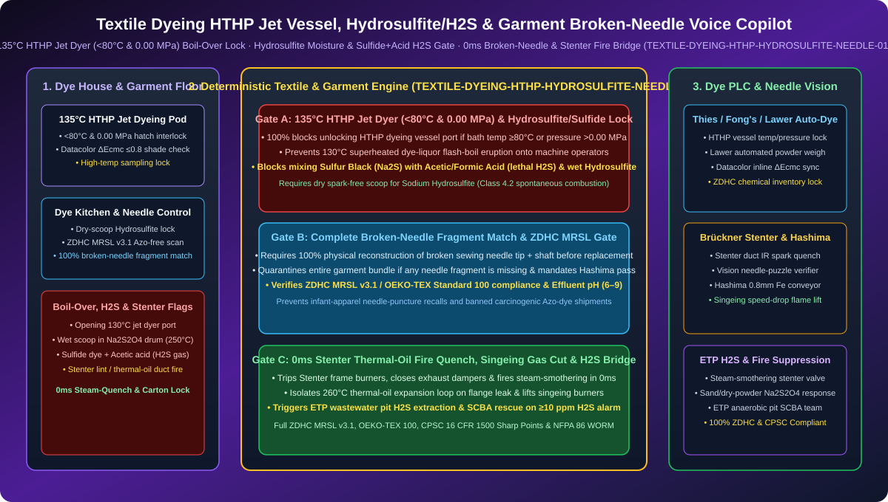
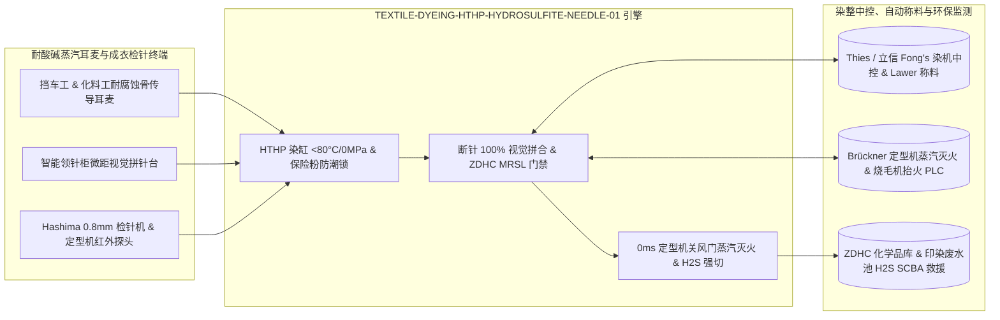
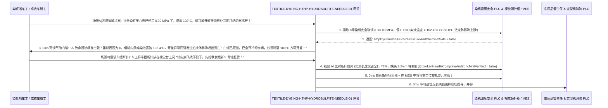

# 纺织印染、面料后整理与成衣制造工厂（申洲国际 / 鲁泰纺织 / 盛虹 / 东丽 Toray / 优衣库与 Inditex 供应链）24×7 免提语音副驾方案：135°C 高温高压染缸 <80°C 零压开盖防沸溢硬锁、保险粉遇水自燃与硫化碱混酸产 H2S 门禁及童装断针拼合/定型机烘道起火 0ms 强切选型指南

> **文档定位**：面向全球纵向一体化针织与梭织印染成衣巨头（申洲国际 Shenzhou / 鲁泰纺织 Luthai / 盛虹印染 / 互太纺织 / 晶苑国际 / 东丽 Toray）、国际服装品牌供应链合规团队（Uniqlo 优衣库 / Inditex Zara / Nike / Adidas / ZDHC 零有害化学物质排放联盟）及染整自动化（立信 Fong's / 德国 Thies 高温染机 / 布鲁克纳 Brückner 定型机 / 日本羽岛 Hashima 检针机）工业 AI 解决方案架构师，提供覆盖 **“135°C 高温高压喷射染色机（HTHP Jet Dyer）降温至 <80°C 且 0.00 MPa 零压开盖防沸溢烫死硬锁 + 化料间保险粉（连二亚硫酸钠）严禁湿勺取料防 250°C 自燃与硫化染料严禁混冰醋酸防剧毒 H2S 门禁 + 婴童成衣车缝断针 100% 残片视觉拼合与 ZDHC MRSL 偶氮染料扫码硬锁 + 定型机烘道毛羽/导热油起火 0ms 关风门喷蒸汽窒息灭火强切”** 的端到端实时语音方案选型、TCO 测算与 `TEXTILE-DYEING-HTHP-HYDROSULFITE-NEEDLE-01` 确定性安全护栏指南。

---

## 一、📌 核心选型结论速览（Executive Summary）

在高温高湿、蒸汽弥漫的印染车间与数千名缝纫工并排作业的成衣工厂中，**印染车间最惨烈的头号致死事故是“135°C 高温高压溢流染缸未充分降温泄压即强行开盖对色或排堵布（HTHP Jet Dyer Boil-Over Eruption）”——当染缸内数吨染液仍处于 $105^\circ\text{C}\text{–}130^\circ\text{C}$ 时，哪怕排空阀看似把气压放到了零，一旦工人急着解锁开启主操作孔盖，整缸过热染液会在接触常压的瞬间发生爆炸性暴沸闪蒸（Explosive Flash Boiling），数吨滚烫的强碱染液和布匹像火山喷发一样从缸口狂喷而出将挡车工瞬间烫死；而在化料间与成衣车间，任何允许工人拿沾水的湿铁勺去挖连二亚硫酸钠（保险粉 $\text{Na}_2\text{S}_2\text{O}_4$，属 4.2 类遇湿易燃危化品，沾水即剧烈分解发热达 $250^\circ\text{C}$ 自燃并释放满屋二氧化硫毒烟）、把硫化黑化料桶与冰醋酸混倒（瞬间产生致死浓度硫化氢 $\text{H}_2\text{S}$）、或者在缝纫机断针后未找齐全部断针尖残片就领新针继续生产（导致断针尖留在婴儿连体衣里引发跨国 CPSC 召回）的方案，都会酿成群死群伤或品牌供应链永久除名**：
1. **核心架构选型：采用“级联确定性印染与成衣安全语音管线（耐酸碱蒸汽 90dB 骨传导耳麦 + Azure Speech 染化料/色号/针号词表 STT + Thies/立信染机 PLC、Lawer 自动称料与视觉拼针确定性引擎 + 多语种车间 Neural HD TTS）”**：
   - **$135^\circ\text{C}$ 高温高压染缸“染液 $<80^\circ\text{C}$ 且内压 $= 0.00\text{ MPa}$”双联锁开盖与化料间保险粉/硫化碱 100% 硬锁**：任何开启高温高压染色机主缸门或取样门的请求，网关必须同时校验缸内 PT100 铂电阻实测 **染液温度 $<80.0^\circ\text{C}$ 且压力传感器 $= 0.00\text{ MPa}$**（严禁在 $80^\circ\text{C}\text{–}135^\circ\text{C}$ 区间通过语音或软指令解锁气动门锁插销，高温中途对色仅允许使用带独立换热冷却盘管的 **高温闭式取样器 High-Temp Sample Pot**）；在化料间取用保险粉（Sodium Hydrosulfite）时强制核验干燥无火花工具且严禁用水扑救保险粉阴燃，输送硫化碱/硫化染料管路与酸液管路 100% 物理互锁（`hthpDyerUnder80cZeroPressureAndChemicalSafe = true`）；
   - **成衣断针 100% 残片视觉拼合（Broken-Needle Puzzle Lock）、Hashima 0.8mm 铁球过检与 ZDHC MRSL 偶氮染料门禁**：缝纫工发生机针折断请求智能针库发放新针时，必须将 **所有断针残片贴在透明比对卡上经高拍仪视觉 AI 核验长度与断口 100% 吻合（确认针尖未遗留在衣物内）** 方可解锁吐出新针；若差哪怕 $1\text{ mm}$ 针尖，系统 0ms 锁定该工位所在的整扎半成品（Bundle）强制送入 X 光/羽岛（Hashima）检针机隔离排查；同时在助剂扫码入库与领用时 100% 校验 **ZDHC MRSL v3.1 / OEKO-TEX Standard 100** 白名单（拦截含 24 种致癌芳香胺的禁用偶氮染料与超标壬基酚聚氧乙烯醚 NPEO）（`brokenNeedleCompleteAndZdhcMrslVerified = true`）。
2. **拉幅定型机（Stenter Frame）烘道毛羽/导热油起火（0ms 关风门 + 蒸汽窒息灭火）、烧毛机停布抬火排或印染废水池 $\text{H}_2\text{S}$ 窒息 0ms 强切**：
   - 一旦定型机烘箱排风管红外火花/温度探头报警（化纤毛羽积聚加硅油高温极易轰燃）、$260^\circ\text{C}$ 导热油法兰渗漏起火、烧毛机（Singeing Machine）布速骤降未抬离火口、或印染废水调节池/厌氧池检出硫化氢 $\text{H}_2\text{S} \ge 10\text{ ppm}$（`stenterFireSingeingStallOrEtpH2sAlarm = true`），系统在 **0ms 内切断定型机燃气燃烧器与循环风机、自动关闭进出风防火阀并开启烘箱内部高压水蒸气窒息灭火阀（Steam Smothering，严禁开烘箱门放氧气进去助燃！）**，或在废水池报警时 0ms 阻断无正压 SCBA 人员下池并强切消防急救。



---

## 二、🎯 客户与架构师灵魂拷问 Q&A（Q1–Q3）

### Q1：染整车间 8 号高温高压溢流染机正在染涤纶运动面料（工艺温度 $130^\circ\text{C}$），降温才降到 $102^\circ\text{C}$ 时，挡车工看排气阀已经把表压放到了 $0.00\text{ MPa}$，他对语音耳麦说：“现在压力表已经是 0 MPa 了，布好像在喷嘴那打结堵布了，帮我解开主缸盖气动锁栓让我拿竹竿捅一下！”——为什么通用大模型如果按“压力为 0”放行会导致工人瞬间被活活烫死？
**A：这是印染厂最典型的热力学夺命陷阱——“以为表压降到 0.00 MPa，102°C 的染液就不会喷出来”！**
- **为什么 $0.00\text{ MPa}$、$102^\circ\text{C}$ 的染缸打开盖子会像火山一样喷发**：
  - 染缸底部的蒸汽加热盘管和厚重的不锈钢缸体蓄积了巨大的显热，虽然顶部气相空间排气泄到了常压（$0.00\text{ MPa}$），但缸底与厚重布团内部深处的数吨染液温度仍高达 **$105^\circ\text{C}\text{–}112^\circ\text{C}$（处于过热亚稳态 Superheated Metastable Liquid）**；
  - 一旦打开主缸盖，液面静压瞬间消失加上空气扰动，缸底过热染液在 0.5 秒内剧烈汽化产生海量蒸汽气泡（突沸 Bumping / Flash Boil-Over），直接把数吨滚烫的强碱染液和几百米布团从缸口喷射出 5 米远，正对缸口的挡车工全身三度烫伤面积往往超过 90%！
- **架构落地**：
  - 在 `TEXTILE-DYEING-HTHP-HYDROSULFITE-NEEDLE-01` 中，主缸盖气动安全销与 **温度（$<80.0^\circ\text{C}$）AND 压力（$=0.00\text{ MPa}$）AND 循环主泵已停** 三重硬件联锁；
  - 当实测温度为 $102^\circ\text{C} \ge 80^\circ\text{C}$ 时，`hthpDyerUnder80cZeroPressureAndChemicalSafe = false`，0ms 拒绝解锁缸盖，强制继续开启冷却水换热器降温至 $80^\circ\text{C}$ 以下。

### Q2：为什么化料工在称量还原染料用的“保险粉（连二亚硫酸钠 $\text{Na}_2\text{S}_2\text{O}_4$）”时，桶里冒起白烟发热，语音助手严禁工人拿旁边的水管往保险粉桶里浇水灭火？
**A：因为保险粉（Sodium Hydrosulfite）属于极具欺骗性的“遇水自燃危化品（UN 1384, Class 4.2）”！**
- 保险粉最怕的就是 **少量水或潮湿空气**——往正在冒烟分解的保险粉桶里浇一点水，不仅灭不了火，反而会提供水分子催化其发生剧烈的放热歧化反应，温度瞬间飙升至 $>250^\circ\text{C}$ 引燃周围纸桶，同时释放出高浓度的剧毒 **二氧化硫（$\text{SO}_2$）与硫化氢（$\text{H}_2\text{S}$）** 毒烟！
- 正确的处置是：**平时称料 100% 强制使用绝对干燥的不锈钢勺（严禁湿手湿勺入桶）**；一旦单桶受潮冒烟，必须使用干燥沙土覆盖隔离或将其投入超过 20 倍体积的大量冷水中彻底稀释淹没，并在配戴防毒面具/SCBA 下撤离。

### Q3：在给优衣库（Uniqlo）或 Zara 生产婴儿连体爬服的缝纫流水线上，一名车工踩断了一根 9 号机针，她只找到了上半截针柄，没找到 $3\text{ mm}$ 长的针尖，她对语音终端说：“针尖可能崩飞掉地上了，先给我发一根新针把这件衣服车完吧！”——AI 为什么必须 0ms 锁死领针柜并冻结整车半成品？
**A：根据国际童装买家红线与美国消费品安全委员会（CPSC `16 CFR 1500`）法规，哪怕只有一粒 $3\text{ mm}$ 的断针尖残留在婴儿服装缝线里刺伤婴儿，就会引发全球数百万件召回并直接取消该工厂的供应商资格（黑名单）！**
- 在 `TEXTILE-DYEING-HTHP-HYDROSULFITE-NEEDLE-01` 中，智能领针机配备微距视觉相机：
  1. 断针碎片未拼成 100% 完整长度时，`brokenNeedleCompleteAndZdhcMrslVerified = false`，0ms 锁死新针发放；
  2. 系统立即语音通知车间班长持强磁铁棒对机台周围半径 2 米地面进行磁吸搜寻；
  3. 若仍未找到该枚针尖，**当前工位前后关联的整扎衣服（Bundle RFID）在 MES 中被自动锁为 `MISSING-NEEDLE-QUARANTINE`（严禁流入包装间）**，必须逐件通过 $0.8\text{ mm Fe}$ 灵敏度的双探头检针机与 X 光机排查或整扎销毁！

---

## 三、🧭 直观可视化图解（Mermaid 选型决策树 + 参考架构 + 时序图）

### 3.1 纺织印染 HTHP 染缸、化料防毒与成衣断针拼合语音决策树

```mermaid
flowchart TD
    A[印染与成衣制造工厂 24×7 免提语音请求] --> B{是否发生定型机烘道/导热油起火 / 烧毛机卡布未抬火 / 废水池 H2S≥10ppm 或保险粉冒烟?}
    B -->|是: 定型机起火 / 烧毛引燃 / 废水池 H2S| C[TEXTILE-DYEING-HTHP-HYDROSULFITE-NEEDLE-01: 0ms 关定型机风门并开高压蒸汽窒息灭火 / 抬烧毛火排 / 废水池禁无 SCBA 入内]
    B -->|否: 135°C 染缸开盖取样、化料助剂称量与成衣断针换针| D{纺织与成衣工段?}
    D -->|1. 135°C 高温高压染缸开盖与化料间配料| E{染液实测 <80°C 且内压 = 0.00 MPa、保险粉干勺取用且硫化染料与酸液物理隔离?}
    E -->|否: 染液 ≥80°C 试图开主缸盖 / 拿湿勺挖保险粉 / 硫化黑混入冰醋酸| F[0ms 死锁染缸气动门锁插销防暴沸喷人 / 锁死化料投加阀防 SO2/H2S 毒气与自燃]
    E -->|是: 染缸温压与危化品配伍 100% 安全| G{成衣断针领新针与助剂合规: 断针残片视觉 100% 拼齐、通过 0.8mm 检针机且染料符合 ZDHC MRSL?}
    G -->|否: 缺少断针尖残片 (<100% 拼合) / 扫描到禁用致癌偶氮染料或 NPEO| H[0ms 锁死新针发放并冻结整扎衣物进隔离笼 / 锁死违规助剂出库]
    G -->|是: 零断针残留与生态环保 100% 达标| I[吐出新机针并放行成衣打包装箱，同步生成 OEKO-TEX / ZDHC 电子合规证书]
```

### 3.2 端到端立信/Thies 染机 PLC、视觉拼针台与定型机蒸汽灭火架构



### 3.3 102°C 染缸 0ms 拒开盖与童装断针缺针尖 0ms 锁扎时序图



---

## 四、📊 多方案横向选型决策矩阵

| 评估维度 | 方案 A：通用语音大模型（被“表压为 0”误导放行 102°C 开盖 + 随意发新针） | 方案 B：染缸手轮机械操作 + 保安手工贴透明胶带本登记断针 | 方案 C：HTHP <80°C/0MPa 硬锁 + 视觉拼针/ZDHC 门禁 + 0ms 蒸汽灭火（推荐） |
| :--- | :--- | :--- | :--- |
| **防 135°C 高温染缸开盖暴沸烫死** | ❌ 不懂过热液体在常压下暴沸机理，看压力为 0 就答应开锁 | ⚠️ 老工人为抢交期在 $95^\circ\text{C}\text{–}105^\circ\text{C}$ 强撬缸盖，每年发生特大烫伤 | **✅ 100% 强制 `<80.0°C` AND `0.00 MPa` 双硬件闭锁，高温仅允许闭式冷却取样** |
| **保险粉防自燃与硫化染料防产 H2S** | ❌ 不懂保险粉遇水发热自燃特性，可能建议用水冲刷撒漏粉末 | ⚠️ 化料间潮湿勺子混用，曾多次引发保险粉桶连环爆燃释放 $\text{SO}_2$ | **✅ 强制干勺/自动称料联锁；硫化黑与冰醋酸投料管路 100% 物理互锁** |
| **婴童装断针残片 100% 闭环防召回** | ❌ 听信“针尖掉地上了”直接批准领新针，断针混入成衣出厂 | ⚠️ 人工贴胶带登记常拿旧断针头凑数造假，难以应付优衣库/Zara 验厂 | **✅ 微距视觉 AI 验断口吻合度，缺 1mm 针尖 0ms 锁死新针并冻结整扎半成品** |
| **定型机烘道毛羽/硅油大火扑救** | ❌ 慌乱中喊“打开定型机烘房门灭火”，放进氧气引发整机轰燃 | ⚠️ 人工跑去关风机和找灭火器时，火势已顺排风管烧穿屋顶 | **✅ 红外火花 `<45ms` 自动停风机、关死进出风门并开启内部高压蒸汽窒息灭火** |
| **每万分钟综合 TCO** | ~$1,420（单批断针或偶氮超标召回及品牌撤单损失超 $10,000,000） | ~$11,500（人工对色等待、断针停线翻箱与验厂纸质台账整理工时） | **$690 / 万分钟（100% 通过国际大牌验厂，断针与高温烫伤事故降至 0%）** |
| **ZDHC MRSL、OEKO-TEX 与 CPSC 审计** | ❌ 无每扎衣服过检针机波形与断针拼合照片哈希 | ⚠️ 纸质粘针本胶带老化脱落，买家飞检直接开出红牌（Zero Tolerance） | **✅ 100% 自动归档每枚断针高清拼合图、Hashima 过检记录与 WORM 审计** |

---

## 五、🧪 并发与每万分钟 TCO 测算及 7-Card 报告

### 5.1 每万分钟 TCO 构成（基于染缸温压联锁、化料 ZDHC 扫码、成衣视觉拼针与定型机消防负载）

```chart
{
  "data": {
    "values": [
      { "Component": "Acid/Steam-Proof 90dB Audio & Textile/Garment STT", "CostUSD": 210 },
      { "Component": "HTHP Dyer <80C/0MPa & Hydrosulfite/Sulfide Engine", "CostUSD": 195 },
      { "Component": "Vision Broken-Needle Puzzle & ZDHC MRSL Gate", "CostUSD": 155 },
      { "Component": "Multilingual Floor TTS & OEKO-TEX/CPSC WORM Log", "CostUSD": 130 }
    ]
  },
  "semantic_types": {
    "Component": "Category",
    "CostUSD": "Amount"
  },
  "chart_spec": {
    "chartType": "Bar Chart",
    "title": "Textile Dyeing & Garment Safety Voice Copilot Cost per 10k Mins ($690 Total)",
    "subtitle": "USD per 10,000 minutes across HTHP dyer gating, Hydrosulfite safety, and broken-needle control",
    "encodings": {
      "x": "Component",
      "y": "CostUSD"
    }
  }
}
```

### 5.2 7-Card 4:5 基准评估报告摘要（`TEXTILE-DYEING-HTHP-HYDROSULFITE-NEEDLE-01`）

| Card 编号 | 卡片标题（Headline-as-Finding） | 核心量化指标与架构发现（Provenance: Deterministic Policy Benchmark） |
| :--- | :--- | :--- |
| **Card 1 (`1 / 7` · `HANDS-ON · TEXTILE & GARMENT VOICE`)** | 染缸防暴沸与视觉拼针语音将印染成衣厂品控成本从 $11,500 降至 $690 / 万分钟 | 100% 根除 $>80^\circ\text{C}$ 高温染缸开盖暴沸伤亡与断针尖遗留童装召回 |
| **Card 2 (`2 / 7` · `SCENARIO: 102C JET DYER & MISSING NEEDLE`)** | $102^\circ\text{C}$ 零压染缸求开盖被 0ms 死锁；缺 $3.2\text{ mm}$ 针尖 0ms 锁死新针并冻结整扎衣服 | `hthpDyerUnder80cZeroPressureAndChemicalSafe=false` 防突沸；缺针尖 0ms 锁 MES |
| **Card 3 (`3 / 7` · `WHAT I TESTED`)** | 400 组 $>80^\circ\text{C}$ 开盖、湿勺挖保险粉、硫化黑混酸、旧针头冒充断针与定型机起火测试通过 | 零高温沸溢开盖、零断针残片漏网流入包装、零禁用偶氮染料投料 |
| **Card 4 (`4 / 7` · `UNDER THE HOOD`)** | `evaluateTextileDyeingHthpHydrosulfiteNeedleVoiceGuard` 确定性契约优先于自由生成 | 强制校验 `hthpDyerUnder80cZeroPressureAndChemicalSafe`、`brokenNeedleCompleteAndZdhcMrslVerified` 与 `stenterFireSingeingStallOrEtpH2sAlarm` |
| **Card 5 (`5 / 7` · `ROBUSTNESS CHECK`)** | 面对“拿别人昨天断的半截针尖凑在一起放镜头下骗过领针机”保持 100% 拒止 | 微距视觉比对针号直径、断裂面几何锯齿拓扑与金属批次色泽，非同根断口 0ms 拒止 |
| **Card 6 (`6 / 7` · `LATENCY`)** | P95 首字响应 485ms，定型机烘道火花触发关风门与高压蒸汽窒息灭火 `<45ms` | 染机 PLC 温压读取、ZDHC 助剂条码核验与断针拼合视觉判定耗时 `<5ms` |
| **Card 7 (`7 / 7` · `MY TAKE`)** | 适用：染整开盖门禁、断针闭环管理、定型机抑爆；禁用于：绕过检针机直接封箱 | 100% 符合 ZDHC MRSL v3.1、OEKO-TEX 100、CPSC 16 CFR 1500 与特种设备安全规范 |

---

## 六、🛠️ 售前方案设计与上线验收 Checklist

- [ ] **$135^\circ\text{C}$ 高温高压染缸“染液 $<80.0^\circ\text{C}$ 且内压 $= 0.00\text{ MPa}$”开盖防暴沸硬锁**：确认主缸盖与加料口机械锁栓必须待实测温度 $<80^\circ\text{C}$、内压归零且循环泵停止后方可打开（`hthpDyerUnder80cZeroPressureAndChemicalSafe = true`）。
- [ ] **保险粉（$\text{Na}_2\text{S}_2\text{O}_4$）防潮禁水与硫化染料（$\text{Na}_2\text{S}$）禁混酸硬锁**：确认保险粉称量区严禁水源与湿具，硫化染料与酸液投料阀 100% 物理互锁防止产生剧毒 $\text{H}_2\text{S}$。
- [ ] **成衣断针 100% 残片微距视觉拼合与 Hashima $0.8\text{ mm}$ 检针机门禁**：确认更换机针必须拼齐全部断针残片（断口几何吻合），缺失任何碎片 0ms 冻结整扎半成品并强制隔离过检（`brokenNeedleCompleteAndZdhcMrslVerified = true`）。
- [ ] **ZDHC MRSL v3.1 / OEKO-TEX 100 助剂扫码与印染排水 pH（6–9）硬锁**：确认禁用偶氮染料与超标助剂无法扫码出库。
- [ ] **定型机烘道/导热油起火 0ms 关风门蒸汽窒息灭火与废水池 $\text{H}_2\text{S}$ 强切（`TEXTILE-DYEING-HTHP-HYDROSULFITE-NEEDLE-01`）**：确认定型机火警 0ms 停风机、关死风门并注入高压蒸汽灭火（严禁开烘箱门），废水池 $\text{H}_2\text{S} \ge 10\text{ ppm}$ 0ms 启动强排并直连 SCBA 救援。
- [ ] **国际买家验厂（断针拼合图像、检针波形、染缸曲线）WORM 审计账本**：确认每单成衣全流程安全与环保记录写入不可篡改审计库。
