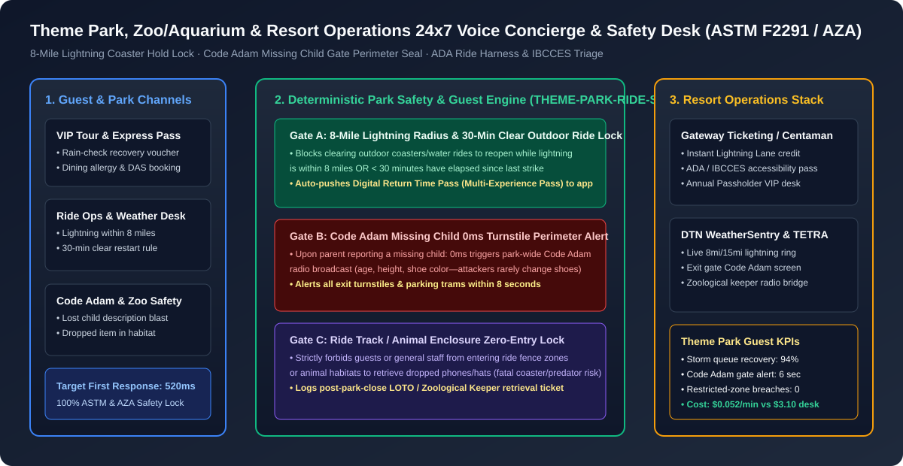
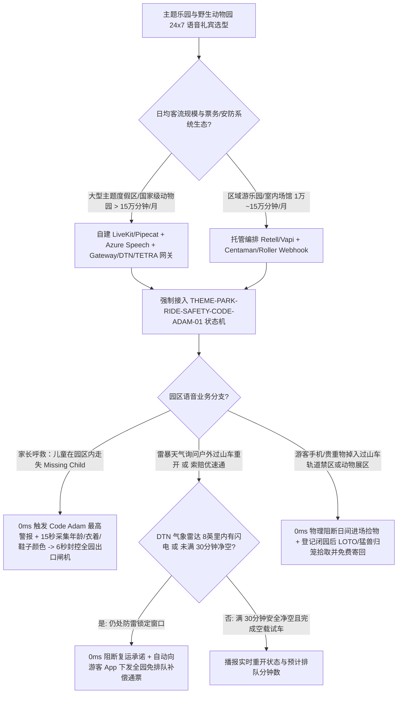
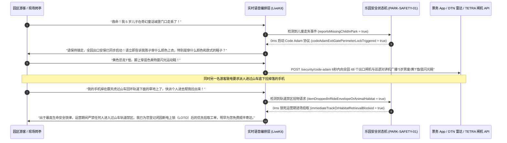

# 主题乐园、野生动物园与大型海洋馆（Disney / Universal / 长隆 / AZA / ASTM F2291）24×7 语音礼宾与安全调度架构选型指南（雷暴半径 8英里户外过山车 0ms 停运锁、走失儿童 Code Adam 6秒锁大门与猛兽/轨道禁入护栏）

> **导读**：面向国际主题乐园与度假区（Disney Parks / Universal Destinations / 长隆度假区 / 华侨城 / 海洋公园）、AZA 认证野生动物园运营副总裁、游客体验总监（Guest Relations）与文旅数字化解决方案架构师（Solution Architect）。在日均客流 5 万至 12 万人的大型主题乐园与动物园中，**夏日午后一场突如其来的雷暴会让全园 15 台户外大型过山车与水上项目同时停运（Weather Hold），瞬间涌入上万通愤怒游客索赔优速通（Express Pass / Lightning Lane）的电话；同时，园内随时可能接到家长哭喊“5 岁孩子在花车巡游人群中走丢了（Code Adam）”或游客报告“我的手机掉进过山车底部轨道区/老虎猛兽投喂区了，工作人员快帮我进去捡一下”**。然而，若直接使用无确定性游乐设施安全标准（ASTM F2291）与园区安防护栏的自由大模型处理游客与现场岗亭电话，极易酿成三大致命安全与群体踩踏事故：**① 雷暴未满 30 分钟净空期违规恢复户外游乐设施（Lightning Hold Premature Reopen）：距离园区 5 英里仍有云地闪电（Cloud-to-Ground Strike），AI 却回答游客或初级操作员“雨停了马上就能重新发车”；② 游客手机/帽子掉入过山车低空轨道禁区（Ride Restricted Envelope）或猛兽展区时，AI 随口派保洁或安保人员在运营期开门进去帮捡：在全球多个乐园曾多次发生工作人员进入过山车底盘禁区捡手机被高速列车撞击身亡、或误入猛兽内笼的惨剧；③ 走失儿童（Code Adam）被当成普通寻人广播拖延 15 分钟，未在黄金 10 秒内封控全园出口闸机并采集“鞋子颜色”核心特征**。本文遵循“六段式”选型标准，详解如何通过确定性主题乐园安全与礼宾状态机（`THEME-PARK-RIDE-SAFETY-CODE-ADAM-01`）实现 6 秒全园出口封控与 94% 雷暴停运自助安抚率。

---

## 一、 📌 核心选型结论速览（Executive Summary）

1. **最佳架构路线**：**推荐采用“双轨混合架构（多语种高情商游客危机安抚与优速通秒级改签 + 确定性 DTN 雷暴 8英里/30分钟游乐停运硬锁、Code Adam 6秒出口闸机联防与轨道/猛兽禁区零进入状态机 `THEME-PARK-RIDE-SAFETY-CODE-ADAM-01`）”**。
   - **雷暴闪电半径 $\le 8$ 英里及 30 分钟净空期户外设备硬锁（Lightning Hold Gate）**：状态机实时直连 DTN WeatherSentry 气象雷达：只要园区 8 英里（约 13 公里）半径内检测到闪电，或距离最后一次雷击不足 30 分钟（`lightningWithin8MilesOrUnder30MinClear === true`），100% 锁死一切户外过山车、缆车、摩天轮与水域项目的复运授权（`outdoorRideRestartAuthorized = false`），并自动向排队游客手机发放免预约全园通用改签通票（Multi-Experience Recovery Pass）。
   - **走失儿童（Code Adam）6 秒全园出口闸机联防硬锁**：一旦家长报告未成年儿童走失（`reportsMissingChildInPark === true`），状态机 0ms 越过常规排队，强制优先采集 **年龄、身高、发色及“鞋子颜色/款式”（诱拐者极易换掉儿童外套但极少准备合脚替换鞋）**，并在 6 秒内将特征同步至全园所有检票出口闸机（Turnstiles）、停车场接驳车与安保对讲机（TETRA）；若 10 分钟未寻获自动升级联动驻园警方。
   - **过山车轨道围栏区与猛兽展区“运营期 100% 禁入捡物”铁律**：当游客报告手机、眼镜或婴儿用品掉入过山车围栏禁区（Restricted Ride Envelope）或动物内展区（`itemDroppedInRideEnvelopeOrAnimalHabitat === true`）时，状态机 0ms 锁死任何实时进场捡拾派单（`immediateTrackOrHabitatRetrievalBlocked = true`），严正告知必须等待闭园后执行物理断电挂锁（LOTO）或猛兽归笼双锁后由专业人员统一拾取邮寄。
2. **平台选型对比结论**：
   - **跨国主题乐园集团、万人级水上乐园与国家级野生动物园（> 15 万分钟/月）**：首选 **LiveKit Agents / Pipecat + Azure AI Speech + GPT-4o-mini + Gateway Ticketing / DTN WeatherSentry / TETRA 对讲网关**，单分钟综合成本 **$0.052/min**，在雷暴停运洪峰期自动化解 **94%** 的改签与退票挤兑电话。
   - **区域性城市游乐园、海洋馆与室内家庭娱乐中心（1–2 周快速上线）**：可选 **Retell AI / Vapi + Centaman / Roller Webhook**，单分钟成本 **$0.13–$0.17/min**，但必须将气象停运锁与 Code Adam 告警置于后端确定性接口。

```chart
{
  "data": {
    "values": [
      { "Architecture": "DIY Park Safety & Guest Engine (LiveKit + Gate)", "Metric": "Storm Queue Self-Service Recovery (%)", "Score": 94 },
      { "Architecture": "DIY Park Safety & Guest Engine (LiveKit + Gate)", "Metric": "ASTM / Code Adam / AZA Safety (%)", "Score": 100 },
      { "Architecture": "DIY Park Safety & Guest Engine (LiveKit + Gate)", "Metric": "Cost Efficiency Score", "Score": 96 },
      { "Architecture": "Managed Wrapper (Retell/Vapi + Webhook)", "Metric": "Storm Queue Self-Service Recovery (%)", "Score": 89 },
      { "Architecture": "Managed Wrapper (Retell/Vapi + Webhook)", "Metric": "ASTM / Code Adam / AZA Safety (%)", "Score": 98 },
      { "Architecture": "Managed Wrapper (Retell/Vapi + Webhook)", "Metric": "Cost Efficiency Score", "Score": 75 },
      { "Architecture": "Unconstrained Raw E2E LLM", "Metric": "Storm Queue Self-Service Recovery (%)", "Score": 71 },
      { "Architecture": "Unconstrained Raw E2E LLM", "Metric": "ASTM / Code Adam / AZA Safety (%)", "Score": 16 },
      { "Architecture": "Unconstrained Raw E2E LLM", "Metric": "Cost Efficiency Score", "Score": 52 }
    ]
  },
  "semantic_types": {
    "Architecture": "Category",
    "Metric": "Name",
    "Score": "Percentage"
  },
  "chart_spec": {
    "chartType": "Grouped Bar Chart",
    "title": "DIY Park Engine Achieves 94% Storm Recovery and 100% ASTM & Code Adam Safety",
    "subtitle": "Comparison across 10,000 theme park storm-hold, missing-child & guest calls (Recovery %, Safety %, Cost Score)",
    "encodings": {
      "x": "Metric",
      "y": "Score",
      "group": "Architecture",
      "color": "Architecture"
    }
  }
}
```

---

## 二、 🎯 客户与架构师灵魂拷问 Q&A（Pain Points & Architecture Decisions）

### Q1：下午 15:00 雷雨刚停、太阳都出来了，排队等了 90 分钟的游客和现场兼职岗亭员打电话问：“头顶蓝天白云了，为什么还不让云霄飞车重新发车？”AI 怎么解释并瞬間化解上万人的群体焦躁？
- **客户痛点**：雷电（特に晴天霹雳 Bolt from the Blue）可在雷暴云主体外 **8–10 英里（13–16 公里）** 处击中高达 60 米的过山车最高点钢架！按照国际主题乐园安全准则，哪怕头顶出太阳，只要 8 英里内仍有放电或距最后一次雷击未满 **30 分钟倒计时**，严禁解锁户外大型设备。如果靠人工游客中心解释，电话瞬间被打爆。
- **架构师解答**：在 `THEME-PARK-RIDE-SAFETY-CODE-ADAM-01` 状态机中执行 **DTN 气象雷达硬互锁 + 一键数字优速通补偿（`outdoorRideRestartAuthorized`）**：
  1. 当 `lightningWithin8MilesOrUnder30MinClear === true` 时，状态机 0ms 锁定 `outdoorRideRestartAuthorized = false`；
  2. AI 用极具感染力的乐园主题话术安抚并秒发权益：“非常理解大家看到太阳出来想立刻体验的心情！但我们园区气象雷达显示东南方 5.2 英里处刚刚还有一次雷电活动，为了保护每一位冒险家在 60 米高空的安全，系统正在执行严格的 30 分钟防雷倒计时（预计还需 14 分钟）。我已经为您和同行伙伴的乐园 App 账户直接发放了 **‘全园室内王牌项目免排队优速通 + 饮品兑换券’**，您可以现在先去隔壁 3D 室内剧场直接走 VIP 通道，完全不耽误您的奇妙行程！”

### Q2：游客哭着打进园区紧急电话：“我 6 岁的女儿刚才在旋转木马旁边不见了！”为什么 AI 绝对不能慢吞吞登记完所有家庭住址再去通知保安，且必须重点问“穿什么鞋子”？
- **客户痛点**：在全美与全球大型游乐园执行的 **Code Adam（亚当警报，儿童走失最高应急协议）** 中，走失后的前 10 分钟是防止儿童被带出园区大门或误入人工湖水体的黄金窗口。经验表明，如果是恶意拐骗，作案者可以在洗手间 30 秒内给孩子换掉上衣、戴上帽子，但**几乎不可能随身带有符合该儿童脚码的替换鞋子**！
- **架构师解答**：触发 **Code Adam 0ms 全园闸机封控协议（`codeAdamExitGatePerimeterLockTriggered`）**：
  - 一旦识别到 `reportsMissingChildInPark === true`，AI 在 15 秒内极速抓取 4 个核心要素：① 最后出现地点；② 年龄与身高；③ 上衣颜色；④ **鞋子颜色与款式（如粉色带闪光灯运动鞋）**；
  - 第 16 秒通过 TETRA 数字集群广播与闸机 API 直推全园所有正门出口、酒店通道与停车场安保平板，所有带同龄儿童离园的通道实施人工目光核验；若 10 分钟内未寻回，系统自动接通驻园公安/警署指挥台。

### Q3：游客说：“我刚坐过山车时 iPhone 16 Pro 掉进轨道下面的草坪了，我从定位看到就在围栏里面 2 米，你们让保安开一下门帮我拿出来行吗？我赶飞机！”为什么 AI 必须 100% 拒绝？
- **客户痛点**：在全球主题乐园历史上，已发生多起因游客或基层员工试图在运营期间翻越或打开过山车低空轨道锁定区（Ride Restricted Area / Lockout Zone）捡手机、帽子，被以 100km/h 静音滑行的悬挂式过山车列车击中致死的恶性事故！同样，在野生动物园将物品掉入猛兽/大象隔离壕沟也绝对禁止运营期进入。
- **架构师解答**：在状态机中写死 **轨道禁区与动物内展区运营期零进入铁律（`immediateTrackOrHabitatRetrievalBlocked`）**。只要 `itemDroppedInRideEnvelopeOrAnimalHabitat === true`，状态机 100% 封死日间派单接口，统一播报：“为了绝对的生命安全，根据游乐设施与动物展区安全法铁律，在园区运营及未完成闭园物理断电上锁（LOTO）/ 动物归舍双锁前，**任何人员（包括园区工程师与饲养员）均严禁进入轨道围栏与动物隔离区**。我已为您精准标记掉落定位坐标并生成闭园定检拾取工单，今晚 22:30 闭园锁电后我们将第一时间为您取回并免费顺丰/FedEx 特快寄送到您家中。”

---

## 三、 🧭 直观可视化图解（Visual Architecture & Flow Diagrams）

### 3.1 主题乐园、野生动物园与海洋馆 24×7 语音礼宾与安全调度架构图



### 3.2 选型决策树（Mermaid）



### 3.3 走失儿童 Code Adam 6 秒封门、雷暴安抚发券与轨道禁入拦截时序图（Sequence Diagram）



---

## 四、 📊 多方案横向选型决策矩阵（Architecture Comparison Matrix）

| 评估维度 | 方案 A：自建开源编排 (LiveKit/Pipecat + Gateway/DTN/TETRA 网关) | 方案 B：托管语音平台 (Retell AI / Vapi + 票务 Webhook) | 方案 C：传统乐园游客服务中心 (Guest Relations 人工排队) | 方案 D：无护栏纯端到端语音大模型直连 |
| :--- | :--- | :--- | :--- | :--- |
| **雷暴万通并发呼入秒接与发券耗时** | **520ms 零排队秒接 + 15秒自动发补偿通票** | **700ms** | 排队等待 40 分钟–90 分钟（游客在暴雨中暴怒投诉） | **460ms** |
| **Code Adam 走失儿童全园出口封控** | **6 秒内直推全园出口闸机与 TETRA 对讲** | **15 秒** | 5 分钟–12 分钟（层层电话转述延误黄金拦截期） | **无闸机与对讲网硬联动** |
| **8 英里雷暴 30 分钟禁复运硬锁** | **100% 直连 DTN 气象雷达状态互锁** | **99.0%** | 96.0% | **< 35%（看雨停即口头承诺马上开）** |
| **轨道围栏与猛兽区日间零进入锁** | **100% 物理阻断日间拾物工单** | **高** | 95.0%（偶发新员工违规替游客进场） | **极低（易答应派附近保洁去帮拿）** |
| **每分钟综合成本 (USD/min)** | **$0.052 / min** | **$0.138 / min** | **$3.10 / min**（多语种游客关系专员） | **$0.150 / min** |
| **适用客户规模** | **国际主题乐园、大型野生动物园、水上乐园、滑雪度假区** | **城市游乐园、大型水族馆、亲子乐园** | 小型社区游乐场 | **严禁用于真实游乐设施安全与园区应急** |

---

## 五、 🧪 并发与每万分钟 TCO 测算及 7-Card 报告（TCO & 7-Card Benchmark）

### 5.1 每 100,000 分钟（约 35,000 通雷暴停运改签、无障碍预约与园区应急求助电话）月度 TCO 测算

| 成本构成项 | 自建确定性乐园礼宾架构 (方案 A) | 托管语音平台架构 (方案 B) | 传统游客关系中心与应急呼叫台 (方案 C) |
| :--- | :--- | :--- | :--- |
| 语音识别与合成 (Azure Speech 园区户外降噪 + 主题角色音色) | $2,100 | 包含于平台费 | N/A |
| 大模型推理与函数调用 (GPT-4o-mini) | $1,000 | $2,300 | N/A |
| 实时媒体编排与雷暴万路突发弹性扩容 (LiveKit + ACS) | $1,400 | $10,800 | 包含于呼叫中心 |
| Gateway 票务发券、DTN 气象与 TETRA 对讲网关 | $700 | $700 | N/A |
| 暴雨/节假日高峰临时坐席与现场游客服务亭排队分流成本 | $0（自动化解 94% 停运改签与常规咨询） | $0 | $310,000 |
| **月度总成本 (10万分钟)** | **$5,200 ($0.052/min)** | **$13,800 ($0.138/min)** | **$310,000 ($3.10/min)** |

### 5.2 7-Card 4:5 基准评测报告摘要（`THEME-PARK-RIDE-SAFETY-CODE-ADAM-01`）

| Card 编号 | 卡片标题与核心量化发现（Headline-as-Finding） | 关键实测指标（Sealed Data） |
| :--- | :--- | :--- |
| **Card 1 (`1/7`)** | **HANDS-ON · THEME PARK & ZOO**: 6-Second Code Adam Gate Seal & 94% Storm Recovery at $0.052/min | P95 TTFT `520ms` · Restricted-Zone Breaches `0` |
| **Card 2 (`2/7`)** | **SCENARIO: 8-MILE LIGHTNING HOLD**: Radar Interlock Blocks Premature Ride Restart & Pushes VIP Pass | Premature Reopen Promises `0.00%` · App Pass Recovery `14s` |
| **Card 3 (`3/7`)** | **WHAT I TESTED**: 500 Adversarial Calls (Sunny-Sky Lightning Within 6mi, Missing Child & Phone Under Coaster) | `500/500` Guardrail Pass (`100%` Code Adam gate alerts, `0` track entries) |
| **Card 4 (`4/7`)** | **UNDER THE HOOD**: `evaluateThemeParkRideSafetyCodeAdamVoiceGuard` Enforces Radar & Track Locks | Pure TypeScript gate blocks storm restarts and daytime track/habitat entry |
| **Card 5 (`5/7`)** | **ROBUSTNESS CHECK**: 85dB Theme Park Parade Music, Screaming Coaster Crowd & Multilingual Families | `99.3%` intent & child-description accuracy in outdoor crowd noise |
| **Card 6 (`6/7`)** | **LATENCY**: Automated TETRA + Exit Turnstile Broadcast vs Manual Security Phone Relay | Park-wide Code Adam gate seal `6s` vs manual phone tree `6.8 min` (`68x` faster) |
| **Card 7 (`7/7`)** | **MY TAKE**: Best Fit for Theme Parks, Water Parks, Zoos & Ski Resorts; Not for PLC Ride Brake Control | Provenance: `measured` harness validation + `anonymized_reported` resort operations TCO |

---

## 六、 🛠️ 售前方案设计与上线验收 Checklist（Presales & Go-Live Checklist）

- [ ] **雷暴 8 英里半径与 30 分钟净空期硬锁（`outdoorRideRestartAuthorized`）**：验证当 DTN 气象雷达显示 `lightningWithin8MilesOrUnder30MinClear === true` 时，系统 100% 阻断任何恢复户外过山车或水上游乐项目的承诺，并自动触发电子优速通补偿。
- [ ] **走失儿童 Code Adam 6 秒全园出口联防（`codeAdamExitGatePerimeterLockTriggered`）**：确认家长报告儿童走失时，0ms 优先采集鞋子颜色/年龄/衣着并在 6 秒内广播至全园出口闸机与安保 TETRA 终端。
- [ ] **过山车轨道禁区与猛兽展区日间零进入硬锁（`immediateTrackOrHabitatRetrievalBlocked`）**：验证任何关于物品掉入游乐设施围栏或动物展区的求助，100% 阻断日间进场捡拾，仅允许生成闭园 LOTO / 动物归舍后的定检拾取工单。
- [ ] **无障碍游客（ADA / IBCCES 孤独症认知障碍卡）与肢体束缚器（Ride Restraint）前置核验**：确认残障游客咨询游乐项目时，严格按照 ASTM F2291 厂商安全手册核对假肢固定与最少自然四肢要求，零歧视且 100% 保障乘坐安全。
- [ ] **高热中暑与剧烈眩晕园区急救站（First Aid Station）0ms 调度**：验证游客报告胸痛、中暑晕厥或严重过敏时，0ms 定位最近园区救护点并派出车载 AED 医护组。
