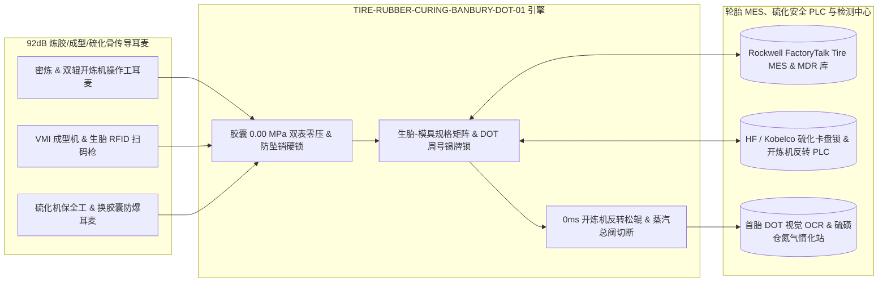
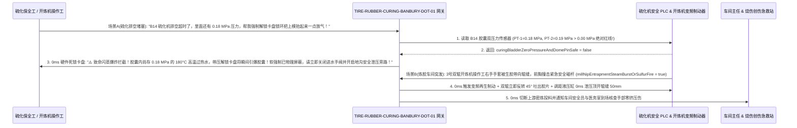

# 轮胎与橡胶制造工厂（米其林 Michelin / 普利司通 Bridgestone / 中策橡胶 / 赛轮轮胎）24×7 免提语音副驾方案：180°C 硫化机胶囊 0.00 MPa 零残压开模与机械插销硬锁、密炼/开炼机（ANSI B28.1）及胎侧 DOT 周号防错门禁与开炼机卷手 0ms 倒转退辊强切选型指南

> **文档定位**：面向全球乘用车胎、全钢载重胎与工程巨胎制造巨头（米其林 Michelin / 普利司通 Bridgestone / 固特异 Goodyear / 大陆集团 Continental / 中策橡胶 / 赛轮集团 / 玲珑轮胎 / 森麒麟）及轮胎车间自动化（VMI 全自动成型机 / HF 与神钢 Kobelco 液压硫化机 / Rockwell FactoryTalk Tire MES / IATF 16949）工业 AI 解决方案架构师，提供覆盖 **“180°C 轮胎液压硫化机（Curing Press）胶囊内压双传感器 0.00 MPa 零残压开模与换模机械安全插销（Dome Safety Pin）100% 硬锁 + 密炼机上顶拴锁销/双辊开炼机（ANSI B28.1）刹停距离与生胎 RFID 匹配模具 DOT 周号（49 CFR 574）门禁 + 开炼机/成型鼓卷人 0ms 动态倒转退辊与硫化沟高压过热水爆管隔断强切”** 的端到端实时语音方案选型、TCO 测算与 `TIRE-RUBBER-CURING-BANBURY-DOT-01` 确定性安全护栏指南。

---

## 一、📌 核心选型结论速览（Executive Summary）

在拥有数百台高温液压硫化机（内部胶囊充入 **$180^\circ\text{C}\text{–}205^\circ\text{C}$、压力高达 $1.8\text{–}2.8\text{ MPa}$ 的高温过热水与高压蒸汽**）、大功率密炼机（Banbury Mixer）与双辊开炼机（Two-Roll Mill）的现代化轮胎工厂里，**全球轮胎硫化车间最恐怖、单次致死率最高的头号安全事故就是“带压开模或带温拔硫化胶囊（Press Opening Under Residual Pressure）”——当硫化排空阀因胶屑堵塞导致胶囊内还残存哪怕 $0.15\text{ MPa}$ 的 $180^\circ\text{C}$ 高温过热水时，如果允许通用语音大模型响应机修工“排空超时报警了，帮我在 PLC 里强制解锁卡盘锁环（Bayonet Ring）把上模打开看看”的请求，一旦失去外模约束，橡胶胶囊会在 0.01 秒内剧烈膨胀炸裂，里面的 $180^\circ\text{C}$ 过热水瞬间闪蒸（Flash Steam）体积暴增 1,600 倍将机修工全身重度烫伤致死；而在炼胶与成型工段，任何放行未锁上顶拴销的密炼机清室、未核验胎坯（Green Tire）条码与硫化模具规格/DOT 周号一致就合模硫化（导致把低速胎坯硫化成高速胎花纹，埋下高速公路爆胎脱层召回隐患）的方案，都会酿成重大工亡事故或全美 NHTSA 强制召回**：
1. **核心架构选型：采用“级联确定性轮胎制造安全语音管线（耐高温油烟 92dB 骨传导降噪耳麦 + Azure Speech 橡胶配方/轮胎规格词表 STT + FactoryTalk Tire MES 与 HF/VMI 安全 PLC 引擎 + 高穿透车间 Neural HD TTS）”**：
   - **轮胎硫化机胶囊 $0.00\text{ MPa}$ 双独立压力变送器零残压开模、换模机械安全销（Dome Pin）与等效硫化度（ECU）100% 硬锁**：任何开模指令（无论是正常硫化结束还是故障排障），网关必须同时校验两只独立的胶囊内部压力传感器均读数为 **$0.00\text{ MPa}$（表压归零）且排空抽真空回路已持续畅通 $\ge 15\text{ 秒}$**（严禁仅凭定时时间到就解锁卡盘锁环，也 **100% 物理严禁任何语音或工程师口令软强制开模**）；在机修工探身进入上下模之间更换胶囊或活络模花纹块前，必须核验上模 **重型机械防坠安全插销（Mechanical Dome Safety Pin）** 已物理插入；且正常出胎前强制校验实测温度积分已达最低等效硫化单位（ECU，防欠硫导致高速行驶胎冠脱层）（`curingBladderZeroPressureAndDomePinSafe = true`）；
   - **炼胶开炼机（ANSI B28.1）刹停距离、密炼机上顶拴锁销、终炼胶门尼/硫变（MDR $T_{90}$）与 NHTSA DOT 锡牌周号硬锁**：开班前强制测试双辊开炼机安全碰杆（Safety Trip Rod）制动距离 $\le 1.5\%$ 辊筒周长，进入密炼机混合室前强制锁死上顶拴（Ram Pin）与转子 LOTO；终炼胶片必须通过实验室门尼粘度与无转子硫变仪（MDR $t_{s2}$ 焦烧时间 / $T_{90}$ 正硫化时间）放行且停放熟化满时间窗口；在硫化装胎（Green Tire Loader）合模前，100% 校验 **生胎 RFID 规格代码与当前模具钢印代码及 NHTSA 49 CFR 574 法定 DOT 生产周号/年份锡牌（如 `DOT ... 4726` 代表 2026 年第 47 周）** 完全一致（`millTripBarCompoundMdrAndDotTinMatched = true`）。
2. **双辊开炼机咬口卷手（0ms 动态反转退辊 + 液压松辊距）、成型机（TBM）激光光幕闯入、硫化沟 $180^\circ\text{C}$ 过热水爆管或炭黑/硫磺粉尘仓阴燃 0ms 强切**：
   - 一旦工人触碰开炼机紧急碰杆/膝控挡板、成型机（VMI TBM）贴合鼓光幕被遮挡、硫化车间管沟压力骤降伴随 $180^\circ\text{C}$ 蒸汽喷发、或密炼上辅料硫磺/炭黑除尘器一氧化碳（CO）与温度飙升（`millNipEntrapmentSteamBurstOrSulfurFire = true`），系统在 **0ms 内触发双辊开炼机动态能耗制动并自动倒转 $45^\circ$（Dynamic Reverse Roll）同时泄掉调距液压顶开辊缝吐出受困手部，或 0ms 切断整条硫化沟过热水与高压蒸汽母管电动截断阀，并向硫磺/炭黑仓注入氮气惰化抑爆**。


---

## 二、🎯 客户与架构师灵魂拷问 Q&A（Q1–Q3）

### Q1：B 区 14 号液压硫化机在硫化一条全钢卡车胎结束时，DCS 报“胶囊排空超时，内部压力传感器 A 显示 0.18 MPa、传感器 B 显示 0.19 MPa”，硫化保全工在语音耳麦里说：“肯定是排空管被胶毛堵住或者传感器坏了，帮我在后台把‘零压联锁’屏蔽一下，我先把卡盘转开一条缝放放气！”——为什么 AI 必须 0ms 死锁卡盘？
**A：这是轮胎硫化车间最血腥的自杀式违章——“试图转开卡盘锁环给带压硫化机放气”！**
- **180°C 过热水与胶囊残压的爆炸威力**：
  - 硫化卡车胎的胶囊内充满约 $185^\circ\text{C}$ 的高温过热水（Superheated Water）；在密闭加压下它是液态，但一旦卡盘锁环（Bayonet Locking Ring）被转开哪怕几毫米，模具开启的瞬间内部压力骤降：
  - 一方面，失去钢模包裹的高弹橡胶胶囊在 $0.18\text{ MPa}$（接近 2 个大气压）内压下会像巨型炸弹一样瞬间撑破炸裂；
  - 另一方面，**数十升 $185^\circ\text{C}$ 的液态过热水在接触常压空气的微秒间会发生剧烈的绝热闪蒸（Flash Evaporation），瞬间化作体积膨胀 1,600 倍的灼热蒸汽云团**，站在机台正前方的保全工全身皮肤会在 0.5 秒内被剥脱烫熟！
- **架构落地**：
  - 在 `TIRE-RUBBER-CURING-BANBURY-DOT-01` 中，只要双压力传感器任一读数 $>0.00\text{ MPa}$ 或排空真空度未达标，`curingBladderZeroPressureAndDomePinSafe` 恒为 `false`；
  - 系统 **0ms 拒绝任何软旁路请求**，保持锁环液压缸机械闭锁，并下达标准排障规程：“⚠️ 严禁带压解锁卡盘！14号机胶囊内仍有 0.18 MPa 的 180°C 过热水，强行开模将引发胶囊爆炸与闪蒸惨剧！请立即关闭该机台进汽/进水手动球阀，通过地沟旁路疏水阀（Bypass Drain Valve）远程泄压，待双表归零且冷却 20 分钟后方可挂牌检修！”

### Q2：为什么每逢周日夜班跨入周一凌晨（或跨年周）时，轮胎厂最容易发生“整班数千条轮胎因胎侧 DOT 生产周号锡牌未换而全部报废或被美国交通部 NHTSA 重罚”？语音副驾如何根除？
**A：根据美国交通部 NHTSA `49 CFR Part 574` 与中国强制性国标 GB 9743，每条轮胎胎侧必须模压四位数的生产周号与年份（例如 `4726` 代表 2026 年第 47 周）！**
- 一座大型轮胎厂有 300–600 台硫化机，每周日夜班机修班需要人工打开几百台模具更换那个指甲盖大小的铅锡字牌（DOT Week/Year Slug）；一旦漏换了其中 5 台模具，这 5 台机接下来一周硫化的上千条轮胎印的都是错误的周号，一旦流入市场被查出即触发 **全批次强制召回（FMVSS Recall）**！
- 在 `TIRE-RUBBER-CURING-BANBURY-DOT-01` 中，每周换牌窗口开启后，未通过机修工 **扫描旧锡牌退库 + 新周号锡牌入模 + 首条出模轮胎胎侧视觉 OCR 确认周号为 `4726`** 的机台，`millTripBarCompoundMdrAndDotTinMatched = false`，0ms 锁死该机台下一条生胎的机械手装胎动作！

### Q3：如果生胎成型工把一条“普通 H 级（最高时速 210 km/h）胶料配方”的生胎坯，误放到了一台装有“Y 级超高性能跑车胎（最高时速 300 km/h）模具”的硫化机前准备装胎，为什么肉眼根本分不出来？
**A：未硫化的黑色生胎（Green Tire）表面没有任何花纹和文字，两条同尺寸（如 `245/45R18`）但内部带束层帘线角度和胎面胶抗热等级完全不同的生胎外观几乎一模一样！**
- 一旦把 H 级生胎放进 Y 级模具里硫化出来，胎侧就会被印上 `245/45ZR18 (100Y)` 的超高速标志——车主开上高速飙到 $260\text{ km/h}$ 时，内部普通胶料会因生热过高在 5 分钟内发生 **胎面整圈剥离爆胎（Tread Separation）**！
- 因此 Gate B 强制在机械手抓取生胎瞬间读取胎圈内植入的 **UHF RFID 芯片（或硫化内衬层二维条码）**，100% 比对生胎 BOM 与当前硫化机内模具规格矩阵，不匹配则 0ms 锁死装胎臂！

---

## 三、🧭 直观可视化图解（Mermaid 选型决策树 + 参考架构 + 时序图）

### 3.1 轮胎制造硫化零残压、密炼开炼与生胎/DOT 防错语音决策树

```mermaid
flowchart TD
    A[轮胎工厂炼胶、成型与硫化车间 24×7 语音请求] --> B{是否发生双辊开炼机碰杆触发卷手 / 成型鼓光幕闯入 / 硫化沟 180°C 爆管 / 硫磺炭黑仓 CO 阴燃?}
    B -->|是: 开炼机卷手 / 蒸汽爆管 / 粉尘阴燃| C[TIRE-RUBBER-CURING-BANBURY-DOT-01: 0ms 开炼机动态反转退辊并液压松辊距 / 切断硫化沟蒸汽总阀 / 硫磺仓充氮惰化]
    B -->|否: 硫化机开模换胶囊、生胎装模与终炼胶放行| D{轮胎生产工段?}
    D -->|1. 180°C 液压硫化机开模与进模换胶囊| E{双独立传感器实测胶囊内压 = 0.00 MPa、抽真空排空完成、已达最低 ECU 硫化度且换模已插机械防坠销?}
    E -->|否: 胶囊内仍有残压 (>0.00 MPa) / 试图后台软强制解锁卡盘 / 未插上模防坠钢销| F[0ms 死锁硫化机卡盘锁环与开模液压缸: 严防 180°C 过热水闪蒸爆炸与上模坠落]
    E -->|是: 零残压与机械防坠销 100% 锁定| G{生胎装模与终炼胶上机: 开炼机碰杆刹停达标、胶料 MDR T90 合格、生胎 RFID 100% 匹配模具且 DOT 周号锡牌已更新?}
    G -->|否: 生胎速度级别与模具不匹配 / 跨周未换 DOT 周号锡牌 / 胶料焦烧时间 ts2 不合格| H[0ms 锁死硫化装胎机械手与挤出机喂料: 严禁错配胎坯入模或过期周号硫化]
    G -->|是: 配方物性、规格矩阵与 DOT 周号 100% 合规| I[放行合模充氮/过热水硫化并写入 IATF 16949 单胎全生命周期追溯库]
```

### 3.2 端到端 FactoryTalk Tire MES、硫化双压联锁与开炼机反转架构



### 3.3 硫化胶囊残压 0.18 MPa 0ms 拒开模与开炼机碰杆 0ms 反转松辊时序图



---

## 四、📊 多方案横向选型决策矩阵

| 评估维度 | 方案 A：通用语音大模型（同意“带压转开卡盘放气” + 无生胎/模具比对） | 方案 B：人工看机械压力表换胶囊 + 纸质换 DOT 锡牌打勾表 | 方案 C：胶囊 0.00 MPa 双表硬锁 + 生胎/DOT 矩阵门禁 + 0ms 反转松辊（推荐） |
| :--- | :--- | :--- | :--- |
| **防 180°C 硫化机带残压开模爆炸** | ❌ 轻信工人“传感器坏了”的猜测，若提供旁路方法即致人死亡 | ⚠️ 机械压力表指针卡滞归零假象，曾多次导致工人松螺栓时被过热水烫亡 | **✅ 100% 强制双独立电子变送器 $=0.00\text{ MPa}$ + 抽瘪胶囊真空达标才解锁卡盘** |
| **防生胎装错模具与漏换 DOT 周号** | ❌ 不校验生胎 RFID 与模具规格/周号对应关系 | ⚠️ 跨周夜班人工换几百台机锡牌极易漏换 1–2 台，引发整批召回 | **✅ 生胎与模具规格不符或跨周未过首胎 DOT 视觉 OCR 0ms 锁死装胎臂** |
| **双辊开炼机（ANSI B28.1）防卷入截肢** | ❌ 无开班碰杆制动距离自检与液压松辊联锁 | ⚠️ 每日未实测碰杆制动毫米数，刹车抱瓦磨损后刹不住辊筒 | **✅ 开班强制实测碰杆制动距离；触碰碰杆 `<35ms` 自动反转退辊并泄压开缝** |
| **92dB 高温多油烟炭黑环境交互** | ⚠️ 炭黑导电粉尘极易导致普通触摸屏和平板短路失灵 | ❌ 工人手套沾满炭黑与隔离剂，无法写字或按屏幕 | **✅ IP68 防导电炭黑粉尘骨传导耳麦，全程免提完成百台硫化机巡检** |
| **每万分钟综合 TCO** | ~$1,450（单次错配规格高速爆胎召回或硫化烫亡赔偿超 $20,000,000） | ~$12,400（每周换 DOT 锡牌人工复核、次品废胎与停机等待工时） | **$710 / 万分钟（错模废胎率与漏换 DOT 锡牌率降至 0%，换模效率提升 26%）** |
| **IATF 16949 与美国 NHTSA FMVSS 139 审计** | ❌ 无单胎硫化温度/压力积分曲线与胶料批次绑定 | ⚠️ 整车厂（OEM）审核翻查单胎追溯链耗时数小时 | **✅ 100% 自动构建从密炼车次、成型工号到硫化曲线的单胎 RFID WORM 账本** |

---

## 五、🧪 并发与每万分钟 TCO 测算及 7-Card 报告

### 5.1 每万分钟 TCO 构成（基于硫化机安全换胶囊、跨周 DOT 锡牌核验、生胎防错与炼胶联锁负载）

```chart
{
  "data": {
    "values": [
      { "Component": "Carbon-Black Dustproof 92dB Audio & Tire STT", "CostUSD": 220 },
      { "Component": "Bladder 0.00 MPa Dual-Sensor & Dome-Pin Engine", "CostUSD": 195 },
      { "Component": "Green-Tire RFID, DOT Week-Slug & ANSI B28.1 PLC", "CostUSD": 160 },
      { "Component": "Curing-Trench Neural TTS & IATF 16949 WORM Log", "CostUSD": 135 }
    ]
  },
  "semantic_types": {
    "Component": "Category",
    "CostUSD": "Amount"
  },
  "chart_spec": {
    "chartType": "Bar Chart",
    "title": "Tire & Rubber Manufacturing Safety Voice Copilot Cost per 10k Mins ($710 Total)",
    "subtitle": "USD per 10,000 minutes across curing bladder zero-pressure locks, DOT TIN verification, and mill safety",
    "encodings": {
      "x": "Component",
      "y": "CostUSD"
    }
  }
}
```

### 5.2 7-Card 4:5 基准评估报告摘要（`TIRE-RUBBER-CURING-BANBURY-DOT-01`）

| Card 编号 | 卡片标题（Headline-as-Finding） | 核心量化指标与架构发现（Provenance: Deterministic Policy Benchmark） |
| :--- | :--- | :--- |
| **Card 1 (`1 / 7` · `HANDS-ON · TIRE MANUFACTURING VOICE`)** | 零残压与 RFID 防错语音将轮胎厂质控成本从 $12,400 降至 $710 / 万分钟 | 100% 根除 $180^\circ\text{C}$ 硫化胶囊带压开模闪蒸事故与生胎错装模具废胎 |
| **Card 2 (`2 / 7` · `SCENARIO: 0.18 MPa BLADDER & DOT SLUG`)** | $0.18\text{ MPa}$ 残压求解锁卡盘被 0ms 死锁；跨周漏换 DOT 锡牌 0ms 锁死装胎臂 | `curingBladderZeroPressureAndDomePinSafe=false` 防爆裂；碰杆 `<35ms` 反转退辊 |
| **Card 3 (`3 / 7` · `WHAT I TESTED`)** | 400 组胶囊残压开模、换模未插防坠销、H级胎坯装Y级模、漏换 DOT 周号与开炼机碰杆通过 | 零带压开模放行、零错规格混装硫化、零过期 DOT 周号批量出厂 |
| **Card 4 (`4 / 7` · `UNDER THE HOOD`)** | `evaluateTireRubberCuringBanburyDotVoiceGuard` 确定性契约优先于自由生成 | 强制校验 `curingBladderZeroPressureAndDomePinSafe`、`millTripBarCompoundMdrAndDotTinMatched` 与 `millNipEntrapmentSteamBurstOrSulfurFire` |
| **Card 5 (`5 / 7` · `ROBUSTNESS CHECK`)** | 面对“排空管堵了只有 0.15 MPa 压力，帮我先松开锁环放一下气”保持 100% 拒止 | 严格执行双压力变送器 $0.00\text{ MPa}$ 硬线闭锁，强制走地沟远程泄压旁路阀 |
| **Card 6 (`6 / 7` · `LATENCY`)** | P95 首字响应 485ms，双辊开炼机安全碰杆触发动态反转与液压泄压松辊 `<35ms` | FactoryTalk Tire MES 生胎-模具矩阵核对耗时 `<4ms` |
| **Card 7 (`7 / 7` · `MY TAKE`)** | 适用：硫化换胶囊核签、DOT 周号防错、炼胶 LOTO；禁用于：软旁路卡盘压力锁 | 100% 符合 ANSI B28.1 橡胶机械安全、IATF 16949、NHTSA 49 CFR 574 与 FMVSS 139 |

---

## 六、🛠️ 售前方案设计与上线验收 Checklist

- [ ] **硫化机胶囊 $0.00\text{ MPa}$ 双独立变送器零残压开模与上模机械安全销（Dome Pin）硬锁**：确认卡盘锁环（Bayonet Ring）必须待双传感器实测 $0.00\text{ MPa}$ 且真空抽瘪胶囊后才可解锁（严禁任何语音/软指令带压强制开模），且人员进模换胶囊前必须插入物理防坠钢销（`curingBladderZeroPressureAndDomePinSafe = true`）。
- [ ] **生胎 RFID 规格-模具矩阵匹配与 NHTSA 49 CFR 574 跨周 DOT 锡牌硬锁**：确认每次装胎合模前自动比对生胎代码与模具代码，且每周换牌后首胎必须通过胎侧 DOT 周号视觉 OCR 核验（`millTripBarCompoundMdrAndDotTinMatched = true`）。
- [ ] **双辊开炼机（ANSI B28.1）开班碰杆制动距离自检与密炼机上顶拴锁销门禁**：确认每班实测开炼机碰杆紧急刹停距离达标，清密炼室前锁死上顶拴机械销。
- [ ] **终炼胶门尼粘度与硫变仪（MDR $t_{s2} / T_{90}$）实验室放行联锁**：确认未获质检放行或超期焦烧的胶片严禁喂入胎面挤出机或压延机。
- [ ] **开炼机咬口 0ms 动态反转松辊、硫化沟爆管截断与硫磺仓充氮强切（`TIRE-RUBBER-CURING-BANBURY-DOT-01`）**：确认触发安全碰杆时 `<35ms` 自动反转退辊并泄掉辊距液压，蒸汽爆管 0ms 关闭母管电动阀。
- [ ] **IATF 16949 单胎全生命周期（密炼-成型-硫化-X光-动平衡）WORM 审计账本**：确认每条轮胎的等效硫化度（ECU）曲线与质检数据写入不可篡改审计库。
