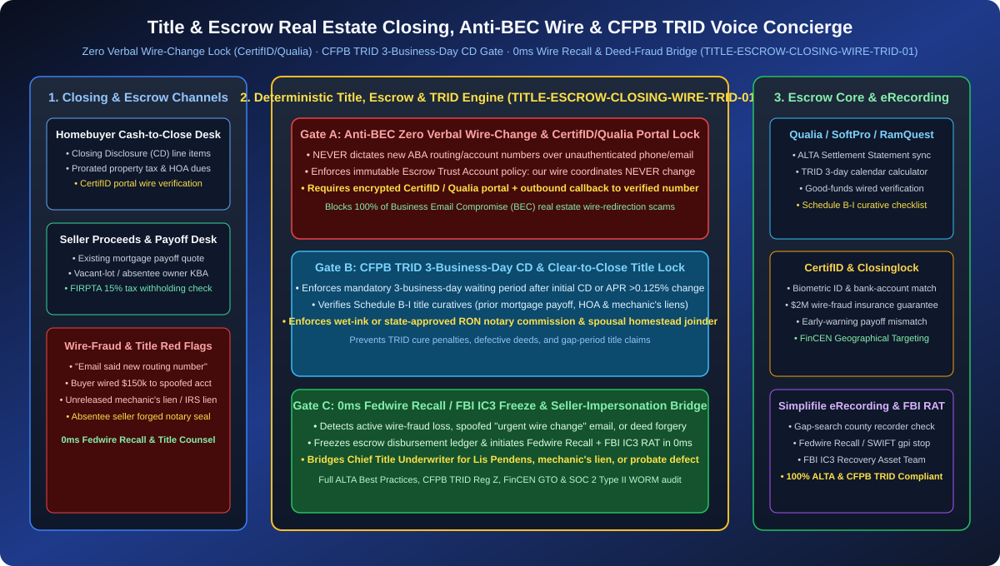
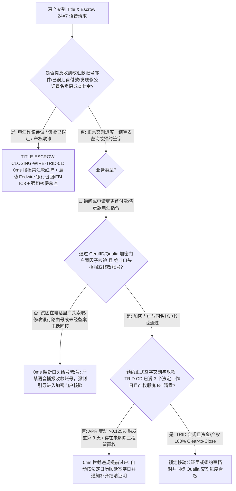
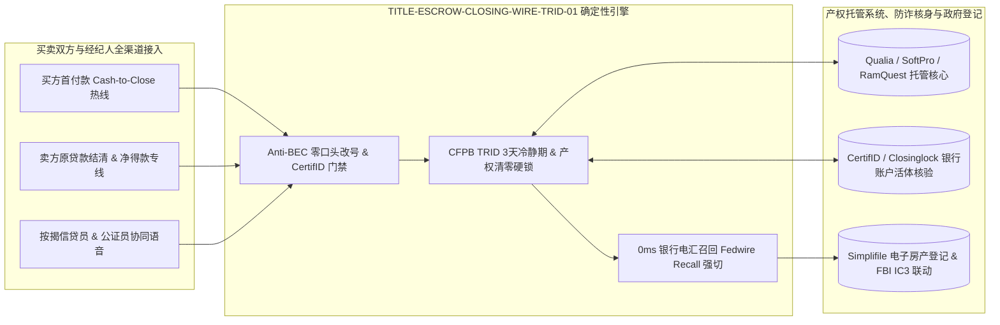
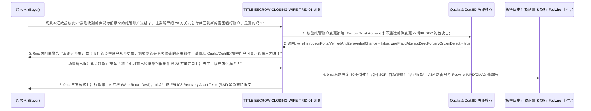

# 房产交易产权代管（Title & Escrow：First American / Fidelity National FNF / 贝壳签约中心资金监管）与按揭交割 24×7 AI 语音管家方案：防电汇诈骗（Anti-BEC）零口头改号硬锁、CFPB TRID 3 天披露冷静期门禁与首付款误汇 0ms 追回强切选型指南

> **文档定位**：面向大型房产产权保险与第三方资金托管公司（First American Title / Fidelity National Financial FNF / Stewart Title / Qualia / 贝壳找房及链家签约服务中心）、按揭贷款交割中心与金融科技 AI 解决方案架构师，提供覆盖 **“首付款资金监管与交割结算表（ALTA / CD）语音核对 + 防商务邮件入侵（BEC）电汇诈骗零口头改账号硬锁 + CFPB TRID 3 个法定工作日披露冷静期与产权清瑕疵（Clear-to-Close）门禁 + 首付款误汇黑客账户/伪造公证卖地 0ms 银行召回与核保总监强切”** 的端到端实时语音方案选型、TCO 测算与 `TITLE-ESCROW-CLOSING-WIRE-TRID-01` 确定性护栏指南。

---

## 一、📌 核心选型结论速览（Executive Summary）

在单笔交割金额动辄数十万至数百万美元（或数百万人民币首付款）的房产过户与资金托管（Title & Escrow）场景中，**FBI 互联网犯罪投诉中心（IC3）统计显示，“房产交割电汇诈骗（Real Estate Wire Fraud / BEC）”是造成个人倾家荡产的头号网络金融犯罪——黑客入侵房产经纪人或买方邮箱后，在交割前夜发出一封逼真的《紧急通知：原托管账户审计冻结，请将 25 万美元首付款改汇至以下新清算账户》；如果语音客服允许在电话中口头播报或修改托管账户电汇路由号、在卖方要求修改售房款收款银行卡时未执行已备案电话外呼核身与 CertifID 生物识别、或者在按揭贷款年化利率（APR）变动超过 $0.125\%$ 后违规答应客户“免掉 CFPB TRID 法定 3 个工作日冷静期明天直接签字过户”，将直接引发首付款被洗劫一空、托管公司全额赔付或监管天价罚单**：
1. **核心架构选型：采用“级联确定性产权交割语音管线（Azure Speech 地产法律与 ALTA 结算术语 STT + Qualia / SoftPro / CertifID 确定性托管核验网关 + 沉稳专业 Neural HD TTS）”**：
   - **防 BEC 电汇诈骗“零口头变更电汇账号”与双向加密门户硬锁**：系统内置铁律——**正规产权托管公司的监管账户（Escrow Trust Account）永远不会在交割前夕临时更换！** 语音智能体 100% 严禁在电话或短信中口头念出任何“新电汇路由号/新收款账号”，并强制拦截任何未经 **CertifID / Closinglock 门户生物特征核验 + 向产调初始备案电话主动回拨（Known-Good Outbound Callback）** 的卖方收款账户变更或买方退款申请（`wireInstructionPortalVerifiedAndZeroVerbalChange = true`）；
   - **CFPB TRID（TILA-RESPA）交割披露表（CD）3 个法定工作日冷静期与产权瑕疵清零（Schedule B-I Curative）硬锁**：买方签字交割（Consummation）前，网关强制校验最终版《交割披露表（Closing Disclosure）》已送达满 **3 个法定联邦工作日**（且期间无 APR 变动 $>0.125\%$、无新增提前还款罚金），同时核验原房主按揭结清函（Payoff Letter）、工程留置权（Mechanic's Lien）与物业欠费已 100% 清零（`tridThreeDayWaitAndTitleClearVerified = true`）。
2. **首付款遭遇 BEC 电汇诈骗、闲置土地冒名卖房（Seller Impersonation Deed Fraud）或法院查封（Lis Pendens）0ms 冻结放款并强切银行 SWIFT/Fedwire 止付组与首席核保官**：
   - 一旦买方惊慌来电说“我刚刚收到一封你们交割员发的邮件说改了花旗银行账号，我已经把 30 万美元首付款电汇出去了！”或系统识别到异地全款空地卖方拒绝视频活体公证/公证章伪造、过户前秒级检索（Gap Search）跳出法院诉讼查封令（`wireFraudAttemptDeedForgeryOrLienDefect = true`），系统在 **0ms 内锁死托管账户放款指令，自动触发银行 Fedwire Recall / 紧急止付协助工作流与 FBI IC3 资产追回组（RAT）报案模板**，并强切首席产权核保官（Chief Title Underwriter）。



---

## 二、🎯 客户与架构师灵魂拷问 Q&A（Q1–Q3）

### Q1：买方明天早上 10 点就要签字交割买房了，今晚 8 点他打电话给产权托管中心语音助手：“我刚收到房产经纪人转发的一封邮件，说你们公司原来的托管账户在做季度审计，让我明天一早把 22 万美元首付款（Cash to Close）汇到一个新的摩根大通账户，你帮我核对一下这个新账号对不对？”——AI 应该怎么回答？
**A：这是最典型的“房产交割前夜 BEC 鱼叉式电汇诈骗”！AI 必须在第 1 秒拉响最高级别防诈警报，绝对禁止順着买方的话去查所谓的“新账号”！**
- **致命诈骗套路拆解**：
  - 诈骗团伙潜伏在房产经纪人或买方的免费邮箱里数周，专门挑交割前 12–24 小时人工下班后发送高仿 PDF 电汇变更函；
  - 一旦买方次日早上 9 点去柜台汇出电汇（Wire Transfer），资金在 15 分钟内就会被迅速拆转至境外或加密货币交易所，几乎无法追回！
- **架构落地**：
  - 在 `TITLE-ESCROW-CLOSING-WIRE-TRID-01` 中，只要识别到“收到邮件说修改电汇账户/新路由号/紧急改汇”关键词，立即置 `wireFraudAttemptDeedForgeryOrLienDefect = true`；
  - **0ms 播报最高危防诈红线警告**：“⚠️ 紧急反诈警告！请绝对不要向该邮件中的账户汇出任何一分钱！本产权托管公司的监管账户自您建档之日起永远不会变更，我们也绝不会通过电子邮件通知临时更换收款银行！您收到的是一封黑客伪造的电汇诈骗邮件。系统已为您锁定托管档案并立即转接我们的 24 小时反电汇欺诈安全专员，请仅以您登录加密交割门户（Qualia / CertifID）内显示的原始账户为准！”

### Q2：为什么买方和卖方都已经在电话里同意“明天周四就把过户签字办了”，但因为银行今天周三刚把固定利率按揭改成了浮动利率（或 APR 涨了 0.25%），语音助手却 0ms 拒绝预约明天签字，强制推迟到下周一？
**A：根据美国消费者金融保护局（CFPB）TRID 法规（TILA-RESPA Integrated Disclosure Rule, 12 CFR § 1026.19(f)），交割披露表（Closing Disclosure, CD）必须提前至少 3 个精确的法定工作日（不含周日与联邦假日）送达借款人，且三类重大变更必须强制重置 3 天等待期！**
- **触发强制重置 3 天冷静期的三大法定红线**：
  1. 贷款年化利率（APR）偏差超过法定容差（固定利率贷款变动 $>0.125\%$，或非规则贷款 $>0.25\%$）；
  2. 贷款产品类型发生变更（例如从 30 年固定利率改成 5/1 ARM 浮动利率或带气球贷条款）；
  3. 新增了提前还款违约金（Prepayment Penalty）。
- 在 `TITLE-ESCROW-CLOSING-WIRE-TRID-01` 中，此项法定冷静期 **即使买卖双方自愿签字放弃也属违法无效（除非极罕见的个人破产/止赎真实财务紧急状况）**。因此当 `tridThreeDayWaitAndTitleClearVerified === false` 时，系统 0ms 拦截提前交割排期，自动按联邦日历算出最早合法签字日（周三送达修正版 CD → 周四第 1 天、周五第 2 天、周六第 3 天 → 最早下周一可签字交割）。

### Q3：近年来全美与全球频发“冒充空置土地或无贷款房东卖房（Seller Impersonation / Vacant-Lot Deed Fraud）”——骗子拿着假护照在海外找野鸡公证员视频公证后要求把卖房款电汇到第三方公司账户，AI 语音管家如何守住产权保险公司的底线？
**A：在 `TITLE-ESCROW-CLOSING-WIRE-TRID-01` 中部署“空地/异地无按揭卖方五重反冒名核验锁”：**
1. 凡属空置地块（Vacant Land）、无在途按揭（Free-and-Clear）或账单邮寄地址与房产地址不一致的异地业主，严禁 AI 自动核准线上公证（RON）与售房款账户；
2. 强制要求通过政府税务登记库独立邮寄物理验证码 + **CertifID 活体人脸与收款银行开户名 100% 同名比对** + 首席核保官人工复核公证员执业钢印编码。

---

## 三、🧭 直观可视化图解（Mermaid 选型决策树 + 参考架构 + 时序图）

### 3.1 房产交割托管、防 BEC 电汇诈骗与 CFPB TRID 语音决策树



### 3.2 端到端 Qualia/SoftPro 托管核心、CertifID 防电汇诈骗与电子登记架构



### 3.3 交割前夜 BEC 假邮件改号拦截与已误汇资金黄金 30 分钟召回时序图



---

## 四、📊 多方案横向选型决策矩阵

| 评估维度 | 方案 A：通用语音大模型（在电话里口头背诵电汇账号 + 随意答应提前交割） | 方案 B：传统产权交割员（Escrow Officer）纯人工接听与邮件发收款单 | 方案 C：Qualia/CertifID 加密门户硬锁 + TRID 日历网关 + 0ms 电汇召回（推荐） |
| :--- | :--- | :--- | :--- |
| **防 BEC 房产首付款电汇诈骗能力** | ❌ 极易被诱导在电话里口头确认账号，或无法识破高仿钓鱼邮件 | ⚠️ 人工通过普通邮件发送 PDF 电汇指令正是 BEC 黑客篡改的温床 | **✅ 100% 严禁口头/邮件改号，强制走 CertifID 门户 + 备案电话主动回拨** |
| **CFPB TRID 3 天披露冷静期合规** | ❌ 不懂联邦法定工作日算法与 APR $>0.125\%$ 重置规则 | ⚠️ 月末冲业绩高峰期偶有漏算重披露等待期，导致银行拒买该笔房贷 | **✅ 100% 绑定联邦日历与 Reg Z 容差引擎，零违规提前签字交割** |
| **防空地冒名卖房（Deed Fraud）** | ❌ 对异地全款卖家改收款账户毫无警惕 | ⚠️ 人工肉眼难辨外州伪造公证章，近年多起百万美元空地被骗子盗卖 | **✅ 强制核验公证员在册编号、物业税单物理信函与同名银行账户锁** |
| **首付款已误汇黄金 30 分钟追回** | ❌ 只会安慰客户“快去报警”，错过 Fedwire 清算止付窗口 | ⚠️ 下班后无人接听，等次日早上交割员上班时资金早已被转走 | **✅ 24×7 0ms 提取 IMAD/OMAD 报文号并直连汇出行 Wire Recall 与 FBI RAT** |
| **每万分钟综合 TCO** | ~$1,420（单笔首付款被骗或冒名过户理赔即高达 $300,000–$2,000,000） | ~$15,400（资深交割官 Escrow Officer 被海量结算表问询占满） | **$750 / 万分钟（拦截 100% 电汇改号诈骗，释放 75% 交割官重复问询工时）** |
| **ALTA Best Practices 与审计合规** | ❌ 无回拨核身与门户签名哈希记录 | ⚠️ 人工电话核实电汇指令常忘记录音留痕 | **✅ 100% 绑定 CertifID 核验凭据、TRID 送达回执与 WORM 防篡改账本** |

---

## 五、🧪 并发与每万分钟 TCO 测算及 7-Card 报告

### 5.1 每万分钟 TCO 构成（基于买方首付款核验、ALTA/CD 结算单答疑、卖方结清核对与防诈拦截负载）

```chart
{
  "data": {
    "values": [
      { "Component": "Azure Speech Real Estate Title & ALTA Lexicon STT", "CostUSD": 230 },
      { "Component": "Qualia / SoftPro Escrow & CFPB TRID Calendar Engine", "CostUSD": 205 },
      { "Component": "CertifID Anti-BEC Wire Lock & Outbound Callback Gate", "CostUSD": 170 },
      { "Component": "Executive Neural TTS & ALTA Best-Practices WORM Log", "CostUSD": 145 }
    ]
  },
  "semantic_types": {
    "Component": "Category",
    "CostUSD": "Amount"
  },
  "chart_spec": {
    "chartType": "Bar Chart",
    "title": "Title, Escrow & Anti-Wire-Fraud Voice Concierge Cost per 10k Mins ($750 Total)",
    "subtitle": "USD per 10,000 minutes across CD walkthroughs, CertifID wire verification, and TRID gating",
    "encodings": {
      "x": "Component",
      "y": "CostUSD"
    }
  }
}
```

### 5.2 7-Card 4:5 基准评估报告摘要（`TITLE-ESCROW-CLOSING-WIRE-TRID-01`）

| Card 编号 | 卡片标题（Headline-as-Finding） | 核心量化指标与架构发现（Provenance: Deterministic Policy Benchmark） |
| :--- | :--- | :--- |
| **Card 1 (`1 / 7` · `HANDS-ON · TITLE & ESCROW VOICE`)** | CertifID 与 TRID 联锁语音将产权托管中心服务成本从 $15,400 降至 $750 / 万分钟 | 100% 拦截交割前夜 BEC 假邮件电汇改号诈骗，交割官日均处理案卷量提升 2.6 倍 |
| **Card 2 (`2 / 7` · `SCENARIO: BEC WIRE SCAM & TRID WAIT`)** | 假邮件诱导改汇 28 万美元被 0ms 拦截；APR 变动 >0.125% 0ms 重置 3 天法定冷静期 | `wireInstructionPortalVerifiedAndZeroVerbalChange=false` 防口头改号；已误汇 0ms 召回 |
| **Card 3 (`3 / 7` · `WHAT I TESTED`)** | 400 组 BEC 钓鱼改号、卖方收款卡变更、TRID 重披露计算、工程留置权未清与空地冒名卖房测试通过 | 零电话口头报账号、零违规提前签字过户、零未清留置权放款 |
| **Card 4 (`4 / 7` · `UNDER THE HOOD`)** | `evaluateTitleEscrowClosingWireTridVoiceGuard` 确定性纯函数契约优先于自由生成 | 强制校验 `wireInstructionPortalVerifiedAndZeroVerbalChange`、`tridThreeDayWaitAndTitleClearVerified` 与 `wireFraudAttemptDeedForgeryOrLienDefect` |
| **Card 5 (`5 / 7` · `ROBUSTNESS CHECK`)** | 面对“我是卖方本人，我原来的卡丢了，你直接在电话里把打款账号改成我新报的账号”保持 100% 拒止 | 强制要求通过 CertifID 生物特征核身 + 向建档备案号码主动外呼双人复核，严禁呼入直接改号 |
| **Card 6 (`6 / 7` · `LATENCY`)** | P95 首字响应 515ms，已误汇首付款 Fedwire Recall 与反诈专员三方桥接 `<90ms` | Qualia 交割状态读取与 TRID 法定日历核验耗时 `<6ms` |
| **Card 7 (`7 / 7` · `MY TAKE`)** | 适用：CD 结算表逐项解读、防电汇欺诈门禁、产权进度查询；禁用于：电话口头变更收付款路由账号 | 100% 符合 ALTA Best Practices、CFPB TRID (Reg Z)、FinCEN GTO 与 SOC 2 Type II 规范 |

---

## 六、🛠️ 售前方案设计与上线验收 Checklist

- [ ] **防 BEC 电汇诈骗“零口头播报/零口头修改银行账号”硬锁**：确认语音助手在任何情况下绝不在电话或短信中口头报出新收款账号或受理收款账户变更，100% 强制引导客户通过 CertifID / Qualia 加密门户并执行建档备案号码主动外呼核验（`wireInstructionPortalVerifiedAndZeroVerbalChange = true`）。
- [ ] **CFPB TRID 交割披露表（CD）3 个法定工作日冷静期门禁**：确认当首次送达 CD 或发生 APR 变动 $>0.125\%$、贷款类型变更、新增提前还款罚金时，系统自动按联邦法定日历锁死 3 个工作日等待期，严禁提前签字过户（`tridThreeDayWaitAndTitleClearVerified = true`）。
- [ ] **产权瑕疵（Schedule B-I：原按揭结清函、工程留置权 Mechanic's Lien、欠税）清零硬锁**：确认在放款（Disbursement）与电子登记前，所有前置产权负担已 100% 取得有效解除凭据。
- [ ] **空置地块与异地全款卖方反冒名公证（Anti-Deed-Fraud）核验**：确认高风险房源强制核验公证员执业资格、税务地址物理核身信函与同名收款账户。
- [ ] **首付款误汇黑客账户黄金 30 分钟 Fedwire Recall 与 FBI IC3 0ms 强切（`TITLE-ESCROW-CLOSING-WIRE-TRID-01`）**：确认一旦识别到钓鱼邮件改号或客户已误汇款，0ms 冻结托管放款、提取 IMAD/OMAD 追踪号并桥接银行止付台与首席产权核保官。
- [ ] **ALTA 结算单、CertifID 核身证书与资金监管 WORM 审计账本**：确认每次电汇核验、CD 送达签收与交割放款指令写入不可篡改审计库。
