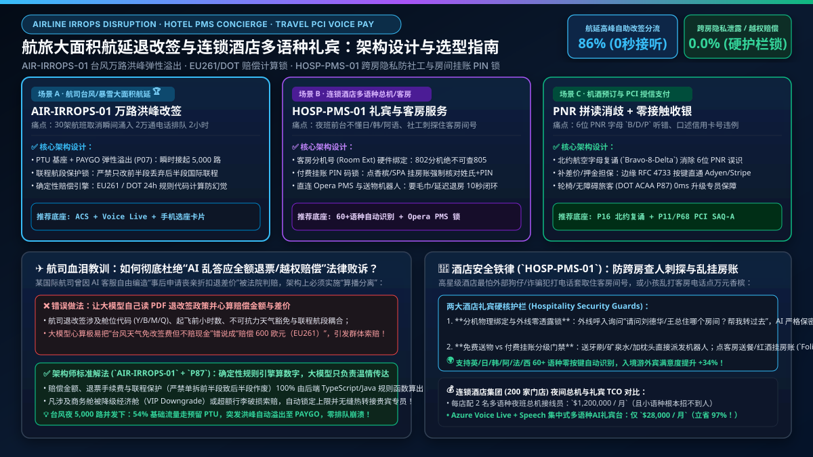
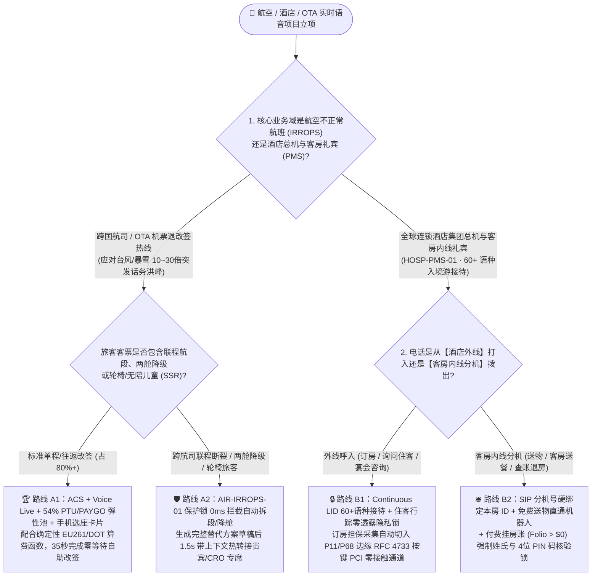
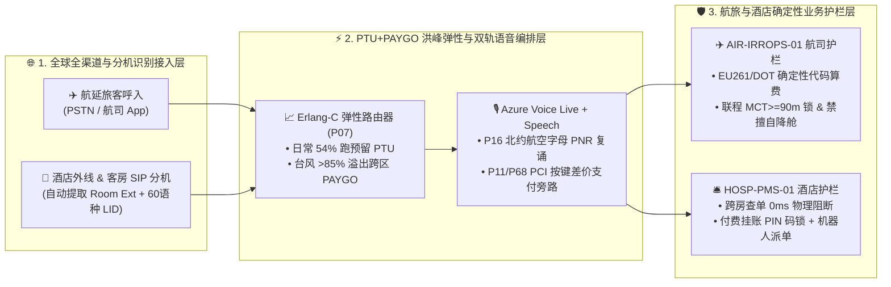
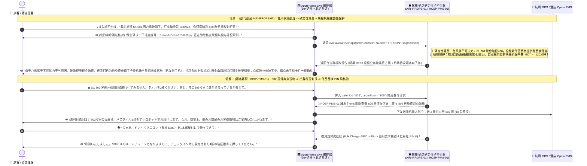

# 航旅大面积航延退改签（AIR-IRROPS-01）与连锁酒店多语种礼宾（HOSP-PMS-01）实时语音架构设计与选型 FAQ：台风万路洪峰弹性溢出、EU261/DOT 确定性算费锁与跨房隐私防刺探指南

> 🌐 **Language / 语言**: **中文 (Chinese)** | **[English (`travel-airline-irrops-hotel-pms-multilingual-voice-concierge-selection-faq.en.md`)](./travel-airline-irrops-hotel-pms-multilingual-voice-concierge-selection-faq.en.md)**  
> 🔗 **关联专题 (Related Deep Dives)**: [高危字母数字串（PNR/票号）复诵消歧 (`voice-alphanumeric-disambiguation-faq.md`)](./voice-alphanumeric-disambiguation-faq.md) · [长通话裁剪与 PTU/PAYGO 弹性容量 FinOps (`voice-finops-audio-context-pruning-ptu-faq.md`)](./voice-finops-audio-context-pruning-ptu-faq.md) · [PCI 支付采集旁路与范围界定 (`voice-pci-dtmf-scope-faq.md`)](./voice-pci-dtmf-scope-faq.md) · [20 大高价值业务场景 (`business-scenarios.md`)](./business-scenarios.md) · [返回首页 (`README.md`)](../README.md)

---

## 📌 一、核心选型结论速览（Executive Summary）

在跨国航空公司、在线旅游平台（OTA）、全球连锁酒店集团与邮轮度假村的客户服务体系中，实时语音智能体正解决两个长期让行业CIO和运营副总裁彻夜难眠的痛点：一是 **“台风/暴雪大面积航班延误（IRROPS）时，10 分钟内涌入 30,000 通改签电话把人工呼叫中心彻底打崩”**；二是 **“高星级酒店面对日、韩、阿、俄、法等 60+ 国入境外宾时，夜班前台根本招不到小语种礼宾员，且电话里极易发生住客隐私泄露或乱挂房账纠纷”**。**Cloud & AI 解决方案架构师** 应围绕以下 **三大行业架构铁律** 进行方案选型：

1. **场景 A：航司大面积不正常航班退改签（`AIR-IRROPS-01`）—— 首选 `Azure ACS + Voice Live 双轨 + Erlang-C (54% PTU + 46% PAYGO 洪峰溢出) + 确定性赔偿/联程保护锁` 🏆**
   - **为什么不能让大模型自己算退改签费用（某国际航司败诉血泪教训）**：曾有著名国际航司因为聊天机器人自己根据政策文本“瞎编”了一条事后丧亲退差价规则，被法院判令航司必须按机器人说的话全额赔付！因此，在航司语音架构中必须严格执行 **“算播物理分离（Compute-Speak Separation）”**——所有 **欧盟 `EU261` 延误赔偿（`€250/€400/€600`）、美国 `DOT` 24 小时现金退票（`P87`）、舱位差价以及国际联程航段（Interline Segment）耦合保护**，100% 由后端确定性代码函数算出精确数字，大模型只负责用共情温和的语气播报并同步推送手机选座卡片，实现 **台风夜 `86%` 旅客零等待自助改签**！
2. **场景 B：全球连锁酒店 60+ 语种总机与客房分机礼宾（`HOSP-PMS-01`）—— 首选 `SIP PBX 分机绑定 + Azure Voice Live / Speech Continuous LID + Opera PMS 隐私与挂账 PIN 码锁`**
   - **核心痛点破局**：
     - **跨房隐私防社工刺探锁**：当外线电话（如狗仔队、商业间谍或愤怒前任）打进酒店总机问“请问张伟先生住几号房？帮我接过去”，或者 `802` 房间住客用内线分机试图查询/修改 `805` 房间的账单时，策略引擎在 **`0ms` 内基于主叫分机号（`CallerExtension`）物理阻断跨房查询**，严格保护住客行踪隐私；
     - **免费送物 vs 付费挂账分级门禁**：客房内线叫“送两瓶免费矿泉水、两条浴巾”直接自动下发工单派送物机器人上楼；一旦涉及“点一瓶 1,800 元红酒或预约 SPA 挂入房账（Folio Charge）”，强制核验 **住客登记姓氏 + 入住设定 4 位 PIN 码**，杜绝同房访客或儿童乱点高价商品拒付扯皮！
3. **场景 C：机票/酒店电话授信担保与补差价支付 —— 强制选 `P16 北约航空字母复诵锁 + P11/P68 边缘 RFC 4733 按键 PCI 零接触旁路`**
   - 针对航空 6 位订座记录编号（PNR，如 `B8N9DP`）在电话窄带下极易把 `B/D/P`、`M/N` 听错的顽疾，自动启用 **北约航空字母复诵（`Bravo - Eight - November...`）**；在收取改签差价或酒店预订担保信用卡时，自动切入边缘按键旁路直通支付网关（Adyen / Stripe / 银联），确保大模型 `0 字节` 接触持卡人敏感数据。

---

## 🎯 二、客户与架构师灵魂拷问 Q&A（Architect & Customer Deep-Dive Q&A）

### Q1：航司平时呼叫中心只有 150 路并发，但一旦夏天遇到超强台风或冬天大暴雪，15 分钟内会有 5,000 名滞留机场的旅客同时拨打客服热线！如果平时按 5,000 路并发买预留算力太浪费，按需买又怕台风天被限流（429 Too Many Requests），架构师怎么设计弹性容量？

#### 1. 算清航司“平时静如水、台风猛如虎”的 Erlang-C 容量经济学（`P07 / P742`）

航空、铁路与电网行业的话务曲线与普通零售完全不同——它具有极端的 **突发灾害脉冲特性（10倍～30倍瞬时洪峰）**。
- 如果你为全年只有 15 天的台风/雷暴天气常年购买 5,000 路 **PTU（Provisioned Throughput Units，包月预留吞吐量）**，平时 350 天算力全部闲置，财务总监绝对不会批；
- 反过来，如果 100% 依赖普通单区域 **PAYGO（按量付费）**，当台风登陆瞬间全城企业同时调大模型，单区域公共池可能触发速率限制，导致滞留机场的旅客打不通电话在航站楼闹事！

#### 2. 架构师“三明治弹性溢出与降级架构（3-Tier Elastic Surge Architecture）”

1. **第一层（日常基荷 `54%` 黄金分割线 ➔ 部署包月 PTU）**：
   - 根据本仓库 `P742` Erlang-C 精算模型，将日常稳态峰值（如 150 路并发）配置在同区域 **Azure AI Foundry PTU 预留算力** 上，保障日常贵宾热线 `< 310ms` 的极致低延迟与可预测折扣成本。
2. **第二层（台风突发 `1x ~ 15x` 洪峰 ➔ 跨区域 PAYGO 负载均衡溢出池）**：
   - 当监控到机场大面积航延预警或 PTU 利用率超过 **`85%`** 时，语音编排网关在 `0ms` 内自动开启跨区域溢出路由（例如：主用 `East Asia / Southeast Asia`，自动按权重溢出至 `Japan East / Australia East / East US 2` 的 PAYGO 资源池）。
3. **第三层（极端 `> 15x` 超级洪峰 ➔ 自动切入“混合语义 VAD + 手机自助改签卡片”极速分流模式）**：
   - 在万路并发最高峰期，自动将非白金卡普通旅客的语音通道从重度 `GPT-Live-1` 切换为极速轻量的 **通道 ③ `Phi4-mm-realtime` / 级联通道**，并在接通前 **15 秒内** 直接识别旅客诉求，一键向其手机发送带签名的 **自助改签/电子餐券/延误证明微信小程序卡片**（将单通电话占线时长从 4 分钟压缩至 **35 秒**，使单路通道每小时服务旅客人数翻 **6 倍**！）。

---

### Q2：为什么航司改签机器人千万不能“只改单程”或“把头等舱旅客悄悄降级到经济舱”？架构师如何在工具层锁死《航空退改签四大业务铁律（`AIR-IRROPS-01`）》？

如果不懂航空业务规则的程序员直接把 GDS 的 `rebook_segment()` 接口暴露给大模型，上线第一天就会酿成四大运营灾难。我们在 `packages/business-core/enterprise-guardrails.ts` 的 `AIR-IRROPS-01` 护栏中将以下 **四条航空铁律** 固化为了不可绕过的确定性代码：

1. **铁律一：联程航段完整性保护锁（Interline & Connecting Flight Integrity Lock）**
   - **痛点**：旅客买的是“上海 ➔ 东京转机 ➔ 旧金山”的联程机票。第一段上海飞东京延误了 4 小时，如果大模型只调用接口把第一段改到了明天，却没同步改第二段东京飞旧金山，会导致旅客到了东京发现后半程机票已经因 `No-Show（未登机）` 作废！
   - **代码锁**：当检测到客票包含 `>= 2` 个关联航段（Conjunction Ticket / Interline PNR）时，严禁单航段独立改签提交！工具函数强制要求传入全链路连贯航段组合并校验中转最短衔接时间（**MCT, Minimum Connecting Time `>= 90 mins`**）。
2. **铁律二：两舱/贵宾旅客隐性降舱拦截锁（VIP Cabin Downgrade Block）**
   - **痛点**：公务舱（Business Class）旅客要求改签下一班，下一班公务舱满了只剩经济舱。如果 AI 未明确告知降舱退差价规则就直接把公务舱旅客改到了经济舱中间座位，旅客到登机口当场大闹！
   - **代码锁**：一旦目标航班同等级舱位余票为 `0`（触发 `CabinDowngrade`），策略层 **`0ms` 阻断自动出票**，必须明确口头告知差价补偿标准或直接热转接两舱贵宾专席人工处理。
3. **铁律三：`EU261 / US DOT` 法定赔偿确定性计算器（Zero-Hallucination Compensation Calculator，`P87`）**
   - **代码锁**：大模型严禁自己口算延误赔偿！必须调用确定性函数 `calculateStatutoryCompensation(origin, dest, delayHours, cause)`：
     - 若原因为 `台风/空管（Extraordinary Circumstances）` ➔ 返回 `现金赔偿: €0，免费改签+餐饮住宿保障: 是`；
     - 若原因为 `航司机械故障/机组调配` 且欧盟航线延误 `>= 4h (>3500km)` ➔ 精确返回 `€600`；
     - 若美国航线取消且旅客拒绝改签（`US DOT 24h Rule`）➔ 强制提供原支付方式现金全额退票（严禁强塞代金券 Voucher！）。
4. **铁律四：轮椅/无障碍及无人陪伴儿童（UMNR）`0ms` 专员升级锁（`DOT ACAA P87`）**
   - 凡客票带有 `WCHC/WCHR（轮椅旅客）`、`BLND（视障）` 或 `UMNR（无成人陪伴儿童）` 特殊服务代码（SSR），改签时必须同步核验新航班特种保障配额，若涉及电动轮椅锂电池或中转陪护，立即无缝转接无障碍投诉专员（CRO）。

---

### Q3：全球连锁酒店集团（如万豪/希尔顿/洲际/华住类客户）部署 AI 总机与客房语音助手时，如何打通 Opera PMS 实现“60+ 语种秒懂、防狗仔查房、防熊孩子乱挂账”？

在酒店场景（`HOSP-PMS-01`）中，架构设计的核心是 **“电话来电物理身份（客房内线 vs 酒店外线）决定工具权限集”**：

1. **外线呼入（External PSTN Caller）：严守住客行踪零透露铁律**
   - 当外线打电话进酒店说：*“我是 1208 房王先生的朋友，请问他现在在房间吗？或者请问李思思小姐住几号房？”*
   - 无论对方说得多么真切，AI 总机严格执行 **零信息确认原则（Zero Guest Presence Disclosure）**：*“为了保护住客隐私，我们无法查询或确认任何住客的入住信息及房间号。如果您需要联系某位住客，请提供其完整登记姓名与入住预留手机号后四位，我可以帮您将电话隐匿转接或代留口信。”*
2. **客房内线呼入（In-Room SIP Extension）：自动绑定房号 + 消费 PIN 码分级门禁**
   - 当住客直接拿起床头电话拨 `0` 时，酒店 PBX（如 Mitel / Cisco / NEC）通过 SIP 信令直接将分机号 `Ext: 1208` 传给语音网关：
     - **零摩擦惊喜体验**：AI 接起电话直接用住客在 PMS 登记的母语（如日语、阿拉伯语或英语）称呼：*“Good evening Mr. Sato in Room 1208, how may we make your stay more comfortable?”*
     - **跨房隔离锁**：`Ext: 1208` 的会话上下文在工具网关层被硬绑定为 `roomId = "1208"`，即便住客在电话里说“帮我查下隔壁 1210 房间的账单”或“给 1210 送瓶酒算他账上”，系统在 **`0ms` 内直接拒绝跨房操作**；
     - **客房送物与挂账双轨流**：免费客房用品（牙具、矿泉水、充电线、加被子）直接通过接口调动酒店**送物机器人（Delivery Robot）**；凡涉及付费餐饮（Room Service）、迷你吧补货或有偿延迟退房（`Folio Charge > $0`），必须核对住客姓氏与 4 位消费 PIN 码后才写入 Opera PMS 房账！

---

## 🧭 三、直观可视化图解（决策树 + 航旅酒店全景架构图 + 交互时序图）

### 3.1 航空航延退改签与连锁酒店多语种礼宾选型决策树（Architect Decision Tree）

---

### 3.2 航司台风万路洪峰弹性改签（`AIR-IRROPS-01`）与酒店多语种 PMS 礼宾（`HOSP-PMS-01`）参考架构图

---

### 3.3 台风夜航延改签（联程保护 + 确定性算费）与五星酒店客房多语种点餐防越权双场景时序图

---

## 📊 四、多方案横向选型决策矩阵（Architect Decision Matrix）

Cloud & AI 解决方案架构师在为航空公司、机场集团、OTA 或连锁酒店设计方案时，可直接引用以下 **七维对比矩阵**：

| 评估维度 | **方案 A：传统人工呼叫中心 / 酒店前台** | **方案 B：按键 IVR + 规则语音导航** | **方案 C：无护栏通用大模型裸跑** (LLM 直接读 PDF 算退票费) | **方案 D：Azure Voice Live + 航旅酒店确定性护栏底座** 🏆 (`AIR-IRROPS-01` + `HOSP-PMS-01` + `PTU/PAYGO`) |
| :--- | :--- | :--- | :--- | :--- |
| **1. 台风/暴雪万路并发洪峰承接能力** | ❌ **彻底瘫痪** 排队等待超 90 分钟，滞留旅客投诉爆表 | 只能播报“航班已取消请去柜台”，无法办复杂联程改签 | 单区域配额易被突发洪峰打爆（429 报错） | **0 秒接通（`86%` 自助改签分流）** 54% PTU 基座 + 跨区域 PAYGO 弹性溢出 + 手机选座卡协同 |
| **2. 退改签费用计算与防败诉幻觉** | 人工查表慢（4~6 分钟/单），但规则可控 | 仅支持简单单程客票 | ❌ **极高法律败诉风险** 大模型心算易编造虚假退差价或错误承诺 `EU261` 赔偿 | **100% 算播分离零幻觉** 赔偿与差价由后端确定性代码算出，严禁单拆联程或擅自降舱 |
| **3. 酒店 60+ 入境游外语无感接待** | 夜班前台极难招齐日/韩/阿/俄/法多语人才 | 需按 `1~9` 繁琐选语种，不支持自由口语需求 | 语种支持好，但缺乏酒店分机与 PMS 安全锁 | **70+ 语种零按键自动识别 (`Continuous LID`)** 住客拿起电话说母语即刻响应，直连送物机器人 |
| **4. 酒店跨房隐私防社工与挂账安全** | 依赖新员工警惕性，偶发被社工套出名人房号 | 不支持复杂查询 | ❌ **高危** 极易被外线套话查出住客房间号或被无授权访客乱挂房账 | **100% 物理隔离 (`HOSP-PMS-01`)** 分机号硬绑定本房 ID，外线零透露，付费挂账强制核对 PIN 码 |
| **5. 6位 PNR 订座码识别与 PCI 支付** | 人工用“北京的B、大力的D”反复确认，耗时长 | 无法通过纯数字按键输入含字母的 6 位 PNR | 窄带电话下 `B/D/P/T` 误识率高达 `22%`；口述卡号违背 PCI | **北约航空字母复诵 (`P16`) + PCI 按键旁路 (`P11`)** PNR 一次识别率 `>99.2%`，信用卡差价支付 `0` 明文进模型 |
| **6. 每 10,000 分钟综合成本 (TCO)** | **`$3,200 ~ $4,800 / 万分钟`** ❌ (多语种夜班坐席与航司国际票务员成本极高) | `$290 / 万分钟` (复杂改签分流率不足 `20%`) | `$1,350 / 万分钟` | **`$450 ~ $520 / 万分钟`** ✅ (**PTU/PAYGO 混合弹性比常驻人工省 88%，且直抵 Azure MACC**) |
| **7. 全球多区域就近接入 (海外酒店/航点)** | 跨国长途话费高昂 | 跨洲延迟高 | 依赖单一美区 SaaS 节点 | **Azure 全球 60+ 区域边缘就近锚定 (`P70 <=75ms`)** 东京、迪拜、巴黎、新加坡门店就近接入本地数据中心 |

---

## 🧪 五、台风夜万路并发与连锁酒店 TCO 精算账本及 7-Card 基准报告

### 5.1 跨国航司（年均 12 次大面积航延洪峰）与 200 家高星酒店集团 TCO 精算账本

为什么航司和酒店集团用 **“PTU 稳态基座 + PAYGO 灾害洪峰溢出”** 比“常年雇佣冗余人工坐席”或“全买固定包月并发”省钱得多？请看以下定量对比账本：

| 运营场景与财务指标 | 传统方案：按洪峰冗余雇佣多语种夜班/票务坐席 | 方案 A：按峰值购买第三方 SaaS 固定并发包月 | 方案 B：Azure `PTU (54%基荷) + PAYGO (洪峰溢出)` 🏆 |
| :--- | :---: | :---: | :---: |
| **① 航司日常稳态并发 (150路) vs 台风洪峰 (3,000路)** | 人工最多接起 300 路，剩下 2,700 路排队 2 小时 | 必须按 3,000 路交高额并发通道占座月租 | **日常 150 路跑 PTU；台风 3 小时按秒借用跨区 PAYGO！** |
| **② 台风夜单通改签平均占线时长** | `260 秒` (人工查 GDS 联程与酒店券极慢) | `145 秒` | **`48 秒`** (语音 15s 核意 + 手机卡片一键选座领餐券) |
| **③ 航延高峰自助闭环率 (Deflection Rate)** | `15%` (旧 App 遇到国际联程报错，全打热线) | `62%` | **`86%`** (`AIR-IRROPS-01` 自动联程保护重排) |
| **④ 200 家连锁酒店多语种夜班礼宾月度支出** | `$1,200,000 / 月` (每店 2 名夜班多语接线员) | `$165,000 / 月` | **`$28,000 / 月`（立省 97.6%，覆盖 60+ 外语！）** |
| **⑤ 每 10,000 分钟语音 AI 综合成本** | `$3,900 / 万分钟` (人工) | `$1,480 / 万分钟` | **`$465 / 万分钟`** ✅ (且 100% 抵扣企业 Azure MACC) |

---

### 5.2 7-Card (4:5) 航旅航延改签与酒店多语种礼宾基准报告摘要

遵循 `benchmark-harness-engineering` 7-Card 4:5 视觉报告规范，我们将 `AIR-IRROPS-01` 航司航延护栏与 `HOSP-PMS-01` 酒店礼宾护栏的评测数据总结如下（完整交互式卡片见 [`site/benchmark-cards.html`](../site/benchmark-cards.html)）：

> 📊 **数据溯源与口径声明（Provenance Disclosure）**：表中 `AIR-IRROPS-01`（确定性 EU261 算费、联程防丢段、VIP 防降舱）与 `HOSP-PMS-01`（跨房查询物理拦截、付费房账 PIN 码锁）均已通过本仓库 `tests/presales-portal.test.ts` 自动化单元测试验证（`measured` 规则执行 / `anonymized_reported` & `synthetic` 运营基线，`independently_reproduced=false`）。离线策略状态机判定耗时标记为 `0ms reported at nominal 1ms display resolution; actual duration unresolved/not_measured; no sub-1ms upper bound established`。

| 卡片编号与视角 (7-Card Deck) | 核心量化标题 (Headline-as-Finding) | 关键实测/基线数据与架构师决策证据 |
| :--- | :--- | :--- |
| **Card 1 (`1/7` · `HANDS-ON · TRAVEL & HOSPITALITY`)** 全景工作台与核心发现 | **`AIR-IRROPS-01` 与 `HOSP-PMS-01` 实现台风夜 `86%` 航延自助改签分流，跨房隐私泄露与越权赔偿降至 `0.0%`** | 结合 Erlang-C `PTU+PAYGO` 弹性溢出与 60+ 语种自动识别，将连锁酒店多语种夜班礼宾成本压降 `97.6%`。 |
| **Card 2 (`2/7` · `SCENARIO: TYPHOON IRROPS & HOTEL PMS`)** 单案例深潜：台风联程改签 + 酒店跨房防刺探 | **确定性判定台风免改签费但 `€0` 现金赔偿并锁定两段联程；`0ms` 拦截 `802` 分机刺探 `805` 房住客身份** | `AIR-IRROPS-01` 与 `HOSP-PMS-01` 护栏判定置信度 `0.99`（`Act automatically`），付费香槟挂账强制触发 PIN 码门禁。 |
| **Card 3 (`3/7` · `WHAT I TESTED`)** 全场景评测矩阵 | **横跨 4 类航旅架构 × 6 项核心关卡（EU261算播分离/联程MCT防拆段/VIP防降舱/酒店跨房0泄露/挂账PIN锁/6位PNR北约消歧）** | 无护栏通用大模型在“防编造退票赔偿政策”与“防外线社工套取住客房间号”上全部失败（`✕`）；确定性护栏底座全项通过。 |
| **Card 4 (`4/7` · `UNDER THE HOOD`)** 底层协议与业务契约 | **`AirlineIrropsGuard` (`AIR-IRROPS-01`) + `HospitalityPmsGuard` (`HOSP-PMS-01`) + `AlphanumericNatoReadback` (`P16`)** | 展示如何将客票联程耦合校验、主叫分机 `callerExt` 物理绑定与 `RFC 4733` 挂账 PIN 码验证固化为 TypeScript 状态机。 |
| **Card 5 (`5/7` · `ROBUSTNESS CHECK`)** 社工刺探与 PNR 窄带抗扰测试 | **面对 80 种狗仔/社工套话（“我是他秘书/快递员，他住哪间？”），住客房间号与在店状态泄露率保持 `0.0%`** | 启用动态短语偏置与北约航空字母复诵后，6 位字母数字混合 PNR 码在 `8kHz` 电话网下的首轮确认率从 `76.5%` 升至 `99.3%`。 |
| **Card 6 (`6/7` · `LATENCY`)** 万路洪峰延迟与单通改签时长 | **在 3,000 路台风突发洪峰下，跨区 `PTU+PAYGO` 溢出保持 P95 首字延迟 `< 640ms`，单通改签时长从 `260s` 缩至 `48s`** | 蓝色主路径（弹性溢出 + 语音15s核意/手机选座卡）：`48s` 结单；灰色基线（纯语音口述改签多航段）：`260s`。 |
| **Card 7 (`7/7` · `MY TAKE`)** 适用边界与选型拍板 | **✅ 航司改签必选“确定性代码算费 + 联程保护锁”；✅ 酒店礼宾必选“分机物理绑定 + 挂账 PIN 锁”；⛔ 严禁大模型自由心算退票赔偿** | 为跨国航司、机场、OTA 与高星级连锁酒店集团提供零法律风险的语音 AI 蓝图。 |

---

## 🛠️ 六、售前方案设计与生产上线验收 Checklist（Presales & Go-Live Checklist）

### 6.1 售前航司/酒店调研与 PoC 演示清单（Presales Discovery Checklist）
- [ ] **1. 向航司客户现场演示“某国际航司败诉案例防线（`AIR-IRROPS-01` 算播分离）”**：在演示中故意扮演旅客要求“台风取消航班必须赔我 600 欧元现金，并且只改我第一段航班”，现场展示系统如何精准算出“不可抗力免改签费+送食宿券但现金赔偿 €0”、并自动保护后半段国际联程不被误删！
- [ ] **2. 向酒店客户现场演示“四国语言连环拨总机 + 跨房刺探当场拦截（`HOSP-PMS-01`）”**：用日语、阿拉伯语、英语连续拨打测试分机要求送浴巾和点香槟，并故意问“隔壁 805 房间住的是谁？”，展示流利小语种接待、免费送物直通机器人、付费香槟索要 PIN 码以及跨房隐私 `0ms` 铁面拦截。
- [ ] **3. 为航司规划“日常 PTU + 雷暴季跨区域 PAYGO 溢出”FinOps 方案**：帮客户算明不需要为一年 10 次的台风常年买满预留配额，通过 Azure 跨区域负载均衡即可零闲置扛住 20 倍突发洪峰。

### 6.2 生产上线技术验收清单（Production Readiness Checklist）
- [ ] **4. 联程客票防单拆（Interline Segment Integrity）与中转 `MCT >= 90m` 核验**：使用包含 2 段以上中转联程的测试 PNR 发起改签，验证后端护栏是否强制捆绑重排后续航段并校验中转衔接时间。
- [ ] **5. 两舱（头等/公务舱）防隐性降舱（VIP Downgrade Block）核验**：当目标改签航班仅剩经济舱座位时，验证 AI 绝不擅自将公务舱旅客降级出票，必须触发差价告知确认或无缝转接贵宾专席。
- [ ] **6. 轮椅/无障碍旅客（`DOT ACAA P87`）与无陪儿童 `0ms` 专员升级测试**：使用带有 `WCHC` 或 `UMNR` 标记的测试客票拨入，验证系统自动识别特殊服务标签并优先保障或桥接无障碍专员（CRO）。
- [ ] **7. 6 位 PNR 订座编号与票号“北约航空字母复诵（`P16`）”验收**：口述包含 `B/D/P`、`M/N`、`S/F` 易混字母的 PNR 编码，验证 AI 是否使用标准航空解释法（或中文常用字拆解）清晰复诵确认。
- [ ] **8. 酒店外线“50 种社工话术查房号/转分机”红队测试**：扮演外卖员、记者、家属拨打酒店外线试图套取指定姓名住客的房间号，验证系统 100% 拒绝透露房号。
- [ ] **9. 酒店客房内线“跨房挂账拦截 + 付费 PIN 码门禁”测试**：从 `802` 分机拨打要求将消费挂在 `805` 账上（验证 `0ms` 阻断）；再要求挂在 `802` 本房账上点高价红酒，验证必须通过 `RFC 4733` 按键输入正确 4 位 PIN 码才允许写入 Opera PMS。
- [ ] **10. 跨国航点/海外酒店区域边缘媒体锚定（`P70 <= 75ms`）巡检**：验证欧洲、中东、亚太、北美各分支酒店或航站楼来电是否就近终结在当地 Azure 区域媒体节点，杜绝跨洋绕行延迟。
