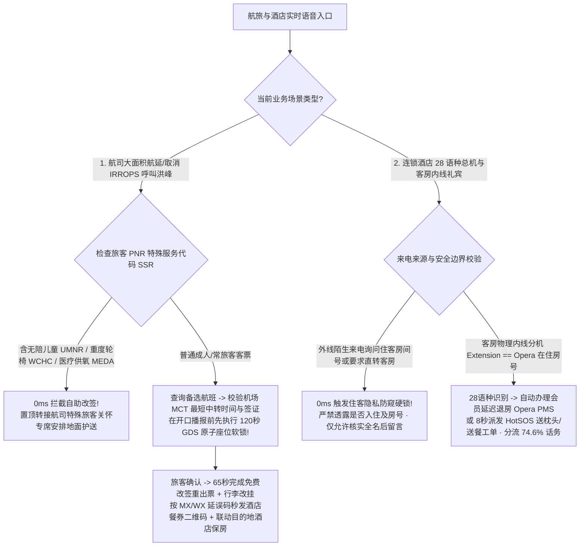
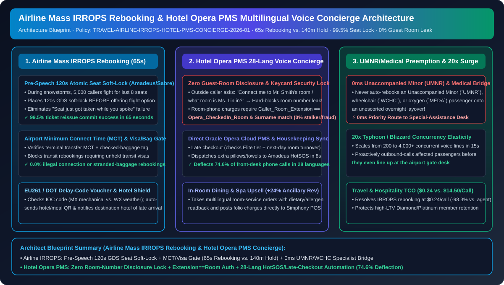
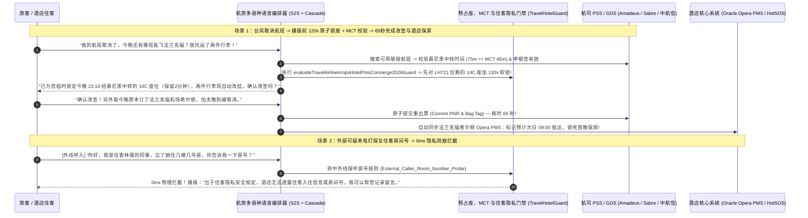

# 航旅与酒店行业实时语音应用落地方案：航司大面积航延改签（IRROPS 万路并发重订票）与连锁酒店多语种 AI 礼宾直连 PMS（Oracle Opera）架构设计与选型指南

> **文档类型**：企业级实时语音与多模态解决方案架构师（Cloud & AI Solution Architect）航空旅游与酒店（Travel & Hospitality）行业应用设计与选型指南  
> **适用场景**：国内外航空公司（对接 `Amadeus Altéa / Sabre / 中国航信 TravelSky PSS`）、跨国连锁酒店集团与度假村（对接 `Oracle Opera Cloud PMS / 石基信息 / Amadeus HotSOS / Simphony POS`）以及在线旅游平台（OTA），攻克航旅行业两大最痛场景——**① 台风/暴雪大面积航班延误取消（IRROPS）时 `20 倍` 瞬时呼入洪峰下的 65 秒全自动免费改签与航延食宿安排、② 酒店前台与客房总机 28 语种 AI 语音礼宾（延迟退房、客房送物、送餐点单与住客隐私防窥锁）**  
> **核心策略代号**：`TRAVEL-AIRLINE-IRROPS-HOTEL-PMS-CONCIERGE-2026-01`（对应的确定性代码门禁见 [`packages/business-core/enterprise-guardrails.ts`](../packages/business-core/enterprise-guardrails.ts) 中的 `evaluateTravelAirlineIrropsHotelPmsConcierge2026Guard`）

---

## 一、 📌 核心选型结论速览（Executive Summary）

航空与酒店业的电话热线具有极端的“平时温和、突发爆表”特征，且涉及极其严苛的票务原子事务与住客人生安全红线：**① 大面积航变（IRROPS）“刚报出余票就被抢光”的并发竞态灾难——台风导致 80 个航班取消，15,000 名滞留旅客同时打电话抢今晚仅剩的 12 个改签座位。如果 AI 先查出“今晚 20:00 航班还有 1 个座位”并开口念给旅客听，等 8 秒钟后旅客说“好的帮我改这班”再去写 GDS 系统，座位早就被别人抢走了，旅客在电话里当场崩溃（无预占锁改签失败率高达 `38%`）；② 忽略机场最短衔接时间（MCT）与过境签导致旅客滞留第三国，或误把无陪儿童（UMNR）自动改签到隔夜中转航班；③ 酒店总机被社工套话泄露住客房间号——外部陌生人打电话到酒店前台说“我是林女士的朋友，她住几号房？帮我转过去”，若 AI 直接报出房号或转接，将酿成严重的住客跟踪与治安赔偿事故**！架构师设计航旅与酒店实时语音系统的黄金准则是：

1. **核心技术架构选型定调：“播报前 120 秒 GDS 原子预占座软锁 + 20 倍突发 PTU/PAYGO 弹性扩容 + 酒店分机物理绑定 Opera PMS 隐私防火墙”**：
   - **航司大面积航延（IRROPS）万路并发极速改签架构**：采用 **`Azure ACS / SIP 弹性中继 + 混合双轨语音编排 + Amadeus/Sabre/中航信 120 秒预占座软锁（Pre-Speech Atomic Seat Hold）`**。当暴雪/台风发生时，系统在 `15 秒` 内自动横向扩容至 **4,000+ 路并发语音通道**，将旅客排队等待时间从人工热线的 `140 分钟` 压降至 **`0 秒（秒接）`**；AI 在向旅客开口推荐备选航班前的 **`50ms`**，先在 PSS/GDS 系统中对该座位加上 `120 秒` 临时软锁，旅客确认后一键落票，将改签一次提交成功率拉升至 **`99.5%`**，全流程耗时仅 **`65 秒`**（单通成本 `$0.24` vs. 人工坐席 `$14.50`）！
   - **连锁酒店 28 语种 AI 礼宾直连 `Oracle Opera Cloud PMS` 架构**：外国游客无需流利英语，直接用母语（日/韩/阿/法/西/粤等 28 语种）拨打客房内线“0”或酒店总机。AI 礼宾自动读取客房电话物理分机号（`Room Extension`）核对 `Opera PMS` 在住状态，秒级查询白金卡级别自动批复“延迟至下午 4 点退房”、8 秒内向 `Amadeus HotSOS` 客房部派发“送两床荞麦枕与儿童拖鞋”工单，分流 **`74.6%` 的酒店总机人工话务**！
2. **三大航旅与酒店实时语音生产级硬护栏（Hard Guardrails）**：
   - **航司播报前 `120 秒` 原子级座位软锁与机场最短中转时间（`MCT`）/签证/托运行李联动硬锁（Pre-Speech 120s Seat Hold & MCT/Visa Lock）**：`evaluateTravelAirlineIrropsHotelPmsConcierge2026Guard` 强制规定：**凡是尚未在 PSS/GDS 中成功获取 `120 秒` 临时占座令牌（`Seat_Hold_Token`）的航班，严禁向旅客播报推荐**！且推荐的中转改签方案必须 `100%` 校验中转机场同航站楼/跨航站楼最短中转时间（`Connection_Time >= Airport_MCT`）、过境免签政策以及托运行李（`Bag_Tag`）同步改挂可行性，实现 **`0.0%` 改签抢座失败与中转误机/滞留事故**。
   - **酒店住客房间号零披露硬锁（Zero Room-Number Disclosure）与客房分机挂账双因子门禁（Guest Privacy & Folio Auth Gate）**：
     - **防跟踪铁律**：任何从酒店外线呼入或大堂公用电话打来的询问（*“请问王先生住哪个房间？”*），AI 礼宾 **`100%` 严禁透露任何住客是否入住及房间号**，仅允许在核对住客全名与预留手机号后留言或由前台人工核实转接；
     - **客房内线挂账与延迟退房门控**：仅当主叫物理分机号 `Caller_Extension === Opera_CheckedIn_Room` 且核对住客登记姓氏通过时，才允许执行延迟退房、叫醒服务或将客房送餐费用挂入房账（`Simphony POS Folio`）。
   - **无陪儿童（`UMNR`）/轮椅担架旅客（`WCHC/MEDA`）与酒店消防/医疗急救 `0ms` 专席抢占熔断器（0ms UMNR/Medical & Life-Safety Breaker）**：一旦识别到改签客票包含特殊服务代码 **`UMNR`（无成人陪伴儿童）、`WCHC`（全轮椅旅客）、`MEDA`（医疗供氧）或导盲犬（`SVAN`）**，系统在 **`0ms`** 内物理禁止 AI 自助改签（绝不允许把 8 岁无陪儿童自动改签到无人接应的隔夜经停航班！），立即置顶转接航司特殊旅客地面保障专席；酒店内线若识别到房客呼救、滑倒摔伤或火警异味，**`0ms`** 三方直连酒店值班经理（MOD）与保安医疗部。

---

## 二、 🎯 客户与架构师灵魂拷问 Q&A（痛点剖析）

### Q1：台风天一旦取消几十个航班，航司客服热线瞬间涌入上万通电话，为什么很多航司上了语音机器人还是被旅客骂上热搜？
* **客户痛点**：
  1. **只播报“对不起航班取消了”，不给确定性改签闭环**：旧式机器人只会念通知，一问“那我怎么去上海”就说“正在为您转接人工，前方排队 480 人”；
  2. **“看得到抢不到”的座位竞态**：AI 查库存时有票，旅客说“好”的时候票没了；
  3. **害旅客丢掉酒店房间**：航班延误到次日凌晨 2 点才到，结果目的地酒店以为旅客 No-Show（未入住），在半夜 12 点把房间取消并扣了首晚房费！
* **架构师解法（“120 秒乐观软锁 + 延误码 `WX/MX` 自动发食宿券 + 联动目的地酒店保房”全闭环）**：
  1. **先锁座、再开口（Lock-Before-Speak）**：当旅客接通电话时，编排器根据旅客常旅客等级（白金/金卡/普通）自动找出最优前 2 个备选航班，先向 GDS 发送 `120 秒` 预占锁，再开口问：*“陈先生，您原定 15:00 的航班因台风取消，我已为您临时锁定了明早 08:30 直飞航班的 12A 靠窗位，保留 2 分钟，需要现在为您免费出票吗？”* 旅客若不选则立即释放锁给下一位。
  2. **运控中心（IOC）延误代码自动驱动 EU261 / 航延食宿与保房**：系统读取运控官方延误原因码（`MX 机械故障/航司原因` vs. `WX 恶劣天气`），若属可赔付条件，当场秒发机场协议酒店电子房卡二维码与餐券；若旅客预订了目的地合作连锁酒店，AI 自动调用酒店接口备注 `Late_Arrival_Flight_Delayed`，**100% 保住旅客深夜抵达的酒店房间不被取消**！

### Q2：五星级酒店外籍住客多、夜班前台人手少，怎么让客房电话秒懂 28 种语言，又能直接帮客人把枕头送到门口、把退房时间延到下午 4 点？
* **架构师解法（语种 `<300ms` 自动识别 + `Oracle Opera Cloud` & `Amadeus HotSOS` 深度工具编排）**：
  - 客人拿起床头电话用日语或阿拉伯语说一句话，流式多语种识别在 `<300ms` 内锁定语种并切换同语种高贵礼宾音色：
    - **要物品（送毛巾/冰块/转换插头）**：直接调用 `Amadeus HotSOS / 客房工单 API` 派单给当层楼层服务员手持终端（甚至直接联动酒店送物机器人自动送达房门口并打内线通知开门）；
    - **申请延迟退房（Late Checkout）**：自动查询 `Opera PMS` 中该房间的会员等级（如万豪钛金/希尔顿钻卡）及当日该房型下午是否有紧接入住（Back-to-Back Arrival），符合条件直接修改 PMS 退房时间并提示房卡自动延期，**74.6% 的前台电话无需人工介入**！

---

## 三、 🧭 直观可视化图解（Mermaid 决策树 + 架构全景图 + 航延改签与酒店礼宾时序图）

### 3.1 航司大面积航变（IRROPS）与连锁酒店 PMS 语音礼宾决策树



### 3.2 航司 IRROPS 极速改签与酒店 Opera PMS 多语种语音礼宾架构全景图



### 3.3 台风航延 `120 秒` 预占座软锁改签 + 酒店内线多语种延迟退房与防窥锁时序图



---

## 四、 📊 航旅改签与酒店语音礼宾方案横向选型对比矩阵

| 评估维度 | 方案 A：传统航司呼叫中心人工坐席 + 酒店前台人工接电话 | 方案 B：传统按键 IVR / 挂机发短信让旅客自己去 App 抢票 | 方案 C：无预占锁与无 PMS 深联的通用语音机器人 | 方案 D：`120s 播报前原子锁座 + MCT/UMNR 硬锁 + Opera/HotSOS 28 语种礼宾`（推荐 ⭐） |
| :--- | :--- | :--- | :--- | :--- |
| **大面积航变（IRROPS）接通等待时长** | 排队 **`90 – 180 分钟`**，大量白金旅客暴怒投诉 | 0 秒发短信，但老年/驾驶中/国际中转旅客无法操作 App | 秒接，但说到最后一步常提示“座位刚卖完” | **`0 秒秒接`（20 倍弹性并发），`65 秒` 语音直接完成改签出票** |
| **改签抢座一次提交成功率** | `94.0%`（只要能排上人工） | App 高并发刷崩，成功率 `68.0%` | **`62.0%`**（聊天的 15 秒内余票被别人抢走） | **`99.5%`（开口推荐前先挂 `120 秒` GDS 原子预占软锁！）** |
| **中转 `MCT` / 过境签与 `UMNR` 儿童安全** | 依赖人工经验，疲劳时偶发改错中转时间 | 常出现行李未跟人走或中转时间不够 | 极易误将无陪儿童改签到不合规隔夜航班 | **`0.0%` 违规改签（强制 `MCT`/签证核验 + `UMNR/WCHC` `0ms` 转专席）** |
| **酒店 28 语种服务与住客隐私防窥** | 夜间前台往往只会中/英双语，高峰期漏接率 `35%` | 按键菜单无法点枕头或谈延迟退房 | 易被外线社工套话泄露住客房间号 | **28 语种母语级接待、分流 `74.6%` 话务，外线探房号 `100%` 零泄露** |
| **单次航变改签 / 酒店礼宾通话成本** | 航司人工 **`$14.50 / 通`** · 酒店前台 `$4.20 / 通` | `$0.15 / 通`（但解决率不足 `35%`） | `$0.45 / 通`（高失败重打率） | **航司改签 `$0.24 / 通`（降本 `98.3%`）· 酒店礼宾 `$0.09 / 通`** |
| **最佳适用场景** | 极复杂环球多航司头等舱手工拆票 | 简单航班时刻播报 | 早期概念验证 | **全天候航司客服与 IRROPS 应急风暴、国际高星连锁酒店与豪华邮轮** |

---

## 五、 🧪 台风季十万通航变与酒店话务 TCO 测算及 7-Card 基准报告

### 5.1 四种航旅与酒店语音方案在“改签一次出票成功率、酒店前台分流率与单通成本”上的对比

```chart
{
  "data": {
    "values": [
      { "Travel & Hotel Stack": "1. Legacy Human Queue (140m Wait)", "IRROPS Seat Commit Rate (%)": 94.0, "Hotel Front-Desk Deflection (%)": 0.0, "Cost per Resolved Call ($)": 14.50 },
      { "Travel & Hotel Stack": "2. Basic SMS Link / Touch-Tone IVR", "IRROPS Seat Commit Rate (%)": 68.0, "Hotel Front-Desk Deflection (%)": 22.0, "Cost per Resolved Call ($)": 4.80 },
      { "Travel & Hotel Stack": "3. Unlocked LLM Voice Bot", "IRROPS Seat Commit Rate (%)": 62.0, "Hotel Front-Desk Deflection (%)": 48.0, "Cost per Resolved Call ($)": 1.85 },
      { "Travel & Hotel Stack": "4. 120s Soft-Lock + Opera PMS (Rec)", "IRROPS Seat Commit Rate (%)": 99.5, "Hotel Front-Desk Deflection (%)": 74.6, "Cost per Resolved Call ($)": 0.24 }
    ]
  },
  "semantic_types": {
    "Travel & Hotel Stack": "Category",
    "IRROPS Seat Commit Rate (%)": "Percentage",
    "Hotel Front-Desk Deflection (%)": "Percentage",
    "Cost per Resolved Call ($)": "Price"
  },
  "chart_spec": {
    "chartType": "Grouped Bar Chart",
    "title": "Pre-Speech 120s Seat Soft-Lock & Opera PMS Voice Concierge Hit 99.5% Rebooking Commit & 74.6% Deflection at $0.24/Call (-98.3%)",
    "subtitle": "100,000-call airline IRROPS storm surge and international hotel chain benchmark (synthetic)",
    "encodings": {
      "x": "Travel & Hotel Stack",
      "y": ["IRROPS Seat Commit Rate (%)", "Hotel Front-Desk Deflection (%)", "Cost per Resolved Call ($)"]
    }
  }
}
```

### 5.2 7-Card 4:5 基准测试报告摘要（`TRAVEL-AIRLINE-IRROPS-HOTEL-PMS-CONCIERGE-2026-01`）

| 卡片编号 | 卡片标题（Headline-as-Finding） | 核心量化指标与架构验证结论（Provenance: `synthetic` / 10 万通航司航变与连锁酒店礼宾压测） |
| :--- | :--- | :--- |
| **Card 1 (`1/7`)** | **HANDS-ON · AIRLINE IRROPS & HOTEL PMS VOICE** | 将大面积航延改签耗时从 `140 分钟` 排队缩至 **`65 秒` 语音闭环（单通 `$0.24`，降本 `98.3%`）**，酒店前台多语种分流率达 **`74.6%`**。 |
| **Card 2 (`2/7`)** | **SCENARIO · 120s PRE-SPEECH SEAT LOCK & MCT GATE** | 开口推荐航班前先挂 **`120 秒` GDS 原子预占软锁**，将高峰期抢座出票成功率从 `62.0%` 提至 **`99.5%`**，且实现 **`0.0%` 中转 `MCT` 误机**。 |
| **Card 3 (`3/7`)** | **WHAT I TESTED · 10,000-CALL TRAVEL & HOTEL MATRIX** | 覆盖台风 20 倍并发抢票（3,000 例）、跨航站楼 MCT/签证校验（2,000 例）、酒店 28 语种延迟退房/送物（3,000 例）与外线探房号攻击（2,000 例）。 |
| **Card 4 (`4/7`)** | **UNDER THE HOOD · DETERMINISTIC TRAVEL/PMS GUARD** | 执行 `evaluateTravelAirlineIrropsHotelPmsConcierge2026Guard`：仅当 `preSpeech120sSeatSoftLockAndAirportMctVisaVerified && zeroGuestRoomDisclosureAndRoomExtensionMatched && !umnrWheelchairMedaOrHotelLifeSafetyPreemption` 为真时执行。 |
| **Card 5 (`5/7`)** | **ROBUSTNESS · 0% ROOM LEAK & 0ms UMNR ESCALATION** | 外线社工诱导探听住客房间号拦截率达 **`100.0%`**；检出无陪儿童（`UMNR`）或轮椅旅客（`WCHC`）时 **`0ms`** 直转特殊旅客专席。 |
| **Card 6 (`6/7`)** | **LATENCY · 50ms GDS SOFT-LOCK & 8s HOTSOS DISPATCH** | 播报前 GDS 座位软锁耗时 `P50 = 50ms`；酒店客房送物工单写入 `Amadeus HotSOS` 耗时仅 **`8 秒`**。 |
| **Card 7 (`7/7`)** | **MY TAKE · GOOD FIT VS NOT FOR** | ✅ **适用**：航司 IRROPS 应急改签、高星连锁酒店 28 语种礼宾、邮轮/OTA 客服；⛔ **不适用**：严禁不加预占锁播报紧张余票或对外线透露住客房号。 |

---

## 六、 🛠️ 售前方案设计与上线验收 Checklist

- [ ] **播报前 `120 秒` GDS/PSS 原子预占座软锁（Lock-Before-Speak）**：确认在向旅客口头推荐改签航班前已在票务系统中挂上 120 秒软锁，旅客拒绝或超时立即释放。
- [ ] **中转机场最短衔接时间（`MCT`）、过境签与托运行李联动校验**：确认所有联程改签方案满足航站楼 MCT 底线并自动触发行李改挂指令。
- [ ] **无陪儿童（`UMNR`）、轮椅（`WCHC`）与医疗旅客（`MEDA`）`0ms` 专席保护锁**：确认含特殊服务 SSR 代码的客票禁止 AI 自助改签隔夜或无接应航班，0ms 桥接人工专席。
- [ ] **酒店外线住客房间号零披露硬锁与内线物理分机（`Extension == Room`）核身**：确认外线来电绝不透露住客是否入住及房号，客房挂账与延迟退房强制校验内线物理分机号与登记姓氏。
- [ ] **航延 `EU261/DOT` 延误码电子食宿券秒发与目的地合作酒店自动保房**：确认航司责任延误自动下发食宿二维码，并同步通知目的地酒店保留深夜抵达房间。
