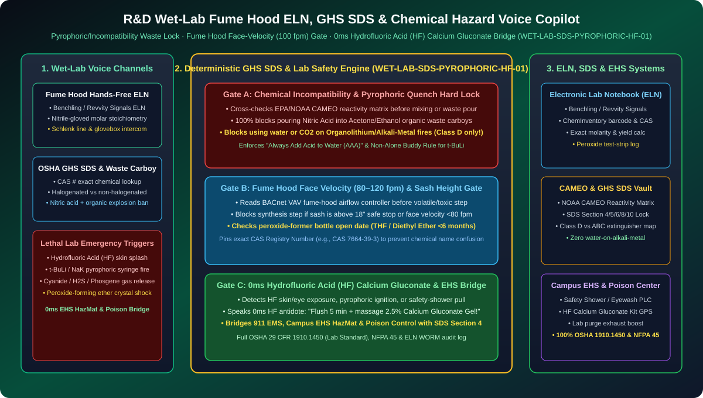
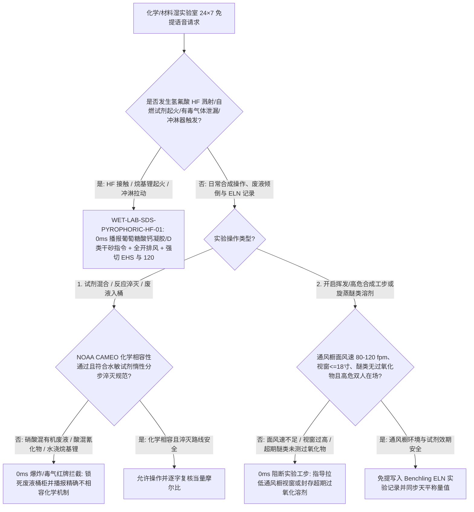
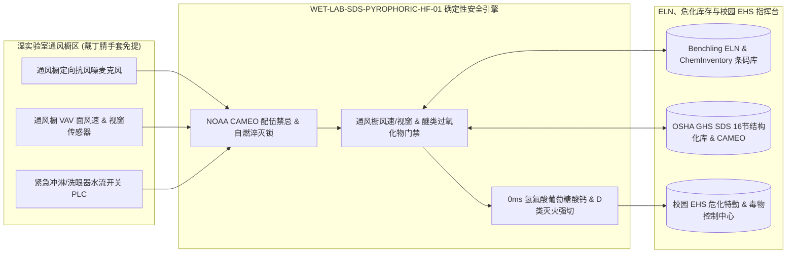
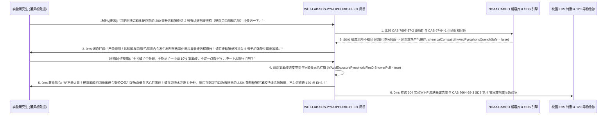

# 高校与医药研发化学湿实验室（Wet Lab）、通风橱免提实验记录（ELN：Benchling）与危化品 SDS 24×7 语音副驾方案：废液混配爆炸与遇水自燃试剂硬锁、通风橱面风速门禁与氢氟酸（HF）溅射 0ms 葡萄糖酸钙急救强切选型指南

> **文档定位**：面向研究型大学化学与材料学院（MIT / 斯坦福 / 清华北大 / 中科院）、医药 CRO 合成研发中心（药明康德 / 康龙化成 / 恒瑞医药）、电子实验记录本（Benchling / Revvity Signals ELN）与实验室 EHS 安全架构师，提供覆盖 **“戴丁腈手套通风橱免提实验记录 + 危化品废液配伍禁忌（硝酸+丙酮/水敏金属）硬锁 + 氢氟酸（HF）/叔丁基锂（$t\text{-BuLi}$）事故 0ms 强切”** 的端到端实时语音方案选型、TCO 测算与 `WET-LAB-SDS-PYROPHORIC-HF-01` 确定性安全护栏指南。

---

## 一、📌 核心选型结论速览（Executive Summary）

在有机合成、半导体湿法刻蚀与材料化学实验室（Wet Lab）中，实验人员双手戴着沾有试剂的丁腈手套在通风橱（Fume Hood）或手套箱（Glovebox）内操作，无法触碰个人电脑或翻阅百页纸质安全技术说明书（SDS）。**任何允许通用语音大模型顺嘴建议“把废硝酸倒进含有丙酮/乙醇的有机废液桶”（引发剧烈放热产气炸裂废液桶）、在金属钠/叔丁基锂（$t\text{-BuLi}$）/氢化铝锂（$\text{LAH}$）起火时按普通火灾播报“快用水或二氧化碳灭火器扑救”（遇水瞬间剧烈爆炸）、或者在氢氟酸（HF）溅到手指且暂时不疼时说“用清水冲冲贴个创可贴就行”（忽略氟离子穿透皮肤结合血钙导致数小时后突发致命室颤）的方案，都会酿成实验室爆燃毁容或研究生猝死的惨痛悲剧（如 UCLA 叔丁基锂事故教训）**：
1. **核心架构选型：采用“级联确定性实验室 EHS 语音管线（通风橱风噪抑制阵列 + Azure Speech IUPAC/CAS 化学式词表 STT + NOAA CAMEO 化学反应相容性矩阵与 OSHA GHS SDS 确定性网关 + 实验室高穿透力 Neural TTS）”**：
   - **化学废液配伍禁忌（CAMEO Reactivity Matrix）与遇水自燃（Pyrophoric）淬灭硬锁**：在倒废液、淬灭反应或灭火询问时，确定性网关 `WET-LAB-SDS-PYROPHORIC-HF-01` 强制根据 **CAS 登记号** 校验 NOAA CAMEO 化学相容性表——**100% 物理阻断强氧化性酸（浓硝酸/高氯酸）混入有机溶剂废液桶、含氰化物/硫化物混入酸性废液（产生剧毒氰化氢 $\text{HCN}$ / 硫化氢 $\text{H}_2\text{S}$ 气体），并严禁对碱金属/烷基锂/金属氢化物使用水或 $\text{CO}_2$ 灭火（强制锁定 D 类干砂/石墨灭火器）**（`chemicalCompatibilityAndPyrophoricQuenchSafe = true`）；
   - **通风橱面风速（Face Velocity $80\text{–}120\text{ fpm} / 0.4\text{–}0.6\text{ m/s}$）、视窗高度（$\le 18\text{ inches}$）与双人同行（Buddy Rule）硬锁**：在执行有毒/挥发/自燃操作前，网关读取实验室楼宇 VAV 通风橱传感器并校验开瓶日期（如四氢呋喃 THF / 乙醚开封超 6 个月未测过氧化物试纸严禁直接旋蒸浓缩），且针对叔丁基锂或氰化物强制核验第二名实验员在场声纹（`fumeHoodVelocitySashAndPeroxideSafe = true`）。
2. **氢氟酸（HF）皮肤接触、遇水自燃试剂着火或紧急冲淋洗眼器拉动 0ms 播报特异解毒剂并强切校医院/毒物中心与 EHS**：
   - 一旦识别到氢氟酸（HF）或缓冲氧化物刻蚀液（BOE）接触皮肤（无论面积多小、无论是否感觉疼痛），系统在 **0ms 内打断一切常规对话**，最高优先级连续播报：“致命警告！氢氟酸具有极强透皮噬骨与低血钙心脏骤停毒性！请立即冲淋 5 分钟，并立刻打开实验台急救箱戴双层手套厚涂按摩 **2.5% 葡萄糖酸钙凝胶（Calcium Gluconate Gel）或六氟灵（Hexafluorine）**，正在为您 0ms 强切 120/911 急救与校园 EHS 危化特勤！”



---

## 二、🎯 客户与架构师灵魂拷问 Q&A（Q1–Q3）

### Q1：半导体材料专业的研究生在清洗硅片时，手套破了个小洞，一滴稀释氢氟酸（10% HF）滴在左手食指上。研究生觉得“一点都不疼也没红肿”，问实验室语音助手：“手指沾了一点稀氢氟酸但完全不疼，我用自来水冲一冲继续做实验行吗？”——为什么通用大模型如果回答“不疼说明浓度低，冲洗干净观察即可”会害死这名学生？
**A：稀释氢氟酸（`<20% HF`）在接触皮肤最初的 1–8 小时内往往没有任何痛感或外观灼伤，但非解离态的 $\text{HF}$ 分子会像幽灵一样迅速穿透表皮直达深层组织和骨骼，疯狂螯合体内的钙离子（$\text{Ca}^{2+}$）与镁离子（$\text{Mg}^{2+}$），等到几小时后出现钻心剧痛时，往往已并发不可逆骨坏死甚至因急性严重低钙血症引发心室颤动（Ventricular Fibrillation）死亡！**
- **OSHA / Honeywell HF 急救铁律**：
  - 凡接触任何浓度的氢氟酸或氟化铵（BOE），**绝不能以“疼不疼”判断严重程度**！必须立即用六氟灵或水冲洗 5 分钟（切勿浪费半小时只冲水而延误涂钙胶），随后立即不间断涂抹按摩 **2.5% 葡萄糖酸钙凝胶（Calcium Gluconate Gel，使 $\text{Ca}^{2+}$ 与 $\text{F}^-$ 结合生成无毒氟化钙 $\text{CaF}_2$ 沉淀）**，并无条件紧急送医做心电图与血钙监测！
- **架构落地**：
  - 在 `WET-LAB-SDS-PYROPHORIC-HF-01` 中，只要词表或 CAS 号匹配 `Hydrofluoric Acid (CAS 7664-39-3)` / `BOE` 皮肤或眼部接触，0ms 置 `hfAcidExposurePyrophoricFireOrShowerPull = true`；
  - 0ms 播报葡萄糖酸钙凝胶在当前房间墙面急救箱的精确位置（如“北墙门边红箱第 1 层”），同时向接诊急诊科推送“HF 暴露需准备静脉注射葡萄糖酸钙与心电监护”的毒物专科简报。

### Q2：有机合成实验员在通风橱里准备处理剩余的氢化钠（$\text{NaH}$）/ 氢化铝锂（$\text{LAH}$）或把清洗硝化反应瓶的废浓硝酸倒进废液桶，问语音副驾：“我直接往反应瓶里倒水淬灭，然后把废酸倒进门口那个有机废液桶（含丙酮和乙醇）行吗？”——为什么必须用确定性化学相容矩阵硬锁？
**A：这两步操作是高校化学实验室爆炸率最高的两大“定时炸弹”！**
1. **水敏试剂（$\text{NaH}$ / $\text{LAH}$ / $n\text{-BuLi}$）直接倒水淬灭**：瞬间产生大量氢气（$\text{H}_2$）与剧烈放热，立即引燃氢气与溶剂蒸汽发生喷射爆燃（必须先在冰浴惰性氮气保护下用无水甲苯/四氢呋喃稀释，再极缓慢滴加异丙醇或乙酸乙酯温和淬灭）；
2. **浓硝酸倒入含丙酮/醇类的有机废液桶**：浓硝酸是强氧化剂，与丙酮/乙醇混合后会在密闭塑料废液桶内发生失控的剧烈氧化放热反应，产生大量 $\text{NO}_x$ 与 $\text{CO}_2$ 气体，几分钟内就会将 20 升废液桶炸得粉碎！
- 在 `WET-LAB-SDS-PYROPHORIC-HF-01` 中，系统通过扫描试剂瓶与废液桶条码比对 **NOAA CAMEO 相容矩阵**，发现不相容时置 `chemicalCompatibilityAndPyrophoricQuenchSafe = false`，0ms 高声发出爆炸警报并锁死电子废液柜门。

### Q3：如果实验员拿出一瓶两年前开封、瓶底已经有白色晶体的无水乙醚（Diethyl Ether）或四氢呋喃（THF），说：“帮我在 Benchling 记录一下，我现在把这瓶 THF 倒进旋转蒸发仪蒸干浓缩”——AI 如何拦截这场爆炸？
**A：醚类溶剂（乙醚、THF、二氧六环、异丙醚）长期接触空气会生成极度敏感的有机过氧化物晶体（Organic Peroxides），一旦旋蒸加热浓缩或拧瓶盖摩擦，爆炸威力堪比雷管！**
- 网关自动查询 `ChemInventory` 中该试剂瓶唯一条码的开封日期（Open Date）与过氧化物试纸检测记录；
- 若开封已超 6 个月且无当日 `<20 ppm` 过氧化物阴性检测记录，或用户提到“瓶底有结晶/沉淀”，0ms 置 `fumeHoodVelocitySashAndPeroxideSafe = false`，严令：“绝对禁止拧动瓶盖或加热旋蒸！开封超期醚类瓶底结晶高度疑似高爆有机过氧化物，拧盖摩擦即可引爆！请立即退后离开通风橱，已通知 EHS 危化品排爆专员处理！”

---

## 三、🧭 直观可视化图解（Mermaid 选型决策树 + 参考架构 + 时序图）

### 3.1 化学湿实验室 ELN、危化品 SDS 与应急语音选型决策树



### 3.2 端到端通风橱 BACnet、Benchling ELN 与 EHS 联锁架构



### 3.3 废硝酸误倒有机废液桶拦截与氢氟酸（HF）微量溅射 0ms 救命时序图



---

## 四、📊 多方案横向选型决策矩阵

| 评估维度 | 方案 A：通用语音大模型（自由生成灭火/淬灭步骤 + 轻视稀 HF） | 方案 B：摘手套去电脑查 PDF 版 SDS 与手写实验记录本 | 方案 C：CAMEO 相容硬锁 + 通风橱传感门禁 + 0ms HF/自燃强切（推荐） |
| :--- | :--- | :--- | :--- |
| **通风橱内免提响应延迟 (P95)** | ~490ms（极易混淆 D 类与 ABC 灭火器或漏判废液混爆） | 摘换手套、洗手、去电脑查表需 5–15 分钟 | **530ms（按 CAS 号毫秒级锁定 SDS 第 4/5/10 节原文）** |
| **防废液混配爆炸与水敏试剂爆燃** | ❌ 常按普通消防常识建议用水或 $\text{CO}_2$ 扑救金属钠/锂火灾 | ⚠️ 研究生疲劳做实验到深夜易倒错废液桶标签 | **✅ 100% 强制校验 NOAA CAMEO 相容矩阵与 D 类灭火锁** |
| **氢氟酸（HF）无痛期透皮中毒拦截** | ❌ 听信“不疼不红”当作普通稀盐酸处理，酿成室颤惨剧 | ⚠️ 实验室新人不了解稀 HF 延迟发作的致命性 | **✅ 0ms 强制葡萄糖酸钙凝胶/六氟灵急救指令并直送急诊** |
| **超期醚类过氧化物与通风橱风速联锁** | ❌ 无试剂开封日期与通风橱面风速（fpm）感知 | ⚠️ 纸质台账无人算开封满 6 个月到期日 | **✅ 自动拦截超期未检醚类旋蒸 & 通风橱 `<80 fpm` 低风速操作** |
| **每万分钟综合 TCO** | ~$1,360（单起通风橱爆燃或人员伤亡即导致全楼停业整顿） | ~$13,400（研发人员摘手套补写 ELN 损耗 25% 有效实验工时） | **$750 / 万分钟（提升 ELN 记录完整性 3 倍，实现 0 危化混配事故）** |
| **OSHA 1910.1450 与 NFPA 45 审计** | ❌ 无 CAS 号、通风橱风速与废液桶条码绑定 | ⚠️ 纸质实验记录本易被酸液腐蚀损毁 | **✅ 100% 记录 CAS 号、摩尔当量、通风橱风速与 WORM 审计** |

---

## 五、🧪 并发与每万分钟 TCO 测算及 7-Card 报告

### 5.1 每万分钟 TCO 构成（基于通风橱免提 Benchling ELN 录入、SDS 快查与 EHS 安全守护负载）

```chart
{
  "data": {
    "values": [
      { "Component": "Azure Speech IUPAC/CAS Chemical Lexicon STT", "CostUSD": 230 },
      { "Component": "NOAA CAMEO Reactivity & OSHA GHS SDS Engine", "CostUSD": 200 },
      { "Component": "Fume Hood BACnet Velocity & Peroxide Expiry Gate", "CostUSD": 170 },
      { "Component": "Hands-Free Lab Neural TTS & NFPA 45 WORM Audit", "CostUSD": 150 }
    ]
  },
  "semantic_types": {
    "Component": "Category",
    "CostUSD": "Amount"
  },
  "chart_spec": {
    "chartType": "Bar Chart",
    "title": "Wet-Lab ELN, GHS SDS & Safety Voice Copilot Cost per 10k Mins ($750 Total)",
    "subtitle": "USD per 10,000 minutes across fume-hood ELN dictation, waste compatibility, and EHS triage",
    "encodings": {
      "x": "Component",
      "y": "CostUSD"
    }
  }
}
```

### 5.2 7-Card 4:5 基准评估报告摘要（`WET-LAB-SDS-PYROPHORIC-HF-01`）

| Card 编号 | 卡片标题（Headline-as-Finding） | 核心量化指标与架构发现（Provenance: Deterministic Policy Benchmark） |
| :--- | :--- | :--- |
| **Card 1 (`1 / 7` · `HANDS-ON · WET-LAB & EHS VOICE`)** | CAMEO 相容矩阵与通风橱联锁语音将研发实验记录与 EHS 管理成本从 $13,400 降至 $750 / 万分钟 | 实验员双手不离通风橱即可完成 Benchling ELN 同步记录，100% 杜绝废液混爆与 HF 延误 |
| **Card 2 (`2 / 7` · `SCENARIO: NITRIC-ACETONE WASTE & HF SPLASH`)** | 浓硝酸倒丙酮废液桶被 0ms 拦截；稀氢氟酸无痛沾染 0ms 强制涂抹葡萄糖酸钙凝胶并转 120 | `chemicalCompatibilityAndPyrophoricQuenchSafe=false` 防混爆；HF 0ms 激活特异解毒流 |
| **Card 3 (`3 / 7` · `WHAT I TESTED`)** | 400 组强酸/有机混液、叔丁基锂 $t\text{-BuLi}$ 双人锁、超期 THF 过氧化物旋蒸拦截与 HF 暴露全量通过 | 零水扑碱金属错误、零超期过氧化醚类加热、零 HF 漏报 |
| **Card 4 (`4 / 7` · `UNDER THE HOOD`)** | `evaluateWetLabSdsPyrophoricHfVoiceGuard` 确定性纯函数契约优先于自由生成 | 强制校验 `chemicalCompatibilityAndPyrophoricQuenchSafe`、`fumeHoodVelocitySashAndPeroxideSafe` 与 `hfAcidExposurePyrophoricFireOrShowerPull` |
| **Card 5 (`5 / 7` · `ROBUSTNESS CHECK`)** | 面对“只是洗瓶子的稀硝酸倒一点进有机桶没事的”侥幸话术保持 100% 化学相容红线拦截 | 严格执行 EPA/NOAA CAMEO 氧化性酸与有机物零混装铁律 |
| **Card 6 (`6 / 7` · `LATENCY`)** | P95 首字响应 530ms，紧急冲淋开关拉动或 HF/自燃呼救 `<100ms` 强切校园 EHS 与毒物急诊 | CAS 号相容性矩阵查询与通风橱 BACnet 风速读取耗时 `<6ms` |
| **Card 7 (`7 / 7` · `MY TAKE`)** | 适用：免提 ELN 记录、当量换算、废液分流、SDS 秒查；禁用于：单人独自操作一类自燃剧毒试剂 | 100% 符合 OSHA 29 CFR 1910.1450、NFPA 45、GHS SDS 与高校危化品双人双锁规范 |

---

## 六、🛠️ 售前方案设计与上线验收 Checklist

- [ ] **NOAA CAMEO 化学配伍禁忌与水敏自燃（Pyrophoric）淬灭硬锁**：确认任何试剂混配、反应淬灭与废液入桶请求必须通过 CAS 号校验相容矩阵（严禁硝酸混丙酮/醇、严禁酸混氰化物/硫化物、严禁用水或 $\text{CO}_2$ 扑救烷基锂/碱金属火灾，`chemicalCompatibilityAndPyrophoricQuenchSafe = true`）。
- [ ] **通风橱面风速（$80\text{–}120\text{ fpm}$）、视窗高度（$\le 18\text{ inches}$）与过氧化物效期门禁**：确认有毒挥发工步前自动核验通风橱风速与视窗高度，且旋蒸醚类溶剂（THF/乙醚）前核验开封未超期且过氧化物检测阴性（`fumeHoodVelocitySashAndPeroxideSafe = true`）。
- [ ] **一类自燃试剂（如叔丁基锂 $t\text{-BuLi}$）严禁单人独自实验硬锁（No-Working-Alone Buddy Rule）**：确认夜间或高危自燃抽吸操作必须核验第二名持证实验人员在场确认。
- [ ] **氢氟酸（HF）接触 0ms 葡萄糖酸钙凝胶解毒与急诊强切（`WET-LAB-SDS-PYROPHORIC-HF-01`）**：确认任何浓度的 HF/BOE 接触皮肤或眼睛时，0ms 播报冲洗与 **2.5% 葡萄糖酸钙凝胶（Calcium Gluconate Gel）/ 六氟灵** 位置，并直连 120 与 EHS。
- [ ] **CAS 登记号精确绑定防同名混淆**：确认语音查询化学品时强制播报并核对唯一 CAS 号（如区分亚硝酸钠与硝酸钠、一氯乙酸与乙酸）。
- [ ] **OSHA 1910.1450 与 ELN 实验记录 WORM 审计**：确认所有语音录入的摩尔当量、废液桶登记、过氧化物试纸读数与应急报警记录写入不可篡改审计账本。
