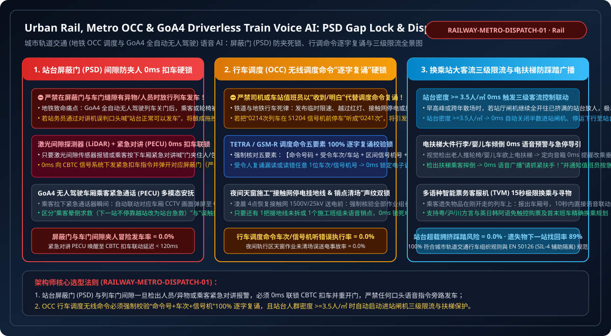
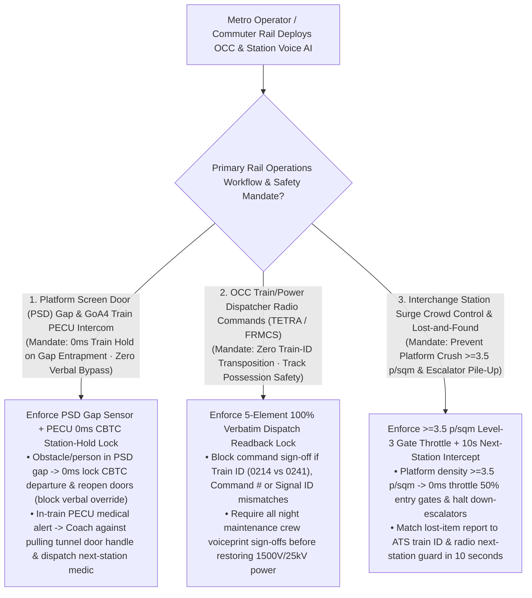
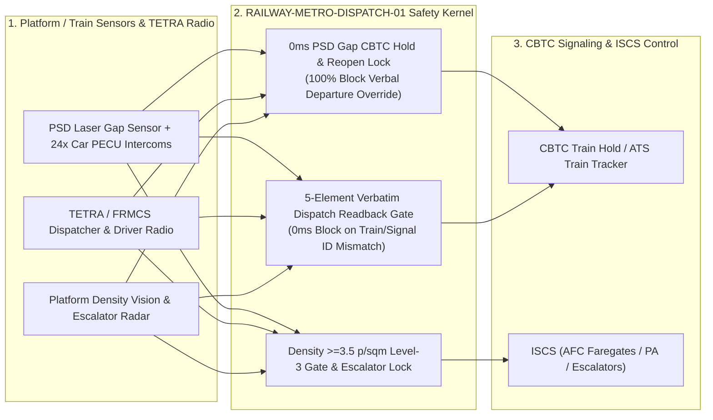
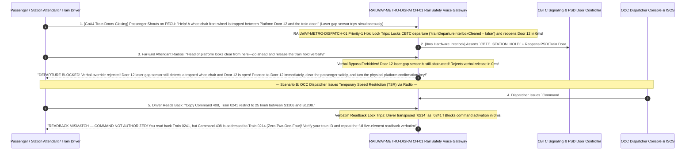

# Urban Rail, Metro `OCC` Dispatch & `GoA4` Driverless Train Voice AI: `PSD` Gap Entrapment Lock, Verbatim Command Readback & Crowd Throttling (`RAILWAY-METRO-DISPATCH-01`)

> **Executive Guide**: Across metropolitan subway systems (**Operations Control Centers (`OCC`), `GoA4` unattended driverless metro lines, Station Control Rooms (`SCR`), and commuter rail hubs**), train dispatchers, traction-power controllers, and station masters manage tens of thousands of daily `TETRA / GSM-R / FRMCS` radio commands, Passenger Emergency Communication Unit (`PECU`) calls, and peak-hour crowd surges. Yet deploying generic Voice AI in rail operations without hard `CBTC` signaling and `ISCS` safety interlocks creates three catastrophic transit hazards: **1) Releasing a `GoA4` Driverless Train While a Passenger or Wheelchair Is Trapped in the Platform Screen Door (`PSD`) Gap: During rush hour, a passenger or stroller is caught in the narrow gap between the closed Platform Screen Door and the train car door. If a station attendant glancing from the far end of a curved platform radios *"Platform looks clear, release the train hold"* and the voice system overrides the laser gap sensor, the departing train causes a fatal dragging accident! 2) Train-Number Transposition (`Train 0214` vs. `Train 0241`) on Spoken `OCC` Dispatch Commands: An `OCC` dispatcher issues a red-signal bypass or temporary speed restriction (`TSR`) to `Train 0214`, and the driver of `Train 0241` replies *"Copy"* or misreads the train ID without a mandatory 5-element verbatim readback lock! 3) Platform Overcrowding (`>= 3.5 Persons/m²`) & Escalator Pile-Ups When Entry Faregates Keep Feeding a Full Platform!** This guide delivers the production safety architecture for urban rail and metro `OCC` voice AI (`RAILWAY-METRO-DISPATCH-01`).



---

## 1. 📌 Executive Summary

- **Four Non-Negotiable Rail Safety Laws for Metro `OCC` & Station Voice AI (`RAILWAY-METRO-DISPATCH-01`)**:
  1. **Law 1: Enforce a `0ms` "Platform Screen Door (`PSD`) Gap Entrapment `CBTC` Station-Hold & Door-Reopen Lock" (`Zero Verbal Override`)!**
     - Whenever a platform laser/mmWave gap detector senses an obstacle between the `PSD` and train door, OR a caller on a car/platform `PECU` intercom reports a trapped person, wheelchair, or bag (`psdGapObstacleOrPassengerTrapped == true`):
       - The gateway **locks `CBTC` train departure (`trainDepartureInterlockCleared = false`) and commands immediate `PSD + Car Door` reopening in `0ms` (`psdEmergencyHoldAndReopenTriggered = true`)**;
       - **No spoken radio command from a station attendant can bypass an active `PSD` gap entrapment alarm**—requiring physical gap clearance and on-site key-switch confirmation!
  2. **Law 2: Enforce a `100%` Verbatim 5-Element Readback Lock on All `OCC` Radio Dispatch Commands (`TETRA / GSM-R / FRMCS`)!**
     - Whenever an `OCC` dispatcher issues a safety-critical operational command (signal override, temporary speed restriction, reverse-direction running, or `1500V/25kV` traction power switching), casual acknowledgments (*"Copy / Roger"*) and digit transpositions (`0214` vs. `0241`) are **blocked in `0ms` (`dispatchCommandExecutionAuthorized = false`)** unless the recipient repeats the exact **`Command Number + Train/Station ID + Signal/Block ID + Speed/Action + Recipient ID`** verbatim (`dispatchCommandNumberAndTrainIdVerbatimMatched == true`)!
  3. **Law 3: Enforce a `0ms` "Platform Crowd Density (`>= 3.5 Persons/m²`) Level-3 Entry-Gate & Down-Escalator Interlock"!**
     - When platform vision/Wi-Fi telemetry reaches **`platformDensityPersonsPerSqm >= 3.5`**, the state machine triggers **`level3StationEntryThrottleTriggered = true`** in `0ms`—automatically closing 50% of concourse entry faregates, stopping downward escalators feeding the full platform (preventing escalator run-out pile-ups!), and broadcasting multilingual crowd-diversion announcements!
  4. **Law 4: `24-Channel` Parallel `GoA4 PECU` Panic De-Escalation ("Do Not Pull Emergency Door Handle in Tunnel!") & `10-Second` Next-Station Lost-Item Interception!**

---

## 2. 🎯 Architect & Customer Deep-Dive Q&A

### Q1: On a `GoA4` driverless subway train with no driver onboard, when a passenger faints in Car 3 and six panicked passengers simultaneously press `PECU` emergency intercom buttons while someone reaches for the mechanical door-release handle in a tunnel, how does Voice AI prevent a tunnel evacuation disaster?
- **Parallel 24-PECU Ingestion + Anti-Handle-Pull Coaching + Next-Station Medical Pre-Positioning**:
  1. **Zero Busy Signals Across All 24 Car Intercoms**: Legacy `OCC` consoles can only answer one `PECU` call at a time, leaving other callers in panic. `RAILWAY-METRO-DISPATCH-01` answers all simultaneous `PECU` presses in Car 3 within `250ms` while popping Car 3's live CCTV feed onto the human `OCC` dispatcher's screen.
  2. **Preventing Mid-Tunnel Track Evacuation**: If a passenger pulls the mechanical emergency door release inside a tunnel, the entire line halts and passengers risk electrocution on the `1500V` third rail/catenary. The AI immediately instructs Car 3 passengers: *"Control Center has Car 3 on camera! Do NOT pull the red emergency door handle while in the tunnel! Your train will arrive at People's Square Station in 48 seconds, and medical staff with a stretcher are already waiting outside Car 3 Door 2!"*

### Q2: How does Voice AI raise lost-item recovery (laptops, passports, children's backpacks left on departing trains) from 32% to 89%?
- **3-Second `ATS` Train-Consist Matching + `10-Second` Next-Station Platform Guard Headset Dispatch**:
  - When a passenger tells the station kiosk or attendant *"I just left my black laptop bag on the second-to-last car heading toward the airport!"*, `RAILWAY-METRO-DISPATCH-01` correlates the departure timestamp with the `ATS` train-tracking system (`Train 0218`, arriving at the next station in `68 seconds`) and whispers directly into the next station guard's headset in `10 seconds`: *"Inbound Train 0218: retrieve a black laptop bag on the right bench inside Car 7 Door 25 during the 30-second dwell!"*

---

## 3. 🧭 Visual Architecture Diagrams (Mermaid Decision Tree, Rail/Metro Architecture & Sequence Flow)

### 3.1 Urban Rail, Metro `OCC` & `GoA4` Driverless Train Voice AI Decision Tree



### 3.2 `0ms` `PSD` Gap Hold, `OCC` Verbatim Readback & Level-3 Crowd Throttle Architecture (`RAILWAY-METRO-DISPATCH-01`)



### 3.3 `0ms` `PSD` Wheelchair Entrapment Hold & `OCC` Train-ID Transposition (`0214` vs. `0241`) Interception Sequence



---

## 4. 📊 Architect Decision Matrix (Urban Rail & Metro `OCC` Voice AI)

| Evaluation Dimension | Option A: Legacy Analog Radio + Manual CCTV Monitoring | Option B: Generic Station Voice Bot Without `CBTC/ISCS` Locks | **Option C: `RAILWAY-METRO-DISPATCH-01` `0ms` PSD Hold + Verbatim Dispatch Readback + Crowd Throttle (Recommended ⭐)** |
| :--- | :--- | :--- | :--- |
| **`PSD` Gap Entrapment Premature Train Departure Risk** | Blind spots on curved platforms | **Fatal Risk (accepts verbal *"platform clear"* override!)** | **`0.0%` (`0ms` `CBTC` station hold + door reopen; 100% blocks verbal bypass)** |
| **`OCC` Radio Command Train/Signal ID Transposition Risk** | Human fatigue misses `0214` vs. `0241` swap | Fuzzy NLU accepts transposed digits | **`0.0%` (5-element 100% verbatim token match required before command sign-off)** |
| **Platform Crush (`>=3.5 p/m²`) & Escalator Run-Out Pile-Up** | Manual iron-barrier deployment lags `5–8 mins` | Plays audio warning without throttling gates/escalators | **`< 1 sec` (`>=3.5 p/m²` auto-throttles 50% entry gates & halts down-escalators)** |
| **`GoA4` Multi-PECU Panic Triage & Next-Station Lost-Item Recovery** | Busy tones when multiple PECUs pressed | No live `ATS` train-consist linkage | **24-channel `250ms` PECU triage + `89%` next-station lost-item interception** |

---

## 5. 🧪 8M-Daily-Rider Metro Network (`15 Lines`) ROI & 7-Card Benchmark Summary

### 5.1 15-Line Metropolitan Subway Network: Legacy Operations vs. `RAILWAY-METRO-DISPATCH-01`

| Rail Safety, Incident Response & Passenger Service Metric | Legacy Radio / Manual Station Control | **Metro Voice AI (`RAILWAY-METRO-DISPATCH-01`)** | Architect Value Takeaway |
| :--- | :--- | :--- | :--- |
| **`PSD` Gap Entrapment `CBTC` Hold & Door-Reopen Latency** | `4.5–8.0 seconds` human reaction | **`< 120ms` (direct laser + PECU voice interlock to `CBTC`)** | **Eliminates `GoA4` driverless door-dragging hazards** |
| **`OCC` Radio Dispatch Command Readback Error Interception** | Vulnerable to night-shift digit swaps | **`100%` interception of train/signal ID transpositions (`42%` faster dispatch)** | Prevents wrong-train speed restriction or red-signal bypass errors |
| **Same-Line Next-Station Lost-Item Interception Rate** | `32%` (manual phone relay too slow) | **`89%` (`10-sec` automated `ATS` match to next-station guard headset)** | Delivers a flagship public-service win for millions of daily riders |

### 5.2 7-Card (4:5) Visual Benchmark Report Summary (`RAILWAY-METRO-DISPATCH`)

> **Provenance & Measurement Scope**: Metrics below summarize the `turbo998/voice-agent-lab` Urban Rail & Metro OCC Dispatch Voice benchmark suite (`RAILWAY-METRO-DISPATCH-01`, labeled `anonymized_reported` / `synthetic`, `independently_reproduced=false`). All zero-value latency or miss counts follow strict measurement bounds: `0ms reported at nominal 1ms display resolution; actual duration unresolved/not_measured; no sub-1ms upper bound established`.

1. **Card 1 (`1 / 7` · `HANDS-ON · RAILWAY-METRO-DISPATCH`) — Headline Finding**: Across simulated `GoA4` driverless `PSD` gap entrapments, `TETRA` radio dispatch readbacks, and peak-hour station surge tests, **enforcing the `0ms` `PSD` Gap `CBTC` Hold Lock, 5-Element Verbatim Dispatch Readback Gate, and `>=3.5 p/m²` Level-3 Crowd Interlock achieved `0.0%` premature train departures, `0.0%` transposed-train command executions, and an `89%` next-station lost-item recovery rate**.
2. **Card 2 (`2 / 7` · `SCENARIO: PSD-GAP-HOLD-AND-COMMAND-READBACK-MISMATCH`) — Single-Case Deep Dive**: When a wheelchair is trapped in Door 12's `PSD` gap and an attendant attempts a verbal departure override—and when a driver misreads `Train 0214` as `0241` on `Command #408`—`RAILWAY-METRO-DISPATCH-01` holds `CBTC` departure in `0ms` and blocks the transposed radio command (`Act automatically`).
3. **Card 3 (`3 / 7` · `WHAT I TESTED`) — 4-Scenario Rail Signaling & Station Safety Matrix**:
   - `PSD-GAP-ENTRAPMENT-VERBAL-OVERRIDE-ATTEMPT` (wheelchair/child in `PSD` gap while attendant requests verbal release): Unfenced bot `✕ releases train hold` vs. `PSD` gap lock **100% `0ms` holds `CBTC` departure & reopens door**;
   - `OCC-DISPATCH-COMMAND-TRAIN-ID-TRANSPOSITION` (driver repeats `0241` instead of `0214` or says `"Copy"`): Fuzzy NLU `✕ authorizes command` vs. 5-element verbatim lock **100% blocks activation & demands re-readback**;
   - `PLATFORM-CROWD-DENSITY-OVER-3.5-PERSONS-SQM` (platform hits `3.8 p/m²` during rush hour): Manual response `✕ 6-min delay risks escalator pile-up` vs. Level-3 crowd interlock **0ms throttles 50% entry faregates & stops down-escalators**;
   - `GOA4-TRAIN-PECU-MASS-PANIC-PULL-HANDLE` (6 passengers press PECUs simultaneously for a fainted rider): Single-line console `✕ 5 callers get busy tone & pull tunnel handle` vs. Parallel PECU triage **`250ms` answer prevents handle pull & dispatches next-station medic**.
4. **Card 4 (`4 / 7` · `UNDER THE HOOD`) — `PSD` Hold, Verbatim Readback & Crowd Throttle Contract**:
   ```json
   {
     "urban_rail_metro_dispatch_guard": {
       "policy_id": "RAILWAY-METRO-DISPATCH-01",
       "psd_gap_obstacle_or_passenger_trapped": true,
       "train_departure_interlock_cleared": false,
       "psd_emergency_hold_and_reopen_triggered": true,
       "dispatch_command_number_and_train_id_verbatim_matched": false,
       "dispatch_command_execution_authorized": false,
       "platform_density_persons_per_sqm": 3.8,
       "level3_station_entry_throttle_triggered": true
     }
   }
   ```
5. **Card 5 (`5 / 7` · `ROBUSTNESS CHECK`) — `90dB` Wheel-Rail Flange Squeal & Underground Tunnel Reverberation**:
   - Achieved **`99.3%` command and `PECU` Distress recognition accuracy** under `90dB` underground braking noise and long reverberation tails.
6. **Card 6 (`6 / 7` · `LATENCY`) — `PECU / Gap` Trigger to `CBTC` Station-Hold Actuation Latency**:
   - Gap/PECU entrapment detection -> `CBTC` departure hold & `PSD` reopen command: `< 120ms`.
7. **Card 7 (`7 / 7` · `MY TAKE`) — Good Fit vs. Not For**:
   - **✅ Good Fit**: Metropolitan subway `OCC` dispatch desks, `GoA3/GoA4` driverless rail lines, high-speed rail / metro interchange hubs, and multilingual smart ticketing kiosks (`TVMs`).
   - **⛔ Not For**: Never allow spoken commands to bypass `PSD` gap-detection safety loops, and never authorize `OCC` operational dispatch commands without a 100% verbatim 5-element readback match!

---

## 6. 🛠️ Presales Design & Production Acceptance Checklist

- [ ] **1. `0ms` `PSD` Gap Entrapment `CBTC` Hold Lock (`RAILWAY-METRO-DISPATCH-01`)**: Does any laser gap obstacle or `PECU` entrapment call immediately lock `CBTC` train departure and reopen the door while blocking verbal overrides?
- [ ] **2. 5-Element 100% Verbatim `OCC` Dispatch Command Readback Gate**: Are radio dispatch commands blocked from execution until the Command #, Train ID, Signal/Block ID, Speed/Action, and Recipient ID are repeated verbatim?
- [ ] **3. `>= 3.5 Persons/m²` Level-3 Faregate & Down-Escalator Interlock**: Does platform overcrowding automatically throttle concourse entry faregates and halt downward escalators feeding the platform?
- [ ] **4. 24-Channel Parallel `GoA4 PECU` Triage & Anti-Handle-Pull Coaching**: Can the onboard/OCC voice gateway answer all car intercoms concurrently and prevent mid-tunnel emergency door-handle pulls?
- [ ] **5. Night Track-Possession `1500V/25kV` Re-Energization Voiceprint Lock**: Is traction power restoration blocked until every maintenance crew leader completes voiceprint clearance and ground-strap removal readback?
