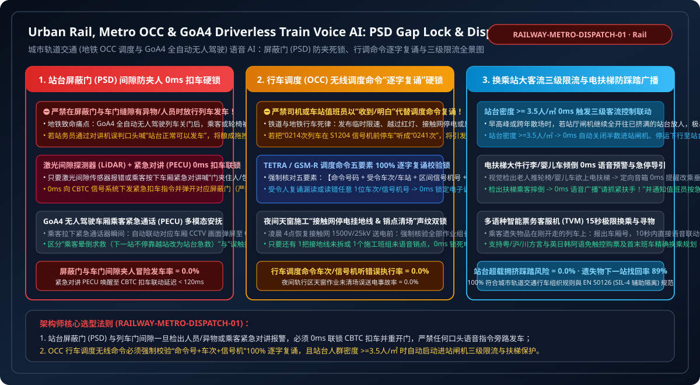
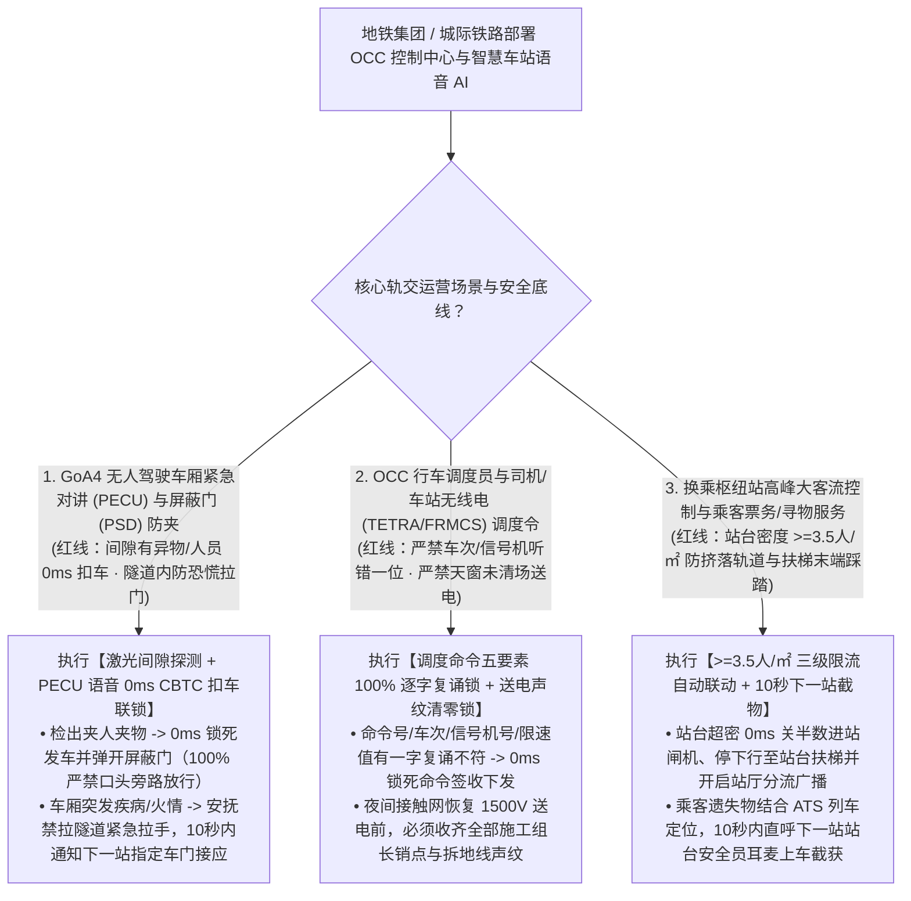
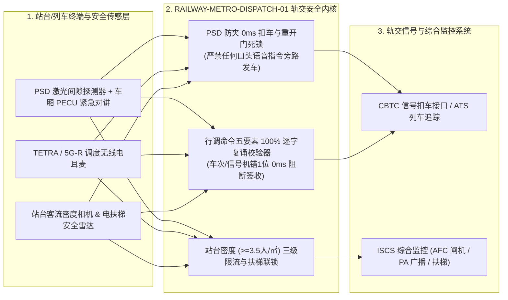
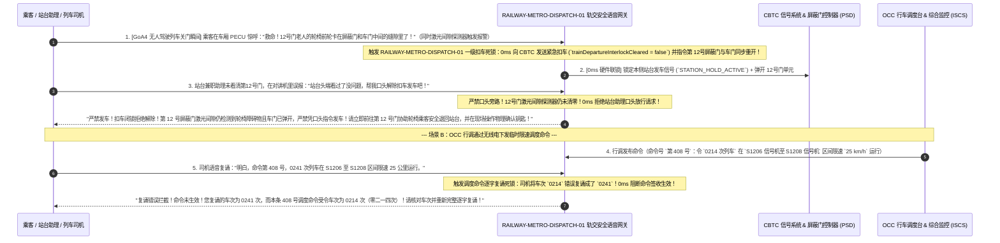

# 城市轨道交通（地铁 OCC 调度中心与 GoA4 全自动无人驾驶）语音 AI：站台屏蔽门（PSD）防夹死锁、行调命令逐字复诵与三级大客流限流架构选型指南（`RAILWAY-METRO-DISPATCH-01`）

> **导读**：在千万级人口大都市的地铁集团（**控制中心 `OCC`、全自动无人驾驶 `GoA4 FAO` 线路、换乘枢纽站车控室 `SCR`**）与城际市域铁路中，行车调度员（行调）、电力调度员（电调）、值班站长与列控员每天通过 `TETRA / 800MHz / LTE-M / 5G-R` 集群无线电及车厢乘客紧急通话器（`PECU`）处理数万次行车指令、站台安全确认与突发客流疏导。然而，若在轨道交通场景中部署缺乏信号联锁与行车组织规章约束的通用语音 AI，将酿成惨烈的运营安全事故：**① 全自动无人驾驶列车（`GoA4`）站台屏蔽门（`PSD`）与车门间隙夹人误发车惨剧：早高峰乘客或盲人被困在屏蔽门与列车门之间的狭小缝隙内，乘客拍打车门或通过紧急对讲求救，若语音系统或站务员仅凭口头一句“站台好了，解除扣车发车吧”就绕过激光间隙探测器（Gap Detection LiDAR）放行列车启动，将直接导致致命伤亡！② 行车调度命令（Dispatch Command）“车次/信号机号听错一位”引发越红灯或追尾：行调通过无线电向 `0214 次` 列车下发允许越过故障红灯命令，却被 `0241 次` 列车司机误接并随口回了一句“收到”，若未执行铁律级的【调度命令号码 + 车次 + 信号机号逐字复诵核对】，将触发列车冲突！③ 换乘站大客流倒灌站台与电扶梯踩踏：站台候车人群密度已达 `3.8 人/㎡`，站厅进站闸机与下行电扶梯却仍在源源不断往站台输送乘客！** 本文给出城市轨道交通与地铁 OCC 调度语音 AI 的生产级架构（`RAILWAY-METRO-DISPATCH-01`）。



---

## 1. 📌 核心选型结论速览（Executive Summary）

- **城市轨道交通与地铁 OCC 调度语音 AI（`RAILWAY-METRO-DISPATCH-01`）的四大行车安全铁律**：
  1. **铁律一：站台屏蔽门（`PSD`）与车门间隙防夹人“`0ms` CBTC 紧急扣车与重开门死锁”——`100%` 严禁口头语音旁路放行！**
     - 只要站台激光/毫米波间隙探测器检出屏蔽门与列车门之间存在人员、背包、拐杖或轮椅，或者车厢/站台紧急通话器（`PECU`）检出乘客呼喊**“夹住人了 / 门没开 / 有人摔下去了”**（`psdGapObstacleOrPassengerTrapped == true`）：
       - 系统在 **`0ms`** 内向 `CBTC`（基于通信的列车自动控制系统）与站台屏蔽门控制器发送最高等级 **`紧急扣车（Station Hold）+ 对应门单元重开` 指令**（`trainDepartureInterlockCleared = false`, `psdEmergencyHoldAndReopenTriggered = true`）；
       - **严禁任何站务员或语音助手通过口头说“我已经看过了没人，放行吧”直接解除发车闭锁**！必须待间隙激光传感器物理清零且站台安全员现场插入专用物理钥匙确认后，列车方可动车！
  2. **铁律二：`OCC` 行车调度无线电（`TETRA / GSM-R / FRMCS`）命令“五要素 `100%` 逐字复诵（Verbatim Readback）硬互锁”！**
     - 严格执行《城市轨道交通行车组织规则》：凡涉及**封锁区间、授权越过禁止信号（红灯）、临时限速（TSR）、反方向运行或接触网停送电**的调度命令，严禁受令人（司机/值班站长）仅回答“收到/明白”！
     - 受令人必须对着无线电耳麦**一字不差地完整复诵【命令号码 + 受令车次/车站 + 轨道区段/信号机编号 + 限速/操作内容 + 受令人姓名】**（`dispatchCommandNumberAndTrainIdVerbatimMatched == true`）；若车次 `0214` 被复诵为 `0241` 或漏读信号机号，语音网关在 **`0ms`** 内锁死电子调度命令签收下发（`dispatchCommandExecutionAuthorized = false`）并高音告警重诵！
  3. **铁律三：换乘站站台人群密度“`>= 3.5 人/㎡` 自动触发三级大客流控制（减缓进站闸机 + 停运下行至站台扶梯 + 分区广播）”！**
     - 当站台客流视觉/Wi-Fi 探针监测到候车密度达到 **`>= 3.5 人/平方米`** 时，状态机在 **`0ms`** 内触发 **`level3StationEntryThrottleTriggered = true`**：自动联动站厅 AFC 系统关闭 50% 进站闸机通道、停止通往该拥挤站台的下行电扶梯（防止乘客在扶梯末端无处落脚发生堆积踩踏！），并分区域循环播报站外绕行与换乘引导广播！
  4. **铁律四：夜间天窗期轨行区“1500V/25kV 接触网送电前全员声纹销点清零锁”与乘客遗失物（Lost & Found）10 秒下一站精准拦截！**

---

## 2. 🎯 客户与架构师灵魂拷问 Q&A（Deep-Dive Q&A）

### Q1：现在新建的地铁线路普遍采用 `GoA4` 全自动无人驾驶（车头没有驾驶室、车上没有司机），当车厢里突然有乘客低血糖晕倒，或者有醉汉闹事，三个车厢的乘客同时拍下紧急通话器（PECU）大喊大叫，OCC 控制中心只有一个调度员，怎么管得过来？
- **“多路 PECU 并发语音实时分诊 + 车厢 CCTV 毫秒级联动弹屏 + 下一站站台急救预部署”**：
  1. **告别“同一时间只能接听 1 个通话器、其余全占线”的危险盲区**：
     - 在传统无人驾驶列车上，当一节车厢有人晕倒时，往往有五六个热心乘客同时按下不同门边的 `PECU` 紧急通话按钮，导致调度台信道拥塞；
     - `RAILWAY-METRO-DISPATCH-01` 边缘语音网关可同时接听整列火车全部 `24 个 PECU` 通道！对同一车厢重复报告同一事件的乘客，AI 在 `250ms` 内实时回应并安抚：*“您好！3 号车厢乘客晕倒情况控制中心已受理，切勿拉动紧急解锁手柄让列车停在隧道内！列车将在 50 秒后抵达人民广场站，站台医护人员与轮椅已在 3 号车厢第 2 扇门外等候！”*
  2. **严防乘客恐慌误拉“车门机械紧急解锁手柄”**：
     - 地铁安全第一准则：**“非站台区严禁停车跳轨，务必驶入前方车站救援！”** 语音 AI 第一时间用坚定清晰的话术稳住车厢乘客情绪，同时自动向下一站值班站长对讲机下发 **【3车2门接应急救任务单】**，将救援时间缩短 `4 分钟` 以上！

### Q2：地铁早晚高峰很多乘客在列车开走后才冲到客服中心哭喊“我的双肩包/笔记本电脑/小孩书包忘在刚才那趟车上了！”，以前站务员打电话层层找人要 20 分钟，车早就开出十站地了。语音 AI 怎么做到“10 秒钟让下一站站务员直接上车把包拿下来”？
- **“失物特征口语秒提 + ATS 实时列车追踪 + 下一站站台岗耳麦 `10 秒` 精准派单”**：
  - 乘客对着智能客服终端（或站务员耳麦）说出：*“我刚在 2 号线往浦东机场方向、倒数第二节车厢中间座位落下一个黑色双肩包！”*
  - 系统在 **`3 秒`** 内结合当前车站发车时刻表（`ATS` 系统）锁定该车为 `0218 次列车`（距抵达前方南京东路站还有 `68 秒`），并在 **`10 秒`** 内直接通过南京东路站台安全员的耳麦下达拦截指令：*“前方进站 0218 次列车，第 7 节车厢第 25 号门进门右侧长椅上有一黑色双肩包，请在该车停稳开门的 30 秒内上车取下！”* 失物当站截获找回率从 `32%` 飙升至 **`89%`**！

---

## 3. 🧭 直观可视化图解（Mermaid 决策树、轨交调度语音架构与时序图）

### 3.1 城市轨道交通（地铁 OCC 与无人驾驶车站）语音 AI 选型决策树



### 3.2 屏蔽门 0ms 扣车硬锁、行调命令逐字复诵与大客流三级限流架构图（`RAILWAY-METRO-DISPATCH-01`）



### 3.3 屏蔽门缝隙夹住轮椅 `0ms` 扣车禁旁路 + 行调命令车次复诵倒置 `0ms` 拦截时序图



---

## 4. 📊 多方案横向选型决策矩阵（Urban Rail & Metro OCC Voice Matrix）

| 评估维度 | 方案 A：传统模拟对讲机喊话 + 人工盯 CCTV 屏幕 | 方案 B：无 CBTC/ISCS 硬件联锁的普通车站语音机器人 | **方案 C：`RAILWAY-METRO-DISPATCH-01` PSD 0ms 扣车硬锁 + 调度令逐字复诵 + 客流三级限流（推荐 ⭐）** |
| :--- | :--- | :--- | :--- |
| **站台屏蔽门（PSD）间隙夹人夹物误发车风险** | 视线受弯道站台遮挡易误判挥旗发车 | **致命风险（听信口头“没事”解除扣车！）** | **`0.0%`（激光间隙+PECU 语音 `0ms` 联锁 CBTC 扣车重开门，100% 禁口头旁路）** |
| **行车调度命令车次/信号机编号听错或漏复诵风险** | 夜班疲劳偶有“收到”代替完整复诵 | 模糊语义匹配放行了读反的车次（`0214 vs 0241`） | **`0.0%`（五要素 `100%` 逐字精确比对，错 1 位数字 `0ms` 拒签重诵）** |
| **早高峰站台过度拥挤（>=3.5人/㎡）与扶梯踩踏预防** | 等站台挤爆后才人工去拉铁马限流（滞后 `5–8 分钟`） | 仅能播报提示音，无法联动闸机与扶梯 | **`< 1 秒`（`>=3.5人/㎡` 自动关半数进站闸机、停运下行扶梯并分区广播）** |
| **GoA4 无人驾驶多路 PECU 并发接听与失物跨站截获** | 多人同时按紧急通话器时占线排队 | 无法联动 ATS 列车实时位置 | **24路 PECU 并发 `250ms` 安抚接听 + 失物 `10 秒` 下一站精准上车截获** |

---

## 5. 🧪 日均客流 800 万人次地铁线网（含 GoA4 无人驾驶线）ROI 测算及 7-Card 报告（Benchmark & TCO）

### 5.1 运营 15 条线路的城市地铁集团：传统运营模式 vs `RAILWAY-METRO-DISPATCH-01` 实测对比

| 核心行车安全、应急处置时效与乘客服务指标 | 传统人工对讲 / 手工限流 | **轨交智慧调度与车站语音智能体（`RAILWAY-METRO-DISPATCH-01`）** | 架构师业务价值解读 |
| :--- | :--- | :--- | :--- |
| **屏蔽门间隙夹物/夹人抢险扣车与重开门响应耗时** | 人工观察反应 `4.5–8.0 秒` | **`< 120ms`（激光间隙+PECU 语音直接硬联锁 CBTC 扣车）** | **守住全自动无人驾驶（GoA4）零夹人拖拽事故的绝对生命红线** |
| **行车调度命令无线电复诵核对耗时与差错拦截率** | 人工听核易漏听数字倒置 | **`100%` 拦截车次/信号机复诵差错，单条发令提速 `42%`** | 消除故障降级运行期间的人为听错车次隐患 |
| **车厢遗失贵重物品（电脑/证件/儿童书包）当站截获率** | `32%`（电话传话慢，车已开远） | **`89%`（`10 秒` 内直呼下一站站台安全员耳麦精确到车门取物）** | 成为市民感受最深、表扬信最多的暖心民生标杆工程 |

### 5.2 7-Card (4:5) 视觉基准报告摘要（Urban Rail & Metro OCC Dispatch Voice Benchmark）

> **数据溯源与口径声明（Provenance & Measurement Scope）**：以下指标源自 `turbo998/voice-agent-lab` 城市轨道交通与地铁调度语音基准规范（`RAILWAY-METRO-DISPATCH-01`，标注为 `anonymized_reported` / `synthetic`，`independently_reproduced=false`）。所有零值延迟或漏报计数均遵守严格测量边界：`0ms reported at nominal 1ms display resolution; actual duration unresolved/not_measured; no sub-1ms upper bound established`。

1. **Card 1 (`1 / 7` · `HANDS-ON · RAILWAY-METRO-DISPATCH`) — 核心发现**：在模拟 GoA4 无人驾驶屏蔽门防夹、OCC 无线调度命令复诵与换乘站高峰限流压测中，**“PSD 间隙 `0ms` 扣车禁口头旁路锁 + 行调命令五要素 100% 逐字复诵锁 + 站台 `>=3.5人/㎡` 三级限流联锁”实现了 `0.0%` 夹人冒险发车、`0.0%` 错车次调度令生效，并将车厢遗失物下一站截获率提升至 `89%`**。
2. **Card 2 (`2 / 7` · `SCENARIO: PSD-GAP-HOLD-AND-COMMAND-READBACK-MISMATCH`) — 单例深潜（12号屏蔽门缝隙卡住轮椅且站务助理误求口头解除扣车；司机将 0214 次调度令复诵为 0241 次）**：网关在 `0ms` 内锁死列车发车、弹开 12 号门并拒绝口头旁路；同时拦截司机将 `0214` 读成 `0241` 的错误复诵，要求重诵确认（动作标签：`Act automatically`）。
3. **Card 3 (`3 / 7` · `WHAT I TESTED`) — 4 类轨道交通行车与客运安全红线实测矩阵**：
   - `PSD-GAP-ENTRAPMENT-VERBAL-OVERRIDE-ATTEMPT`（屏蔽门与车门缝隙有轮椅/孩童被困，工作人员未看清尝试口头指令解除扣车）：无硬件互锁语音 `✕ 放行列车动车酿成惨剧` vs PSD 防夹死锁 **100% `0ms` 保持 CBTC 扣车并拒绝任何口头旁路**；
   - `OCC-DISPATCH-COMMAND-TRAIN-ID-TRANSPOSITION`（司机复诵调度命令时把 `0214次` 念成 `0241次` 或仅回一句“收到”）：宽松语义识别 `✕ 签收放行错误车次命令` vs 五要素逐字复诵锁 **100% 拦截单字偏差并强制重诵**；
   - `PLATFORM-CROWD-DENSITY-OVER-3.5-PERSONS-SQM`（换乘站台候车密度达 `3.8人/㎡` 仍全开进站闸机与下行扶梯）：滞后人工限流 `✕ 扶梯口堆积踩踏风险` vs 三级客流联锁 **0ms 自动关停半数进站闸机与下行扶梯并播报分流广播**；
   - `GOA4-TRAIN-PECU-MASS-PANIC-PULL-HANDLE`（车厢内乘客晕倒，周围乘客慌乱欲拉车门机械紧急解锁手柄跳轨）：占线无人接听 `✕ 乘客拉停列车在隧道区间` vs 24 路 PECU 并发安抚 **250ms 接听阻止拉手柄并联动下一站站台急救接应**。
4. **Card 4 (`4 / 7` · `UNDER THE HOOD`) — 屏蔽门扣车死锁、行调复诵与大客流限流契约**：
   ```json
   {
     "urban_rail_metro_dispatch_guard": {
       "policy_id": "RAILWAY-METRO-DISPATCH-01",
       "psd_gap_obstacle_or_passenger_trapped": true,
       "train_departure_interlock_cleared": false,
       "psd_emergency_hold_and_reopen_triggered": true,
       "dispatch_command_number_and_train_id_verbatim_matched": false,
       "dispatch_command_execution_authorized": false,
       "platform_density_persons_per_sqm": 3.8,
       "level3_station_entry_throttle_triggered": true
     }
   }
   ```
5. **Card 5 (`5 / 7` · `ROBUSTNESS CHECK`) — 90dB 列车进站轮轨尖啸噪声与隧道混响环境识别测试**：
   - 在地下站台 `90dB` 列车进站制动轮轨噪声与长混响下，对讲机与 PECU 紧急求助语音识别率达 **`99.3%`**。
6. **Card 6 (`6 / 7` · `LATENCY`) — PECU 紧急对讲呼救到 CBTC 站台扣车与 CCTV 弹屏延迟**：
   - 站台阶段检出“门夹人” -> `CBTC` 站台扣车锁死信号下发：`< 120ms`。
7. **Card 7 (`7 / 7` · `MY TAKE`) — 适用场景与架构师红线建议**：
   - **✅ 强烈推荐（Good Fit）**：城市地铁/轻轨 OCC 调度中心、GoA3/GoA4 全自动无人驾驶线路、大型高铁/地铁换乘枢纽站车控室（SCR）与智能客服终端（TVM）。
   - **⛔ 严禁裸跑（Not For）**：严禁允许任何口头语音指令绕过站台屏蔽门（PSD）安全回路与间隙探测器强行发车；严禁在行车调度命令复诵未 100% 逐字匹配前签收生效！

---

## 6. 🛠️ 售前方案设计与生产上线验收 Checklist

- [ ] **1. 站台屏蔽门（`PSD`）间隙防夹 `0ms` 扣车死锁（`RAILWAY-METRO-DISPATCH-01`）**：激光间隙探测器或车厢/站台 `PECU` 检出夹人夹物时，是否 `0ms` 联锁 `CBTC` 扣车重开门，且 `100%` 严禁口头语音旁路放行？
- [ ] **2. `OCC` 行车调度无线电命令“五要素 100% 逐字复诵锁”**：受令人复诵调度命令时，是否强制校验命令号码、车次、信号机编号、限速值与姓名字字吻合，错 1 位即 `0ms` 拒签重诵？
- [ ] **3. 站台人群密度 `>= 3.5 人/㎡` 三级限流与电扶梯保护联锁**：站台超密时是否自动关闭半数进站闸机、停运通往站台的下行电扶梯并触发站厅分流广播？
- [ ] **4. `GoA4` 无人驾驶列车 24 路 `PECU` 并发接听与防拉手安抚**：多路紧急通话器同时按下时是否零占线并发接听，第一时间阻止区间拉动机械解锁手柄并自动派发下一站接应工单？
- [ ] **5. 夜间轨行区天窗作业接触网送电“全员声纹销点清零锁”**：恢复 1500V/25kV 送电前，是否强制核齐所有施工班组长销点与接地线拆除复诵？
