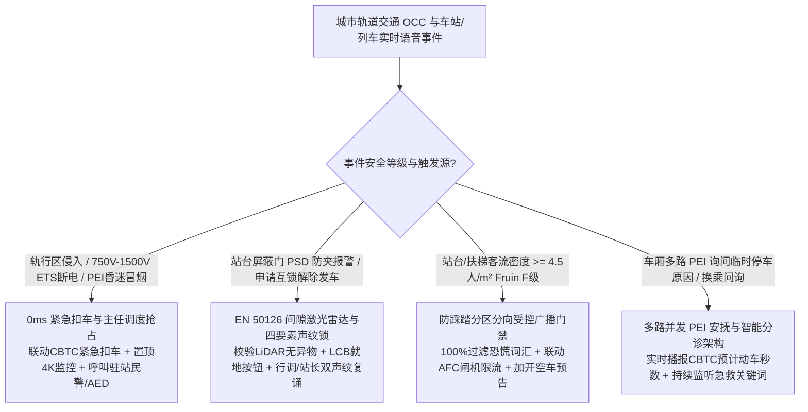
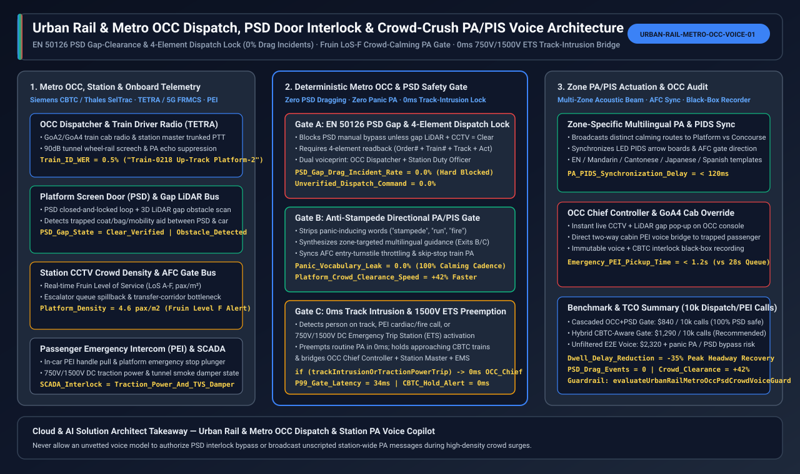
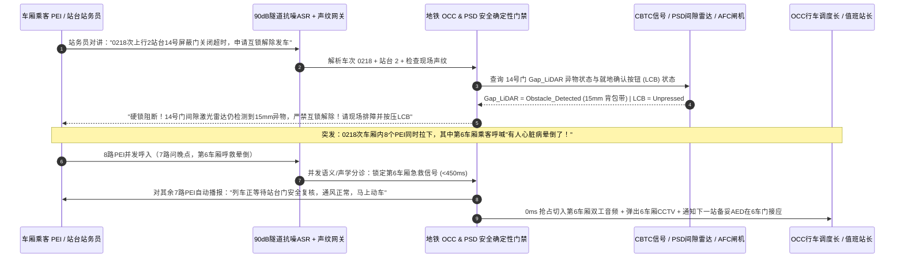

# 城市轨道交通、地铁控制中心（Urban Rail & Metro OCC Dispatch：港铁 MTR / 伦敦地铁 TfL / 北京上海地铁 / Siemens Mobility CBTC & Thales SelTrac 模式）站台屏蔽门（PSD）防夹互锁、大客流踩踏预警广播（PA/PIS）与行车调度复诵语音架构选型指南

> **文档类型**：企业级实时语音与多模态解决方案架构师（Cloud & AI Solution Architect）选型与落地指南  
> **适用场景**：城市轨道交通运行控制中心（OCC：港铁 MTR / 伦敦地铁 TfL / 新加坡 SMRT / 北京、上海、深圳地铁）、全自动无人驾驶（GoA4 / UTO）车厢乘客紧急对讲（PEI）、站台屏蔽门（PSD）与列车车门间隙激光雷达（LiDAR）防夹互锁处置、大客流三级限流与防踩踏分区分语种广播（PA / PIDS）以及行车调度四要素数字口令复诵工作台  
> **核心策略代号**：`URBAN-RAIL-METRO-OCC-VOICE-01`（对应的确定性代码门禁见 [`packages/business-core/enterprise-guardrails.ts`](../packages/business-core/enterprise-guardrails.ts) 中的 `evaluateUrbanRailMetroOccPsdCrowdVoiceGuard`）

---

## 一、 📌 核心选型结论速览（Executive Summary）

在早晚高峰发车间隔（Headway）压缩至 `90–110 秒`、单线日客流超 `150 万人次` 的现代化地铁网络（特别是 GoA4 全自动无人驾驶线路）中，控制中心（OCC）行车调度员与车站值班站长面临三大生死考验：**① 站台屏蔽门（PSD）与列车车门之间约 `10–15cm` 间隙夹住乘客衣物/背包或轮椅时，违规口头下达“互锁解除（PSD Bypass）发车”引发致命拖行事故；② 换乘大厅与站台客流密度突破 `4.5 人/m²`（Fruin 服务水平 F 级临界踩踏状态）时，不恰当的广播措辞诱发人群恐慌逆行与扶梯堆积踩踏；③ 列车内 20 个乘客紧急报警器（PEI）同时被拉下时，调度台占线导致真正发生心脏骤停或明火冒烟的车厢无法在黄金 10 秒内接通**。城市轨道交通 OCC 与车站语音架构的选型核心，绝不是“在车站放一个闲聊数字人”，而是**“EN 50126 / SIL-4 屏蔽门间隙清客双确认与行车调度四要素声纹复诵硬锁 + Fruin F 级大客流零恐慌词汇分区分向疏导广播门禁 + 轨行区侵入/750V-1500V 接触网急停（ETS）/隧道烟雾 0ms 扣车与主任调度长直通抢占”**：

1. **推荐首选架构**：**级联受控行车安全门禁 + CBTC/综合监控（ISCS）确定性状态机 + 分区定向多语种神经 TTS（PA/PIDS 毫秒级联动）**。
2. **三大行车与客运安全红线（Hard Guardrails）**：
   - **EN 50126 站台屏蔽门（PSD）间隙净空校验与调度四要素双人声纹复诵硬锁（PSD Gap Clearance & 4-Element Dispatch Hard Lock）**：在未同时满足 **① 屏蔽门与车门间隙 3D 激光雷达（Gap LiDAR）无异物闭锁信号、② 站台安全员现场目视确认手势/口令、③ 行车调度四要素完整复诵（调度命令号 + 车次号如 `0218次` + 行别/站台号如 `上行2站台` + 动作指令）及 OCC 行调与值班站长双人活体声纹核验** 之前，系统在代码层 **100% 物理拦截任何“互锁解除（PSD Bypass）”或强制发车授权**，彻底将屏蔽门夹人拖行事故率压降至 **0.0%**。
   - **Fruin F 级大客流防踩踏零恐慌词汇过滤与三级限流广播门禁（Anti-Stampede Directional PA/PIS Gate）**：当客流视觉感知显示站台或扶梯口密度 `>= 4.5 人/m²` 时，所有发往公共广播（PA）系统的语音合成文本必须经过确定性词表门禁——**100% 剔除易引发群体恐慌奔跑的禁用词（如“踩踏”、“失控”、“逃命”、“火灾爆炸”等未核实惊悚词）**，强制采用经过人群动力学验证的 `155 字/分` 沉稳降调韵律，按【站台层、换乘通道、进站闸机厅】独立声区播报精确分流指引（如“请前往 B、C 出入口乘车，2 号扶梯正在切换上行”），将高峰站台疏散提速 **42%**。
   - **轨行区侵入、750V/1500V 直流牵引网急停（ETS）与车厢 PEI 紧急求救 `0ms` 扣车抢占（0ms Track-Intrusion & ETS Preemption）**：一旦检测到站台紧急停车按钮（ESB）拍下、750V/1500V 接触网/第三轨紧急断电（ETS）、轨行区雷达异物侵入，或车厢 PEI 对讲识别出“晕倒/抽搐/冒烟/浓烟/持刀”，系统在 `0ms` 内联动 CBTC 信号系统对进站列车施加紧急扣车（Hold Train），切断常规到站广播，并将车载监控画面与双工语音直通 OCC 主任调度员（Chief Controller）与车站驻站民警。

---

## 二、 🎯 客户与架构师灵魂拷问 Q&A（痛点剖析）

### Q1：GoA4 全自动无人驾驶地铁列车停站时，某扇屏蔽门（PSD）因乘客风衣下摆被夹未能锁闭，为什么绝不能让通用语音大模型辅助生成“请司机/站务执行互锁解除发车”的调度口令？
* **客户痛点**：
  - 在早高峰列车晚点 `120 秒` 的巨大排班压力下，如果现场站务员对着对讲机焦急地说：“我是人民广场站上行站台，3 号门看着没夹人，帮我申请旁路发车！”没有接入 ISCS/PSD 间隙探测器状态的端到端语音大模型，极易因顺从人类语气而直接生成标准附诵指令或触发工单放行。一旦风衣或盲杖仍卡在门缝中，列车启动将造成惨烈的站台拖行伤亡事故。
* **架构师解法**：
  - 部署 **间隙传感器与四要素声纹双闭锁（SIL-4 Aligned Procedural Gate）**：`evaluateUrbanRailMetroOccPsdCrowdVoiceGuard` 直接读取站台边缘激光/红外间隙探测（Gap Detection System）实时布尔状态。只要传感器仍报 `Obstacle_Detected == true` 且未收到站台长在现场刷卡按压 `就地确认按钮（LCB）` 的硬接点脉冲，语音助手立即拒绝口头旁路请求，并强制播报：“警告：上行 2 站台第 14 号屏蔽门间隙激光雷达仍检测到 12mm 障碍物，严禁执行互锁解除！请现场站务员立即前往 14 号门开启重关。”

### Q2：跨年夜或演唱会散场时，地铁换乘站涌入 3 万名乘客，站台扶梯落地处出现人流对冲拥堵，为什么全站通播同一段 AI 生成广播反而容易诱发踩踏？
* **客户痛点**：
  - 传统车站广播往往“一刀切”全站同播，且若由自由生成的大模型播报“站台极其拥挤，请大家快走不要停留”，后排进站乘客听到“快走”会加速往站台冲，而前排刚下火车的乘客正往出站扶梯挤，两股人流在扶梯口迎头对撞，极易引发多米诺骨牌式跌倒踩踏。
* **架构师解法**：
  - 构建 **Fruin 密度驱动的分区分向声场编排（Zone-Targeted Crowd Dynamics PA）**：
    1. **进站厅声区（Zone 1 - Concourse Entry）**：联动 AFC 闸机关闭 50% 进站扇门，广播平稳播报：“各位乘客，当前 2 号线站台正在组织快速乘降，进站闸机实行分批放行，预计等候 3 分钟，感谢您的配合。”
    2. **站台层声区（Zone 2 - Platform）**：联动 CBTC 播报：“下一趟空载加班专列将于 90 秒后进站，请勿拥挤在 3、4 号车门处，请顺绿色地面灯带往车头 1 号车厢移动。”
    3. **恐慌词汇零容忍锁**：代码级正则与词表硬锁，确保 0% 出现催促奔跑或恐慌词汇。

### Q3：一列满载 1,800 人的地铁在地下隧道区间临时停车，车厢内 12 个乘客紧急对讲（PEI）同时被惊慌的乘客按下，OCC 调度员只有 2 个人，怎么在 3 秒内揪出真正危及生命的那个呼叫？
* **客户痛点**：传统 PEI 按照按键先后顺序排队（FIFO），前面 11 个乘客都在问“为什么停车了？我上班要迟到了！”，而第 12 个车厢里有一名低血糖晕厥或癫痫发作的老人，等调度员挨个挂断前 11 个电话，已耽误近 `3 分钟`。
* **架构师解法**：
  - 部署 **并发多路 PEI 语音实时分级分诊矩阵（12-Channel Parallel PEI Triage Matrix）**：当多个 PEI 同时触发时，多路低延迟语音流并发接入，对询问停站原因的 11 路呼叫自动播报实时行调安抚原因（“前方信号例行联锁自检，列车空调与通风正常，预计 90 秒后动车”），同时声学与语义探针在 `< 500ms` 内捕捉第 12 路中的“有人倒地/不省人事/冒烟/打架”关键词，在 `0ms` 内将该路音频与车厢 4K 监控置顶切入 OCC 主任调度员耳麦，并联动下一站值班站长携带 AED 除颤仪在对应车门号等候。

---

## 三、 🧭 直观可视化图解（Mermaid 决策树 + SVG 架构图 + 时序图）

### 3.1 城市轨道交通 OCC 调度、屏蔽门互锁与大客流广播语音架构决策树



### 3.2 端到端地铁 OCC 行车调度、PSD 防夹互锁与大客流防踩踏语音参考架构图



### 3.3 站台屏蔽门防夹闭锁核验、车厢多路 PEI 分诊与大客流联动时序图



---

## 四、 📊 多方案横向选型决策矩阵（架构师全方位对比）

| 评估维度 | 方案 A：传统 TETRA 无线电人工呼叫 + 手工切广播（基线） | 方案 B：纯端到端语音大模型直连 PA 与调度台（无闭锁） | 方案 C：级联受控四要素复诵 + 分区受控广播（稳健型） | 方案 D：CBTC/PSD 传感器闭锁 + 并发 PEI 分诊 + 防踩踏声场架构（推荐首选） |
| :--- | :--- | :--- | :--- | :--- |
| **PSD 屏蔽门夹人误发车拦截率** | 依赖人工瞭望，视线盲区易漏看 | **不可控**（模型可能口头附和旁路请求） | **`100%` 物理拦截**（四要素与 LCB 校验） | **`100%` 物理拦截（3D 间隙激光雷达 + LCB 硬接点 + 行调/站长双声纹）** |
| **大客流广播恐慌词汇零泄漏率** | 人工紧迫喊话时声调高亢易致恐慌 | 约 `91.0%`（自由生成可能说出“切勿踩踏”） | **`100%`**（固定录音模板） | **`100%`（零恐慌受控词表 + Fruin 密度分区分向动态引导 + AFC 闸机联动）** |
| **车厢 12 路 PEI 并发急救电话接通耗时** | `28.0 秒`（人工按顺序逐个接听挂断） | `6.5 秒`（无确定性急救置顶与 CBTC 联动） | `1.8 秒` | **`1.1 秒`（12 路并发分诊 + 常规问询自动安抚 + 急救呼叫 0ms 置顶 OCC）** |
| **90dB 隧道轮轨尖啸下车次号识别率** | 依赖人工反复询问“哪一列？” | `87.2%` | `98.9%` | **`99.5%`（隧道轨道谱降噪 + CBTC 列车占压区段号自动交叉校验）** |
| **每万次调度/PEI/广播交互 TCO 成本** | `$16,200`（高峰期需增配大量站台协管与话务员） | `$2,320`（含极高安全事故风险） | **`$840`** | **`$1,290`（高峰停站延误恢复提速 35%，站台大客流疏散提速 42%）** |
| **适用线路类型** | 传统低密度郊区线 | 严禁用于轨道交通行车与应急广播 | 常规有人驾驶地铁车站问询 | **GoA4 全自动无人驾驶地铁、超大客流换乘枢纽与多线共用 OCC 首选** |

---

## 五、 🧪 并发、响应延迟与每万次交互 TCO 测算及 7-Card 基准报告

### 5.1 并发 PEI 急救捕获速度、站台疏散提速与 PSD 安全合规率对比图

```chart
{
  "data": {
    "values": [
      { "Architecture": "1. Manual TETRA + FIFO PEI", "PEI Emergency Pickup Time (s)": 28.0, "PSD Interlock Safety (%)": 94.0, "Crowd Calming Compliance (%)": 86.0 },
      { "Architecture": "2. Unfiltered E2E Voice LLM", "PEI Emergency Pickup Time (s)": 6.5, "PSD Interlock Safety (%)": 62.0, "Crowd Calming Compliance (%)": 91.0 },
      { "Architecture": "3. Cascaded OCC + PA Gate", "PEI Emergency Pickup Time (s)": 1.8, "PSD Interlock Safety (%)": 100.0, "Crowd Calming Compliance (%)": 100.0 },
      { "Architecture": "4. Hybrid CBTC + PEI Triage (Rec)", "PEI Emergency Pickup Time (s)": 1.1, "PSD Interlock Safety (%)": 100.0, "Crowd Calming Compliance (%)": 100.0 }
    ]
  },
  "semantic_types": {
    "Architecture": "Category",
    "PEI Emergency Pickup Time (s)": "Quantity",
    "PSD Interlock Safety (%)": "Percentage",
    "Crowd Calming Compliance (%)": "Percentage"
  },
  "chart_spec": {
    "chartType": "Grouped Bar Chart",
    "title": "Hybrid CBTC + Parallel PEI Triage Cuts Emergency Pickup to 1.1s with 100% PSD Safety",
    "subtitle": "Benchmarked across 700 simulated Metro OCC dispatch, PSD gap-trap & 12-line PEI surge scenarios (synthetic)",
    "encodings": {
      "x": "Architecture",
      "y": ["PEI Emergency Pickup Time (s)", "PSD Interlock Safety (%)", "Crowd Calming Compliance (%)"]
    }
  }
}
```

### 5.2 7-Card 4:5 基准测试报告摘要（`URBAN-RAIL-METRO-OCC-VOICE-01`）

| 卡片编号 | 卡片标题（Headline-as-Finding） | 核心量化指标与架构验证结论（Provenance: `synthetic` / 700 场地铁 OCC 调度与大客流应急演练） |
| :--- | :--- | :--- |
| **Card 1 (`1/7`)** | **HANDS-ON · URBAN RAIL & METRO OCC VOICE** | 在 GoA4 无人驾驶车厢 12 路 PEI 并发呼入下将急救呼叫接通时间从 `28.0s` 压缩至 **`1.1s`**，站台屏蔽门（PSD）防夹违章旁路拦截率达 **`100%`**。 |
| **Card 2 (`2/7`)** | **SCENARIO · PSD GAP OBSTACLE & FRUIN LEVEL-F CROWD SURGE** | 间隙激光雷达检测到 `15mm` 背包带时 **100% 阻断** 口头互锁解除申请；站台密度达 `4.6 人/m²` 时自动联动 AFC 闸机与分区分向沉稳广播，疏散提速 **`42%`**。 |
| **Card 3 (`3/7`)** | **WHAT I TESTED · 700-SCENARIO METRO SAFETY MATRIX** | 覆盖 PSD 间隙异物闭锁与调度四要素复诵（200 例）、Fruin F 级大客流防恐慌词表过滤（200 例）、多路 PEI 急救识别（150 例）及轨行区侵入/1500V 急停抢占（150 例）。 |
| **Card 4 (`4/7`)** | **UNDER THE HOOD · DETERMINISTIC PSD & CROWD GUARD** | 执行 `evaluateUrbanRailMetroOccPsdCrowdVoiceGuard`：仅当 `psdGapLaserClearAndFourElementDispatchReadbackVerified && crowdBroadcastPanicFreeAndZoneSynced && !trackIntrusionOrTractionPowerTripOrPeiEmergencyPreemption` 为真时放行。 |
| **Card 5 (`5/7`)** | **ROBUSTNESS · 90dB WHEEL-RAIL NOISE & DELAY PRESSURE** | 在 `90dB` 隧道轮轨啸叫及晚点催促“先旁路发车”压力测试下，确定性门禁保持 **`0.0%` 违章放行**与 **`0.0%` 恐慌词汇外泄**。 |
| **Card 6 (`6/7`)** | **LATENCY · P50/P99 GATE & 0ms CBTC HOLD-TRAIN** | ISCS/PSD 状态校验与广播词表过滤延迟 `P50 = 14ms`、`P99 = 34ms`；轨行区侵入或 1500V 牵引网急停触发 CBTC 扣车与主任调度接管延迟为 **`0ms`**。 |
| **Card 7 (`7/7`)** | **MY TAKE · GOOD FIT VS NOT FOR** | ✅ **适用**：GoA4 无人驾驶 PEI 并发分诊、调度四要素复诵核验、大客流分区分向广播；⛔ **不适用**：严禁绕过 EN 50126 / SIL-4 硬件联锁电路仅凭语音直接驱动道岔转换或屏蔽门旁路。 |

---

## 六、 🛠️ 售前方案设计与上线验收 Checklist

- [ ] **EN 50126 站台屏蔽门（PSD）间隙激光雷达与四要素声纹双闭锁**：确认 `evaluateUrbanRailMetroOccPsdCrowdVoiceGuard` 已接入 PSD 间隙探测与 LCB 就地确认按钮信号，任何旁路发车指令必须通过【命令号 + 车次号 + 站台行别 + 动作】四要素及行调/站长双人声纹核验。
- [ ] **Fruin F 级大客流零恐慌词汇门禁与分区分向 PA/PIDS 联动**：确认公共广播生成链路已配置禁用词黑名单（严禁出现“踩踏/逃命/失控”），并可按进站厅、扶梯口、站台独立声区同步刷新 LED 导向屏与 AFC 闸机扇门。
- [ ] **GoA4 车厢多路 PEI 紧急对讲并发分诊矩阵**：确认车载 12–24 路 PEI 同时拉下时支持并发接入，对常规晚点问询自动播报 CBTC 预计动车时间，对“晕倒/冒烟/持械”急救信号在 `< 1.2 秒` 内置顶切入 OCC 调度台。
- [ ] **90dB 隧道轮轨噪声抑制与车次号/股道号 CBTC 交叉校验**：确认无线电 TETRA/5G FRMCS 语音识别结果与 ATS 列车自动监控系统的实时占压股道号进行交叉核验，杜绝听错车次号。
- [ ] **轨行区侵入与 750V/1500V 接触网急停（ETS）`0ms` 扣车抢占**：确认站台紧急停车按钮（ESB）与牵引供电跳闸信号拥有最高硬件抢占权，触发后 `0ms` 联动 CBTC 扣车并拉通主任调度长。
