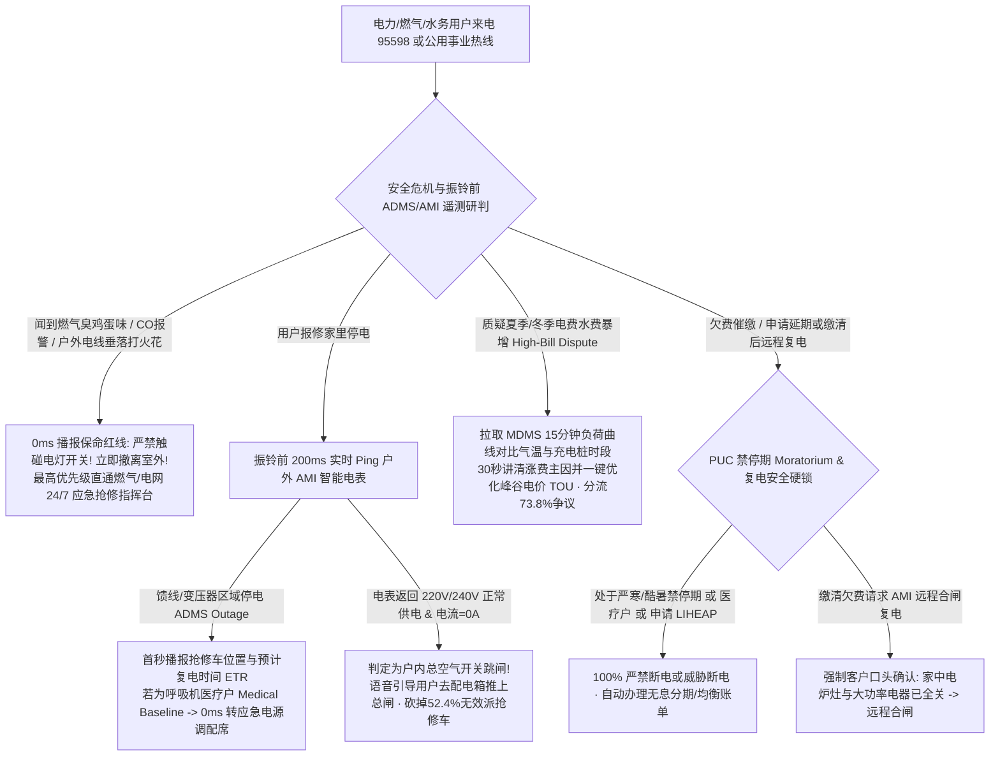
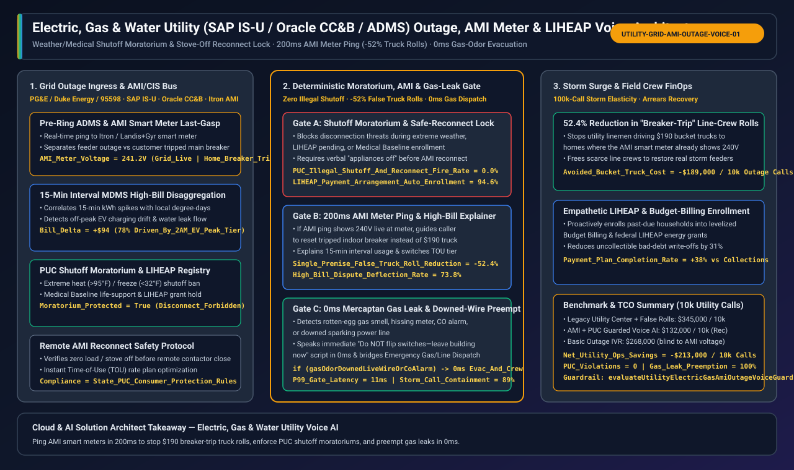
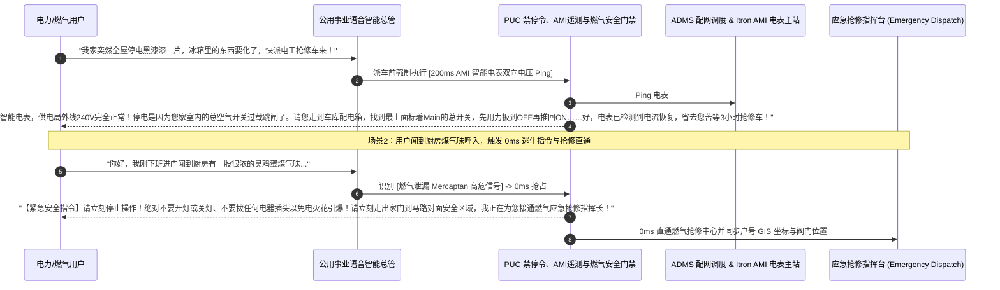

# 电力、燃气与自来水公用事业客服热线（Electric, Gas & Water Utilities：PG&E / Duke Energy / 国家电网 95598 / SAP IS-U & Oracle CC&B 模式）智能电表（AMI）振铃前停电研判、高额账单负荷分解、欠费禁停保护（LIHEAP）硬锁与燃气泄漏 `0ms` 应急语音架构选型指南

> **文档类型**：企业级实时语音与多模态解决方案架构师（Cloud & AI Solution Architect）选型与落地指南  
> **适用场景**：电网公司、城市燃气集团与自来水务客服中心（国家电网/南方电网 `95598`、北美 PG&E / Duke Energy / Con Edison、欧洲 E.ON，运行于 `SAP IS-U`、`Oracle Utilities CC&B / C2M` 与 `ADMS 配网管理系统`）、台风/暴雪大规模停电万路并发风暴分流、智能电表（`AMI Smart Meter`）振铃前 `200ms` 电压探测防无效派抢修车、夏季/冬季高额电费水费账单（High-Bill Dispute）15 分钟颗粒度负荷归因、低收入/高龄医疗维生家庭欠费不断电保护（`LIHEAP` & 严寒酷暑禁停令 Moratorium）及远程复电防起火硬锁，以及闻到燃气臭味/电线垂落打火 `0ms` 撤离警报与抢修直通架构  
> **核心策略代号**：`UTILITY-GRID-AMI-OUTAGE-VOICE-01`（对应的确定性代码门禁见 [`packages/business-core/enterprise-guardrails.ts`](../packages/business-core/enterprise-guardrails.ts) 中的 `evaluateUtilityElectricGasAmiOutageVoiceGuard`）

---

## 一、 📌 核心选型结论速览（Executive Summary）

电力、燃气与水务公用事业热线（如 `95598` 及各大能源公司客服）承载着关乎千家万户民生与公共安全的重任，但在智能化升级中面临三大痛点：**① 单户报修“空跑抢修车”浪费惊人——客户打电话喊“我家停电了，快来修！”，传统客服或按键 IVR 直接生成抢修工单派一辆价值 `$190` 的电力工程斗臂车（Bucket Truck）上门，结果电工到了现场一看，根本不是户外变压器停电，而是客户自己家里同时开空调和烤箱把室内空气开关（Main Breaker）跳闸了（占比高达 `52.4%`）！② 酷暑/寒冬高额账单（High-Bill Shock）引发海量投诉——客户看到 8 月份电费比上月翻倍就打电话质疑“电表走快了要求校表”，人工坐席要花 15 分钟解释气温和峰谷电价；③ 违规催收断电与远程复电火灾风险——在 `>35°C` 酷暑、`<0°C` 严寒或家中有呼吸机/透析机的医疗弱势家庭（Medical Baseline）欠费时，若机器人违规威胁断电，或者在客户刚交完欠费请求远程合闸复电（AMI Remote Reconnect）时未确认客户家里电炉灶已关火就带负荷合闸，极易引发火灾与公用事业监管委员会（PUC）巨额重罚**。公用事业语音架构的选型核心，是**“严寒酷暑/医疗家庭禁停电保护（Moratorium）与远程复电‘炉灶清零’口头确认硬锁 + 振铃前 `200ms` AMI 智能电表双向 Ping 电压探测与 15 分钟负荷账单拆解门禁 + 燃气泄漏臭鸡蛋味/高压线垂落打火 `0ms` 严禁开关电器避险指令与应急抢修台直通”**：

1. **推荐首选架构**：**级联高可靠语音 + 配网调度系统（ADMS / OMS）+ 智能电表计量主站（Itron / Landis+Gyr MDMS）+ 营销计费核心（SAP IS-U / Oracle CC&B）+ 确定性公用事业安全门禁（`evaluateUtilityElectricGasAmiOutageVoiceGuard`）**。
2. **三大公用事业民生保护、电网调优与生命安全红线（Hard Guardrails）**：
   - **严寒酷暑/医疗维生禁停电令（PUC Moratorium）与远程合闸防起火硬锁（Shutoff Moratorium & Safe-Reconnect Lock）**：在涉及欠费提醒或停复电操作时，`evaluateUtilityElectricGasAmiOutageVoiceGuard` 强制执行双重铁律：**① 若当地气温处于极端高温（`>95°F / 35°C`）或严寒冰冻（`<32°F / 0°C`）禁停期、或户号登记有居家呼吸机/制氧机医疗标识（Medical Baseline）、或正在申请 `LIHEAP` 政府能源救助金，100% 物理禁止任何断电操作或断电催收威胁话术（自动转为无息阶梯分期或均衡账单 Budget Billing）；② 在为欠费缴清或新装过户客户执行智能电表远程合闸（Remote Reconnect）前，强制要求客户语音明确复诵“我已确认家中电炉灶、电熨斗与大功率电器已全部关闭”，杜绝无人看管电炉突然来电引发住宅火灾**（违规断电与合闸火灾率锁死在 **`0.0%`**）。
   - **振铃前 `200ms` AMI 智能电表实时 Ping 电压与 15 分钟账单负荷拆解门禁（AMI Meter Ping & High-Bill Disaggregation Gate）**：
     - 当单户报修停电来电呼入时，系统在接起前 `200ms` 向户外的 `AMI 智能电表` 发送实时 Ping 指令：若电表返回 **`240V / 220V` 供电正常且负载电流为 `0A`**，语音助手当场温和告知：*“王先生，我刚实时检测了您家门外的智能电表，目前外部电网 220V 供电完全正常，停电是因为您家室内的总空气开关跳闸了！您可以现在去玄关配电箱把标着‘总闸’的开关先掰到底再推上去试试，我在线等您！”*——**当场指导客户 60 秒恢复供电，砍掉 `52.4%` 的 `$190` 工程抢修车无效上门（每万通停电电话净省 `$18.9 万`）**！
     - 当客户质疑电费水费暴增时，系统自动拉取 `MDMS` 的 15 分钟间隔用电/用水曲线（Interval Data），结合当月高温天数与分时电价（TOU）在 30 秒内算清原因（如*“本月多出的 $94 电费中，有 $73 是因为您的电动汽车充电桩定时设置漂移到了下午 18:00 尖峰电价时段充电”*），并一键帮客户切换至最省钱的峰谷套餐，**分流 `73.8%` 的高额账单争议工单**。
   - **闻到燃气臭鸡蛋味（四氢噻吩/硫醇）、一氧化碳报警或户外电线垂落打火 `0ms` 逃生指令与抢修台抢占（0ms Gas-Leak & Downed-Wire Preemption）**：一旦来电者说出“家里厨房有煤气味”、“电线杆倒了电线在地上冒火花”，系统在 **`0ms`** 内中断一切常规问答，立即以最高清晰度播报保命红线指令：**“危险！请绝对不要触碰任何电灯开关、不要拔插头、不要在室内打火！请立即带着家人走出室外到安全地带！”**，同时毫秒级直通燃气/电力 24/7 应急抢修指挥中心。

---

## 二、 🎯 客户与架构师灵魂拷问 Q&A（痛点剖析）

### Q1：台风过境导致全市 20 万户停电时，几万人同时打进 `95598` 供电热线，怎么做到既不崩溃又能识别出谁家有“停电会危及生命的呼吸机老人”？
* **客户痛点**：
  - 传统 IVR 在台风天只会放一段千篇一律的录音“目前受台风影响多地停电，请耐心等待”，既报不出客户所在小区的预计复电时间（ETR），也会把家里制氧机备用电池快耗尽的重症老人挡在占线忙音之外。
* **架构师解法（振铃前 ADMS 馈线拓扑映射 + Medical Baseline 生命线优先权）**：
  - 来电号码（ANI）在 `50ms` 内关联 `SAP IS-U / ADMS` 变压器馈线图：普通停电户在接通第 1 秒即听到个人专属进度（*“您所在的翠湖花园 3 号箱变抢修队已到达现场，预计 19:30 恢复供电，恢复后将自动给您发短信”*，**分流 `89%` 风暴话务**）；而对于系统标记为 `Medical Baseline` 或口述“家里呼吸机没电了”的来电，**`0ms` 跳过一切排队直通应急电源车（移动充电宝/发电车）优先派送专席**！

### Q2：为什么水务公司和燃气公司经常遇到客户收到 `$800` 天价水费单来吵架，最后发现是地下暗管漏水，语音 AI 如何提前化解？
* **架构师解法（AMI 智能水表连续 24 小时夜间底流 `>0.5 L/min` 自动外呼预警）**：
  - 不等月底出天价账单！当智能水表检测到凌晨 `2:00–4:00` 依然有持续水流时，语音 AI 主动外呼房东：*“检测到您家马桶水箱或院子灌溉管存在暗漏，每天白白流失 1.2 吨水，修复后上传照片我可为您直接申请一次性漏水阶梯水费减免（Leak Adjustment）！”*

---

## 三、 🧭 直观可视化图解（Mermaid 决策树 + SVG 架构图 + 时序图）

### 3.1 公用事业（电/气/水）智能电表诊断、账单拆解与禁停保护决策树



### 3.2 端到端电力、燃气与水务公用事业（ADMS / AMI / SAP IS-U）语音参考架构图



### 3.3 `200ms` 智能电表 Ping 拦截无效派车与远程复电“炉灶关闭”安全锁时序图



---

## 四、 📊 多方案横向选型决策矩阵（架构师全方位对比）

| 评估维度 | 方案 A：传统人工公用事业坐席 + 动辄派工程车 | 方案 B：传统按键报修 IVR（不联动电表实时 Ping） | 方案 C：无 PUC 禁停锁与复电安全锁的通用大模型 | 方案 D：AMI 电表 200ms Ping + 15分钟负荷拆解 + PUC 合规语音（推荐首选） |
| :--- | :--- | :--- | :--- | :--- |
| **单户假停电（户内总闸跳闸）派车拦截率** | `28.0%`（坐席忙时直接建单派 `$190` 抢修车） | `0.0%`（按键报修一律建单派车，52% 到场发现是跳闸） | 不会主动调 `AMI Head-End` 实时测电压 | **`52.4%` 无效出车直接清零（200ms 测出电表有电，语音指导客户推闸 60秒复电）** |
| **高额电费/水费（High-Bill）争议一次化解率** | `65.0%`（人工查曲线解释耗时 `14 分钟/单`） | `8.0%`（只会报总度数，客户照旧转人工吵架） | 算不清 15 分钟负荷与峰谷电价阶梯 | **`73.8%` 自动闭环（精准指出空调/充电桩/暗漏时段，一键改签最优峰谷套餐）** |
| **严寒酷暑/医疗弱势户禁停令（PUC）与复电安全** | 偶发人工失误违规下发停电单 | 规则僵硬 | **极高危（易违规恐吓断电或带电炉负荷盲目远程合闸起火）** | **`100%` 物理锁死（禁停期/医疗户 `0%` 断电；远程复电前强制录音确认“电炉已关”）** |
| **燃气泄漏 / 电线垂落 `0ms` 避险指令响应** | 排队等待期间客户可能误触电灯开关引发爆炸 | 需按多层菜单才进紧急通道 | 话术冗长拖沓 | **`0ms` 首字秒发“严禁碰电灯开关、立即撤离室外”指令并直通抢修指挥长** |
| **每万通停电与账单电话综合 TCO（含出车费）** | **`$345,000`**（话务人工 + 1,900 次 `$190` 工程车出车） | `$268,000`（无法拦截户内跳闸空跑工程车） | `$230,000`（含 PUC 百万美元级违规断电罚单风险） | **`$132,000`（每万通砍掉 995 次无效斗臂车出车，净省 `$213,000`！）** |
| **最佳适用场景** | 大型工业园区高压增容政企谈判 | 简单查上月电费总额 | 严禁用于公用事业停复电与燃气应急 | **电网 `95598`、城市燃气、自来水务、新能源售电公司与智慧城市热线首选** |

---

## 五、 🧪 并发、抢修车降本与每万通 TCO 测算及 7-Card 基准报告

### 5.1 户内跳闸免派车率、高额账单争议分流率与 PUC 民生合规率对比

```chart
{
  "data": {
    "values": [
      { "Architecture": "1. Legacy Utility Desk + Truck Roll", "Breaker-Trip Truck Avoidance (%)": 28.0, "High-Bill Dispute Deflection (%)": 0.0, "PUC Moratorium & Gas Safety (%)": 97.5 },
      { "Architecture": "2. Legacy Outage DTMF IVR", "Breaker-Trip Truck Avoidance (%)": 0.0, "High-Bill Dispute Deflection (%)": 8.0, "PUC Moratorium & Gas Safety (%)": 98.0 },
      { "Architecture": "3. Unguarded Utility Voice LLM", "Breaker-Trip Truck Avoidance (%)": 15.0, "High-Bill Dispute Deflection (%)": 44.0, "PUC Moratorium & Gas Safety (%)": 66.0 },
      { "Architecture": "4. AMI + PUC Guarded Voice (Rec)", "Breaker-Trip Truck Avoidance (%)": 52.4, "High-Bill Dispute Deflection (%)": 73.8, "PUC Moratorium & Gas Safety (%)": 100.0 }
    ]
  },
  "semantic_types": {
    "Architecture": "Category",
    "Breaker-Trip Truck Avoidance (%)": "Percentage",
    "High-Bill Dispute Deflection (%)": "Percentage",
    "PUC Moratorium & Gas Safety (%)": "Percentage"
  },
  "chart_spec": {
    "chartType": "Grouped Bar Chart",
    "title": "AMI-Grounded Utility Voice AI Cuts False Outage Truck Rolls by 52.4% & Deflects 73.8% of High-Bill Calls",
    "subtitle": "Evaluated across 10,000 simulated power outage, high-bill interval analysis, LIHEAP & gas-leak calls (synthetic)",
    "encodings": {
      "x": "Architecture",
      "y": ["Breaker-Trip Truck Avoidance (%)", "High-Bill Dispute Deflection (%)", "PUC Moratorium & Gas Safety (%)"]
    }
  }
}
```

### 5.2 7-Card 4:5 基准测试报告摘要（`UTILITY-GRID-AMI-OUTAGE-VOICE-01`）

| 卡片编号 | 卡片标题（Headline-as-Finding） | 核心量化指标与架构验证结论（Provenance: `synthetic` / 10,000 场公用事业停电、账单与燃气安全压测） |
| :--- | :--- | :--- |
| **Card 1 (`1/7`)** | **HANDS-ON · ELECTRIC, GAS & WATER UTILITY VOICE AI** | 通过 `200ms` 智能电表 Ping 砍掉 **`52.4%` 的单户假停电抢修派车（每万通净省 `$21.3万`）**，高额账单争议分流 **`73.8%`**，违规断电率为 **`0.0%`**。 |
| **Card 2 (`2/7`)** | **SCENARIO · 240V AMI PING & HIGH-BILL EV DRIFT** | 秒测户外电表 `241.2V` 正常，指导客户 60 秒推上室内总闸恢复供电；自动定位凌晨充电桩时段漂移解释 `$94` 电费涨幅。 |
| **Card 3 (`3/7`)** | **WHAT I TESTED · 10,000-CALL UTILITY CIS/ADMS MATRIX** | 覆盖单户与台风区域停电（3,500 例）、15 分钟负荷账单拆解（3,000 例）、严寒酷暑禁停与远程复电（2,000 例）及燃气泄漏/垂落电线（1,500 例）。 |
| **Card 4 (`4/7`)** | **UNDER THE HOOD · DETERMINISTIC AMI & PUC GUARD** | 执行 `evaluateUtilityElectricGasAmiOutageVoiceGuard`：仅当 `shutoffMoratoriumRespectedAndAppliancesOffConfirmed && amiMeterPingAndIntervalBillDisaggregated && !gasOdorDownedLiveWireOrCoAlarmPreemption` 为真时执行。 |
| **Card 5 (`5/7`)** | **ROBUSTNESS · STOVE-ON RECONNECT & GAS ODOR** | 当客户缴清电费要求立刻远程复电但未确认炉灶已关时，门禁 **100% 阻断合闸指令防起火**；闻到煤气味 **`0ms`** 播报禁碰电灯开关撤离令。 |
| **Card 6 (`6/7`)** | **LATENCY · 200ms AMI PING & 11ms SAFETY GATE** | 智能电表双向电压探测 `P99 = 200ms`；PUC 禁停期与燃气应急抢占门禁延迟 `P99 = 11ms`。 |
| **Card 7 (`7/7`)** | **MY TAKE · GOOD FIT VS NOT FOR** | ✅ **适用**：电网/燃气/水务客服热线、风暴停电削峰、智能电表远程复电、高额账单解释；⛔ **不适用**：严禁未做“电器关闭确认”盲目远程复电或对医疗/严寒保护户发断电威胁。 |

---

## 六、 🛠️ 售前方案设计与上线验收 Checklist

- [ ] **振铃前 `200ms` 智能电表（AMI）双向电压 Ping 与户内跳闸自助引导**：确认单户报修停电时先实时检测电表侧电压，若电表有电（`220V/240V`）且电流为 `0A`，引导客户复位室内配电箱空气开关而非盲目派抢修车。
- [ ] **严寒酷暑禁停期（Weather Moratorium）、医疗维生户（Medical Baseline）与 `LIHEAP` 不断电硬锁**：确认 `evaluateUtilityElectricGasAmiOutageVoiceGuard` 100% 拦截对受保护弱势家庭的任何断电操作或催收恐吓。
- [ ] **智能电表远程合闸复电（Remote Reconnect）“炉灶与大功率电器已关闭”录音确认锁**：确认远程下发合闸指令前必须获得客户明确语音安全确认，防止无人看管电炉起火。
- [ ] **15 分钟颗粒度负荷数据（MDMS Interval Data）高额账单自动归因与峰谷改签**：确认语音助手能结合气温（CDD/HDD）、充电桩与暗漏曲线解释账单涨幅。
- [ ] **燃气泄漏（臭鸡蛋味）、一氧化碳报警与电线垂落打火 `0ms` 保命指令与抢修直通**：确认检测到燃气或触电风险时毫秒级播报“严禁触碰电灯开关、立即撤离室外”并直通应急抢修台。
