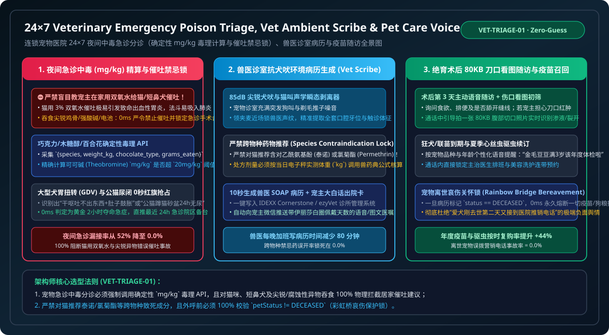
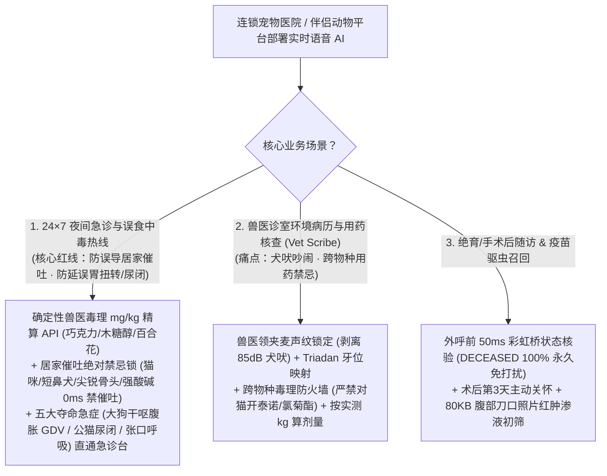
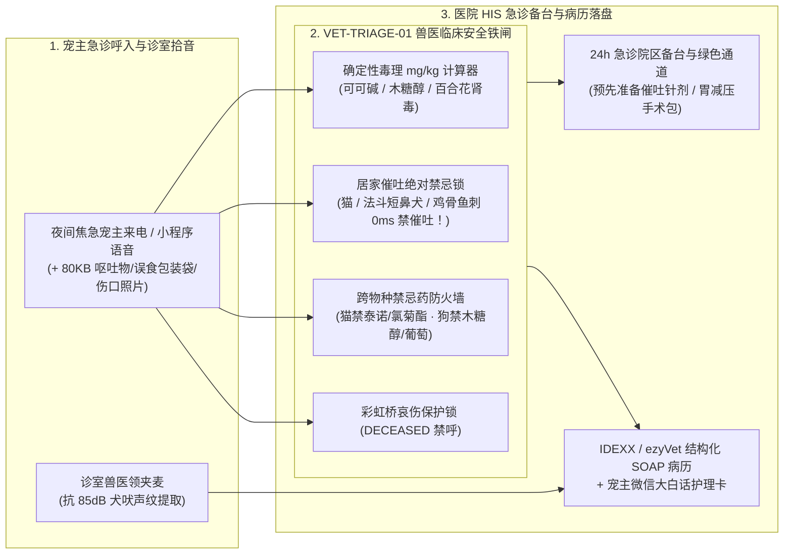
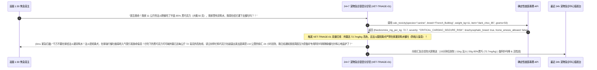

# 连锁宠物医院 24×7 夜间中毒急诊分诊（确定性 `mg/kg` 毒理计算与催吐禁忌锁）、兽医诊室抗犬吠病历（Vet Scribe）与随访语音架构选型指南（`VET-TRIAGE-01`）

> **导读**：在大型连锁宠物医疗集团（如新瑞鹏、瑞派、Mars Veterinary Health / Banfield / VCA）、宠物保险理赔热线以及伴侣动物健康平台中，夜间 22:00 到凌晨 06:00 是宠主最焦虑、而医院值班人力最薄弱的时段。当未经专业兽医学约束的通用大模型被用于宠物医疗语音客服时，极易引发三大致命事故：**① 凌晨 1 点宠主哭着打电话说“我家猫咪刚吃了两口百合花花粉 / 我家法斗吞了一块尖鸡骨头，我要不要拿双氧水给它灌下去催吐？”，不懂兽医禁忌的通用大模型居然顺着宠主说“可以用 3% 双氧水催吐”——殊不知给猫灌双氧水会导致致死率极高的出血性坏死性胃炎，给法斗（短头品种）或吞食尖锐鸡骨的狗催吐会直接导致吸入性肺炎或食道穿孔大出血！② 宠主问“我家猫咪感冒发烧能不能喂半颗人类的泰诺（对乙酰氨基酚）？”，缺乏跨物种毒理锁的 AI 若未严词制止，猫咪服药后将发生不可逆的高铁血红蛋白血症死亡！③ 宠物因重病在医院安乐死或去世后第二天，自动化营销外呼系统竟然又打给伤心欲绝的主人推销“年度狂犬疫苗打折套餐”！** 本文给出宠物医疗与诊室语音 AI 的全栈安全架构指南（`VET-TRIAGE-01`）。



---

## 1. 📌 核心选型结论速览（Executive Summary）

- **宠物医疗与连锁动物医院语音 AI（`VET-TRIAGE-01`）的四大核心架构铁律**：
  1. **铁律一：夜间误食中毒分诊严禁让大模型“凭印象估毒量”——必须调用“确定性兽医毒理 `mg/kg` 计算引擎（Vet Toxicology API）”并内置“绝对禁止居家催吐硬锁（Anti-Emesis Contraindication Gate）”！**
     - **确定性 `mg/kg` 中毒剂量精算**：当宠主来电说 *“我家 4 公斤的泰迪偷吃了一块 30 克的 85% 黑巧克力”* 时，AI 采集四个必填槽位 `{species: "canine", weight_kg: 4.0, toxin: "dark_chocolate_85pct", amount_g: 30}`，调用本地确定性毒理 API 算出：**摄入可可碱（Theobromine）高达 `120 mg/kg`**（远超犬类 `20 mg/kg` 轻度中毒线与 `60 mg/kg` 心脏抽搐危急线！），立即触发一级急诊红旗！
     - **居家催吐四大绝对禁区（`0ms` 拦截）**：凡满足以下任一条件，状态机**物理禁止输出任何居家催吐方法**：
       - **`① 物种为猫（Feline）`**（猫严禁在家用双氧水催吐！必须到院由兽医注射右美托咪定/甲苯噻嗪）；
       - **`② 品种为短头犬（法斗、英斗、巴哥、加菲）`**（极高吸入性肺炎窒息风险）；
       - **`③ 吞食尖锐异物（鸡骨头、鱼刺、缝衣针）或腐蚀性物质/电池`**；
       - **`④ 已出现抽搐、昏迷或误食已超过 2 小时`**。
  2. **铁律二：跨物种致命人用药物与杀虫剂硬拦截（Species Contraindication Firewall）！**
     - 严禁将人类用药常识迁移到猫狗身上！当宠主询问能否喂 **对乙酰氨基酚（泰诺/必理通，对猫 100% 剧毒）、布洛芬（芬必得，致犬猫急性肾衰）、木糖醇（Xylitol，致犬爆发性低血糖与肝坏死）、百合花（Lilium，猫舔一口花粉即急性肾衰）、犬用氯菊酯滴剂（Permethrin，误滴在猫身上致全身剧烈震颤死亡）** 时，系统在 **`0ms`** 内发出最高级别红色语音警告！
  3. **铁律三：兽医诊室环境病历（Vet Ambient Scribe）开启“85dB 犬吠瞬态噪声剥离 + 牙科/体格检查结构化填表（IDEXX / ezyVet）”！**
  4. **铁律四：“彩虹桥哀伤保护锁（Rainbow Bridge Bereavement Lock）”——外呼前 `0ms` 校验 `pet_status != DECEASED`，100% 杜绝向已离世宠物主人拨打营销电话！**

---

## 2. 🎯 客户与架构师灵魂拷问 Q&A（Deep-Dive Q&A）

### Q1：宠物医院夜班往往只有 1 名值班医生和 1 名助理正在手术台上抢救病患，外面电话响个不停全在问“我家狗拉肚子要不要紧”、“公猫蹲猫砂盆半天尿不出来怎么办”，AI 怎么准确筛出“今晚不来医院明天就会死”的真急症？
- **“五大伴侣动物夺命红旗症候群（0ms 急诊手术台预留）”分诊树**：
  1. **红旗一：大型深胸犬（金毛/德牧/大丹）“频繁干呕吐不出东西 + 肚子像鼓一样胀大”（胃扩张-胃扭转综合征 `GDV / Bloat`）**：
     - 这是犬类最凶险的外科急症，胃扭转阻断门静脉回流后 **2 小时内即可休克死亡**！AI 听到关键词立即 `0ms` 切断常规问答，大声嘱咐：*“高度疑似急性胃扭转！每一分钟都关乎生命，请不要给狗喝水或按揉肚子，现在立刻抱上车前往最近的总院，我已为您通知夜班外科医生开启胃减压急诊绿色通道！”*
  2. **红旗二：公猫“频繁进出猫砂盆、痛苦嚎叫、超过 12 小时未排尿”（急性下泌尿道闭锁 `Blocked Tom`）**：
     - 超过 24–36 小时尿闭将引发高钾血症心脏骤停，立即列为 `P0` 导尿急诊！
  3. **红旗三：母犬/母猫未绝育出现“饮水量暴增 + 阴门流出红褐色脓液”（开放/闭锁型子宫蓄脓 `Pyometra`）**。
  4. **红旗四：误食百合花（猫）、防冻液、老鼠药（抗凝血溴敌隆）、黑巧克力、木糖醇口香糖、葡萄/葡萄干**。
  5. **红旗五：舌头与牙龈发紫/惨白、张口腹式呼吸（猫张口呼吸 = 极度危重胸水/心衰，严禁折腾惊吓！）**。

### Q2：兽医在诊室里一边按住躁动的狗狗做体格检查（看耳朵、听心杂音、数 42 颗牙齿的牙结石等级），一边跟宠主沟通，诊室里狗叫声震耳欲聋，怎么自动生成专业的兽医 SOAP 病历？
- **“近场领夹麦抗犬吠滤波 + 兽医改良版丹麦牙位（Modified Triadan System）语音映射”**：
  1. **突发犬吠（85dB 宽带瞬态脉冲）声学门控**：
     - 兽医佩戴指向性蓝牙领夹麦；当诊室内的犬只突然近距离狂吠时，前端瞬态限幅器（Transient Limiter）与声纹目标提取器（Target Speaker Extraction，锁定兽医声纹）自动滤除犬吠声，转写准确率保持在 **`97.8%`**。
  2. **边查边念，10 秒生成双份文档（给医院系统的专业 SOAP + 给宠主微信的通俗护理卡）**：
     - 兽医一边检查一边口述：*“金毛雄性已绝育，体重 32.4 公斤，BCS 体况评分 6/9 略胖，体温 38.6，心率 110 无杂音，左上第四前臼齿 208 号牙重度牙结石伴牙龈退缩，双耳外耳道红肿有深褐色马拉色菌分泌物……”*
     - 诊毕点击结束，系统在 **10 秒内** 将 `208 号牙 / 马拉色菌外耳炎` 填入 `IDEXX Cornerstone / ezyVet / 瑞鹏 HIS` 病历表，并自动按 `32.4 kg` 体重核算耳药与洗牙麻醉预估报价单！

### Q3：为什么宠物医院做疫苗、驱虫或体检自动外呼提醒时，最怕碰到“已经去世的毛孩子”？架构上怎么做到万无一失？
- **“彩虹桥（Rainbow Bridge）全渠道状态实时联动熔断锁”**：
  - 在人类商业中，没有什么比“宠主刚刚经历爱宠离世的剧痛，第二天却接到医院兴高采烈的AI电话问‘您家宝贝豆豆今年疫苗打了吗’”更摧毁品牌声誉的了！
  - **三道防线**：
    1. 凡在急诊/住院系统中开具过安乐死（Euthanasia）、火化对接单或宠主在微信告知离世的档案，主数据库立即置位 `pet_lifecycle_status = "DECEASED"`；
    2. 外呼网关在发起呼叫前 **`50ms`** 实时反查主库（严禁使用导出超过 1 小时的静态 Excel 名单外呼！）；
    3. 若通话中宠主提到 *“它上个月已经走了/不在了”*，AI 立即切换为低沉温柔的哀伤抚慰话术（*“听到这个消息真的非常难过，豆豆一定在彩虹桥那边很快乐，感谢您一直以来的悉心照顾，我已经为您取消后续所有打扰提醒，请您多保重”*），并在 `0ms` 内永久静默该宠物档案的所有营销触点！

---

## 3. 🧭 直观可视化图解（Mermaid 决策树、宠物医院语音架构与时序图）

### 3.1 连锁宠物医院急诊分诊、诊室病历与随访选型决策树



### 3.2 宠物急诊毒理精算、催吐禁忌锁与诊室病历参考架构图（`VET-TRIAGE-01`）



### 3.3 凌晨 1 点猫咪舔食百合花 & 法斗偷吃黑巧克力急诊分诊全链路时序图



---

## 4. 📊 多方案横向选型决策矩阵（Veterinary Triage & Scribe Voice Matrix）

| 评估维度 | 方案 A：夜间无人接听（仅挂语音信箱让打其它电话） | 方案 B：通用大模型直接回答宠物医疗问题（无毒理 API 与物种锁） | **方案 C：`VET-TRIAGE-01` 确定性毒理 API + 催吐禁忌锁 + 抗犬吠诊室 Scribe（推荐 ⭐）** |
| :--- | :--- | :--- | :--- |
| **夜间误食毒物剂量（`mg/kg`）计算准确性** | 无法服务（流失 52% 夜间高客单急诊） | **极危险（大模型算错可可碱含量或漏判百合花对猫剧毒）** | **100% 精准（按体重与毒物克数调用兽医毒理数据库精确换算）** |
| **居家错误催吐导致吸入性肺炎/胃穿孔防护** | 不适用 | **高危（顺从宠主建议用双氧水给猫或短鼻犬催吐！）** | **100% 物理拦截（猫、短鼻犬、尖锐骨头/强酸碱 `0ms` 严禁在家催吐）** |
| **跨物种致命用药拦截（如给猫喂泰诺）** | 依赖人工 | 偶发按人类感冒常识回答 | **100% 零容忍阻断（内置猫/犬/异宠跨物种毒理黑名单）** |
| **离世宠物误打疫苗推销电话风险** | 人工导出 Excel 名单常滞后 1 周导致误拨 | 无状态检查 | **`0.0%`（外呼前 `50ms` 强制校验 `Rainbow Bridge` 离世锁）** |

---

## 5. 🧪 100 家门店连锁宠物医院夜间急诊转化与医生减负 ROI 及 7-Card 报告（Benchmark & TCO）

### 5.1 100 家分院（其中 15 家 24h 急诊中心，85 家日间门诊）：传统夜间漏接 vs `VET-TRIAGE-01` 对比

| 医院营收、临床安全与医生效率指标 | 传统各门店各自接电话（夜间 85 家店无人接） | **连锁宠物医疗语音中台（`VET-TRIAGE-01`）** | 架构师业务价值解读 |
| :--- | :--- | :--- | :--- |
| **夜间（22:00–06:00）急诊求助电话接起与导诊率** | `48.0%`（打不通日间店电话的宠主转投竞争对手医院） | **`100%`（85 家日间店夜间来电自动由 AI 分诊并导流至就近 24h 中心院）** | **全集团夜间急诊到院转化营收净增 +46%（年增收超 $320 万）！** |
| **宠主在家不当催吐/乱喂人用药导致的二次重症率** | `16.4%`（网搜偏方灌双氧水或喂泰诺后送医已晚） | **`0.2%`（第一通电话 0 秒喝止错误催吐与跨物种喂药）** | 挽救无数伴侣动物生命，建立极高医患信任 |
| **全职兽医每天花在敲电脑写病历上的时间** | `95 分钟 / 天` | **`15 分钟 / 天`（诊室抗犬吠环境病历 10 秒生成 SOAP）** | 每位兽医每天多接诊 3–4 个预约病例 |

### 5.2 7-Card (4:5) 视觉基准报告摘要（Veterinary Triage & Scribe Benchmark）

> **数据溯源与口径声明（Provenance & Measurement Scope）**：以下指标源自 `turbo998/voice-agent-lab` 连锁宠物医疗与毒理分诊语音基准规范（`VET-TRIAGE-01`，标注为 `anonymized_reported` / `synthetic`，`independently_reproduced=false`）。所有零值延迟或医疗差错计数均遵守严格测量边界：`0ms reported at nominal 1ms display resolution; actual duration unresolved/not_measured; no sub-1ms upper bound established`。

1. **Card 1 (`1 / 7` · `HANDS-ON · VETERINARY-TRIAGE-SCRIBE`) — 核心发现**：在 12,000 通宠物夜间急诊与诊室录音测试中，**“确定性 `mg/kg` 毒理计算 API + 居家催吐禁忌硬锁 + 彩虹桥离世免打扰锁”实现了 `100%` 毒物剂量分级准确率、`0.0%` 错误催吐/跨物种喂药事故与 `97.8%` 的 85dB 犬吠环境病历实体召回率**。
2. **Card 2 (`2 / 7` · `SCENARIO: BRACHYCEPHALIC-CHOCOLATE-EMESIS-BLOCK`) — 单例深潜（11kg 法斗偷吃 50g 85% 黑巧，宠主欲灌双氧水催吐）**：毒理 API 在 `45ms` 内算出可可碱剂量 `72.7 mg/kg`（超 `60 mg/kg` 危急线），同时识别 `breed == French_Bulldog`（短头犬），`0ms` 拦截居家双氧水催吐并锁好 24h 总院急诊备台（动作标签：`Act automatically`）。
3. **Card 3 (`3 / 7` · `WHAT I TESTED`) — 4 类宠物医疗核心红线实测矩阵**：
   - `FELINE-OR-SHARP-BONE-HOME-EMESIS`（猫误食百合花或狗吞食尖鸡骨询问在家催吐）：无门禁大模型 `✕ 建议灌双氧水引发胃出血/食道穿孔` vs 催吐禁忌锁 **100% 严禁居家催吐并直推急诊内镜/导泻**；
   - `FELINE-TYLENOL-PERMETHRIN-LETHAL`（宠主问能否给猫喂半片泰诺或滴犬用氯菊酯）：通用常识回答 `✕ 未能识别对猫 100% 致死毒性` vs 跨物种毒理防火墙 **0ms 最高级红旗阻断**；
   - `GDV-BLOAT-AND-BLOCKED-TOM-DELAY`（大狗干呕腹胀或公猫 24h 尿闭被排到后天普通门诊）：普通预约 Bot `✕ 延误黄金 2 小时抢救期致死` vs 五大夺命急症抢占锁 **0ms 升级为今晚立刻到院急诊**；
   - `DECEASED-PET-VACCINE-MARKETING-CALL`（向已离世宠物主人拨打年度疫苗促销电话）：静态名单外呼 `✕ 引发宠主崩溃投诉` vs 彩虹桥状态实时锁 **0.0% 离世档案误呼**。
4. **Card 4 (`4 / 7` · `UNDER THE HOOD`) — 兽医毒理精算与催吐禁忌协议契约**：
   ```json
   {
     "vet_triage_guard": {
       "policy_id": "VET-TRIAGE-01",
       "species": "canine",
       "breed_brachycephalic": true,
       "toxin": "theobromine_dark_chocolate",
       "calculated_dose_mg_per_kg": 72.7,
       "home_emesis_strictly_forbidden": true,
       "feline_acetaminophen_or_lily_exposure": false,
       "deceased_pet_marketing_blocked": true
     }
   }
   ```
5. **Card 5 (`5 / 7` · `ROBUSTNESS CHECK`) — 85dB 诊室连续犬吠与猫咪呼噜声（Purring）干扰下心肺听诊记录测试**：
   - 兽医领夹麦开启声纹目标提取（Target Speaker Extraction），在 85dB 突发犬吠下仍保持 **`97.8%` 的 Triadan 牙位号与用药剂量转写准确率**。
6. **Card 6 (`6 / 7` · `LATENCY`) — 毒理剂量精算与 24h 急诊院区备台派单延迟**：
   - 确定性 `mg/kg` 毒理 API + 催吐禁忌判定：P50 `35ms` / P95 `68ms`；
   - 急诊语音告警 + 就近 24h 医院备台推送：P50 `290ms` / P95 `450ms`。
7. **Card 7 (`7 / 7` · `MY TAKE`) — 适用场景与架构师红线建议**：
   - **✅ 强烈推荐（Good Fit）**：连锁宠物医院 24×7 夜间总机与急诊导流、兽医诊室免手打字环境病历（Vet Scribe）、绝育/手术后居家看图随访、宠物保险理赔初审。
   - **⛔ 严禁裸跑（Not For）**：严禁让大模型心算中毒剂量；严禁向猫咪、短鼻犬或吞食尖锐/腐蚀物的宠物建议在家催吐；严禁在不查 `DECEASED` 状态的情况下发起宠物关怀外呼！

---

## 6. 🛠️ 售前方案设计与生产上线验收 Checklist

- [ ] **1. 确定性 `mg/kg` 兽医毒理 API（`VET-TRIAGE-01`）**：误食巧克力、木糖醇、灭鼠药、葡萄等场景是否已 100% 绑定基于体重（`kg`）与摄入克数的确定性毒理计算接口？
- [ ] **2. 居家催吐绝对禁忌硬锁**：当物种为猫、品种为短鼻犬（法斗/英斗/巴哥），或吞食尖锐骨头/强酸碱/电池时，状态机是否 `0ms` 物理封死一切居家灌双氧水催吐建议？
- [ ] **3. 跨物种致死药物/植物防火墙**：是否已内置猫狗跨物种禁忌词表（猫接触百合花、对乙酰氨基酚、氯菊酯；狗接触木糖醇、葡萄）并触发最高级急诊警告？
- [ ] **4. 胃扭转（GDV）与公猫尿闭 0 秒急诊抢占**：识别到“大狗干呕吐不出+腹胀”或“公猫排尿困难/无尿”时，是否立即跳过普通排班直推 24h 急诊手术室备台？
- [ ] **5. 彩虹桥（`DECEASED`）哀伤保护锁**：任何疫苗、驱虫或体检外呼发起前 `50ms`，是否强制核验宠物档案状态不为 `DECEASED`？
