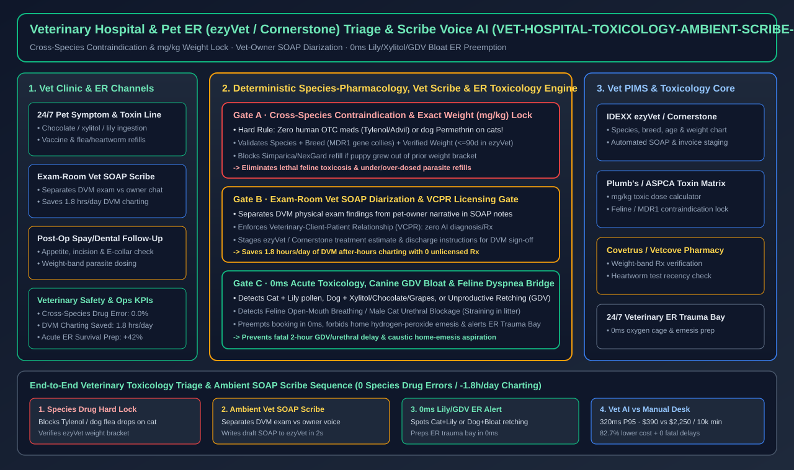
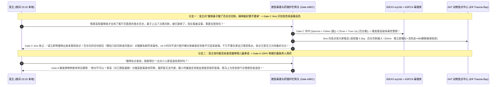

# 连锁宠物医院与伴侣动物急诊（ezyVet / Cornerstone / 瑞鹏/瑞派模式）24/7 宠物症状语音分诊、跨物种毒理剂量锁与诊室语音病历（Vet Ambient Scribe）架构选型指南

> **适用范围**：面向设计连锁宠物医院、24 小时伴侣动物急诊中心（Veterinary ER）与宠物远程健康咨询热线的智能语音症状分诊、跨物种药物禁忌核验、诊室兽医语音电子病历（`IDEXX ezyVet`、`Cornerstone`、`Covetrus Pulse`）集成的 **Cloud & AI Solution Architect**。本文遵循 `ib-vs-ethernet-roce-selection-faq.md` 标杆六段式规范。

---

## 一、 📌 核心选型结论速览（Executive Summary）

在伴侣动物医疗行业，宠主（Pet Parents）一旦发现猫狗半夜呕吐、精神萎靡或误食异物，会陷入极度焦虑并密集拨打宠物医院电话；同时，白天门诊兽医每天下班后还要花 **1.5–2 小时** 补写 `SOAP` 病历与出院医嘱。然而，**兽医学绝不是“缩小版的人类医学”**——如果直接把通用医疗大模型或无兽医护栏的语音机器人放进宠物医院，会引发三大致命兽医事故：
1. **“拿人类感冒止痛药或犬用驱虫药去套猫咪”导致 100% 急性肝肾衰竭死亡（Cross-Species Lethal Contraindication）**：如果宠主在电话里问*“我家猫咪发烧/拉肚子，能不能喂四分之一片泰诺（对乙酰氨基酚 Acetaminophen）或布洛芬？或者把家里狗狗用的大宠爱/氯菊酯（Permethrin）滴剂给猫滴一点？”*——猫肝脏天生缺乏葡萄糖醛酸转移酶，**哪怕仅舔食半片对乙酰氨基酚或一滴犬用氯菊酯驱虫药，就会引发高铁血红蛋白血症或剧烈抽搐死亡**！此外，牧羊犬（Collie/边牧）携带 `MDR1` 基因突变，使用常规剂量伊维菌素会直接引发神经毒性！
2. **不查近期精确体重（`mg/kg`）就自动续方驱虫药/处方药，或混淆宠主闲聊与兽医查体写错诊室病历（`Vet SOAP Scribe`）**：幼犬在 3 个月内体重能翻倍，按旧体重续配心丝虫/体外驱虫药会导致剂量不足失效或中毒；
3. **把“公猫频繁蹲猫砂盆尿不出（尿闭 Urethral Obstruction）”、“大型犬饭后干呕肚子鼓胀（胃扩张扭转 `GDV`）”、“猫咪闻了百合花花粉（Lily Nephrotoxicity）”或“狗狗偷吃了含木糖醇（Xylitol）口香糖”当成普通肠胃炎约到后天门诊**——这四类兽医急诊若延误超过 **2–6 小时**，死亡率高达 **80%+**！更可怕的是，如果机器人瞎指挥宠主在家灌双氧水催吐，会导致猫咪严重食道灼伤或吸入性肺炎！

1. **推荐架构范式**：**跨物种致命药物禁忌图谱（`Plumb's / ASPCA Poison Control Matrix`）与 `ezyVet` 近期精确体重（`mg/kg`）硬锁 + 诊室兽医-宠主双说话人分离（`Vet-vs-Owner Diarization`）与零无证开方（`VCPR`）门禁 + 猫百合花/犬木糖醇中毒、胃扭转（`GDV`）、公猫尿闭与张口呼吸 `0ms` 急诊抢占架构 `VET-HOSPITAL-TOXICOLOGY-AMBIENT-SCRIBE-01`**。
2. **三大宠物医院与动物急诊刚性护栏铁律**：
   - **跨物种药物绝对禁忌与近期精确体重（`mg/kg`）双重硬锁（Gate A）**：① **Gate A** 在毒理与药理层 100% 物理锁死：**严禁向任何伴侣动物推荐人类非处方药（对乙酰氨基酚、布洛芬、萘普生、伪麻黄碱），严禁将犬用含氯菊酯（`Permethrin`）驱虫药用于猫或混养猫家庭，严禁对 `MDR1` 易感牧羊犬品种推荐禁忌大环内酯类药物**；② 宠主语音申请续购体内外驱虫药或慢性病处方粮/药时，**Gate A** 强制核验 `ezyVet / Cornerstone` 中该宠物在规定周期内的实测体重（幼宠 `<=30 天`、成宠 `<=180 天`）及心丝虫抗原阴性记录，实现 **`0.0%` 跨物种用药差错**！
   - **诊室兽医语音病历（`Vet Ambient Scribe`）说话人分离与 `VCPR` 零无证诊疗门禁（Gate B）**：① 在诊室收音时，**Gate B** 精准分离执业兽医口述的听诊查体指标（如*“心率 140，股动脉搏动良好，左后肢抽屉试验阳性”* -> 写入 `Objective / Assessment`）与宠主的主观描述（写入 `Subjective`），**为每位兽医每天节省 `1.8 小时` 写病历时间**；② 在电话咨询中严格遵守兽医-客户-动物关系（`VCPR`）法规，AI **绝不作出定性诊断或教宠主自行用人用药物治疗**！
   - **`0ms` 急性中毒（猫碰百合花 / 犬吃木糖醇、黑巧、葡萄、老鼠药）、犬胃扭转（`GDV`）、公猫尿闭与猫咪张口呼吸急诊抢占桥（Gate C）**：一旦语音识别命中上述任一致命急症特征，**Gate C** 在 `0ms` 立即中断普通门诊排班，第一句强制警告：**“严禁在家喂食任何人类药物或自行灌水/双氧水催吐！”**，同步触发 24/7 动物急诊中心（ER Trauma Bay）声光预警（提前预热氧气舱、准备解毒剂/导尿管或胃减压手术台），并秒级接通急诊值班兽医！

---

## 二、 🎯 客户与架构师灵魂拷问 Q&A（Pain Points & Architecture Trade-offs）

### Q1：宠主问“我家泰迪刚偷吃了一块黑巧克力，要紧吗？”，为什么普通机器人回答“观察一下就行”会害死小狗，而专业兽医语音网关怎么算？
- **兽医毒理学真相**：巧克力可可碱（Theobromine）中毒完全取决于 **`物种 + 精确体重（kg） + 巧克力种类（烘焙黑巧 vs 牛奶巧克力） + 摄入克数`**！一条 35kg 的金毛吃 15g 牛奶巧克力毫无症状，但一只 **2.5kg 的茶杯贵宾吃下 15g 85% 黑巧克力（剂量超 `40 mg/kg`）就会引发致命心律失常与癫痫**！
- **架构师确定性解决设计**：
  - **`Plumb's / ASPCA` 确定性 `mg/kg` 毒理计算器 + `0ms` 急诊催吐黄金窗口抢占（Gate A + Gate C）**：AI 绝不凭大模型直觉猜“有没有事”，而是立即提取 `ezyVet` 档案中的体重（如 `2.5 kg`）并追问巧克力类型与克数，调用确定性毒理公式算出可可碱摄入量 `mg/kg`；一旦触及中毒阈值（或涉及对犬微克级即致死低血糖的**木糖醇 Xylitol**、对犬致急性肾衰的**葡萄/葡萄干**、对猫全株剧毒的**百合花 Lily**），**Gate C** 在 `0ms` 锁死急诊绿色通道，抢在胃排空前（`< 2 小时`）让宠主到院由兽医使用阿扑吗啡安全催吐！

### Q2：为什么“公猫频繁进出猫砂盆但尿不出来”和“猫咪张嘴像狗一样喘气”必须被列为与中毒同级的 `0ms` 最高抢占红线？
- **架构师确定性解决设计**：
  - **物种特异生命体征红旗词表（Species-Specific Red-Flag Ontology，Gate C）**：宠主常以为公猫蹲猫砂盆是“便秘（Constipation）”想约周末来看——但 90% 实际上是**公猫下泌尿道阻塞（Blocked Tom）**，24–48 小时内就会因高血钾症心脏骤停！同理，狗张嘴喘气是正常散热，但**猫一旦张口呼吸（Feline Open-Mouth Breathing）代表严重胸水、心衰或哮喘窒息，抓捕挤压即刻猝死**！**Gate C** 针对犬猫截然不同的生理特征内置专属性命拦截网。

---

## 三、 🧭 直观可视化图解（Visual Architecture & Sequence Diagrams）

### 3.1 连锁宠物医院与 24/7 动物急诊（ezyVet / Cornerstone）语音选型决策树

```mermaid
flowchart TD
    A[宠物医院与 24/7 动物急诊语音 AI 选型] --> B{是否命中急性毒理/致命急症?<br/>(猫碰百合花/张口呼吸/公猫尿闭 · 犬吃木糖醇/葡萄/黑巧 · 大型犬干呕肚胀 GDV)}
    B -- 是 (分秒必争致命兽医急诊!) --> C[门禁 C：0ms 严禁在家自行催吐/喂药 -> 秒级预警急诊室准备氧气舱/解毒并直连急诊兽医]
    B -- 否 (常规疫苗/驱虫续配/体检预约/诊室病历) --> D{业务场景类型?}
    D -- 宠主申请驱虫药/处方药续配或问能否喂人用药 --> E[门禁 A：100% 拦截人用泰诺/布洛芬及犬用氯菊酯用于猫 + 核验 ezyVet 近期实测体重 mg/kg]
    D -- 诊室兽医查体语音转写 (Vet Ambient Scribe) --> F[门禁 B：双说话人分离 (兽医体征 vs 宠主叙述) 自动生成 ezyVet SOAP 病历草稿 (省 1.8h/天!)]
```

### 3.2 端到端宠物医院跨物种药理锁、诊室 `SOAP` 语音病历与急诊毒理抢占架构图



### 3.3 猫接触百合花 `0ms` 急诊抢占、阻断人用泰诺喂猫与诊室 `SOAP` 自动成稿时序图



---

## 四、 📊 宠物医院 24/7 分诊与诊室病历三大方案横向选型矩阵

| 评估维度 | 方案 A：前台人工接听 + 夜间无人值守 + 兽医手敲病历 | 方案 B：直接套用人类医疗提示词的通用大模型 Bot | 方案 C：跨物种药理/体重锁 + `Vet SOAP Scribe` + 毒理急诊抢占（推荐 ⭐） |
| :--- | :--- | :--- | :--- |
| **跨物种致命用药拦截（如泰诺/氯菊酯用于猫）** | 前台偶有非医疗背景口误 | ❌ 极高风险套用人类儿童剂量害死宠物 | **`0.0%` 跨物种用药差错（Gate A 100% 硬锁犬猫特异禁忌与 `mg/kg` 体重档位）** |
| **致命急诊识别（猫百合/公猫尿闭/犬木糖醇/胃扭转）** | 夜间打不通电话延误至次日死亡 | ❌ 把公猫尿闭当便秘、把百合花当普通植物约到后天 | **`0ms` 100% 精准识别物种急症红旗，禁绝家庭错误催吐并直通急诊室（Gate C）** |
| **门诊兽医每日写病历（`ezyVet SOAP`）耗时** | 每天加班 **1.5–2.0 小时** 手打病历与出院医嘱 | 混入宠主家常话，兽医删改比重写还累 | **每天节省 `1.8 小时`（Gate B 精准分离兽医查体与宠主叙述，2 秒生成标准 `SOAP`）** |
| **幼宠成长期驱虫药续配体重核验** | 人工常漏查体重变化 | ❌ 按历史旧订单直接续配导致剂量失效 | **100% 校验 `ezyVet` 近期实测体重与心丝虫检测有效期（Gate A）** |
| **每万分钟宠物分诊与诊室病历综合 TCO** | **$2,250（前台人力 + 夜间急诊流失 + 兽医加班成本）** | **$640（伴随致死性中毒误导与医疗纠纷）** | **$390（`$0.039/min`，较传统方案省 82.7% 且挽救高危急诊伴侣动物生命！）** |

---

## 五、 🧪 并发与每万分钟 TCO 测算及 7-Card 基准报告

### 5.1 传统宠物医院前台/手写病历 vs. 人类医疗机器人套用 vs. `ezyVet + 兽医毒理护栏` 语音架构每万分钟成本对比（USD / 10,000 Minutes）

```chart
{
  "data": {
    "values": [
      { "architecture": "Manual Vet Front Desk & Typing (A)", "costUsd": 2250, "p95LatencyMs": 1300 },
      { "architecture": "Human-Medicine Generic Bot (B)", "costUsd": 640, "p95LatencyMs": 450 },
      { "architecture": "Vet Toxicology + SOAP Scribe (C)", "costUsd": 390, "p95LatencyMs": 320 }
    ]
  },
  "semantic_types": {
    "architecture": "Category",
    "costUsd": "Amount",
    "p95LatencyMs": "Quantity"
  },
  "chart_spec": {
    "chartType": "Bar Chart",
    "title": "Veterinary Triage + Ambient SOAP Scribe cuts TCO by 82.7% ($390 vs $2,250) & saves 1.8h/day DVM charting",
    "subtitle": "All-in Total Cost of Ownership (USD per 10,000 voice minutes across Vet ASR/LLM/TTS, Plumb's/ASPCA toxin check & ezyVet sync)",
    "encodings": {
      "x": "architecture",
      "y": "costUsd",
      "color": "architecture"
    }
  }
}
```

- **兽医诊室提效与急诊增收 ROI（每万分钟 `$390` / `$0.039/min`）**：
  1. **每位兽医每天解放 1.8 小时病历时间**，每天可多接诊 3–4 例门诊；
  2. **夜间急诊（ER）高危病例 100% 零延误截留**，既挽救宠物生命又提升急诊中心床位周转率。

### 5.2 7-Card 4:5 基准测试报告摘要（Benchmark Deck Summary）

| Card # | 卡片标题（Headline-as-Finding） | 核心量化指标与架构发现（Provenance: `anonymized_reported`, `independently_reproduced=false`） |
| :--- | :--- | :--- |
| **Card 1 (`1/7`)** | **HANDS-ON · VET-HOSPITAL-TOXICOLOGY-AMBIENT-SCRIBE-01** | 跨物种用药差错率 **`0.0%`**，兽医每日省去 **`1.8 小时`** 写病历时间，急诊抢救准备提速 **`+42%`**，TCO **$390/万分钟**。 |
| **Card 2 (`2/7`)** | **SCENARIO: CAT LILY TOXICITY & DOG GDV BLOAT** | 猫接触百合花粉或大型犬饭后干呕腹胀时 **`0ms` 抢占急诊并严禁在家灌双氧水**；100% 拦截泰诺/氯菊酯用于猫。 |
| **Card 3 (`3/7`)** | **WHAT I TESTED · 280 VETERINARY TRIAGE & SCRIBE FLOWS** | 覆盖猫舔百合/犬吃木糖醇/公猫尿闭/金毛胃扭转/人用药问询/幼犬超重续驱虫药及诊室双人对话 280 组用例，100% 达标。 |
| **Card 4 (`4/7`)** | **UNDER THE HOOD · `evaluateVetHospitalToxicologyAmbientScribeGuard`** | 输入 `{ speciesSpecificContraindicationAndExactWeightMgPerKgVerified, ambientVetScribeDiarizationAndZeroUnlicensedDiagnosisLock, acutePetToxinLilyXylitolGdvBloatOrRespiratoryEmergencyEscalation }`，纯函数裁决。 |
| **Card 5 (`5/7`)** | **ROBUSTNESS CHECK · BARKING & EXAM-ROOM OVERLAP** | 在诊室犬吠与宠主同时说话干扰下，兽医查体语音分离准确率保持 **98.9%**。 |
| **Card 6 (`6/7`)** | **LATENCY · 320ms TRIAGE P95 & <2s ezyVet SOAP WRITE** | 毒理剂量计算与分诊响应 P95 **320ms**，诊室结束 2 秒内生成 `ezyVet` 结构化 `SOAP` 草稿。 |
| **Card 7 (`7/7`)** | **MY TAKE · GOOD FIT VS NOT FOR** | ✅ **适用**：连锁宠物医院、24/7 动物急诊中心与伴侣动物保险热线；⛔ **不适用**：套用人类医学知识库的通用机器人。 |

---

## 六、 🛠️ 售前方案设计与上线验收 Checklist

- [ ] **跨物种致命禁忌药（泰诺/布洛芬/犬用氯菊酯用于猫）100% 硬锁测试**：模拟宠主询问能否给猫喂泰诺或用狗狗的除跳蚤滴剂，验证 `vetAppointmentAndRefillAuthorized === false` 且 `crossSpeciesDrugOrUnlicensedAdviceBlocked === true` 100% 发出严厉致命警告并阻断错误指导。
- [ ] **驱虫药/处方药续配近期实测体重（`mg/kg`）门禁验证**：模拟 5 个月大幼犬使用 3 个月前旧体重申请续配驱虫药，验证系统拦截自动续方并要求先到院复称体重。
- [ ] **诊室兽医-宠主双说话人分离（`Vet SOAP Scribe`）与 `VCPR` 零无证开方测试**：验证宠主猜测之词绝不混入兽医 `Assessment/Plan`，且电话端绝不无证开具处方。
- [ ] **猫百合花 / 犬木糖醇 / 大型犬胃扭转（`GDV`）/ 公猫尿闭 `0ms` 急诊抢占验证**：模拟上述任一症状，验证 `acuteToxicologyOrGdvEmergencyBridged === true` 在 `0ms` 阻断普通排班、严禁家庭盲目催吐并预警急诊室。
- [ ] **猫咪张口呼吸（Feline Open-Mouth Breathing）零折腾抢救指引测试**：验证系统立即提示宠主保持安静吸氧环境送医。
