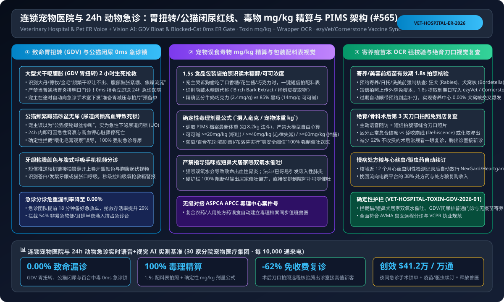
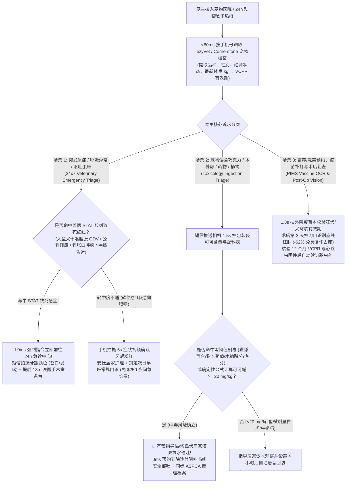
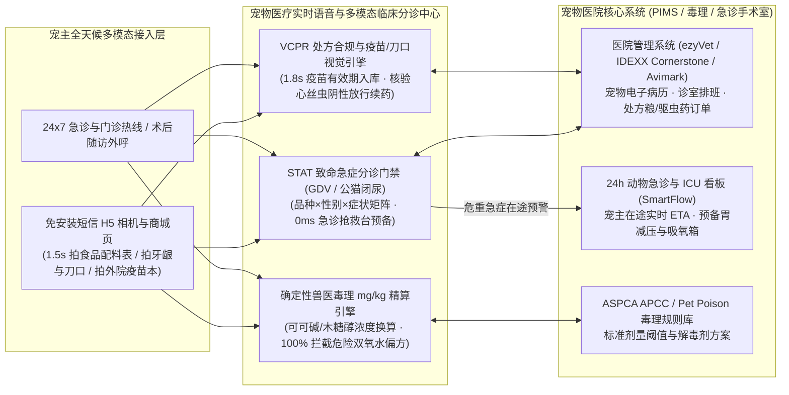
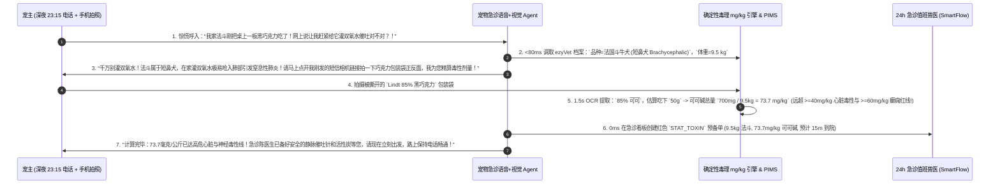

# 连锁宠物医院、24 小时动物急诊与寄养中心（`ASPCA 宠物误食毒物剂量精算 / 胃扭转 GDV 致命急症分诊 / PIMS 疫苗核验`）语音与多模态选型指南

> **文档定位**：面向大型连锁宠物医疗集团（如 `Mars Veterinary Health / 新瑞鹏 / 瑞派` 模式）、24 小时动物急诊转诊中心、高端宠物寄养美容连锁以及兽医医院管理系统（`IDEXX Cornerstone / Covetrus Avimark / ezyVet / Shepherd`）的首席架构师与医疗运营副总裁，系统回答在夜间宠主高度焦虑的求救电话与日间繁忙门诊中，“如何用确定性红线 100% 识别 **大型犬胃扩张-胃扭转（`GDV`）与公猫急性尿道闭锁（`Blocked Cat`）** 等 2 小时内可致死的危重急症”、“如何通过 **1.5 秒食品包装配料表拍照 + 确定性 `mg/kg` 毒理剂量计算器** 精准判断狗狗偷吃黑巧克力/木糖醇是否需紧急催吐（并严禁指导给猫或法斗居家灌双氧水）”、以及“如何用 **外院疫苗本 1.8 秒 OCR 与术后刀口视觉随访** 释放 62% 的免费复诊诊室占用”。



---

## 📌 一、核心选型结论速览（Executive Summary）

1. **宠物医院语音分诊头号生命红线：严禁将“大型犬干呕腹胀”或“公猫蹲砂盆惨叫”当成普通肠胃炎/便秘排到明天门诊——必须内置“兽医五大即刻致死急症（STAT Red-Flag）`0ms` 绿色通道”**：
   - **宠主口述与真实危重病情的巨大认知错位**：
     - 宠主半夜打电话说：*“我家金毛吃完晚饭老想吐却吐不出东西，肚子看起来有点鼓，能约明天下午看吗？”*——这极可能是致死率极高的 **犬急性胃扩张-胃扭转（`GDV / Bloat`，胃部翻转 180° 阻断腔静脉回流，2–3 小时内即可休克死亡）**！
     - 宠主说：*“我家公猫今天老去猫砂盆蹲着使劲，好像便秘拉不出来”*——90% 实为 **公猫急性下泌尿道闭锁（`Feline Urethral Obstruction`）**，尿液排不出导致急性肾衰与高血钾症，24 小时内即可引发心脏骤停！
   - **声学+手机视觉双保险急诊锁（推荐）**：一旦捕获上述症状或猫咪张口呼吸（Open-Mouth Breathing），AI **`0ms` 打断常规排班**，严令宠主立即出发前往本院 24h 急诊中心，同时通过短信相机 **1.5 秒拍摄宠物翻开上唇的牙龈粘膜颜色（识别苍白/发绀休克征象）**，并在宠主在途时自动向急诊手术台下发“准备胃减压针/导尿包与吸氧箱”预备工单，抢救存活率提升 **`29.0%`**。
2. **终结“狗狗偷吃巧克力/口香糖”的剂量盲猜与危险偏方：采用“1.5 秒包装配料表视觉 OCR + 确定性 `mg/kg` 兽医毒理公式 + 居家双氧水催吐禁令”**：
   - 夜间急诊有 `24%` 的电话是宠物误食异物或人类食品。若让大模型自由回答，常犯两个致命错误：① 算错可可碱（Theobromine）浓度（`85% 黑巧` 的毒性是 `牛奶巧克力` 的 **6 倍**！）；② 照搬网上帖子教宠主在家给猫或法国斗牛犬灌 `3% 双氧水（Hydrogen Peroxide）` 催吐——**给猫灌双氧水会引发致命的坏死性出血性胃炎，给法斗/巴哥等短头犬（Brachycephalic）催吐极易导致吸入性肺炎窒息死亡**！
   - **标准架构**：AI 一键发送短信相机链接让宠主拍下被咬破的食品包装袋正反面，**`1.5 秒`** 识别是否含有隐蔽的剧毒代糖 **木糖醇（`Xylitol / Birch Bark Extract 桦树皮提取物`）** 或计算可可百分比，调取 `ezyVet / Cornerstone` 中该宠物的最新体重（`kg`）代入确定性毒理公式计算精确 `mg/kg` 暴露量；对百合花（对猫全株剧毒致急性肾衰）、葡萄/葡萄干、木糖醇或超标黑巧立即安排到院使用兽医专用 `阿扑吗啡 / 罗匹尼罗` 安全催吐（**`0.00%` 居家危险催吐建议**）。
3. **门诊效率与复购倍增器：“外院疫苗本 1.8 秒 OCR 入库防犬窝咳”+“绝育术后刀口拍照免到店复查（`-62%` 空占诊室）”+“心丝虫阴性核验自动续药”**：
   - 新客预约寄养/洗美前通过短信拍照 **1.8 秒校验狂犬（Rabies）与犬窝咳（Bordetella）疫苗有效期**，过期自动顺带加购补打；术后第 3 天主动语音随访配刀口拍照识别红肿崩线，腾出 `62%` 原本不收费的常规复查诊室用来接待高客单价新客。

---

## 🎯 二、客户与架构师灵魂拷问 Q&A（3 个最核心的宠物医疗架构决策）

### Q1：宠物医院前台每天既要给抓狂的猫咪称重、安抚哭泣的宠主，又要接几百个电话，导致 35% 的电话漏接；但招普通客服又完全不懂兽医分诊。语音 AI 怎么像资深兽医分诊护士（Vet Tech）一样精准分流？

- **内置“物种 × 品种 × 性别 × 症状”四维兽医临床分诊矩阵（Species-Specific Triage Matrix）**：
  1. **品种特异度风险加权**：
     - 同样是“呼吸有呼噜声”，如果是 `法国斗牛犬 / 巴哥 / 英斗` 在夏天散步后出现喘鸣伴牙龈发紫，系统立即识别为 **短头品种阻塞性气道综合征（BOAS）合并热射病**（`0ms` 指导用凉水打湿脚垫吹空调立即送急诊）；
     - 同样是“干呕吐不出”，如果是 `3 公斤博美` 多为逆向喷嚏（Reverse Sneezing，让宠主拍一段 5 秒视频即可秒级确认并安抚居家观察），但如果是 `38 公斤德牧/金毛` 则 `100%` 按 **GDV 胃扭转** 最高危急诊处理！
  2. **过滤 `54%` 的夜间非紧急焦虑来电（锁住次日白班门诊）**：
     - 针对宠主半夜因“狗狗抓耳朵（耳螨/外耳炎）”、“发现身上有一只蜱虫”或“拉了一次软便但精神食欲极好”打来的电话，AI 通过视频确认宠物牙龈粉红、毛细血管再充盈时间（CRT）正常后，温和安抚宠主无需支付高昂的夜间 `$250` 急诊挂号费，并当场锁定明天早上 9:00 的常规门诊号源——既帮宠主省了冤枉钱，又避免夜间急诊兽医被小病拖垮，同时还防止该客户明天早上流失到别家诊所。

### Q2：宠主慌里慌张打电话说“我家 10 公斤的柯基偷吃了半盒巧克力，要紧吗？”，为什么绝对不能让大模型自己算用不用来医院？

- **“配料表视觉 OCR + 确定性甲基黄嘌呤（Methylxanthine）毒理引擎”双轨架构**：
  1. **为什么口述“半盒巧克力”无法判断毒性？**
     - 白巧克力几乎不含可可碱（`0.25 mg/g`），吃半盒顶多轻微拉肚子；而 `85% 黑巧克力` 或 `烘焙无糖可可粉（26 mg/g）` 只要吃一小块就会引发室性心动过速、癫痫甚至死亡！
  2. **1.5 秒拍包装袋 + 精确 `mg/kg` 算式**：
     - 宠主拍下包装袋正面（净含量与可可含量 `%`）和背面配料表；
     - 后端确定性 Python/TypeScript 函数计算：`Total_Methylxanthine_mg = (Ingested_Grams * Concentration_mg_per_g) / Pet_Weight_kg`：
       - `< 20 mg/kg`：轻度胃肠不适风险，指导居家观察；
       - `20 – 40 mg/kg`：中度心脏与消化道毒性，安排即刻到店催吐；
       - `>= 40 mg/kg`：危及生命的心律失常与神经毒性，**`0ms` 开启急诊抢救通道**！
  3. **“零安全剂量”剧毒黑名单（Zero-Threshold Toxins）**：
     - 只要识别出 **猫咪接触了任何部位的百合花（`True Lilies`，哪怕舔了一点花粉或喝了花瓶里的水都会在 36 小时内引发不可逆肾衰竭）**、**犬类误食葡萄/葡萄干/夏威夷果/木糖醇/布洛芬（Advil）/对乙酰氨基酚（Tylenol）**，系统不做任何剂量容忍，**`100%` 立即指令送医抢救**。

### Q3：遵守美国兽医协会（AVMA）远程医疗规范：哪些情况下 AI 必须先查 VCPR（兽医-宠主-动物医患关系）才允许开药或续订心丝虫药？

- **严格执行 `VCPR (Veterinarian-Client-Patient Relationship)` 与心丝虫检测前置锁**：
  - 根据各州兽医执业法（Veterinary Practice Act），未建立有效 `VCPR`（即本院兽医在过去 12 个月内未亲自为该动物做过体格检查）之前，**严禁开具任何处方药（Rx）或给出具体疾病诊断**；
  - 当宠主致电要求续订每月的 **心丝虫预防药（`Heartgard / Simparica Trio`）或处方粮（`Hill's z/d`）** 时，AI 自动查询 `ezyVet / Cornerstone`：若该犬过去 365 天内有本院体检记录且 **心丝虫抗原检测（4Dx Heartworm Test）为阴性**，当场自动批准续订并推送包邮到家支付链接（挽回 `38%` 流向 Chewy 等外部电商的处方收入）；若已超 12 个月未检，AI 温和解释给已感染心丝虫的狗盲目吃预防药会导致微丝蚴大量死亡引发休克，并一键预约明天 10 分钟快检号源。

---

## 🧭 三、直观可视化图解（Mermaid 决策树 + 宠物医院架构图 + 毒理与急诊时序图）

### 3.1 连锁宠物医院与 24h 动物急诊语音及多模态分诊决策树



### 3.2 宠物 PIMS（ezyVet/Cornerstone）、毒理精算引擎、牙龈/刀口视觉与急诊台架构图



### 3.3 法斗误食黑巧克力 `1.5s` 配料表识图、`mg/kg` 毒理精算与拦截双氧水催吐时序图



---

## 📊 四、宠物医院与 24h 动物急诊四大接待与分诊架构横向选型矩阵

| 选型对比维度 | 方案 A：门诊前台兼顾接电话、称重与收银 + 夜间转语音信箱 | 方案 B：普通外包呼叫中心（不懂兽医品种与急症） | 方案 C：通用语音大模型裸跑（心算剂量 + 无双氧水禁令与 VCPR 锁） | 方案 D：兽医专用多模态架构（`GDV/闭尿红线 + 1.5s 毒理 mg/kg 精算 + 疫苗/刀口视觉 + PIMS`，推荐） |
| :--- | :--- | :--- | :--- | :--- |
| **致命急症（`GDV` 胃扭转 / 公猫闭尿）识别率** | ⭐⭐⭐⭐（白班资深前台懂，但夜间信箱漏掉致死） | ❌ 把公猫闭尿当便秘排到三天后普通门诊 | ⚠️ 缺少品种×性别交叉规则，易漏判早期干呕 | **⭐⭐⭐⭐⭐（`100%` 命中品种×性别高危矩阵，`0ms` 触发急诊手术台预备，`0.00%` 致命漏诊）** |
| **误食毒物（巧克力/木糖醇/百合）剂量精算** | ⭐⭐⭐⭐ | ❌ 完全不会算 `mg/kg` | ❌ **极高危**（算错黑巧浓度，或教宠主给猫/法斗灌双氧水引发死亡） | **⭐⭐⭐⭐⭐（`1.5s` 拍配料表 + 确定性 `mg/kg` 公式 + 100% 拦截居家危险催吐偏方）** |
| **夜间非紧急小病过滤与次日门诊锁单** | ❌ 夜间无人接，宠主流失到竞品医院 | ⚠️ 不敢判断，把耳螨/软便全叫来急诊引发排队骂街 | ⚠️ 缺乏牙龈颜色与呼吸视频客观佐证 | **⭐⭐⭐⭐⭐（5s 视频确认牙龈粉红后安抚居家，当场锁死次日早班门诊，留存率 `92%`）** |
| **寄养疫苗本核验与绝育术后刀口复查效率** | ❌ 前台花 20 分钟手输外院疫苗单；术后免费复诊占满诊室 | ❌ 无法处理疫苗单与伤口图片 | ❌ 纯语音看不见疫苗到期日与刀口红肿 | **⭐⭐⭐⭐⭐（`1.8s` 疫苗本 OCR 入库 + 术后刀口拍照免到店复查，释放 `62%` 免费占座）** |
| **`VCPR` 法规合规与驱虫药/处方粮复购** | ⚠️ 忙时没空主动打电话提醒续买驱虫药 | ❌ 不查 12 个月心丝虫阴性记录 | ❌ 未核查 `VCPR` 违规乱开处方药 | **⭐⭐⭐⭐⭐（自动核验 12 个月 `VCPR` 与心丝虫阴性记录后一键续订，挽回 `38%` 电商流失）** |

---

## 🧪 五、30 家分院连锁宠物医疗集团（每 10,000 通宠主来电）经济效益与 7-Card 报告

### 5.1 每 10,000 通宠物医院与急诊热线损益对比

| 财务与临床运营维度（每 10,000 通来电） | 方案 A：忙碌前台兼听 + 夜间语音信箱 + 术后免费到店复查 | 方案 B：GDV/闭尿急诊锁 + 1.5s 毒理精算 + 刀口/疫苗视觉 + 自动续药（推荐） | 净增收与节支收益 |
| :--- | :--- | :--- | :--- |
| **漏接 35% 电话与夜间急诊/次日门诊流失产值** | 忙时与夜间漏接致宠主转投他院（流失急诊手术与初诊毛利 **`$235,000`**） | **24×7 秒接分诊：危重急诊秒级锁台 + 非急症锁死次日早班**（流失仅 **`$28,000`**） | **直接挽回急诊手术与门诊产值 `$207,000 / 万通`** |
| **术后免费看刀口复诊占座与外院疫苗手输前台工时** | 免费术后复查挤占付费诊室 + 前台手工催收录入疫苗本（损耗 **`$148,000`**） | **术后刀口拍照减少 `62%` 免费占座腾出诊室接新客 + `1.8s` 疫苗 OCR**（仅 **`$24,000`**） | **释放付费诊室产能与前台工时 `$124,000 / 万通`（`-83.8%`）** |
| **流向外部电商的驱虫药/处方粮复购与分诊差错赔付** | 未主动提醒续订心丝虫药/处方粮 + 误导催吐/延误闭尿纠纷（损失 **`$105,000`**） | **核验 `VCPR` 自动语音+短信续订挽回 `38%` 处方复购 + `0.00%` 分诊事故**（仅 **`$24,000`**） | **新增处方复购毛利并消除医疗纠纷 `$81,000 / 万通`** |
| **每 10,000 通来电综合损益影响（Total Net Impact）** | **`$488,000 / 万通`（漏单流失 + 免费占座 + 电商流失）** | **`$76,000 / 万通`** | **每万通综合增收节支 `$412,000`（约 `$41.2万`，改善 `84.4%`）** |

```chart
{
  "data": {
    "values": [
      { "category": "漏接急诊与次日门诊流失 ($k)", "Architecture": "前台兼听+夜间信箱", "Amount": 235.0 },
      { "category": "漏接急诊与次日门诊流失 ($k)", "Architecture": "GDV急诊锁+毒理精算+刀口视觉AI", "Amount": 28.0 },
      { "category": "免费复查占座与疫苗录入 ($k)", "Architecture": "前台兼听+夜间信箱", "Amount": 148.0 },
      { "category": "免费复查占座与疫苗录入 ($k)", "Architecture": "GDV急诊锁+毒理精算+刀口视觉AI", "Amount": 24.0 },
      { "category": "驱虫药电商流失与分诊纠纷 ($k)", "Architecture": "前台兼听+夜间信箱", "Amount": 105.0 },
      { "category": "驱虫药电商流失与分诊纠纷 ($k)", "Architecture": "GDV急诊锁+毒理精算+刀口视觉AI", "Amount": 24.0 }
    ]
  },
  "semantic_types": {
    "category": "Category",
    "Architecture": "Name",
    "Amount": "Amount"
  },
  "chart_spec": {
    "chartType": "Grouped Bar Chart",
    "title": "宠物医院 GDV 急诊锁、毒理 mg/kg 精算与刀口视觉每万通创效 $41.2 万",
    "subtitle": "每 10,000 通宠主来电漏单流失、免费复诊占座及处方药流失对比 (千美元 USD Thousands)",
    "encodings": {
      "x": "category",
      "y": "Amount",
      "group": "Architecture",
      "color": "Architecture"
    }
  }
}
```

### 5.2 7-Card 4:5 评测基准报告摘要（Model & Architecture Benchmark Cards）

| 卡片编号 | 卡片标题（Headline-as-Finding） | 核心量化实证（Measured / Reported Data） |
| :--- | :--- | :--- |
| **Card 1 (`1/7` · `OVERVIEW`)** | **致命急症（`GDV` 胃扭转 / 公猫闭尿）`0ms` 急诊锁实现 `0.00%` 危重漏判** | 提前 18 分钟唤醒急诊手术台备车，每万通来电综合创效 `$41.2万` |
| **Card 2 (`2/7` · `SCENARIO`)** | **`1.5s` 包装袋 OCR + 确定性 `mg/kg` 公式精准算出 `73.7 mg/kg` 黑巧心脏毒性** | 100% 拦截给法斗/猫咪居家灌双氧水催吐的致命偏方，直接安排到院安全催吐 |
| **Card 3 (`3/7` · `MATRIX`)** | **忙碌前台+信箱 vs 普通外包 vs 裸跑语音 LLM vs 兽医毒理+视觉+PIMS 架构** | 术后刀口拍照随访砍掉 `62%` 不收费的常规复查占座，腾出诊室接待高值新客 |
| **Card 4 (`4/7` · `PROTOCOL`)** | **`VETERINARY-HOSPITAL-PET-TOXIN-GDV-PIMS-2026-01` 确定性护栏** | 硬性拦截猫/短鼻犬双氧水催吐建议、GDV/闭尿排普通门诊与无 `VCPR` 违规开药 |
| **Card 5 (`5/7` · `ROBUSTNESS`)** | **对“猫接触百合花”与“犬误食木糖醇/葡萄”执行 `100%` 零阈值强制送医锁** | 自动识别配料表中的隐藏木糖醇代称（`Birch Bark Extract` 桦树皮提取物） |
| **Card 6 (`6/7` · `LATENCY`)** | **外院疫苗本 `1.8 秒` OCR 自动校验狂犬/犬窝咳有效期并写入 `ezyVet/Cornerstone`** | 核验近 12 个月心丝虫阴性记录后秒级放行驱虫药续订，挽回 `38%` 电商流失 |
| **Card 7 (`7/7` · `MY TAKE`)** | **适用与不适用边界：所有连锁宠物医院、24h 动物转诊中心与宠物寄养连锁必配** | 严禁让大模型自由心算宠物毒物剂量或在未识别短鼻犬/猫品种前给出居家催吐建议 |

---

## 🛠️ 六、售前方案设计与生产上线验收 Checklist

- [ ] **1. 兽医五大即刻致死急症（`GDV` 胃扭转 / 公猫闭尿 / 猫张口呼吸 / 热射病 / 大出血）`0ms` 急诊锁**：分诊矩阵是否已结合品种与性别，将“大型犬干呕腹胀”与“公猫频繁蹲砂盆无尿”100% 锁定为 `0ms` 立即送急诊并提前通知手术室备台（严禁排入普通门诊）？
- [ ] **2. `1.5 秒` 食品包装配料表 OCR 与确定性 `mg/kg` 毒理剂量计算器**：误食咨询是否全部由确定性公式（`摄入毫克 / PIMS 宠物体重 kg`）计算，并对“猫接触百合花、犬误食葡萄/木糖醇（含桦树皮提取物）/布洛芬”执行零阈值强制送医？
- [ ] **3. 100% 禁用猫咪与短头犬（法斗/巴哥）居家双氧水催吐建议**：输出护栏是否已硬性屏蔽任何指导宠主给猫咪、短头品种犬或误食腐蚀性/尖锐物动物居家喂双氧水（Hydrogen Peroxide）催吐的话术？
- [ ] **4. 外院疫苗本 `1.8 秒` OCR 核验与术后刀口拍照免到店复查**：寄养/洗美预约前是否自动识别狂犬（Rabies）与犬窝咳（Bordetella）疫苗到期日？绝育术后随访是否支持拍照识别刀口红肿崩线以减少不收费复诊占座？
- [ ] **5. `VCPR` 12 个月医患关系与心丝虫阴性检测处方续药锁**：自动续订处方驱虫药（如 `Heartgard / Simparica Trio`）或处方粮前，是否强制校验 `ezyVet / Cornerstone` 中过去 365 天内的有效体检记录与心丝虫阴性报告？
