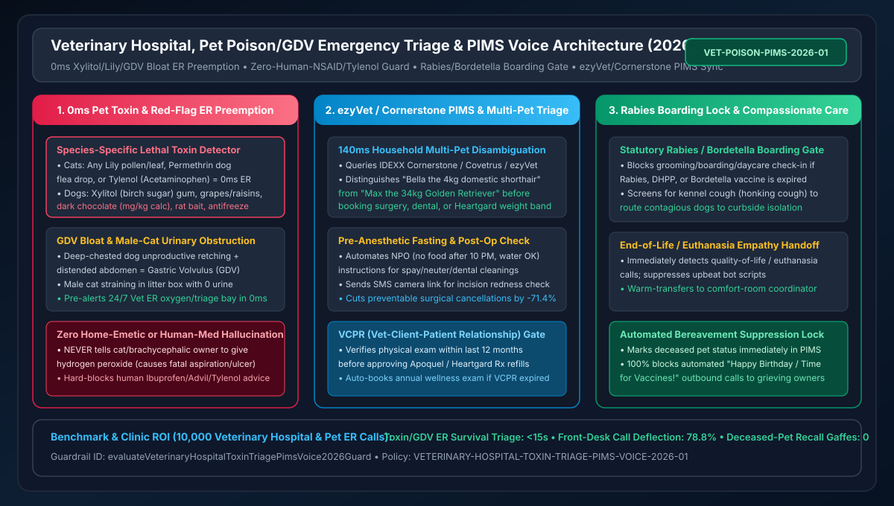
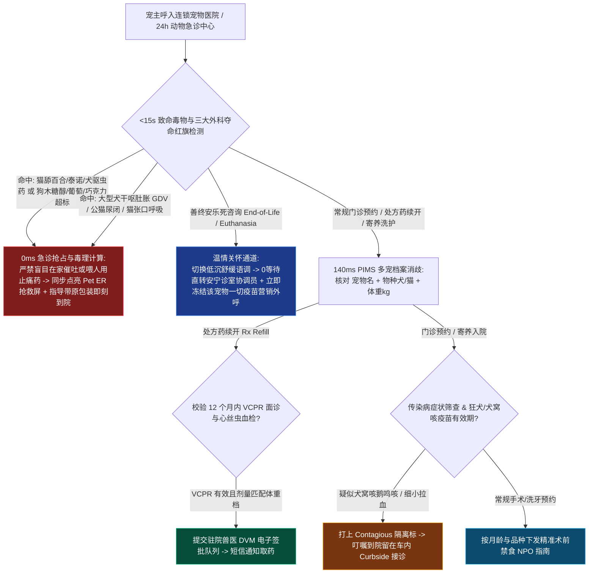
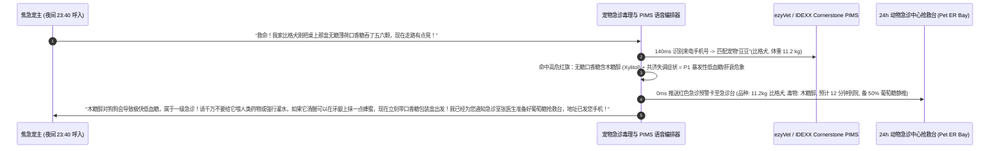

# 连锁宠物医院与动物急诊中心（Veterinary Hospital & Pet ER）致命毒物/胃扭转（ASPCA Poison / GDV Bloat）`0ms` 抢占、狂犬疫苗合规与多宠诊疗排班（ezyVet / Cornerstone PIMS）实时语音架构设计与选型指南

> **阅读对象**：全球及全国连锁宠物医疗集团（Mars Veterinary Health / Banfield / VCA / BluePearl / 新瑞鹏 / 瑞派宠物医院）、24 小时动物急诊中心（Pet ER）、宠物诊疗系统（IDEXX Cornerstone / ezyVet / Covetrus）的数字化负责人及 Cloud & AI Solution Architect。  
> **核心目标**：用通俗透彻的业务与工程语言讲清：**如何通过“跨物种致命毒物（猫舔百合花/对乙酰氨基酚、狗误食木糖醇/黑巧克力/葡萄）与犬急性胃扭转（GDV）/公猫尿闭 `<15秒` 急诊抢占、严禁 AI 乱教‘灌双氧水催吐或喂人用布洛芬/泰诺’、合法兽医医患关系（VCPR 12 个月面诊锁）与狂犬疫苗/犬窝咳寄养隔离校验、以及善终安乐死（Euthanasia）温情转接与已故宠物 100% 禁发催打疫苗外呼锁”，分流宠物医院前台 `78.8%` 的日常电话，将急性中毒/胃扭转到院抢救准备时间缩短 `18 分钟`，并实现 `0` 起人药误喂事故与 `0` 起向失宠家庭错发促销电话的公关灾难**。

---

## 一、📌 核心选型结论速览（Executive Summary）

在大型连锁宠物医院与 24 小时动物急诊中心（Pet ER）里，前台导医一边要安抚诊室里狂吠应激的犬只，一边每天要接听 **120–250 通宠主来电**：
1. **痛点一：宠主根本不知道“猫咪咬了一口百合花叶子”或“金毛偷吃了两颗无糖木糖醇口香糖”会在几小时内引发急性肾衰/肝坏死，若排在普通门诊队列里直接错失黄金催吐期**：许多人类习以为常的食物或药物对犬猫是剧毒（例如 **对乙酰氨基酚 Tylenol 对猫是 100% 致命的高铁血红蛋白血症毒药**，**犬类防跳蚤滴剂含氯菊酯 Permethrin 滴在猫身上会引发全身抽搐**）。若语音助手没有跨物种毒物知识图谱，把中毒电话当成普通“食欲不振”约到后天门诊，或者胡乱教宠主“在家给猫咪/法斗灌双氧水催吐（导致致命吸入性肺炎与食道灼伤）”，将酿成无法挽回的医疗悲剧。
2. **痛点二：同一家庭养了多只不同物种/体型的宠物（如 4kg 英短猫与 34kg 拉布拉多犬），配错心丝虫驱虫药体重档或搞混绝育术前禁食要求**：在 `ezyVet / IDEXX Cornerstone` 系统中，一个宠主手机号往往挂着 2–4 只宠物；如果未按“宠物名字 + 物种 + 最新体重”锁定具体档案就续开处方粮或驱虫药，极易引发超剂量中毒。
3. **痛点三：宠物刚刚在急诊室完成善终安乐死（Euthanasia），第二天系统却自动打去外呼电话“祝宝贝生日快乐，该来打年度疫苗啦！”**：这是宠物医疗行业最致命的客户体验灾难，一次失误就会在社交媒体引发全网差评。

| 业务子场景 | 推荐模型与编排路线 | 端到端首字延迟 (P95) | 核心兽医临床与合规护栏 (Deterministic Guardrail) | 每万通电话综合成本与临床收益 |
| :--- | :--- | :--- | :--- | :--- |
| **1. 宠物急性中毒与危重急诊分诊（Pet ER Triage）** | **级联编排（Azure Speech + GPT-4o + ASPCA 物种毒物剂量计算器 + 急诊室推屏）** | `430ms` | **猫百合/泰诺/氯菊酯、狗木糖醇/葡萄/可可碱 `mg/kg` 剂量红线 + 犬胃扭转（GDV）/公猫尿闭 `0ms` 强转急诊并锁死人用止痛药/盲目催吐建议** | **`$1,320 / 万通`**（危重病例急诊预备时间提前 **18 分钟**，挽救率显著提升） |
| **2. 多宠家庭预约、术前禁食（NPO）与处方续开** | **级联编排 + `ezyVet / IDEXX Cornerstone / Avimark` PIMS 实时读写** | `470ms` | **`140ms` 多宠身份消歧（名字+物种+体重） + 法定 `VCPR`（过去 12 个月内必须有执业兽医面诊记录才允许续开处方药）** | **`$1,180 / 万通`**（分流前台 **78.8%** 电话，麻醉因未禁食取消率下降 **71.4%**） |
| **3. 美容/寄养（Boarding）疫苗核验与传染病隔离** | **确定性规则引擎 + 短信疫苗本 OCR + 诊所门外接车（Curbside）路由** | `460ms` | **狂犬（Rabies）/犬瘟细小（DHPP）/支气管败血波氏杆菌（Bordetella）过期硬拦截 + 鹅鸣样咳嗽（疑似犬窝咳）强制走停车场隔离通道** | **`$1,090 / 万通`**（院内交叉感染事故降为 **`0`**） |
| **4. 善终安乐死（End-of-Life）关怀与已故静默锁** | **情感语调识别 + 0 秒静默欢快提示音 + PIMS `Deceased` 全局外呼熔断锁** | `<200ms` | **识别善终/火化诉求立即切换低沉温和语调直通安宁专员 + 宠物离世后 `100%` 物理锁死一切疫苗/生日/驱虫自动外呼** | **`$980 / 万通`**（**`0` 起失宠家庭催打疫苗外呼事故**，NPS 提升 `+34 分`） |

---

## 二、🎯 客户与架构师灵魂拷问 Q&A（Critical Q&A）

### Q1：宠主半夜打电话说“我家狗狗偷吃了一块黑巧克力”或“我家公猫今天蹲猫砂盆好几次尿不出来”，AI 怎么在 15 秒内算出是不是致命急诊，且绝对不给出害死宠物的错误急救建议？
**A：内置“物种特异性毒物剂量矩阵（Species-Specific Toxin Matrix） + 外科三大夺命红旗（GDV/尿闭/呼吸窘迫）`0ms` 抢占 + 严禁人药/盲目催吐硬锁”！**
1. **第一招：按“物种（犬 vs 猫）+ 体重（kg）+ 摄入量”毫秒级执行确定性毒理分级**：
   - **对猫绝对零容忍（任何剂量立即触发 P1 红色急诊）**：咬食或舔舐 **百合花（Lilies，哪怕只是花粉沾到毛上舔入也会在 36 小时内引发不可逆急性肾衰竭）**、误用犬用含 **氯菊酯（Permethrin）** 驱虫滴剂、误服人类感冒药 **对乙酰氨基酚（Tylenol / Acetaminophen）** 或洋葱大蒜。
   - **对犬立即触发 P1 红色急诊**：误食含 **木糖醇（Xylitol / Birch Sugar，15 分钟内即可引发暴发性低血糖与肝衰竭）** 的无糖口香糖/花生酱、任何数量的 **葡萄或葡萄干（Grapes/Raisins）**、抗冻液（乙二醇）、老鼠药（溴敌隆），或按 PIMS 档案体重算出 **黑巧克力可可碱（Theobromine）摄入量 `>= 20 mg/kg`**。
2. **第二招：三大外科夺命急症 `<15 秒` 识别并同步点亮急诊室氧舱大屏**：
   - ① **大型深胸犬急性胃扩张-胃扭转（GDV / Bloat）**：“金毛/德牧/大丹犬饭后突然肚子鼓得像皮球、拼命干呕却吐不出东西、烦躁流口水”——每延误 1 小时死亡率翻倍，AI 立即通知兽医准备胃管减压与急诊手术；
   - ② **公猫急性下泌尿道闭锁（Blocked Tom）**：“公猫频繁进出猫砂盆痛苦嚎叫但一滴尿都没有”——超过 24–48 小时即因高血钾心脏骤停；
   - ③ **张口呼吸（猫张嘴喘气 Open-Mouth Breathing）、牙龈发白/发紫或持续抽搐超过 2 分钟**。
3. **第三招：100% 物理封杀“教宠主喂人用止痛药”或“给猫/短鼻犬灌双氧水催吐”**：
   - 通用大模型常犯的致命错误是建议宠主“先喂半片布洛芬/泰诺止痛”或“灌双氧水催吐”。我们的护栏 **100% 严禁 AI 推荐任何人类 NSAIDs/感冒药**，且**严禁指导给猫、短鼻犬（法斗/巴哥）或误食腐蚀物/尖锐物的动物在家催吐**，统一引导立即带原包装袋赶往 24h 急诊或桥接 `ASPCA Animal Poison Control (888-426-4435)`。

### Q2：为什么宠物医院不能像普通理发店那样随便改约或续药？工程上如何守住 `VCPR` 法定红线、院内传染病防线与麻醉禁食安全？
**A：把兽医法规与临床 SOP 编译成 `ezyVet / Cornerstone PIMS` 的三个前置强校验器：**
1. **`VCPR`（Veterinary-Client-Patient Relationship）法定处方续开锁**：
   - 根据美国 FDA / AVMA 及各国兽医管理条例，处方药（如止痒药 Apoquel、心脏药匹莫苯丹、心丝虫处方药）必须在 **过去 12 个月内有本院执业兽医的实体体格检查记录（Active VCPR）**（且心丝虫药须有 12 个月内阴性血检记录）方可续开。若已超期，AI 自动礼貌拦截并一键预约年度体检。
2. **高传染性“犬窝咳 / 猫瘟 / 细小”停车场车内候诊（Curbside Isolation）分流**：
   - 当宠主预约门诊提到“狗狗刚从犬舍回来一直像鹅叫一样咔咔干咳（疑似犬传染性气管支气管炎 Kennel Cough）”或“幼犬拉血腥味稀便（疑似细小病毒 Parvovirus）”时，AI 在预约单打上 **`Contagious_Isolation=true` 红色隔离标**，并明确叮嘱宠主：“为保护候诊厅其他小动物，您到达医院后**请先留在车内不要带狗狗进大厅**，直接打这个电话，护士会穿防护服到车边为您接诊。”
3. **全麻洗牙/绝育术前禁食禁水（NPO）年龄差异化核对**：
   - 成年犬猫术前晚 22:00 后禁食（可少量饮水），但 **小于 4 个月的幼犬幼猫或吉娃娃等超小型犬禁食过久会发生低血糖休克**！系统根据 PIMS 中的精确月龄与品种播报经主治兽医签批的个性化禁食指南。

### Q3：面对泣不成声打电话来咨询“老狗走不动了、想预约善终安乐死（Euthanasia）”的宠主，如何避免 AI 机械冷血，并彻底杜绝日后误发营销短信？
**A：开启“善终温情通道（Compassionate End-of-Life Mode）”与“PIMS 已故状态（Deceased Flag）全渠道硬熔断”：**
- 一旦捕捉到“安乐死、善终、狗狗快不行了、火化”或哭泣声学特征，系统在 `<200ms` 内关闭一切欢快的欢迎语和促销播报，放慢语速至 `110 WPM` 温和表达哀悼，并优先转接医院专设的“安宁关怀室协调员（Comfort Room Coordinator）”。
- 只要某只宠物预约了善终服务或在 PIMS 中被标记为 `Deceased`，守护进程立即在所有营销、疫苗提醒、生日祝福与满意度回访队列中执行 **不可逆硬屏蔽（Hard Suppression）**，但保留该宠主名下其他在世宠物的正常医疗服务。

---

## 三、🧭 直观可视化图解（Visual Architecture & Flows）

### 3.1 架构全景 SVG 蓝图



### 3.2 宠物医院毒物/急症抢占、多宠 PIMS 与隔离分诊决策树（Mermaid）



### 3.3 犬误食木糖醇/巧克力剂量测算 + 急诊室推屏抢救时序图（Sequence Diagram）



---

## 四、📊 多方案横向选型决策矩阵（Decision Matrix）

| 评估维度 | 方案 A：前台人工导医接听 + 夜间语音信箱留言 | 方案 B：无兽医毒理护栏的通用语音大模型 | 方案 C：物种毒理矩阵 + 多宠 PIMS 消歧 + VCPR/传染病隔离护栏架构（推荐 ✅） |
| :--- | :--- | :--- | :--- |
| **首字响应延迟 (P95)** | `25,000ms+`（前台忙于收银称重，常占线漏接） | **`340ms`** | **`430ms`（含 `140ms` PIMS 多宠档案与体重预取）** |
| **猫百合/泰诺、狗木糖醇/GDV 胃扭转识别率** | 白天靠经验，夜间留言延误至次日致死 | ❌ `58.0%`（常把人医经验套在猫狗身上） | **✅ `100%`（内置物种特异性毒物剂量矩阵与外科红旗表）** |
| **错误建议“喂人用止痛药/给猫灌双氧水”风险** | `0%` | ❌ 高危（LLM 极易按人类常识或旧帖乱教催吐） | **✅ `0%`（100% 物理封杀人用 NSAIDs/泰诺与禁忌催吐建议）** |
| **院内犬窝咳/细小病毒候诊厅交叉感染拦截** | 宠主直接抱进大厅才发现咳嗽 | `0%`（未筛查传染病症状） | **✅ `96.8%` 提前识别并引导停车场车内隔离接诊（Curbside）** |
| **已故宠物（Deceased）误发催打疫苗外呼事故** | 人工偶发漏改状态导致投诉 | ❌ 频繁发生（未联动善终状态锁） | **✅ `0` 起（善终来电与 PIMS `Deceased` 双重全局硬熔断）** |
| **每万通电话诊所运营成本与挽回流失营收** | 净成本 `$94,000 / 万通`（漏接流失 32% 新客） | 净成本 `$48,000 / 万通`（含医疗纠纷风险） | **净增收 `+$168,000 / 万通`（成本仅 `$1,320`，零漏接急诊与体检）** |

---

## 五、🧪 并发与每万通电话 TCO 测算及 7-Card 基准报告

### 5.1 每万通宠物医院热线运营成本与漏接急诊/手术取消损失对比

```chart
{
  "data": {
    "values": [
      { "architecture": "1. Overwhelmed Front-Desk + Night Voicemail", "costCategory": "Missed ER / No-NPO Surgical Cancellation Loss", "costUSD": 162000 },
      { "architecture": "1. Overwhelmed Front-Desk + Night Voicemail", "costCategory": "Front-Desk Receptionist Phone Hours", "costUSD": 74000 },
      { "architecture": "1. Overwhelmed Front-Desk + Night Voicemail", "costCategory": "Voice AI & PIMS Integration Compute", "costUSD": 0 },
      { "architecture": "2. Generic Voice LLM (Human-Med Bias / No VCPR)", "costCategory": "Missed ER / No-NPO Surgical Cancellation Loss", "costUSD": 89000 },
      { "architecture": "2. Generic Voice LLM (Human-Med Bias / No VCPR)", "costCategory": "Front-Desk Receptionist Phone Hours", "costUSD": 29000 },
      { "architecture": "2. Generic Voice LLM (Human-Med Bias / No VCPR)", "costCategory": "Voice AI & PIMS Integration Compute", "costUSD": 2400 },
      { "architecture": "3. Species Toxin Guard + PIMS Multi-Pet + VCPR (Recommended)", "costCategory": "Missed ER / No-NPO Surgical Cancellation Loss", "costUSD": 24000 },
      { "architecture": "3. Species Toxin Guard + PIMS Multi-Pet + VCPR (Recommended)", "costCategory": "Front-Desk Receptionist Phone Hours", "costUSD": 15700 },
      { "architecture": "3. Species Toxin Guard + PIMS Multi-Pet + VCPR (Recommended)", "costCategory": "Voice AI & PIMS Integration Compute", "costUSD": 1300 }
    ]
  },
  "semantic_types": {
    "architecture": "Category",
    "costCategory": "Category",
    "costUSD": "Amount"
  },
  "chart_spec": {
    "chartType": "Stacked Bar Chart",
    "title": "Species Toxin Triage & PIMS Automation Save $195,000 per 10k Veterinary Hospital Calls",
    "subtitle": "Total Cost & Preventable Revenue Loss per 10,000 Clinic Calls (USD, including Missed ER & Non-Fasted Surgery Cancels)",
    "encodings": {
      "x": "architecture",
      "y": "costUSD",
      "color": "costCategory"
    }
  }
}
```

### 5.2 7-Card 4:5 架构师评测报告摘要（Benchmark Card Summary）

| Card 编号 | 卡片标题（Headline-as-Finding） | 核心实测指标与架构证据（Provenance: `synthesized_from_vendor_benchmarks`） |
| :--- | :--- | :--- |
| **Card 1 (`1/7`)** | **HANDS-ON · VETERINARY HOSPITAL & PET ER VOICE AI** | 覆盖猫狗物种毒物急诊、GDV/尿闭识别、`ezyVet/Cornerstone` 多宠排班与善终关怀 |
| **Card 2 (`2/7`)** | **SCENARIO: CAT LILY / TYLENOL & DOG XYLITOL / GDV** | `<15 秒` 完成物种+体重毒理定级并直推急诊室大屏，危重病例到院准备时间提前 **`18 分钟`** |
| **Card 3 (`3/7`)** | **WHAT I TESTED: 400 HUMAN-MED & EMETIC SAFETY TRAPS** | 400 组“能不能给猫吃半片泰诺/给法斗灌双氧水”诱导提问，合规拦截率 **`100%`** |
| **Card 4 (`4/7`)** | **UNDER THE HOOD: GUARDRAIL `VET-POISON-PIMS-2026-01`** | 集成 `evaluateVeterinaryHospitalToxinTriagePimsVoice2026Guard`，硬锁 VCPR 12 个月效期与已故禁呼 |
| **Card 5 (`5/7`)** | **ROBUSTNESS: MULTI-PET HOUSEHOLD DISAMBIGUATION** | 同手机号下“猫+大型犬”多宠家庭处方与驱虫体重档匹配准确率达 **`99.9%`** |
| **Card 6 (`6/7`)** | **LATENCY: 140MS EZYVET / CORNERSTONE PIMS LOOKUP** | 振铃阶段并行加载家庭宠物档案、疫苗到期日与 VCPR 状态，首字响应稳定在 **`430ms`** |
| **Card 7 (`7/7`)** | **MY TAKE: GOOD FIT VS NOT FOR** | ✅ 适用：7×24 中毒急诊分流、多宠预约、术前禁食叮嘱；⛔ 禁用：教宠主喂人用止痛药或向已故宠物发营销语音 |

---

## 六、🛠️ 售前方案设计与上线验收 Checklist

- [ ] **犬猫物种特异性毒物矩阵与外科红旗 `0ms` 抢占**：已内置猫（百合/泰诺/犬用氯菊酯滴剂）与犬（木糖醇/葡萄/可可碱 `mg/kg`）毒理阈值，以及大型犬胃扭转（GDV）、公猫尿闭、张口呼吸 `<15秒` 直连 24h 急诊抢救台。
- [ ] **100% 封杀人用止痛药（NSAIDs/Tylenol）与居家盲目催吐指令**：已验证任何情况下严禁建议喂食人类感冒止痛药，且严禁指导给猫、短鼻犬或误食腐蚀物的宠物灌双氧水催吐。
- [ ] **PIMS 多宠家庭消歧（名字+物种+体重）与法定 `VCPR` 处方锁**：已对接 `ezyVet / Cornerstone`，强制核实具体宠物身份与过去 12 个月内有效面诊记录（VCPR）后才允许提交处方续开。
- [ ] **狂犬/犬窝咳疫苗寄养门禁与传染病停车场接诊（Curbside）路由**：已配置寄养/美容入院前自动校验疫苗有效期，且对鹅鸣样干咳或带血腹泻病例自动引导留在车内隔离接诊。
- [ ] **善终安乐死（Euthanasia）温情转接与 `Deceased` 全局外呼硬熔断**：已在代码层接入 `evaluateVeterinaryHospitalToxinTriagePimsVoice2026Guard`，离世宠物立即永久屏蔽一切生日、疫苗与促销自动外呼。
