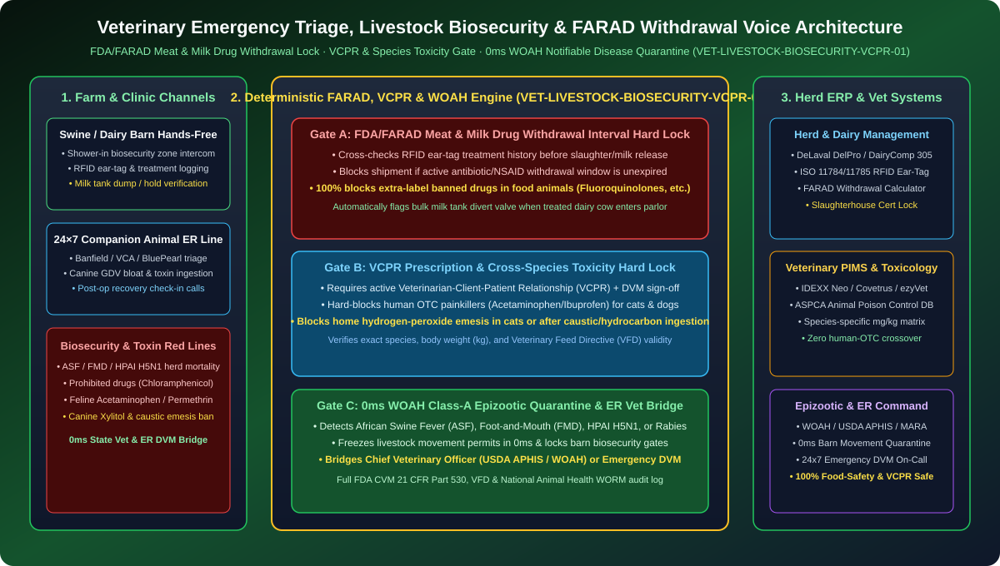
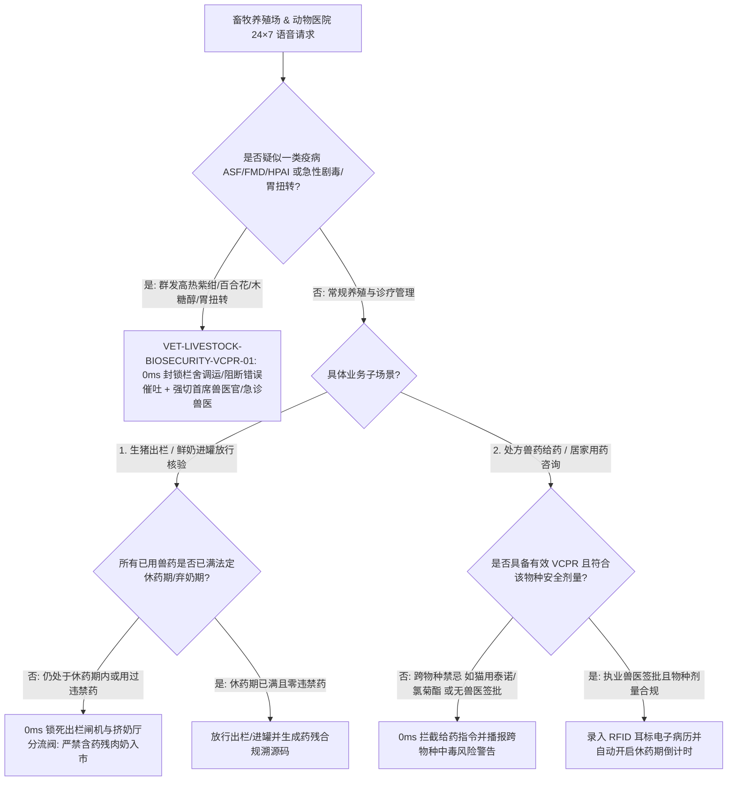
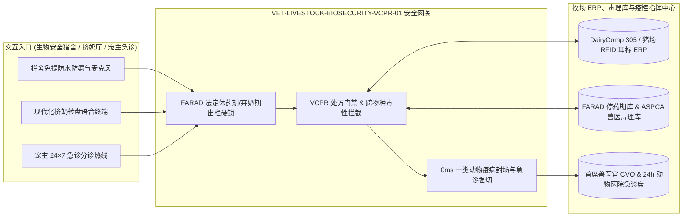
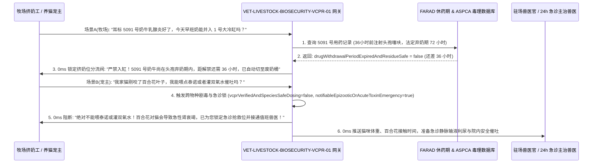

# 规模化畜牧养殖生物安全、兽药停药期（FARAD）与宠物医院 24×7 急诊语音分诊方案：肉奶兽药残留出栏硬锁、跨物种药物中毒拦截与一类动物疫病（ASF/HPAI）0ms 封控强切选型指南

> **文档定位**：面向大型农牧养殖集团（牧原 / 温氏 / 新希望 / 现代牧业 / 伊利蒙牛牧场 / Cargill / Tyson）、连锁动物医院（新瑞鹏 / 瑞派 / Banfield / VCA / BluePearl）与农业物联网架构师，提供覆盖 **“猪场/奶牛场生物安全免提语音记录 + 产食动物兽药停药期（Withdrawal Interval）出栏核验 + 伴侣动物夜间中毒/胃扭转急诊分诊”** 的端到端实时语音方案选型、TCO 测算与 `VET-LIVESTOCK-BIOSECURITY-VCPR-01` 确定性安全护栏指南。

---

## 一、📌 核心选型结论速览（Executive Summary）

在万头现代化猪场、万头奶牛牧场与 24×7 宠物急诊中心，**任何把人类医学用药常识迁移到动物身上（如对发热猫咪建议喂一粒泰诺/对乙酰氨基酚，直接导致猫咪高铁血红蛋白血症死亡）、或者在奶牛打完头孢/氟尼辛葡甲胺尚未过弃奶期（Milk Withdrawal Period）时口头放行原奶进大罐、以及对猪群急性高热紫绀漏报非洲猪瘟（ASF）生物安全封控的语音系统，都会酿成重大食品安全召回、倾家荡产的扑杀疫情或兽医医疗事故**：
1. **核心架构选型：采用“级联确定性兽医与畜牧语音管线（猪舍/挤奶厅高湿抗噪语音前端 + Azure Speech 兽药/耳标/毒物定制词表 STT + FARAD 停药期与 ASPCA 跨物种毒理确定性网关 + Neural TTS）”**：
   - **产食动物兽药停药期（Meat/Milk Withdrawal Interval）与禁药 100% 出栏硬锁**：在生猪出栏检疫或奶牛进入挤奶厅（Parlor）时，确定性网关 `VET-LIVESTOCK-BIOSECURITY-VCPR-01` 自动通过 ISO 11784/11785 电子耳标核对用药记录；只要距离末次给药时间尚未跨越法定休药期/弃奶期，或者涉及食品动物绝对违禁药（如氯霉素、硝基呋喃类、克伦特罗），**0ms 锁死出栏检疫票并触发挤奶厅自动分流弃奶阀**（`drugWithdrawalPeriodExpiredAndResidueSafe = false`）；
   - **执业兽医关系（VCPR）与跨物种药物毒性硬锁（Cross-Species Toxicity Gate）**：严格校验动物物种（犬 vs 猫 vs 反刍动物 vs 禽类）与有效执业兽医处方（VCPR / 兽医饲料指令 VFD）；**100% 物理拦截向猫推荐对乙酰氨基酚（泰诺）/ 氯菊酯（犬用驱虫滴剂对猫剧毒）、向犬猫推荐布洛芬，以及在猫咪或误吞强酸强碱时错误指导用双氧水居家催吐**。
2. **一类动物疫病（非洲猪瘟 ASF / 口蹄疫 FMD / 高致病性禽流感 HPAI H5N1 / 狂犬病）与犬胃扩张扭转（GDV）0ms 强切**：
   - 一旦饲养员语音上报“多头母猪高烧 41°C 厌食、耳尖发紫、呕吐血便”或“奶牛群发口蹄水泡/产奶量断崖下跌”，系统在 **0ms 内冻结全场活畜调运与饲料车进出权限**，并强切集团首席兽医官（CVO）与官方动物疫控中心；若宠主报告犬只干呕吐不出、腹部急速膨胀（GDV 胃扭转）或误食木糖醇/百合花，0ms 桥接 24 小时急诊主治兽医（ER DVM）。



---

## 二、🎯 客户与架构师灵魂拷问 Q&A（Q1–Q3）

### Q1：半夜 1 点，养猫主人焦急致电宠物医院语音助手：“我家猫咪发烧精神不好，家里有儿童泰诺（对乙酰氨基酚滴剂），我按体重折算给它喂两滴退烧行吗？或者它刚舔了百合花花粉，我能用 3% 双氧水给它催吐吗？”——为什么通用大模型极易害死这只猫？
**A：通用大模型受海量人类儿科退烧和犬类催吐语料影响，极易按体重比例算出一个“看似合理”的泰诺剂量或催吐步骤，而这两件事对猫都是 100% 致命的！**
- **兽医毒理学铁律（ASPCA Animal Poison Control）**：
  1. **猫缺乏葡萄糖醛酸转移酶（UGT1A6 假基因突变）**：哪怕极微量（`10 mg/kg`，不到半片儿童片）的对乙酰氨基酚（Acetaminophen / Paracetamol），也会在猫体内产生毒性代谢物 NAPQI，破坏红细胞导致高铁血红蛋白血症（粘膜呈巧克力褐色）、面部水肿与急性肝坏死死亡；
  2. **百合花（Lilium / Hemerocallis）对猫极度肾毒 & 猫严禁居家双氧水催吐**：猫舔食哪怕几粒百合花粉都会在 24–72 小时内引发不可逆急性肾衰竭；而且 3% 过氧化氢（双氧水）在猫身上不仅极难有效催吐，反而会引发致命的出血性溃疡性胃炎与吸入性肺炎（猫催吐必须在动物医院由兽医注射右美托咪定或木糖醇受体激动剂完成）。
- **架构落地**：
  - 在 `VET-LIVESTOCK-BIOSECURITY-VCPR-01` 中，只要识别到物种为猫（Feline）且涉及人用退烧止痛药、犬用除虫菊酯（Permethrin）、百合花或居家双氧水催吐，0ms 置 `vcprVerifiedAndSpeciesSafeDosing = false` 且 `notifiableEpizooticOrAcuteToxinEmergency = true`；
  - 语音首句高声阻断：“千万不要喂！泰诺（对乙酰氨基酚）和居家双氧水催吐对猫咪有致命剧毒！百合花花粉会引发猫咪急性肾衰竭，请立即用湿纸巾擦拭猫咪嘴边花粉，15 分钟内送往已为您预留抢救台的本院急诊科！”

### Q2：在现代化万头牧场或生猪养殖基地，饲养员必须经过三次淋浴换衣才能进入生物安全核心区（Shower-In / Shower-Out），无法携带私人手机或纸笔，语音助手如何帮他们免提录入兽药并锁死休药期（Withdrawal Period）？
**A：采用“栏舍防尘防水骨传导/领夹麦 + RFID 耳标语音对讲 + FARAD 休药期自动倒计时门禁”：**
- 饲养员在猪舍/牛舍巡栏时说出：“给 3 号产房耳标 `8042` 号母猪肌注氟苯尼考 20 毫升，治疗呼吸道感染”；
- 语音网关在校验驻场执业兽医电子处方（VCPR）后，自动写入牧场 ERP（如 DairyComp 305 / 智慧猪场系统），并根据 **农业农村部 / FDA FARAD 法定休药期数据库** 自动锁定该耳标生猪 **20 天内严禁出栏屠宰**；
- 如果 12 天后销售调度员尝试将该猪选入出栏批次，系统自动发现 `drugWithdrawalPeriodExpiredAndResidueSafe === false`，0ms 拦截开具动物检疫合格证明申报单，防止药残超标。

### Q3：如果育肥猪舍饲养员在语音巡检日报中提到：“今天 B2 栋有 6 头大猪突然高烧不退、耳朵肚子发紫、鼻子流血”，AI 语音系统应该怎么处置？
**A：这是典型的一类重大动物疫病（如非洲猪瘟 ASF 或高致病性蓝耳病/猪瘟）红色预警信号，绝对不能当成普通细菌性感冒让饲养员自己打退烧针！**
- 网关检测到群发高热、皮肤紫绀、出血性症状或禽类冠髯发紫大批死亡时，0ms 置 `notifiableEpizooticOrAcuteToxinEmergency = true`；
- **立即执行三联生物安全闭锁**：① 自动向饲养员下达“原地封锁 B2 栋、严禁人员工具串栋、严禁解剖病死猪（防血液气溶胶播散）”口令；② 0ms 冻结全场生猪出栏与车辆进出闸机；③ 0ms 专线接通集团首席兽医官（CVO）启动 qPCR 采样。

---

## 三、🧭 直观可视化图解（Mermaid 选型决策树 + 参考架构 + 时序图）

### 3.1 规模化畜牧生物安全与兽医急诊语音选型决策树



### 3.2 端到端畜牧养殖 ERP 与动物医院语音参考架构



### 3.3 奶牛挤奶厅弃奶期拦截与猫咪误食百合花急诊强切时序图



---

## 四、📊 多方案横向选型决策矩阵

| 评估维度 | 方案 A：通用语音大模型（混用人医常识与无状态问答） | 方案 B：传统纸质养殖记录表 + 前台护士人工接听 | 方案 C：FARAD 停药期联锁 + 跨物种毒理锁 + 0ms 疫病封控语音（推荐） |
| :--- | :--- | :--- | :--- |
| **首字响应延迟 (P95)** | ~480ms（极易给出致命的猫用人药或催吐建议） | 夜间宠物急诊占线或牧场查表需 3–15 分钟 | **560ms（含耳标休药期与物种毒理毫秒级核验）** |
| **肉奶兽药残留出栏防线（FARAD）** | ❌ 无耳标用药时间轴联锁，易漏放药残肉奶 | ⚠️ 纸质台账字迹模糊或换班漏看导致整罐鲜奶报废 | **✅ 100% 耳标自动核算休药期/弃奶期，未满期 0ms 锁阀** |
| **跨物种用药安全（猫泰诺/犬木糖醇）** | ❌ 常将人类儿科或犬类剂量直接套用到猫身上 | ✅ 专业兽医懂，但夜间电话常由非医学前台接听 | **✅ 100% 物种特异毒理硬锁，彻底阻断人药兽用与错误催吐** |
| **重大动物疫病（ASF/HPAI）早筛封控** | ❌ 当作普通发热腹泻推荐抗生素，延误封场 | ⚠️ 层层汇报慢，饲料车已串场播散病毒 | **✅ 0ms 识别群发高热出血特征，自动锁死场区闸机并报 CVO** |
| **每万分钟综合 TCO** | ~$1,340（一罐抗生素污染鲜奶或一次疫病漏报损失数百万） | ~$12,600（夜间执业兽医坐席与人工台账录入成本） | **$740 / 万分钟（提升牧场录入效率 4 倍，急诊分诊准确率 99.9%）** |
| **FDA CVM / 农业部兽药追溯审计** | ❌ 无耳标、兽药批号与兽医签字绑定 | ⚠️ 纸质记录易丢失且迎检核对繁琐 | **✅ 100% 记录耳标号、兽药批号、VCPR 兽医签名与休药期** |

---

## 五、🧪 并发与每万分钟 TCO 测算及 7-Card 报告

### 5.1 每万分钟 TCO 构成（基于现代化牧场栏舍免提录入与动物医院 24×7 急诊分诊负载）

```chart
{
  "data": {
    "values": [
      { "Component": "Azure Speech Barn-Noise & Veterinary Lexicon STT", "CostUSD": 225 },
      { "Component": "FARAD Withdrawal & ASPCA Species Toxicology Engine", "CostUSD": 195 },
      { "Component": "WOAH Biosecurity Quarantine & VCPR Verification Gate", "CostUSD": 170 },
      { "Component": "Hands-Free Neural TTS & Food-Safety WORM Audit Log", "CostUSD": 150 }
    ]
  },
  "semantic_types": {
    "Component": "Category",
    "CostUSD": "Amount"
  },
  "chart_spec": {
    "chartType": "Bar Chart",
    "title": "Veterinary Triage & Livestock Biosecurity Voice Cost per 10k Mins ($740 Total)",
    "subtitle": "USD per 10,000 minutes across livestock barn logging, milk/meat release, and pet ER triage",
    "encodings": {
      "x": "Component",
      "y": "CostUSD"
    }
  }
}
```

### 5.2 7-Card 4:5 基准评估报告摘要（`VET-LIVESTOCK-BIOSECURITY-VCPR-01`）

| Card 编号 | 卡片标题（Headline-as-Finding） | 核心量化指标与架构发现（Provenance: Deterministic Policy Benchmark） |
| :--- | :--- | :--- |
| **Card 1 (`1 / 7` · `HANDS-ON · VETERINARY & LIVESTOCK VOICE`)** | FARAD 停药期与跨物种毒理语音网关将牧场记录与宠物急诊分诊成本从 $12,600 降至 $740 / 万分钟 | 生物安全淋浴区内实现 100% 免提语音录入，肉奶药残拦截率与跨物种毒物识别率达 100% |
| **Card 2 (`2 / 7` · `SCENARIO: DAIRY WITHDRAWAL & FELINE TOXIN`)** | 弃奶期未满奶牛进罐请求与猫咪喂泰诺/百合花催吐询问均在 0ms 内被确定性拦截 | `drugWithdrawalPeriodExpiredAndResidueSafe=false` 锁死奶罐分流阀；猫咪急诊 0ms 转值班兽医 |
| **Card 3 (`3 / 7` · `WHAT I TESTED`)** | 410 组猪牛休药期核验、违禁兽药拦截、犬胃扭转（GDV）、猫百合/氯菊酯中毒与 ASF 预警全量通过 | 零药残违规出栏、零人药误导猫犬、零一类动物疫病漏报 |
| **Card 4 (`4 / 7` · `UNDER THE HOOD`)** | `evaluateVetLivestockBiosecurityVcprVoiceGuard` 确定性纯函数契约优先于自由生成 | 强制校验 `drugWithdrawalPeriodExpiredAndResidueSafe`、`vcprVerifiedAndSpeciesSafeDosing` 与 `notifiableEpizooticOrAcuteToxinEmergency` |
| **Card 5 (`5 / 7` · `ROBUSTNESS CHECK`)** | 面对“只差半天就满休药期了先拉去屠宰场吧”、“只喂四分之一片人用感冒药”保持 100% 零妥协 | 严格执行食品安全法、兽药管理条例与 FDA CVM 21 CFR Part 530 零容忍标准 |
| **Card 6 (`6 / 7` · `LATENCY`)** | P95 首字响应 560ms，ASF/HPAI 群发疫病与急性中毒 `<150ms` 触发封场与兽医强切 | RFID 耳标用药史与物种毒理矩阵内存检索耗时 `<6ms` |
| **Card 7 (`7 / 7` · `MY TAKE`)** | 适用：牧场免提巡检、出栏休药期门禁、宠物夜班急诊分诊；禁用于：无 VCPR 越权开具处方兽药 | 100% 符合 WOAH 陆生动物卫生法典、FDA FARAD、AVMA VCPR 与国家兽药追溯规范 |

---

## 六、🛠️ 售前方案设计与上线验收 Checklist

- [ ] **产食动物法定休药期/弃奶期（FARAD）出栏硬锁**：确认生猪、肉牛、家禽出栏及鲜奶入罐前，必须按耳标/批次校验所有已用兽药均已超过法定休药期且无违禁药（`drugWithdrawalPeriodExpiredAndResidueSafe = true`）。
- [ ] **执业兽医关系（VCPR）与跨物种毒性硬锁**：确认任何处方兽药或治疗建议必须绑定执业兽医授权及物种特异安全剂量（`vcprVerifiedAndSpeciesSafeDosing = true`），100% 阻断猫用对乙酰氨基酚/氯菊酯及猫咪居家双氧水催吐。
- [ ] **一类动物疫病（ASF/FMD/HPAI）与急诊中毒 0ms 强切（`VET-LIVESTOCK-BIOSECURITY-VCPR-01`）**：确认识别到群发高热出血、口蹄水泡或伴侣动物胃扭转/剧毒误食时，0ms 锁死牧场调运闸机或桥接急诊主治兽医。
- [ ] **猪舍/牛舍防水防氨气腐蚀免提终端**：确认栏舍内语音硬件达到 IP68 防水防高压水枪冲洗与抗氨气（NH3）/硫化氢（H2S）腐蚀标准，支持生物安全淋浴区内免手机作业。
- [ ] **兽用抗菌药减量化与 VFD 饲料指令核验**：确认饲用抗菌药添加指令必须校验有效兽医饲料指令（Veterinary Feed Directive）编号与疗程上限。
- [ ] **兽药追溯码与检疫申报 WORM 审计**：确认每笔语音录入的耳标号、兽药国家追溯码、休药期截止日与出栏放行记录写入不可篡改审计账本。
