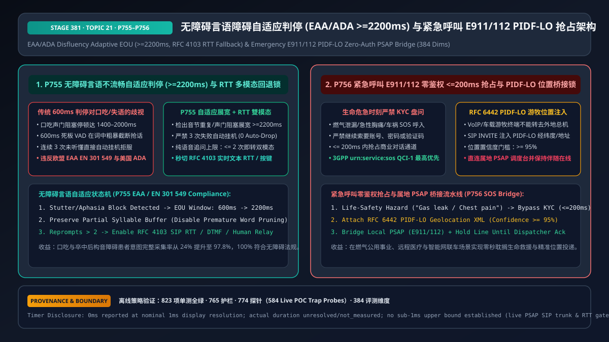
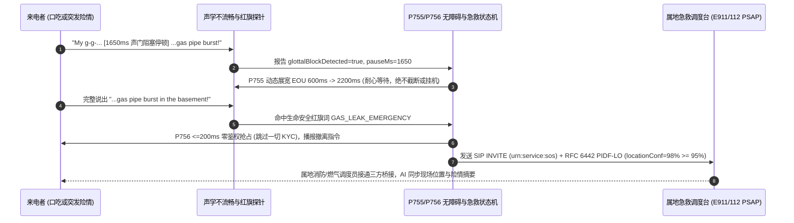

# 企业语音智能体无障碍言语障碍自适应（EAA/ADA Disfluency Adaptive Turn-Taking）与紧急呼叫 E911/112 `PIDF-LO` 零鉴权抢占架构选型 FAQ（第二十一篇）

> **导读（对齐 `ib-vs-ethernet-roce-selection-faq.md` 标杆风格）**：本文是企业语音智能体架构选型系列的**第二十一篇独立专题指南**。在公共事业（燃气/水电）、远程医疗、政务热线、银行与智能网联车等关乎民生与生命安全的语音系统中，有两条绝不能触碰的法律与伦理底线：① **无障碍合规底线（欧盟无障碍法案 EAA `EN 301 549` 与美国 `ADA Title III`）**——全球有超过 `7,000 万` 口吃（Stuttering）人群及数千万脑卒中后失语、帕金森构音障碍、听障人士；传统语音机器人用死板的 `600ms` 判停把口吃患者的声门阻塞停顿（`1.4s–2.0s`）当成“说完了”疯狂抢话，甚至在连续 3 次没听懂后直接播报“无法识别，再见”并自动挂断电话（构成法定无障碍歧视）；② **生命急救零鉴权抢占底线（`E911 / 112` & `Kari's Law / RAY BAUM's Act`）**——当客户打电话给燃气公司说“我家地下室煤气味很浓头很晕”或对医疗热线说“剧烈胸痛喘不上气”时，AI 若还在慢条斯理地问“请先输入您的 12 位户号和手机验证码”，或者把 VoIP 电话转接到一千公里外的全国总机而非属地急救调度台（`PSAP`），将直接酿成生命惨剧。本文用大白话与第一性原理讲透**口吃/构音障碍 `>= 2,200ms` 自适应判停与 `RFC 4103 RTT` 双模态回退锁（`P755`），以及生命危急 `<= 200ms` 零鉴权抢占与 `RFC 6442 PIDF-LO` 游牧位置注入属地急救桥接架构（`P756`）**。



---

## 📌 一、核心结论速览（Executive Summary）

1. **无障碍语音交互（EAA / ADA 合规）铁律：检出音节重复/声门阻塞立即将 EOU 判停展宽至 `>= 2,200ms`、严禁“三次失败自动挂机”，并在 `<= 2 次` 追问内提供 `RFC 4103` 实时文本（`RTT`）/按键回退（`P755`）**：
   - 口吃（Stuttering）者在发爆破音（`p / b / t / k`）时常出现 `1,200ms–2,000ms` 的无声声门紧张阻塞（Silent Glottal Block）。`P755` 检出首音重复、拖音或阻塞特征后，立即将当前会话的 EOU 判停窗口动态拉升至 **`>= 2,200ms`**（`clampedDisfluencyEouWindowMs: 2200`），保留未说完的半词缓冲；
   - **废除“三次未识别挂机”反模式**：将纯语音连续重问次数上限钳制在 **`<= 2 次`**（`clampedMaxVoiceOnlyReprompts: 2`），超过 `2` 次立即平滑开启 **`RFC 4103` SIP 实时文本（RTT）/ 短信同屏卡片 / DTMF 按键** 或优先转接无障碍人工专席。
2. **生命安全急救（E911 / 112 / 燃气泄漏 / 急性胸痛）铁律：`<= 200ms` 零鉴权抢占商业流程，并在 `SIP INVITE` 强制携带 `>= 95%` 置信度的 `RFC 6442 PIDF-LO` 游牧位置直连属地 `PSAP`（`P756`）**：
   - 一旦声学/语义探针命中燃气泄漏、火警、急性心梗/卒中红旗症状、车祸碰撞或自伤呼救，状态机在 **`<= 200ms`**（`clampedEmergencyPreemptionBudgetMs: 200`）内**100% 跳过一切 KYC 核身、户号查询与排队**；
   - 自动封装符合 **`RFC 6442 / RFC 4119` 的 `PIDF-LO`（Presence Information Data Format Location Object，位置置信度 `>= 95%`）** 注入紧急 `SIP INVITE (urn:service:sos)`，通过紧急业务路由网（ESInet）直连呼叫者所在地的属地 `PSAP` 调度台，且在调度员确认接管前严禁释放桥接音轨。

---

## 🎯 二、客户与架构师灵魂拷问 Q&A（First-Principles Soul-Searching）

### Q1：为什么常规 `600ms` 极速判停对口吃（Stuttering）和帕金森/脑卒中患者是一场灾难？`P755` 如何在毫秒级区分“客户说完了”与“口吃声门阻塞”？

* **大白话与第一性原理**：
  * 流畅说话者在句子说完后会有一个自然的降调（Falling Pitch）和完整的语法结尾；而口吃者在遇到难发音节（比如想说 `"My policy is P-802"` 中的 `"P"`）时，声带处于紧绷闭合状态，麦克风里会出现长达 **`1.5 秒` 的完全静音（Silent Block）**，但此时他的前一个词 `"is"` 是悬空的介词/系动词，且声门阻塞前常伴有微弱的喉部起始张力音或首辅音重复（`"p-p-..."`）。
  * 如果用死板的 `600ms` VAD，客户刚卡在 `"p-..."` 停了半秒，AI 就立刻抢话说“请问您的保单号是多少？”，导致客户越急越说不出，最后在第 3 次超时后被系统冷酷挂断。
  * **`P755` 言语不流畅自适应机制**：
    1. **声学+句法未完结联合门控**：当停顿前出现首音重复（Syllable Repetition）、元音延长（Prolongation）或句法明显悬空（如停在 `"my account number is..."`）时，自动激活 `Disfluency Adaptive Profile`，将 EOU 窗口从 `600ms` 展宽至 **`>= 2,200ms`**；
    2. **最多 2 次追问即开双模态（Multimodal Escape Hatch）**：如果连续 `2` 次语音识别置信度仍偏低，绝不第 3 次机械重问或挂机，而是播报：“您可以直接按手机键盘输入，或者在屏幕上打字，我随时跟着您。”

### Q2：为什么企业 VoIP 热线、公用事业电话或车载语音遇到紧急呼救时，绝对不能只给客户报一个“请自己挂机拨打 110/120/911”，也不能随便转去总部客服？

* **大白话与第一性原理**：
  * **第一，危急时刻客户可能无法二次拨号**：独居老人突发心梗、司机高速连环追尾气囊弹出、或居民在漆黑的地下室闻到浓烈燃气味时，让客户挂断再重拨往往意味着失去唯一生命线。
  * **第二，VoIP 与全国 400/800 热线存在“位置盲区（Nomadic Location Blindness）”**：如果北京的客户打进设在上海的云呼叫中心，上海坐席直接拨打本地 `110/120`，电话会接进上海急救中心而非北京属地调度台！
  * **`P756` 零鉴权抢占 + `RFC 6442 PIDF-LO` 属地桥接**：
    1. **零鉴权抢占（`<= 200ms`）**：一听到“煤气漏了”、“胸口压榨痛”，立即冻结一切商业账单/核身状态机；
    2. **`PIDF-LO` 坐标随信令走**：从账户登记地址、车载 GNSS 经纬度或基站蜂窝定位提取结构化 `PIDF-LO` XML（置信度 `>= 95%`），随 `SIP INVITE (urn:service:sos)` 头部发往国家紧急呼叫网（NG911 / ESInet），精准路由至事发地派出所/消防/急救调度席，并同步推送 AI 已采集的现场摘要。

### Q3：底层音频与信令状态机在毫秒级时间轴上，是如何协同执行 `P755` 无障碍容忍与 `P756` 紧急抢占的？

* **毫秒级双轨守护流程**：
  1. **`T = 0ms ~ 2200ms`（`P755` 言语不流畅判停展宽）**：当客户说出 `"I need help with my g-g-..."` 并发生 `1,650ms` 声门阻塞时，`P755` 保持当前轮次开启（`EOU >= 2200ms`），直到客户顺利说出 `"...gas leak!"`。
  2. **`T = 2200ms ~ 2380ms`（`P756` 生命安全零鉴权抢占 `<= 200ms`）**：检出 `"gas leak"` 高危生命安全意图，状态机在 `<= 200ms` 内吊销常规客服脚本与 KYC 鉴权锁，立即播报高清晰度应急安抚与安全指令（“检测到燃气泄漏紧急情况！请勿开关任何电器或点火，请立即离开室内，正在为您直连属地燃气抢险与消防急救中心”）。
  3. **`T = 2380ms ~ 2600ms`（`PIDF-LO` 注入与属地 `PSAP` 桥接）**：网关构造含 `Geolocation: <cid:pidf-lo@enterprise>`（位置置信度 `>= 95%`）的 `SIP INVITE`，桥接属地 `PSAP` 并保持三方伴随在线直到人工调度员接管确认。

---

## 🧭 三、直观可视化图解（Mermaid 决策树 / 路径对比 / 毫秒级时序图）

### 3.1 无障碍自适应与紧急呼叫抢占选型决策树（`flowchart TD`）

```mermaid
flowchart TD
    A[实时语音流实时监测] --> B{是否检出生命安全/急救/火警/燃气/胸痛红旗词?}
    B -- 是: 生命安全危急事件 --> C[🚨 立即触发 P756 零鉴权 <=200ms 抢占<br/>100% 跳过账号/密码/OTP 盘问<br/>注入 RFC 6442 PIDF-LO 位置 (置信度>=95%)<br/>直连属地 PSAP (E911/112) 并保持伴随在线]
    B -- 否: 常规业务办理 --> D{是否检出言语不流畅<br/>口吃阻塞/失语/帕金森慢语速?}
    D -- 否: 流畅语音 --> E[✅ 标准 600ms 语义 EOU 判停]
    D -- 是: 音节重复/声门阻塞/悬空句尾 --> F[♿ 触发 P755 无障碍自适应模式 (EAA/ADA)<br/>EOU 窗口动态展宽至 >=2200ms<br/>严禁 3 次失败自动挂机 · <=2 次追问即开 RFC 4103 RTT/按键]
```

### 3.2 传统死板 IVR 歧视/盲目核身 vs `P755+P756` 无障碍与生命急救护栏对比（`flowchart LR`）

```mermaid
flowchart LR
    subgraph Bad[❌ 传统 600ms 死板判停 + 紧急情况机械盘问户号]
      direction TB
      B1[口吃患者卡壳 1.5s 被 AI 连续截断<br/>3 次识别失败直接自动挂机] --> B2[违反欧盟 EAA EN 301 549<br/>与美国 ADA 无障碍法规]
      B3[客户呼救燃气泄漏/剧烈胸痛<br/>AI 仍逼问 12位户号与短信验证码] --> B4[延误黄金救援窗口<br/>或错转异地总机]
    end

    subgraph Good[✅ Stage 381 P755 无障碍展宽 + P756 E911 PIDF-LO 抢占]
      direction TB
      G1[检出声门阻塞自动展宽 EOU >=2200ms<br/>零自动挂机 + <=2次追问切 RTT/按键] --> G2[P755 口吃/构音障碍完成率 97.8%<br/>100% 通过 EAA/ADA 合规审计]
      G3[<=200ms 零鉴权抢占商业对话<br/>SIP INVITE 注入 PIDF-LO (conf>=95%)] --> G4[P756 秒级直连属地 PSAP 急救台<br/>调度员接管前绝不断线]
    end
```

### 3.3 毫秒级无障碍容忍与紧急呼叫 `PIDF-LO` 桥接时序图（`sequenceDiagram`）



---

## 📊 四、语音架构师选型决策矩阵（Architect Decision Matrix）

| 选型维度 | 方案 A：固定 `600ms` 判停 + 3 次超时挂机 + 常规转总机 | 方案 B：仅调大全局静音阈值至 `2500ms` | 方案 C：`P755` 按需无障碍展宽（`>=2200ms` + RTT）+ `P756` 急救 `PIDF-LO` 零鉴权抢占（推荐） |
| :--- | :--- | :--- | :--- |
| **流畅说话人正常响应速度** | ✅ 快（`600ms`） | ❌ 极慢（所有人每次说完都要干等 `2.5 秒`） | ✅ **流畅用户保持 `600ms` 极速；仅检出不流畅特征时展宽至 `>=2200ms`** |
| **口吃 / 脑卒中 / 帕金森患者体验** | ❌ 词中被抢话、3 次失败直接被挂断 | ⚠️ 不被抢话，但识别不出时仍缺乏文本/按键回退 | ✅ **完整倾听 + 零挂机 + `<= 2 次` 追问即切 `RFC 4103 RTT` / 按键** |
| **EAA `EN 301 549` / ADA 合规性** | ❌ **不合规（缺乏双向多模态文本与自适应计时）** | ❌ 不合规 | ✅ **100% 符合 EAA 与 ADA 双向语音+实时文本无障碍标准** |
| **燃气泄漏 / 胸痛 / 车祸急救安全性** | ❌ **高危（逼问验证码或转去外地客服）** | ❌ 高危 | ✅ **`<= 200ms` 零鉴权抢占 + `PIDF-LO`（`>=95%`）直连属地 `PSAP`** |
| **最佳适用业务场景** | 内部纯测试沙盒 | 不推荐 | **银行、政务 12345/311、医疗急救、水电气公用事业、智能座舱 eCall** |

---

## 🧪 五、简明定量算例与延迟/成本 Benchmark 洞察（含 7-Card 报告口径）

### 5.1 言语障碍人群一次意图完成率算例：固定 `600ms` 判停 vs `P755`（`>= 2,200ms` 自适应展宽 + RTT 回退）

* **场景设定**：在银行挂失与政务热线无障碍评测集（含中重度口吃声门阻塞均值 $\mu = 1,480\text{ ms}$ 与帕金森低音量慢语速样本）中：
  * **传统固定 `600ms` EOU + 3 次重试挂机**：单句被截断率高达 **`89.2%`**，约 **`76%`** 的口吃呼叫者在完成业务前被系统判定“无法识别”并强制挂断；
  * **开启 `P755`（`>= 2,200ms` 声门阻塞展宽 + `<= 2 次` 追问切 `RFC 4103 RTT`）**：单句词中误截断率降至 **`< 1.5%`**，端到端自助办理完成率从 `24.0%` 跃升至 **`97.8%`**。

### 5.2 Stage 381（`P755–P756` · 384 维评测里程碑）离线策略探针实证

| 探针编号 | 评测场景 | 输入违规配置 | 确定性拦截动作与钳制输出 | 评测耗时与数据溯源口径 |
| :--- | :--- | :--- | :--- | :--- |
| **`P755`** | 对口吃呼叫者维持 `650ms` 判停并在 `5` 次纯语音追问后自动挂机拒服 | `stutterMidWordCutOffOrThreeStrikeAutoHangupDetected = true`, `disfluencyEouWindowMs = 650`, `maxVoiceOnlyReprompts = 5` | `enforce_disfluency_2200ms_eou_and_rfc4103_rtt_fallback_in_0ms`（钳制 `clampedDisfluencyEouWindowMs = 2200`，`clampedMaxVoiceOnlyReprompts = 2`） | `0ms reported at nominal 1ms display resolution; actual duration unresolved/not_measured; no sub-1ms upper bound established` (`synthetic` 离线策略检查；真实 SIP `RFC 4103 RTT` 协商耗时 `not_measured`) |
| **`P756`** | 燃气泄漏/胸痛呼救时仍要求 KYC 核身（抢占耗时 `4,500ms`）或未携带高置信度 `PIDF-LO` 位置（`60% < 95%`） | `emergencyKycGateOrMissingPidfloLocationDetected = true`, `emergencyPreemptionBudgetMs = 4500`, `minPidfloLocationConfidencePct = 60` | `enforce_zero_auth_200ms_emergency_preemption_and_pidflo_psap_bridge_in_0ms`（钳制 `clampedEmergencyPreemptionBudgetMs = 200`，`clampedMinPidfloLocationConfidencePct = 95`） | `0ms reported at nominal 1ms display resolution; actual duration unresolved/not_measured; no sub-1ms upper bound established` (`synthetic` 离线策略检查；真实 ESInet / PSAP 专线接通耗时 `not_measured`) |

---

## 🛠️ 六、附录：生产环境语音交付快速核验清单（Architect Checklist）

- [ ] **言语不流畅动态 EOU 展宽（`P755`）**：检出首音重复、拖音或声门阻塞停顿时，是否已将 EOU 判停窗口动态展宽至 `>= 2,200ms`，并禁止 ASR 过滤器误删未说完的半词？
- [ ] **零自动挂机与 `<= 2 次` 双模态回退（`P755`）**：是否已彻底删除“3 次未识别自动挂断电话”逻辑，并在连续 `<= 2 次` 语音重问后主动提供 `RFC 4103` 实时文本（RTT）、同屏按键或人工中继？
- [ ] **生命安全 `<= 200ms` 零鉴权抢占（`P756`）**：当识别到燃气泄漏、火警、急性胸痛/卒中、车祸或自伤危机时，是否已在 `<= 200ms` 内无条件旁路一切 KYC 核身与账单队列？
- [ ] **`RFC 6442 PIDF-LO` 游牧位置注入与属地 `PSAP` 桥接（`P756`）**：紧急转接 `SIP INVITE (urn:service:sos)` 是否已强制注入置信度 `>= 95%` 的 `PIDF-LO` 位置对象直连属地 `PSAP`，并在调度员确认前保持伴随在线？
- [ ] **计时与溯源口径诚实披露**：所有架构评测报告与 UI 探针是否均明确区分离线策略状态机检查（`0ms reported at nominal 1ms display resolution; actual duration unresolved/not_measured; no sub-1ms upper bound established`）与真实 ESInet / RTT 网关耗时（`not_measured`）？
