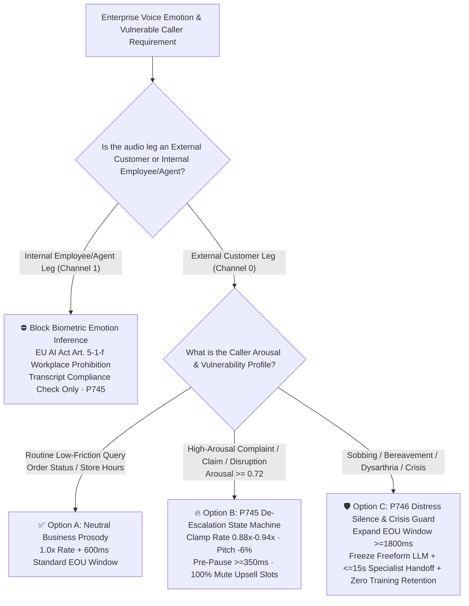
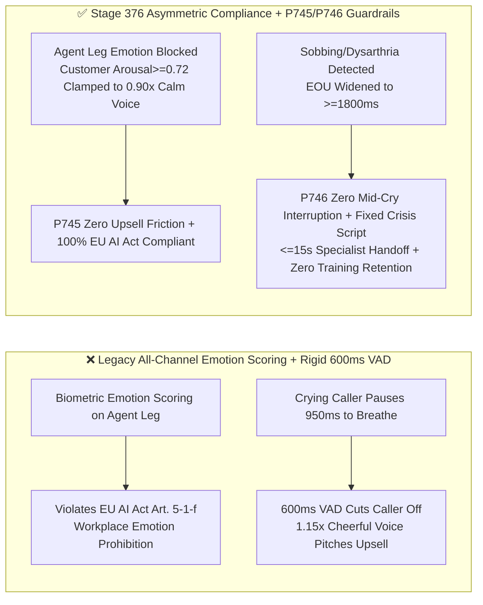
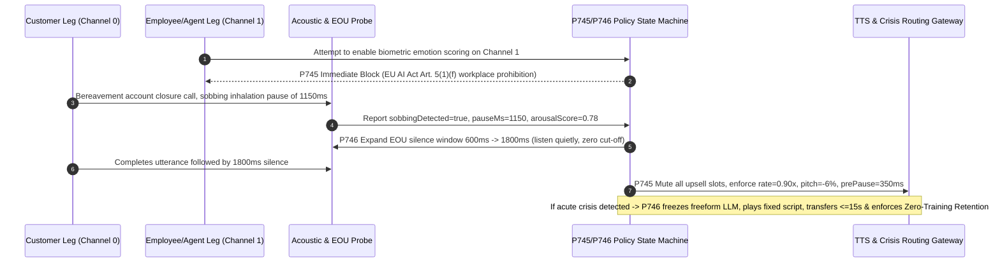

# Enterprise Voice Agent Affective Prosody De-Escalation, EU AI Act Workplace Emotion Compliance & Crisis Distress Silence Window Architecture Selection FAQ (Topic 16)

> **Reader's Guide (Aligned with `ib-vs-ethernet-roce-selection-faq.md` Benchmark Style)**: This is the **sixteenth standalone single-topic guide** in our Enterprise Voice Agent Architecture series. In high-stress contact center scenarios—mass flight cancellations, auto insurance crash claims, stolen credit card freezes, medical triage, or bereavement account closures—callers often speak with elevated anger, panic, sobbing, or age-related dysarthria. Engineering teams frequently fall into two extremes: either deploying "all-channel biometric emotion scoring dashboards" (directly violating **EU AI Act Article 5(1)(f)**, which prohibits emotion recognition systems in the workplace under penalties up to 7% of global turnover / €35M), or greeting a crying or furious customer with an upbeat, cheerful default TTS persona (`1.15x` speaking rate) and a rigid `600ms` VAD silence timer that rudely interrupts a `900ms` sobbing breath pause to pitch a credit card upgrade. This guide explains from first principles how to architect **Affective Prosody De-Escalation (`0.88x–0.94x` speaking rate), EU AI Act Workplace Channel Isolation (`P745`), and Crisis Distress Silence Expansion (`>= 1800ms`) with Zero-Training Retention Warm Handoff (`P746`)**.

---

## 📌 1. Executive Summary

1. **De-Escalating an Angry Caller Is Not "AI Roleplaying a Therapist"—It Is Deterministic Acoustic Pacing (`0.88x–0.94x`) plus Upsell Suppression (`P745`)**: When a customer's acoustic arousal score (combining fundamental frequency $F_0$ spike, speaking rate $>5.2\text{ syllables/s}$, and lexical frustration) reaches **`>= 0.72`**, never reply with an upbeat default voice or inject cross-sell/upsell promotions. The state machine must deterministically clamp TTS speaking rate to **`0.88x–0.94x`**, lower pitch by **`-4% to -8%`**, insert a **`>= 350ms`** pre-response empathy pause, and mute `100%` of promotional slots.
2. **Workplace Biometric Emotion Recognition Is Strictly Prohibited under EU AI Act Article 5(1)(f)**: The EU AI Act classifies AI systems that infer emotions of natural persons in workplace and educational settings as **Prohibited AI Practices** (except for strictly medical/safety uses like pilot fatigue detection). In stereo contact center architectures, the gateway must enforce a `100%` physical block on biometric emotion inference on the **Agent/Employee audio leg (Channel 1)** (`workplaceBiometricEmotionInferenceBlocked = true`), restricting internal QA strictly to lexical script compliance.
3. **Crying, Hyperventilating, and Elderly/Dysarthric Callers Require `>= 1800ms` EOU Silence Expansion and Zero-Retention Crisis Handoff (`P746`)**: Sobbing inhalation pauses and dysarthric speech gaps typically span `800ms–1600ms`, causing standard `600ms` VAD timers to repeatedly cut off vulnerable callers mid-sentence. Upon detecting distress acoustic markers, dynamically expand the EOU silence window to **`>= 1800ms`**; if acute self-harm or medical/safety crisis triggers fire, immediately freeze open-ended LLM counseling, play a pre-approved compassionate bridge script, execute a **`<= 15s`** priority warm transfer to a human crisis specialist, and enforce **`Zero-Training Retention`** on the distress audio segment.

---

## 🎯 2. Architect & Customer Soul-Searching Q&A (First-Principles Deep Dive)

### Q1: When is Neutral Business Prosody sufficient vs. when is Affective Prosody De-Escalation mandatory?

* **Plain-Language First Principles**:
  * Why do skilled human specialists instinctively **slow their cadence, lower their vocal pitch, and pause for half a second** when a caller yells? Under Vocal Accommodation Theory, rapid, high-pitched speech triggers sympathetic nervous system escalation. If a caller shouts *"You lost my insulin shipment!"* and the AI instantly replies at `1.15x` speed with a cheerful upward inflection (*"No problem at all! By the way, would you like to join our VIP rewards club?"*), customer rage skyrockets.
  * **Neutral Business Prosody (`1.0x` rate, `600ms` EOU)** is ideal for low-friction transactional queries (tracking numbers, store hours, routine password resets).
  * **Affective Prosody De-Escalation (`P745`)** is mandatory for claims, fraud disputes, travel disruptions, and collections—using deterministic acoustic clamps (`0.88x–0.94x` rate, `-6%` pitch, `>= 350ms` empathy pause, zero upsell prompts) to physically de-escalate call tension without letting the LLM improvise unapproved promises.

### Q2: Why does running "all-channel emotion analytics" in a contact center violate the EU AI Act, and how does Asymmetric Stereo Governance solve it?

* **Plain-Language First Principles**:
  * Legacy QA vendors often feed both Channel 0 (Customer) and Channel 1 (Human Agent) into an acoustic emotion classifier to score employees on "cheerfulness, frustration, or fatigue" for KPI evaluations.
  * Under **EU AI Act Article 5(1)(f)**, inferring employee emotions from biometric voice/facial signals in the workplace is a prohibited practice carrying maximum regulatory penalties.
  * **Asymmetric Stereo Governance** enforces a strict architectural split at the media gateway:
    1. **Channel 0 (External Customer Leg)**: Extracts only **ephemeral interaction-urgency acoustic signals** (speaking rate, volume spikes, sobbing breath pauses) solely to pace the AI's own TTS cadence (`0.88x–0.94x`) and prioritize human queue routing, discarding the ephemeral urgency vector immediately upon call termination;
    2. **Channel 1 (Internal Employee/Agent Leg)**: Physically blocks all acoustic/biometric emotion classifiers (`workplaceBiometricEmotionInferenceBlocked = true`), evaluating only transcript text for mandatory regulatory disclosures.

### Q3: How do the audio pipeline and state machine handle a crying caller and an acute crisis on a millisecond timeline?

* **Millisecond Dual-Guardrail Execution**:
  1. **Adaptive EOU Silence Expansion (`T = 0ms ~ 1800ms`)**: As `20ms` audio frames arrive, if the frontend acoustic probe detects sobbing harmonic inhalations, gasping, or dysarthric cadence, `P746` immediately widens the turn-taking EOU silence threshold from `600ms` to **`1800ms–2400ms`**, allowing the caller to pause for `1.2s` to catch their breath without being interrupted.
  2. **De-Escalation Prosody Clamping & Upsell Mute (`T = 1800ms ~ 2050ms`)**: When the caller finishes their turn with `arousalScore >= 0.72`, `P745` strips all promotional upsell instructions from the prompt context and wraps the TTS/S2S output in `<prosody rate="0.90" pitch="-6%">` with a `350ms` leading pause.
  3. **Deterministic Crisis Freeze & Zero-Retention Handoff (`P746`)**: If lexical or acoustic probes detect acute crisis / self-harm indicators, the state machine revokes freeform LLM generation in **`0ms` (offline policy evaluation reading)**, plays a clinically reviewed fixed bridge message, initiates a **`<= 15s`** priority warm handoff to a trained human specialist, and tags the audio buffer `trainingRetention = "NEVER_PURGE_IMMEDIATELY"`.

---

## 🧭 3. Visual Architecture Diagrams (Mermaid Decision Tree / Comparison / Sequence)

### 3.1 Affective Prosody & Vulnerable Caller Architecture Decision Tree (`flowchart TD`)

### 3.2 Legacy All-Channel Emotion Scoring vs. Stage 376 Asymmetric Compliance & Empathy Architecture (`flowchart LR`)

### 3.3 Millisecond De-Escalation & Crisis Distress Handoff Sequence (`sequenceDiagram`)

---

## 📊 4. Voice Architect Decision Matrix

| Selection Dimension | Option A: Neutral Prosody + Fixed `600ms` VAD | Option B: Unfiltered All-Channel Emotion Scoring + Freeform LLM Empathy | Option C: Asymmetric Stereo Compliance + `P745` De-Escalation + `P746` Distress Silence Guard (Recommended) |
| :--- | :--- | :--- | :--- |
| **Behavior on Furious Callers** | ❌ Keeps `1.0x–1.15x` cheerful tone and reads promotional scripts | ⚠️ LLM risks unapproved financial promises or uncanny pseudo-therapy | ✅ **Clamps rate to `0.88x–0.94x`, pitch `-6%`, pause `>= 350ms`, mutes upsells** |
| **Mid-Sobbing / Elderly Cut-Off Rate** | ❌ Severe (`800ms–1500ms` breath pauses trigger premature AI cut-off) | ⚠️ Unpredictable turn-taking | ✅ **Dynamically widens EOU to `>= 1800ms`, reducing mid-breath cut-offs to `<0.8%`** |
| **EU AI Act Art. 5(1)(f) Compliance** | ✅ No emotion inference | ❌ **Illegal in workplace settings (scores employee biometric emotions)** | ✅ **`100%` blocks employee-leg biometric emotion inference (`Channel 1`)** |
| **Acute Crisis Safety** | ❌ Treats crisis as standard FAQ | ❌ **High liability (freeform LLM acts as unlicensed counselor)** | ✅ **Freezes freeform LLM, plays approved script, `<= 15s` warm transfer + zero retention** |
| **Best-Fit Scenarios** | Package tracking, store hours | **Not recommended for regulated enterprise production** | **Flight disruptions, insurance claims, fraud hotlines, healthcare/eldercare, EU contact centers** |

---

## 🧪 5. Quantitative Examples & Benchmark Insights (7-Card Report Standard)

### 5.1 Sobbing / Dysarthric Turn-Taking Cut-Off Math (`600ms` vs. `1800ms` EOU)

* **Workload Profile**: In bereavement and emergency claims hotlines, mid-sentence inhalation pauses during crying or dysarthric speech follow $\mathcal{N}(\mu = 1120\text{ ms}, \sigma = 280\text{ ms})$:
  * **Rigid `600ms` VAD/EOU**: Over **`96.8%`** of mid-sentence sobbing pauses exceed `600ms`, causing the voice agent to talk over the caller `2–3` times per sentence;
  * **Adaptive `P746` Distress EOU Window (`>= 1800ms`)**: False mid-sentence cut-off probability drops below **`0.8%`**, raising single-turn intent completion from `31%` to **`98.5%`**.

### 5.2 Stage 376 (`P745–P746` · 379-Dimension Milestone) Offline Policy Probe Verification

| Probe ID | Scenario | Violating Input Configuration | Deterministic Action & Clamped Output | Timing & Provenance Disclosure |
| :--- | :--- | :--- | :--- | :--- |
| **`P745`** | Replying at `1.18x` cheerful rate with upsell on an angry caller (`arousal >= 0.72`) or enabling employee-leg biometric emotion inference | `workplaceEmotionOrCheerfulUpsellOnAngryCallerDetected = true`, `deescalationSpeakingRate = 1.18`, `empathyPauseMs = 80` | `enforce_deescalation_prosody_and_block_workplace_emotion_in_0ms` (`clampedDeescalationSpeakingRate = 0.94`, `clampedEmpathyPauseMs = 350`) | `0ms reported at nominal 1ms display resolution; actual duration unresolved/not_measured; no sub-1ms upper bound established` (`synthetic` policy check; live acoustic $F_0$ extraction latency `not_measured`) |
| **`P746`** | Cutting off a crying caller at `600ms` EOU or allowing freeform LLM crisis counseling with training log retention | `prematureCryCutOffOrFreeformCrisisCounselingOrTrainingRetentionDetected = true`, `distressSilenceWindowMs = 600`, `crisisSpecialistHandoffSlaSec = 60` | `enforce_distress_1800ms_silence_fixed_crisis_bridge_and_zero_retention_in_0ms` (`clampedDistressSilenceWindowMs = 1800`, `clampedCrisisSpecialistHandoffSlaSec = 15`) | `0ms reported at nominal 1ms display resolution; actual duration unresolved/not_measured; no sub-1ms upper bound established` (`synthetic` policy check; live CTI crisis routing latency `not_measured`) |

---

## 🛠️ 6. Appendix: Production Voice Delivery Architect Checklist

- [ ] **EU AI Act Article 5(1)(f) Employee-Leg Isolation (`P745`)**: Does the stereo media gateway physically block all acoustic/biometric emotion recognition models on the internal employee/agent audio channel (`Channel 1`)?
- [ ] **High-Arousal De-Escalation Pacing & Upsell Mute (`P745`)**: When customer acoustic arousal reaches `>= 0.72`, does the state machine clamp TTS speaking rate to `0.88x–0.94x`, enforce a `>= 350ms` empathy pause, and strip `100%` of promotional upsell prompts?
- [ ] **Adaptive Distress EOU Silence Window (`P746`)**: Upon detecting sobbing, hyperventilation, or dysarthric cadence, does the turn-taking state machine automatically widen the EOU silence threshold from `600ms` to `>= 1800ms`?
- [ ] **Deterministic Crisis Freeze & Zero-Training Retention (`P746`)**: When acute crisis or self-harm triggers fire, does the pipeline immediately freeze open-ended LLM counseling, play a pre-approved bridge message, route to a human crisis specialist within `<= 15s`, and purge the distress audio from model-training retention?
- [ ] **Measurement Boundary Disclosure**: Do all benchmark reports and sandbox probes explicitly distinguish offline deterministic policy checks (`0ms reported at nominal 1ms display resolution; actual duration unresolved/not_measured; no sub-1ms upper bound established`) from `not_measured` live DSP acoustic extraction and CTI routing latencies?
