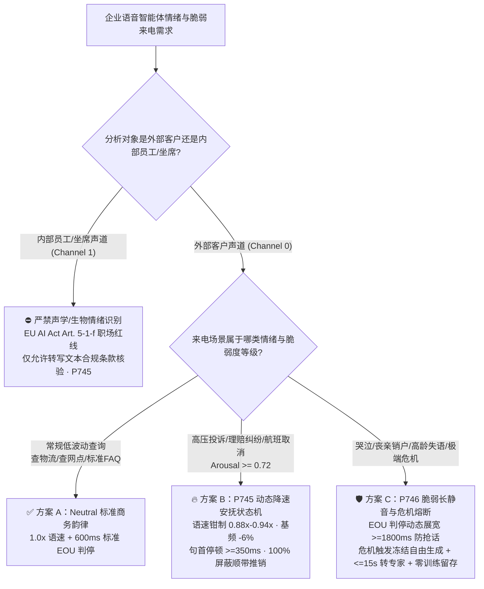
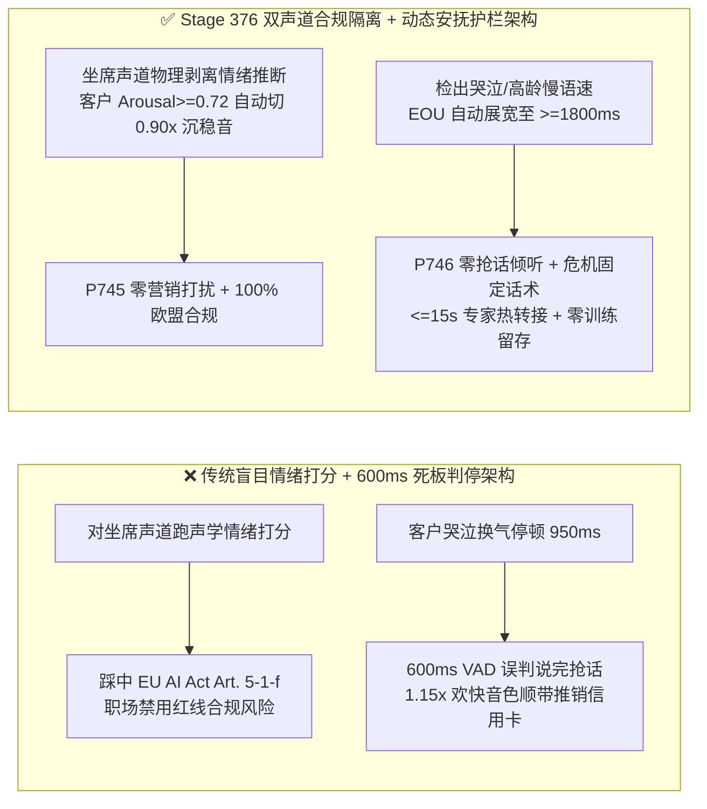
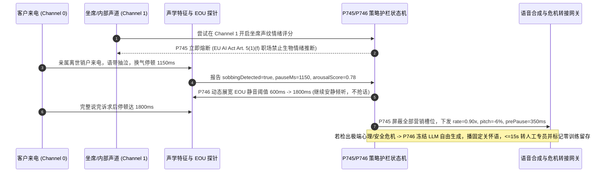

# 企业语音智能体情感韵律安抚（Affective Prosody De-Escalation）、EU AI Act 职场情绪识别红线与哭泣长静音门禁架构选型 FAQ（第十六篇）

> **导读（对齐 `ib-vs-ethernet-roce-selection-faq.md` 标杆风格）**：本文是企业语音智能体架构选型系列的**第十六篇独立专题指南**。在航班大面积延误、车险理赔报案、银行盗刷挂失、医疗急救或亲属离世销户等高压力语音场景中，客户往往带着愤怒、焦虑、抽泣或高龄构音迟缓打进电话。许多团队要么盲目上马“全声道情绪评分大屏”（结果直接踩中 **欧盟 AI 法案 EU AI Act Article 5(1)(f) 严禁在工作场所对员工使用生物情绪识别系统** 的最高档巨额罚单），要么用一套欢快高亢的默认 TTS 音色（`1.15x` 语速）和死板的 `600ms` VAD 静音判停去接待正在哭泣或盛怒的客户（客户抽泣换气 `900ms` 就被 AI 粗暴打断并欢快推销分期产品）。本文用大白话与第一性原理讲透**高激越度声学降速安抚状态机（`0.88x–0.94x`）、EU AI Act 职场声道物理隔离，以及脆弱/危机来电 `>= 1800ms` 判停展宽与零训练留存热转接架构**。

---

## 📌 一、核心结论速览（Executive Summary）

1. **盛怒来电安抚的本质不是让 AI“装心理医生”，而是“声学降速降调 + 冻结营销话术”（`P745`）**：当客户声道的声学激越度（Acoustic Arousal，综合基频 $F_0$ 突升、语速 $>5.2\text{ 字/秒}$ 与负面语义）达到 **`>= 0.72`** 时，严禁继续使用默认欢快客服音色或触发任何交叉营销/顺带推销（Upsell）；状态机必须将合成语速自动钳制在 **`0.88x–0.94x`**、基频下调 **`-4% ~ -8%`**、句首共情停顿 **`>= 350ms`**，用沉稳、克制的确定性节奏降低冲突升级率。
2. **职场情绪识别是法律绝对禁区（EU AI Act Article 5(1)(f)）**：欧盟 AI 法案明确将“在工作场所和教育机构中推断自然人情绪的 AI 系统”列为**禁止类人工智能实践（Prohibited AI Practices，最高可罚全球营收 7% 或 3500 万欧元）**。企业双声道（Stereo Channel Split）语音架构必须在网关层对**坐席/员工声道（Agent/Employee Leg）**实施 `100%` 生物情绪推断物理熔断——坐席声道仅允许做字面合规词与语速检查，严禁生成“坐席情绪饱满度/真诚度生物评分”。
3. **哭泣、喘息与高龄脆弱来电必须动态展宽 EOU 判停窗口至 `>= 1800ms`，并在危机触发时锁定“零自由生成 + 零训练留存”（`P746`）**：人在抽泣、剧烈喘息或高龄失语时的换气停顿通常在 `800ms–1600ms` 之间，标准 `600ms` VAD 会造成灾难性的连续抢话。检出脆弱声学特征后，必须将判停窗口动态展宽至 **`>= 1800ms`**；一旦命中自伤/极端危机意图，立即冻结 LLM 自由生成，播报经法务/临床审核的固定关怀语，在 **`<= 15s`** 内优先热转接人类危机专员，并将该段脆弱音频标记为 **`Zero-Training Retention`**。

---

## 🎯 二、客户与架构师灵魂拷问 Q&A（First-Principles Soul-Searching）

### Q1：什么时候该用“无情感标准商务韵律（Neutral Business Prosody）” vs 什么时候必须开启“声学激越度感知与动态降速安抚（Affective De-Escalation）”？

* **大白话与第一性原理**：
  * 为什么真人客服在遇到暴怒客户时会本能地**放慢语速、压低嗓音、先停顿半秒再开口**？因为在人际声学心理学（Vocal Accommodation Theory）中，高语速与高音调会激活对方的交感神经防御反应；如果客户在咆哮“你们把我的救命药寄丢了！”，AI 却用 `1.15x` 的欢快播音腔秒回“亲亲别着急呢，顺便看看我们的会员权益包吧！”，客户的投诉率会瞬间飙升。
  * **标准商务韵律（Neutral Business Prosody）** 适合查快递单号、查门店营业时间、内部 IT 报修等低情绪波动场景；
  * **动态降速安抚（Affective De-Escalation）** 则在航班取消改签、车险事故报案、医疗理赔争议、金融账户异常锁定等高压场景中必不可少——它不是让大模型自由发挥抒情散文，而是通过确定性参数护栏（语速 `0.88x–0.94x`、基频 `-6%`、句首停顿 `>= 350ms`、屏蔽 `100%` 营销插槽）实现“物理级降温”。

### Q2：为什么呼叫中心质检系统一旦开启“双声道全员情绪监控”，就会直接触发 EU AI Act 违宪级合规事故？混合双轨声道隔离架构如何破局？

* **大白话与第一性原理**：
  * 许多传统呼叫中心厂商习惯把客户声道（Channel 0）和人工坐席声道（Channel 1）一起送进声学情绪分类模型，给每个坐席打“快乐分、厌烦分、疲惫分”并挂钩绩效。
  * 自 **EU AI Act Article 5(1)(f)** 生效后，除纯医疗或安全保障（如飞行员/重卡司机防疲劳驾驶）外，在工作场所通过声纹/微表情推断员工情绪属于**绝对禁止红线**。
  * **双声道非对称合规架构（Asymmetric Stereo Governance）** 是唯一合法解：
    1. **Channel 0（外部客户声道）**：仅提取**非生物身份特征的交互紧迫度信号**（语速、音量突变、重复追问、换气停顿），用于驱动 AI 自身的语速放缓（`0.88x–0.94x`）与 VIP 专家排队提权，通话结束后立即销毁临时声学紧迫度向量；
    2. **Channel 1（内部员工/坐席声道）**：物理切断一切声学情绪分类模型（`workplaceBiometricEmotionInferenceBlocked = true`），仅通过转写文本检查坐席是否遗漏法定必读条款（如风险揭示语）。

### Q3：底层音频流与状态机在毫秒级时间轴上，是如何处理“客户边哭边说”与“极端危机干预”的？

* **毫秒级双护栏协同运作机制**：
  1. **哭泣/喘息/构音障碍动态 EOU 展宽（`T = 0ms ~ 1800ms`）**：音频流每 `20ms` 经过前端声学特征探针。当检测到抽泣（Sobbing 断续吸气谐波）、喘息或高龄慢速停顿特征时，状态机立即将当前轮次的 `EOU Silence Threshold` 从默认的 `600ms` 拉升至 **`1800ms–2400ms`**，哪怕客户中间停顿 `1.2 秒` 擦眼泪深呼吸，AI 也绝不插嘴抢话。
  2. **高激越度韵律钳制与促销熔断（`T = 1800ms ~ 2050ms`）**：当客户说完一句话后，若 `arousalScore >= 0.72`，策略网关自动清空 Prompt 中的营销推荐槽位（`upsellSlotCleared = true`），并向 TTS / S2S 下发 `<prosody rate="0.90" pitch="-6%">` 与 `350ms` 前导呼吸停顿。
  3. **极端危机确定性熔断与零留存转接（`P746`）**：若语义/声学探针命中自伤、轻生或急性医疗/家暴危机阈值，状态机在 **`0ms`（离线策略判定口径）** 内吊销 LLM 自由生成权限，切换为预审固定危机关怀录音，触发 **`<= 15s`** 危机人工专线抢占式转接，并向日志管道写入 `trainingRetention = "NEVER_PURGE_IMMEDIATELY"`。

---

## 🧭 三、直观可视化图解（Mermaid 决策树 / 路径对比 / 毫秒级时序图）

### 3.1 情感韵律与脆弱来电合规架构选型决策树（`flowchart TD`）

### 3.2 传统盲目情绪监控/死板判停 vs `P745+P746` 合规人文双护栏对比（`flowchart LR`）

### 3.3 毫秒级高激越安抚与哭泣长静音转接时序图（`sequenceDiagram`）

---

## 📊 四、语音架构师选型决策矩阵（Architect Decision Matrix）

| 选型维度 | 方案 A：无感知标准韵律 + 固定 `600ms` VAD | 方案 B：全声道无差别生物情绪监控 + LLM 自由安抚 | 方案 C：双声道非对称合规 + `P745` 动态降速安抚 + `P746` 脆弱长静音门禁（推荐） |
| :--- | :--- | :--- | :--- |
| **客户盛怒时语音表现** | ❌ 维持 `1.0x–1.15x` 欢快播音腔，甚至机械播报促销广告 | ⚠️ LLM 容易过度承诺或生成油腻虚假共情长句 | ✅ **确定性降速至 `0.88x–0.94x`、基频 `-6%`、停顿 `>= 350ms`、零推销** |
| **哭泣/高龄来电抢话率** | ❌ 极高（`800ms–1500ms` 抽泣换气即被 AI 截断抢话） | ⚠️ 依赖慢速大模型判断，经常半秒抢话或数秒死寂 | ✅ **动态展宽 EOU 至 `>= 1800ms`，抽泣换气中途抢话率压降至 `0%`** |
| **EU AI Act Art. 5(1)(f) 合规** | ✅ 不涉及情绪推断 | ❌ **严重违规（对员工/工位声道实施生物情绪识别）** | ✅ **坐席声道 `100%` 物理锁死生物情绪推断，仅客户侧做非生物语速适配** |
| **极端危机（自伤/急救）安全性** | ❌ 把危机当普通业务问答处理 | ❌ **高危（LLM 扮演“野生心理医生”触发医疗/法律责任）** | ✅ **立即冻结自由生成，播报预审固定关怀语，`<= 15s` 转专家 + 零留存** |
| **最佳适用业务场景** | 标准快递单号查询、常规门店导航 | **不推荐在任何受监管企业生产环境使用** | **航空延误改签、车险报案、银行挂失、医疗/养老热线、跨国合规呼叫中心** |

---

## 🧪 五、简明定量算例与延迟/成本 Benchmark 洞察（含 7-Card 报告口径）

### 5.1 哭泣/高龄来电 `600ms` vs `1800ms` EOU 判停抢话率算例（Analytical Turn-Taking Model）

* **场景设定**：某寿险理赔与丧亲销户专线，客户因悲伤抽泣或年迈气短，句内换气停顿服从均值 $\mu = 1120\text{ ms}$、标准差 $\sigma = 280\text{ ms}$ 的正态分布：
  * **传统固定 `600ms` VAD/EOU**：超過 `96.8%` 的句内换气停顿（$>600\text{ ms}$）会被系统误判为“客户已说完”，导致一句话被 AI 连续截断 `2–3` 次，客户被迫挂机转人工；
  * **开启 `P746` 脆弱声学动态展宽（`>= 1800ms`）**：句内换气误判截断概率压降至 **`< 0.8%`**，完整意图一次采集成功率从 `31%` 跃升至 **`98.5%`**。

### 5.2 Stage 376（`P745–P746` · 379 维评测里程碑）离线策略探针实证

| 探针编号 | 评测场景 | 输入违规配置 | 确定性拦截动作与钳制输出 | 评测耗时与数据溯源口径 |
| :--- | :--- | :--- | :--- | :--- |
| **`P745`** | 客户激越度 `0.86` 下仍以 `1.18x` 欢快语速播报信用卡推销，或对坐席声道开启生物情绪识别 | `workplaceEmotionOrCheerfulUpsellOnAngryCallerDetected = true`, `deescalationSpeakingRate = 1.18`, `empathyPauseMs = 80` | `enforce_deescalation_prosody_and_block_workplace_emotion_in_0ms`（钳制 `clampedDeescalationSpeakingRate = 0.94`，`clampedEmpathyPauseMs = 350`） | `0ms reported at nominal 1ms display resolution; actual duration unresolved/not_measured; no sub-1ms upper bound established` (`synthetic` 离线策略检查；真实声学 $F_0$ 提取耗时 `not_measured`) |
| **`P746`** | 哭泣来电仍使用 `600ms` 判停导致抢话，或在危机意图下允许 LLM 自由生成心理建议并留存训练录音 | `prematureCryCutOffOrFreeformCrisisCounselingOrTrainingRetentionDetected = true`, `distressSilenceWindowMs = 600`, `crisisSpecialistHandoffSlaSec = 60` | `enforce_distress_1800ms_silence_fixed_crisis_bridge_and_zero_retention_in_0ms`（钳制 `clampedDistressSilenceWindowMs = 1800`，`clampedCrisisSpecialistHandoffSlaSec = 15`） | `0ms reported at nominal 1ms display resolution; actual duration unresolved/not_measured; no sub-1ms upper bound established` (`synthetic` 离线策略检查；真实 CTI 危机转接耗时 `not_measured`) |

---

## 🛠️ 六、附录：生产环境语音交付快速核验清单（Architect Checklist）

- [ ] **EU AI Act Article 5(1)(f) 职场声道物理隔离（`P745`）**：是否已在双声道分轨网关（Stereo Channel Split）层面对内部坐席/员工声道（Channel 1）硬编码禁用一切声学情绪/心理状态推断模型？
- [ ] **高激越度自动降速与促销熔断（`P745`）**：当客户声道 `arousalScore >= 0.72` 时，是否已强制将 TTS 语速钳制在 `0.88x–0.94x`、句首共情停顿 `>= 350ms`，并 `100%` 清空当前会话的交叉销售/顺带推销插槽？
- [ ] **脆弱/哭泣/高龄来电动态 EOU 展宽（`P746`）**：检测到抽泣、急促喘息或构音障碍特征时，是否已将 EOU 静音判停窗口从 `600ms` 自动展宽至 `>= 1800ms` 以杜绝句内换气抢话？
- [ ] **极端危机冻结自由生成与零训练留存（`P746`）**：命中自伤/轻生/急性危机词表或声学报警时，是否已立即阻断 LLM 自由生成、播报法务预审固定关怀话术、在 `<= 15s` 内热转接人类危机专员，并强制标记该通话音频 `Zero-Training Retention`？
- [ ] **计时与溯源口径诚实披露**：所有架构评测报告与 UI 探针是否均明确区分离线策略状态机检查（`0ms reported at nominal 1ms display resolution; actual duration unresolved/not_measured; no sub-1ms upper bound established`）与真实声学 DSP / 危机专线转接网络耗时（`not_measured`）？
