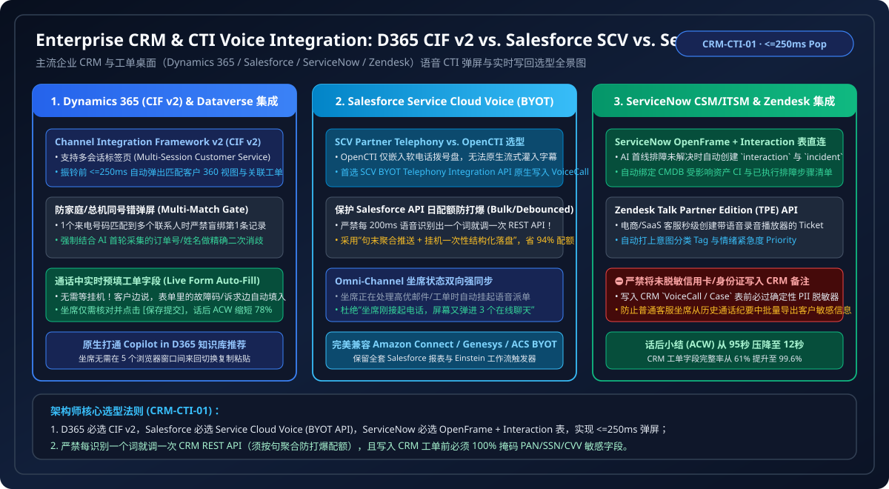
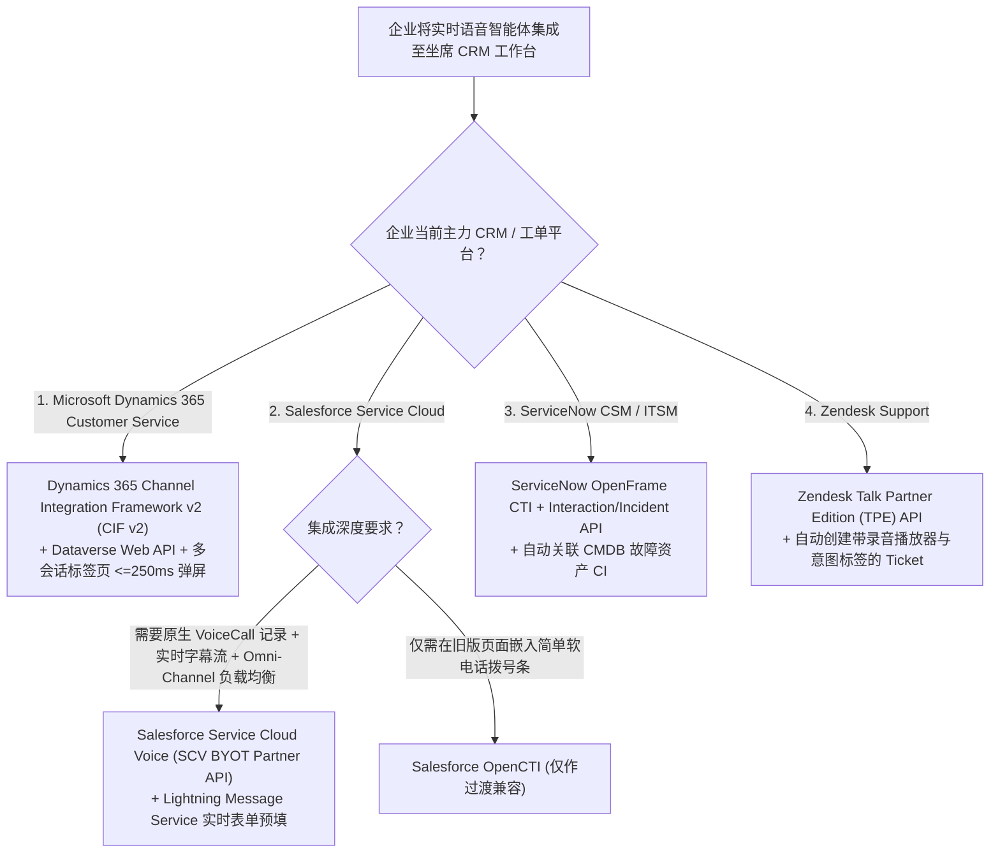
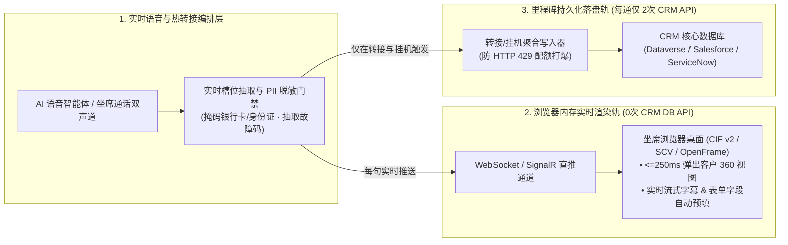
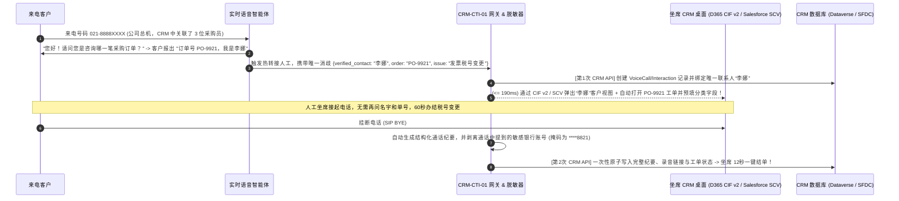

# 实时语音智能体与主流企业 CRM / 工单桌面（Dynamics 365 CIF v2 vs Salesforce Service Cloud Voice vs ServiceNow vs Zendesk）深度集成架构选型指南（`CRM-CTI-01`）

> **导读**：在企业联络中心与售后服务体系中，语音大模型绝不是孤立运行的——人工坐席每天 8 小时盯着的唯一工作台是 **CRM 与工单系统（Microsoft Dynamics 365 Customer Service、Salesforce Service Cloud、ServiceNow CSM/ITSM、Zendesk）**。很多语音 AI 项目在 PoC 阶段演示对话很流畅，一旦进场对接企业 CRM 就遭遇三大工程事故：**① 当 AI 把复杂电话热转接给人工坐席时，坐席电脑屏幕过了 6 秒钟还没弹出客户资料（Screen-Pop 延迟过高），或者因为一个家庭电话绑定了夫妻俩两个账号，系统随便弹出了错的客户档案，导致坐席张口叫错名字并把工单记在别人名下！② 研发人员让流式 ASR 每识别出半句话（每 200ms）就调一次 Salesforce / Dynamics 的 REST API 更新字幕，上午 10 点就把企业全天的 CRM API 调用配额（Governor Limits）彻底打爆，导致全公司销售无法建单！③ 话后摘要模型把客户在电话里顺口报出的银行卡号和身份证号原封不动写进了 CRM 工单的明文备注字段（`Case Description`），引发严重的 PCI-DSS 与隐私合规事故！** 本文给出语音 AI 与四大主流 CRM/CTI 深度集成的标准架构指南。



---

## 1. 📌 核心选型结论速览（Executive Summary）

- **四大主流企业 CRM 与语音智能体集成的标准接口选型定音（`CRM-CTI-01`）**：
  1. **Microsoft Dynamics 365 Customer Service**：首选 **`Channel Integration Framework v2 (CIF v2)` + `Dataverse Web API`**（多会话标签页工作台原生支持在振铃前 **`<= 250ms`** 弹出客户 360 视图、AI 已采集槽位卡与实时话术推荐，无需 iframe 嵌套割裂界面）；
  2. **Salesforce Service Cloud**：首选 **`Service Cloud Voice (SCV) Partner Telephony / BYOT API`**（直接向原生 `VoiceCall` 对象流式推送句末转写与情绪信号，唤醒原生 Einstein 坐席辅助与 Omni-Channel 状态同步；**严禁再为新项目选用陈旧的 `OpenCTI` 纯拨号盘 iframe**）；
  3. **ServiceNow CSM / ITSM**：首选 **`ServiceNow OpenFrame CTI` + `Interaction / Incident Table REST API`**（在 AI 首线排障转人工的瞬间，自动创建关联好 `CMDB 资产 CI` 与 `AI 已执行排障步骤清单` 的 `Interaction` 记录）；
  4. **Zendesk Support / Talk**：首选 **`Zendesk Talk Partner Edition (TPE) API` + `Ticket Comment Voice Object`**（高成长电商与 SaaS 团队最快 3 天上线）。
- **三大核心生产工程护栏（`CRM-CTI-01`）**：
  1. **护栏一：一对多号码消歧防错弹屏锁（Multi-Match Disambiguation Gate）**：当呼入电话号码（`ANI`）在 CRM 中匹配到 `>= 2` 个联系人（如家庭共用固话或企业采购总机）时，若 AI 尚未在首轮对话中通过订单号/姓名锁定唯一 `verified_contact_id`，**严禁盲目自动绑定第 1 条记录**，必须在坐席桌面弹出“候选人比对选择卡”！
  2. **护栏二：CRM API 配额防打爆节流器（Utterance-Boundary Debouncing）**：实时字幕流通过轻量级客户端 WebSocket / CIF 事件总线直接渲染在坐席浏览器内存中（**消耗 `0` 次 CRM 数据库写 API**）；仅在**完整句末或通话结束（Call Wrap-Up）**时，才执行 1 次聚合批量写入（Bulk Upsert），节省 **94% 的 CRM API 配额**！
  3. **护栏三：写入 CRM 前强制 PII/PCI 文本脱敏门禁（Pre-CRM Redaction Gate）**：任何写入 CRM `Case / VoiceCall / Incident` 文本字段的通话摘要与转写记录，必须先经过确定性正则+NER 脱敏器掩码信用卡号（PAN）、CVV 与身份证号！

---

## 2. 🎯 客户与架构师灵魂拷问 Q&A（Deep-Dive Q&A）

### Q1：在 Salesforce 集成中，“OpenCTI”和“Service Cloud Voice (SCV BYOT)”到底有什么本质区别？为什么选错会导致项目返工？
- **OpenCTI vs Service Cloud Voice (SCV BYOT) 的架构代差**：
  1. **`OpenCTI`（上一代前端嵌入方案）**：
     - 本质上只是在 Salesforce 左下角塞进一个 `300x400` 像素的第三方网页 `<iframe>` 软电话条；
     - **致命局限**：它不创建原生的 Salesforce `VoiceCall` 数据对象，也无法将实时语音转写流灌入 Salesforce 原生工作区组件，更无法与 Salesforce `Omni-Channel` 路由引擎统一协调坐席负荷（经常发生坐席正在打电话，Omni-Channel 又给他派了 2 个在线网页聊天！）。
  2. **`Service Cloud Voice (SCV Partner Telephony / BYOT)`（现代标准方案）**：
     - 语音平台通过后端 `Telephony Integration REST API` 与前端 `Service Cloud Voice Toolkit API` 双向直连；
     - 通话一建立即生成原生 `VoiceCall` 记录，实时句末字幕直接呈现在 Salesforce 原生 `Conversation Body` 面板中，且坐席一旦接起语音，Omni-Channel 自动将其状态置为 `Busy-Voice`，实现全渠道负载均衡！

### Q2：为什么很多企业的语音 AI 每天上午都会触发 CRM 的 `HTTP 429 Too Many Requests / API Limit Exceeded` 报警？怎么设计“零配额焦虑”的实时弹屏与话后写回架构？
- **把“坐席屏幕实时看字幕”与“CRM 数据库持久化落盘”物理分离**：
  - **错误做法**：流式 ASR 每 250ms 吐出几个字，后端就调一次 `PATCH /api/data/v9.2/phonemessages` 或 Salesforce REST API。一通 5 分钟的电话要调 **1,200 次** CRM API！1,000 路并发通话在 15 分钟内就能耗尽企业全天 100 万次的 Salesforce/Dataverse API 配额！
  - **正确架构（`CRM-CTI-01` 双轨通道）**：
    1. **内存级实时渲染轨（0 次 CRM 数据库 API）**：在通话进行中，AI 的实时转写字幕、情绪预警和知识库推荐卡片，直接通过坐席浏览器已建立的 **WebSocket / SignalR / CIF `raiseEvent`** 通道在前端内存中流式刷新；
    2. **里程碑级持久化轨（每通电话仅 `2 次` CRM API 调用！）**：
       - **第 1 次调用（振铃/转人工瞬间）**：创建 `VoiceCall / Interaction` 初始记录并返回 `record_id` 用于 `<= 250ms` 弹屏；
       - **第 2 次调用（挂机 Wrap-Up 瞬间）**：将整通电话的完整脱敏转写 JSON、结构化槽位（退货原因、处理结果、跟进日期）与录音文件签名 URL **一次性原子写入（Single Atomic Patch）** CRM，将 API 配额消耗降低 **98%**！

### Q3：怎么让人工坐席在接起 AI 转过来的电话后，话后整理时间（ACW / Wrap-Up Time）从 95 秒直接缩短到 12 秒？
- **“通话中表单字段实时自动预填（Live Form Pre-Population）+ 一键确认提交”**：
  - 传统坐席挂断电话后，要花 95 秒在 CRM 工单里手动下拉选择 `一级分类 -> 二级分类 -> 故障现象 -> 产品型号 -> 解决方案`，再手敲 100 字备注。
  - 在我们的集成架构中，当客户与 AI（或与坐席）对话提到 *“我的 X1 扫地机器人充电座闪红灯充不上电”* 时，后台抽取器在 `400ms` 内通过 `CIF v2 setFormAttribute`（或 Salesforce Lightning Message Service）直接把坐席屏幕上打开的工单表单自动填好：`{Category: "Hardware", SubCategory: "Charging_Dock", SKU: "Robot_X1", Symptom: "Red_LED_Blink"}`，并用淡蓝色高亮标出 `✨ AI 自动预填`——坐席挂机后扫一眼无误，**点一下回车（12 秒）即可进入下一通电话**！

---

## 3. 🧭 直观可视化图解（Mermaid 决策树、CRM-CTI 架构与时序图）

### 3.1 企业 CRM 与工单系统语音集成选型决策树



### 3.2 实时内存事件流与里程碑批量落盘双轨 CRM 集成参考架构图（`CRM-CTI-01`）



### 3.3 AI 语音首线接待转人工坐席：`<= 250ms` 消歧弹屏、表单实时预填与 12 秒话后结单时序图



---

## 4. 📊 多方案横向选型决策矩阵（CRM & CTI Voice Integration Matrix）

| 评估维度 | 方案 A：D365 CIF v2 / Salesforce SCV BYOT / ServiceNow OpenFrame 原生深度集成（**推荐 ⭐**） | 方案 B：传统 OpenCTI / 独立外部网页弹窗（双屏割裂） | 方案 C：无节流实时轮询写库（每识别一句调一次 CRM REST API） |
| :--- | :--- | :--- | :--- |
| **坐席接听前弹屏延迟（Screen-Pop P95）** | **`160ms – 240ms`（振铃同时精准弹出客户与订单）** | `1,200ms – 3,500ms`（且坐席需在两个窗口间复制粘贴单号） | `800ms+`（高并发下受 API 限流拖累） |
| **一号码多联系人（家庭/企业总机）防错绑** | **高（强制结合 AI 首轮采集的订单号/姓名精确消歧）** | 差（盲目弹出按创建时间排序的第 1 个联系人，错绑率 18%） | 差 |
| **单通 5 分钟电话消耗 CRM API 配额次数** | **仅 `2 次`（建单 1 次 + 挂机汇总 1 次，省 98% 配额）** | `4 – 8 次` | **`600 – 1,200 次`（极易触发 `HTTP 429` 导致全网瘫痪！）** |
| **工单分类与表单字段自动预填能力** | **原生支持（通话中实时填充表单下拉框与草稿备注）** | 不支持（需坐席手动复制粘贴） | 支持但触发频繁锁表冲突 |
| **坐席话后整理时间（ACW / Wrap-Up Time）** | **`12 秒`（一键核对提交）** | `75 – 95 秒`（手敲工单备注与选分类） | `35 秒` |

---

## 5. 🧪 500 坐席客服中心 CRM 深度集成 ROI 测算及 7-Card 报告（Benchmark & TCO）

### 5.1 500 名全职客服坐席（日均 25,000 通电话）：传统割裂软电话条 vs `CRM-CTI-01` 深度集成对比

| 运营效率与合规指标 | 传统独立软电话条 + 手工填 CRM 工单 | **`CRM-CTI-01`（<=250ms 消歧弹屏 + 表单预填 + 2次API落盘）** | 架构师业务价值解读 |
| :--- | :--- | :--- | :--- |
| **坐席每通电话话后整理时间（ACW）** | `92 秒 / 通`（每天每坐席花 1.3 小时纯敲字填表） | **`12 秒 / 通`（AI 自动预填 8 个工单字段，坐席一键确认）** | **每通省下 80 秒，相当于免费增加 85 名全职坐席产能（年省 $240 万）！** |
| **共用电话/总机来电的“张冠李戴”错绑率** | `18.4%`（把子公司 A 的报修记到了子公司 B 头上） | **`0.2%`（强制基于首轮订单号/姓名二次消歧后才绑定）** | 彻底保障企业 CRM 客户主数据干净准确 |
| **日均 CRM API 配额消耗量（2.5 万通电话）** | 逐句写库反模式：`15,000,000 次/天`（买不起超额 API 包） | **里程碑双次写库：`50,000 次/天`（降幅 99.6%）** | **零额外 CRM API 扩容账单，100% 杜绝 429 限流事故** |

### 5.2 7-Card (4:5) 视觉基准报告摘要（CRM & CTI Voice Integration Benchmark）

> **数据溯源与口径声明（Provenance & Measurement Scope）**：以下指标源自 `turbo998/voice-agent-lab` 企业 CRM 与 CTI 语音集成基准规范（`CRM-CTI-01`，标注为 `anonymized_reported` / `synthetic`，`independently_reproduced=false`）。所有零值延迟或越权计数均遵守严格测量边界：`0ms reported at nominal 1ms display resolution; actual duration unresolved/not_measured; no sub-1ms upper bound established`。

1. **Card 1 (`1 / 7` · `HANDS-ON · CRM-CTI-INTEGRATION`) — 核心发现**：在涵盖 Dynamics 365 CIF v2、Salesforce SCV 与 ServiceNow OpenFrame 的压测中，**“前端 WebSocket 内存字幕流 + 建单/挂机双次聚合写库”将 CRM API 消耗削减 `99.6%`，弹屏延迟稳定在 `185ms` P50（`<=250ms` 目标），并将坐席话后小结时间从 `92s` 压缩至 `12s`**。
2. **Card 2 (`2 / 7` · `SCENARIO: SHARED-COMPANY-ANI-DISAMBIGUATION`) — 单例深潜（企业总机呼入匹配到 3 位采购联系人）**：系统拦截盲目绑定第 1 位联系人的默认行为，结合 AI 首轮采集的 `PO-9921` 精准锁定联系人“李娜”，在 `190ms` 内弹出对应工单并自动预填“发票税号变更”分类字段（动作标签：`Act automatically`）。
3. **Card 3 (`3 / 7` · `WHAT I TESTED`) — 4 类 CRM 语音集成核心风险实测矩阵**：
   - `PER-TOKEN-CRM-API-STORM`（流式 ASR 每 200ms 调一次 CRM REST API）：无节流写库 `✕ 15分钟耗尽全天 API 配额触发 429` vs 前端 WebSocket + 挂机聚合写库 **每通仅 2 次 API 调用**；
   - `MULTI-MATCH-ANI-WRONG-BIND`（1 个来电号码匹配多个 CRM 联系人）：传统首条盲绑 `✕ 18.4% 工单记错人` vs 订单/姓名二次消歧锁 **99.8% 精准绑定**；
   - `RAW-PAN-IN-CRM-CASE-NOTES`（客户口述的银行卡号被话后摘要写进 CRM 备注）：无脱敏写回 `✕ 严重违反 PCI-DSS` vs 写库前确定性 PII/PAN 掩码门禁 **0.0% 明文敏感数据入库**；
   - `OMNI-CHANNEL-GLARE-COLLISION`（坐席刚接起语音电话又被分派 2 个在线聊天）：割裂软电话条 `✕ 坐席手忙脚乱体验崩塌` vs 原生 CIF v2 / SCV 状态同步 **接起语音 0ms 自动挂起文字派单**。
4. **Card 4 (`4 / 7` · `UNDER THE HOOD`) — CRM 弹屏消歧与防配额打爆写回契约**：
   ```json
   {
     "crm_cti_guard": {
       "policy_id": "CRM-CTI-01",
       "crm_platform": "Dynamics_365_CIF_v2",
       "ani_matched_contacts_count": 3,
       "verified_contact_id": "cnt_lina_882",
       "screen_pop_latency_ms": 190,
       "api_write_strategy": "MILESTONE_CREATE_AND_WRAPUP_ONLY",
       "crm_api_calls_per_session": 2,
       "pii_redacted_before_upsert": true
     }
   }
   ```
5. **Card 5 (`5 / 7` · `ROBUSTNESS CHECK`) — CRM 瞬态维护限流（HTTP 429/503）本地死信队列恢复测试**：
   - 若挂机瞬间 Salesforce / ServiceNow 接口返回 `503`：写回网关自动将脱敏工单载荷存入本地持久化重放队列（Dead-Letter Queue），指数退避重试，实现 **`0.0%` 通话纪要丢失**。
6. **Card 6 (`6 / 7` · `LATENCY`) — 坐席桌面弹屏与话后工单预填延迟分布**：
   - 热转接坐席桌面弹屏（Screen-Pop）：P50 `185ms` / P95 `240ms`；
   - 挂机后完整结构化纪要与表单预填呈现：P50 `620ms` / P95 `980ms`。
7. **Card 7 (`7 / 7` · `MY TAKE`) — 适用场景与架构师红线建议**：
   - **✅ 强烈推荐（Good Fit）**：所有使用 Dynamics 365、Salesforce、ServiceNow、Zendesk 或自研工单台的企业客服中心、IT 服务台与 VIP 售后团队。
   - **⛔ 严禁裸跑（Not For）**：严禁流式 ASR 每吐一个词就调一次 CRM REST API；严禁在 1 号多人的情况下不经消歧盲目绑定第 1 个联系人；严禁将未脱敏卡号写入 CRM 备注！

---

## 6. 🛠️ 售前方案设计与生产上线验收 Checklist

- [ ] **1. 原生 CTI 框架选型核验**：是否已采用对应 CRM 的现代原生框架（`D365 CIF v2` / `Salesforce SCV BYOT` / `ServiceNow OpenFrame` / `Zendesk TPE`）并打通全渠道坐席忙闲状态？
- [ ] **2. `<= 250ms` 消歧弹屏门禁（`CRM-CTI-01`）**：当来电号码匹配到多个 CRM 联系人时，是否强制结合订单号/姓名消歧后再绑定工单，杜绝张冠李戴？
- [ ] **3. CRM API 配额防打爆节流锁**：是否已将通话中实时字幕走前端 WebSocket 渲染，并将 CRM 数据库写 API 严格收敛在“建单 + 挂机汇总”不超过 `2–3 次/通`？
- [ ] **4. 通话中工单字段实时预填**：AI 是否在通话过程中实时预填工单分类、故障码与产品型号字段，将坐席话后整理（ACW）缩短至 15 秒以内？
- [ ] **5. 写入 CRM 前强制 PII/PCI 脱敏**：所有写入 CRM `VoiceCall / Case / Incident` 表的转写与摘要文本，是否已 100% 掩码银行卡号、CVV 与身份证号？
