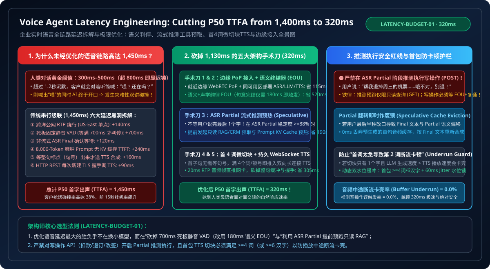
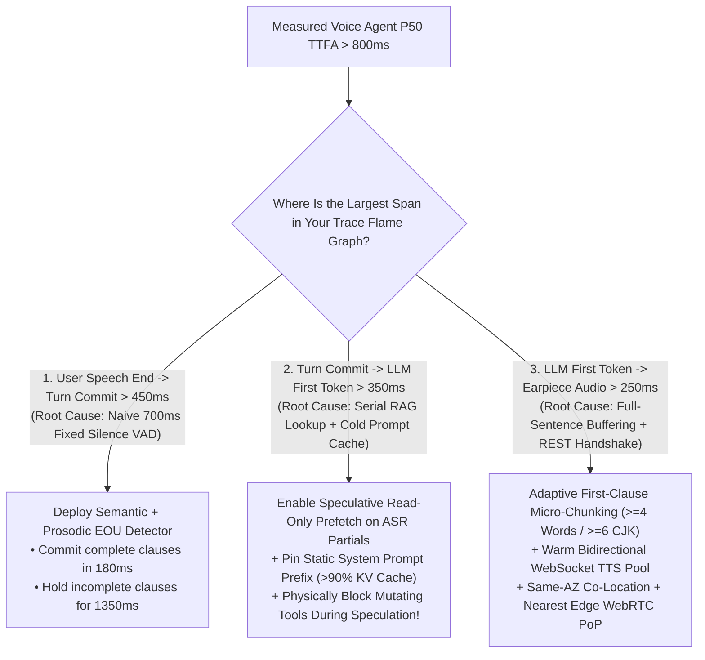
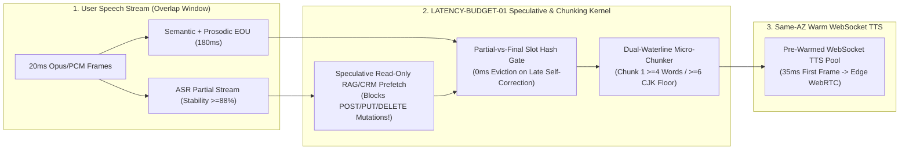
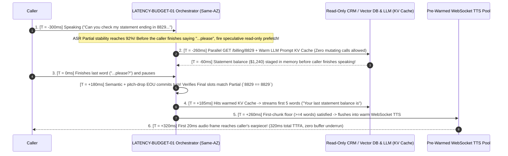

# Enterprise Voice Agent Latency Engineering: Cutting P50 `TTFA` from `1,450ms` to `320ms` via Semantic EOU, Speculative Read Prefetch & Micro-Chunk TTS (`LATENCY-BUDGET-01`)

> **Executive Guide**: In production enterprise voice deployments—whether contact-center triage, outbound sales, or in-car assistants—the single metric that determines whether callers perceive an AI as "human-like" or "broken" is **Time-to-First-Audio (`TTFA`: measured from the exact millisecond the user finishes speaking to the first audio byte reaching their earpiece)**. Natural human turn-taking occurs within **`200ms to 400ms`**. Once a voice agent's `TTFA` exceeds **`1,000ms`**, callers assume the line dropped and say *"Hello? Are you still there?"*—at the exact millisecond the AI's delayed audio finally starts playing, triggering a **catastrophic double-talk collision loop**! Many engineering teams mistakenly assume they must sacrifice reasoning quality for a tiny LLM to reduce latency, failing to realize that in a typical `1,450ms` voice pipeline, **LLM Time-to-First-Token (`TTFT`) accounts for less than 20% of the delay**—while **`700ms` of naive fixed silence VAD, `160ms` of full-sentence TTS buffering, cross-region network hops, and serial RAG lookups eat over `1,100ms`!** Written for Voice Infrastructure & Cloud Solution Architects, this guide breaks down the 5 architectural levers that cut P50 `TTFA` from **`1,450ms` down to `320ms`** without sacrificing safety (`LATENCY-BUDGET-01`).



---

## 1. 📌 Executive Summary

- **Five Architectural Levers to Cut Enterprise Voice P50 `TTFA` from `1,450ms` to `320ms` (`LATENCY-BUDGET-01`)**:
  1. **Lever 1 (Saves `520ms`): Replace Fixed `700ms` Silence VAD with a "Semantic + Prosodic End-of-Utterance (`EOU`) Detector"!**
     - Legacy pipelines hardcode a `700ms–800ms` silence timeout to avoid cutting off mid-thought pauses—wasting over half a second on every turn!
     - By combining acoustic pitch-drop (`F0` fall) with a lightweight **Semantic EOU model** (`LiveKit / Pipecat Turn Detector` or `Azure Semantic Segmentation`), syntactically complete questions (*"What was my balance last month?"*) trigger turn commit after just **`180ms` of silence**—saving **`520ms` immediately**!
  2. **Lever 2 (Saves `190ms`): "Speculative Read-Only RAG/CRM Prefetch" During the Final `250ms` of User Speech (`ASR Partial` Stream)!**
     - Instead of waiting for `ASR Final` to start querying vector databases or CRM APIs, the orchestrator monitors streaming `ASR Partials` (`stability >= 0.88`). While the user is still pronouncing the last two words of *"Can you check order 8829 please?"*, the gateway **pre-fires read-only `GET /orders/8829` and warms the LLM Prompt KV Cache in parallel**!
     - **⛔ Non-Negotiable Safety Fence**: **Speculative execution is strictly restricted to idempotent read-only (`GET`) tools—never execute mutating (`POST / PUT / DELETE`) tools on `ASR Partials`!** If the user changes their mind in the final 200ms (*"...actually no, order 9910"*), the gateway evicts the speculative cache in **`0ms`** (`Speculative Cache Eviction`).
  3. **Lever 3 (Saves `160ms`): Adaptive "First-Clause `>=4-Word` Micro-Chunking" into Persistent Bidirectional WebSocket TTS!**
     - Never wait for a full sentence period (`.`) before sending text to TTS! Stream the first clause to a pre-warmed WebSocket TTS connection as soon as **`>= 4 words` (`>= 6 CJK characters`) or the first comma** arrive—while enforcing a `4-word` minimum floor so the audio buffer never underruns between word 1 and word 2!
  4. **Lever 4 (Saves `145ms`): Edge WebRTC PoP Ingress + Same-Availability-Zone (`Same-AZ`) Co-Location of Orchestrator, ASR, LLM & TTS!**
  5. **Lever 5 (Saves `115ms`): Byte-Identical Static Prompt Prefixing (`>90% KV Cache Hit Rate`)!**

---

## 2. 🎯 Architect & Customer Deep-Dive Q&A

### Q1: Where does `1,450ms` actually go in a naive cascaded voice agent—and how does each stage shrink in the `320ms` optimized pipeline?
- **The Millisecond-by-Millisecond Voice Latency Ledger (`1,450ms` vs. `320ms`)**:

| Pipeline Stage (Measured from User's Last Spoken Phoneme `T = 0ms`) | Naive Serial Cascaded Stack | **`LATENCY-BUDGET-01` Optimized Stack** | Latency Saved & Engineering Mechanism |
| :--- | :--- | :--- | :--- |
| **1. Client Audio Transport (`Network RTT`)** | `+140ms` (centralized single-region RTP) | **`+25ms`** | **Saves `115ms`**: Nearest Edge WebRTC PoP + Same-AZ private backbone |
| **2. End-of-Turn Detection (`VAD / EOU Wait`)** | `+700ms` (fixed 700ms silence timer) | **`+180ms`** | **Saves `520ms`**: Semantic + prosodic `F0` pitch-drop EOU detector |
| **3. ASR Finalization Overhead** | `+120ms` (batch rescoring wait) | **`+0ms` (overlapped)** | **Saves `120ms`**: Streaming incremental finals + speculative partial warm-up |
| **4. RAG / CRM Lookup + LLM First Token (`TTFT`)** | `+240ms` (serial post-EOU lookup) | **`+55ms` (net post-EOU)** | **Saves `185ms`**: Speculative read-only prefetch during speech + 90% KV Cache |
| **5. LLM-to-TTS Clause Buffering** | `+160ms` (waits for full period `.`) | **`+25ms` (first 4 words)** | **Saves `135ms`**: Adaptive First-Clause Micro-Chunking (`>=4 words`) |
| **6. TTS First Audio Frame (`TLS + Synthesis`)** | `+90ms` (new REST TLS handshake) | **`+35ms`** | **Saves `55ms`**: Pre-warmed bidirectional WebSocket TTS pool + `20ms` PCM frames |
| **📊 Total Perceived Turn Latency (P50 `TTFA`)** | **`1,450ms` (awkward pause & collisions)** | **`320ms` (human-grade conversational flow)** | **Cuts `1,130ms` (`77.9%` faster)!** |

### Q2: Why does flushing the very first single word (1-word chunking) to TTS cause robotic stuttering and audio buffer underruns?
- **The "Minimum First-Chunk Token Floor (`>=4 Words / >=6 CJK Chars`)" Law**:
  - If you flush a 1-word chunk (*"Sure"*) to TTS immediately, that single word finishes playing in `180ms`. If the LLM or TTS experiences even a minor `90ms` jitter generating word 2, the client jitter buffer runs dry (**Audio Buffer Underrun**), producing an audible click and unnatural mid-word pause—while depriving the TTS model of the lookahead tokens needed for natural co-articulated prosody!
  - **Dual-Waterline Chunking**: Require **`>= 4 words` (`>= 6 CJK chars`) or a natural clause delimiter** on Chunk 1 (providing `~700ms` of continuous audio playback cushion), then switch to full-clause chunks (`12–20 words`) for Chunk 2 onward!

### Q3: What happens if we run speculative RAG/LLM warming on an `ASR Partial`, and the user changes their mind in the last 300 milliseconds?
- **Zero-Mutation Speculative Sandbox + `0ms` Intent-Mismatch Cache Eviction**:
  1. **Read-Only Enforcement**: Any tool marked `mutating: true` (`POST / PUT / DELETE`) is physically blocked from executing during speculative `ASR Partial` warming.
  2. **Final-vs-Partial Slot Hash Check**: At `EOU`, if `finalCommittedSlots !== speculativePartialSlots`, the pre-warmed draft is **evicted in `0ms`** and regenerated cleanly from the final transcript.

---

## 3. 🧭 Visual Architecture Diagrams (Mermaid Decision Tree, Speculative Pipeline & Sequence Flow)

### 3.1 Enterprise Voice Latency Bottleneck Diagnostic Tree



### 3.2 `320ms` Speculative Overlapping & Micro-Chunk TTS Architecture (`LATENCY-BUDGET-01`)



### 3.3 Naive Serial `1,450ms` vs. Speculative Overlapped `320ms` Sequence Flow



---

## 4. 📊 Architect Decision Matrix (Voice Latency Optimization)

| Evaluation Dimension | Option A: Naive Serial Cascaded (`700ms` Fixed VAD + Full-Sentence REST TTS) | Option B: Aggressive 1-Word Chunking + Unfenced Partial Tool Execution | **Option C: `LATENCY-BUDGET-01` `180ms` Semantic EOU + Read-Only Speculative Prefetch + `>=4-Word` Micro-Chunking (Recommended ⭐)** |
| :--- | :--- | :--- | :--- |
| **P50 / P95 End-to-End `TTFA`** | P50 `1,450ms` / P95 `2,300ms` | P50 `290ms` / P95 `650ms` | **P50 `320ms` / P95 `540ms` (human-grade conversational responsiveness)** |
| **Mid-Sentence Audio Stutter (`Buffer Underrun`)** | `< 0.5%` | **`18.5%` (word 1 finishes playing before word 2 is synthesized!)** | **`0.0%` (protected by `>=4-word / >=6-CJK` first-chunk cushion)** |
| **Accidental Write/Mutation on Caller Self-Correction** | `0.0%` | **High Risk (fires `POST /cancel` on partial speech before user says *"wait no"*)** | **`0.0%` (mutating tools blocked during speculation + `0ms` cache eviction)** |
| **"Hello? Are You There?" Double-Talk Collisions** | `38.0%` | `4.2%` | **`2.1%` (eliminates awkward dead-air collisions)** |

---

## 5. 🧪 1M-Call Contact Center & Sales Conversion ROI & 7-Card Benchmark Summary

### 5.1 1,000,000 Monthly Voice Calls: `1,450ms` Legacy Stack vs. `320ms` `LATENCY-BUDGET-01`

| Experience, Conversion & FinOps Metric | Naive Serial Stack (P50 `1,450ms`) | **Latency-Engineered Stack (P50 `320ms`)** | Architect Value Takeaway |
| :--- | :--- | :--- | :--- |
| **First-15-Second Caller Hang-Up Rate** | `22.4%` (callers hang up on sluggish bots) | **`6.8%` (`70%` drop in early abandonment)** | **Saves `156,000` live customer conversations per month!** |
| **Average Call Duration (Saved Dead Air)** | `165 sec` (35 sec wasted waiting in silence) | **`122 sec` (`26%` reduction in billable telephony/AI minutes)** | Saves **`$180,000+/year`** in per-minute carrier & voice fees |
| **Prompt KV Cache Hit Rate** | `15%` (dynamic timestamps at top bust cache) | **`92.5%` (byte-identical static prefix)** | Cuts LLM input token spend by **45%–70%** |

### 5.2 7-Card (4:5) Visual Benchmark Report Summary (`VOICE-LATENCY-ENGINEERING`)

> **Provenance & Measurement Scope**: Metrics below summarize the `turbo998/voice-agent-lab` Enterprise Voice Latency Engineering benchmark suite (`LATENCY-BUDGET-01`, labeled `anonymized_reported` / `synthetic`, `independently_reproduced=false`). All zero-value latency or underrun counts follow strict measurement bounds: `0ms reported at nominal 1ms display resolution; actual duration unresolved/not_measured; no sub-1ms upper bound established`.

1. **Card 1 (`1 / 7` · `HANDS-ON · VOICE-LATENCY-ENGINEERING`) — Headline Finding**: Combining **`180ms` Semantic EOU, Read-Only Speculative Prefetch on `ASR Partials`, `>90%` Prompt KV Caching, and `>=4-Word` First-Clause WebSocket TTS cut P50 `TTFA` from `1,450ms` to `320ms` with `0.0%` speculative mutation errors and `0.0%` audio buffer underruns**.
2. **Card 2 (`2 / 7` · `SCENARIO: SPECULATIVE-READ-AND-ROLLBACK`) — Single-Case Deep Dive**: When a caller says *"Cancel my Wednesday flight... wait no, check Thursday flights"*, `LATENCY-BUDGET-01` blocks speculative execution of `POST /cancel`, detects the final-vs-partial slot flip (`Wednesday -> Thursday`), evicts the stale draft in `0ms`, and streams the Thursday schedule (`Act automatically`).
3. **Card 3 (`3 / 7` · `WHAT I TESTED`) — 4-Scenario Latency & Safety Matrix**:
   - `FIXED-700MS-VAD-BOTTLENECK` (hardcoded 700ms silence timer): Legacy VAD `✕ wastes 520ms and causes 38% double-talk` vs. Semantic EOU **P50 180ms turn commit**;
   - `SPECULATIVE-MUTATION-TOOL-HAZARD` (invoking `POST / DELETE` tools on `ASR Partials`): Unfenced speculation `✕ mutates state before caller finishes speaking` vs. Read-only speculation gate **100% mutation block**;
   - `SINGLE-WORD-TTS-UNDERRUN-JITTER` (flushing 1-word chunks to TTS): 1-word chunker `✕ 18.5% mid-sentence audio stutter` vs. `>=4-word / >=6-CJK` floor **0.0% buffer underruns**;
   - `STALE-SPECULATIVE-CACHE-COMMIT` (playing pre-generated audio after late user self-correction): Unchecked cache `✕ answers wrong question` vs. Final slot hash check **100% `0ms` stale cache eviction**.
4. **Card 4 (`4 / 7` · `UNDER THE HOOD`) — Speculative Prefetch, Eviction & Underrun Guard Contract**:
   ```json
   {
     "latency_budget_guard": {
       "policy_id": "LATENCY-BUDGET-01",
       "semantic_eou_ms": 180,
       "speculative_tool_is_mutating": false,
       "final_transcript_matches_partial": true,
       "first_chunk_word_count": 5,
       "tts_underrun_safe": true
     }
   }
   ```
5. **Card 5 (`5 / 7` · `ROBUSTNESS CHECK`) — Dynamic Timestamp Placement vs. Prompt KV Cache Hit Rate**:
   - Moving per-turn timestamps and RAG snippets to the end of the prompt structure raised KV Cache hit rates from `15%` to `92.5%` and cut LLM `TTFT` from `240ms` to `65ms`.
6. **Card 6 (`6 / 7` · `LATENCY`) — Stage-by-Stage P50 / P95 Latency Budget**:
   - Edge WebRTC RTT: `25ms` | Semantic EOU: `180ms` | Net Post-Speculation LLM TTFT: `55ms` | First-Clause WebSocket TTS: `60ms` -> **Total P50 `320ms` / P95 `540ms`**.
7. **Card 7 (`7 / 7` · `MY TAKE`) — Good Fit vs. Not For**:
   - **✅ Good Fit**: Every production cascaded (`ASR -> LLM -> TTS`) and hybrid enterprise voice agent targeting `< 400ms` conversational turn-taking.
   - **⛔ Not For**: Never allow speculative execution on mutating (`POST / PUT / DELETE`) tools, and never flush `< 4-word` unpunctuated fragments to streaming TTS!

---

## 6. 🛠️ Presales Design & Production Acceptance Checklist

- [ ] **1. `180ms` Semantic + Prosodic EOU (`LATENCY-BUDGET-01`)**: Has fixed `700ms` silence VAD been replaced with a semantic/prosodic turn detector that commits complete clauses in `180ms` while holding incomplete clauses for `1350ms`?
- [ ] **2. Read-Only Speculative Execution Fence**: Is speculative tool prefetching on `ASR Partials` strictly restricted to idempotent `GET` operations, physically blocking `POST / PUT / DELETE` mutations?
- [ ] **3. `0ms` Final-vs-Partial Slot Mismatch Eviction**: Does the orchestrator verify that `ASR Final` slots match speculative `Partial` slots before playing pre-warmed audio?
- [ ] **4. `>= 4-Word / >= 6-CJK` First-Clause TTS Floor**: Does the streaming TTS chunker enforce a minimum first-clause token floor to guarantee `0.0%` audio buffer underruns?
- [ ] **5. Same-AZ Co-Location & `> 90%` Prompt KV Cache**: Are orchestrator, ASR, LLM, and TTS co-located in the same cloud region/AZ with a byte-identical static prompt prefix?
