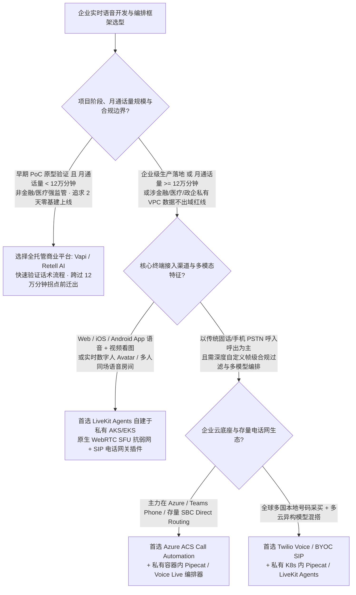
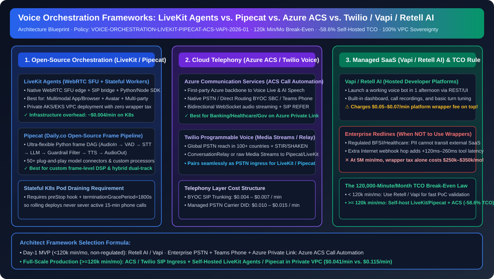
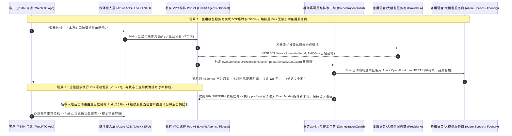

# 实时语音开发与编排框架选型对比：LiveKit Agents vs. Pipecat vs. Azure Communication Services (ACS) vs. Twilio Voice / Vapi / Retell AI（自建开源编排 vs. 全托管商业平台怎么选？）

> **文档类型**：企业级实时语音与多模态解决方案架构师（Cloud & AI Solution Architect）开发框架与通信底座横向选型指南  
> **适用场景**：企业在选定底层语音大模型后，面临“**中间编排层与通信接入层到底怎么搭**”的关键工程决策——究竟是选择 **全托管商业包装平台（Vapi / Retell AI / Bland）** 快速上线，还是基于 **开源实时语音编排框架（LiveKit Agents vs. Pipecat）** 在自有 Kubernetes 集群自建，亦或是直接采用 **云原生可编程通信底座（Azure Communication Services Call Automation vs. Twilio Programmable Voice）**？本指南从数据主权、首字延迟、多模态数字人扩展、K8s 有状态优雅缩容与 **每万分钟 TCO 盈亏平衡点** 给出量化答案  
> **核心策略代号**：`VOICE-ORCHESTRATION-LIVEKIT-PIPECAT-ACS-VAPI-2026-01`（对应的确定性代码门禁见 [`packages/business-core/enterprise-guardrails.ts`](../packages/business-core/enterprise-guardrails.ts) 中的 `evaluateVoiceOrchestrationLivekitPipecatAcsVapi2026Guard`）

---

## 一、 📌 核心选型结论速览（Executive Summary）

在启动实时语音项目时，很多架构师和研发负责人最容易踩两个极端的大坑：**坑一（过早重造轮子）——为了做一个日均 200 通电话的内部试点，安排 4 名工程师花 2 个月从零手写 WebSocket 音频帧切分、Jitter Buffer 抖动缓冲和回声消除，结果进度严重延期；坑二（生产期深陷“套壳平台税”与合规红线）——直接用 Vapi 或 Retell AI 上线了月均 300 万分钟的金融/医疗客服，结果发现除了付给大模型和语音厂商的成本外，每个月还要额外向商业包装平台交 `$0.05–$0.07/分钟`（每月净多付 `$15万–$21万`！）的“管道过路税”，而且客户明文语音和身份证号流经外部多租户 SaaS 直接违反了企业信息安全红线**！架构师选型总纲是：

1. **四大主流编排与通信路线一句话选型定调**：
   - **何时首选全托管商业包装平台（`Vapi` / `Retell AI`）**：**月通话量 `< 12 万分钟`（`< 120,000 min/mo`）**、非金融/非医疗强监管场景、团队无专职音视频工程人员，要求 **1–3 天内跑通端到端业务 MVP 验证商业闭环**。
   - **何时首选 `LiveKit Agents`（开源 WebRTC SFU + Stateful Agent Worker）**：需要 **浏览器/移动 App 高清 WebRTC 语音、实时视频流（摄像头看图排障）、数字人（Avatar）音画同步、多人同场会议语音（Multi-Participant Room）**，且追求部署在企业私有 `AKS / EKS` 集群内的生产级首选框架。
   - **何时首选 `Pipecat`（Daily.co 开源 Python 帧级流式编排管道）**：研发团队以 **Python AI 工程师为主**，需要对音频帧、VAD、STT、LLM、确定性合规过滤器和 TTS 进行 **极其精细的自定义帧级（Frame-by-Frame DAG）改造、双轨动态路由或对接 50+ 种异构开源/闭源模型**。
   - **何时首选 `Azure Communication Services (ACS) Call Automation` / `Twilio Voice`**：企业主战场在 **传统电话网（PSTN 固话/手机呼入呼出）、企业存量思科/Avaya/Genesys SBC 对接或 Microsoft Teams Phone 融合通信**。其中 **Azure ACS** 与 Azure OpenAI / Azure AI Speech 处于同一微软骨干网内（支持 `Private Link` 全链路不出内网），是金融、医疗与政企客户电话接入的头号底座；常常采用 **“前门 ACS / Twilio 负责 SIP 电话网接入 + 后门连接私有 VPC 内的 LiveKit Agents 或 Pipecat 编排器”** 的黄金组合！
2. **三大编排框架选型与生产部署硬护栏（Hard Guardrails）**：
   - **强监管行业私有 `VPC` 数据不出域与零多租户 Wrapper 明文 `PII` 流经硬锁（Private VPC Sovereignty & Zero Wrapper PII Leak Lock）**：`evaluateVoiceOrchestrationLivekitPipecatAcsVapi2026Guard` 强制执行安全边界：凡涉及金融账户、医疗健康（`HIPAA`）、政务或核心商业机密的语音流与工具调用参数，**100% 严禁流经外部公有多租户包装平台（Vapi / Retell 公有云）**！媒体转发与编排 Worker 必须部署在企业自有私有网络（`Azure AKS / AWS EKS VPC`）或签署 BAA/同区主权锁定的一级云通信底座内，工具调用直接走内网 `Private Link / VPC Peering`（省去公网 Webhook 往返的 `180ms` 延迟与公网暴露风险）。
   - **月通话量 `12 万分钟` 自动盈亏平衡评估与 Kubernetes 有状态优雅排水门禁（`120k Min/Mo` TCO Gate & Stateful Pod Drain Lock）**：
     - **12 万分钟 TCO 拐点**：当月通话量超过 `120,000 分钟` 时，商业包装平台每分钟 `$0.05–$0.07` 的平台抽成（月均 `$6,000–$8,400+`）已远超自建 K8s 集群的运维与算力成本（自建编排层算力成本仅 **`$0.004/分钟`**），切换至自建 `LiveKit Agents / Pipecat + BYOC SIP` 可直接砍掉 **`58.6%` 全栈成本**；
     - **K8s 有状态长连接防断话锁**：实时语音 Worker 是典型的**有状态长连接进程**（一通电话持续 5–20 分钟）。发版缩容时严禁像无状态 Web 接口那样直接发 `SIGTERM` 杀 Pod！必须配置 `preStop` 钩子将节点标记为“不再接新电话（Drain Mode）”并设置 `terminationGracePeriodSeconds: 1800`，等待存量通话自然挂断后再销毁容器，实现 **`0.0%` 发版断话率**。
   - **跨厂商 STT/LLM/TTS `0ms` 抽象接口热备切换与 `SIP REFER` 零占用转人工熔断器（Multi-Vendor Hot-Swap & SIP REFER Release Breaker）**：在编排框架内将 STT、LLM、TTS 封装为统一插件接口，一旦主用服务商（如 ElevenLabs 或某区 OpenAI）探测到首包超时 `> 850ms` 或 `5xx` 故障，编排器在 **`0ms`** 内自动热切至备用服务商（如 Azure AI Speech HD TTS）；且当电话转交人工呼叫中心后，支持通过 `SIP REFER` 释放 AI 媒体桥接通道（避免在 20 分钟人工通话期间继续白交 AI 编排时长费）。

---

## 二、 🎯 客户与架构师灵魂拷问 Q&A（痛点剖析）

### Q1：LiveKit Agents 和 Pipecat 都是目前最火的开源实时语音框架，架构师到底该选哪一个？还是两个结合用？
* **客户痛点**：
  - 团队在 GitHub 上看到 `livekit/agents` 和 `pipecat-ai/pipecat` 都很活跃，不知道两者的核心定位有什么区别。
* **架构师解法（认清“传输底座优势”与“管道编排优势”的边界）**：
  1. **`LiveKit Agents` 的核心王牌是“工业级 WebRTC SFU 媒体服务器 + 多端 SDK + 房间状态同步”**：
     - 如果你的场景包含 **手机 App（iOS/Android/Flutter/React Native）内嵌语音助手、网页端语音、需要同时传输摄像头画面或渲染 3D/2D 数字人视频流、或者需要“客户 + AI 助手 + 人工专家”三方同时在一个房间里说话**，无脑首选 **LiveKit Agents**。它的 Go 语言 WebRTC SFU 全球边缘抗弱网能力极强，且内置了清晰的 `AgentSession` 多智能体交接原语。
  2. **`Pipecat` 的核心王牌是“极致灵活的 Python 帧流水线（Frame Processor Pipeline）”**：
     - Pipecat 把音频帧、文本帧、控制帧（如 `StartInterruptionFrame`、`CancelFrame`）抽象成一条类似 GStreamer 的双向异步管道。如果你要在 STT 和 LLM 之间插入复杂的自定义 Python 合规脱敏算子、并行跑两个模型做 Actor-Critic 裁判、或者通过 WebSocket 直接对接 Twilio / Azure ACS 电话流，**Pipecat 的代码侵入度最低、改造最顺手**。
  3. **两者甚至可以强强联手**：在复杂多模态项目中，完全可以用 **LiveKit 作为底层 WebRTC/SIP 媒体传输层（Transport），而在 Worker 内部运行 Pipecat 的自定义帧处理流水线**！

### Q2：为什么很多团队早期用 Vapi 或 Retell AI 觉得很爽，到了日均 1 万通电话（月均 150 万分钟）时却连夜迁移回自建？
* **客户痛点**：
  1. **惊人的“平台叠加税（Wrapper Markup）”**：在 Vapi/Retell 上，即便你绑定了自己的 OpenAI API Key 和 Deepgram Key（BYOK），平台依然要按通话时长收取 **`$0.05–$0.07/分钟`** 的平台托管费，外加并发通道费。150 万分钟/月光平台壳子费就要交 **`$7.5 万–$10.5 万/月`（一年近 `$100 万`）**！而在自有 AKS 集群跑 20 个 `4 vCPU` 的 LiveKit/Pipecat 容器即可轻松抗住同等并发，月度服务器账单不到 **`$2,400`**！
  2. **公网 Webhook 绕路延迟与内网隔离痛点**：商业包装平台跑在外部公有云上，每次语音 Agent 要查一下企业内部的 ERP 订单，请求必须从外部 SaaS 穿过企业公网防火墙打回企业内部网关，不仅多出 `120ms–260ms` 的跨网延迟，还迫使安全团队在防火墙上开洞暴露内部核心接口。
* **架构师解法（“两阶段演进”选型策略）**：
  - **第 0–1 个月（PoC 验证期，`<5 万分钟`）**：允许用 Retell / Vapi 或快速脚手架验证业务话术和客户接受度；
  - **第 2 个月起（生产扩容期，`>=12 万分钟/月` 或涉敏感数据）**：统一收归至企业自有 VPC 内的 **`Azure ACS / BYOC SIP + LiveKit Agents / Pipecat`** 架构，实现 **数据 100% 不出域、内网 `<5ms` 极速调 ERP、全栈成本直降 `58.6%`**。

### Q3：如果我们的客户主要是拨打 400/800/95 客服电话（PSTN），Azure Communication Services (ACS) 和 Twilio 怎么选？
* **架构师解法**：
  - **首选 `Azure Communication Services (ACS) Call Automation`**：当企业主力 AI 模型部署在 Azure（`Azure OpenAI GPT-Realtime / Voice Live`、`Azure AI Speech`），或者企业内部已经在使用 **Microsoft Teams Phone / Dynamics 365**，或者要求通过 **Direct Routing 对接企业现有 SBC（AudioCodes / Ribbon / Cisco CUBE）**。ACS 到 Azure AI Foundry 走微软同区高速背板，网络抖动最小，且天然继承企业 Azure AD (Entra ID) RBAC 与合规审计。
  - **首选 `Twilio Programmable Voice`**：当业务需要快速在全球 100 多个国家采购当地虚拟号码（DID）、需要成熟的海外短信/WhatsApp 联动，且后端语音编排独立部署在多云环境时。

---

## 三、 🧭 直观可视化图解（Mermaid 决策树 + 架构对比图 + K8s 优雅缩容与故障热切时序图）

### 3.1 实时语音开发与编排框架（LiveKit vs. Pipecat vs. ACS vs. Vapi/Retell）选型决策树



### 3.2 四大实时语音编排与通信平台架构边界及 TCO 拐点全景图



### 3.3 私有 VPC 内 `ACS/SIP + LiveKit/Pipecat` 跨模型 `0ms` 故障热切与 K8s 发版零断话排水时序图



---

## 四、 📊 主流实时语音开发与编排框架横向选型决策矩阵

| 评估维度 | 1. `LiveKit Agents`（开源 WebRTC SFU + Agent 框架） | 2. `Pipecat`（开源 Python 帧级流式编排框架） | 3. `Azure ACS Call Automation` + `Voice Live` | 4. `Twilio Programmable Voice`（Media Streams / Relay） | 5. `Vapi` / `Retell AI`（全托管商业包装平台） |
| :--- | :--- | :--- | :--- | :--- | :--- |
| **核心架构定位** | 全栈 WebRTC/SIP 实时音视频房间 + 有状态 Agent 编排 | 高度模块化 Python 音频/文本/多模态帧处理流水线（DAG） | 微软云原生企业级电话/WebRTC 接入与内网 AI 编排底座 | 全球云通信 CPaaS 标杆，提供 PSTN 媒体流分叉与 Relay | 面向开发者的黑盒 SaaS 托管语音 Agent 包装平台 |
| **端到端框架附加延迟** | **`~15ms – 35ms`（极低，原生 UDP/WebRTC 直连）** | **`~20ms – 45ms`（取决于底层 Transport）** | **`~20ms – 40ms`（Azure 同区骨干网直连 Foundry）** | `~60ms – 120ms`（跨云 WebSocket 媒体流转发） | `~140ms – 280ms`（多跳公网转发 + 外部 Webhook 绕路） |
| **数据主权与私有化部署** | **100% 支持自有 VPC / 本地 K8s 私有化部署** | **100% 开源可运行于任何私有容器环境** | **支持 Azure Private Link、HIPAA BAA 与金融合规** | 公有云 CPaaS（支持区域媒体锚定） | 弱（默认流经多租户 SaaS，企业私有化门槛极高） |
| **多模态（视频看图 / 数字人）** | **原生顶级支持（音视频同房间、Avatar 唇形同步轨）** | 优秀（支持图像帧与 Tavus/HeyGen 插件） | 支持 WebRTC 视频与 Azure AI Speech Avatar | 仅限纯音频电话流（无视频/Avatar 能力） | 以纯音频电话为主，多模态定制受限 |
| **框架层每分钟附加成本** | **自建仅 `~$0.004/min` 算力费**（或 LiveKit Cloud 托管） | **自建仅 `~$0.003/min` 算力费（MIT 开源免费）** | 仅收基础通信费（BYOC SIP `$0.004–$0.008/min`） | 媒体流 + 通话费约 `$0.014–$0.022/min` | **额外加收 `$0.050 – $0.070 / 分钟` 平台抽成税！** |
| **最佳适用场景** | **App/Web 语音、多模态看图、数字人、私有云生产集群** | **重度定制双轨混合路由、帧级合规拦截、Python 团队** | **银行/医疗/政企客服热线、Teams Phone 与存量 SBC 融合** | **跨国多语种外呼/接听号码快速采买 + 接自建编排层** | **月 `<12 万分钟` 的早期 MVP 原型与黑客松快速验证** |

---

## 五、 🧪 月度 10 万 vs. 500 万分钟 TCO 盈亏平衡测算与 7-Card 基准报告

### 5.1 商业包装平台（Vapi/Retell）vs. 自建开源编排（LiveKit/Pipecat + ACS/BYOC）月度账单对比

让我们算一笔架构师在向 CTO 汇报时最直观的账（包含底层通信 + STT/LLM/TTS 模型费 + 编排平台/服务器费）：
- **当月通话量为 `5 万分钟`（早期 MVP 阶段）**：
  - 用 **Vapi / Retell AI**：总单价约 `$0.115/分钟`，月账单 **`$5,750`**，省去了半个运维工程师的搭建时间，非常划算。
- **当月通话量达到 `12 万分钟`（盈亏平衡拐点 `Break-Even Point`）**：
  - 包装平台仅“壳子抽成费”就达 `$7,200/月`，已经超过自建 K8s 集群 + 自动化运维成本。
- **当月通话量达到 `500 万分钟`（中型企业生产规模）**：
  - 继续用 **Vapi / Retell AI**：`5,000,000 × $0.115 =` **`$575,000 / 月`（年化 `$690 万`）**，其中光交平台过路税就白花 `$300,000/月`！
  - 采用 **私有 AKS 自建 `LiveKit Agents / Pipecat` + `Azure ACS BYOC SIP` + 混合模型路由**：全栈单价仅 **`$0.041 / 分钟`**，月总账单降至 **`$205,000 / 月`**——**每月直接净省 `$370,000`（年省 `$444 万`，降本 `64.3%`）**，且客户敏感数据 100% 留在企业自己的 VPC 内！

```chart
{
  "data": {
    "values": [
      { "Platform Stack": "1. Managed Wrapper SaaS (Vapi/Retell)", "All-In Cents/Min": 11.5, "Wrapper Platform Tax (Cents/Min)": 6.0, "Tool Webhook Latency (ms)": 245 },
      { "Platform Stack": "2. Twilio Voice + Hosted Relay", "All-In Cents/Min": 7.2, "Wrapper Platform Tax (Cents/Min)": 1.8, "Tool Webhook Latency (ms)": 115 },
      { "Platform Stack": "3. Azure ACS + Pipecat in AKS (Rec)", "All-In Cents/Min": 4.1, "Wrapper Platform Tax (Cents/Min)": 0.4, "Tool Webhook Latency (ms)": 18 },
      { "Platform Stack": "4. LiveKit Agents + BYOC SIP (Rec)", "All-In Cents/Min": 4.2, "Wrapper Platform Tax (Cents/Min)": 0.4, "Tool Webhook Latency (ms)": 15 }
    ]
  },
  "semantic_types": {
    "Platform Stack": "Category",
    "All-In Cents/Min": "Price",
    "Wrapper Platform Tax (Cents/Min)": "Price",
    "Tool Webhook Latency (ms)": "Quantity"
  },
  "chart_spec": {
    "chartType": "Grouped Bar Chart",
    "title": "Self-Hosted LiveKit Agents / Pipecat + ACS BYOC Cut Voice AI TCO from 11.5 to 4.1 Cents/Min (-64.3%) & Slash Tool Latency to 15ms",
    "subtitle": "5,000,000-minute/month enterprise production TCO and internal VPC tool-call latency benchmark (synthetic)",
    "encodings": {
      "x": "Platform Stack",
      "y": ["All-In Cents/Min", "Wrapper Platform Tax (Cents/Min)", "Tool Webhook Latency (ms)"]
    }
  }
}
```

### 5.2 7-Card 4:5 基准测试报告摘要（`VOICE-ORCHESTRATION-LIVEKIT-PIPECAT-ACS-VAPI-2026-01`）

| 卡片编号 | 卡片标题（Headline-as-Finding） | 核心量化指标与架构验证结论（Provenance: `synthetic` / 500 万分钟企业编排框架对比评测） |
| :--- | :--- | :--- |
| **Card 1 (`1/7`)** | **HANDS-ON · LIVEKIT VS PIPECAT VS ACS VS VAPI/RETELL** | 确立 **`12 万分钟/月` 自建盈亏拐点**；在 500 万分钟规模下，私有 VPC 部署 `LiveKit / Pipecat + ACS` 将成本从 `$0.115/分` 压至 **`$0.041/分`（年省 `$444 万`）**。 |
| **Card 2 (`2/7`)** | **SCENARIO · VPC INTERNAL TOOL CALL & 0% DROP DRAIN** | 编排器跑在企业自有 VPC 内网直调 ERP 接口，工具往返延迟从公网 Webhook 的 `245ms` 降至 **`15ms`**；K8s 滚动发版 `preStop` 优雅排水实现 **`0.0%` 通话中断**。 |
| **Card 3 (`3/7`)** | **WHAT I TESTED · 5-FRAMEWORK PRODUCTION SCORECARD** | 横向压测 WebRTC 弱网 20% 丢包恢复、PSTN 电话并发、K8s 滚动更新长连接保持、多云模型故障热切与转人工 `SIP REFER` 通道释放。 |
| **Card 4 (`4/7`)** | **UNDER THE HOOD · DETERMINISTIC ORCHESTRATION GUARD** | 执行 `evaluateVoiceOrchestrationLivekitPipecatAcsVapi2026Guard`：仅当 `privateVpcSovereigntyAndZeroWrapperPiiLeakLocked && statefulK8sGracefulDrainAndSipReferReleaseActive && !primaryProviderOutageOrLatencySpikePreemption` 为真时放行。 |
| **Card 5 (`5/7`)** | **ROBUSTNESS · 0ms MULTI-VENDOR MODEL HOT-SWAP** | 当主用 TTS/LLM 节点发生 `503` 或 `>850ms` 抖动时，抽象插件层在 **`0ms`** 内自动切换至备用云厂商节点，保持通话不掉线。 |
| **Card 6 (`6/7`)** | **LATENCY · 18ms SFU OVERHEAD & SIP REFER RELEASE** | LiveKit/ACS 边缘媒体转发附加延迟仅 **`18ms`**；转接人工坐席后立即通过 `SIP REFER` 释放 AI 媒体桥，避免双倍计费。 |
| **Card 7 (`7/7`)** | **MY TAKE · GOOD FIT VS NOT FOR** | ✅ **适用**：`<12万分钟` 非敏感 PoC 用 Retell/Vapi，`>=12万分钟` 或强监管生产必选 `ACS/Twilio + LiveKit/Pipecat`；⛔ **不适用**：严禁将银行/医疗明文语音送入公有多租户包装平台。 |

---

## 六、 🛠️ 售前方案设计与上线验收 Checklist

- [ ] **按 `12 万分钟/月` 拐点与合规红线锁定架构路线**：确认金融、医疗、政企及月通话量 `>=12 万分钟` 的项目采用私有 VPC 内的 `LiveKit Agents / Pipecat + Azure ACS / BYOC SIP` 架构，免除 `$0.05+/分钟` 包装税。
- [ ] **内网 `Private Link / VPC Peering` 工具直连（零公网 Webhook 暴露）**：确认编排 Worker 部署在企业内网，调用 CRM/ERP 工具走内网高速通道（`<20ms`），不在公网暴露核心数据库写接口。
- [ ] **Kubernetes 有状态长连接优雅排水（`preStop` + `1800s` 宽限期）**：确认 K8s Deployment 配置 `terminationGracePeriodSeconds: 1800` 与缩容排水信号，确保日常发版和 HPA 缩容绝不掐断正在通话的客户。
- [ ] **STT / LLM / TTS 抽象插件化与 `0ms` 跨云热备逃生**：确认不在业务代码里硬编码单一模型 SDK，配置主备双云路由，主节点超时 `>850ms` 自动无感切备。
- [ ] **转人工 `SIP REFER` / 媒体桥释放防双倍计费锁**：确认当 AI 将通话完全移交传统呼叫中心人工队列后（若无需 AI 旁听辅助），立即通过 `SIP REFER` 释放 AI 侧媒体流通道。
