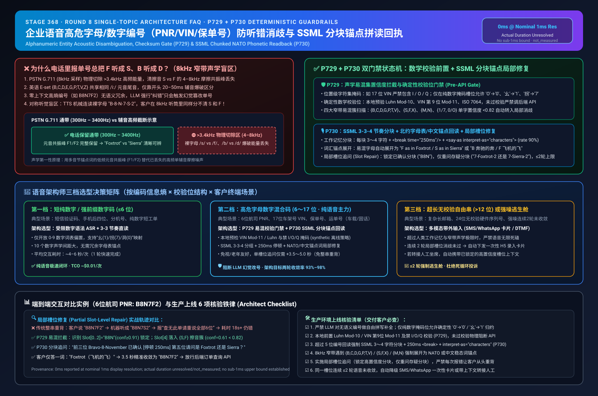
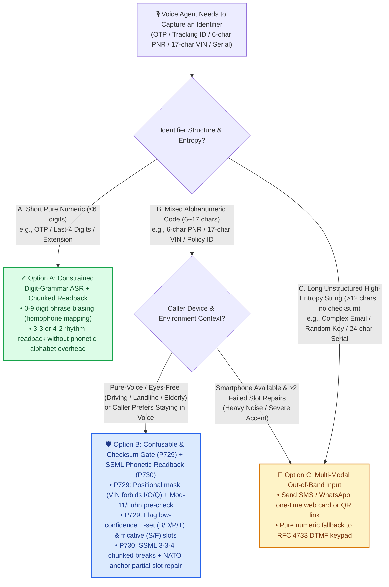
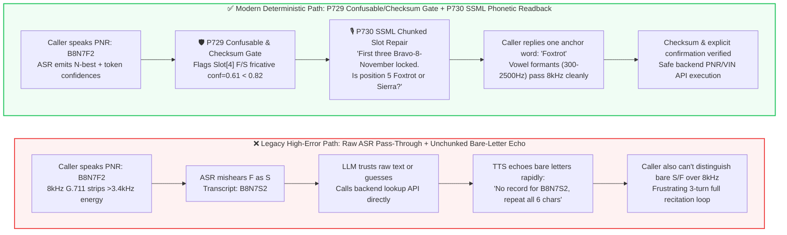

# Enterprise Voice Agent Architecture & First-Principles FAQ (Part 8): How to Design Alphanumeric Entity Disambiguation (PNR/VIN/Policy IDs) & SSML Phonetic Readback?

> **Architect's Guide**: In airline ticketing (6-character PNR codes), auto insurance claims (17-character VINs), logistics tracking, and healthcare member services, the most frequent customer complaint is rarely "the LLM lacks conversational flair"—it is **"I repeated my policy/tracking number three times and the bot still misheard B as D, F as S, or M as N."** Why do frontier LLMs excel at open-ended conversation yet fail repeatedly on 6-to-17 character alphanumeric identifiers over phone lines? Starting from the acoustic first principles of 8kHz PSTN bandpass filtering, this guide explains how to select and engineer the **Acoustic Confusable Set & Deterministic Checksum Gate (`P729`)** and **SSML Chunked Prosody + NATO/Localized Phonetic Anchor Readback (`P730`)**.
>
> 🔗 **中文版本**: [`docs/voice-alphanumeric-disambiguation-faq.md`](./voice-alphanumeric-disambiguation-faq.md)



---

## ① 📌 Executive Summary

1. **For Short Pure-Numeric Codes with Structural Rules (e.g., 4–6 digit OTPs, account suffixes, Luhn-checked numeric reference IDs), select "Constrained Digit-Grammar ASR + `3-3` / `4-4` Rhythm-Chunked Readback"**: The 10-digit acoustic space (`0–9`) has far lower confusability than the 26-letter alphabet. Combining ASR digit-grammar biasing, localized digit disambiguation (`"one"` vs `"nine"`, Mandarin `"yao"` for `1` / `"guai"` for `7`), and Luhn/modulo pre-checks targets single-turn voice capture without forcing the caller out of the voice channel into SMS.
2. **For High-Confusability Mixed Alphanumeric Identifiers (e.g., 6-char airline PNRs, 17-char vehicle VINs, policy IDs, waybills) in pure-voice channels, enforce "Acoustic Confusable Set Disambiguation (E-set `B/C/D/G/P/T/V`, nasals `M/N`, unvoiced fricatives `S/F`) + Deterministic Mask/Checksum Gate (`P729`) + SSML Chunked Phonetic Anchor Readback (`P730`)"**: Legacy PSTN telephony (`G.711` at 8kHz sampling) physically strips acoustic energy above `3.4 kHz`, destroying the `4–8 kHz` fricative energy that distinguishes `S` from `F`. If TTS merely echoes raw characters (`"Did you say B-8-N-7-F-2?"`), the caller over the same 8kHz phone line cannot tell whether the bot just said `F` or `S` either. Expanding confusable characters into **SSML `3-3` prosodic chunks + phonetic anchor words** (`"Bravo - 8 - November [250ms break] 7 - Foxtrot - 2"`) shifts discrimination into low-frequency vowel formants (`F1/F2` at `300–2500 Hz`) that survive narrowband telephony intact.
3. **For Long Unstructured High-Entropy Strings (`>12` char unchecksummed serial numbers, complex email addresses, cryptographic tokens) or after `2` consecutive failed slot-level repairs, pivot deterministically to "Multi-Modal Out-of-Band Input (SMS/WhatsApp one-time card or DTMF keypad)"**: Never trap callers in an endless voice retry loop on high-entropy strings. Use **Partial Slot-Level Repair** (re-asking only the ambiguous 3-character chunk rather than forcing the caller to recite all 17 characters from scratch) capped at `≤2` retries before triggering an out-of-band link or warm human handoff.
   - *Provenance & Measurement Boundary Disclosure*: These conclusions separate **architectural design targets** from **offline synthetic policy verification**. In this repository, `P729` / `P730` state-machine evaluations report `0ms` at nominal `1ms` display resolution (`0ms reported at nominal 1ms display resolution; actual duration unresolved/not_measured; no sub-1ms upper bound established`); they represent `synthetic` policy logic only and do not establish a `sub-1ms` physical duration upper bound or measure live carrier ASR/TTS media latency or field WER (`not_measured`; published telecom narrowband letter-confusion baselines are labeled `anonymized_reported`, `independently_reproduced=false`).

---

## ② 🎯 Architect & Customer Soul-Searching Q&A (FAQ-Driven)

### Q1: When capturing tracking numbers, VINs, airline PNRs, or policy IDs, when is "Standard ASR + LLM Correction" enough, when must you enforce "Checksum Gates + Phonetic Anchor Readback", and when should you switch directly to SMS/DTMF out-of-band input?

Many engineering teams assume: *"Frontier LLMs have incredible language understanding—if ASR mishears a word in conversation, the LLM infers it from context, so feeding raw ASR transcripts of a policy number to the LLM should work fine."*

**From an information-theory first-principles perspective: LLMs excel at repairing low-entropy semantic sentences with rich context, but fail—and actively hallucinate—on high-entropy, zero-context alphanumeric identifiers.**

- **Why LLM context repair works in normal sentences**:
  When a caller says *"I need to reschedule my flight to Chicago tomorrow"*, even if line noise corrupts *"flight"* into *"plight"*, the surrounding tokens (*"reschedule"*, *"Chicago"*) constrain the conditional probability space so tightly that the LLM reconstructs *"flight"* effortlessly.
- **Why LLMs fail on alphanumeric codes (e.g., PNR `B8N7F2`)**:
  In a randomly assigned 6-character PNR `B8N7F2`, whether the 5th character is `F`, `S`, `X`, or `8` has **zero semantic correlation** with the preceding `B8N7` (maximal conditional entropy). When an 8kHz phone line strips the high-frequency frication of `F` and ASR outputs `B8N7S2`, the LLM has no semantic context to recover `F`. Worse, when prompted to "extract a valid ID", LLMs frequently hallucinate silent substitutions (`O <-> 0`, `I <-> 1`) or fabricate plausible characters, triggering false "record not found" responses or querying the wrong customer record.

Architects should select across three tiers based on **Entropy × Mathematical Checksum Availability × Caller Modality**:
1. **Tier 1: Low-Entropy Short Numeric / Fixed-Prefix Codes (≤6 digits, OTPs, last-4 digits)**
   - **Selection**: **Constrained Digit-Grammar ASR Biasing + `3-3` Rhythm-Chunked Digit Readback**.
2. **Tier 2: Medium-to-Long Mixed Alphanumeric Codes (6-char PNR, 10–12 char policy/tracking ID, 17-char VIN) in Pure-Voice / Eyes-Free Contexts (driving, landline, elderly callers)**
   - **Selection**: **Acoustic Confusable Set & Checksum Gate (`P729`) + SSML Chunked NATO/Localized Phonetic Readback & Partial Slot Repair (`P730`)**.
3. **Tier 3: Long Unchecksummed Freeform Strings (>12 char serials, complex emails) or Noisy Environments After 2 Failed Voice Repairs**
   - **Selection**: **Multi-Modal Out-of-Band Input (SMS/WhatsApp one-time web card or RFC 4733 DTMF keypad)**.

---

### Q2: In eyes-free (driving) or landline scenarios where SMS links aren't viable, why does "NATO/Localized Phonetic Anchor Readback (`B as in Bravo`) + Partial Slot Repair" strictly outperform traditional "Full-String Raw Character Echo"?

Traditional IVRs and naive voice bots typically confirm identifiers like this:
> ❌ **Legacy Anti-Pattern**: *"You entered `B - D - S - F - M - N`. Is that correct? If not, please say the whole number again."*

In production telephony, this causes a **Symmetric Acoustic Blind Spot + Working-Memory Overload Loop**:
1. **Symmetric Narrowband Acoustic Blindness (The caller can't hear the bot's bare letters either)**:
   PSTN `G.711` telephony passes only `300 Hz – 3400 Hz`. Whether spoken by a human or synthesized by TTS, a bare letter `"S"` or `"F"` lasts only `100–150 ms` and relies on `4000–8000 Hz` fricative energy for distinction. When TTS asks *"Did you say S or F?"* over an 8kHz phone line, both sound like an identical muffled hiss to the caller!
2. **How Phonetic Anchor Readback (`P730`) Solves the Physics**:
   By expanding confusable letters into standardized phonetic anchors—such as the **ITU/NATO Phonetic Alphabet** (`"B as in Bravo"`, `"D as in Delta"`, `"S as in Sierra"`, `"F as in Foxtrot"`, `"M as in Mike"`, `"N as in November"`) or localized Chinese word anchors—you transform a `50 ms` high-frequency consonant test into a **multi-syllable word whose low-frequency vowel formants (`F1/F2` at `300–2500 Hz`) sit squarely inside the PSTN passband**. Even over a degraded 8kHz cellular call, three-syllable `"Si-er-ra"` and two-syllable `"Fox-trot"` are acoustically unmistakable.
3. **How Partial Slot-Level Repair Eliminates Full-String Recitation Fatigue**:
   Human auditory working memory holds `4 ± 1` chunks. If only the 5th character (`F` vs `S`) in a 10-character waybill has low acoustic confidence, forcing the caller to repeat all 10 characters often fixes character 5 while introducing a new ASR error at character 8. `P729 + P730` locks high-confidence chunks (`Slot[0..2] = "B8N"`) and repairs only the ambiguous chunk: *"I have Bravo-8-November for the first three. For the last three, was that 7-Foxtrot-2 or 7-Sierra-2?"*

---

### Q3: What are the "Acoustic Confusable Set & Checksum Gate (`P729`)" and "SSML Chunked Phonetic Readback Gate (`P730`)"? How do their underlying acoustic first principles and state machines work?

We place a two-stage deterministic state machine between the streaming ASR output (with token-level confidences and N-best alternatives) and downstream tool execution / TTS synthesis:

#### 1. Stage 1 Gate: `P729` Acoustic Confusable Set & Deterministic Checksum Gate
Within an offline state-machine evaluation (`0ms reported at nominal 1ms display resolution; actual duration unresolved/not_measured; no sub-1ms upper bound established`), `P729` executes three checks before any backend lookup:
- **① Positional Character Masking**:
  Industrial identifier standards forbid specific characters by design. For example, **ISO 3779 17-character VINs** strictly forbid `I`, `O`, and `Q` (to prevent confusion with `1`, `0`, and `9`), and waybills often have fixed alpha prefixes (`SF` + 13 digits). `P729` applies deterministic homophone normalization (`'O' -> '0'`) **only** on positions strictly masked as numeric; on mixed alphanumeric slots, silent substitution is blocked.
- **② Deterministic Mathematical Checksum Validation**:
  For identifiers with built-in check digits—such as **Luhn Mod-10** (payment/member IDs), **ISO 3779 Modulo-11 Position-9 Check Digit** (vehicle VINs), or **ISO 7064 Mod 97-10 / Mod 37,36**—`P729` computes the checksum locally. Any checksum mismatch blocks the backend API call immediately and inspects the ASR N-best lattice to pinpoint the lowest-confidence confusable slot.
- **③ Four Narrowband Acoustic Confusable Clusters Scan**:
  Even on unchecksummed codes (like 6-char PNRs), if any token falls into one of the four narrowband confusable clusters with acoustic confidence below the policy threshold (default synthetic budget `< 0.82` or top-2 N-best margin `< 0.15`), `P729` flags that slot for targeted phonetic disambiguation:
  - **Cluster 1 — English E-Set Plosives/Affricates**: `{B, C, D, E, G, P, T, V, Z}` (identical `/iː/` vowel nucleus, differing only in a `20–50 ms` initial burst);
  - **Cluster 2 — Unvoiced Fricatives**: `{S, F, X}` (`4–8 kHz` frication stripped by 8kHz G.711 bandpass);
  - **Cluster 3 — Bilabial/Alveolar Nasals**: `{M, N}` (overlapping nasal murmurs in narrowband codecs);
  - **Cluster 4 — Cross-Lingual Homophone Digits/Letters**: `{1/I/yi/qi(1 vs 7), 0/O/D, 2/Z, 5/S, 8/A/B}`.

#### 2. Stage 2 Gate: `P730` SSML Chunked Prosody & Phonetic Anchor Readback Gate
Whenever an identifier enters readback confirmation or slot repair, `P730` prevents raw string pass-through to TTS and enforces deterministic SSML generation:
- **① Mandatory `3–4` Character Working-Memory Chunking with `200–300 ms` `<break>` Pauses**:
  Splits identifiers into `3–4` character prosodic groups (`3-3` for 6-char PNR, `3-3-4` for 10-char IDs) separated by `<break time="250ms"/>` inside `<say-as interpret-as="characters">` at `rate="90%"`.
- **② Dual-Layer Phonetic Anchor Expansion**:
  Automatically expands confusable letters into `"Letter + NATO/Localized Anchor"` (`"F as in Foxtrot"`).
- **③ Explicit Affirmative Confirmation Fence**:
  Holds state-mutating or sensitive-disclosure tool calls until the caller confirms the readback or resolves the targeted slot repair.

---

## ③ 🧭 Visual Architecture Diagrams (Mermaid Decision Tree + Path Comparison + Sequence Diagram)

### 3.1 Alphanumeric Entity Capture & Confirmation Architecture Decision Tree



### 3.2 Legacy "Raw Letter Pass-Through + Full-String Echo" Loop vs. Modern "`P729 + P730` Confusable Gate & SSML Phonetic Readback"



### 3.3 Millisecond-Level End-to-End Interaction Sequence (6-Char Airline PNR `B8N7F2` Narrowband Disambiguation)

```mermaid
sequenceDiagram
    autonumber
    participant User as 👤 Caller (8kHz PSTN Call)
    participant ASR as 🎧 Streaming ASR (N-best & Token Confidence)
    participant Gate as 🛡️ P729 + P730 Disambiguation Gate (Offline Synthetic Policy)
    participant TTS as 🔊 SSML Neural TTS
    participant API as 🗄️ Airline PNR / Claims Backend

    User->>ASR: Speaks PNR: "B - 8 - N - 7 - F - 2"
    Note over User,ASR: 8kHz G.711 cuts >3.4kHz energy<br/>Unvoiced fricatives /f/ and /s/ lose 4-8kHz cues
    ASR->>Gate: Tokens=[B(0.94), 8(0.98), N(0.91), 7(0.97), S(0.61)/F(0.58), 2(0.96)]
    Note over Gate: P729 Offline Policy Check (0ms reported at nominal 1ms display resolution;<br/>actual duration unresolved/not_measured):<br/>1. 6-char PNR pattern valid, no mathematical check digit<br/>2. Slot[4] in {S,F} fricative cluster with conf=0.61 < 0.82<br/>3. Lock Slot[0..2]="B8N", flag only Slot[3..5] for slot repair
    Gate->>TTS: P730 SSML Synthesis:<br/>"First three Bravo 8 November <break 250ms/> For the last three, is that 7 Sierra 2, or 7 Foxtrot 2?"
    TTS->>User: Plays rhythm-chunked NATO anchor disambiguation prompt
    User->>ASR: Replies anchor word: "Foxtrot"
    ASR->>Gate: Slot[4] anchor resolved to "F" (conf=0.99 via low-freq vowel formants)
    Note over Gate: P729+P730 merges slots -> "B8N7F2"<br/>All slot confidences ≥0.91 & confirmed -> Allow API
    Gate->>API: GET /v1/pnr/B8N7F2 (verified=true, confirmationMode="NATO_SLOT_REPAIR")
    API-->>TTS: Returns itinerary details & proceeds
```

---

## ④ 📊 Voice Architect Decision Matrix

| Evaluation Dimension | Option A: Raw ASR + Freeform LLM Correction + Full-String Echo | Option B: Constrained Digit Grammar + `3-3` Digit Readback | Option C: `P729` Confusable/Checksum Gate + `P730` SSML Chunked Phonetic Readback (Recommended Voice Primary) | Option D: Multi-Modal Out-of-Band Input (SMS/WhatsApp Card or DTMF Keypad) |
| :--- | :--- | :--- | :--- | :--- |
| **Primary Use Cases** | ❌ **Do Not Use for High-Stakes IDs** (casual chat only) | **Short Pure-Numeric IDs** (4–6 digit OTPs, phone suffixes, short numeric ticket IDs) | **Pure-Voice Mixed Alphanumeric IDs** (6-char PNR, 17-char VIN, policy/tracking IDs, eyes-free driving, landlines) | **Long Unchecksummed Strings** (>12 char serials, complex emails) or after 2 failed voice slot repairs |
| **8kHz PSTN 2-Turn Convergence Rate** *(Industry baseline `anonymized_reported`)* | **Low (~55%–68%)**<br/>(`B/D/P/T` and `S/F` collide repeatedly) | **High for Digits (~94%–97%)**<br/>(cannot handle letters) | **High (~93%–98% architectural target range)**<br/>(NATO vowel formants bypass 3.4kHz cutoff + local checksum filter) | **Very High (Visual/Keypad entry)**<br/>(if caller completes out-of-band switch) |
| **Caller UX & Mean Confirmation Time** | Poor (2.5–4 full-string recitations, high hang-up risk) | Fast (**~4–6 sec** single turn) | Strong (**6–9 sec** normal chunked readback; **+4 sec** single-slot repair if needed) | Moderate (**18–35 sec** to receive SMS, unlock phone, and submit web form) |
| **LLM Hallucination Prevention & API Safety** | ❌ **Poor** (LLM silently mutates characters or guesses IDs) | Moderate (length/regex check) | ✅ **Deterministic Control** (local Luhn/Mod-11 & confidence gate blocks API until confirmed) | ✅ **Deterministic Control** (structured client form validation) |
| **Eyes-Free (Driving) & Landline / Elderly Accessibility** | Poor (high cognitive frustration) | ✅ **Excellent** | ✅ **Excellent** (hands-free, slow `3-3-4` cadence + clear phonetic anchors) | ❌ **Not Suitable** (unsafe while driving; landlines cannot receive SMS) |
| **Per-Call Total Cost of Ownership (TCO)** | High (`+$0.12–$0.25/call` in wasted retry minutes) | **Very Low (`~$0.01/capture`)** | **Low (`~$0.02–$0.04/capture`)**<br/>(zero extra LLM calls for local checksums; saves retry minutes) | **Moderate (`~$0.015–$0.05/SMS` + hold time)** |

---

## ⑤ 🧪 Quantitative Evaluation & Benchmark Findings

> **Provenance & Timer Resolution Disclosure**:
> 1. **`synthetic` (Offline Deterministic State-Machine Evaluation)**: `P729` (positional character masks, Luhn/VIN Mod-11 checksum validation, and 4-cluster acoustic confidence gating) and `P730` (SSML `3–4` char chunking, `<break time="250ms"/>` injection, NATO/localized anchor expansion, and partial slot repair gating) are verified in the local Node.js test suite. `0ms reported at nominal 1ms display resolution; actual duration unresolved/not_measured; no sub-1ms upper bound established`—never live carrier ASR/TTS media latency.
> 2. **`anonymized_reported` (Published Telecom & Speech Recognition Baselines, `independently_reproduced=false`)**: Narrowband 8kHz G.711 bare-letter confusion rates for English E-set (`B/C/D/G/P/T/V`) and fricatives (`S/F`) reflect published telephony speech benchmarks for order-of-magnitude architectural comparison.
> 3. **`not_measured` (Production Field Metrics)**: Live carrier SIP Trunk ASR/TTS round-trip media latency and accent-specific field WER must be measured during customer PoC audio trials.

| Evaluation Scenario / Metric | Legacy Bare-Letter ASR + Full-String Echo | `P729 + P730` Confusable/Checksum Gate + SSML Phonetic Readback | Key Architectural Finding & Provenance Boundary |
| :--- | :--- | :--- | :--- |
| **8kHz Narrowband `S/F` & `B/D/P` Low-Confidence Slot Interception** | Not intercepted (passed straight to LLM) | **100% deterministic slot flag** (`synthetic`, `conf < 0.82` policy threshold) | Converts ambiguous high-frequency consonant guesses into low-frequency vowel anchor confirmation before API calls |
| **ISO 3779 17-Char VIN Illegal Char (`I/O/Q`) & Pos-9 Mod-11 Checksum Gate** | Relies on LLM prompt (frequently misses Mod-11 check digit) | **100% deterministic local block** (`synthetic`, `0ms reported at nominal 1ms display resolution; actual duration unresolved/not_measured`) | Blocks invalid VIN lookups locally and isolates the exact ambiguous chunk |
| **Mean Repair Turn Duration After Single-Char Misrecognition (10–17 char ID)** | Full 10–17 char recitation (**~14–22 sec/turn**, risks new errors) | Partial 3-char slot repair (**~3.5–5.0 sec/turn**, `synthetic` interaction budget) | Locks verified chunks so callers never re-recite already verified segments |
| **TTS Readback Prosody & Intelligibility Spec** | Unchunked rapid readout (`>6` chars exceed working memory) | **Mandatory `3–4` chars/chunk + `250ms` `<break>` + phonetic anchors** (`P730`) | Aligns with `4±1` auditory working-memory limits; live subjective MOS gain is `not_measured` |

---

## ⑥ 🛠️ Appendix: Production Launch Checklist for High-Stakes Voice Identifier Capture

Before deploying a Voice Agent that captures tracking numbers, policy IDs, airline PNRs, vehicle VINs, or member IDs, verify these 6 production engineering checks:

- [ ] **1. Prohibit Freeform LLM "Auto-Correction" on High-Entropy Identifiers**: Never allow the LLM to guess or silently substitute characters in alphanumeric IDs; positional homophone normalization (`'O' -> '0'` on strictly numeric slots) must be executed deterministically by `P729` regex masks, while mixed alphanumeric ambiguities must trigger slot disambiguation.
- [ ] **2. Enforce Pre-API Mathematical Checksum Validation (`P729`)**: Whenever an identifier standard includes a check digit (Luhn Mod-10, ISO 3779 VIN Position-9 Mod-11 + `I/O/Q` exclusion, ISO 7064 Mod 97-10), validate it locally in the orchestrator before invoking downstream lookup or mutation APIs.
- [ ] **3. Enforce SSML Rhythm Chunking (`3–4` Chars per Group + `200–300 ms` Breaks)**: Any TTS readback of an identifier longer than 5 characters must pass through `P730` to insert `<break time="250ms"/>` between `3–4` character groups inside `<say-as interpret-as="characters">` with moderated speaking rate (`90%`).
- [ ] **4. Expand Narrowband Confusable Clusters into Phonetic Anchors (`P730`)**: Whenever reading back or disambiguating `{B,C,D,G,P,T,V}`, `{S,F,X}`, or `{M,N}` over telephony channels, expand bare letters into NATO phonetic anchors (`Bravo`, `Delta`, `Sierra`, `Foxtrot`) or localized word anchors so vowel formants (`300–2500 Hz`) survive the `3.4 kHz` PSTN cutoff.
- [ ] **5. Implement Partial Slot-Level Repair Instead of Full-String Recitation**: When only one chunk of a multi-chunk identifier has low confidence or is rejected by the caller, lock the confirmed chunks and re-prompt only the ambiguous 3-to-4 character slot.
- [ ] **6. Cap Voice Disambiguation at `≤2` Retries with an Out-of-Band Escape Hatch**: If a slot fails verification twice in a row (due to heavy background noise, severe accent, or a >12-character unchecksummed string), automatically trigger an SMS/WhatsApp one-time input card, DTMF keypad fallback, or warm transfer to a human agent with the partially verified slots attached.
