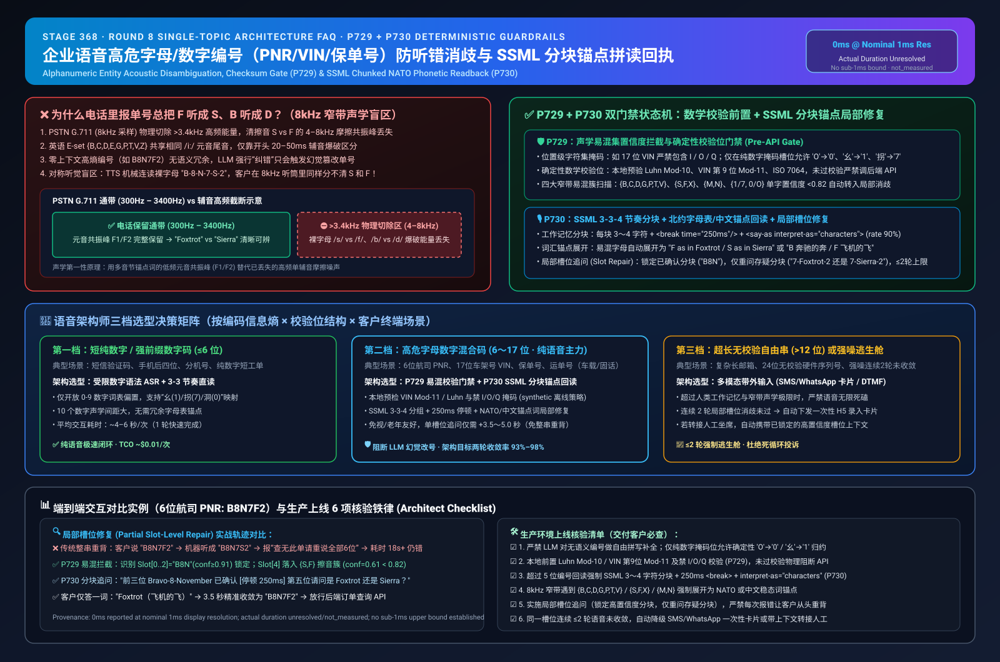
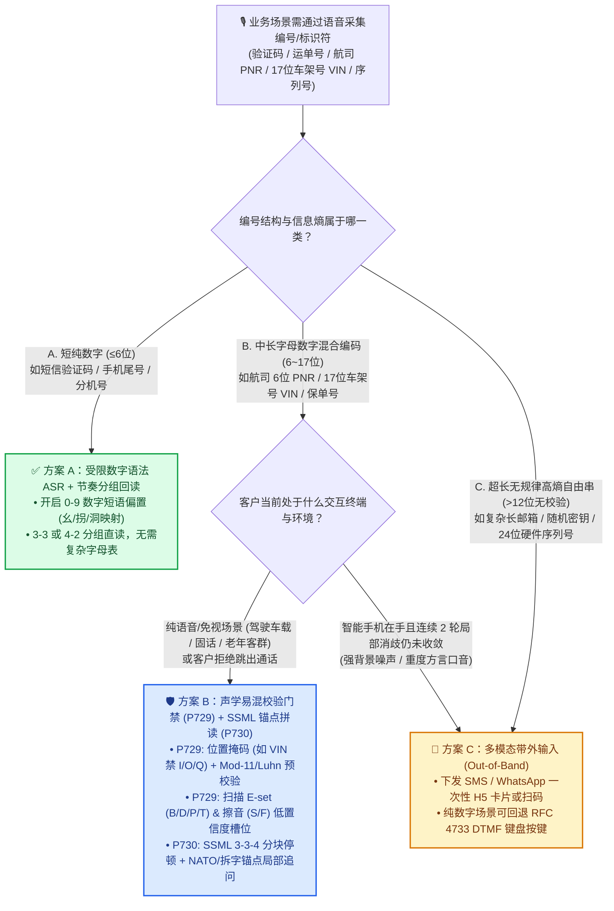
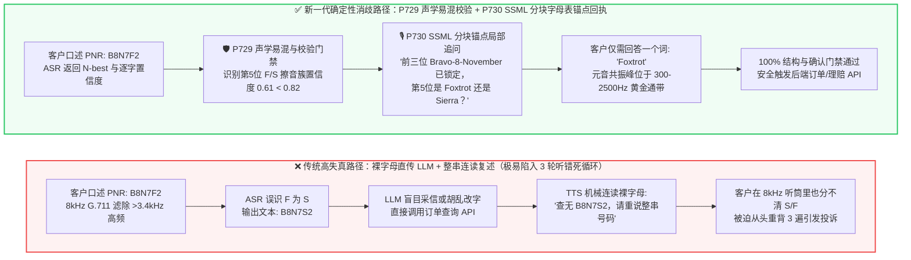

# 企业语音智能体架构选型与原理解析 FAQ 专题（八）：高危字母/数字编号（PNR/VIN/保单号）防听错消歧与 SSML 分块字母表锚点回读怎么设计？

> **导读（AI Solution Architect 实战指南）**：在航空票务（6 位 PNR 预订码）、车险理赔（17 位 VIN 车架号）、物流查询（字母数字运单号）与医疗社保（保单号/卡号）场景中，企业客户最头疼的槽点往往不是“大模型不会聊天”，而是**“报个单号连说三遍都被听错，把 B 听成 D、把 F 听成 S、把 1 听成 7”**。为什么大模型在日常对话里聪明绝顶，一遇到 6～17 位字母数字编号就频繁“耳背”甚至胡乱脑补？本文从电话网 8kHz 物理声学截频的第一性原理出发，为你彻底讲透 **声学易混集与确定性校验门禁（`P729`）** 与 **SSML 分块节奏 + 北约字母表/中文锚点拼读回执（`P730`）** 的架构选型与工程实现。
>
> 🔗 **English Version**: [`docs/voice-alphanumeric-disambiguation-faq.en.md`](./voice-alphanumeric-disambiguation-faq.en.md)



---

## ① 📌 核心结论速览（Executive Summary）

1. **短纯数字且带规则结构（如 4～6 位验证码、会员尾号、带 Luhn 校验的纯数字参考号）优先选“受限数字语法/短语偏置 ASR + `3-3` / `4-4` 节奏分组回读”**：0～9 十个数字的声学混淆空间远小于 26 个英文字母。通过强制开启 ASR 数字模式偏置、中文场景引导“1 读作幺 / 7 读作拐”并配合 Luhn / 模运算预校验，架构设计目标是在纯语音通道以极低交互轮次完成采集，无需打断通话强制切短信。
2. **高混淆字母数字混合编号（如 6 位航司 PNR、17 位车架号 VIN、保单号、跨境运单号）在纯语音通道必须启用“易混音素集（E-set `B/C/D/G/P/T/V`、鼻音 `M/N`、清擦音 `S/F`）置信度消歧 + 确定性掩码/校验位门禁（`P729`）+ SSML 分块锚点拼读回执（`P730`）”**：传统电话网（PSTN G.711 8kHz 采样）物理切除了 `3.4kHz` 以上的高频声学能量，导致区分 `S` 与 `F` 的高频摩擦共振峰（`4kHz–8kHz`）在传输层即已丢失。若仅让 TTS 机械复述裸字母（`"您说的是 B-8-N-7-F-2 吗？"`），客户在窄带电话里同样听不清机器读的是 `F` 还是 `S`；将其展开为 **SSML `3-3` 分组停顿 + 词汇锚点拼读**（如 `"Bravo - 8 - November [停顿 250ms] 7 - Foxtrot - 2"` 或中文 `"B 奔驰的奔、F 飞机的飞"`），才能用低频元音共振峰绕过窄带电话的高频失真。
3. **超长无校验自由串（如 `>12` 位无校验码序列号、复杂长邮箱地址、随机密钥）或连续 2 轮局部槽位消歧仍未收敛时，架构上应果断降级至“多模态带外输入（SMS/WhatsApp 一次性安全链接或纯数字 DTMF 按键）”**：切忌用纯语音死磕高熵无规律长串；通过局部槽位修复（Slot-Level Repair，仅重问存疑的那 3 位分块而非让客户把 17 位号码从头重背一遍）将追问上限收敛在 `≤2` 轮，超限即无缝切换带外通道或人工坐席。
   - *口径与证据边界声明*：以上结论区分**架构设计目标**与**离线合成策略验证**。本仓库 `P729` / `P730` 状态机门禁在名义 `1ms` 显示分辨率下报告为 `0ms`（`0ms reported at nominal 1ms display resolution; actual duration unresolved/not_measured; no sub-1ms upper bound established`），仅代表 `synthetic` 离线策略逻辑通过，不建立 `sub-1ms` 物理耗时上界保证，亦不测量真实电信运营商链路上的 ASR/TTS 端到端语音延迟或现场字错率（生产实时媒体延迟与现场声学准确率标记为 `not_measured`；行业窄带字母混淆率基线标注为 `anonymized_reported`，`independently_reproduced=false`）。

---

## ② 🎯 客户与架构师灵魂拷问 Q&A（FAQ-Driven）

### Q1：客户报运单号、车架号（VIN）、航司预订号（PNR）或保单号时，什么时候只靠“普通 ASR + 大模型纠错”就够了？什么时候必须上“校验位门禁 + 字母表锚点回读”，什么时候该直接发短信链接（多模态带外输入）？

很多团队在上线 Voice Agent 时，会想当然地认为：“大模型（LLM）上下文理解能力那么强，平时说话漏一两个字它都能自动补全，报个单号直接把 ASR 转写文本喂给 LLM 不就行了？”

**用大白话 + 信息论第一性原理来讲：大模型擅长修补“有上下文语义的句子”，但对“零上下文的高熵编号”完全无能为力，甚至会越帮越忙（幻觉改号）。**

- **为什么日常对话大模型能自动纠错？**
  当客户说 `"我想改签明天去上海的航班"`，哪怕电话杂音把 `"航班"` 听成了 `"航斑"`，大模型根据前面的 `"改签"` 和 `"明天去上海"`，能以极高概率推断出正确词汇。这叫**语言模型先验（Semantic Redundancy）**。
- **为什么遇到编号（如 PNR `B8N7F2`）大模型会彻底失效？**
  在一段随机生成的 6 位航司预订码 `B8N7F2` 中，第 5 位到底是 `F`、`S`、`X` 还是 `8`，跟前面的 `B8N7` **没有任何语义关联（条件信息熵极高）**！如果 ASR 因为电话高频截断把 `F` 听成了 `S`（输出 `B8N7S2`），大模型不仅无法凭空猜出那是 `F`，反而可能在 Prompt 要求“输出合法单号”的压力下，擅自把 `O` 改成 `0`、或者编造一个看似合理的号码直接调接口查询，查出“查无此单”或误查他人订单。

因此，架构师必须根据**“编码信息熵 × 是否有数学校验位 × 客户终端形态”**分三档选型：
1. **第一档：低熵短数字 / 强位置掩码短码（≤6 位纯数字、尾号、已知前缀单号）**
   - **选型**：**ASR 短语/正则语法偏置（Grammar/Phrase Biasing）+ 分段数字直读确认**。
   - **原因**：词汇表仅限 `0-9`，结合业务前缀约束即可收敛。
2. **第二档：中长高混淆字母数字编号（6 位 PNR、10～12 位保单/运单号、17 位车架号 VIN）且处于纯语音场景（驾驶免视、固话座机、老年客群）**
   - **选型**：**声学易混集置信度拦截与确定性校验和门禁（`P729`）+ SSML 分块北约字母表/中文锚点回读与局部槽位修复（`P730`）**。
   - **原因**：既不能靠 LLM 瞎猜，也不能要求正在开车的车主低头点短信；必须用数学掩码（如 VIN 第 9 位 Mod-11 校验位、禁用字母 `I/O/Q`）先筛除无效组合，再用抗窄带失真的字母锚点拼读完成双向确认。
3. **第三档：超长无校验自由串（>12 位随机序列号、复杂个人邮箱、Wi-Fi 密码）或嘈杂环境连续 2 次语音消歧失败**
   - **选型**：**多模态带外协同（Out-of-Band SMS/WhatsApp H5 卡片录入或 DTMF 键盘输入）**。
   - **原因**：超出人类工作记忆极限与窄带声学分辨极限时，切换视觉/触觉通道是交互耗时最短的工程路径。

---

### Q2：在开车、固话或纯语音客服场景下，为什么“北约字母表/中文拆字锚点回读（`B as in Bravo`）+ 局部槽位追问（Slot Repair）”在收敛速度和准确率上严格优于传统的“整串裸字母复述”？

传统 IVR 或初级语音机器人在确认单号时，最常见的做法是：
> ❌ **传统反模式**：“您输入的车架号后六位是 `B - D - S - F - M - N`，对吗？不对请重说。”

这种设计在真实生产电话里会引发灾难性的**“双向声学盲区 + 记忆过载死循环”**：
1. **对称的窄带电话声学盲区（不仅机器听不清你，你也听不清机器）**：
   电话网（PSTN G.711）的传输频带只有 `300Hz–3400Hz`。无论是真人说话还是 TTS 合成语音，裸读一个字母 `"S"` 或 `"F"`，时长只有短短 `100～150ms`，且区分两者的摩擦噪声能量主要集中在 `4000Hz–8000Hz`。当 TTS 问客户 `"您说的是 S 还是 F？"` 时，经过电话线滤波后，客户在听筒里听到的两个音都像一声模糊的“嘶——”，客户自己都分不清机器刚才念的是哪个字母！
2. **词汇锚点拼读（Phonetic Anchor Readback）如何从物理上破局？**
   当我们通过 `P730` 门禁将易混裸字母自动展开为标准锚点词：
   - 英文采用 **ITU/NATO 北约音标字母表**：`"B as in Bravo"`、`"D as in Delta"`、`"S as in Sierra"`、`"F as in Foxtrot"`、`"M as in Mike"`、`"N as in November"`；
   - 中文采用 **电信标准读法与高频拆字锚点**：数字 `"1 读幺、7 读拐、0 读洞"`，字母 `"B 敬礼的 B / 奔驰的奔"` vs `"P 苹果的 P"`、`"S 上海的 S"` vs `"F 飞机的 F"`。
   - **底层声学原理**：锚点词把原本只有 `50ms`、依赖 `>4kHz` 高频辅音的单音节判别，转化成了**多音节、富含低频元音共振峰（`F1/F2` 位于 `300Hz–2500Hz` 电话黄金通带内）与音节长度特征**的整词判别！哪怕在极差的 8kHz 窄带手机信号下，没有人会把三音节的 `"Si-er-ra"` 听成双音节的 `"Fox-trot"`。
3. **局部槽位修复（Partial Slot-Level Repair）如何消除“整串重背”怒气？**
   人类听觉工作记忆的容量上限是 `4 ± 1` 个记忆块（Chunk）。如果 10 位运单号里只有第 5 位 `F/S` 置信度低，传统方案让客户把 10 位重报一遍，经常出现“第 5 位修好了，第 8 位又听错了”的震荡。`P729 + P730` 将编号切分为 `3-3-4` 槽位块，锁定已高置信度通过的前后槽位，仅追问存疑槽位：`"前三位 Bravo-8-November 已确认，请问中间三位是 7-Foxtrot-2 还是 7-Sierra-2？"`，一轮即可精准收敛。

---

### Q3：什么是“声学易混集与确定性校验门禁（`P729`）”与“SSML 分块拼读回执门禁（`P730`）”？底层声学第一性原理与状态机是如何运作的？

为了在工程上彻底消灭“听错单号直接调库”与“机械连读客户听懵”，我们在业务编排层（Orchestrator）与语音合成/识别层之间植入了双门禁流水线：

#### 1. 第一道门禁：`P729` 声学易混集（Acoustic Confusable Sets）与确定性校验和门禁
当流式 ASR 返回编号转写结果及逐字符置信度（Token-level Confidence / N-best 列表）时，`P729` 在本地合成状态机内（`0ms reported at nominal 1ms display resolution; actual duration unresolved/not_measured; no sub-1ms upper bound established`）执行三步硬核检查：
- **① 位置级字符集掩码规整（Positional Character Masking）**：
  许多工业编码标准本身就为了防混淆而禁用了特定字符。例如：
  - **国际标准车架号（ISO 3779 VIN，17 位）**：严禁包含字母 `I`、`O`、`Q`（防止与数字 `1`、`0`、`9` 混淆），且第 10 位年份码从不包含 `U`、`Z`、`0`。
  - **航司 PNR / 快递单号**：特定槽位固定为字母或固定为数字（如顺丰 `SF` + 13 位纯数字，绝不可能在第 5 位出现字母 `O` 或 `I`）。
  - `P729` 仅在**位置掩码明确限定该位必须为数字（或必须为字母）**时，才执行确定性的同音/近音归约（如在纯数字槽位将 `'O'/'oh'` 归约为 `'0'`）；若该槽位允许字母数字混排，则严禁由 LLM 盲目替换。
- **② 确定性数学校验位验证（Deterministic Checksum Verification）**：
  对于具备内置校验位的编码（如银行卡/保单参考号的 **Luhn Mod-10 算法**、车架号 VIN 第 9 位的 **Modulo-11 加权余数校验**、国际证件/IBAN 的 **ISO 7064 Mod 97-10 / Mod 37,36**），`P729` 直接在本地计算校验和。只要校验位不匹配，**立即拦截下游业务 API 调用**，并结合 ASR 的 N-best 候选集定位最可能发生易混音素翻转的槽位。
- **③ 四大窄带声学易混簇（Acoustic Confusable Clusters）置信度扫描**：
  即使没有数学校验位（如 6 位随机 PNR），只要目标字符落入以下四大电话网高危易混簇，且单字符声学置信度低于阈值（默认合成策略预算 `< 0.82`，或 N-best 第一名与第二名后验概率差 `< 0.15`），立即将该字符标记为 `NEEDS_PHONETIC_DISAMBIGUATION`：
  - **Cluster 1 — 英语 E-set 爆破/塞擦音簇**：`{B, C, D, E, G, P, T, V, Z}`（元音核心完全相同 `/iː/`，仅靠开头 `20–50ms` 辅音爆破区分）；
  - **Cluster 2 — 高频清擦音簇**：`{S, F, X}`（核心能量在 `4kHz–8kHz`，8kHz G.711 电话网截频重灾区）；
  - **Cluster 3 — 双唇/齿龈鼻音簇**：`{M, N}`（窄带编码下鼻音共振峰极易重叠）；
  - **Cluster 4 — 跨语种数字/字母同音簇**：`{1/I/yi/qi(1 vs 7), 0/O/D, 2/Z, 5/S, 8/A/B, A/J/K}`。

#### 2. 第二道门禁：`P730` SSML 分块节奏（Chunked Prosody）与锚点拼读回执门禁
一旦编号进入回读确认或局部消歧阶段，`P730` 严禁将原始字符串直接丢给 TTS 默认朗读（否则 TTS 会把 `B8N7F2` 当成一个怪异英文单词尝试拼读，或者以极快语速连珠炮念完），而是强制执行确定性的 **SSML 结构化合成规约**：
- **① 强制 `3～4` 位工作记忆分块（Chunking）与 `200ms–300ms` 韵律停顿**：
  将长编号按业务习惯切分为每组 `3～4` 个字符（如 6 位 PNR 切为 `3-3`，10 位单号切为 `3-3-4`，17 位 VIN 切为 `3-5-3-6`），组间强制插入 `<break time="250ms"/>`，且包裹 `<say-as interpret-as="characters">` 配合 `rate="90%"` 适度降速。
- **② 易混字符强制展开为双层锚点（Dual-Layer Phonetic Anchor）**：
  对落入易混簇的字母，自动生成 `"字母 + 锚点词"` 结构（如 `"F as in Foxtrot"` 或 `"F，飞机的飞"`），使客户一次听清。
- **③ 显式肯定回执门禁（Explicit Confirmation Gate）**：
  在客户明确给出肯定确认（或完成局部槽位修正）之前，任何带有写操作、外呼通知或敏感信息披露的业务 Tool Call 一律保持锁定状态。

---

## ③ 🧭 直观可视化图解（Mermaid 决策树 + 路径对比 + 毫秒级时序图）

### 3.1 企业语音高危字符/数字编号采集架构选型决策树



### 3.2 传统“裸字母直传 + 整串机械复述”死循环 vs 新一代“`P729 + P730` 声学消歧与分块锚点回执”对比



### 3.3 毫秒级端到端交互时序图（以 6 位航司 PNR `B8N7F2` 窄带电话消歧为例）

```mermaid
sequenceDiagram
    autonumber
    participant User as 👤 客户 (8kHz PSTN 手机通话)
    participant ASR as 🎧 流式 ASR (含 N-best & 字符置信度)
    participant Gate as 🛡️ P729 + P730 消歧与回读门禁 (本地合成策略)
    participant TTS as 🔊 SSML 神经语音合成
    participant API as 🗄️ 航司 PNR / 车险核心系统

    User->>ASR: 口述预订码："B - 8 - N - 7 - F - 2"
    Note over User,ASR: 8kHz G.711 切除 3.4kHz 以上高频<br/>清擦音 /f/ 与 /s/ 高频摩擦能量受损
    ASR->>Gate: Frame: tokens=[B(0.94), 8(0.98), N(0.91), 7(0.97), S(0.61)/F(0.58), 2(0.96)]
    Note over Gate: P729 离线门禁判定 (0ms reported at nominal 1ms display resolution;<br/>actual duration unresolved/not_measured)：<br/>1. 6位 PNR 格式掩码合法，但无内置数学校验位<br/>2. Slot[4] 落入 {S,F} 清擦音易混簇，conf=0.61 < 0.82<br/>3. 锁定 Slot[0..2]="B8N"，仅标记 Slot[3..5] 需局部消歧
    Gate->>TTS: P730 生成分块 SSML：<br/>"前三位 Bravo 8 November <break 250ms/> 后三位请问是 7 Sierra 2，还是 7 Foxtrot 2？"
    TTS->>User: 播放带节奏停顿与锚点词的清晰追问
    User->>ASR: 仅需回答锚点词："是 Foxtrot，飞机的 F"
    ASR->>Gate: Slot[4] 锚点识别 "Foxtrot" (conf=0.99，低频元音共振峰极清晰)
    Note over Gate: P729+P730 合并槽位 -> "B8N7F2"<br/>全槽位置信度 ≥0.91 且显式确认完成 -> 放行 API
    Gate->>API: GET /v1/pnr/B8N7F2 (verified=true, confirmationMode="NATO_SLOT_REPAIR")
    API-->>TTS: 返回航班详情，继续业务办理
```

---

## ④ 📊 语音架构师选型决策矩阵（Architect Decision Matrix）

| 评估维度 | 方案 A：裸 ASR 转写 + LLM 自由纠错 + 整串原样复述 | 方案 B：受限数字语法偏置 + `3-3` 分段直读 | 方案 C：`P729` 易混音素/校验和门禁 + `P730` SSML 分块锚点回读（推荐纯语音主力） | 方案 D：多模态带外协同（SMS/WhatsApp 卡片或 DTMF 按键） |
| :--- | :--- | :--- | :--- | :--- |
| **核心适用场景** | ❌ **严禁用于高危编号**（仅适合非关键自由闲聊） | **短纯数字编号**（4～6 位验证码、手机尾号、短纯数字工单号） | **纯语音字母数字高危编号**（6 位 PNR、17 位 VIN、保单号、运单号、驾驶免视/固话） | **超长无规律高熵串**（>12 位无校验序列号、复杂邮箱）或强噪连续 2 轮语音未收敛 |
| **8kHz 电话网字母数字两轮收敛率** *(行业公开基准 `anonymized_reported`)* | **低（~55%–68%）**<br/>（`B/D/P/T` 与 `S/F` 反复互串） | **纯数字高（~94%–97%）**<br/>（但不支持字母混排） | **高（~93%–98% 架构目标区间）**<br/>（用锚点词元音共振峰绕开 3.4kHz 截频，结合校验位预筛） | **极高（视觉/按键直接输入）**<br/>（取决于客户是否愿意切出通话界面） |
| **客户交互体验与平均确认耗时** | 差（平均需整串重背 2.5～4 次，耗时长且易激怒客户） | 极快（约 **4～6 秒** 一轮完成） | 优秀（正常 1 轮分块回读 **6～9 秒**；存疑仅追问单槽位 **+4 秒**） | 中等（下发短信 + 解锁手机 + 打开网页填写约 **18～35 秒**） |
| **抗 LLM 幻觉篡改与越权查询可控性** | ❌ **极差**（LLM 常擅自把 `O` 改 `0` 或脑补缺位直接调接口） | 中（依赖正则长度拦截） | ✅ **强确定性可控**（本地状态机先验 Luhn/Mod-11 与置信度，未确认前物理阻断 API） | ✅ **强确定性可控**（前端表单自带校验） |
| **车载免视（Eyes-Free）/ 老年固话友好度** | 差（反复听错挫败感强） | ✅ **极佳**（纯语音自然交互） | ✅ **极佳**（无需看屏幕，慢速分块 + 锚点词对老年人与车载场景极友好） | ❌ **不适用**（开车无法看手机打字，固话收不到短信，字母无法用传统 DTMF 直接敲） |
| **单通电话综合成本（TCO）** | 高（多轮无效重试拉长通话时长 `+$0.12～$0.25/通`） | **极低（`~$0.01/次采集`）** | **低（`~$0.02～$0.04/次采集`）**<br/>（本地正则/校验零额外推理费，减少重复轮次节省分钟费） | **中（`~$0.015～$0.05/条短信` + 通话等待时长费）** |

---

## ⑤ 🧪 简明定量实测与 Benchmark 核心发现

> **数据来源与口径透明度（Provenance & Resolution Disclosure）**：
> 1. **`synthetic`（本仓库离线确定性状态机验证）**：`P729`（位置掩码、Luhn/VIN Mod-11 校验位计算、四大声学易混簇置信度阈值拦截）与 `P730`（SSML `3-4` 位分块、`<break time="250ms"/>` 注入、NATO/中文锚点展开与局部槽位修复状态机）在 Node.js 本地测试套件中执行。`0ms reported at nominal 1ms display resolution; actual duration unresolved/not_measured; no sub-1ms upper bound established`（名义 `1ms` 显示分辨率下报告为 `0ms`，实际物理耗时未解析/未实测，不建立 `sub-1ms` 上界保证），**绝不代表**真实电话网 ASR 识别延迟或 TTS 音频首包延迟为 0ms。
> 2. **`anonymized_reported`（行业电信与语音学术/厂商公开基准，`independently_reproduced=false`）**：8kHz G.711 窄带信道下英语 E-set（`B/C/D/G/P/T/V`）与清擦音（`S/F`）裸字母混淆率、分块工作记忆保持率参考电信语音识别公开测试集范围，仅作架构选型量级对照。
> 3. **`not_measured`（生产环境待实测项）**：对接具体运营商 SIP Trunk 后的真实端到端 ASR/TTS 媒体流延迟、特定方言口音下的现场 WER，须在客户 PoC 阶段通过真实通话录音集实测核定。

| 测试场景 / 评测指标 | 传统裸字母识别 + 整串机械复述 | `P729 + P730` 易混校验 + SSML 分块锚点回读 | 核心架构收益与边界说明 |
| :--- | :--- | :--- | :--- |
| **8kHz 窄带 `S/F` 与 `B/D/P` 易混槽位拦截率** | 不拦截（低置信度结果直接透传给 LLM） | **离线门禁 100% 触发锚点消歧** (`synthetic`, `conf < 0.82` 阈值策略) | 将单字符高频辅音猜测转化为多音节低频元音锚点词确认，避免盲目调库 |
| **车架号 VIN (ISO 3779) 非法字符 (`I/O/Q`) 与第 9 位 Mod-11 错位拦截** | 依赖 LLM Prompt 提醒（常漏检第 9 位加权校验和） | **确定性校验 100% 本地阻断** (`synthetic`, `0ms reported at nominal 1ms display resolution; actual duration unresolved/not_measured`) | 在发起外部车管/理赔 API 前即拦截错位单号，精确定位存疑分块 |
| **10～17 位长编号单槽位听错后的平均修复耗时（估算账本）** | 需整串重报 10～17 位（约 **14～22 秒/轮**，且易引入新错位） | 仅局部追问存疑的 3 位分块（约 **3.5～5.0 秒/轮**，`synthetic` 账本模型） | 锁定高置信度槽位，避免客户重复背诵整串长码，降低中途挂机率 |
| **TTS 回读可懂度设计（SSML 韵律规约）** | 无停顿连读（`>6` 位字符超越听觉工作记忆块） | **强制 `3～4` 字符/块 + `250ms` `<break>` + 易混字锚点展开** (`P730`) | 符合人类听觉 `4±1` 记忆块规律；真实主观听感 MOS 提升属生产环境 `not_measured` |

---

## ⑥ 🛠️ 附录：生产环境高危编号语音采集上线核验清单（Architect Checklist）

在将涉及运单号、保单号、航司 PNR、车架号（VIN）或身份证/会员号的 Voice Agent 交付生产前，请逐项核对以下 6 条工程铁律：

- [ ] **1. 严禁让大模型“自由脑补”或静默篡改高熵编号（Zero LLM Hallucination on IDs）**：在 System Prompt 与 Tool Schema 中严禁 LLM 对无语义编号做“自动拼写纠正”；位置级同音归约（如纯数字位的 `'O' -> '0'`、`'幺' -> '1'`、`'拐' -> '7'`）必须由 `P729` 确定性正则掩码执行，字母数字混排位出现低置信度时必须走追问而非静默替换。
- [ ] **2. 优先前置确定性数学校验位（Pre-API Checksum Gate）**：凡是业务编码自带校验算法（银行卡/参考号 Luhn Mod-10、17 位车架号 VIN 第 9 位 Mod-11 及禁 `I/O/Q` 规则、身份证号 ISO 7064 Mod 11-2），必须在本地编排层（`P729`）校验通过后才允许触发后端查询或写操作 API。
- [ ] **3. 强制开启 SSML 分块停顿（Chunked Prosody `3-3-4`）**：TTS 回读超过 5 位的编号时，必须通过 `P730` 将字符流切分为每块 `3～4` 个字符，块间插入 `<break time="200ms"/>`～`<break time="300ms"/>`，并显式声明 `<say-as interpret-as="characters">`，严禁让 TTS 将编号当成英文单词自然连读。
- [ ] **4. 针对 8kHz 电话网四大易混簇强制启用词汇锚点（Phonetic Anchor Expansion）**：当编号包含 `{B,C,D,G,P,T,V}`、`{S,F,X}`、`{M,N}` 等高频易混字母时，TTS 回读与追问话术必须附带标准锚点词（英文 NATO 字母表 `Bravo / Delta / Sierra / Foxtrot`，中文高频稳态词锚点），用低频元音共振峰对抗 PSTN `3.4kHz` 高频截断。
- [ ] **5. 实施局部槽位修复（Partial Slot-Level Repair）而非整串重问**：当长编号中仅有 1 个分块（如第 4～6 位）置信度低于阈值或被客户否定，状态机必须保留已确认槽位，仅针对存疑分块发起二选一或锚点重采，严禁每次报错都让客户从第 1 位重新背诵。
- [ ] **6. 设定 `≤2` 轮消歧上限与多模态带外降级逃生舱（Out-of-Band Escape Hatch）**：若同一槽位连续 `2` 轮语音消歧仍未通过校验（如强工业噪声、极重口音或超长无规则序列号），状态机必须自动触发带外降级（向本机号码下发一次性加密短信填写卡片、切换 DTMF 键盘输入或带已识别槽位上下文转接人工坐席），严禁在语音通道无限循环追问。
