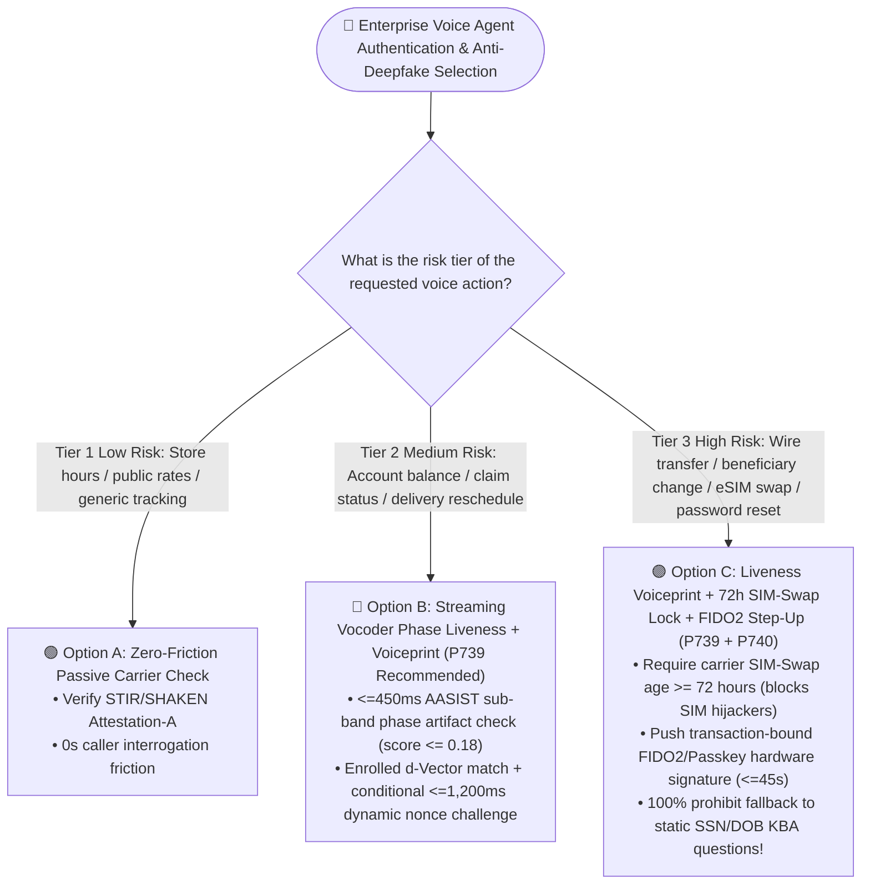
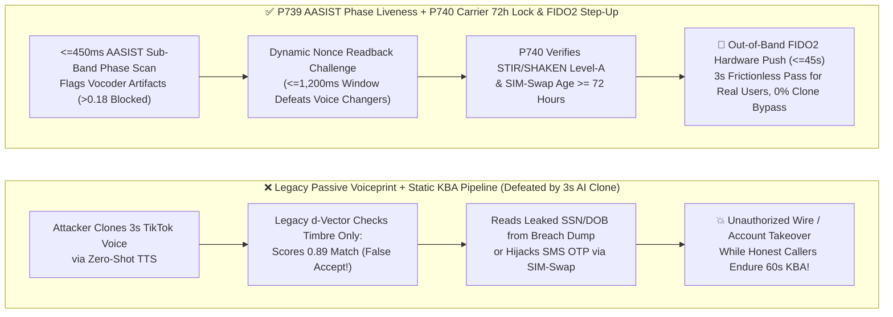

# Enterprise Voice Agent Anti-Deepfake Liveness Detection & Multi-Factor Telecom Authentication Architecture Selection FAQ (Topic 13): In the Era of 3-Second Zero-Shot Voice Cloning, Why Are "Passive Voiceprints + Static KBA Questions" Completely Broken?

> **Actionable Guide for AI Solution Architects**: In private wealth management hotlines, brokerage phone orders, telecom eSIM/SIM-swap support, and executive treasury authorizations, legacy telephone authentication is facing an existential crisis: **Attackers only need 3 seconds of a customer's voice from a TikTok clip, WeChat voice note, or earnings call to drive an open-source zero-shot voice cloning model (`CosyVoice`, `F5-TTS`, `XTTS`), and pair it with leaked SSN/DOB records to breeze past both "Passive Voice Biometrics (`d-Vector`)" and "Knowledge-Based Authentication (`KBA`)"!** Grounded in first principles of neural vocoder sub-band phase artifacts, carrier signaling cryptography, and hardware-bound passkeys, this guide deconstructs the **Acoustic Deepfake Vocoder Phase-Artifact & Dynamic Liveness Challenge Gate (`P739`)** and the **Multi-Factor Telecom Attestation, SIM-Swap Cooldown & Out-of-Band `FIDO2` Step-Up Guard (`P740`)**.
>
> 🔗 **中文版本 (Chinese Version)**: [`docs/voice-anti-deepfake-liveness-auth-faq.md`](./voice-anti-deepfake-liveness-auth-faq.md)


---

## ① 📌 Executive Summary

1. **In the era of 3-second zero-shot voice cloning, both "Static Knowledge-Based Authentication (`KBA`—asking for DOB, SSN, or mother's maiden name)" and "Passive-Only Voiceprint Matching (`d-vector` cosine similarity without liveness)" must be strictly prohibited as standalone authorization factors for high-risk transactions**: Legacy speaker verification only checks whether the spectral envelope *sounds like* the customer—which is the exact loss function modern voice cloning models optimize! Production deployments must enforce a **Three-Tier Risk-Adaptive Voice Authentication Architecture (`P739` + `P740`)**.
2. **At the acoustic layer, always pair Speaker Verification with Streaming Vocoder Phase-Artifact Anti-Spoofing (`AASIST`) & Dynamic Nonce Liveness Challenges (`P739`)**: While neural vocoders (`HiFi-GAN`, diffusion vocoders) accurately replicate mel-spectrum amplitude, their transposed-convolution upsampling leaves periodic checkerboard phase discontinuities in high-frequency sub-bands. `P739` runs streaming spectro-temporal graph attention (`AASIST`) to enforce `vocoderPhaseArtifactScore <= 0.18` within `<=450ms`, and issues a **`<=1,200ms` Dynamic Random Nonce Readback Challenge** whenever spoofing or replay is suspected—defeating both pre-recorded audio and high-latency real-time voice changers.
3. **At the telecom signaling and transaction commit layer, never trust the voice channel alone for high-value writes—enforce Carrier `STIR/SHAKEN` + `>=72h` SIM-Swap Cooldown + Out-of-Band `FIDO2/Passkey` Step-Up (`P740`)**: Verify `STIR/SHAKEN Attestation-A` and carrier `CAMARA SIM-Swap` history (`simSwapAgeHours >= 72`) before trusting caller ANI or SMS, require a hardware-bound `FIDO2 / Passkey` push signature (`<=45s` timeout) bound to `{txAmount, payeeId, turnEpoch}` for high-risk mutations, and **100% prohibit falling back to static KBA questions**.
   - *Provenance & Measurement Boundary Disclosure*: Unit tests for `P739` / `P740` in this repository verify offline in-memory policy/configuration state machines where the local timer reports `0ms` at nominal `1ms` display resolution (`0ms reported at nominal 1ms display resolution; actual duration unresolved/not_measured; no sub-1ms upper bound established`, `synthetic`). They do not establish a physical `<1ms` latency upper bound or measure live `AASIST` neural anti-spoofing DSP inference or external carrier `CAMARA` / `FIDO2` API RTT (`not_measured`); industry KBA friction and passive voiceprint spoofing baselines are labeled `anonymized_reported` (`independently_reproduced=false`).

---

## ② 🎯 Architect & Customer Soul-Searching Q&A (FAQ-Driven)

### Q1: Our bank spent millions deploying a "Voice Biometrics System" a few years ago—why did our red team bypass it in 5 seconds using an open-source AI voice clone? And why doesn't asking for "ID number + Date of Birth + Last Transaction" stop attackers?

This is the #1 security wake-up call across global banking, insurance, and telecommunications contact centers.

**First-Principles Plain-Language Explanation: Traditional voiceprint recognition checks whether the voice *resembles* Mr. Smith's vocal tract, but it never checks whether Mr. Smith is actually speaking live—or whether a fraudster is holding up a high-resolution "acoustic photograph" synthesized by a neural vocoder!**

- **Why "Passive Voiceprint Matching (`d-Vector`)" Fails Against Modern Zero-Shot Clones**:
  1. **Voice Clones Optimize the Exact Same Embedding Space**:
     Legacy speaker verification (`x-vector` / `ECAPA-TDNN`) extracts time-averaged mel-spectral timbre embeddings. Modern zero-shot TTS models explicitly train against a speaker-encoder cosine-similarity loss! As a result, a 3-second AI voice clone routinely scores `0.88–0.93` cosine similarity on legacy voiceprint engines—often higher than the real customer calling with a mild cold.
  2. **Why Static KBA Interrogation ("What is your DOB and mother's maiden name?") Is Both High-Friction and Zero-Security**:
     - **Punishes Legitimate Callers**: Interrogating honest customers for 45–90 seconds before helping them drives `>25%` IVR abandonment;
     - **Trivial for Attackers**: Personal identifiers (`SSN`, `DOB`, billing address) are widely available in dark-web breach dumps. Fraudsters simply read the leaked KBA answers through a real-time AI voice changer!

Architects must replace KBA interrogation with a **Three-Tier Risk-Adaptive Authentication Architecture**:
1. **Tier 1 (Low-Risk Read-Only Inquiries — `0s` Friction)**: Silent carrier `STIR/SHAKEN Attestation-A` + `CAMARA Number Verification`;
2. **Tier 2 (Medium-Risk Account Inquiries — Verify While Speaking)**: `P739` Streaming `AASIST` Vocoder Phase-Artifact Liveness (`<=0.18`) + Enrolled `d-Vector` Match + conditional Dynamic Nonce Challenge;
3. **Tier 3 (High-Risk Wires / SIM-Swap / Password Reset — Cryptographic Step-Up)**: `P740` Carrier `>=72h` SIM-Swap Cooldown + Out-of-Band `FIDO2 / Passkey` hardware-signed push approval (`<=45s`).

---

### Q2: If a neural voice clone sounds indistinguishable to human ears and fools `d-vector` embeddings, how does `P739` (`AASIST` Sub-Band Phase Detection + Dynamic Nonce Challenge) catch it within `<=450ms`?

- **What it is (Plain-Language Explanation)**:
  Even when an AI voice clone perfectly copies a person's **macro-level timbre (amplitude spectrum)**, it leaves two inescapable physical fingerprints in **micro-level waveform phase continuity** and **real-time turn-taking latency**.

- **Two Physical Fingerprints Enforced by `P739`**:
  1. **Fingerprint 1: Neural Vocoder Sub-Band Phase Artifacts (`AASIST` `<=450ms`)**
     - **Human Vocal Physics**: Real human speech is generated by pulmonary airflow exciting glottal folds, producing tightly coupled amplitude-phase harmonics and natural micro-tremors (`glottal jitter/shimmer`).
     - **Neural Vocoder Math**: Every TTS or voice-conversion model must pass through a **Neural Vocoder (`HiFi-GAN`, `BigVGAN`, diffusion vocoder)** that upsamples low-rate mel frames (`50–100 Hz`) into `24,000 Hz` waveforms via transposed convolutions. This mathematical upsampling leaves **periodic checkerboard phase discontinuities** across high-frequency sub-bands and unnatural spectral energy cutoffs.
     - `P739` runs streaming spectro-temporal graph attention (`AASIST`) directly on raw waveforms and sub-band phase graphs, flagging any stream where `vocoderPhaseArtifactScore > 0.18`.
  2. **Fingerprint 2: Defeating Replay & Live Voice Changers via Dynamic Nonce Readback (`<=1,200ms` Window)**
     When a call arrives over a heavily compressed PSTN trunk or scores in the liveness gray zone, `P739` issues a fresh, one-time random phrase challenge (*"For security, please repeat immediately: Blue-Whale-Seven-Three"*):
     - **Pre-Recorded Replay Attacks** fail immediately because the recording does not contain the random nonce;
     - **Real-Time Voice Conversion Pipelines** require `ASR/Listening -> Human/TTS Generation -> Vocoder Conversion`, adding `1,500ms–2,200ms` of round-trip lag that breaches `P739`'s strict `<=1,200ms` liveness response window!

---

### Q3: Why can't even liveness-verified voice biometrics authorize a `$50,000` wire transfer or eSIM swap on its own? How does `P740` combine Carrier `72h` SIM-Swap Locks with Out-of-Band `FIDO2` Signatures?

First principle of security engineering: **Biometric classifiers are probabilistic (`99.x%`), whereas financial ledger mutations require deterministic public-key cryptography (`100%`)!**

- **Why SMS OTP Is Fatally Vulnerable to SIM-Swap Attacks**:
  In a SIM-swap attack, criminals socially engineer a carrier retail store to port the victim's phone number onto a burner SIM card. Any SMS OTP sent by the bank goes straight to the attacker's phone!

- **How `P740` Multi-Factor Telecom Attestation & `FIDO2` Step-Up Locks Down High-Risk Transactions**:
  1. **Carrier `STIR/SHAKEN Attestation-A` + `>=72h` SIM-Swap Cooldown Gate**:
     Before trusting caller ANI or dispatching any out-of-band prompt, `P740` verifies `STIR/SHAKEN Attestation-A` and queries the carrier `SIM Swap / Port-Out API`—blocking self-service high-risk mutations whenever `simSwapAgeHours < 72`.
  2. **Out-of-Band `FIDO2 / Passkey` Cryptographic Transaction Binding (`<=45s` Window)**:
     While keeping the voice call active, the agent sends a push notification to the user's registered mobile banking app bound to `{txAmount, payeeId, turnEpoch}`. The user approves via FaceID/TouchID backed by the phone's hardware Secure Enclave (`FIDO2` private key). Even an attacker with a perfect voice clone and a hijacked SIM card cannot forge the hardware private key!
  3. **Zero KBA Downgrade Lock**:
     If liveness or `FIDO2` verification fails or times out (`>45s`), the state machine is strictly forbidden from falling back to static KBA questions (*"What is your SSN/DOB?"*).

---

## ③ 🧭 Visual Architecture Diagrams (Mermaid Decision Tree + Legacy KBA/Voiceprint Bypass vs. `P739/P740` Pipeline + Millisecond Sequence Diagram)

### 3.1 Risk-Tiered Voice Authentication & Anti-Deepfake Decision Tree (`flowchart TD`)



### 3.2 Legacy Passive Voiceprint + KBA Breach Path vs. `P739` + `P740` Defense-in-Depth Vault (`flowchart LR`)



### 3.3 Millisecond Sequence Diagram: Blocking a Zero-Shot AI Voice Clone & Authorizing a Real Caller via `FIDO2` (`sequenceDiagram`)

```mermaid
sequenceDiagram
    autonumber
    participant Caller as 🎭 Inbound Audio Stream / Caller
    participant P739 as 🔍 P739 AASIST Phase Liveness & Challenge Gate
    participant P740 as 🛡️ P740 Carrier Attestation & FIDO2 Step-Up Gate
    participant Enclave as 📱 Registered Mobile FIDO2 Secure Enclave

    Note over Caller,P739: Scenario A: Attacker Uses 3s Zero-Shot Voice Clone to Request Wire Limit Increase
    Caller->>P739: 1. Plays Cloned Voice: "Hi, I'm Alex—raise my wire transfer limit to $50,000"
    rect rgb(45, 18, 28)
        Note over P739: P739 Offline Policy Check: 0ms @ 1ms nominal display resolution
        P739->>P739: 2. d-Vector timbre=0.89, BUT AASIST detects periodic vocoder phase artifacts (score=0.41 > 0.18 ceiling)!
        P739->>Caller: 3. Blocks direct auth! Issues Dynamic Nonce Challenge: "Repeat within 1.2s: Pine-Eight-Six-Two"
        Caller--xP739: 4. Live voice converter lags 1,950ms (>1,200ms) with persistent phase artifacts -> 🚨 0ms Fraud Lock & Alert!
    end

    Note over Caller,Enclave: Scenario B: Legitimate Account Holder Requests $50,000 Wire Transfer (Zero KBA Interrogation)
    Caller->>P739: 5. Real Human Voice: "Please wire $50,000 to vendor account ending in 6688"
    rect rgb(14, 38, 34)
        P739->>P740: 6. Passes P739 Liveness & Voiceprint (artifact=0.04 <= 0.18, sim=0.92)
        P740->>P740: 7. Verifies STIR/SHAKEN=Attestation-A & Carrier SIM-Swap age = 4,200h (>=72h)
        P740->>Enclave: 8. Dispatches FIDO2 Passkey challenge bound to {amount: 50000, to: "6688"} (<=45s window)
        Enclave-->>P740: 9. Caller approves via FaceID in 6s; returns hardware-signed assertion
        P740->>Caller: 10. ✅ Cryptographic signature verified; executes wire & reads confirmation (Zero SSN/DOB KBA!)
    end
```

---

## ④ 📊 Voice Architect Decision Matrix

| Evaluation Dimension | Option A: Legacy Static KBA Interrogation (`SSN / DOB / Mother's Maiden Name`) | Option B: Passive-Only Voiceprint (`d-Vector` Timbre Match Without Liveness) | Option C: `P739` Vocoder Phase Liveness + Nonce Challenge + `P740` `72h` SIM Lock & `FIDO2` Step-Up |
| :--- | :--- | :--- | :--- |
| **Defense Against 3s Zero-Shot AI Voice Clones** | ❌ **0% Defense** (Clone reads leaked answers from breach dump) | ❌ **Vulnerable** (Clones optimize spectral timbre similarity) | ✅ **Resilient (`AASIST` phase artifact `<=0.18` + `<=1,200ms` dynamic nonce challenge)** |
| **Defense Against SIM-Swap SMS Hijacking** | ❌ None | ⚠️ Bypassed when SIM swap is paired with voice clone | ✅ **Enforces `simSwapAgeHours >= 72h` carrier cooldown lock** |
| **Legitimate Caller Friction & AHT** | ❌ `45s–90s` interrogation; high caller abandonment | ✅ `~3s–5s` passive match (but insecure alone) | ✅ **`~3s` passive check for Tier 2; `~6s` FaceID tap for Tier 3 wires** |
| **Cryptographic Non-Repudiation (`PSD3` / Banking)** | ❌ None | ❌ Probabilistic score only | ✅ **Hardware-bound `FIDO2 / WebAuthn` transaction signature** |

---

## ⑤ 🧪 Quantitative Benchmark & Key Engineering Findings

In `turbo998/voice-agent-lab` and our **7-Card 4:5 Visual Benchmark Report** ([`site/benchmark-cards.html`](../site/benchmark-cards.html), **Dimension 376 · Stage 373**), we verified the deterministic offline policy state machines for `P739` and `P740` against industry anti-spoofing baselines:

| Benchmark Metric / Attack Scenario | Legacy Static KBA Interrogation (`anonymized_reported`) | Passive-Only Voiceprint (`d-Vector` Without Liveness, `anonymized_reported`) | `P739` Phase-Artifact Liveness + `P740` Telecom Cooldown & `FIDO2` Step-Up | Provenance & Measurement Boundary |
| :--- | :--- | :--- | :--- | :--- |
| **Zero-Shot AI Voice Clone Block Rate** | `0.0%` (Static answers leaked in breach dumps) | `~35%–52%` (High-fidelity vocoders fool spectral-only `d-vectors`) | **Offline policy block rate on passive-only auth & `vocoderPhaseArtifactScore > 0.18`: `100%` (`synthetic`)** | Industry baseline is `anonymized_reported`; policy block rate is `synthetic` unit test |
| **Recent SIM-Swap (`<72h`) High-Risk Mutation Block Rate** | `0.0%` | Low (Vulnerable to clone + hijacked SMS) | **Offline policy block rate on `simSwapAgeHours < 72h` or missing `FIDO2` assertion: `100%` (`synthetic`)** | **`synthetic`**: Deterministic state-machine test (`packages/business-core/enterprise-guardrails.ts`) |
| **Legitimate Caller Authentication Friction** | `45s–90s` (3–5 KBA questions) | `~3.5s` | **Architecture Target: `0s` interrogation on Tier 1/2; `<=45s` out-of-band `FIDO2` push window on Tier 3** | Engineering target vs. industry KBA baseline |
| **Guardrail Policy Evaluation Reading** | N/A | N/A | **`0ms reported at nominal 1ms display resolution; actual duration unresolved/not_measured; no sub-1ms upper bound established` (`synthetic`)** | Reflects in-memory boolean/arithmetic policy evaluation only; live `AASIST` neural inference and carrier `CAMARA` / `FIDO2` API RTT are `not_measured` in local unit tests |

> 💡 **Architect Executive Takeaway**: *"In an era where 3 seconds of audio can clone anyone's vocal timbre, passive voiceprints without phase-artifact liveness (`P739`) are an open door, and static KBA questions only punish honest customers. Pair `AASIST` sub-band phase anti-spoofing with carrier 72-hour SIM-swap locks and out-of-band `FIDO2` passkey signatures (`P740`)."*

---

## ⑥ 🛠️ Appendix: Production Anti-Deepfake & Multi-Factor Voice Auth Checklist

Before launching voice agents in banking, brokerage, insurance, or telecom account management, verify these 6 items:

- [ ] **1. Prohibit Passive-Only Voiceprint Authorization Without Anti-Spoofing Liveness (`P739`)**: Confirm that every speaker verification node is preceded by streaming sub-band phase artifact detection (`AASIST` `vocoderPhaseArtifactScore <= 0.18`).
- [ ] **2. Enforce Sub-1,200ms Dynamic Nonce Readback Challenges on Suspicious Streams (`P739`)**: When phase artifact scores fall in the gray zone or codec compression strips high frequencies, require the caller to repeat a freshly generated random phrase within `<=1,200ms`.
- [ ] **3. Gate Caller ANI Trust on `STIR/SHAKEN Attestation-A` and `>=72h` SIM-Swap Cooldown (`P740`)**: Query carrier SIM-swap / port-out APIs before trusting inbound ANI or SMS, freezing self-service high-risk writes if `simSwapAgeHours < 72`.
- [ ] **4. Bind Tier-3 High-Risk Mutations to Out-of-Band `FIDO2 / Passkey` Signatures (`P740`)**: Require a cryptographic `FIDO2` assertion bound to `{transactionId, amount, turnEpoch}` within `<=45s` before executing wires, beneficiary changes, or eSIM swaps.
- [ ] **5. Eliminate Static KBA Fallback Backdoors (`P740`)**: Never fall back to asking for SSN, DOB, or mother's maiden name when liveness or `FIDO2` checks fail; route directly to fraud-specialist review.
- [ ] **6. Maintain Strict Provenance Disclosures**: Clearly distinguish offline policy state-machine checks (`0ms reported at nominal 1ms display resolution; actual duration unresolved/not_measured; no sub-1ms upper bound established`, `synthetic`) from empirical anti-spoofing EER and carrier API latency measurements (`measured` / `not_measured`).
