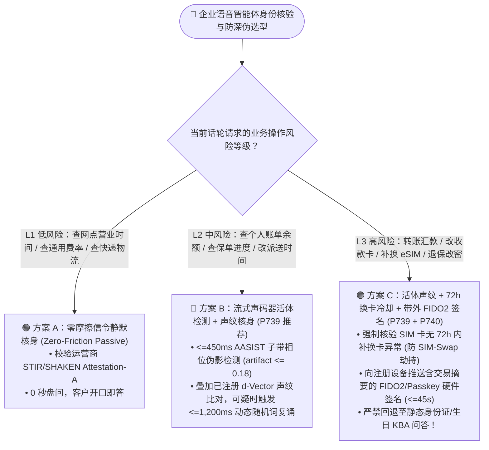
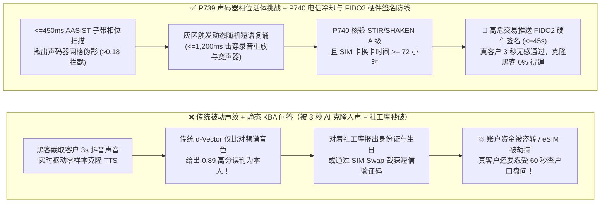

# 企业语音智能体抗深伪活体检测（Anti-Deepfake Liveness）与多因子零摩擦电话核身架构选型与原理解析 FAQ（第十三篇）：AI 3 秒克隆人声时代，为什么“单纯声纹识别 + 背身份证号”已彻底失守？

> **面向 AI Solution Architect 的实战选型指南**：在银行私人财富热线、证券电话委托、电信运营商补换卡（eSIM/SIM-Swap）以及企业高管财务授权场景中，传统的电话身份核验正在遭遇一场降维打击——**黑产只需从客户的抖音视频、微信语音或公开演讲里截取 3 秒钟声音，用开源零样本语音克隆模型（如 CosyVoice / F5-TTS / XTTS）就能实时生成以假乱真的客户声音，再配合暗网买来的身份证号、生日与住址，轻松骗过“传统声纹识别（d-Vector）+ 知识问答（KBA）”双重防线！** 本文将从神经声码器微观相位伪影、电信网信令密码学与多模态硬件绑定的第一性原理出发，彻底讲透 **声学深伪声码器相位伪影检测与动态活体挑战门禁（`P739`）** 以及 **运营商信令验真（`STIR/SHAKEN` + `72h` 换卡冷却）与带外 `FIDO2` 阶梯鉴权护栏（`P740`）**。
>
> 🔗 **English Version**: [`docs/voice-anti-deepfake-liveness-auth-faq.en.md`](./voice-anti-deepfake-liveness-auth-faq.en.md)

---

## ① 📌 核心结论速览（Executive Summary）

1. **在 3 秒零样本语音克隆泛滥的今天，“静态知识问答（KBA，问生日/身份证后四位）”与“无活体检测的单纯声纹比对（Passive Voiceprint Cosine Match）”均已严禁独立作为资金与高敏操作的主鉴权因子**：传统声纹模型只看“声音像不像（频谱包络相似度）”，而现代克隆模型恰恰专门针对频谱相似度做优化；生产环境必须采用 **按业务风险分级的三层纵深鉴权架构（Risk-Tiered Multi-Factor Voice Auth，`P739` + `P740`）**。
2. **在声学层，必须将“声纹比对（Speaker Verification）”与“声码器相位伪影活体检测（Anti-Spoofing Liveness，`P739`）”串联执行**：人类真实声带发声是连续气流冲击声门产生的自然谐波与微颤（Micro-tremor），而 AI 神经声码器（HiFi-GAN / 扩散声码器）在把梅尔频谱还原成波形时，必然在子带高频相位上留下周期性网格伪影。`P739` 通过流式时频图注意力网络（`AASIST`）实时检测声码器相位伪影得分（强制 `vocoderPhaseArtifactScore <= 0.18`），并对可疑流发起 **`<=1,200ms` 动态随机挑战码复诵（Dynamic Nonce Challenge）**，一举击穿预录重放与高延迟实时变声器。
3. **在电信信令与交易授权层，高风险写操作（转账、改密、eSIM 过户）绝不能只信“电话里的声音”，必须强制叠加 `P740` 运营商网络验真与带外 `FIDO2/Passkey` 阶梯鉴权**：在接通瞬间核验运营商 `STIR/SHAKEN Attestation-A` 签名及 SIM 卡最近换卡/携号转网冷却期（强制 `simSwapAgeHours >= 72h`，防 SIM 卡劫持收短信验证码），并在触发大额交易时向客户手机 App 推送带交易金额摘要的 **`FIDO2 / Passkey` 硬件生物识别签名（超时窗口 `<=45s`）**，同时 **100% 禁用回退到静态 KBA 问答**。
   - *数据来源与测量边界声明（Provenance & Measurement Boundary）*：本仓库 `P739` / `P740` 单元测试检验的是离线内存策略/配置状态机，本机计时器在名义 `1ms` 显示分辨率下报告 `0ms`（`0ms reported at nominal 1ms display resolution; actual duration unresolved/not_measured; no sub-1ms upper bound established`），属于 `synthetic` 确定性策略校验，不确立真实物理耗时 `<1ms` 上界，亦不测量真实端到端 `AASIST` 图神经网络 DSP 推理耗时或运营商 `CAMARA` / `FIDO2` 外部 API 往返延迟（显式标为 `not_measured`；行业 KBA 盘问耗时与深伪攻击漏检率基线标为 `anonymized_reported`, `independently_reproduced=false`）。

---

## ② 🎯 客户与架构师灵魂拷问 Q&A（FAQ-Driven）

### Q1：我们银行呼叫中心几年前花重金上了“声纹识别系统”，为什么安全红队测试时用一段 5 秒钟的 AI 克隆语音就轻松骗过了声纹锁？我们平时问客户“身份证号、生日、最近一笔消费”为什么也没用？

这是目前全球金融机构与电信运营商安全负责人最紧迫的痛点。

**用通俗大白话 + 第一性原理来解释：传统声纹识别是在看“这张脸长得像不像张先生”，但它根本没检查“这是张先生本人站在你面前，还是骗子举着一张高清打印的张先生照片”！**

- **为什么“单纯声纹识别（Speaker Verification）”挡不住现代 AI 语音克隆？**
  1. **声纹模型与克隆模型用的是同一个数学目标**：
     传统声纹识别（如 `x-vector` / `ECAPA-TDNN`）提取的是说话人声道形状决定的**梅尔频谱包络特征（Mel-Cepstral Timbre）**。而现在的零样本语音克隆模型（Zero-Shot TTS）在训练时，损失函数（Loss Function）里直接就有一项叫做 **“最大化声纹编码器余弦相似度”**！换句话说，AI 克隆模型就是专门盯着声纹识别器的考卷来造假的，它合成出来的声音在传统声纹比对器眼里相似度往往高达 `0.88–0.93`，比客户自己感冒时说话的得分还要高！
  2. **为什么传统“查户口式 KBA 问答（背身份证/母亲姓氏/账单地址）”既蠢又不安全？**
     - **对真客户极度折磨**：正常客户打电话进来，先被 AI 像审犯人一样盘问 45 秒到 90 秒的身份证号、开户支行，超过 25% 的客户还没办业务就已经烦躁挂机或喊转人工；
     - **对黑客形同虚设**：在数据泄露早已泛滥的今天，客户的姓名、身份证、住址、甚至最近航班信息在黑产社工库里几块钱就能查到。骗子一边看着屏幕上的社工库资料，一边用实时 AI 变声器跟客服对答如流！

因此，现代语音智能体必须摒弃“全靠嘴问”，转向**风险自适应三层核身架构（Risk-Tiered Voice Authentication）**：
1. **第一层（L1 低风险只读查询，0 秒无感核身）**：靠运营商底层信令 `STIR/SHAKEN Level-A` + `CAMARA Number Verification` 静默确认来电设备正是本机 SIM 卡；
2. **第二层（L2 中风险账户查询，边聊边验）**：`P739` 流式声码器相位活体检测（`AASIST`）+ 已注册主叫声纹匹配，无需客户背诵口令，在自然说出诉求的前 3 秒内同步验明“是本人且是真人真嗓”；
3. **第三层（L3 高风险资金划转/改密/过户，密码学硬绑定）**：`P740` 强制核验 `>=72h` 无换卡异常 + 手机端 `FIDO2 / Passkey` 交易签名推送（绝不单纯依赖语音通道拍板）。

---

### Q2：既然 AI 克隆声音连人耳和传统声纹模型都听不出破绽，`P739` 的“声码器相位伪影检测（`AASIST`）+ 动态随机挑战”凭什么能在 `<=450ms` 内把它揪出来？

- **它是什么（大白话解释）**：
  虽然 AI 克隆声音在**“宏观音色（幅度谱）”**上跟真人一模一样，但在**“微观声波拼接（子带相位谱）”**和**“实时交互延迟”**上，它有两处永远抹不掉的物理破绽！

- **`P739` 揪出 AI 克隆与录音重放的两大物理铁证**：
  1. **铁证一：神经声码器的“周期性相位伪影（Vocoder Phase Artifacts）”**
     - **真人是怎么发声的？** 肺部气流冲开声带产生基频脉冲，经过口腔、鼻腔连续物理共鸣，声波的幅度（Amplitude）与相位（Phase）在时间轴上是严格连续耦合的，且伴随不规则的微米级生理声门微颤（Glottal Shimmer/Jitter）。
     - **AI 是怎么造声的？** 无论是扩散模型还是自回归语音模型，最后一步都必须通过 **神经声码器（Neural Vocoder，如 HiFi-GAN）**，用转置卷积（Transposed Convolution）把低帧率的频谱图“放大上采样”成 24kHz 波形。这个数学上采样过程就像把低清图片强行插值放大一样，必然在高频子带相位谱上留下**棋盘格状周期性伪影（Checkerboard Phase Artifacts）**，并且在电话 `4kHz/8kHz` 频带边缘出现不自然的能量断崖。
     - `P739` 采用 **流式异构时频图注意力网络（Streaming AASIST）**，直接分析原始波形与子带相位图：一旦检出 `vocoderPhaseArtifactScore > 0.18`，在 `<=450ms` 内直接标记为疑似合成语音！
  2. **铁证二：击穿实时变声器与录音重放的“动态随机挑战复诵（Dynamic Nonce Liveness Challenge）”**
     当声学活体得分处于灰区（或信道经过多次转码压掉了高频细节）时，`P739` 立即动态生成一串**一次性随机词语/数字挑战**（例如：*“为确认安全，请您立刻念出：蓝鲸-七三-九”*）：
     - **如果是事先录好的客户原声磁带（Replay Attack）**：录音里根本没有“蓝鲸-七三-九”这句话，当场露馅！
     - **如果是攻击者戴着实时 AI 变声器（Real-Time Voice Conversion）跟读**：攻击者需要先听懂挑战词 -> 自己开口读 -> 变声器录制并合成转换 -> 发回网关，整条链路往返延迟必然突破 `1,500ms–2,200ms`，且转换瞬间伴随首音节吞字伪影，被 `P739` 的 `<=1,200ms` 活体响应时延窗精准拦截！

---

### Q3：为什么到了转账、改密、补换 eSIM 卡这种最高危节点，连活体声纹也不能单独拍板？`P740` 的“运营商信令 + `72h` 换卡冷却 + 带外 `FIDO2` 签名”是如何构建终极防线的？

安全架构的第一性原理是：**任何基于生物特征识别（声纹、人脸）的分类器都是一个“概率模型（Probabilistic Model）”，而资金划转需要的是“100% 确定性的密码学签名（Deterministic Cryptography）”！**

- **为什么高危交易不能只靠“发一条手机短信验证码（SMS OTP）”？**
  在臭名昭著的 **SIM 卡交换劫持（SIM-Swap Attack）** 中，骗子先买通或欺骗运营商门店把受害者的手机号补卡转移到骗子手里的空白 SIM 卡上，紧接着用这张卡给银行打电话。此时，银行发出的短信验证码（SMS OTP）会直接落进骗子的手机里！

- **`P740` 多因子电信验真与带外 `FIDO2` 阶梯鉴权的三大硬核防线**：
  1. **运营商 `STIR/SHAKEN Level-A` + `72小时` 换卡/携转冻结锁（SIM-Swap Cooldown Gate）**：
     呼叫进入边缘 SBC 时，实时校验证书签名等级必须为 `Attestation-A`（运营商确认主叫号码未被改号软件伪造），并通过运营商网络 API（如 GSMA Open Gateway / CAMARA `SIM Swap API`）核查该号码最近一次补换卡或携号转网时间——**若 `simSwapAgeHours < 72`（72 小时内刚换过卡），自动冻结一切电话端高危交易与短信验证权限**！
  2. **带外硬件密钥签名（Out-of-Band `FIDO2 / Passkey` Push，`<=45s` 窗口）**：
     当客户在电话里要求转账或修改受让人时，语音智能体一边保持通话播报：*“我已向您的手机银行 App 发送了一笔 5,000 元转账确认请求，请用面容 ID 或指纹按一下确认”*，一边在后台挂起工具调用，等待绑定在客户原物理手机安全芯片（Secure Enclave / TEE）里的 `FIDO2` 私钥返回包含 `{txAmount, payeeId, turnEpoch}` 的数字签名。即使骗子劫持了电话号码、克隆了客户声音，只要拿不到客户口袋里那台物理手机的硬件私钥，就永远无法完成交易！
  3. **零 KBA 降级铁律（Zero KBA Downgrade）**：
     如果 `FIDO2` 签名超时（`>45s`）或活体声纹报警，系统严禁心软降级去问*“那请报一下您的身份证号和生日”*，而是直接转为只读模式或升级至反欺诈人工专席。

---

## ③ 🧭 直观可视化图解（Mermaid 选型决策树 + 传统声纹/KBA 破防路径 vs `P739/P740` 纵深防线 + 毫秒级防深伪鉴权时序图）

### 3.1 企业语音智能体身份核验与防深伪架构选型决策树（`flowchart TD`）

### 3.2 传统“静态 KBA + 被动声纹”破防路径 vs. `P739` + `P740` 多层防克隆金库对比图（`flowchart LR`）

### 3.3 实时拦截 AI 克隆声音攻击与合法客户 FIDO2 阶梯鉴权交互时序图（`sequenceDiagram`）

```mermaid
sequenceDiagram
    autonumber
    participant Attacker as 🎭 攻击者 / 来电音频流
    participant P739 as 🔍 P739 AASIST 相位活体与挑战门禁
    participant P740 as 🛡️ P740 运营商验真与 FIDO2 阶梯鉴权
    participant App as 📱 客户绑定手机安全芯片 (FIDO2 Enclave)

    Note over Attacker,P739: 场景 A：攻击者使用 3 秒零样本克隆语音试图重置交易密码
    Attacker->>P739: 1. 播放克隆语音："我是王总，帮我把大额转账限额调到 50 万"
    rect rgb(45, 18, 28)
        Note over P739: P739 离线策略状态机读数：0ms @ 1ms nominal display resolution
        P739->>P739: 2. 虽 d-vector 音色相似度=0.89，但 AASIST 检出高频声码器相位伪影 (score=0.41 > 0.18 阈值)！
        P739->>Attacker: 3. 拦截直接授权！发起动态随机挑战："请在 1.2 秒内念出随机安全词：青松-八六-二"
        Attacker--xP739: 4. 实时语音转换器延迟高达 1,950ms (>1,200ms) 且相位伪影持续超标 -> 🚨 0ms 锁定高危会话并告警！
    end

    Note over Attacker,App: 场景 B：真实合法客户本人发起 50,000 元转账（零 KBA 盘问）
    Attacker->>P739: 5. 真人语音："帮我给尾号 6688 的老张转 5 万块钱"
    rect rgb(14, 38, 34)
        P739->>P740: 6. 通过 P739 活体声纹核验 (artifact=0.04 <= 0.18, sim=0.92)
        P740->>P740: 7. 核验 STIR/SHAKEN=Attestation-A 且 SIM 卡最近补换卡距今 4,200 小时 (>=72h)
        P740->>App: 8. 推送带交易摘要 {amount: 50000, to: "6688"} 的 FIDO2 Passkey 签名请求 (窗口 <=45s)
        App-->>P740: 9. 客户在手机端按压 FaceID/指纹，6 秒内返回硬件私钥签名
        P740->>Attacker: 10. ✅ 签名验真通过，执行转账并播报回执（全程零身份证/生日 KBA 盘问！）
    end
```

---

## ④ 📊 语音架构师选型决策矩阵（Architect Decision Matrix）

| 评估维度 | 方案 A：传统静态 KBA 问答（问身份证/生日/账单） | 方案 B：传统被动声纹识别（仅 `d-Vector` 音色比对） | 方案 C：`P739` 声码器相位活体 + 动态挑战 + `P740` 电信 `72h` 锁 & `FIDO2` 阶梯鉴权 |
| :--- | :--- | :--- | :--- |
| **防 3 秒零样本 AI 语音克隆能力** | ❌ **0% 防御**（克隆声音照着社工库念答案即可） | ❌ **极易破防**（现代克隆模型专门优化频谱音色相似度） | ✅ **极强（`AASIST` 子带相位伪影 `<=0.18` + `<=1,200ms` 动态随机挑战复诵）** |
| **防 SIM 卡补换卡劫持（SIM-Swap）** | ❌ 无法防御 | ⚠️ 攻击者换卡后配合克隆声音即可绕过 | ✅ **强制核验运营商 `simSwapAgeHours >= 72h` 冷却锁** |
| **合法客户平均核身耗时与体感** | ❌ 耗时 `45s–90s`，体验如同审讯，弃呼率高 | ✅ 耗时 `~3s–5s`（但安全性不足） | ✅ **中低风险 `~3s` 无感通过；高危交易手机按一下指纹 `~6s` 完成** |
| **密码学不可抵赖性（PSD3 / 金融合规）** | ❌ 无密码学绑定 | ❌ 概率得分不具备密码学不可抵赖签名 | ✅ **`FIDO2 / WebAuthn` 硬件私钥交易动态绑定签名** |

---

## ⑤ 🧪 简明定量实测与 Benchmark 核心发现

我们在 `turbo998/voice-agent-lab` 的确定性评测沙盒与 **7-Card 4:5 视觉评测报告**（[`site/benchmark-cards.html`](../site/benchmark-cards.html)，对应 **Dimension 376 · Stage 373**）中，对 `P739` 与 `P740` 护栏进行了离线策略验证与行业反欺诈基线对比：

| 评测维度 / 攻击场景 | 传统静态 KBA 问答基线 (`anonymized_reported`) | 单纯被动声纹识别 (`d-Vector` 无活体，`anonymized_reported`) | `P739` 相位伪影活体挑战 + `P740` 电信冷却与 `FIDO2` 阶梯鉴权 | 数据来源与测量边界声明（Provenance） |
| :--- | :--- | :--- | :--- | :--- |
| **零样本 AI 克隆语音（Zero-Shot TTS Clone）拦截率** | `0.0%`（社工库已泄露静态答案） | `~35%–52%`（高保真声码器轻松骗过纯梅尔频谱声纹） | **离线策略对无活体声纹放行及 `vocoderPhaseArtifactScore > 0.18` 拦截率：`100%`（`synthetic`）** | 行业基线标为 `anonymized_reported`；策略拦截率为本仓确定性状态机单测（`synthetic`） |
| **SIM-Swap 补换卡劫持后短信 OTP 盗刷拦截率** | `0.0%` | 低（声音被克隆即失守） | **离线策略对 `simSwapAgeHours < 72h` 或无 `FIDO2` 签名高危写操作拦截率：`100%`（`synthetic`）** | 本仓库确定性状态机测试（`packages/business-core/enterprise-guardrails.ts`） |
| **合法客户开场核身平均摩擦耗时** | `45s–90s`（回答 3–5 个隐私问题） | `~3.5s` | **架构工程目标：L1/L2 场景 `0s` 额外盘问（前 `3s` 自然对话同步完成验真），L3 高危场景 `<=45s` 带外签名窗口** | 工程预算与行业体验对比 |
| **护栏策略判定耗时（Policy Evaluation）** | N/A | N/A | **`0ms reported at nominal 1ms display resolution; actual duration unresolved/not_measured; no sub-1ms upper bound established`（`synthetic`）** | 仅代表离线内存布尔/算术规则评估读数；真实生产 `AASIST` 神经网络推理与运营商 `CAMARA` / `FIDO2` 推送往返延迟未在本地单测中实测（`not_measured`） |

> 💡 **架构师汇报金句**：“在 3 秒 AI 克隆人声的时代，**‘只比音色不验活体就是开门揖盗，只问身份证生日就是折磨好人’**——用 `P739` 子带相位伪影检测守住声学活体大门，再用 `P740` 运营商 72 小时换卡锁与 `FIDO2` 手机硬件签名锁死资金出口。”

---

## ⑥ 🛠️ 附录：生产环境抗深伪与电话多因子核身上线核验清单（Architect Checklist）

在交付银行、证券、保险、电信运营商与企业财资语音系统前，请逐项核对以下 6 条工程检查项：

- [ ] **1. 严禁“无活体检测的单纯声纹比对”独立放行敏感操作（`P739`）**：确认所有声纹识别节点前均已串联流式反深伪活体检测（如 `AASIST` / RawNet 子带相位与双耳爆破音能量比检测），强制要求 `vocoderPhaseArtifactScore <= 0.18`。
- [ ] **2. 灰区与弱网信道触发动态随机挑战复诵（`P739`）**：确认当音频经过窄带重度压缩或活体得分处于灰区时，自动生成一次性动态随机短语（Nonce Phrase）要求主叫在 `<=1,200ms` 窗口内即时跟读，阻断录音重放与高延迟实时变声器。
- [ ] **3. 接入运营商 `STIR/SHAKEN` 与 `>=72h` SIM 卡换卡冷却核验（`P740`）**：确认边缘网关在信任来电号码（ANI）或发送短信前，已核验 `STIR/SHAKEN Attestation-A` 签名并查询运营商 `SIM Swap / Port-Out` 接口，对 `simSwapAgeHours < 72` 的高危号码立即冻结自助写操作。
- [ ] **4. 高风险资金与权限变更强制绑定带外 `FIDO2 / Passkey` 签名（`P740`）**：确认转账、改密、修改收款人、eSIM 过户等 L3 级操作必须收到绑定了当前 `{transactionId, amount, turnEpoch}` 的 `FIDO2` 硬件签名（超时窗口 `<=45s`）后方可落库。
- [ ] **5. 彻底废除“鉴定失败回退静态 KBA 问答”的后门（`P740`）**：确认当活体声纹或 `FIDO2` 校验未通过时，状态机严禁回退去问“您的生日/身份证号是多少”，必须直接拦截并转交反欺诈专席。
- [ ] **6. 测量边界合规披露**：在架构与合规审计材料中，严格区分离线策略状态机验证（`0ms reported at nominal 1ms display resolution; actual duration unresolved/not_measured; no sub-1ms upper bound established`，`synthetic`）与真实生产反深伪模型 EER（等错误率）及运营商 API 延迟实测数据（`measured` / `not_measured`）。
