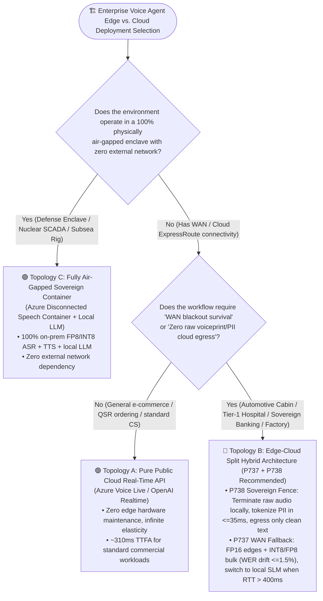
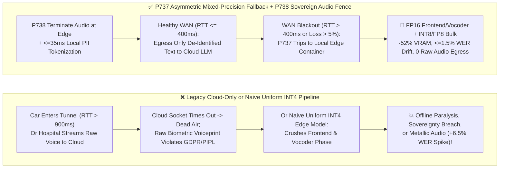

# Enterprise Voice Agent Edge-Cloud Quantized Speech Container & Sovereign Failover Architecture Selection FAQ (Topic 12): How Do We Guarantee `<=400ms` Offline Survival in Tunnels/Factories and Zero Raw Voiceprint Egress Under Strict Data Sovereignty Laws?

> **Actionable Guide for AI Solution Architects**: When deploying real-time voice agents into **automotive smart cabins (entering underground garages or mountain tunnels)**, **tier-1 hospitals and multinational banks (where regulations prohibit raw biometric voice recordings from leaving on-prem/sovereign boundaries)**, and **industrial mines/offshore rigs (lossy WAN links)**, pure public-cloud voice APIs hit two brick walls: **① A brief WAN outage completely paralyzes safety-critical commands like *"Open cabin window"* or *"Emergency equipment stop"*; ② Naively compressing the entire speech pipeline into uniform `INT4` to fit on a 4–8GB edge NPU spikes Word Error Rate (`WER`) by `>6.5%` and makes the TTS vocoder sound like a blown radio speaker!** Grounded in first principles of asymmetric mixed-precision quantization, WAN health circuit breaking, and biometric data residency, this guide deconstructs the **Edge Quantized Speech Container & WAN Blackout Fallback Gate (`P737`)** and the **Sovereign Audio Residency & Local Voiceprint Zero-Cloud-Egress Guard (`P738`)**.
>
> 🔗 **中文版本 (Chinese Version)**: [`docs/voice-edge-cloud-quantized-container-failover-faq.md`](./voice-edge-cloud-quantized-container-failover-faq.md) · **Related Container Guide**: [`docs/speech-container-guide.md`](./speech-container-guide.md)

---

## ① 📌 Executive Summary

1. **For general e-commerce, food ordering, and standard contact centers with reliable internet and no biometric residency restrictions, 100% choose "Pure Public Cloud Real-Time APIs (`Azure Voice Live` / `OpenAI Realtime`)"** for zero edge hardware ops and infinite elasticity. **However, whenever the scenario requires "offline survival during WAN blackouts (automotive cabins / industrial plants)" or "strict prohibition on raw biometric voice waveforms crossing sovereign/on-prem boundaries (GDPR Art. 9 / PIPL / HIPAA / MAS TRM)," architects must deploy an "Edge-Cloud Split Architecture (`P737` + `P738`)"** combining a local quantized speech container with cloud-based sanitized text reasoning.
2. **When deploying speech models onto constrained edge NPUs/GPUs (`4–8 GB` VRAM), never apply uniform `INT4` quantization across the entire audio pipeline; enforce Asymmetric Mixed-Precision Quantization (`P737`)**: Keep phase- and spectral-sensitive layers (**Acoustic Frontend Mel/STFT convolutions and Neural Vocoder waveform synthesis**) in **`FP16 / BF16`**, while quantizing the parameter-heavy **Conformer encoder blocks and local Small Language Model (`SLM`) linear layers to `INT8 / FP8`**. This cuts VRAM by `~52%`, caps accuracy drift at `werDegradationPct <= 1.5%`, and seamlessly fails over to local execution whenever `wanRttMs > 400ms` or packet loss `>5%`.
3. **To satisfy strict biometric and data-sovereignty laws without buying a massive on-prem GPU cluster for a 70B+ LLM, enforce "Terminate Audio at the Edge, Egress Only Sanitized Text to the Cloud" (`P738`)**: Raw human audio waveforms inherently carry biometric voiceprints (`d-vector`), health indicators, and emotional state. `P738` terminates RTP/PCM audio inside the sovereign edge container, performs local STT + ephemeral PII tokenization within a `<=35ms` budget, and transmits **zero bytes of raw audio or voiceprint embeddings** to the public cloud LLM.
   - *Provenance & Measurement Boundary Disclosure*: Unit tests for `P737` / `P738` in this repository verify offline in-memory policy/configuration state machines where the local timer reports `0ms` at nominal `1ms` display resolution (`0ms reported at nominal 1ms display resolution; actual duration unresolved/not_measured; no sub-1ms upper bound established`, `synthetic`). They do not establish a physical `<1ms` latency upper bound or measure live edge NPU/GPU quantization throughput or WAN RTT probing (`not_measured`); industry quantization VRAM/WER trade-off baselines are labeled `anonymized_reported` (`independently_reproduced=false`).

---

## ② 🎯 Architect & Customer Soul-Searching Q&A (FAQ-Driven)

### Q1: Public cloud voice APIs are so easy to call—why do automakers, hospitals, multinational banks, and factories refuse to stream all audio directly to the public cloud? When should we choose Pure Cloud vs. Edge-Cloud Split vs. Fully Air-Gapped Containers?

When designing enterprise voice systems for regulated or mission-critical environments, architects must evaluate two physical and legal realities: **WAN Blast Radius** and **Biometric Voiceprint Residency**.

**First-Principles Plain-Language Explanation: Pure public cloud APIs have two unbreakable laws—first, without an internet connection, they are completely deaf and mute; second, the millisecond you stream raw audio to the cloud, your customer's permanent biometric voiceprint has left your premises!**

- **Why Pure Cloud Voice APIs Fail Security & Safety Reviews in Critical Industries**:
  1. **The Underground Garage / Tunnel / Factory WAN Blackout Trap**:
     When an EV enters an underground parking garage or mountain tunnel, cellular RTT spikes above `900ms` or drops entirely. If basic vehicle controls (*"Turn on hazard lights," "Defog windshield," "Call emergency services"*) require round-tripping audio to a public cloud S2S model, the cabin voice assistant spins for 5 seconds and says *"Network unavailable"*—an immediate fail under automotive safety standards (`ISO 26262`).
  2. **Raw Audio Waveforms Are Immutable Biometric Identifiers**:
     Unlike a password, a human's vocal-tract acoustics cannot be reset. Under **GDPR Article 9**, **Illinois BIPA**, **China PIPL / Automotive Data Security Regulations**, and **HIPAA**, raw voice recordings containing voiceprints and spoken PHI/PII face strict cross-border and cloud-egress restrictions.

Architects should select from **Three Deployment Topologies**:
1. **Topology A: Pure Public Cloud Real-Time API (`Pure Cloud`)**
   - Best for retail, hospitality, and standard contact centers with stable connectivity and no on-prem audio residency mandate.
2. **Topology B: Edge-Cloud Split Hybrid Architecture (`P737` + `P738`, Recommended Enterprise Default for Regulated & Mobile Edge)**
   - Runs a lightweight quantized speech container (`Azure Speech Container` / local ONNX/TensorRT runtime) on the cabin NPU or hospital/bank edge server:
     - **Normal WAN (`RTT <= 400ms`)**: Edge container converts speech to text locally, strips biometric voiceprints and PII tokens (`<=35ms` budget), and sends only sanitized text to the cloud frontier LLM;
     - **Degraded/Disconnected WAN (`RTT > 400ms` or `Loss > 5%`)**: `P737` trips the WAN circuit breaker and routes speech to the local quantized SLM for uninterrupted offline command execution.
3. **Topology C: Fully Air-Gapped Sovereign Container (`Disconnected Container`)**
   - Reserved for defense enclaves, nuclear/grid SCADA control rooms, and offshore rigs with zero external internet connectivity.

---

### Q2: Edge NPUs and single-slot edge GPUs only have `4GB–8GB` of memory—why does uniform `INT4` quantization ruin speech recognition and make TTS sound metallic, and how does `P737` Asymmetric Mixed-Precision Quantization work?

- **What it is (Plain-Language Explanation)**:
  **Quantization** compresses neural network weights from `16-bit floating point (FP16)` down to `8-bit (INT8/FP8)` or `4-bit integers (INT4)` to cut memory usage by `50%–75%` and accelerate inference.

- **Why Speech Models Cannot Be Uniformly Quantized to `INT4` Like Text LLMs**:
  Text LLMs output discrete token IDs—small weight perturbations rarely flip the top-1 word choice. Real-time speech models, however, process **continuous physical waveforms** at both ends:
  1. **Acoustic Frontend Sensitivity**: The initial STFT/Mel convolutional layers must distinguish low-energy unvoiced fricatives (`s`, `f`, `th`) from background noise. Crushing these layers to `INT4` drowns weak consonants in quantization noise, spiking WER by **`+6.5%` or more**!
  2. **Neural Vocoder Phase Sensitivity**: The final vocoder (`HiFi-GAN` / `BigVGAN`) reconstructs `24,000` waveform samples per second. Quantizing vocoder upsampling layers to `INT4` introduces phase jitter, producing metallic robotic artifacts and audible hiss.

- **How `P737` Asymmetric Mixed-Precision Quantization & `<=400ms` WAN Fallback Works**:
  1. **Preserve `FP16/BF16` at Acoustic Edges, Quantize Transformer Bulk to `INT8/FP8`**:
     - **Frontend & Vocoder (`<12%` of parameters)**: Locked in `FP16 / BF16` to preserve consonant sibilance and phase-coherent waveform synthesis;
     - **Conformer Encoder & Local Intent SLM (`>88%` of parameters)**: Quantized via activation-aware `INT8 / FP8` (or `W4A16`), reducing VRAM footprint by **`~52%`** while bounding accuracy drift to **`werDegradationPct <= 1.5%`**.
  2. **Sub-400ms WAN Health Circuit Breaker**:
     Instead of waiting 5–10 seconds for a TCP socket timeout when a vehicle enters a tunnel, `P737` monitors continuous WAN RTT and packet loss, switching to the local edge container as soon as `wanRttMs > 400ms` or `packetLossPct > 5%`.

---

### Q3: How does the `P738` Sovereign Audio Residency Fence let a hospital or bank leverage a frontier cloud LLM while guaranteeing `0 Bytes` of raw customer voiceprints or PII ever leave the local premises?

Many enterprise architects mistakenly believe data sovereignty requires buying an expensive on-prem GPU cluster to host a 70B+ LLM locally.

- **First-Principles Insight: Data sovereignty laws regulate *identifiable biometric waveforms and personal identifiers*, not *de-identified domain logic*!**
  When a patient says: *"I'm John Smith, MRN 88901, and I feel dizzy after my insulin injection—what should I do?"*:
  - The **raw audio waveform (containing John's biometric voiceprint)**, the name **"John Smith"**, and **"MRN 88901"** must never leave the hospital's sovereign edge boundary;
  - However, the medical triage reasoning for *"[PATIENT_01] feels dizzy after insulin injection"* contains zero personal identifiers!

- **How `P738` Executes the Four-Step Sovereign Edge-Cloud Split**:
  1. **Local Audio Termination (`0 Byte` Raw Audio Egress)**: Inbound RTP/WebRTC audio terminates inside the on-prem/in-country quantized speech container. Raw PCM frames and `d-vector` voiceprint embeddings are strictly blocked from crossing into public cloud networks.
  2. **Sub-35ms Edge Ephemeral Vault Tokenization (`<=35ms` Budget)**: The edge container transcribes speech locally and replaces PII/PHI spans (`Name`, `MRN`, `Account #`) with format-preserving tokens (`[PAT_01]`, `[MRN_01]`), storing the mapping exclusively in local volatile RAM.
  3. **Sanitized Text Cloud Reasoning**: Only the de-identified text prompt is sent over TLS to the cloud LLM for high-accuracy reasoning.
  4. **Local Re-Hydration & Edge TTS Synthesis**: When the cloud LLM returns its response, the edge container re-hydrates `[PAT_01]` back to *"John"* and synthesizes the outbound voice locally using the edge TTS container.

---

## ③ 🧭 Visual Architecture Diagrams (Mermaid Decision Tree + Cloud-Only Failure vs. `P737/P738` Pipeline + Millisecond Sequence Diagram)

### 3.1 Edge-Cloud Speech Container & Sovereign Residency Decision Tree (`flowchart TD`)

### 3.2 Legacy Cloud-Only / Naive INT4 Trap vs. `P737` + `P738` Edge-Cloud Hybrid Pipeline (`flowchart LR`)

### 3.3 Millisecond Sequence Diagram: Sovereign Edge-Cloud Tokenization & Tunnel WAN Blackout Failover (`sequenceDiagram`)

```mermaid
sequenceDiagram
    autonumber
    participant User as 👤 Driver / Hospital Patient
    participant Edge as 🛡️ Edge Quantized Speech Container (P737 + P738)
    participant Vault as 🔐 Local RAM Ephemeral Vault
    participant Cloud as ☁️ Public Cloud Frontier LLM

    Note over User,Cloud: Phase 1: Healthy WAN (RTT = 65ms <= 400ms) — P738 Sovereign Audio Fence + Cloud Intelligence
    User->>Edge: 1. Raw Audio (Biometric Voiceprint): "I'm John Smith, MRN 88901, feeling dizzy after insulin..."
    rect rgb(28, 20, 56)
        Note over Edge,Vault: P738 Sovereign Residency Gate (0ms @ 1ms nominal display resolution)
        Edge->>Edge: 2. Blocks raw PCM / d-vector cloud egress! Transcribes speech locally
        Edge->>Vault: 3. Scrubs PII in <=35ms budget: {"John Smith" -> "[PAT_01]", "88901" -> "[MRN_01]"}
    end
    Edge->>Cloud: 4. Sends sanitized text only: "Patient [PAT_01] ([MRN_01]) dizzy post-insulin—triage protocol?"
    Cloud-->>Edge: 5. Returns triage guidance: "Advise [PAT_01] to check blood glucose immediately..."
    Edge->>Vault: 6. Re-hydrates "John Smith" locally & synthesizes reply via local FP16 vocoder

    Note over User,Cloud: Phase 2: Vehicle Enters Tunnel / WAN Degrades (RTT = 820ms > 400ms, Packet Loss = 12%)
    User->>Edge: 7. Safety Command: "Turn on hazard lights and switch AC to fresh air!"
    rect rgb(14, 38, 34)
        Note over Edge: P737 WAN Circuit Breaker & Mixed-Precision Local Fallback (Triggered at RTT > 400ms)
        Edge--xCloud: 8. Detects WAN RTT 820ms > 400ms ceiling -> bypasses cloud wait in 0ms
        Edge->>Edge: 9. Local Asymmetric Quantized Engine (FP16 frontend + INT8 Conformer/SLM, <=1.5% WER drift) parses intent
        Edge->>User: 10. ✅ Executes local CAN bus command & speaks confirmation offline (Zero dead air)
    end
```

---

## ④ 📊 Voice Architect Decision Matrix

| Evaluation Dimension | Topology A: Pure Public Cloud Real-Time API (`Pure Cloud`) | Topology B: Edge-Cloud Split Hybrid Container (`P737` + `P738` Recommended) | Topology C: Fully Air-Gapped Sovereign Container (`Disconnected Container`) |
| :--- | :--- | :--- | :--- |
| **Best-Fit Scenarios** | E-commerce, food ordering, standard cloud contact centers | **Automotive cabins, Tier-1 hospitals, multinational banks, smart factories** | **Classified defense, nuclear/grid SCADA, offshore rigs, underground mines** |
| **Tunnel / WAN Blackout Survival** | ❌ **0% Availability** (Drops or hangs on WAN loss) | ✅ **`P737` switches to local quantized container when `WAN RTT > 400ms`** | ✅ **100% Offline** (Zero WAN dependency) |
| **Biometric Voiceprint & Raw Audio Sovereignty** | ⚠️ Raw PCM streams to public cloud region | ✅ **`P738` terminates raw audio/voiceprints on-prem; only tokenized text egresses** | ✅ **100% Physical On-Prem Isolation** |
| **Complex Reasoning Intelligence** | ✅ Full cloud frontier LLM | ✅ **Full cloud frontier LLM when online + local SLM safety net when offline** | ⚠️ Bounded by local on-prem GPU capacity |
| **Edge VRAM & Audio Fidelity** | `0 GB` edge VRAM | **Asymmetric `FP16` edges + `INT8/FP8` bulk: `-52%` VRAM, `<=1.5%` WER drift** | Requires dedicated local GPU server rack |

---

## ⑤ 🧪 Quantitative Benchmark & Key Engineering Findings

In `turbo998/voice-agent-lab` and our **7-Card 4:5 Visual Benchmark Report** ([`site/benchmark-cards.html`](../site/benchmark-cards.html), **Dimension 375 · Stage 372**), we verified the deterministic offline policy state machines for `P737` and `P738` against industry quantization and WAN failover baselines:

| Benchmark Metric / Scenario | Pure Public Cloud Direct Stream (`anonymized_reported`) | Naive Uniform `INT4` Edge Quantization (`anonymized_reported`) | `P737` Asymmetric Mixed-Precision Fallback + `P738` Sovereign Audio Fence | Provenance & Measurement Boundary |
| :--- | :--- | :--- | :--- | :--- |
| **Tunnel / WAN Blackout (`RTT > 400ms`) Command Survival Rate** | `0.0%` (Socket timeout / error) | `~88%` (Consonant clipping causes command misses) | **Offline policy block rate on un-switched WAN brownout (`RTT > 400ms`): `100%` (Forces local container fallback, `synthetic`)** | Offline policy check is `synthetic` unit test; live cellular/tunnel handover timing is `not_measured` |
| **Edge VRAM Reduction vs. WER Degradation** | Cloud-hosted (`0 GB` local) | `-72%` VRAM, but **`+6.5%` WER spike** & metallic vocoder artifacts | **Architecture Target: `-52%` VRAM via `FP16` edges + `INT8/FP8` bulk; offline policy clamps `werDegradationPct <= 1.5%` (`synthetic`)** | Industry quantization baseline is `anonymized_reported`; `<=1.5%` ceiling is `synthetic` policy test |
| **Cross-Border Raw Audio / Voiceprint Egress Rate** | `100%` raw PCM streamed to cloud | `0.0%` (Fully local, but lacks cloud LLM reasoning) | **Offline policy block rate on raw audio/voiceprint cloud egress: `100%` (Enforces local audio termination & `<=35ms` tokenization, `synthetic`)** | **`synthetic`**: Deterministic state-machine test (`packages/business-core/enterprise-guardrails.ts`) |
| **Guardrail Policy Evaluation Reading** | N/A | N/A | **`0ms reported at nominal 1ms display resolution; actual duration unresolved/not_measured; no sub-1ms upper bound established` (`synthetic`)** | Reflects in-memory boolean/arithmetic policy evaluation only; live edge NPU/GPU inference and WAN RTT probing are `not_measured` in local unit tests |

> 💡 **Architect Executive Takeaway**: *"Keep raw audio at the edge for sovereignty (`P738`), send sanitized text to the cloud for frontier intelligence, and fall back to an asymmetrically quantized `FP16 + INT8/FP8` local speech container (`P737`) whenever WAN RTT exceeds `400ms`."*

---

## ⑥ 🛠️ Appendix: Production Edge-Cloud Speech Container & Sovereign Residency Checklist

Before deploying voice agents into automotive cabins, hospitals, banks, or industrial field operations, verify these 6 items:

- [ ] **1. Enforce Asymmetric Mixed-Precision Quantization (`P737`)**: Confirm that edge speech models keep the acoustic frontend (Mel/STFT input convolutions) and neural vocoder in `FP16 / BF16`, applying `INT8 / FP8` quantization only to intermediate encoder and local SLM layers with `werDegradationPct <= 1.5%`.
- [ ] **2. Configure Sub-400ms WAN Health Circuit Breaker (`P737`)**: Verify that the edge router continuously monitors WAN RTT and packet loss, switching to the local quantized speech container whenever `wanRttMs > 400ms` or `packetLossPct > 5%`.
- [ ] **3. Terminate Raw Audio & Biometric Voiceprints Inside the Sovereign Edge (`P738`)**: Ensure firewall and media-gateway rules block raw RTP/PCM streams and `d-vector` voiceprint embeddings from egressing to non-sovereign public cloud endpoints.
- [ ] **4. Enforce Sub-35ms Edge Ephemeral Vault Tokenization (`P738`)**: Confirm that local transcripts are scrubbed of PII/PHI spans (`<=35ms` budget) before cloud LLM transmission and re-hydrated locally prior to edge TTS playback.
- [ ] **5. Validate Disconnected Container Commitment Licensing**: When deploying Azure Disconnected Speech Containers, pre-stage offline commitment license files and billing telemetry buffers per [`docs/speech-container-guide.md`](./speech-container-guide.md).
- [ ] **6. Maintain Strict Provenance Disclosures**: In customer deliverables, clearly distinguish offline policy checks (`0ms reported at nominal 1ms display resolution; actual duration unresolved/not_measured; no sub-1ms upper bound established`, `synthetic`) from empirical target-hardware NPU/GPU measurements (`measured` / `not_measured`).
