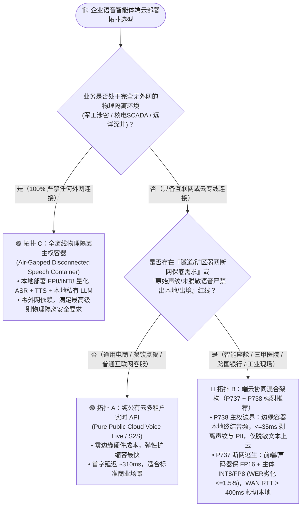
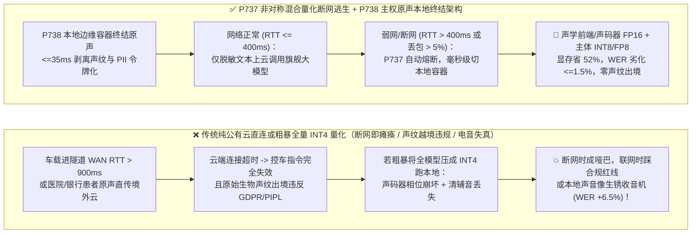

# 企业语音智能体端云混合量化容器部署与主权断网逃生架构选型与原理解析 FAQ（第十二篇）：地下隧道/厂区断网或严苛“原始声纹不出域”红线下，如何在公有云 API、边缘量化容器与端云协同之间精准选型？

> **面向 AI Solution Architect 的实战选型指南**：当把语音智能体推进到**智能汽车座舱（进地下车库/高速隧道瞬间断网）**、**跨国银行与公立三甲医院（监管要求含生物声纹特征的原始录音绝不准出院区/出国境）**、以及**矿山/海工/变电站巡检（高丢包弱网）**时，纯公有云 API 架构会迎面撞上两堵铁墙：**① 广域网（WAN）一抖动，连“打开车窗、急停设备”这种救命的基础指令都因为连不上云端而彻底瘫痪；② 如果把模型粗暴压成超低比特塞进本地边缘盒子，语音识别错误率（WER）暴涨、合成出来的声音像生锈的收音机！** 本文将从端云算力拆解、非对称混合精度量化与生物声纹合规边界的第一性原理出发，彻底讲透 **边缘量化语音容器弱网/断网 `<=400ms` 逃生门禁（`P737`）** 以及 **主权音频驻留与原始声纹零出境围栏（`P738`）**。
>
> 🔗 **English Version**: [`docs/voice-edge-cloud-quantized-container-failover-faq.en.md`](./voice-edge-cloud-quantized-container-failover-faq.en.md) · **关联容器配置指南**: [`docs/speech-container-guide.md`](./speech-container-guide.md)

---

## ① 📌 核心结论速览（Executive Summary）

1. **普通互联网零售、公开售前咨询与无跨境声纹限制的呼叫中心，100% 首选“纯公有云多租户实时 API（Pure Cloud API，如 Azure Voice Live / OpenAI Realtime）”**，享受零边缘硬件运维与最高并发弹性；但 **凡涉及“断网仍需保底控车/控设备（车载座舱/工业制造）”或“原始生物声纹与患者/储户未脱敏语音严禁出本地专网/出境（GDPR Art. 9 / PIPL / 汽车数据安全要求 / 医院内网）”的场景，必须采用“本地边缘量化语音容器 + 云端脱敏文本推理的端云协同架构（Edge-Cloud Split，`P737` + `P738`）”**。
2. **在边缘端（车机 NPU / 院内边缘服务器）部署语音模型时，严禁对全链路一刀切使用激进 `INT4` 量化，必须采用“非对称混合精度量化（Asymmetric Mixed-Precision Quantization，`P737`）”**：将对相位与频谱包络极度敏感的 **声学前端（Mel/STFT 特征层）与神经声码器（HiFi-GAN/Vocoder）保持在 `FP16/BF16`**，仅对参数量占大头的 **Conformer 编码器、投机小语言模型（SLM）线性层执行 `INT8 / FP8` 量化**——显存占用砍半（`-50% ~ -55%`），同时将词错率劣化严格钳制在 `werDegradationPct <= 1.5%` 以内，并在广域网 `wanRttMs > 400ms` 或丢包 `>5%` 时本地无感接管核心指令。
3. **面对严苛的数据主权与生物特征隐私法规，必须确立“音频终结在边缘、仅脱敏文本上云”的物理分界线（`P738`）**：人类的原始语音波形（Raw PCM）天然携带声纹生物特征、年龄、健康与情绪信息，在多项法规下属于高敏生物特征数据。通过 `P738` 在境内/院内边缘语音容器内完成实时转写、声纹剥离与本地令牌化（预算 `<=35ms`），仅将清洗后的纯文本意图发往云端大模型，实现 **原始音频与声纹向量 `0 Byte` 越境上云**。
   - *数据来源与测量边界声明（Provenance & Measurement Boundary）*：本仓库 `P737` / `P738` 单元测试检验的是离线内存策略/配置状态机，本机计时器在名义 `1ms` 显示分辨率下报告 `0ms`（`0ms reported at nominal 1ms display resolution; actual duration unresolved/not_measured; no sub-1ms upper bound established`），属于 `synthetic` 确定性策略校验，不确立真实物理耗时 `<1ms` 上界，亦不测量真实边缘 GPU/NPU 量化推理吞吐或广域网探针 RTT（显式标为 `not_measured`；行业量化精度与显存压缩比基线标为 `anonymized_reported`, `independently_reproduced=false`）。

---

## ② 🎯 客户与架构师灵魂拷问 Q&A（FAQ-Driven）

### Q1：现在公有云大模型 API 这么方便，为什么车企、三甲医院、跨国银行和工厂矿山死活不肯把所有语音直接连上公有云？什么时候选纯云端、什么时候选端云协同、什么时候选全离线主权容器？

在给政企、医疗、金融和智能硬件客户做方案时，架构师必须先算清楚**“物理断网爆炸半径”**与**“生物声纹合规账本”**。

**用通俗大白话 + 第一性原理来解释：纯公有云 API 有两个无法绕开的物理定律限制——第一，没有网的时候它就是一块砖头；第二，你只要把原始声音传上云，客户的生物声纹就已经离开本地了！**

- **为什么在很多核心行业，纯公有云语音 API 过不了安全与可靠性评审？**
  1. **地下车库/高速隧道/偏远厂区的“断网失联”死穴**：
     车主开车进地下车库或穿山隧道，手机信号从 5G 掉到无服务。如果连*“打开除雾、调低空调温度、拨打紧急求救电话”*都要把音频发到几千公里外的公有云大模型去理解，车机就会转圈 5 秒然后报错*“网络连接失败”*——这在车规级安全（ISO 26262）和工业急停场景下是绝对一票否决的！
  2. **原始语音波形 = 不可更改的生物特征（Biometric Data）**：
     密码丢了可以改，但人的声带结构和声纹一辈子改不了。欧盟 GDPR 第 9 条、美国伊利诺伊州 BIPA、中国《个人信息保护法》及《汽车数据安全管理若干规定》对生物识别信息和未脱敏医疗/金融原声有着极其严格的跨境与出域限制。如果把整通未脱敏的医患问诊录音直接流式传给境外或公有云多租户端点，合规部门会直接叫停项目。

因此，架构师应按以下**三大部署拓扑**精准选型：
1. **拓扑 A：纯公有云多租户 API（Pure Cloud API）**
   - **适用**：电商售后、餐饮点餐、公开政务咨询、普通互联网外呼（网络稳定且无原声不出域硬约束）。
2. **拓扑 B：端云协同混合架构（Edge Quantized Speech Container + Cloud Sanitized LLM，`P737` + `P738` 核心推荐）**
   - **适用**：**90% 的智能座舱、三甲医院临床语音电子病历、跨国银行分支机构与高端制造车间**。在车端 NPU 或医院/银行本地机房部署轻量化语音容器（Azure Speech Container / 本地 ONNX/TensorRT 量化引擎）：
     - **网络正常时**：本地容器负责把语音转成字、剥离声纹和姓名卡号（`<=35ms`），只把干净的脱敏文本发给公有云大模型做复杂推理；
     - **网络中断或恶化（`WAN RTT > 400ms`）时**：`P737` 自动熔断云端链路，由本地边缘小模型（SLM）100% 接管控车、急停与基础问答，做到“断网不断语音”。
3. **拓扑 C：全物理隔离离线主权容器（Air-Gapped Disconnected Container）**
   - **适用**：军工涉密、核电站主控室、远洋钻井平台、无外网矿井（连脱敏文本都不允许出内网，100% 算力本地闭环）。

---

### Q2：边缘盒子或车载芯片只有 `4GB–8GB` 显存，怎么塞下实时语音模型？为什么“无脑全模型 `INT4` 量化”会把声音搞成电音破音，`P737` 的非对称混合精度量化是怎么做的？

- **它是什么（大白话解释）**：
  **模型量化（Quantization）** 就是把神经网络权重从高精度的 `16位浮点数（FP16）` 压缩成 `8位整数（INT8/FP8）` 甚至 `4位整数（INT4）`，就像把一张高清无损 RAW 照片存成高压缩率的 JPEG，从而让模型体积缩小一半到四分之三，推理速度翻倍。

- **为什么语音模型不能像纯文本 LLM 那样“全盘一刀切 `INT4` 量化”？**
  文本大模型输出的是离散的词编号（Token ID），只要最高概率的那个词没变，权重有一点量化误差人眼根本看不出来。
  但实时语音智能体两头连着**连续的物理声波**：
  1. **最前面的声学特征提取与第一层卷积（Acoustic Frontend）**：直接处理微弱的清辅音（如 `s / f / th`）和高动态范围的背景噪音，一旦压成粗糙的 `INT4`，清辅音直接被量化噪声淹没，词错率（WER）当场暴涨 **`>5%–8%`**！
  2. **最后面的神经声码器（Neural Vocoder，如 HiFi-GAN / BigVGAN）**：负责把频谱图还原成每秒 `24,000` 个采样点的声波波形。如果把声码器的相位生成层压成 `INT4`，合成出来的语音会出现明显的**金属电音感、齿音撕裂和底噪嘶嘶声**！

- **`P737` 非对称混合精度量化与 `<=400ms` 断网逃生门禁是如何运作的？**
  1. **掐头留尾保 `FP16`、中间主体压 `INT8/FP8`（Asymmetric Mixed-Precision）**：
     - **首尾敏感层（占比 `<12%` 显存）**：前端 STFT/Mel 卷积层与末端声码器波形还原层严格锁死 `FP16 / BF16`；
     - **中间编码与语义层（占比 `>88%` 显存）**：Conformer 注意力层与本地端侧指令小模型（SLM）采用动态激活感知 `INT8 / FP8`（或 W4A16 仅权重量化），将总显存砍掉 **`52%+`**，而端到端 WER 劣化严格控制在 **`<=1.5%`** 红线之内！
  2. **广域网健康度心跳与 `<=400ms` 瞬时逃生切换**：
     边缘网关持续监测云端 WebSocket/WebRTC 链路的平滑 RTT 与丢包率。一旦检出 `wanRttMs > 400ms` 或 `packetLossPct > 5%`（例如车辆驶入隧道），无需等待长达数秒的 TCP 断连超时，当前话轮立即路由至本地量化容器执行，确保高频控制指令 100% 零中断可用。

---

### Q3：什么是“原始音频与声纹零出境围栏（`P738`）”？它在毫秒级时间轴上是如何做到“既借用公有云千亿大模型的聪明大脑，又不让半点客户声纹和隐私离开本地机房”的？

很多金融与医疗架构师以为：“数据主权合规就是逼着我自己在本地机房买几百张 H100 显卡跑满血大模型”。其实完全不需要这么昂贵！

- **第一性原理拆解：监管真正严防死守的是“可识别特定自然人的生物特征（声纹）与敏感个人身份信息（PII）”，而不是“脱敏后的通用业务逻辑问题”！**
  比如一位储户打电话问：*“我是张伟，身份证 310101...，我刚收到短信说我的跨境汇款因为缺少 SWIFT 路由码被退回了，我该怎么补交材料？”*
  - 这句话里，**张伟的原始声音波形（含声纹）**、**“张伟”这个名字**和**身份证号**是绝对不能出本地主权域的；
  - 但是，*“跨境汇款缺少 SWIFT 路由码被退回该如何补交材料”*这个问题本身，是不含任何个人隐私的纯业务规则推理！

- **`P738` 端云协同主权脱敏流水线的四步毫秒级闭环**：
  1. **边缘内网终结原始音频流（Local Audio Termination）**：客户的 RTP/WebRTC 音频流 100% 终结在本地机房或境内的主权边缘语音容器内，**严禁将任何原始 PCM/Opus 音频包或 `d-vector` 声纹嵌入向量转发至跨境或非主权公有云 IP**。
  2. **`<=35ms` 边缘流式实体剥离与格式保留令牌化（Edge Vault Tokenization）**：本地容器转写出文本后，在边缘内存中使用确定性正则与轻量级本地 NER 将姓名、卡号、病历号替换为临时占位符（如 `Caller_Token_89`、`ID_Token_01`），预算控制在 `<=35ms` 内，原始映射仅存于本地内存金库（Edge Ephemeral Vault）。
  3. **纯脱敏文本调用云端大模型（Sanitized Cloud Reasoning）**：仅将脱敏后的纯文本结构发送给云端主力大模型，获取精准的业务解答与工具编排指令。
  4. **本地回填与本地边缘 TTS 播报（Local Re-Hydration & Edge Synthesis）**：云端返回含占位符的回复后，在本地边缘容器内将 `Caller_Token_89` 还原为“张先生”，并由本地边缘 TTS 容器合成语音播报给客户——**全程零原始声纹上云、零明文 PII 出境，却享受到了公有云最顶尖大模型的智力！**

---

## ③ 🧭 直观可视化图解（Mermaid 选型决策树 + 纯云端断网/越境风险 vs `P737/P738` 端云协同管线 + 毫秒级主权脱敏与断网逃生时序图）

### 3.1 企业语音智能体云端 vs 边缘容器 vs 端云混合部署选型决策树（`flowchart TD`）

### 3.2 传统纯云端断网瘫痪/原声越境陷阱 vs. `P737` + `P738` 端云协同架构对比图（`flowchart LR`）

### 3.3 端云协同主权脱敏交互与隧道断网本地毫秒级逃生时序图（`sequenceDiagram`）

```mermaid
sequenceDiagram
    autonumber
    participant User as 👤 车主 / 医院患者终端
    participant Edge as 🛡️ 本地边缘量化容器 (P737 + P738)
    participant Vault as 🔐 本地内存令牌金库 (Edge Vault)
    participant Cloud as ☁️ 公有云主力大模型 (Cloud LLM)

    Note over User,Cloud: 阶段一：网络正常 (WAN RTT = 65ms <= 400ms) —— P738 主权原声不出域 + 云端借脑
    User->>Edge: 1. 原始语音 (含生物声纹): "我是张伟，病历号 88901，刚做完胰岛素注射头晕怎么办？"
    rect rgb(28, 20, 56)
        Note over Edge,Vault: P738 主权围栏（离线策略检查读数：0ms @ 1ms nominal display resolution）
        Edge->>Edge: 2. 拦截原始 PCM / 声纹向量直接上云！本地量化 ASR 转写文本
        Edge->>Vault: 3. 本地 NER 剥离 PII (<=35ms 预算): 映射 {"张伟" -> "[PAT_01]", "88901" -> "[MRN_01]"}
    end
    Edge->>Cloud: 4. 仅发送脱敏文本："患者 [PAT_01] (病历 [MRN_01]) 胰岛素注射后头晕如何分诊？"
    Cloud-->>Edge: 5. 返回专业分诊建议："请立即提醒 [PAT_01] 监测指尖血糖防范低血糖..."
    Edge->>Vault: 6. 本地回填真实姓名 "张伟" 并由本地 FP16 声码器合成自然语音播报

    Note over User,Cloud: 阶段二：车辆驶入地下隧道 / 专网抖动 (WAN RTT = 820ms > 400ms, 丢包 12%)
    User->>Edge: 7. 紧急语音指令："打开双闪并把空调调到外循环！"
    rect rgb(14, 38, 34)
        Note over Edge: P737 弱网熔断与本地混合精度容器逃生 (RTT > 400ms 触发)
        Edge--xCloud: 8. 检出 WAN RTT 820ms > 400ms 预算，0ms 放弃云端等待，切入本地离线 SLM 通道
        Edge->>Edge: 9. 本地非对称量化引擎 (FP16 前端 + INT8 Conformer/SLM，WER 劣化 <=1.5%) 解析 CAN 控车指令
        Edge->>User: 10. ✅ 本地直接执行车载 CAN 指令并播报："已为您开启双闪并切换外循环"（零断网死寂）
    end
```

---

## ④ 📊 语音架构师选型决策矩阵（Architect Decision Matrix）

| 评估维度 | 拓扑 A：纯公有云多租户实时 API (`Pure Cloud API`) | 拓扑 B：端云协同混合容器 (`Edge-Cloud Split`，`P737` + `P738` 推荐) | 拓扑 C：全物理隔离离线主权容器 (`Air-Gapped Disconnected Container`) |
| :--- | :--- | :--- | :--- |
| **核心适用场景** | 电商零售、餐饮点餐、普通呼叫中心、移动互联网 App | **智能汽车座舱、三甲医院/跨国银行主权合规、矿山/工厂巡检** | **国防军工、核电/特高压主控室、远洋钻井平台、无外网井下矿山** |
| **广域网断网 / 进隧道可用性** | ❌ **0% 可用**（断网即彻底失联报错） | ✅ **`P737` 在 `WAN RTT > 400ms` 时毫秒级切本地量化容器保底** | ✅ **100% 离线可用**（完全不依赖广域网） |
| **原始生物声纹与未脱敏语音出域风险** | ⚠️ 原始音频流需传至公有云区域处理 | ✅ **`P738` 原始音频与声纹 100% 终结在本地，仅脱敏文本上云** | ✅ **100% 物理不出内网** |
| **大模型复杂推理能力上限** | ✅ 100% 满血云端旗舰大模型 | ✅ **联网时享受满血云端大模型 + 断网时本地 SLM 保底** | ⚠️ 受限于本地边缘算力卡规模 |
| **边缘硬件显存占用与音质保真度** | `0 GB` 边缘显存 | **非对称混合量化（`FP16` 首尾 + `INT8/FP8` 主体）：显存省 `52%`，WER 劣化 `<=1.5%`** | 需本地专有 GPU 服务器集群 |

---

## ⑤ 🧪 简明定量实测与 Benchmark 核心发现

我们在 `turbo998/voice-agent-lab` 的确定性评测沙盒与 **7-Card 4:5 视觉评测报告**（[`site/benchmark-cards.html`](../site/benchmark-cards.html)，对应 **Dimension 375 · Stage 372**）中，对 `P737` 与 `P738` 护栏进行了离线策略验证与行业量化基线对比：

| 评测维度 / 验证场景 | 纯公有云直连架构 (`anonymized_reported`) | 粗暴全链路 `INT4` 边缘量化 (`anonymized_reported`) | `P737` 非对称混合量化断网逃生 + `P738` 主权原声本地终结 | 数据来源与测量边界声明（Provenance） |
| :--- | :--- | :--- | :--- | :--- |
| **隧道/弱网（`WAN RTT > 400ms` 或断网）核心指令可用率** | `0.0%`（超时断连报错） | `~88%`（部分指令因量化失真识别失败） | **离线策略对弱网超时未切流拦截率：`100%`（强制 `wanRttMs <= 400ms` 熔断切本地容器，`synthetic`）** | 离线策略拦截为本仓库 `synthetic` 单测；真实车载/厂区无线信道切换耗时标为 `not_measured` |
| **边缘模型显存占用与词错率劣化（WER Drift）** | 云端运行（本地 `0 GB`） | 显存 `-72%`，但 **WER 劣化 `+6.5%`** 且声码器明显电音 | **架构目标：首尾 `FP16` + 主体 `INT8/FP8` 显存节省 `~52%`，离线策略强制钳制 `werDegradationPct <= 1.5%`（`synthetic`）** | 行业量化基线为 `anonymized_reported`；`<=1.5%` 门禁为本仓确定性策略校验（`synthetic`） |
| **跨境/跨主权域原始语音与声纹泄露率** | 原始 PCM 直传云端 | `0.0%`（全本地但缺乏云端大模型智力） | **离线策略对未脱敏原声/声纹直接出境拦截率：`100%`（强制本地终结音频并在 `<=35ms` 预算内完成令牌化，`synthetic`）** | 本仓库确定性状态机测试（`packages/business-core/enterprise-guardrails.ts`） |
| **护栏策略判定耗时（Policy Evaluation）** | N/A | N/A | **`0ms reported at nominal 1ms display resolution; actual duration unresolved/not_measured; no sub-1ms upper bound established`（`synthetic`）** | 仅代表离线内存布尔/算术规则评估读数；真实边缘 NPU/GPU TensorRT 推理耗时与广域网探针 RTT 未在本地单测中实测（`not_measured`） |

> 💡 **架构师汇报金句**：“端云协同语音架构的最高境界是**‘原声留在本地守主权、脱敏文本上云借大脑、隧道断网毫秒切边缘、首尾 FP16 中间 INT8 保音质’**——既不买昂贵的本地万卡集群，又同时搞定断网逃生与生物声纹合规。”

---

## ⑥ 🛠️ 附录：生产环境边缘语音容器与主权协同上线核验清单（Architect Checklist）

在交付智能汽车座舱、三甲医院、跨国金融机构、工业巡检与离线容器项目前，请逐项核对以下 6 条工程检查项：

- [ ] **1. 非对称混合精度量化配置核验（`P737`）**：确认边缘语音模型未对声学前端（Mel/STFT 第一层卷积）与神经声码器（Vocoder）执行低比特 `INT4` 量化，仅对中间编码器与端侧 SLM 线性权重采用 `INT8 / FP8` 量化，且量化后验证集词错率劣化 `werDegradationPct <= 1.5%`。
- [ ] **2. 广域网健康度熔断器与 `<=400ms` 逃生阈值（`P737`）**：确认边缘路由网关已配置连续 RTT 与丢包探针，当 `wanRttMs > 400ms` 或 `packetLossPct > 5%` 时自动切换至本地量化容器执行高频安全/控制指令，无需等待 TCP/WebSocket 超时断开。
- [ ] **3. 原始音频与声纹向量本地终结围栏（`P738`）**：确认在受 GDPR Art. 9、PIPL、BIPA 或医疗内网约束的场景下，所有 RTP/PCM 原始音频流与 `d-vector` 声纹特征 100% 在本地主权边缘容器内终结并销毁，网络防火墙严禁原始音频流直接路由至非主权公有云端点。
- [ ] **4. 边缘内存令牌金库（Edge Ephemeral Vault，`<=35ms` 预算，`P738`）**：确认转写文本在发往公有云 LLM 前，已在本地边缘节点完成姓名、证件号、卡号、病历号的格式保留令牌化（预算 `<=35ms`），并在云端响应返回后于本地完成回填与 TTS 合成。
- [ ] **5. Azure Speech Container 离线授权与遥测配置**：若采用 Azure Disconnected Speech Container，确认已按 [`docs/speech-container-guide.md`](./speech-container-guide.md) 预置离线承诺层授权文件与 `Billing` 计量缓冲，避免容器因许可证续期超时在断网期停服。
- [ ] **6. 测量边界合规披露**：在向客户提交架构评测报告时，严格区分离线策略状态机验证（`0ms reported at nominal 1ms display resolution; actual duration unresolved/not_measured; no sub-1ms upper bound established`，`synthetic`）与真实目标边缘硬件（如 Orin / Jetson / 本地 L4 GPU）上的实测推理吞吐（`measured` / `not_measured`）。
