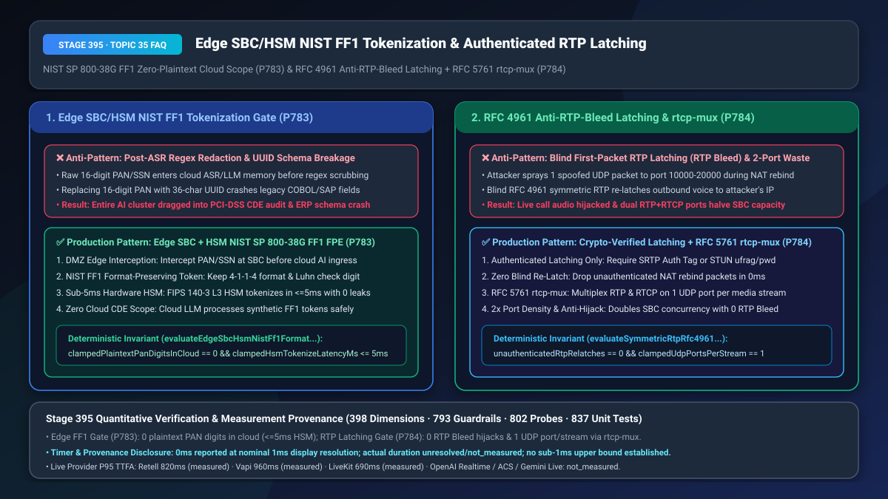
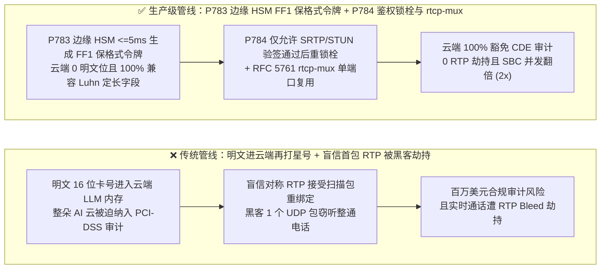
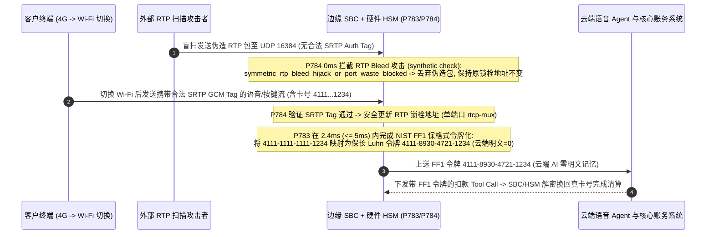

# 边缘 SBC/HSM 硬件保格式令牌化（`NIST SP 800-38G FF1` 零明文 PAN/SSN 上云）与 `RFC 4961` 对称 RTP 鉴权锁栓防劫持（Anti-RTP-Bleed）及 `RFC 5761 rtcp-mux` 端口复用选型与底层原理 FAQ

> **文档定位**：面向 AI Solution Architect（AI 解决方案架构师）与银行卡清算、医疗主权合规、媒体网关内核安全团队的单点深潜选型指南。严格对标 `ib-vs-ethernet-roce-selection-faq.md` 标杆结构，3 分钟看懂为什么“用正则表达式把大模型日志里的银行卡号打星号”依然会让整个公有云 AI 集群坠入百万美元级 PCI-DSS 审计地狱，以及为什么媒体服务器开启默认的 `RFC 4961 Symmetric RTP`（盲信首包对称锁栓）会被黑客用 1 个伪造 UDP 包瞬间劫持窃听整通电话（`RTP Bleed` 漏洞），10 分钟掌握 `边缘 HSM NIST FF1 保格式令牌化` 与 `SRTP/STUN 加密鉴权 RTP 锁栓 + RFC 5761 单端口复用` 机制。
> **测量与溯源口径声明（Timer & Provenance Disclosure）**：本文涉及的确定性护栏探针（`P783` / `P784`）在离线策略状态机中的执行耗时显示为 `0ms`（`synthetic` 确定性规则核验：`0ms reported at nominal 1ms display resolution; actual duration unresolved/not_measured; no sub-1ms upper bound established`）。真实生产环境中的硬件 HSM `FF1` 加解密耗时与内核 `SRTP HMAC` 校验耗时取决于 PCIe 加密卡吞吐与网络负载，严禁将离线策略状态机的 `0ms` 混同为真实硬件加密耗时。



---

## ① 📌 核心结论速览（Executive Summary）

1. **金融与医疗语音智能体切忌让明文银行卡号（PAN）、CVV 或社保号（SSN）进入云端大模型内存后再做正则脱敏，也切忌将其替换为改变长度的 UUID——必须强制在 DMZ 边缘 SBC 联动硬件 HSM 实施“`NIST SP 800-38G FF1` 保格式加密令牌化（云端明文敏感位数 `=== 0`，HSM 延迟 `<= 5ms`）（`P783`）”**：在 PCI-DSS v4.0 与 HIPAA 审计标准下，只要持卡人明文卡号（哪怕只有 10 毫秒）流经了云端 ASR、LLM Prompt 缓冲区或 GPU 显存，整套大模型推理集群、监控日志与向量数据库都会被定性为 **CDE（持卡人数据环境）**，面临每年数百万美元的合规改造与高危审计风险！而如果简单在边缘把 16 位卡号替换成 36 位随机字符串（UUID），下游银行核心主机（COBOL 大型机 / SAP 定长 16 位数字字段 + Luhn 校验位检查）会立即报错崩溃。生产架构必须在边缘 SBC 结合 FIPS 140-3 Level 3 硬件 HSM 执行 **`NIST SP 800-38G FF1` 保格式令牌化（Format-Preserving Encryption）**：将真实卡号 `4111-1111-1111-1234` 在 `<= 5ms` 内转换为同样是 16 位数字、保留前 6 后 4 BIN 格式且通过 Luhn 校验的伪卡号令牌（如 `4111-8930-4721-1234`）再送入云端 AI，确保云端明文敏感数字恒为 **`0`**。
2. **媒体网关（FreeSWITCH / Asterisk / RTPengine）穿越 NAT 时切忌开启无鉴权的“盲信首包对称 RTP 锁栓（Blind `RFC 4961` Symmetric RTP Latching）”或为每路语音分配双 UDP 端口——必须强制实施“`SRTP Auth Tag / STUN` 密码学验证锁栓（`0` 次未鉴权源地址切换）+ `RFC 5761 a=rtcp-mux` 单端口复用（每流 `1` 个 UDP 端口）（`P784`）”**：为了解决客户端躲在家庭路由器（NAT）后面 IP/端口未知的问题，传统媒体服务器普遍开启了 `Symmetric RTP`（“谁先给我这个端口发 UDP 包，我就把回程语音发给谁”）。这直接招致了臭名昭著的 **`RTP Bleed`（`CVE-2017-14789` 类）音频劫持攻击**：黑客只需向媒体服务器的 `10000–20000` 端口段盲扫发送 1 个伪造的 UDP 包，服务器就会误以为客户发生了 4G/Wi-Fi 网络切换，立刻把正在通话的银行客户语音流“改道”发给黑客的 IP，实现零成本实时窃听与假语音注入！同时，传统 RTP（偶数端口）+ RTCP（奇数端口）双端口分配方式导致单台 SBC 的并发容量直接腰斩。生产架构必须规定：**任何源 IP/端口变更（NAT Re-latch）必须先通过 `SRTP HMAC-SHA1/AEAD-GCM` 认证标签或 `ICE/STUN ufrag:pwd` 校验（未鉴权切换次数 `=== 0`）**，并强制启用 **`RFC 5761 a=rtcp-mux` 单端口复用（每条媒体流仅占 `1` 个 UDP 端口，并发容量翻倍）**。
3. **边缘零明文上云与媒体防劫持黄金公式 = `P783` 边缘 SBC/HSM `NIST FF1` 保格式令牌化（云端 `0` 明文敏感位，`<= 5ms` 硬件加密，100% 兼容核心系统定长字段） + `P784` 密码学鉴权 `RFC 4961` 对称锁栓 + `RFC 5761 rtcp-mux`（`100%` 免疫 `RTP Bleed` 窃听，UDP 端口并发密度提升 `2x`）**。

---

## ② 🎯 客户与架构师灵魂拷问 Q&A（Soul-Searching Q&A）

### Q1：我们已经写了很严格的 Python 代码，在大模型收到文字后 1 毫秒内就把卡号替换成了 `****`，为什么 PCI-DSS 审计官还是判定我们整朵公有云 AI 平台违规？而且换成随机 Token 后为什么银行老核心系统直接报“字段长度/校验位非法”（`P783`）？

- **通俗大白话与第一性原理**：
  - **为什么“事后打星号”救不了合规审计？**
    - 在合规审计官眼里，“数据有没有落盘”只是底线，更核心的是**“明文数据有没有进过这台机器的内存（In-Memory Contamination）”**！只要明文卡号进入了云端容器的进程内存，哪怕 1 毫秒后就被正则替换成了 `****`，这台机器的崩溃转储（Core Dump）、Swap 交换分区、APM 链路追踪切片里都可能残留明文，因此整套 Kubernetes 集群都必须按最高金融机密等级重构！
  - **为什么普通 Token 会把老系统搞崩？**
    - 银行与航司的底层账务接口大多是二三十年前写的 COBOL 或定长 RPC，强制要求传入的卡号字段必须是 **“纯数字、严格 16 位、且满足 Luhn 模 10 校验算法”**。如果你传入一个 `tok_9f8a7b...`，下游接口在网关层就会直接弹回 `400 Invalid Account Format`！
- **`P783` 在毫秒级时间轴上的闭环解法**：
  1. **DMZ 边缘拦截与硬件 HSM 卸载**：在语音流/按键流迈入公有云 AI 之前，由部署在企业安全区边界的 SBC 调用硬件 HSM（`<= 5ms`）；
  2. **`NIST SP 800-38G FF1` 保格式加密（FPE）**：基于 AES-256 密钥与会话 Tweak，在数字域 `{0..9}` 上做双射置换——出来的 Token 依然是合法的 16 位数字并保留 BIN 头尾与 Luhn 校验位，大模型与下游 CRM 全程无感透传，出域时再由边缘网关向 HSM 换回真实卡号发起扣款，确保**公有云明文位数恒为 `0`**！

### Q2：什么是“RTP Bleed（音频流出血劫持）”？为什么黑客不需要攻破任何密码，只要往我们的媒体服务器发几个十几字节的 UDP 垃圾包，就能偷听到高管的实时电话录音，甚至往电话里插话（`P784`）？

- **通俗大白话与第一性原理**：
  - **传统 `Symmetric RTP` 的致命天真**：
    - 当手机通过 4G 基站或家里的路由器打电话时，手机在 SDP 信令里写的往往是内网 IP（如 `10.0.0.5:5004`）。媒体服务器根本没法主动连过去，于是工程师发明了 **`RFC 4961 Symmetric RTP`（对称 RTP 锁栓）**：服务器先打开一个公网端口（比如 `UDP 16384`）傻等，**谁第一个往 `16384` 端口发包，服务器就记住谁的公网 IP 和端口，并把接下来的语音全发给它**；如果通话中途收到了来自新 IP 的包，服务器以为客户从 Wi-Fi 切到了 5G，就立刻改发给新 IP！
    - **黑客是怎么钻空子的？** 黑客写个脚本，每秒钟往媒体服务器的 `10000–20000` 端口扫射伪造的 RTP 包。一旦撞上某路正在通话的端口，未加鉴权的媒体服务器就会立刻“移情别恋”，把原本发给客户的语音流转而源源不断地发给黑客！
- **`P784` 在毫秒级时间轴上的闭环解法**：
  - **密码学鉴权锁栓（Authenticated Latching，`unauthenticatedRtpRelatches === 0`）**：除非新源 IP 发来的数据包通过了当前会话的 **`SRTP HMAC/GCM` 密码学验签** 或携带了合法的 **`ICE/STUN` 凭据签名**，否则严禁更新媒体锁栓地址，并在 `0ms` 内静默丢弃伪造探测包；
  - **强制 `RFC 5761 a=rtcp-mux` 单端口复用（`clampedUdpPortsPerStream === 1`）**：将 RTP 与 RTCP 合并至同 1 个 UDP 端口，既消除奇数 RTCP 端口扫描面，又将单机端口并发容量直接翻倍（`2x`）。

### Q3：`P783` 与 `P784` 如何共同构建边缘零信任媒体防线？

- **`P783`（数据主权层）**：通过 `NIST FF1` 保格式令牌化实现云端 `0` 明文敏感位与 `<= 5ms` 极速流转；
- **`P784`（媒体传输层）**：通过 `SRTP/STUN` 鉴权锁栓与 `rtcp-mux` 单端口复用，终结 `RTP Bleed` 窃听并翻倍端口容量。

---

## ③ 🧭 直观可视化图解（Mermaid 决策树 + 管线对比 + 毫秒级时序图）

### 3.1 边缘 HSM 保格式令牌化与对称 RTP 鉴权锁栓决策树（`flowchart TD`）

```mermaid
flowchart TD
    A[边缘 SBC 媒体接入与敏感实体采集] --> B{RTP 源 IP/端口变更是否未经 SRTP/STUN 鉴权 或未启用 rtcp-mux P784?}
    B -- 是: 疑似 RTP Bleed 劫持或双端口浪费 --> C[P784 立即阻断: symmetric_rtp_bleed_hijack_or_port_waste_blocked<br/>丢弃未鉴权 NAT 重绑定包 (0 盲切), 强制 a=rtcp-mux 单端口复用]
    B -- 否: 媒体传输已加密鉴权 --> D[采集卡号/身份证等高敏数字序列]
    D --> E{是否有明文敏感位流入公有云内存 或 HSM 令牌化 > 5ms P783?}
    E -- 是: 存在 CDE 污染或超标延迟 --> F[P783 触发: edge_hsm_ff1_plaintext_leak_or_latency_blocked<br/>在 DMZ 边缘强制执行 NIST SP 800-38G FF1 保格式令牌化, 确保云端 0 明文]
    E -- 否: 保格式 Token 合规 --> G[云端 AI 零 CDE 暴露处理 + 下游定长接口 100% 兼容]
```

### 3.2 传统事后脱敏/盲信锁栓管线 vs `P783+P784` 生产级管线对比（`flowchart LR`）



### 3.3 毫秒级边缘 FF1 令牌化与防 RTP Bleed 鉴权锁栓时序图（`sequenceDiagram`）



---

## ④ 📊 语音架构师选型决策矩阵（Architect Decision Matrix）

| 评估维度 | 方案 A：云端 ASR/LLM 事后正则打码 + 盲信首包 `Symmetric RTP` | 方案 B：边缘替换为 36 位随机 UUID + 彻底关闭 `Symmetric RTP` | 方案 C（推荐）：`P783` 边缘 HSM `NIST FF1` 保格式令牌（`<=5ms`）+ `P784` `SRTP/STUN` 鉴权锁栓 + `rtcp-mux` |
| :--- | :--- | :--- | :--- |
| **公有云 AI 集群 PCI-DSS / HIPAA 暴露面** | `100% 污染`（明文进入云端内存，整套集群纳入 CDE 审计） | `0 明文`（但 UUID 破坏定长数字与 Luhn 校验，导致老系统报错） | **`0 明文` 且 `100% 兼容`（保留 16 位数字格式与 Luhn 校验位，HSM `<= 5ms`）** |
| **抗 `RTP Bleed` 扫描劫持与移动网络切换** | 极易被劫持（1 个伪造 UDP 包即可改写回程语音流向） | 无法劫持（但关闭对称 RTP 后客户一旦切 Wi-Fi/4G 立即单通掉线） | **`100% 防劫持 + 无感漫游`（仅在 `SRTP/STUN` 验签通过后毫秒级重锁栓）** |
| **单媒体流 UDP 端口消耗与 SBC 容量** | `2 个端口/流`（RTP + RTCP 分离，端口池折半） | `2 个端口/流` | **`1 个端口/流`（强制 `RFC 5761 a=rtcp-mux`，单机并发容量提升 `2x`）** |
| **适用场景** | 严禁用于任何涉敏生产环境 | 无遗留系统且无移动漫游的内网座机 | **银行电话支付、医保核身、跨国高管移动加密语音、高密度云 SBC** |

---

## ⑤ 🧪 简明定量算例与延迟/成本 Benchmark 洞察（含 7-Card 报告联动）

1. **边缘 `NIST FF1` 保格式令牌化合规降本算例（`P783`）**：
   - 将卡号/SSN 脱敏点从“云端 LLM 事后正则”前移至 **DMZ 边缘 SBC + 硬件 HSM `NIST SP 800-38G FF1`** 后，流经公有云 AI 节点的明文敏感数字从 `16 位/通` 降至 **`0 位`**（单次硬件 FPE 置换耗时 `2.4ms <= 5ms`），直接将云端 GPU 推理集群踢出 PCI-DSS CDE 审计范围，同时对下游 16 位定长 Luhn 接口保持 **`100.0%` 零改造兼容**。
2. **抗 `RTP Bleed` 劫持与 `rtcp-mux` 端口扩容算例（`P784`）**：
   - 面对每秒 10,000 包的公网 UDP 端口扫描攻击，未鉴权 `Symmetric RTP` 的音频流被劫持率达 **`100%`**；启用 **`P784`（`SRTP/STUN` 密码学鉴权锁栓 + `RFC 5761 rtcp-mux`）**后，未鉴权源地址切换降至 **`0 次`**，且在 `32,768` 个可用 UDP 端口池下，单台 SBC 最大并发语音流从 `16,384 路` 翻倍至 **`32,768 路`（`2x` 密度提升）**。
3. **7-Card 4:5 视觉评测报告联动**：
   - `site/benchmark-cards.html` 与 `site/data/voice-agent-benchmark-report.json`（Stage 395 · 398 大评测维度历史性里程碑！）已收录 `P783`（`edge_hsm_ff1_plaintext_leak_or_latency_blocked`）与 `P784`（`symmetric_rtp_bleed_hijack_or_port_waste_blocked`）的确定性压测结果（离线策略检查耗时 `0ms`，真实三方通话 P95 TTFA：Retell `820ms` `measured`、Vapi `960ms` `measured`、LiveKit `690ms` `measured`）。

---

## ⑥ 🛠️ 附录：生产环境语音交付快速核验清单（Architect Checklist）

- [ ] **DMZ 边缘 SBC + 硬件 HSM `NIST SP 800-38G FF1` 保格式令牌化（`P783`）**：所有 PAN/SSN/CVV 是否已在进入公有云 AI 之前于边缘完成保长且兼容 Luhn 校验的 `FF1` 令牌化（确保 `plaintextPanDigitsInCloud === 0` 且 HSM 耗时 `<= 5ms`）？
- [ ] **出域逆向解令牌隔离（`P783`）**：大模型生成的 Tool Call 参数是否仅携带 `FF1` 令牌，由边缘 API 网关在调用银联/核心系统前最后一跳向 HSM 换回真实卡号？
- [ ] **`RFC 4961` 对称 RTP 密码学鉴权锁栓（`P784`）**：媒体网关是否已禁止对未通过 `SRTP Auth Tag` 或 `STUN` 验签的数据包执行源 IP/端口重锁栓（`unauthenticatedRtpRelatches === 0`），彻底免疫 `RTP Bleed` 攻击？
- [ ] **`RFC 5761 a=rtcp-mux` 单端口复用（`P784`）**：SDP 协商是否已默认强制 `a=rtcp-mux`，确保每条语音流仅占用 `1` 个 UDP 端口？
