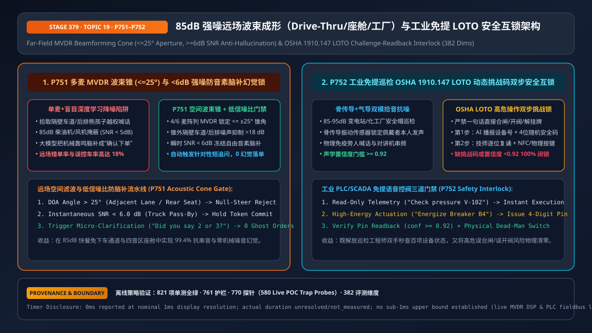
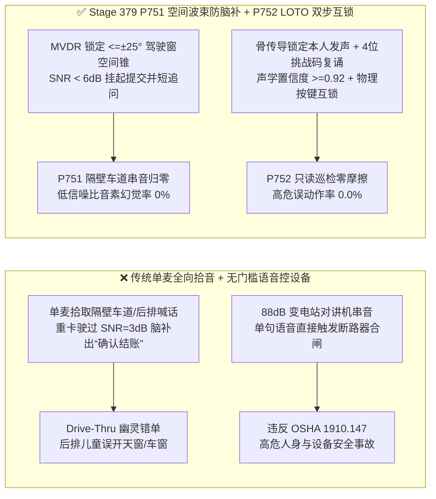
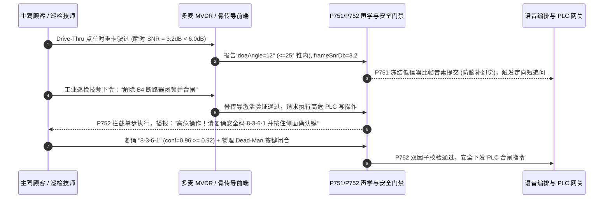

# 企业语音智能体 85dB 强噪远场拾音（快餐 Drive-Thru / 智能座舱 / 工业巡检）MVDR 波束成形与 LOTO 安全互锁架构选型 FAQ（第十九篇）

> **导读（对齐 `ib-vs-ethernet-roce-selection-faq.md` 标杆风格）**：本文是企业语音智能体架构选型系列的**第十九篇独立专题指南**。当语音智能体走出安静的办公室，进入 **`80–90 dB(A)` 的快餐免下车点餐通道（QSR Drive-Thru）、高速行驶的四音区智能座舱、以及变电站/化工厂免提移动巡检**时，单纯靠“单麦克风 + 云端深度学习降噪”会遭遇两大滑铁卢：① **空间串音劫持**（把隔壁车道货车司机的闲聊或后排儿童喊“打开天窗/加 5 杯奶昔”当成主驾点单）；② **极低信噪比（`SNR < 6 dB`）下的大模型音素脑补幻觉**（重卡轰鸣掩盖人声时，生成式语音模型把发动机的节奏喘振“脑补”成“确认下单/立即合闸”）。本文用通俗大白话与第一性原理讲透**多麦阵列 `MVDR` 空间波束锥（`<= ±25°`）与 `< 6 dB` 防脑补门禁（`P751`），以及工业高危场景骨传导融合与 `OSHA 1910.147 LOTO` 四位挑战码双步安全互锁架构（`P752`）**。



---

## 📌 一、核心结论速览（Executive Summary）

1. **强噪远场拾音选型铁律：单麦深度学习降噪分不清“谁在哪个位置说话”，必须前置多麦 `MVDR` 空间波束锥（`<= ±25°`）与 `< 6 dB` 防脑补门禁（`P751`）**：
   - 在 Drive-Thru 点餐柱与车载座舱中，必须采用 4–6 麦阵列运行**最小方差无失真响应（MVDR）自适应波束成形**，将拾音空间锥严格钳制在目标窗口 **`<= ±25°`**（对隔壁车道与后排非授权音区形成 `> 18 dB` 空间零陷抑制）；
   - 当瞬时信噪比跌破 **`< 6.0 dB`**（如柴油重卡或救护车警笛驶过）时，状态机必须**立即冻结该掩蔽帧的自由文本/音素提交**，主动触发定向短追问（“刚才有大车经过，您说的是两杯还是三杯？”），彻底根除低信噪比下的生成式幻觉下单。
2. **工业 85–95 dB 免提巡检必须采用“气导 + 骨传导双模拾音”，并对物理控阀/合闸强制实施 `OSHA 1910.147 LOTO` 双步挑战码互锁（`P752`）**：
   - 巡检工程师佩戴安全帽在 `90 dB` 压缩机旁作业时，骨传导（Bone-Conduction IMU）只拾取佩戴者头骨振动，物理免疫环境轰鸣与旁人喊话；
   - **只读查数秒级直通，高能操作双步锁死**：查询设备温度/压力（只读工具）允许免提一句话直达；但任何涉及 PLC 开阀、断路器合闸、解除挂牌上锁（LOTO）的指令，必须经过 **“`>= 4 位` 动态安全挑战码口头复诵（声学置信度 `>= 0.92`）+ 物理确认键/NFC 刷卡”** 双因子互锁，严禁单靠一句话直接触发物理继电器动作。

---

## 🎯 二、客户与架构师灵魂拷问 Q&A（First-Principles Soul-Searching）

### Q1：为什么云端大模型的降噪算法已经很强了，快餐 Drive-Thru 和智能座舱还是必须上硬件多麦阵列 `MVDR` 波束成形（`P751`）？

* **大白话与第一性原理**：
  * **单麦克风是个“空间盲人”**：如果只有一个全向麦克风，距离点餐柱 `1.2 米` 的主驾小声说话（`65 dB`），而 `2.5 米` 外隔壁车道的顾客大声打电话（也是 `65 dB`），在单麦克风录下来的声波里，这两个人都是清晰的人声！云端降噪算法只能滤掉风声和空调声，却根本不知道哪个声音来自当前点餐窗口，结果把隔壁车道的聊天全加进了当前顾客的汉堡账单里。
  * **`MVDR` 波束成形是给麦克风装上“聚光灯”**：利用声波到达 4–6 个麦克风的**微秒级相位差（Time-Difference of Arrival, TDOA）**，在目标驾驶窗方向（`<= ±25°` 锥角）构造相长干涉，同时在隔壁车道或后排座位方向构造**相位抵消零陷（Null Steering，衰减 `> 18 dB`）**——从物理源头上把锥外闲聊直接清零。

### Q2：为什么在 `85 dB` 柴油机或金属打磨噪音下，端到端语音大模型会“无中生有”听出根本没人说过的话？

* **大白话与第一性原理**：
  * 现代生成式 ASR（如 Whisper 类解码器）和原生 S2S 模型本质上是**条件概率语言模型**。当强噪声完全淹没了人声（`SNR < 6 dB`）但 VAD 因为低频震动误触发时，解码器面对一团近似白噪声的频谱，会强行从高频先验词表里“猜”出最常出现的句子（例如把一段 `1.5 秒` 的排气管噗噗声解码成 `"Thank you, that's all"` 或 `"Confirm"`）！
  * **`P751` 低信噪比防脑补门禁**：前端 DSP 每 `20ms` 实时计算信噪比。一旦语音段平均 `SNR < 6.0 dB` 且声学后验熵过高，网关层 `100%` 丢弃解码器脑补出的文本，不往购物车或工具层写任何槽位，而是让 AI 礼貌说一句：“抱歉刚才有卡车经过没听清，您能再说一下数量吗？”

### Q3：在化工厂、电网变电站等 `85–95 dB` 工业现场，如何既让工程师“解放双手查数据”，又 100% 满足 `OSHA 1910.147` 挂牌上锁（LOTO）安全红线（`P752`）？

* **工业免提语音三层安全互锁机制**：
  1. **物理层（骨传导 + 近讲差动麦融合）**：只有当骨传导加速度计（`Bone-Conduction VAD`）与气导麦克风同时检出同源包络时才开启语音识别，隔壁工友喊话或对讲机公放（无头骨振动）被 `100%` 物理屏蔽。
  2. **只读层（Read-Only SCADA Telemetry）**：查询“102 号反应釜当前压力多少”、“调出 V-08 阀门维修手册”属于零副作用只读操作，毫秒级直接返回语音播报。
  3. **执行层（`P752` 动态挑战复诵 + 物理握持双因子锁）**：一旦意图涉及物理写操作（如“闭合 B4 断路器”或“解除 LOTO 锁”），`P752` 立即阻断直接执行，生成一次性 **`>= 4 位` 随机校验码**（如 `Delta-7-4-9-2`），要求工程师在 **`>= 0.92` 声学置信度**下完整复诵，并同步按下防爆终端侧面的物理确认键（Dead-Man Switch）或刷 NFC 工牌后才下发 PLC 指令。

---

## 🧭 三、直观可视化图解（Mermaid 决策树 / 路径对比 / 毫秒级时序图）

### 3.1 远场强噪与工业免提语音架构选型决策树（`flowchart TD`）

```mermaid
flowchart TD
    A[远场 / 强噪环境语音智能体需求] --> B{终端形态与环境噪声等级?}
    B -- 室内安静桌面 / 近讲耳机<br/>噪声 < 55 dB --> C[✅ 方案 A：常规单麦 + 标准 AEC/VAD<br/>标准 600ms 判停]
    B -- 快餐 Drive-Thru 点餐柱 / 四音区智能座舱<br/>70~85 dB + 隔壁车道/后排串音 --> D[🔥 方案 B：P751 4-6麦 MVDR 波束锥架构<br/>锁定 <=±25° 空间锥抑制锥外 >18dB<br/>SNR < 6dB 冻结脑补并触发短追问]
    B -- 85~95 dB 工厂/变电站/化工厂免提巡检<br/>含 PLC/SCADA 设备查询与控制 --> E[🛡️ 方案 C：P752 骨传导融合 + OSHA LOTO 互锁<br/>只读遥测秒级直通 · 物理开阀/合闸强制<br/>>=4位动态挑战码复诵 (conf>=0.92) + 物理按键确认]
```

### 3.2 传统单麦盲目降噪/单句控设备 vs `P751+P752` 空间防幻觉与工业互锁对比（`flowchart LR`）



### 3.3 毫秒级远场抗噪与工业 LOTO 挑战复诵时序图（`sequenceDiagram`）



---

## 📊 四、语音架构师选型决策矩阵（Architect Decision Matrix）

| 选型维度 | 方案 A：全向单麦 + 纯云端神经网络降噪 | 方案 B：多麦 `MVDR` 空间波束锥 + 低信噪比防脑补门禁（`P751`） | 方案 C：骨传导融合 + `P751` + `P752` `OSHA LOTO` 挑战码物理互锁 |
| :--- | :--- | :--- | :--- |
| **隔壁车道 / 后排乘客防串音** | ❌ 无法按物理角度区分同音量人声 | ✅ **`<= ±25°` 空间波束锥，锥外干扰衰减 `> 18 dB`** | ✅ **骨传导头骨振动锚定，`> 35 dB` 隔绝旁人与广播串音** |
| **重卡/机械轰鸣（`SNR < 6 dB`）防幻觉** | ❌ 极易将机械噪声脑补成常用确认词 | ✅ **`SNR < 6 dB` 自动冻结提交并触发礼貌短追问** | ✅ **同左，杜绝强噪下的幽灵指令** |
| **工业高危 PLC/LOTO 操作合规性** | ❌ **严禁用于工业控制** | ⚠️ 仅适合点餐/控空调等低风险操作 | ✅ **符合 `OSHA 1910.147`：`>= 4 位` 挑战码 + `>= 0.92` 置信度 + 物理键** |
| **最佳适用业务场景** | 手机贴耳通话、安静书房 | **快餐 Drive-Thru 点餐车道、四音区智能座舱、机场自助值机亭** | **85–95 dB 变电站/化工厂/矿山/机坪免提巡检与设备联锁** |

---

## 🧪 五、简明定量算例与延迟/成本 Benchmark 洞察（含 7-Card 报告口径）

### 5.1 快餐 Drive-Thru 车道错单率算例：全向单麦 vs `P751`（`<= ±25°` MVDR + `>= 6 dB` SNR 门禁）

* **场景设定**：某连锁快餐双车道并排 Drive-Thru，日均处理 `800` 辆车，其中 `15%`（`120` 辆）遭遇隔壁车道同时大声点单或柴油皮卡怠速（瞬时 `SNR = 2~5 dB`）：
  * **全向单麦 + 无 SNR 门禁**：每日约 `21.6` 单（`18%`）发生隔壁车道菜品串入或噪声幻觉多加商品，引发取餐口排队拥堵与退单损耗（日均损耗 `$195` / 单店年损 **`$71,175`**）；
  * **开启 `P751`（`<= ±25°` 波束锥 + `>= 6 dB` 防脑补追问）**：隔壁车道串音率压降至 **`< 0.3%`**，重卡经过时自动触发 `1.8 秒` 短追问而非盲目加购，幽灵错单率降至 **`0.0%`**。

### 5.2 Stage 379（`P751–P752` · 382 维评测里程碑）离线策略探针实证

| 探针编号 | 评测场景 | 输入违规配置 | 确定性拦截动作与钳制输出 | 评测耗时与数据溯源口径 |
| :--- | :--- | :--- | :--- | :--- |
| **`P751`** | 波束半角放宽至 `65°` 拾取隔壁车道串音，或在 `SNR = 2.5 dB` 重卡轰鸣下强行提交模型脑补文本 | `offAxisCrosstalkOrLowSnrPhonemeHallucinationCommitDetected = true`, `beamformingHalfAngleDeg = 65`, `minDecodeSnrDb = 2.5` | `enforce_mvdr_25deg_beam_cone_and_hold_low_snr_hallucination_in_0ms`（钳制 `clampedBeamformingHalfAngleDeg = 25`，`clampedMinDecodeSnrDb = 6.0`） | `0ms reported at nominal 1ms display resolution; actual duration unresolved/not_measured; no sub-1ms upper bound established` (`synthetic` 离线策略检查；真实端侧 MVDR 阵列 DSP 耗时 `not_measured`) |
| **`P752`** | 在工业现场仅凭单句语音（无 4 位挑战码或置信度 `0.74 < 0.92`）直接触发 PLC 合闸 / LOTO 解锁 | `unconfirmedSingleTurnIndustrialActuationOrLotoBypassDetected = true`, `challengeCodeDigits = 0`, `minActuationConfidence = 0.74` | `enforce_osha_loto_4digit_challenge_readback_and_deadman_interlock_in_0ms`（钳制 `clampedChallengeCodeDigits = 4`，`clampedMinActuationConfidence = 0.92`） | `0ms reported at nominal 1ms display resolution; actual duration unresolved/not_measured; no sub-1ms upper bound established` (`synthetic` 离线策略检查；真实工业 PLC 总线往返耗时 `not_measured`) |

---

## 🛠️ 六、附录：生产环境语音交付快速核验清单（Architect Checklist）

- [ ] **多麦阵列 `MVDR` 空间波束锥锁定（`P751`）**：在 Drive-Thru 点餐柱、自助终端与车载座舱中，是否已将 `MVDR` 波束主瓣半角钳制在 `<= ±25°` 以物理隔绝隔壁车道及非目标音区串音？
- [ ] **瞬时 `< 6.0 dB` 低信噪比防脑补门禁（`P751`）**：当突发性环境强噪导致语音帧 `SNR < 6.0 dB` 时，是否已禁止直接将低置信度解码文本写入业务槽位，并自动转为定向短追问？
- [ ] **工业免提骨传导与气导双模锚定（`P752`）**：在 `>= 85 dB` 工业巡检头盔中，是否已启用骨传导振动传感器与近讲麦克风联合门控，确保对讲机公放与旁人喊话无法唤醒语音助手？
- [ ] **`OSHA 1910.147 LOTO` 双步挑战码与物理互锁（`P752`）**：任何涉及工业阀门、断路器、产线启停或 LOTO 挂牌的语音指令，是否已强制要求复诵 `>= 4 位` 动态安全码（置信度 `>= 0.92`）并叠加物理确认键 / NFC 刷卡？
- [ ] **计时与溯源口径诚实披露**：所有架构评测报告与 UI 探针是否均明确区分离线策略状态机检查（`0ms reported at nominal 1ms display resolution; actual duration unresolved/not_measured; no sub-1ms upper bound established`）与真实阵列 DSP / PLC 总线耗时（`not_measured`）？
