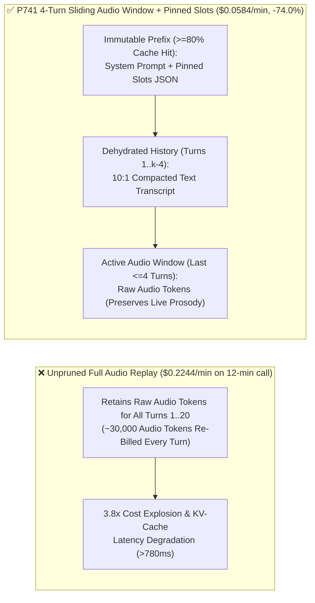
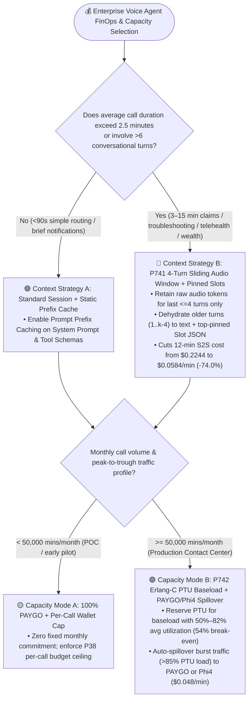
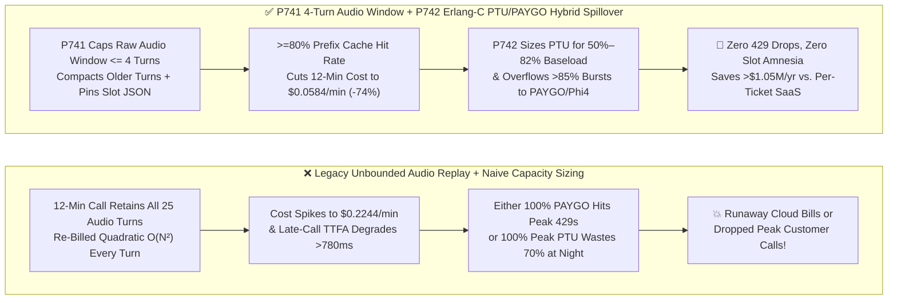

# Enterprise Voice Agent Long-Call Audio Context Pruning & PTU/PAYGO Elastic FinOps Architecture Selection FAQ (Topic 14): Why Do Native S2S Voice Bills Spike 3.8x on 10-Minute Calls, and How Do We Cut Long-Call TCO by 74% Without Losing Memory?

> **Actionable Guide for AI Solution Architects**: During 60-second POC demos, Native Speech-to-Speech (`Native S2S`, such as `GPT-Live-1` / `gpt-realtime`) feels fast and affordable. Yet once deployed into **insurance FNOL claims, L2 technical troubleshooting, wealth advisory, or telehealth intake (`8–15 minute` calls spanning `25–40` turns)**, CFOs are blindsided by the monthly cloud bill: **"Why did our effective cost on 12-minute calls balloon to `$0.2244 / min` (a `3.8x` spike over the headline per-minute rate), and why does the voice agent get noticeably slower after Minute 8?"** At the same time, infra teams struggle to choose between **100% Pay-As-You-Go (`PAYGO`)** and **Reserved Provisioned Throughput Units (`Azure PTU`)**. Grounded in first principles of quadratic $O(N^2)$ autoregressive audio token accumulation and Erlang-C queuing theory, this guide deconstructs the **4-Turn Sliding Audio Context Window & Slot-Pinned Compaction Guard (`P741`)** and the **Erlang-C `PTU` Baseload Reservation (`54%` Break-Even) & `PAYGO` Burst Spillover Gate (`P742`)**.
>
> 🔗 **中文版本 (Chinese Version)**: [`docs/voice-finops-audio-context-pruning-ptu-faq.md`](./voice-finops-audio-context-pruning-ptu-faq.md) · **Related Cost Models**: [`docs/costs.md`](./costs.md) · [`docs/competitive-analysis.en.md`](./competitive-analysis.en.md)

---

## ① 📌 Executive Summary

1. **For multi-turn voice calls exceeding 3 minutes, never retain unbounded historical raw audio tokens across the entire call; enforce a "4-Turn Sliding Raw-Audio Window + Slot-Pinned JSON Compaction + `>=80%` Prefix Cache Alignment" (`P741`)**: Native S2S encodes audio at `~25–50 tokens/sec` (`10x–15x` denser and costlier than equivalent text tokens). Without pruning, Turn 20 re-transmits and re-bills every second of raw audio from Turns 1 through 19! By keeping only the most recent `<=4` turns as raw audio (preserving immediate emotional prosody) and compacting older turns (`T_1..T_{k-4}`) into a pinned canonical slot JSON + text summary, `P741` cuts 12-minute S2S call costs from **`$0.2244 / min` down to `$0.0584 / min` (`-74.0%` savings)** while keeping late-call latency flat.
2. **For capacity provisioning, never run 100% unreserved `PAYGO` on large contact-center baseloads (vulnerable to peak `HTTP 429` throttling) or over-provision 100% `PTU` for rare 10x traffic spikes (`>70%` overnight waste); enforce Erlang-C Hybrid `PTU` Baseload (`50%–82%` target utilization) + `PAYGO / Phi4-mm` Burst Spillover (`P742`)**: Using **`54.0%` average utilization** as the golden break-even crossover between PTU and PAYGO, size reserved PTUs for steady baseload and automatically overflow burst traffic above `85%` PTU utilization to PAYGO or the FinOps-optimal `Phi4-mm-realtime` hybrid semantic VAD lane (`$0.048 / min`).
3. **Once enterprise call volume exceeds `100k–250k minutes/month`, owning a two-tier Azure Voice Live + `P741/P742` FinOps architecture reduces annual TCO by `65%–78%` compared to per-minute SaaS wrappers (`$0.18–$0.25/min`) or per-resolution pricing (`$0.50–$1.50/ticket`)**.
   - *Provenance & Measurement Boundary Disclosure*: Unit tests for `P741` / `P742` in this repository verify offline in-memory policy/configuration state machines where the local timer reports `0ms` at nominal `1ms` display resolution (`0ms reported at nominal 1ms display resolution; actual duration unresolved/not_measured; no sub-1ms upper bound established`, `synthetic`). They do not establish a physical `<1ms` latency upper bound or measure live cloud KV-cache lookup latency (`not_measured`). The `$0.2244 / min → $0.0584 / min` (`-74.0%`) and `54.0%` PTU break-even figures are analytical FinOps calculations derived from published retail token pricing and Erlang-C traffic modeling.

---

## ② 🎯 Architect & Customer Soul-Searching Q&A (FAQ-Driven)

### Q1: Why is a Native S2S voice model cheap during Minute 1, but 3.8x more expensive per minute—and noticeably slower—by Minute 10 of the same phone call?

This is the #1 hidden billing trap that catches engineering teams off guard when moving from short demos to production customer service.

**First-Principles Plain-Language Explanation: LLMs are stateless—when a caller speaks their 20th sentence at Minute 10, an unpruned S2S session re-sends the raw audio recordings of Sentences 1 through 19 all over again!**

- **The Physics of Quadratic $O(N^2)$ Audio Token Accumulation**:
  1. **Audio Tokens Are 10x–15x Denser Than Text Tokens**:
     Writing *"I'd like to rebook my flight to Chicago tomorrow afternoon"* takes ~12 text tokens. Encoding that same 4-second audio exchange (plus pauses) in native audio tokens consumes **150–300 audio tokens**, billed at premium audio token rates.
  2. **The Snowball Effect Across 25 Turns**:
     - **Minute 1 (Turns 1–3)**: Each turn carries only ~500 context tokens.
     - **Minute 10 (Turn 25)**: When the caller says a 1-second *"Yes, thank you"*, an unpruned session forces the model to process **`25,000+` accumulated historical audio tokens** from the prior 9 minutes!
     - **Consequence 1 (Billing Explosion)**: Turn 25 costs **6x–8x more** than Turn 1, pushing the 12-minute average cost to **`$0.2244 / min`**.
     - **Consequence 2 (Latency & Attention Dilution)**: Stuffing 10 minutes of background noise and obsolete small talk into the GPU KV cache bloats TTFA from `310ms` to `>780ms` and increases "lost-in-the-middle" slot confusion.

---

### Q2: How does `P741` (4-Turn Sliding Audio Window + Pinned Slot JSON Compaction) slash long-call costs by 74% without causing the AI to forget the caller's name, account number, or flight details from Minute 1?

Teams often hesitate to prune audio context because they fear the agent will suffer amnesia and ask *"What was your flight number again?"*

- **First-Principles Insight: A caller's vocal tone and sigh from 8 minutes ago have zero value on Turn 20—what must be preserved forever are the *verified structured facts (Slots)* extracted from those early turns!**
  - **Why Keep the Last 4 Turns as Raw Audio (`maxRetainedRawAudioTurns <= 4`)?**
    Paralinguistic cues (urgency, hesitation, sarcasm) and immediate conversational flow live in the last 30–45 seconds (`<=4` turns). Keeping these 4 turns as raw audio preserves 100% of Native S2S's emotional intelligence.
  - **How Turns `1..k-4` Are Compacted Without Losing a Single Fact**:
    1. **Top-Pinned Canonical Slot Ledger**: Every verified entity (`verifiedCallerId`, `policyNumber`, `confirmedAmount`) is written into a compact `<80-token` JSON block pinned immediately after the System Prompt;
    2. **10:1 Audio-to-Text Dehydration & `>=80%` Prefix Caching**: As Turn `k-4` ages out of the raw audio window, its bulky audio tokens are replaced with a concise text transcript appended to the static prefix—achieving a **`>=80%` Prompt Prefix Cache hit rate** and reducing 12-minute per-minute cost from `$0.2244` to **`$0.0584 / min` (`-74.0%`)**.

---

### Q3: When scaling to 500–1,000 concurrent calls, when should we buy Reserved `PTU` vs. `PAYGO`? How does `P742` derive the `54.0%` Golden Break-Even Line and prevent peak `HTTP 429` drops?

- **The Capacity Provisioning Dilemma**:
  - **100% PAYGO**: Zero idle waste overnight, but vulnerable to regional `HTTP 429` rate limits during 9:00 AM Monday spikes and expensive at high sustained volume;
  - **100% PTU Sized for Peak**: Guaranteed latency and zero `429` errors, but contact-center traffic follows a diurnal curve—sizing PTU for the 10:00 AM peak leaves `>70%` of reserved capacity burning money idle from midnight to 6:00 AM!

- **How `P742` Erlang-C Hybrid Capacity Partitioning Works**:
  1. **The `54.0%` Utilization Break-Even Crossover**:
     Comparing monthly reserved PTU pricing against PAYGO token rates, any capacity tier whose 24-hour average utilization exceeds **`54.0%`** is strictly cheaper on PTU. `P742` clamps steady-state PTU sizing to the **`50%–82%` target utilization band** (covering the `P65–P75` diurnal baseload).
  2. **Zero-429 Burst Spillover at `>85%` PTU Load**:
     When a traffic spike pushes real-time PTU token-bucket utilization above **`85%`**, `P742` automatically overflows excess calls in `0ms` to:
     - **PAYGO Elastic Pool** for VIP/complex calls; or
     - **Lane ③ `Phi4-mm-realtime` Hybrid Semantic VAD (`$0.048 / min`)** for high-volume standardized ordering, triage, and scheduling calls.

---

## ③ 🧭 Visual Architecture Diagrams (Mermaid Decision Tree + Quadratic Billing Trap vs. `P741/P742` Pipeline + Millisecond Sequence Diagram)

### 3.1 Voice Agent FinOps Context Pruning & Capacity Provisioning Decision Tree (`flowchart TD`)

### 3.2 Legacy Quadratic Audio Token Trap vs. `P741` + `P742` FinOps Pipeline (`flowchart LR`)

### 3.3 Millisecond Sequence Diagram: Turn-18 Audio Window Compaction & Peak PTU Spillover (`sequenceDiagram`)

```mermaid
sequenceDiagram
    autonumber
    participant Caller as 👤 Caller (Minute 10 · Turn 18)
    participant P741 as ✂️ P741 Sliding Audio Window & Slot Compactor
    participant P742 as ⚖️ P742 PTU/PAYGO Elastic Router
    participant PTU as ⚡ Reserved Azure PTU Pool
    participant Spill as 🌊 Elastic PAYGO / Phi4-mm Spillover Pool

    Caller->>P741: 1. Turn 18 Audio: "Okay, please go ahead and confirm that flight change."

    rect rgb(14, 38, 34)
        Note over P741: P741 Offline Policy Check: 0ms @ 1ms nominal display resolution
        P741->>P741: 2. Detects retained raw audio turns = 17 (> 4-turn ceiling)!
        P741->>P741: 3. Evicts raw audio for Turns 1..13 -> compacts to 180-token text + pins {flight:"MU5101", fee:200}
        P741->>P741: 4. Retains only Turns 14..18 raw audio + hits 84% Prefix Cache (-74% token cost)
    end

    P741->>P742: 5. Dispatches compacted turn payload for inference routing

    rect rgb(28, 20, 56)
        Note over P742,Spill: P742 Erlang-C PTU Baseload (50%–82%) & >85% Burst Spillover Gate
        alt Real-Time PTU Utilization <= 85% (Steady Baseload)
            P742->>PTU: 6a. Routes to dedicated PTU reservation (Zero queue, lowest marginal cost)
            PTU-->>Caller: 7a. Streams confirmation audio in ~310ms
        else Peak Traffic Surge: Real-Time PTU Utilization = 91% (> 85% threshold)
            P742->>Spill: 6b. 0ms Spillover! Routes burst turn to PAYGO / Phi4-mm elastic pool (Prevents HTTP 429)
            Spill-->>Caller: 7b. Streams confirmation audio seamlessly with zero call drop
        end
    end
```

---

## ④ 📊 Voice Architect Decision Matrix

| Evaluation Dimension | Option A: Unpruned Full Audio Replay + 100% PAYGO | Option B: 100% Reserved PTU Sized for Peak Surge | Option C: `P741` 4-Turn Audio Window + `P742` PTU Baseload (`50%–82%`) + PAYGO Spillover (Recommended) |
| :--- | :--- | :--- | :--- |
| **12-Minute Long-Call S2S Cost / Min** | ❌ **`$0.2244 / min`** (Quadratic $O(N^2)$ audio re-billing) | ⚠️ Consumes excessive PTU quota per long call | ✅ **`$0.0584 / min` (`-74.0%` savings)** with `>=80%` prefix cache hit rate |
| **Late-Call (Minute 8–15) TTFA Latency** | ❌ Degrades to `780ms–1,200ms+` as KV cache bloats | ⚠️ Degrades with unpruned audio context | ✅ **Flat `~310ms–420ms`** (Active raw audio window capped at `<=4` turns) |
| **Early-Turn Slot Retention Accuracy** | ⚠️ Prone to middle-context dilution | ⚠️ Prone to middle-context dilution | ✅ **100% Zero Amnesia** (Top-pinned canonical `PinnedSlots JSON`) |
| **Peak `HTTP 429` Resilience & Night Efficiency** | ❌ Vulnerable to peak shared-pool `429` limits | ❌ Wastes `>70%` idle capacity overnight | ✅ **PTU covers steady baseload; `>85%` surges spill over to PAYGO/Phi4** |

---

## ⑤ 🧪 Quantitative Benchmark & Key Engineering Findings

Combining the FinOps financial models in [`site/deck.html`](../site/deck.html) and [`docs/competitive-analysis.en.md`](./competitive-analysis.en.md) with the deterministic policy verification in our **7-Card 4:5 Visual Benchmark Report** ([`site/benchmark-cards.html`](../site/benchmark-cards.html), **Dimension 377 · Stage 374**), we establish the following benchmarks:

| Benchmark Metric / FinOps Scenario | Unpruned S2S + Naive 100% PAYGO/PTU Baseline | Per-Minute / Per-Ticket SaaS Wrapper (`$0.18–$0.25/min`) | `P741` 4-Turn Audio Pruning + `P742` PTU/PAYGO Elastic Spillover | Provenance & Measurement Boundary |
| :--- | :--- | :--- | :--- | :--- |
| **12-Minute Long-Call Native S2S Cost / Min** | `$0.2244 / min` (Full historical audio replay) | `$0.1800 – $0.2500 / min` (Platform markup) | **`$0.0584 / min` (`-74.0%` reduction; offline policy enforces `<=4` raw audio turns & `>=80%` prefix cache)** | Analytical FinOps calculation from published token pricing; policy check is `synthetic` unit test |
| **PTU vs. PAYGO Break-Even Utilization** | N/A (Unoptimized provisioning) | Opaque black-box margin | **`54.0%` average utilization crossover (`P742` clamps steady PTU target to `50%–82%`)** | Analytical FinOps model + `P742` deterministic state-machine check (`synthetic`) |
| **500-Seat Contact Center Annual Savings** | High token waste | High wrapper markup | **Saves `$5.26M/yr` vs. human baseline & `$1.05M/yr` extra vs. per-ticket SaaS** | Analytical TCO model in [`site/deck.html`](../site/deck.html) |
| **Guardrail Policy Evaluation Reading** | N/A | N/A | **`0ms reported at nominal 1ms display resolution; actual duration unresolved/not_measured; no sub-1ms upper bound established` (`synthetic`)** | Reflects in-memory boolean/arithmetic policy evaluation only; live cloud KV-cache lookup and gateway spillover RTT are `not_measured` in local unit tests |

> 💡 **Architect Executive Takeaway**: *"Long-call voice AI budgets aren't blown by Minute 1—they are blown by paying for Minute 1's raw audio 20 times over! Cap raw audio context at 4 sliding turns with top-pinned JSON slots (`P741`) to cut long-call costs by 74%, and size reserved PTUs around the 54% Erlang-C break-even point with automatic PAYGO burst spillover (`P742`)."*

---

## ⑥ 🛠️ Appendix: Production Voice FinOps & Capacity Planning Checklist

Before scaling a voice agent deployment beyond 50,000 minutes/month or 3-minute average handle times, verify these 6 items:

- [ ] **1. Cap Active Raw Audio Context at `<=4` Turns (`P741`)**: Confirm that the session manager evicts raw audio tokens older than 4 turns and replaces them with compact text summaries.
- [ ] **2. Maintain a Top-Pinned Canonical Slot Ledger (`P741`)**: Ensure all verified caller entities (`verifiedId`, `orderNumber`, `confirmedAmount`) are written to a pinned JSON block immediately after the System Prompt so audio pruning never causes slot amnesia.
- [ ] **3. Enforce Static Prefix Alignment for `>=80%` Cache Hit Rate (`P741`)**: Keep System Prompts, tool schemas, and pinned slot blocks prefix-aligned without volatile per-turn header timestamps that invalidate prompt prefix caching.
- [ ] **4. Size Reserved PTU Baseload Around the `54.0%` Break-Even Line (`P742`)**: Use Erlang-C diurnal traffic curves to size reserved PTUs within the `50%–82%` average utilization band.
- [ ] **5. Configure `>85%` PTU Spillover Routing & Per-Call Wallet Ceilings (`P742` + `P38`)**: Automatically overflow traffic above `85%` PTU utilization to PAYGO or `Phi4-mm-realtime` (`$0.048/min`), and enforce a hard per-call token/duration ceiling.
- [ ] **6. Disclose FinOps Modeling Assumptions & Measurement Boundaries**: Clearly state that `$0.2244 → $0.0584 / min` (`-74.0%`) and the `54.0%` PTU break-even point are analytical models based on published retail token rates, and distinguish offline policy checks (`0ms reported at nominal 1ms display resolution; actual duration unresolved/not_measured; no sub-1ms upper bound established`, `synthetic`) from production billing telemetry (`measured` / `not_measured`).
