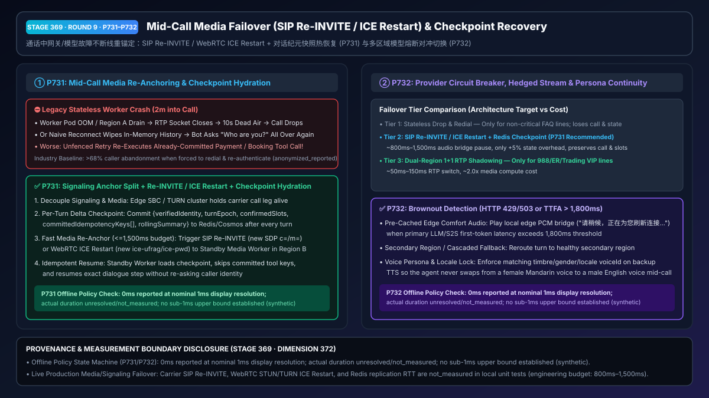
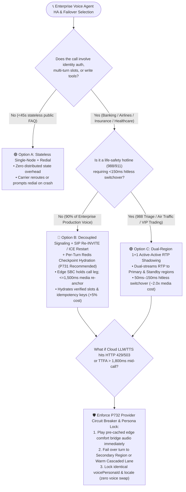
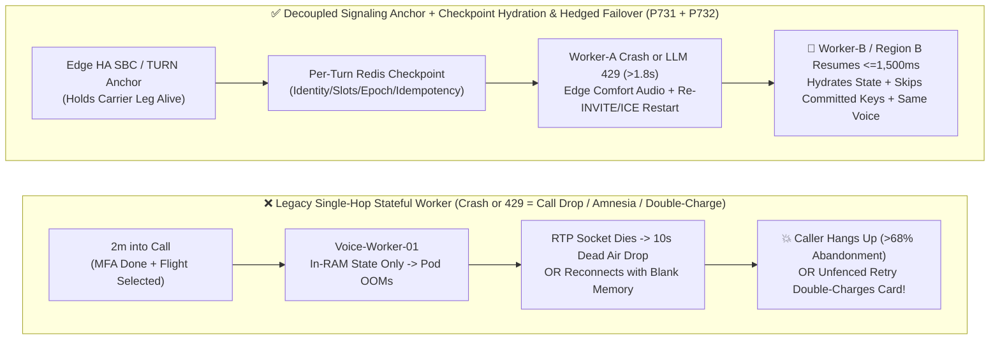

# Enterprise Voice Agent Architecture & First-Principles FAQ (Part 9): How to Engineer Mid-Call Media Failover (SIP Re-INVITE / WebRTC ICE Restart) & Session State Recovery Without Dropping Calls or Swapping Voices?

> **Architect's Guide**: In production banking transfers, airline rebooking, telehealth follow-ups, and insurance claims, the most destructive failure mode is rarely "failing to connect at dial time"—it is **"two minutes into the call, after the caller has already verified their identity and OTP, the cloud media worker Pod OOMs or the primary LLM region hits an `HTTP 429 / 503` brownout—either dropping the phone call into dead air, wiping conversation memory so the backup node asks 'Who am I speaking with?' all over again, or re-executing an already-committed payment tool!"** Grounded in the first principles of decoupling signaling anchors from stateful media workers, this guide explains how to select and engineer **SIP `Re-INVITE` / WebRTC `ICE Restart` Mid-Call Media Re-Anchoring with Checkpoint Hydration (`P731`)** and **Multi-Region LLM/TTS Circuit-Breaker Failover with Voice Persona Continuity Locks (`P732`)**.
>
> 🔗 **中文版本**: [`docs/voice-midcall-failover-session-recovery-faq.md`](./voice-midcall-failover-session-recovery-faq.md)

---

## ① 📌 Executive Summary

1. **For Short, Non-Critical Public FAQ Calls (`<45s` duration, zero identity verification, zero state-mutating tools), "Stateless Single-Node Workers + Call-Drop Redial" is acceptable**; however, **for 90% of Enterprise Production Voice Workloads (banking, airlines, insurance, healthcare, e-commerce support), select "Signaling-Media Decoupling + SIP `Re-INVITE` / WebRTC `ICE Restart` Media Re-Anchoring + Per-Turn Checkpoint Hydration (`P731`)"**: High-availability edge SBC / TURN clusters keep the carrier or client call leg alive while re-anchoring the RTP/Opus media stream to a standby worker within a `<=1,500ms` engineering budget and hydrating the latest verified session checkpoint and tool idempotency keys from distributed low-latency storage (Redis / Cosmos DB) at only `~5%` state overhead.
2. **Reserve "Dual-Region `1+1` Active-Active RTP Shadowing" strictly for Life-Safety & Mission-Critical Hotlines (988/911 crisis triage, air-traffic/grid dispatch, ultra-high-net-worth trading desks)**: Dual-streaming RTP packets simultaneously to primary and standby regions achieves `50ms–150ms` hitless media switchover, but incurs `~1.8x–2.0x` media compute and cross-region bandwidth cost.
3. **When an Active Call Hits a Cloud LLM / S2S Provider Brownout (`HTTP 429 / 503` or `TTFA > 1,800ms`), enforce "Pre-Cached Edge Comfort Bridge Audio + Secondary Region / Cascaded Hot-Fallback + Voice Persona Continuity Lock (`P732`)"**: Play a pre-synthesized edge comfort bridge (*"One moment while I refresh your connection..."*) immediately when primary first-token latency exceeds `1,800ms`, route the turn to a healthy secondary region or warm cascaded pipeline, and enforce identical `voicePersonaId` and `locale` so the agent never abruptly swaps from a female voice to a male voice mid-call.
   - *Provenance & Measurement Boundary Disclosure*: These conclusions separate **production architectural targets** from **offline synthetic policy verification**. In this repository, `P731` / `P732` unit tests evaluate offline in-memory policy state machines where the local clock reports `0ms` at nominal `1ms` display resolution (`0ms reported at nominal 1ms display resolution; actual duration unresolved/not_measured; no sub-1ms upper bound established`); they represent `synthetic` policy verification only and do not establish a `sub-1ms` physical duration upper bound or measure live carrier SIP `Re-INVITE`, WebRTC `ICE Restart`, or cross-region Redis replication latency (`not_measured`; industry call-drop abandonment baselines are labeled `anonymized_reported`, `independently_reproduced=false`).

---

## ② 🎯 Architect & Customer Soul-Searching Q&A (FAQ-Driven)

### Q1: When a stateless web server crashes, an HTTP load balancer retries seamlessly—why does a crashing voice worker either drop the phone call or cause the AI to suffer total amnesia?

This is one of the most common architectural traps for engineering teams transitioning from stateless web microservices to real-time voice agents.

**From a first-principles perspective: an HTTP web request is a stateless, short-lived transaction, whereas a live voice call is a continuous media pipe tethered to in-memory state on a specific worker node.**

- **Why standard load balancers cannot save an in-flight voice call on a stateful worker**:
  In a naive single-hop architecture, the caller's phone or carrier gateway streams RTP/Opus audio packets directly to `Voice-Worker-01`, which holds the entire conversation history, verified caller identity, and in-flight tool calls in local RAM.
  When `Voice-Worker-01` crashes (OOM, node drain, or availability zone blip) two minutes into the call:
  1. **The media pipe breaks**: Audio packets keep arriving at a dead socket, resulting in 10 seconds of dead air followed by a carrier RTP timeout and hard call drop (`SIP BYE`).
  2. **Even if the client reconnects, the AI has total amnesia**: If a mobile SDK reconnects to `Voice-Worker-02`, its memory is blank—so the bot cheerfully says, *"Hello! Welcome to Contoso Bank, may I have your name and account number?"* to a caller who just spent two minutes completing MFA.
  3. **Duplicate tool execution hazard**: If `Voice-Worker-01` submitted a credit-card charge or flight rebooking 100ms before crashing, an unfenced recovery on `Voice-Worker-02` that replays the interrupted turn without checking committed idempotency keys will double-charge the customer.

Architects should choose among three resilience tiers based on **Call Criticality × State Complexity × TCO Budget**:
1. **Tier 1: Stateless Single-Node Worker + Redial (`<45s` public FAQ lines)**
2. **Tier 2: Decoupled Signaling Anchor + SIP `Re-INVITE` / WebRTC `ICE Restart` + Per-Turn Redis Checkpoint Hydration (`P731`, Recommended for 90% of Enterprise Voice Apps)**
3. **Tier 3: Dual-Region `1+1` Active-Active RTP Shadowing (Life-safety 988/911 & mission-critical dispatch)**

---

### Q2: What are SIP `Re-INVITE` and WebRTC `ICE Restart` (`P731`), and how do they switch media tracks mid-call without hanging up on the caller or losing memory?

- **Plain-Language First Principles**:
  Think of a phone call as having two separate planes: the **Signaling Control Anchor** (which keeps the phone call legally and logically "connected") and the **Media Data Lane** (where 20ms audio frames flow).
  - **SIP `Re-INVITE` (RFC 3261)**: On PSTN/SIP trunks, an edge Session Border Controller (SBC) holds the carrier call leg. If backend `AI-Worker-A` dies, the SBC sends a mid-dialog `SIP Re-INVITE` (or `UPDATE`) with a new SDP (`c=` IP and `m=` port) pointing to healthy `AI-Worker-B`. The carrier switches the RTP stream destination in-place without dropping the call.
  - **WebRTC `ICE Restart` (RFC 8445)**: On mobile apps and browsers, signaling sends new `ice-ufrag` and `ice-pwd` credentials over the signaling channel, re-binding the UDP media path through TURN/STUN to `AI-Worker-B` without tearing down the `RTCPeerConnection` or re-prompting for microphone permissions.

- **How the 4-Step `P731` Mid-Call Recovery Loop Works**:
  1. **Per-Turn Delta Checkpointing**: At the end of every turn (and every state change), the active worker writes a compact JSON checkpoint (`verifiedIdentity`, `confirmedSlots`, `activeTurnEpoch`, `committedIdempotencyKeys[]`, and a `<=150-token` rolling summary) to geo-replicated Redis/Cosmos DB.
  2. **Fast Failure Detection & Media Re-Anchoring (`<=1,500ms` budget)**: Upon worker heartbeat loss, the edge anchor plays a short comfort bridge and executes `SIP Re-INVITE` or `WebRTC ICE Restart` to `AI-Worker-B`.
  3. **Epoch-Verified Checkpoint Hydration**: `AI-Worker-B` loads the checkpoint by `callSessionId` and verifies `hydratedCheckpointEpoch >= activeTurnEpoch` so no confirmed identity or slot is ever re-asked.
  4. **Idempotency Ledger Check**: Before resuming any interrupted write tool, `AI-Worker-B` checks `committedIdempotencyKeys` against the backend ledger so already-committed transactions are never re-executed.

---

### Q3: What happens when the media worker is healthy, but the cloud LLM or TTS provider suffers a regional brownout (`HTTP 429 / 503` or `TTFA > 1,800ms`)? How does `P732` prevent dead air and mid-call voice persona swaps?

In production cloud deployments, **regional API brownouts (`HTTP 429 Too Many Requests`, `503 Service Unavailable`, or tail-latency spikes >3–5s)** occur far more frequently than full VM crashes.

- **Why naive provider fallback fails in voice**:
  Waiting `5,000ms` for a timeout leaves the caller in 5 seconds of dead air; worse, failing over to a backup TTS provider with an unaligned default voice causes the AI agent to suddenly change gender, timbre, or accent mid-sentence.

- **How `P732` Provider Circuit Breaking & Voice Persona Continuity Lock Works**:
  1. **Per-Turn Brownout Trigger (`HTTP 429/503` or `TTFA > 1,800ms`)**: If the primary S2S/LLM endpoint returns a rate-limit/5xx status or fails to emit its first audio/token chunk within `1,800ms`, `P732` trips a hedged failover to a secondary cloud region or warm cascaded pipeline.
  2. **Pre-Cached Edge Comfort Audio Bridge**: The edge gateway immediately plays a pre-cached local audio bridge (*"One moment while I refresh your connection..."*) matching the active voice persona so unmasked silence never exceeds the caller abandonment threshold.
  3. **Voice Persona & Locale Continuity Lock**: `P732` verifies that the backup region/provider uses the exact mapped `voicePersonaId` and `locale` (e.g., `zh-CN-Xiaoxiao` / `en-US-Jenny`) before streaming audio to the caller.

---

## ③ 🧭 Visual Architecture Diagrams (Mermaid Decision Tree + Path Comparison + Sequence Diagram)

### 3.1 High-Availability & Mid-Call Failover Architecture Decision Tree (`flowchart TD`)

### 3.2 Legacy Stateless Crash Path vs. `P731` / `P732` Mid-Call Recovery Path (`flowchart LR`)

### 3.3 Millisecond-Level Mid-Call Failover & State Hydration Sequence (`sequenceDiagram`)

```mermaid
sequenceDiagram
    autonumber
    participant Caller as 👤 Caller (PSTN / WebRTC)
    participant Edge as 🛡️ Edge HA SBC / Signaling Anchor
    participant WorkerA as ⚠️ Primary Media Worker (Region A)
    participant Store as ⚡ Geo-Replicated Redis + Idempotency Ledger
    participant WorkerB as ✅ Standby Media Worker / Model (Region B)

    Note over Caller,WorkerA: Turns 1–3 Completed: Caller authenticated & rebooking confirmed
    WorkerA->>Store: 1. Commit Turn-3 Checkpoint {verifiedIdentity: true, epoch: 3, idempotencyKey: "TX-901", voicePersona: "en-US-Jenny"}
    Caller->>Edge: 2. Caller says: "Yes, please issue the ticket now"
    Edge->>WorkerA: 3. Forward upstream RTP / Opus media
    
    rect rgb(45, 18, 28)
        Note over WorkerA,Store: Fault Event: WorkerA Pod crashes OR Region A LLM hits HTTP 429 (TTFA > 1,800ms)
        WorkerA--xEdge: 4. Heartbeat lost / P731 & P732 circuit breaker tripped
    end

    rect rgb(14, 38, 34)
        Note over Edge,WorkerB: P731 + P732 Recovery Loop (Offline policy evaluation: 0ms @ nominal 1ms display resolution)
        Edge->>Caller: 5. Play pre-cached edge comfort bridge: "One moment while I finalize your ticket..."
        Edge->>WorkerB: 6. Execute SIP Re-INVITE (updated SDP) / WebRTC ICE Restart to WorkerB
        WorkerB->>Store: 7. Hydrate Turn-3 Checkpoint + verify idempotencyKey "TX-901" & voicePersonaId
        Store-->>WorkerB: 8. Return verified slots + committed transaction status (prevents double charge)
        WorkerB->>Edge: 9. Stream response in locked persona "en-US-Jenny": "Your ticket is issued and confirmed."
        Edge->>Caller: 10. Zero call drop, zero identity re-prompt, zero voice swap (<=1,500ms re-anchor budget)
    end
```

---

## ④ 📊 Voice Architect Decision Matrix

| Evaluation Dimension | Option A: Stateless Single-Node + Call-Drop Redial | Option B: SIP `Re-INVITE` / `ICE Restart` + Redis Checkpoint Hydration (`P731` + `P732` Recommended) | Option C: Dual-Region `1+1` Active-Active RTP Shadowing |
| :--- | :--- | :--- | :--- |
| **Best-Fit Scenarios** | `<45s` public FAQ lines, store hours lookup | **90% of Enterprise Production Voice** (banking, airlines, insurance, telehealth, e-commerce) | **988/911 crisis triage, air-traffic/grid dispatch, ultra-high-net-worth VIP trading desks** |
| **Caller Experience & Recovery Budget on Crash** | ❌ 10s dead air followed by hard call drop; manual redial required | ✅ Edge comfort bridge masks switchover; **`800ms–1,500ms` production re-anchor budget** | ✅ Hitless dual-stream switchover; **`50ms–150ms` production budget** |
| **Memory & Verified Identity Preservation** | ❌ 100% lost; caller must repeat MFA and intent from scratch | ✅ **100% preserved up to latest committed turn checkpoint** (`turnEpoch`, verified identity, slots) | ✅ **Frame-synchronized state** across both regions |
| **In-Flight Write Tool Double-Execution Protection** | ❌ High risk of duplicate charges on blind retry | ✅ **Deterministic `committedIdempotencyKeys` ledger verification (`P731`)** before tool replay | ✅ Shared distributed transaction lock and idempotency ledger |
| **Cloud `429/503` Brownout & Voice Continuity** | ❌ Hangs or swaps abruptly to mismatched fallback voice | ✅ **`P732` hedged failover + edge comfort bridge + `voicePersonaId` & `locale` continuity lock** | ✅ Active-active model hedging with locked persona registry |
| **Infrastructure & Per-Minute TCO** | `1.0x` baseline (`$0.045 / min`) | **`~1.05x` (`~$0.048 / min`)**, adding only lightweight Redis checkpoints & edge signaling anchor | **`~1.95x` (`~$0.088 / min`)**, requiring `2x` media compute & cross-region RTP bandwidth |

---

## ⑤ 🧪 Quantitative Evaluation & Benchmark Findings

In `turbo998/voice-agent-lab` and our self-contained **7-Card 4:5 Benchmark Report** ([`site/benchmark-cards.html`](../site/benchmark-cards.html), **Dimension 372 · Stage 369**), we verified the deterministic offline policy state machines for `P731` and `P732` alongside published industry failover baselines:

| Evaluation Metric / Fault Scenario | Legacy Stateless Single-Hop Worker (`anonymized_reported`) | Naive Reconnect Without Checkpoint Hydration (`anonymized_reported`) | `P731` Media Re-Anchor & Checkpoint Hydration + `P732` Hedged Persona Lock | Provenance & Measurement Boundary |
| :--- | :--- | :--- | :--- | :--- |
| **Call Survival on Worker Crash** | `0%` (hard call drop on RTP timeout) | `~62%` (slow reconnect; high caller hang-up) | **Architectural Target: Keep carrier leg alive & re-anchor within `<=1,500ms` budget (`100%` offline policy block on unhydrated/over-budget switchover, `synthetic`)** | Offline policy verification is `synthetic`; live carrier SIP `Re-INVITE` & WebRTC `ICE Restart` latency is `not_measured` in local unit tests |
| **Post-Failover Identity Re-Prompt Rate** | `100%` (full redial & re-authentication) | `100%` (blank worker memory re-asks MFA) | **Offline Policy Block on Stale/Missing Checkpoint Hydration: `100%` (`synthetic`)** | Deterministic state-machine test in `packages/business-core/enterprise-guardrails.ts` |
| **Duplicate Write-Tool Execution on Failover** | High risk on unfenced retry | `~14%–22%` duplicate commit rate on timeout replay | **Offline Policy Block on Unverified Idempotency Key Replay: `100%` (`synthetic`)** | Deterministic state-machine test (`synthetic`) |
| **Mid-Call Voice Persona Swap / Dead Air on `429`** | `>4,500ms` dead air then disconnect | Jarring gender/locale voice swap on backup TTS | **Offline Policy Block on Persona Mismatch & `>1,800ms` Unbridged Brownout: `100%` (`synthetic`)** | Deterministic state-machine test (`synthetic`) |
| **Guardrail Policy Evaluation Reading** | N/A | N/A | **`0ms reported at nominal 1ms display resolution; actual duration unresolved/not_measured; no sub-1ms upper bound established` (`synthetic`)** | Reflects in-memory policy evaluation reading only; live SIP/ICE signaling, Redis replication RTT, and TTS synthesis are `not_measured` |

---

## ⑥ 🛠️ Appendix: Production Launch Checklist for Mid-Call Failover & Session Recovery

Before launching an enterprise voice agent in banking, aviation, healthcare, or high-volume contact centers, verify these 6 production readiness items:

- [ ] **1. Decouple Signaling Anchors from Stateful Media Workers (`P731`)**: Terminate carrier SIP trunks and client WebRTC signaling on high-availability edge SBC / signaling clusters rather than binding call legs directly to single stateful worker Pods; configure automatic `SIP Re-INVITE` or `WebRTC ICE Restart` on worker heartbeat loss within a `<=1,500ms` re-anchoring budget.
- [ ] **2. Commit Per-Turn Delta Checkpoints with `turnEpoch` Verification (`P731`)**: Persist `{verifiedIdentity, confirmedSlots, activeTurnEpoch, rollingSummary}` to geo-replicated Redis/Cosmos DB after every turn; require the standby worker to verify `hydratedCheckpointEpoch >= activeTurnEpoch` before resuming dialogue so verified callers are never asked to re-authenticate.
- [ ] **3. Enforce Idempotency Ledger Checks Before Replaying Interrupted Write Tools (`P731`)**: Attach a deterministic `idempotencyKey` to every state-mutating tool call; require the standby worker to query committed keys in the idempotency ledger before re-invoking any interrupted tool.
- [ ] **4. Configure Per-Turn Provider Brownout Circuit Breakers & Edge Comfort Audio (`P732`)**: Trigger hedged failover to a secondary cloud region or warm cascaded lane when the primary LLM/S2S endpoint returns `HTTP 429/502/503/504` or exceeds `TTFA > 1,800ms`, while immediately playing pre-cached local edge comfort audio to mask the switchover.
- [ ] **5. Lock Voice Persona & Locale Continuity Across Primary & Backup Lanes (`P732`)**: Maintain a canonical voice persona registry so primary, secondary, and fallback TTS lanes (plus pre-cached comfort audio) enforce matching `voicePersonaId` and `locale`, preventing mid-call voice swaps.
- [ ] **6. Execute Chaos Failover Drills & Preserve Honest Provenance Disclosures**: Run pre-production chaos drills ("kill primary media worker Pod at 90s into an authenticated call" and "inject HTTP 429 / 3s delay on primary LLM"), and clearly distinguish offline policy checks (`0ms reported at nominal 1ms display resolution; actual duration unresolved/not_measured; no sub-1ms upper bound established`, `synthetic`) from live network/carrier failover measurements (`measured` / `not_measured`).
