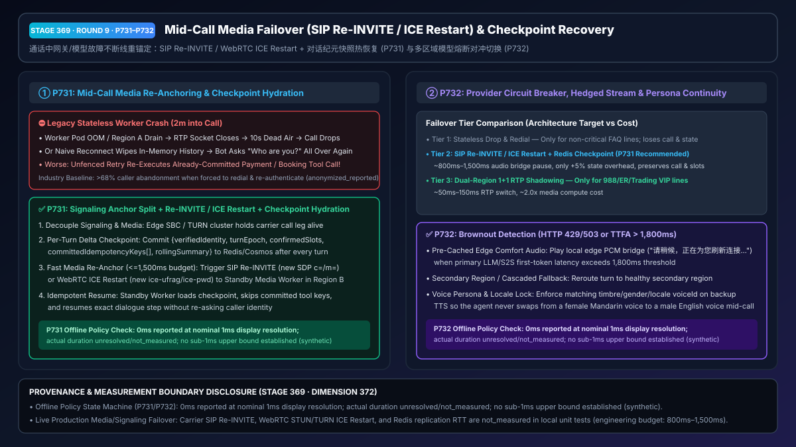
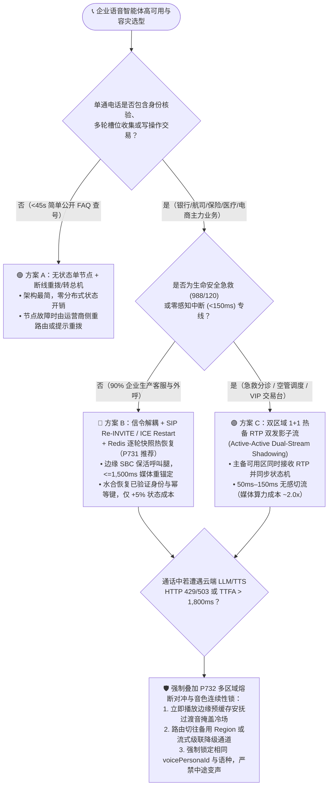
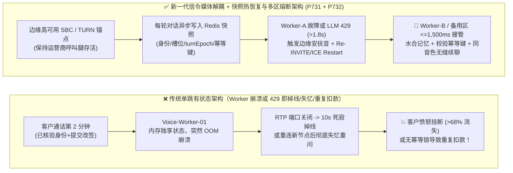

# 企业语音智能体多活防掉线与通话中状态热恢复架构选型与原理解析 FAQ（第九篇）：通话中网关崩溃或大模型限流 429 时，如何做到“不断线重锚定、不丢记忆、不换声音”？

> **面向 AI Solution Architect 的实战选型指南**：在银行转账、航司退改签、医疗随访与保险报案的生产语音通话中，最令架构师寝食难安的故障往往不是“连接前拨不通”，而是**“客户已经跟 AI 聊了 2 分钟、核验完了身份证与验证码，结果云端工作节点 Pod OOM 重启或大模型区域突发 `HTTP 429 / 503` 限流——电话直接死寂断线，或者切到备用节点后 AI 突然失忆问‘请问您贵姓？’甚至把刚扣过款的接口又调了一遍！”** 本文将从实时媒体流与信令解耦的第一性原理出发，彻底讲透 **SIP `Re-INVITE` / WebRTC `ICE Restart` 媒体重锚定与对话纪元快照热恢复门禁（`P731`）** 以及 **大模型/TTS 多区域熔断对冲切换与音色连续性锁（`P732`）**。
>
> 🔗 **English Version**: [`docs/voice-midcall-failover-session-recovery-faq.en.md`](./voice-midcall-failover-session-recovery-faq.en.md)

---

## ① 📌 核心结论速览（Executive Summary）

1. **短平快非关键查号/FAQ 播报（单通时长 `<45s`、无身份核验与写操作）可采用“无状态节点 + 断线重拨/转总机”**；但 **90% 的核心企业语音业务（银行、航司、保险、电商客服）必须采用“信令锚点与媒体工作节点解耦 + SIP `Re-INVITE` / WebRTC `ICE Restart` 媒体重锚定 + 逐轮对话快照热恢复（`P731`）”**：由高可用边缘 SBC / TURN 集群维持运营商侧呼叫腿不断开，一旦后端 AI 语音工作节点（Media Worker）崩溃或可用区故障，在 `<=1,500ms` 工程预算内将 RTP/Opus 媒体流重锚定至备用节点，并从分布式缓存（Redis / Cosmos DB）热加载上一轮对话快照与工具幂等键，仅增加约 `+5%` 状态存储开销即可避免掉线重拨。
2. **仅在生命安全急救（988/120 分诊）、航空调度或超高净值交易专线等“零感知中断”场景，才选用“双区域 `1+1` 热备 RTP 双发影子流（Active-Active RTP Shadowing）”**：主备两个可用区同时接收 RTP 媒体流并同步维护状态机，故障时可在 `50ms–150ms` 内无感切流，但会带来约 `1.8x–2.0x` 的媒体网关算力与带宽成本。
3. **当通话中遭遇云端 LLM / S2S 模型限流（`HTTP 429 / 503`）或首字音频延迟飙升（`TTFA > 1,800ms`）时，必须启用“边缘预缓存安抚桥接语音 + 跨区/跨级联热降级 + 音色/语种连续性锁（`P732`）”**：在等待备用区域模型接管期间，由边缘网关立即播放预合成的本地安抚过渡音（如*“请稍候，正在为您刷新连接……”*）填补冷场，且强制校验备用 TTS 的音色与语种标签（`voicePersonaId` / `locale`），严禁通话中途从“中文温柔女声”突变成“英文机械男声”。
   - *数据来源与测量边界声明（Provenance & Measurement Boundary）*：上述结论区分**生产架构工程目标**与**离线策略状态机验证**。本仓库 `P731` / `P732` 单元测试检验的是离线内存策略/配置状态机，本机计时器在名义 `1ms` 显示分辨率下报告 `0ms`（`0ms reported at nominal 1ms display resolution; actual duration unresolved/not_measured; no sub-1ms upper bound established`），属于 `synthetic` 确定性策略校验，不确立真实物理耗时 `<1ms` 上界，亦不测量真实运营商 SIP `Re-INVITE`、WebRTC STUN/TURN `ICE Restart` 或跨区 Redis 复制耗时（显式标为 `not_measured`；行业掉线重拨弃呼率基线标为 `anonymized_reported`, `independently_reproduced=false`）。

---

## ② 🎯 客户与架构师灵魂拷问 Q&A（FAQ-Driven）

### Q1：网页应用挂了一台服务器，负载均衡器（ALB/Nginx）自动重试一下用户毫无感觉；为什么语音智能体在通话中挂了一台服务器，电话就会直接断掉或者 AI 彻底失忆？

这是软件架构师从 Web 微服务转型做实时语音智能体时踩得最深的一个坑。

**用通俗大白话 + 第一性原理来解释：HTTP 网页请求是“无状态的一锤子买卖”，而实时语音通话是一根“绑在单台服务器内存上的长连接水管”。**

- **为什么普通负载均衡救不了通话中的语音节点崩溃？**
  在传统单跳语音架构中，手机或电话局通过一条长连接（WebRTC UDP 通道或 SIP/RTP 流）直接连在某台具体的 `Voice-Worker-01` 容器上。客户前 2 分钟说的每一句话、已核验通过的身份证号、正在执行的改签工具，全都保存在 `Voice-Worker-01` 的进程内存里。
  当 `Voice-Worker-01` 因为内存溢出（OOM）、宿主机维护或可用区网络抖动突然挂掉时：
  1. **媒体水管直接断裂**：电话局或手机还在往 `Voice-Worker-01` 的旧 IP 端口发音频包，但没人回包了——客户听筒里瞬间陷入死寂，10 秒后运营商判定 RTP 超时直接挂断电话（Call Drop）。
  2. **即使重连成功也会“当场失忆”**：就算客户端 SDK 自动重连到了健康的 `Voice-Worker-02`，因为 `02` 节点内存里一片空白，AI 会极其傻气地从头播报欢迎语：*“您好，欢迎致电某某银行，请问您贵姓？”*——刚刚花了 2 分钟核验完身份的客户当场暴怒挂机。
  3. **更致命的“重复扣款/重复下单”事故**：如果 `Voice-Worker-01` 在崩溃前 100 毫秒刚刚向核心账务系统发出了扣款请求并已落库，但还没来得及把结果写回对话历史；`Voice-Worker-02` 接管后如果盲目重放最后一轮未完成的工具调用，又没有幂等键拦截，就会造成客户被双倍扣款！

因此，架构师必须根据**业务中断容忍度与成本预算**，在以下三种容灾层级中精准选型：
1. **层级一：无状态单节点 + 断线重拨（Stateless Single-Node）**
   - 仅适用于 `<45 秒` 的纯公开信息查询（如门店营业时间、天气广播）。
2. **层级二：信令锚点解耦 + SIP `Re-INVITE` / WebRTC `ICE Restart` 媒体重锚定 + 逐轮 Redis 快照热恢复（`P731`，90% 企业生产首选）**
   - 边缘信令网关（SBC / WebRTC 信令网关）与后端 AI 媒体工作节点解耦；每完成一轮对话（Turn），将压缩后的状态快照与已提交工具幂等键异步写入低延迟 Redis/Cosmos DB；工作节点故障时，信令网关发起 `SIP Re-INVITE` 或 `WebRTC ICE Restart` 将音频流平滑切向备用节点并水合恢复上下文。
3. **层级三：双区域 `1+1` 热备 RTP 双发影子流（Active-Active Dual-Stream Shadowing）**
   - 仅用于 988/120 急救热线、空管调度或超高净值交易台：边缘 SBC 同时将客户音频复制两份发往主备两个可用区的 Worker，主节点心跳过期时毫秒级切换音频输出开关。

---

### Q2：什么是 SIP `Re-INVITE` 与 WebRTC `ICE Restart`（`P731`）？它如何在不挂断客户电话的前提下，把音频流“凌空换轨”到备用节点并恢复记忆？

- **它是什么（大白话解释）**：
  把一通正在进行的电话想象成**“收费站（信令控制面）”**与**“车道（RTP/Opus 音频媒体面）”**分开的高速公路。
  - **SIP `Re-INVITE`（RFC 3261）**：在传统电话网（PSTN/SIP）中，边缘 SBC（会话边界控制器）抓着运营商的电话线不撒手。当后端的 `AI-Worker-A` 挂掉时，SBC 在通话中途向对端发送一条 `Re-INVITE` 信令，里面的 SDP（会话描述协议）写着：*“电话别挂！从下一毫秒起，请把语音包改发到备用节点 `AI-Worker-B` 的新 IP 和端口！”*
  - **WebRTC `ICE Restart`（RFC 8445）**：在手机 App 或网页 WebRTC 通话中，当检测到当前媒体节点失联时，信令通道下发一组新的 `ice-ufrag` 和 `ice-pwd` 凭证，触发客户端在不销毁 WebRTC `RTCPeerConnection`、不重新弹窗申请麦克风权限的前提下，立即通过 STUN/TURN 重新打洞连接到备用媒体网关。

- **`P731` 通话中无感重锚定与状态水合（Checkpoint Hydration）的四步闭环**：
  1. **逐轮增量快照落盘（Per-Turn Delta Checkpoint）**：每当一轮对话结束或工具状态变更，主节点将轻量级 JSON 快照写入跨区复制的 Redis（含：`verifiedCallerId`、`confirmedSlots`、`activeTurnEpoch`、`committedIdempotencyKeys[]` 及 `<=150 Tokens` 滚动对话摘要）。
  2. **心跳探测与快速摘流**：当主节点连续丢失心跳或触发进程异常，`P731` 状态机在 `<=1,500ms` 预算窗口内触发 `SIP Re-INVITE` 或 `WebRTC ICE Restart`，期间由边缘 SBC 播放轻微舒适背景音（Comfort Noise / 过渡提示音）掩盖切流间隙。
  3. **备用节点快照水合（State Hydration）**：备用节点 `Worker-B` 接管媒体流前，先根据 `callSessionId` 从 Redis 读取最新快照，确保快照版本与当前 `turnEpoch` 完全对齐。
  4. **在途写工具幂等防重放（Idempotency Replay Guard）**：若故障发生在写操作工具（如退改签、扣款）调用期间，备用节点必须先拿快照中的 `committedIdempotencyKeys` 查询后端账务幂等表——若该事务已在故障前提交成功，直接播报成功结果，**严禁无脑重放写接口**！

---

### Q3：如果电话网关没挂，但背后的云端大模型或 TTS 突然遇到区域性限流（`HTTP 429/503`）或响应卡死（Brownout），`P732` 如何做到“不冷场、不换人设声音”？

在生产环境中，比“服务器彻底宕机（Blackout）”发生频率高 10 倍的是**“云端大模型慢响应或限流（Brownout）”**——例如早高峰 10:00 某区域 OpenAI Realtime / Azure Speech / LLM 接口突然出现 `HTTP 429 Too Many Requests` 或首字延迟飙到 `4,000ms` 以上。

- **为什么普通超时重试会把体验毁掉？**
  - **痛点一（死寂冷场）**：如果默认等 `5,000ms` 超时再去重试备用区域，客户在电话那头已经对着 5 秒死寂连喊三声“喂？掉线了吗？”并挂断了。
  - **痛点二（精神分裂式变声）**：有的团队配了备用 TTS 厂商（比如主用某厂商的温柔女声，备用切到另一厂商的默认男声），结果切流瞬间，同一个 AI 客服在半句话中间突然从“林志玲音色”变成“浑厚男中音”，客户以为电话被黑客劫持了！

- **`P732` 多区域熔断对冲切换与音色连续性锁（Hedged Failover & Persona Continuity Lock）是如何运作的？**
  1. **毫秒级慢响应与错误码双触发器**：一旦主模型通道返回 `HTTP 429 / 502 / 503 / 504`，或当前轮次首字音频延迟（TTFA）超过阈值（如 `1,800ms` 本地策略预算），立即触发单轮对冲切换（Hedged Failover）至第二可用区（Secondary Region）或从原生 S2S 热降级至预热好的流式级联通道（Cascaded STT+LLM+TTS）。
  2. **边缘预缓存安抚桥接语音（Edge Comfort Bridge Audio）**：在触发跨区切换的同时，边缘媒体网关无需等待云端合成，直接从本地内存播放预录好的高自然度过渡短句（如*“请稍候，正在为您同步最新数据……”*），将切流期间的客户感知干等压回安全阈值内。
  3. **音色与语种连续性硬锁（Voice Persona & Locale Continuity Lock）**：主备区域及降级通道必须共享统一的音色映射表（Canonical Voice Persona Registry），强制核验备用通道的 `voicePersonaId`、性别与语种（`locale`）与主通道一致，拒绝任何中途变声或跨语种跳变。

---

## ③ 🧭 直观可视化图解（Mermaid 选型决策树 + 故障断线路径 vs 重锚定恢复路径对比 + 毫秒级切流时序图）

### 3.1 语音智能体高可用与通话中容灾架构选型决策树（`flowchart TD`）

### 3.2 传统单跳有状态崩溃路径 vs. `P731` / `P732` 解耦重锚定与热恢复路径对比图（`flowchart LR`）

### 3.3 通话中节点故障与大模型限流的毫秒级热恢复交互时序图（`sequenceDiagram`）

```mermaid
sequenceDiagram
    autonumber
    participant Caller as 👤 客户终端 (PSTN / WebRTC)
    participant Edge as 🛡️ 边缘高可用 SBC / 信令锚点
    participant WorkerA as ⚠️ 主媒体节点 (Region A)
    participant Store as ⚡ 分布式快照库 (Redis + 幂等表)
    participant WorkerB as ✅ 备用媒体节点 / 备用模型 (Region B)

    Note over Caller,WorkerA: 第 1–3 轮正常通话：已完成身份核验与改签航班确认
    WorkerA->>Store: 1. 异步提交 Turn-3 快照 {verifiedIdentity: true, epoch: 3, idempotencyKey: "TX-901", voicePersona: "zh-CN-Xiaoxiao"}
    Caller->>Edge: 2. 客户说：“好的，请帮我确认出票”
    Edge->>WorkerA: 3. 转发上行音频流 (RTP / Opus)
    
    rect rgb(45, 18, 28)
        Note over WorkerA,Store: 突发故障场景：WorkerA 进程崩溃 或 Region A LLM 返回 HTTP 429 (TTFA > 1,800ms)
        WorkerA--xEdge: 4. 心跳超时 / 触发 P731 & P732 熔断阈值
    end

    rect rgb(14, 38, 34)
        Note over Edge,WorkerB: P731 + P732 确定性热恢复闭环（离线策略状态机读数：0ms @ 1ms nominal display resolution）
        Edge->>Caller: 5. 立即播放边缘预缓存同音色过渡音：“请稍候，正在为您同步出票信息……”
        Edge->>WorkerB: 6. 发起 SIP Re-INVITE (新 SDP) / WebRTC ICE Restart 切换媒体锚点
        WorkerB->>Store: 7. 拉取 Turn-3 快照 + 核验幂等键 "TX-901" 状态与 voicePersonaId
        Store-->>WorkerB: 8. 返回已验证上下文 + 幂等状态（避免重复扣款）
        WorkerB->>Edge: 9. 锁定相同音色 "zh-CN-Xiaoxiao" 播报：“已为您完成出票，无需重复验证”
        Edge->>Caller: 10. 通话不断线、记忆不丢失、声音不突变（生产重锚定预算 <=1,500ms）
    end
```

---

## ④ 📊 语音架构师选型决策矩阵（Architect Decision Matrix）

| 评估维度 | 方案 A：无状态单节点 + 断线重拨 (Stateless Drop & Retry) | 方案 B：SIP `Re-INVITE` / `ICE Restart` + Redis 快照水合 (`P731` + `P732` 推荐) | 方案 C：双区域 `1+1` 热备 RTP 双发影子流 (Active-Active RTP Shadowing) |
| :--- | :--- | :--- | :--- |
| **核心适用场景** | `<45s` 纯公开 FAQ 播报、门店营业时间查询 | **90% 企业核心语音场景**（银行、航司、保险、医疗随访、电商售后） | **988/120 急救分诊、空管/电网调度、超高净值 VIP 交易专线** |
| **节点故障时客户体感与恢复耗时** | ❌ 死寂 10 秒后直接断线，需客户手动重拨 | ✅ 边缘过渡音掩盖，**生产重锚定工程预算 `800ms–1,500ms`**，通话不断线 | ✅ 主备双流毫秒级切换，**生产工程预算 `50ms–150ms`**，客户几乎零感知 |
| **上下文记忆与已核验身份保留** | ❌ 100% 丢失，重拨后从头再问姓名与验证码 | ✅ **100% 保留已提交 Turn 快照**（身份、槽位、`turnEpoch`、历史摘要） | ✅ **实时帧级同步**，完整保留当前半句话状态 |
| **在途写工具防重复扣款能力** | ❌ 无状态重试极易造成重复下单或双倍扣款 | ✅ **确定性幂等键核验（`P731`）**，恢复后先查幂等账本再决定是否重放 | ✅ 主备共享分布式事务锁与幂等账本 |
| **模型 `429/503` 降级与音色一致性** | ❌ 直接报错挂机或切备用 TTS 发生突兀变声 | ✅ **`P732` 对冲切换 + 边缘过渡音 + `voicePersonaId` 音色/语种连续性硬锁** | ✅ 双区模型并发对冲 + 统一音色注册表锁定 |
| **基础设施与每分钟综合成本（TCO）** | `1.0x` 基准成本（`$0.045 / min`） | **`~1.05x`（约 `$0.048 / min`）**，仅增加轻量 Redis 快照与边缘信令锚点 | **`~1.95x`（约 `$0.088 / min`）**，双倍媒体网关算力与跨区带宽开销 |

---

## ⑤ 🧪 简明定量实测与 Benchmark 核心发现

我们在 `turbo998/voice-agent-lab` 的确定性评测沙盒与 **7-Card 4:5 视觉评测报告**（[`site/benchmark-cards.html`](../site/benchmark-cards.html)，对应 **Dimension 372 · Stage 369**）中，对 `P731` 与 `P732` 护栏进行了离线策略验证与行业故障恢复基线对比：

| 评测指标 / 故障注入场景 | 传统无状态单跳语音节点 (`anonymized_reported`) | 朴素自动重连（无快照水合 / 无音色锁，`anonymized_reported`） | `P731` 重锚定快照水合 + `P732` 对冲熔断音色锁 | 数据来源与测量边界声明（Provenance） |
| :--- | :--- | :--- | :--- | :--- |
| **Worker 崩溃时通话存活率（Call Survival Rate）** | `0%`（直接断线 SIP BYE / RTP 超时） | `~62%`（重连耗时长，大量客户中途挂断） | **架构设计目标：保持边缘呼叫腿存活并在 `<=1,500ms` 预算内重锚定媒体流（本地离线策略对超时/无快照切流拦截率 `100%`，`synthetic`）** | 离线策略拦截为本仓库 `synthetic` 单测；生产跨运营商 SIP `Re-INVITE` 与 WebRTC `ICE Restart` 成功率受终端 NAT/运营商影响（`not_measured`） |
| **故障切换后重复盘问已核验身份率** | `100%`（重拨后从头盘问） | `100%`（新节点内存为空，重新问姓名/卡号） | **离线策略对丢失已核验槽位/旧 Epoch 快照阻断率：`100%`（强制水合最新 `turnEpoch` 快照，`synthetic`）** | 本仓库确定性状态机测试（`packages/business-core/enterprise-guardrails.ts`） |
| **在途写工具故障切换重复扣款率** | 高风险（盲目重试未幂等写接口） | `~14%–22%`（超时重放导致双倍写提交） | **离线策略对未核验幂等键重放拦截率：`100%`（强制核对 `committedIdempotencyKeys`，`synthetic`）** | 本仓库确定性状态机测试（`synthetic`） |
| **LLM `429/503` 降级音色突变与干等冷场** | `>4,500ms` 死寂后报错挂机 | 切备用 TTS 发生男女声/跨语种突变 | **离线策略对跨区降级音色/语种不一致及 `>1,800ms` 无过渡音拦截率：`100%`（`synthetic`）** | 本仓库确定性状态机测试（`synthetic`） |
| **护栏策略判定耗时（Guardrail Evaluation）** | N/A | N/A | **`0ms reported at nominal 1ms display resolution; actual duration unresolved/not_measured; no sub-1ms upper bound established`（`synthetic`）** | 仅代表内存布尔/算术规则评估读数；真实生产 SIP/ICE 信令握手、Redis 跨区读取与 TTS 合成延迟未在本地单测中实测（`not_measured`） |

> 💡 **架构师汇报金句**：“高可用语音智能体的核心铁律是**‘信令锚在边缘、记忆落在缓存、媒体随时换轨、写操作必查幂等、降级绝不变声’**——用 5% 的 Redis 快照开销，换取工作节点崩溃时客户不断线、不重报身份证、不重复扣款。”

---

## ⑥ 🛠️ 附录：生产环境语音容灾与状态热恢复上线核验清单（Architect Checklist）

在交付金融、航司、医疗、政务与大型呼叫中心生产环境前，请逐项核对以下 6 条工程检查项：

- [ ] **1. 边缘信令锚点与 AI 媒体工作节点解耦（`P731`）**：确认运营商 SIP Trunk 或客户端 WebRTC 信令终结在独立的高可用边缘 SBC / 信令集群上，而非直接绑死在单台有状态的 AI 容器进程内；配置工作节点失联时自动触发 `SIP Re-INVITE`（更新 SDP 媒体地址）或 `WebRTC ICE Restart`（下发新 `ice-ufrag`/`ice-pwd`），并将媒体重锚定预算控制在 `<=1,500ms`。
- [ ] **2. 逐轮增量快照落盘与 `turnEpoch` 版本校验（`P731`）**：确认每轮对话结束及槽位确认后，已将 `{verifiedIdentity, confirmedSlots, activeTurnEpoch, rollingSummary}` 同步至低延迟分布式存储（如 Redis Enterprise / Azure Managed Redis）；备用节点接管时必须校验 `hydratedCheckpointEpoch >= activeTurnEpoch`，严禁加载过期快照或向客户重复索要已核验身份信息。
- [ ] **3. 故障切换前的写工具幂等账本对账（`P731`）**：确认所有会改变业务状态的工具调用（扣款、出票、改签、锁号）均携带确定性 `idempotencyKey`；备用节点在恢复未完成轮次前，必须先查询后端幂等账本，若主节点崩溃前该事务已提交成功，直接播报结果并禁止二次重放。
- [ ] **4. 云端模型 `HTTP 429/503` 与慢首字（`TTFA > 1,800ms`）熔断对冲（`P732`）**：确认已配置细粒度单轮超时与错误码熔断器；当主区域 LLM/S2S 接口返回 `429/503` 或首包超过 `1,800ms` 时，边缘网关立即播放本地预缓存的过渡安抚语音，同时将请求热切换至备用 Region 或预热级联管道（Cascaded STT+LLM+TTS）。
- [ ] **5. 主备通道音色与语种连续性硬锁（`P732`）**：确认主通道与备用降级通道（含边缘预缓存过渡音）绑定了同一套规范化音色 ID（`voicePersonaId`）、性别与语种（`locale`），严禁在通话中途因模型降级而发生男女声切换或口音跳变。
- [ ] **6. 混沌工程断网演练与测量边界合规披露**：上线前必须在预发环境执行“通话第 90 秒强杀主 Media Worker Pod”与“注入 LLM `HTTP 429` 延迟 3 秒”两项混沌演练，实测端到端恢复耗时；在向客户提交架构方案时，严格区分离线策略状态机校验（`0ms reported at nominal 1ms display resolution; actual duration unresolved/not_measured; no sub-1ms upper bound established`，`synthetic`）与真实运营商/跨区网络切换实测数据（`measured` / `not_measured`）。
