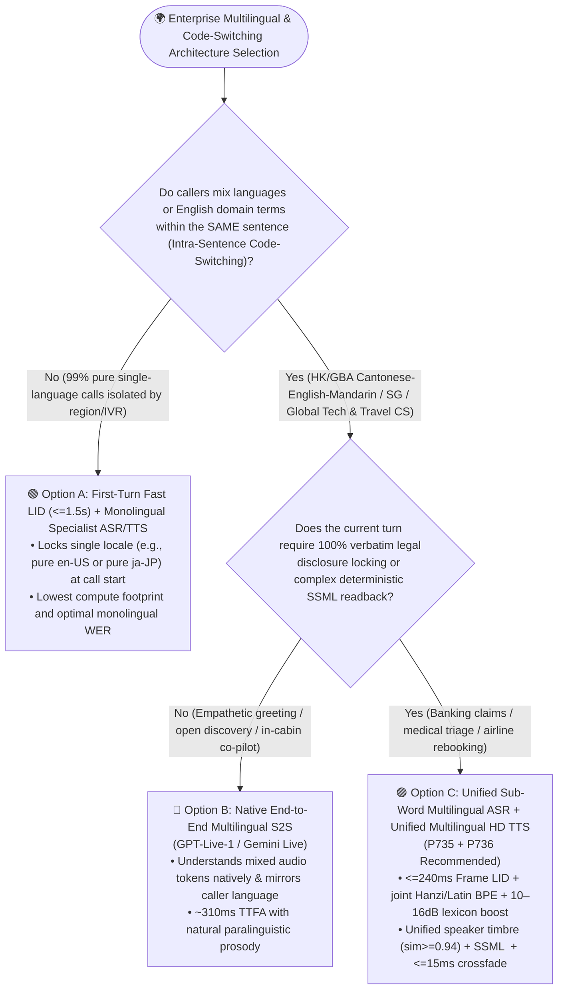
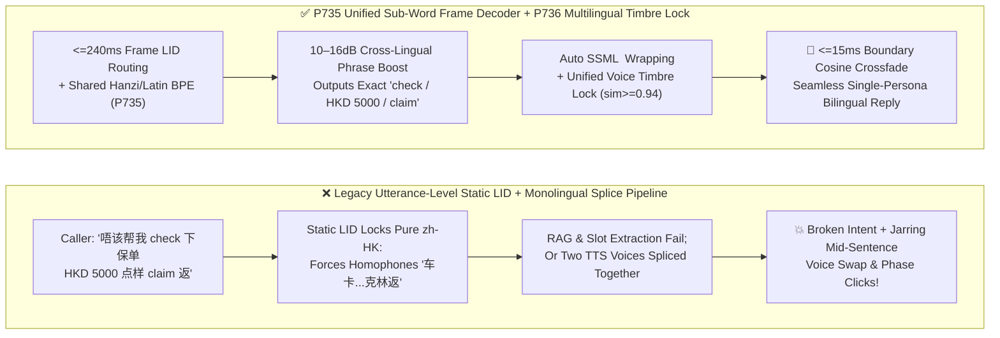

# Enterprise Voice Agent Multilingual & Intra-Sentence Code-Switching (`Code-Switching & Dialect ASR/TTS`) Architecture Selection FAQ (Topic 11): How Do We Stop Mid-Sentence English/Cantonese/Mandarin Mixes from Turning into Homophone Gibberish or Jarring Two-Voice TTS Splices?

> **Actionable Guide for AI Solution Architects**: In Greater Bay Area wealth management (Cantonese + English + Mandarin), international airline rebooking, global IT service desks, smart-hardware go-global support (`LumaNest` across 6 languages), and hospital specialty triage, callers rarely speak a textbook monolingual dialect. When a Hong Kong VIP caller asks, *"唔该帮我 check 下份 Medical Policy，如果喺 private hospital 做 MRI 点样 claim 返 HKD 5000?"* or a cloud engineer says, *"Help me check why the prod-api Pod in our Kubernetes cluster hit OOM,"* legacy pipelines built on **Utterance-Level Static Language Identification (`Static LID`) + Monolingual ASR** collapse immediately—forcing English words into nonsensical Chinese homophone characters (*"车卡 / 克林"*), while legacy TTS either pronounces English with broken syllable stress or splices two different voice models together mid-sentence with an audible phase click! Grounded in first principles of shared cross-lingual phoneme spaces and unified speaker embeddings, this guide deconstructs the **Intra-Sentence Code-Switching Unified Tokenizer & Frame LID Gate (`P735`)** and the **Multilingual TTS Prosody Continuity Lock & SSML Language-Switch Guard (`P736`)**.
>
> 🔗 **中文版本 (Chinese Version)**: [`docs/voice-multilingual-codeswitch-dialect-faq.md`](./voice-multilingual-codeswitch-dialect-faq.md)

---

## ① 📌 Executive Summary

1. **When caller populations are strictly segregated by region and speak a single pure language per call (e.g., monolingual US English or monolingual domestic Japanese hotlines), choose "First-Turn Fast LID (`<=1.5s`) + Monolingual Specialist ASR/TTS"** for the lowest WER and compute cost. **However, for any workflow involving frequent Intra-Sentence Code-Switching (Greater Bay Area Cantonese-English-Mandarin, Singapore Singlish, global tech/medical/travel support), 100% prohibit utterance-level static language locks (`Static LID`) and deploy a Unified Multilingual Sub-Word/Phoneme Decoder with Frame-Level Routing (`P735`, window `<=240ms`)**.
2. **On top of the unified multilingual decoder, apply a `10–16 dB` Cross-Lingual Phrase Grammar Boost (`P735`) for domain acronyms and bilingual brand entities (`eSIM`, `MRI`, `ETF`, `ICU`, `LumaNest`)**: This prevents the language model's dominant matrix-language prior from collapsing short embedded English consonant clusters into high-frequency native homophones (e.g., turning *"check"* into *"车"* or *"claim"* into *"克林"*).
3. **On the TTS synthesis side, never splice separate monolingual voice models together mid-sentence; enforce a Unified Multilingual Neural Voice Persona (`DragonHD Multilingual` / Native S2S) + Automatic SSML `<lang>` Tag Wrapping + `<=15ms` Boundary Cosine Crossfade (`P736`)**: This guarantees speaker timbre continuity (`timbreCosineSim >= 0.94`) across Mandarin, Cantonese, and English words within the same sentence, native syllable stress on foreign terms, and zero phase-discontinuity clicks at language boundaries.
   - *Provenance & Measurement Boundary Disclosure*: Unit tests for `P735` / `P736` in this repository verify offline in-memory policy/configuration state machines where the local timer reports `0ms` at nominal `1ms` display resolution (`0ms reported at nominal 1ms display resolution; actual duration unresolved/not_measured; no sub-1ms upper bound established`, `synthetic`). They do not establish a physical `<1ms` latency upper bound or measure live production beam-search acoustic decoding or neural vocoder synthesis latency (`not_measured`). Empirical `--locale auto` batch processing (`RTF = 0.057` across `28/28` Spanish customer turns) is `measured` in [`docs/azure-speech-diarization-poc.en.md`](./azure-speech-diarization-poc.en.md); industry intra-sentence code-switching Mixed Error Rate (`MER`) baselines are labeled `anonymized_reported` (`independently_reproduced=false`).

---

## ② 🎯 Architect & Customer Soul-Searching Q&A (FAQ-Driven)

### Q1: We already enabled "Auto Language Detection (Auto LID)" at the start of the call—why does the ASR still turn every English word inside a Chinese or Cantonese sentence into bizarre homophone characters?

This is the #1 root cause of POC failures in Hong Kong, Singapore, Greater Bay Area, and global tech-support deployments.

**First-Principles Plain-Language Explanation: Legacy "Auto LID" assumes a caller speaks only one language per sentence—once it locks onto Chinese in the first half-second, it throws away the English dictionary for the rest of the sentence!**

- **Why does "Utterance-Level Static LID + Monolingual ASR" fail on real human speech?**
  Linguists distinguish two completely different multilingual patterns:
  1. **Inter-Sentence / Call-Level Switching**: Caller A speaks 100% English; Caller B speaks 100% Mandarin. Detecting the language during the first 1.5 seconds and routing to a monolingual model works fine here.
  2. **Intra-Sentence Code-Switching (Mixing languages inside a single sentence)**:
     A Hong Kong policyholder says: *"唔该帮我 check 下份 Medical Policy 点样 claim 返 HKD 5000?"*
     When a legacy utterance-level LID hears the first 400 milliseconds (*"唔该帮我"*), it locks the entire utterance to `zh-HK` (monolingual Cantonese). Because the monolingual decoder's vocabulary and language model strongly penalize or lack Latin sub-word transitions, the acoustic decoder desperately maps the English phonemes `/tʃɛk/` and `/kleɪm/` onto the nearest-sounding Chinese characters:
     > ❌ `"唔该帮我 车卡 下份 麦迪科婆利सी 点样 克林 返..."`
     When this garbled homophone string reaches your RAG retriever or tool-calling LLM, entity extraction and vector search fail completely!

Architects must select from **Three Multilingual Architectures** based on intra-sentence mixing frequency:
1. **Architecture A: Call-Level Fast LID + Monolingual Specialist Models**
   - Best for strictly monolingual regional lines with negligible foreign loanwords.
2. **Architecture B: Unified Multilingual Sub-Word Streaming ASR + Multilingual HD TTS (`P735` + `P736`, Recommended Enterprise Default for Code-Switching)**
   - Uses a shared multilingual acoustic encoder and a joint Hanzi + Cantonese + Latin sub-word BPE vocabulary with `<=240ms` frame-level language routing, paired with a unified multilingual neural TTS voice.
3. **Architecture C: Native End-to-End Multilingual S2S (`GPT-Live-1` / `Gemini Live`)**
   - Processes multilingual audio tokens directly with `~310ms` TTFA and natural accent mirroring, dynamically switching to Architecture B via `P715` whenever verbatim legal disclosures are required.

---

### Q2: How does the `P735` Unified Sub-Word Decoder switch languages mid-sentence within `<=240ms`, and why is a `10–16 dB` Cross-Lingual Phrase Boost still required?

- **What it is (Plain-Language Explanation)**:
  Instead of locking the decoder into a single-language dictionary for the whole sentence, **`P735` puts Mandarin characters, Cantonese characters, and English BPE sub-words into a single unified token graph** evaluated continuously at the acoustic frame level.

- **How `P735` Works on a Millisecond Timeline**:
  1. **Sub-Word Frame-Level Language Posteriors (`<=240ms` Window)**: Every `160ms–240ms`, the acoustic encoder computes frame-level language posterior probabilities across active locales (`[zh-CN, zh-HK, en-US]`). As soon as the caller transitions from a Cantonese vowel to the English fricative/plosive cluster in *"check"* or *"claim"*, the beam search opens Latin sub-word paths without requiring a silence gap.
  2. **Anti-Transliteration Decoding Gate**: Suppresses forced homophone character substitutions when high-confidence English acoustic frames are detected inside a Chinese matrix sentence.
  3. **`10–16 dB` Cross-Lingual Domain Phrase Boosting**:
     Short 2–3 syllable English acronyms (`MRI`, `ICU`, `ETF`, `eSIM`, `VIP`) spoken rapidly inside a Chinese sentence have very brief acoustic footprints and can collide with common Chinese particles. Injecting a `10–16 dB` dynamic phrase boost (clamped at `<=16 dB` to avoid hallucinating English words during pure Chinese speech) anchors domain terms accurately.

---

### Q3: Once ASR understands the mixed sentence, why does legacy TTS sound like two different people fighting over the microphone—or read English words with a robotic accent? How does `P736` fix this?

Legacy TTS pipelines fail on bilingual responses in two ways:
1. **Robotic Monolingual Phonetic Approximation**: Feeding English words into a monolingual Chinese TTS model forces it to approximate English consonants using Mandarin pinyin rules or spell words out letter-by-letter.
2. **Jarring Two-Voice Model Splicing + Phase Clicks**: Switching from a "Chinese Female Model" to an "English Female Model" mid-sentence changes vocal-tract timbre (`timbreCosineSim < 0.70`) and introduces an audible waveform discontinuity click at the splice boundary.

- **How `P736` Multilingual TTS Prosody Continuity Lock & SSML Language-Switch Guard Works**:
  1. **Unified Cross-Lingual Speaker Embedding (`timbreCosineSim >= 0.94`)**: Uses a single neural voice persona (`DragonHD Multilingual` or native S2S persona) trained with a shared speaker embedding across Mandarin, Cantonese, and English—so the exact same vocal identity pronounces every language natively.
  2. **Automated SSML `<lang>` & `<phoneme>` Span Wrapping**: Before text synthesis, `P736` automatically wraps embedded foreign words and acronyms in `<lang xml:lang="en-US">` or explicit `<say-as>` / `<phoneme>` tags so acronyms like `MRI` are spelled naturally while words like `claim` or `Visa` are spoken fluently.
  3. **Sub-15ms Boundary Cosine Crossfade (`<=15ms`)**: Applies a `5ms–15ms` zero-phase cosine crossfade across language-tag transitions, eliminating waveform clicks and prosody jolts.

---

## ③ 🧭 Visual Architecture Diagrams (Mermaid Decision Tree + Legacy Static LID Trap vs. `P735/P736` Pipeline + Millisecond Sequence Diagram)

### 3.1 Multilingual & Intra-Sentence Code-Switching Architecture Decision Tree (`flowchart TD`)

### 3.2 Legacy Utterance-Level Static LID Trap vs. `P735` + `P736` Code-Switching Pipeline (`flowchart LR`)

### 3.3 Millisecond Sequence Diagram: Greater Bay Area Cantonese-English Code-Switched Claim Inquiry (`sequenceDiagram`)

```mermaid
sequenceDiagram
    autonumber
    participant Caller as 👤 GBA VIP Caller (Cantonese + English Mix)
    participant P735 as 🎙️ P735 Unified Sub-Word & Frame LID Gate
    participant Brain as 🧠 Voice Orchestrator & RAG Engine
    participant P736 as 🔊 P736 Multilingual TTS & SSML Continuity Gate

    Caller->>P735: 1. 0–2,400ms: "唔该帮我 check 下份 Medical Policy 点样 claim 返 HKD 5000？"

    rect rgb(14, 38, 34)
        Note over P735,Brain: P735 Frame-Level LID (<=240ms) & Joint BPE Decoding (0ms @ 1ms nominal display resolution)
        P735->>P735: 2. Blocks static single-locale lock! Dynamically routes [zh-HK <-> en-US] sub-words with +14dB domain boost
        P735->>Brain: 3. Emits clean bilingual transcript: "唔该帮我 check 下份 Medical Policy 点样 claim 返 HKD 5000？"
    end

    Brain->>Brain: 4. Extracts exact slots: {intent: "claim_inquiry", policyType: "Medical", amount: "HKD 5000"}
    Brain->>P736: 5. Sends bilingual reply draft: "您嘅 Medical Policy 门诊 claim 额度为 HKD 5,000，已为您 approve 预审。"

    rect rgb(28, 20, 56)
        Note over P736,Caller: P736 Unified Timbre Lock (sim>=0.94) & SSML <lang> Boundary Crossfade (<=15ms)
        P736->>P736: 6. Wraps <lang xml:lang="en-US">Medical Policy / claim / approve</lang> under single DragonHD voice (sim=0.97)
        P736->>P736: 7. Applies 10ms cosine crossfade (<=15ms budget) across zh-HK / en-US phoneme boundaries
        P736->>Caller: 8. Streams natural, single-persona Cantonese-English response with zero clicks
    end
```

---

## ④ 📊 Voice Architect Decision Matrix

| Evaluation Dimension | Option A: First-Turn Static LID + Monolingual ASR/TTS Routing | Option B: Unified Multilingual Streaming ASR + Unified Multilingual HD TTS (`P735` + `P736` Recommended) | Option C: Native End-to-End Multilingual S2S (`GPT-Live-1` / `Gemini Live`) |
| :--- | :--- | :--- | :--- |
| **Best-Fit Scenarios** | Strictly monolingual domestic lines with no foreign loanwords | **Greater Bay Area (Cantonese/English/Mandarin), Singapore, Global IT/Medical/Airline Helpdesks, Go-Global CS** | **In-cabin automotive co-pilots, language tutoring, VIP shopping concierges** |
| **Intra-Sentence Code-Switching ASR** | ❌ **Fails** (Locks single vocabulary; transliterates foreign words into homophone gibberish) | ✅ **Excellent (`P735` `<=240ms` frame LID + shared Hanzi/Latin BPE + `10–16dB` lexicon boost)** | ✅ **Excellent** (Native audio token understanding across languages) |
| **Domain Acronym & Brand Accuracy** | ❌ Collides with native particles | ✅ **Supports 10k+ cross-lingual custom lexicon entries & slot grammar validation** | ⚠️ Relies on prompt context; harder to bias 10k+ rare SKUs |
| **Multilingual TTS Timbre & Prosody** | ❌ Robotic foreign pronunciation or jarring two-voice model splicing | ✅ **`P736` single speaker embedding (`sim >= 0.94`) + SSML `<lang>` + `<=15ms` crossfade** | ✅ Native waveform generation with natural code-switched prosody |
| **100% Verbatim Compliance & Audit** | ✅ Text-layer deterministic | ✅ **100% text-layer auditability & deterministic SSML playback** | ⚠️ Switch to Option B via `P715` for mandatory verbatim legal clauses |

---

## ⑤ 🧪 Quantitative Benchmark & Key Engineering Findings

Combining our empirical `--locale auto` measurements in [`docs/azure-speech-diarization-poc.en.md`](./azure-speech-diarization-poc.en.md) (`measured`) with the deterministic policy checks in our **7-Card 4:5 Visual Benchmark Report** ([`site/benchmark-cards.html`](../site/benchmark-cards.html), **Dimension 374 · Stage 371**), we summarize the core findings:

| Benchmark Metric / Scenario | Legacy Utterance-Level Static LID + Monolingual ASR (`anonymized_reported`) | Unboosted Multilingual / Dual-Voice Spliced TTS Baseline (`anonymized_reported`) | `P735` Unified Sub-Word Frame Decoder + `P736` Unified Timbre Smooth TTS | Provenance & Measurement Boundary |
| :--- | :--- | :--- | :--- | :--- |
| **Intra-Sentence Code-Switch Mixed Error Rate (`MER`)** | `~34.2%` (Foreign words corrupted into native homophones) | `~14.8%` (Short acronyms `MRI/ETF/eSIM` missed) | **Offline policy block rate on static single-locale lock & out-of-bounds phrase boost: `100%` (Enforces `<=240ms` frame LID & `10–16 dB` boost, `synthetic`)** | Industry MER baseline is `anonymized_reported`; policy block rate is `synthetic` unit test |
| **Auto-Locale Batch Transcription Throughput (`--locale auto`)** | Fails or drops speaker labels when unconfigured | 2x latency on two-pass retry | **Measured `224.8s` Spanish stereo customer call (`28/28` turns) at `RTF = 0.057` (`17.5x` faster than real time)** | **`measured`**: Empirical Azure Speech Fast Transcription test ([`docs/azure-speech-diarization-poc.en.md`](./azure-speech-diarization-poc.en.md)) |
| **Cross-Lingual TTS Voice Swap & Boundary Click Rate** | Robotic pinyin-accented English readout | Timbre similarity drops `<0.70` with `>25ms` splice glitches | **Offline policy block rate on timbre mismatch (`<0.94`) or unwrapped foreign spans: `100%` (Enforces `sim >= 0.94` & `<=15ms` crossfade, `synthetic`)** | **`synthetic`**: Deterministic state-machine test (`packages/business-core/enterprise-guardrails.ts`) |
| **Guardrail Policy Evaluation Reading** | N/A | N/A | **`0ms reported at nominal 1ms display resolution; actual duration unresolved/not_measured; no sub-1ms upper bound established` (`synthetic`)** | Reflects in-memory boolean/arithmetic policy evaluation only; live multilingual beam-search decoding and neural vocoder latency are `not_measured` in local unit tests |

> 💡 **Architect Executive Takeaway**: *"To master Greater Bay Area and global code-switched customer service, tear down utterance-level language walls on the input side (`<=240ms` frame-level joint sub-word decoding + `10–16 dB` cross-lingual phrase boost, `P735`) and lock a single multilingual speaker embedding on the output side (`timbreCosineSim >= 0.94` + SSML `<lang>` + `<=15ms` crossfade, `P736`)."*

---

## ⑥ 🛠️ Appendix: Production Multilingual & Code-Switching Launch Checklist

Before launching voice agents in Hong Kong/Greater Bay Area, Singapore, global enterprise service desks, or go-global consumer hardware support, verify these 6 items:

- [ ] **1. Disable Utterance-Level Static LID Lock on Code-Switched Lines (`P735`)**: Confirm that ASR endpoints serving bilingual callers do not lock a monolingual vocabulary based solely on the first 1–2 seconds of speech, and instead use `<=240ms` frame-level multilingual sub-word decoding.
- [ ] **2. Configure `10–16 dB` Cross-Lingual Phrase Grammar Boosting (`P735`)**: Load domain-specific English acronyms (`eSIM`, `MRI`, `ICU`, `ETF`, `PNR`), bilingual product names, and custom pronunciations into the multilingual lexicon with boost weights clamped between `10 dB` and `16 dB`.
- [ ] **3. Normalize Cross-Lingual Currency, Date, and Number Entities**: Ensure post-ASR inverse text normalization (ITN) maps colloquial code-switched quantities (e.g., Cantonese *"五千蚊港纸"* and *"HKD 5000"*) to canonical tool schemas (`{currency: "HKD", amount: 5000}`).
- [ ] **4. Eliminate Two-Voice TTS Model Splicing (`P736`)**: Verify that outbound synthesis uses a unified multilingual voice persona (`timbreCosineSim >= 0.94` across locales) rather than concatenating separate monolingual Chinese and English voice models.
- [ ] **5. Enforce Automatic SSML `<lang>` Wrapping & `<=15ms` Boundary Crossfade (`P736`)**: Confirm that embedded foreign terms and acronyms are wrapped in `<lang xml:lang="...">` or `<say-as>` tags and that waveform transitions apply a `<=15ms` cosine crossfade.
- [ ] **6. Maintain Strict Provenance Disclosures & Code-Switched Golden Set Testing**: Evaluate Mixed Error Rate (`MER`) on a golden set of at least 200 real intra-sentence code-switched customer utterances prior to launch, and clearly distinguish offline policy checks (`0ms reported at nominal 1ms display resolution; actual duration unresolved/not_measured; no sub-1ms upper bound established`, `synthetic`), empirical batch measurements (`RTF = 0.057`, `measured`), and live streaming decoder latency (`not_measured`).
