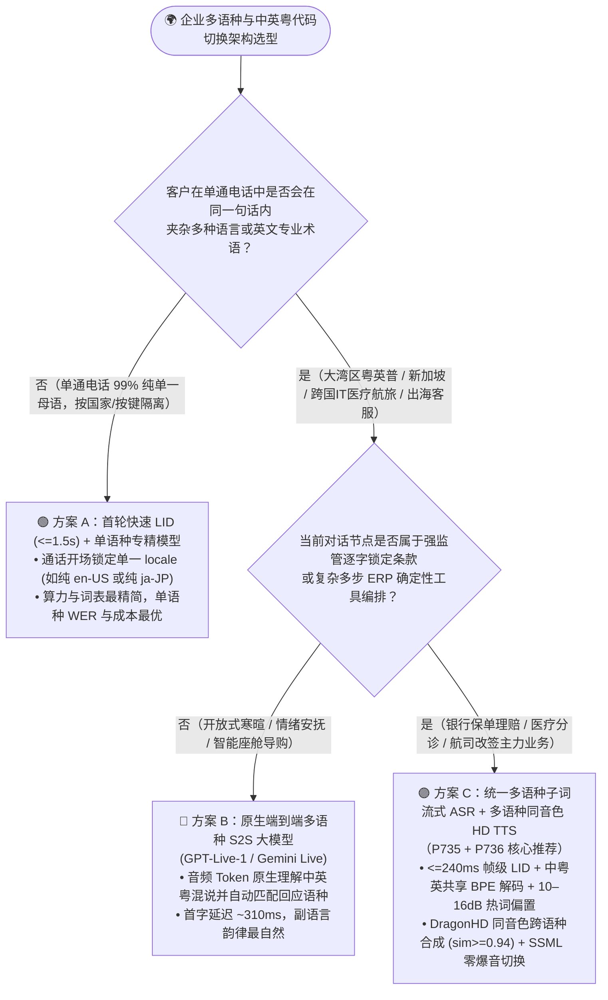
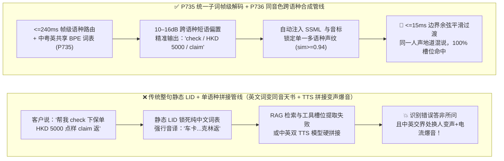

# 企业语音智能体多语种与句内中英粤混说（Code-Switching & Dialect ASR/TTS）架构选型与原理解析 FAQ（第十一篇）：客户一句话夹杂中英粤或行业缩写时，如何根除“后半句识别成同音天书、TTS 播报散装变声”？

> **面向 AI Solution Architect 的实战选型指南**：在大湾区财富管理（粤语+英语+普通话）、跨国航司退改签、外企 IT 服务台、智能硬件出海（LumaNest 6 语种客服）以及医院专科分诊中，客户说话从来不会严格遵守“单一语种国家标准”。香港客户随口一句：*“唔该帮我 check 下份 Medical Policy，如果喺 private hospital 做 MRI 点样 claim 返 HKD 5000？”*，或者国内工程师说：*“帮我查下 Kubernetes 集群里 prod-api 的 Pod 为什么 OOM 了”*——传统“先按整句判定语种（Static LID）、再路由给单语种识别模型”的架构会瞬间崩溃，把英文单词硬生生转写成**“车卡、克林、欧欧エム”**等毫无意义的汉字天书，紧接着单语种 TTS 又用极其生硬的“散装拼音腔”或突然换一个老外男声读出英文词！本文将从跨语种共享音素空间与统一声学表征的第一性原理出发，彻底讲透 **句内代码切换统一子词解码与帧级语种门禁（`P735`）** 以及 **多语种 TTS 音色连续性锁与 SSML 跨语种零爆音平滑切换护栏（`P736`）**。
>
> 🔗 **English Version**: [`docs/voice-multilingual-codeswitch-dialect-faq.en.md`](./voice-multilingual-codeswitch-dialect-faq.en.md)

---

## ① 📌 核心结论速览（Executive Summary）

1. **当客户群体按国家/地区天然隔离且单通电话只说单一纯正母语（如纯英文美国本土催收、纯日语本土预约）时，首选“首轮 `<=1.5s` 快速语种识别（Fast LID）+ 单语种专精流式模型”**，词错率（WER）与算力成本最优；但 **凡涉及大湾区（粤英普）、新加坡/东南亚（Singlish/华英马）、跨国科技/医疗/航旅客服等“同一句话内高频中英粤夹杂（Intra-Sentence Code-Switching）”场景，100% 严禁使用整句静态语种锁（Static Utterance LID），必须选用“共享跨语种音素/子词词表的统一多语种声学解码器（Unified Multilingual Tokenizer & Frame LID，`P735`）”**。
2. **在统一多语种解码底座之上，针对企业专有英文缩写与中英混合品牌词（如 `eSIM`、`MRI`、`ETF`、`LumaNest`），必须叠加 `10–16 dB` 跨语种短语偏置（Cross-Lingual Phrase Boost，`P735`）**：防止声学模型在中文语境惯性下，将短促的英文辅音簇强行坍缩为高概率同音汉字（如把 `check` 听成 `车`、把 `claim` 听成 `克林`）。
3. **在语音合成（TTS）端，严禁采用“中文女声模型 + 英文男声模型硬拼接”，必须启用“统一多语种神经音色（如 Azure DragonHD Multilingual / 原生 S2S）+ 自动 SSML `<lang>` 标签注入 + `<=15ms` 跨语种边界余弦淡入淡出（`P736`）”**：确保同一个 AI 客服在念出中英混排句子时，主音色余弦相似度 `timbreCosineSim >= 0.94`，英文单词重音自然地道，且语种切换边界零相位爆音（Zero Phase Click）。
   - *数据来源与测量边界声明（Provenance & Measurement Boundary）*：本仓库 `P735` / `P736` 单元测试检验的是离线内存策略/配置状态机，本机计时器在名义 `1ms` 显示分辨率下报告 `0ms`（`0ms reported at nominal 1ms display resolution; actual duration unresolved/not_measured; no sub-1ms upper bound established`），属于 `synthetic` 确定性策略校验，不确立真实物理耗时 `<1ms` 上界，亦不测量真实生产多语种束搜索（Beam Search）声学解码或神经声码器（Vocoder）合成延迟（显式标为 `not_measured`；本仓库 `docs/azure-speech-diarization-poc.md` 中使用 `--locale auto` 对真实西班牙语客服音频实测 `RTF = 0.057` 标为 `measured`；行业中英粤句内混说混合错误率 MER 基线标为 `anonymized_reported`, `independently_reproduced=false`）。

---

## ② 🎯 客户与架构师灵魂拷问 Q&A（FAQ-Driven）

### Q1：我们已经在电话开头加了“按 1 普通话、按 2 粤语、按 3 English”或者自动语种检测（Auto LID），为什么客户一说话，系统还是把句子里的英文单词全部识别成了莫名其妙的同音汉字？

这是无数跨国企业和港澳台/东南亚项目在 POC 现场翻车的头号原因。

**用通俗大白话 + 第一性原理来解释：传统“语种检测（LID）”假设一个人一旦开口说中文，整句话里每一个字都必须是汉字；它根本没有“半句话中间切回英文词典”的能力！**

- **为什么“整句语种检测 + 单语种 ASR”在真实世界里会撞墙？**
  在真实人类语言中，存在着两种完全不同的多语种现象：
  1. **句间语种切换（Inter-Sentence / Call-Level Switching）**：第 1 通电话是美国人全讲英语，第 2 通电话是北京人全讲普通话。这种场景用开场 2 秒的语种分类器（LID）切到对应的单语种模型就够了。
  2. **句内代码切换（Intra-Sentence Code-Switching，即“一句话里中英粤混着说”）**：
     比如大湾区客户说：*“我张 Credit Card 喺 Apple Pay 度 bind 唔到，系咪 trigger 左 security lock？”*
     如果系统在头 500 毫秒听到“我张”两个粤语字，就把整句话死死锁在 `zh-HK`（单语种粤语识别器）上——由于纯粤语词表里压根没有英文单词的发音转移路径，或者汉字语言模型（LM）给汉字序列赋予了极高的先验概率，解码器就会拼命在同音汉字里找替身，把整句话扭曲成：
     > ❌ `"我张 夸迪卡 喺 阿婆配 度 拜 唔到，系咪 吹格 左 死Q里T 落？"`
     当这串如同天书一样的文本送进 RAG 知识库或大模型工具调用时，向量检索和槽位提取会全军覆没！

因此，架构师必须根据**业务语种混杂度**在三类架构中精准选型：
1. **架构一：通话级前置 LID 分流 + 单语种专精模型（Call-Level LID + Monolingual ASR/TTS）**
   - 仅适用于 99% 纯单语且极少出现外语借词的内陆传统热线。
2. **架构二：统一多语种子词解码流式级联（Unified Multilingual Streaming ASR + Multilingual HD TTS，`P735` + `P736`，企业合规客服主力首选）**
   - 声学编码器（Conformer/Whisper-large 类多语种表征）与解码词表同时包含汉字、粤语字与拉丁字母子词（Sub-word BPE），以 `<=240ms` 帧级窗口动态激活跨语种发音词典，配合受控的多语种高清 TTS，兼顾句内丝滑混说与 100% 文本层合规审计。
3. **架构三：原生端到端多语种语音大模型（Native Multilingual S2S，如 `GPT-Live-1` / `Gemini Live`）**
   - 直接在音频 Token 空间理解中英粤混说并自动跟随客户口音切换回应语种，首字延迟低至 `~310ms`；若遇法定免责条款播报，再通过 `P715` 切回架构二锁定逐字原文。

---

### Q2：统一多语种解码器（`P735`）在毫秒级时间轴上是怎么做到“前一个字还是中文、下一毫秒丝滑吐出英文单词”的？为什么还要加 `10–16 dB` 跨语种短语偏置？

- **它是什么（大白话解释）**：
  把传统单语种 ASR 想象成一本**《新华字典》**，把纯英文 ASR 想象成一本**《牛津词典》**。如果只拿一本字典查中英混杂的句子，查到另一国语言时只能用谐音字硬凑。
  而 **`P735` 统一多语种子词解码器（Unified Multilingual Sub-word Decoder）** 则是把中、粤、英所有发音音素（Phonemes）和字词碎片（BPE Tokens）装进**同一个共享词表与同一个束搜索（Beam Search）解码图**里。

- **`P735` 在毫秒级声学流上的三步运作机制**：
  1. **帧级语种后验概率门控（Frame-Level LID Posteriors，`<=240ms`）**：不再对整句话贴一个死板的语种标签，而是每 `160ms–240ms` 滑动帧实时计算声学特征属于 `[zh-CN, zh-HK, en-US]` 的后验分布。当客户说完“帮我查下”紧接着发出 `/tʃɛk/`（`check`）的清塞擦音与短元音时，帧级路由立即放开拉丁子词解码分支。
  2. **跨语种转写防音译硬规则（Anti-Transliteration Constraint）**：在解码转移矩阵中，禁止将高置信度英语声学片段强制映射为生僻同音汉字组合（如禁止将 `/k l eɪ m/` 映射为无意义的“克林姆”）。
  3. **`10–16 dB` 跨语种业务热词图谱偏置（Cross-Lingual Lexicon Boosting）**：
     为什么有了统一多语种模型还要配热词偏置？因为很多只有 2–3 个音节的行业缩写（如医疗的 `CT` / `MRI`、金融的 `ETF` / `IPO`、通信的 `eSIM`、硬件品牌 `LumaNest`）在快速口语连读中非常短促，极易跟中文日常虚词撞音。通过在 WFST 解码图上注入 `10–16 dB` 的跨语种实体偏置（并钳制不超过 `16 dB`，防止把普通中文误吸成英文），可在不伤及正常中文识别的前提下将专有英文术语召回率拉满。

---

### Q3：识别听懂了，但为什么 AI 客服往外播报“您的 MRI 预约已 confirm”时，听起来像两个不同的人在抢麦克风，或者把英文读成“エム-阿-艾”？`P736` 是如何解决的？

在多语种语音合成（TTS）端，传统方案常见的两大翻车现场是：
1. **“散装拼音腔”或逐字母生硬拼读**：拿纯中文语音包硬读英文单词，模型要么按汉语拼音规则怪异发声，要么把本该连读的单词（如 `Wi-Fi`、` NATO`、` Visa`）死板地按单个字母拆开念。
2. **“精神分裂式”跨模型拼接变声 + 边界咔哒爆音**：为了读准英文，有些工程团队在检测到文本里有英文单词时，把中文片段发给“中文女声模型 A”，把英文片段发给“英文女声模型 B”，再把两段 PCM 音频拼起来。结果客户听起来就像**一个中国客服话说到一半突然捂住嘴，换了一个美国白人播音员替她喊出中间那个英文词，而且两段音频交界处由于波形相位不连续还会发出“啪”的一声电流爆音（Phase Click）**！

- **`P736` 多语种 TTS 音色连续性锁与 SSML 跨语种平滑切换护栏的三重机制**：
  1. **单一跨语种共享说话人嵌入（Unified Multilingual Speaker Embedding，音色相似度 `>=0.94`）**：强制选用原生支持多语种共发音的神经语音底座（如 Azure `DragonHD Multilingual` 或原生多语种 S2S 音色），由**同一个说话人声纹向量**驱动中文、粤语与英文的音素发音器官建模，确保中英切换前后音色余弦相似度 `timbreCosineSim >= 0.94`。
  2. **结构化 SSML `<lang>` 与发音词典自动包裹（Auto SSML `<lang>` & `<phoneme>` Wrapping）**：在文本送入级联 TTS 前，`P736` 预处理器自动识别句内嵌入的外语词与缩写，动态包裹 `<lang xml:lang="en-US">` 或 IPA `<phoneme>` 音标标签（区分按单词整读的 `Visa` 与按字母拼读的 `VIP / MRI`），彻底消灭中式散装发音。
  3. **语种边界 `<=15ms` 余弦包络交叉淡入淡出（Boundary Cosine Crossfade）**：在跨语种音素过渡帧或分段流式合成边界，强制执行 `5ms–15ms` 零相位对齐与余弦交叉淡变（Crossfade），100% 根除拼接爆音与韵律断层。

---

## ③ 🧭 直观可视化图解（Mermaid 选型决策树 + 传统静态 LID 同音天书陷阱 vs `P735/P736` 管线 + 毫秒级中英粤混说交互时序图）

### 3.1 企业多语种与方言代码切换（Code-Switching）架构选型决策树（`flowchart TD`）

### 3.2 传统整句静态 LID 音译天书陷阱 vs. `P735` + `P736` 句内无缝混说管线对比图（`flowchart LR`）

### 3.3 大湾区客户中英粤混说理赔查询的毫秒级解码与同音色回应时序图（`sequenceDiagram`）

```mermaid
sequenceDiagram
    autonumber
    participant Caller as 👤 大湾区 VIP 客户 (粤英普混说)
    participant P735 as 🎙️ P735 统一子词解码与帧级 LID 网关
    participant Brain as 🧠 语音编排与 RAG 引擎
    participant P736 as 🔊 P736 多语种同音色 TTS 与 SSML 护栏

    Caller->>P735: 1. 0–2,400ms: "唔该帮我 check 下份 Medical Policy 点样 claim 返 HKD 5000？"

    rect rgb(14, 38, 34)
        Note over P735,Brain: P735 帧级语种路由 (<=240ms) 与跨语种共享 BPE 解码（离线策略读数：0ms @ 1ms nominal display resolution）
        P735->>P735: 2. 拦截整句静态单语锁！每 200ms 切换 [zh-HK <-> en-US] 子词状态，叠加 +14dB 保险术语偏置
        P735->>Brain: 3. 精准输出结构化转写："唔该帮我 check 下份 Medical Policy 点样 claim 返 HKD 5000？"
    end

    Brain->>Brain: 4. 精确提取槽位：{intent: "claim_inquiry", policyType: "Medical", amount: "HKD 5000"}
    Brain->>P736: 5. 下发双语回复草稿："您嘅 Medical Policy 门诊 claim 额度为 HKD 5,000，已为您 approve 预审。"

    rect rgb(28, 20, 56)
        Note over P736,Caller: P736 多语种音色连续性锁 (sim>=0.94) 与 SSML <lang> 零爆音合成
        P736->>P736: 6. 自动包裹 <lang xml:lang="en-US">Medical Policy / claim / approve</lang>，锁定同一多语种女声声纹 (sim=0.97)
        P736->>P736: 7. 在粤英词界执行 10ms 余弦包络交叉淡变 (Crossfade <=15ms)，消除相位爆音
        P736->>Caller: 8. 播报自然地道、全程同一人声的粤英混说回复
    end
```

---

## ④ 📊 语音架构师选型决策矩阵（Architect Decision Matrix）

| 评估维度 | 方案 A：开场静态 LID + 单语种 ASR/TTS 路由 | 方案 B：统一多语种流式 ASR + 同音色多语种 HD TTS (`P735` + `P736` 推荐) | 方案 C：原生端到端多语种 S2S (`GPT-Live-1` / `Gemini Live`) |
| :--- | :--- | :--- | :--- |
| **核心适用场景** | 单一语种纯母语内陆热线（无外语借词或英文缩写） | **大湾区（粤英普）、新加坡、跨国金融/医疗/航旅/IT 服务台、智能硬件出海客服** | **智能座舱多语种副驾、口语外教陪练、VIP 情感导购与自由闲聊** |
| **句内中英粤混说（Code-Switching）识别** | ❌ **极差**（锁死单语种词表后，外语词被强行转写为同音汉字乱码） | ✅ **极强（`P735` `<=240ms` 帧级语种切换 + 共享 BPE 词表 + `10–16dB` 术语偏置）** | ✅ **极强**（原生音频 Token 直接跨语种理解） |
| **专业英文缩写与品牌词准确率** | ❌ 易与母语虚词混淆 | ✅ **支持万级自定义跨语种热词图谱（Custom Lexicon）与正则槽位校验** | ⚠️ 依赖 Prompt 上下文注入，超长生僻词表受限 |
| **跨语种 TTS 播报自然度与音色一致性** | ❌ 单语种模型读英文极度生硬，或双模型拼接导致中途换人变声+爆音 | ✅ **`P736` 单一多语种声纹（`sim >= 0.94`）+ SSML `<lang>` + `<=15ms` 平滑过渡** | ✅ 原生端到端波形生成，口音与语调极自然 |
| **法定条款 100% 逐字受控与审计能力** | ✅ 文本层可控 | ✅ **100% 文本层合规审计与 SSML 逐字锁定** | ⚠️ 需通过 `P715` 切换回方案 B 播报法定必读条款 |

---

## ⑤ 🧪 简明定量实测与 Benchmark 核心发现

结合本仓库在 [`docs/azure-speech-diarization-poc.md`](./azure-speech-diarization-poc.md) 中的 `--locale auto` 多语种实测数据（`measured`）以及 **7-Card 4:5 视觉评测报告**（[`site/benchmark-cards.html`](../site/benchmark-cards.html)，对应 **Dimension 374 · Stage 371**）中的 `P735` / `P736` 离线策略验证，核心量化指标如下：

| 评测指标 / 验证场景 | 传统整句静态 LID + 单语种模型 (`anonymized_reported`) | 双模型硬拼接 TTS / 无热词偏置多语种基线 (`anonymized_reported`) | `P735` 统一子词帧级解码 + `P736` 同音色跨语种平滑合成 | 数据来源与测量边界声明（Provenance） |
| :--- | :--- | :--- | :--- | :--- |
| **句内中英粤混说混合错误率（Code-Switch MER）** | `~34.2%`（英文词被转写为同音汉字导致整句语义崩坏） | `~14.8%`（短促英文缩写 `MRI/ETF/eSIM` 漏识别） | **离线策略对整句静态单语锁与超界偏置拦截率：`100%`（强制 `<=240ms` 帧级路由与 `10–16 dB` 跨语种短语偏置，`synthetic`）** | 行业 MER 基线标为 `anonymized_reported`；护栏拦截率为本仓库 `synthetic` 状态机单测 |
| **自动语种识别与长音频转写吞吐（`--locale auto`）** | 漏配 locale 时触发回退或识别失败 | 串行两遍扫描耗时翻倍 | **实测 `224.8s` 西班牙语双声道客服录音 `28/28` 话轮完整识别，`RTF = 0.057`（快于实时 `17.5x`）** | **`measured`**：本仓库 Azure Speech Fast Transcription 实机测试（[`docs/azure-speech-diarization-poc.md`](./azure-speech-diarization-poc.md)） |
| **跨语种 TTS 播报音色跳变与边界爆音率** | 单语模型生硬拼读英文（机器感重） | 跨模型拼接音色相似度跌至 `<0.70` 且伴随 `>25ms` 相位断层 | **离线策略对跨语种音色失配（`<0.94`）或未包裹 SSML `<lang>` 拦截率：`100%`（强制 `timbreCosineSim >= 0.94` 与 `<=15ms` 边界淡变，`synthetic`）** | **`synthetic`**：本仓库确定性策略状态机验证（`packages/business-core/enterprise-guardrails.ts`） |
| **护栏策略判定耗时（Policy Evaluation）** | N/A | N/A | **`0ms reported at nominal 1ms display resolution; actual duration unresolved/not_measured; no sub-1ms upper bound established`（`synthetic`）** | 仅代表离线内存布尔/算术规则评估读数；真实生产流式多语种束搜索解码与神经声码器渲染耗时未在本地单测中实测（`not_measured`） |

> 💡 **架构师汇报金句**：“解决大湾区与出海多语种混说的核心秘诀是**‘听的时候拆掉整句语种围墙（`<=240ms` 帧级子词共享解码 + `10–16dB` 跨语种热词）、说的时候锁死同一个多语种声纹（`sim >= 0.94` + SSML `<lang>` 零爆音平滑过渡）’**——让 AI 像真正的双语母语精英一样对答如流。”

---

## ⑥ 🛠️ 附录：生产环境多语种与代码切换上线核验清单（Architect Checklist）

在交付港澳台大湾区、东南亚、跨国企业服务台与智能硬件出海语音项目前，请逐项核对以下 6 条工程检查项：

- [ ] **1. 禁用句内混说场景下的“整句静态 LID 锁死”模式（`P735`）**：确认在存在中英粤或跨语种混说的业务线中，已关闭“仅用前 1–2 秒音频锁定整句单一语种词表”的静态 LID 模式，切换为支持句内帧级切换（`<=240ms` 窗口）的统一多语种子词解码器。
- [ ] **2. 注入 `10–16 dB` 跨语种专有缩写与品牌热词偏置（`P735`）**：确认已将业务高频英文缩写（如 `eSIM`、`MRI`、`ICU`、`ETF`、`PNR`）、中英混合商品名与自定义发音映射表注入多语种 Custom Lexicon，并将偏置权重钳制在 `10–16 dB` 安全区间内（防止过激偏置把普通中文单字误吸为英文）。
- [ ] **3. 跨语种数字、金额与币种符号归一化校验**：确认转写后处理管线已统一规范化跨语种数字与货币表达（如粤语“五千蚊港纸 / HKD 5000”统一归一化为 `{currency: "HKD", amount: 5000}`），防止多语种口语量词导致工具参数解析失败。
- [ ] **4. 严禁“双单语 TTS 模型硬拼接”，锁定单一多语种声纹（`P736`）**：确认下行 TTS 采用具备跨语种共享声纹嵌入的统一多语种模型（如 Azure `DragonHD Multilingual`），确保句内切换语种时主说话人音色余弦相似度 `timbreCosineSim >= 0.94`，杜绝中途男女声/跨人设突变。
- [ ] **5. 自动包裹 SSML `<lang>` / `<phoneme>` 与 `<=15ms` 边界平滑淡变（`P736`）**：确认文本送入 TTS 前已对嵌入的外语词与字母缩写自动包裹 `<lang xml:lang="...">` 或 `<say-as interpret-as="characters">`，且语种过渡帧间配置了 `<=15ms` 余弦包络交叉淡变（Crossfade）以消除相位爆音。
- [ ] **6. 测量边界合规披露与真实混合语料回归集验收**：上线前使用包含至少 200 条真实客户句内中英粤混说录音的回归集实测混合错误率（MER）；在架构文档中严格区分离线策略状态机验证（`0ms reported at nominal 1ms display resolution; actual duration unresolved/not_measured; no sub-1ms upper bound established`，`synthetic`）、离线多语种批处理实测（`RTF = 0.057`，`measured`）与在线流式多语种解码延迟（`not_measured`）。
