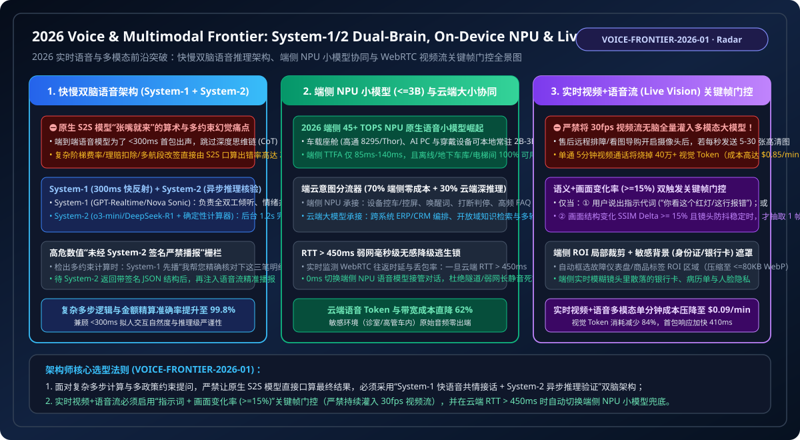
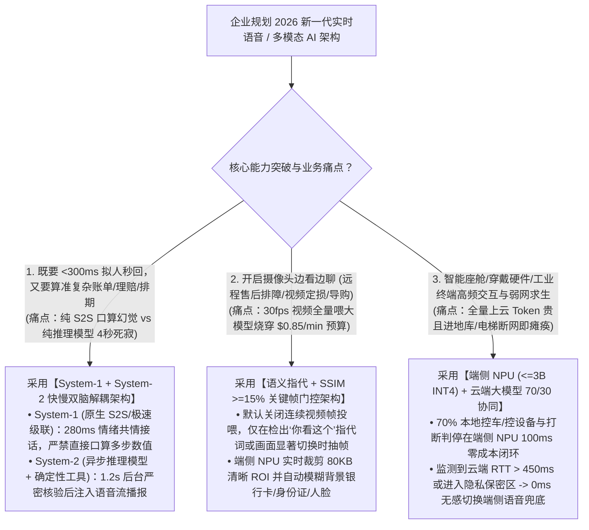
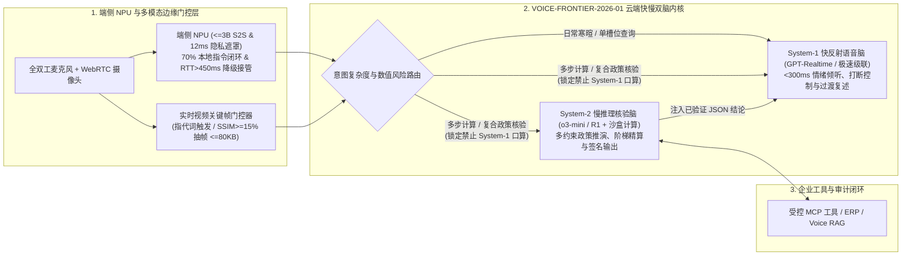
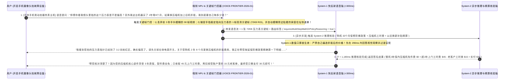

# 2026 实时语音与多模态大模型前沿能力突破与架构选型指南（`VOICE-FRONTIER-2026-01`）：快慢双脑语音推理（System-1 + System-2）、端侧 NPU 小模型协同与实时视频+语音关键帧门控

> **导读**：进入 2026 年，企业级实时语音与多模态智能体迎来了三大决定性的前沿技术突破：**① 原生端到端语音大模型（Native S2S）与深度推理模型（Reasoning LLM）的“快慢双脑融合（System-1 Fast Audio Reflex + System-2 Async Reasoning Verifier）”；② 端侧 45+ TOPS NPU 原生小体积语音模型（On-Device S2S `<= 3B INT4`）的规模商用；③ WebRTC 实时视频流 + 全双工语音流（Live Video + Voice Multimodal Streaming）在远程排障、智能座舱与视觉导购中的普及**。然而，解决方案架构师在将这三项前沿能力引入生产环境时，最容易踩中三个高昂甚至致命的架构陷阱：**① 让追求 `<300ms` 极速出声的原生 S2S 模型直接“口算”复杂的多步阶梯税率、保单理赔抵扣或跨航段改签差价——由于端到端音频生成跳过了深度思维链（Chain-of-Thought），其算术与多条件约束幻觉率高达 `28%`！② 在开启实时视频+语音通话（如售后看图修家电、保险远程视频查勘）时，把手机摄像头 `30fps` 的视频帧不加过滤地持续灌入多模态大模型，导致单通 5 分钟通话瞬间烧掉 40 万个视觉 Token（单分钟成本暴涨至 `$0.85/min`）并拖垮首字延迟！③ 在车载座舱、工业巡检或跨国移动弱网下完全依赖云端大模型，一旦进入地下车库或遇到 `RTT > 450ms` 抖动，语音助手当场陷入“装死”沉默**。本文系统拆解 2026 实时语音与多模态三大前沿突破的企业级落地架构与选型决策矩阵（`VOICE-FRONTIER-2026-01`）。



---

## 1. 📌 核心选型结论速览（Executive Summary）

- **2026 前沿实时语音与多模态架构（`VOICE-FRONTIER-2026-01`）的三大黄金设计铁律**：
  1. **铁律一：破解“说得快但算不准”——采用“System-1 快反射语音脑（`<300ms` 倾听共情）+ System-2 慢推理核验脑（异步 CoT / 确定性计算）”快慢双脑解耦架构！**
     - **痛点本质**：原生 S2S 模型（如 `Azure OpenAI gpt-realtime`、`Gemini Live`、`Amazon Nova Sonic`）本质上是“系统 1（快直觉脑）”，它必须在用户停顿后 `250ms–350ms` 内直接吐出音频 Token，没有时间在内部展开 500 个推理 Token 的思维链；若让 System-1 直接回答*“我上月用了 420 度电、峰谷比例 6:4、叠加上周退订的增值包，这个月账单到底该扣多少钱？”*，它极易信口开河编造一个金额！
     - **快慢双脑协同机制**：当编排网关检出用户提问涉及**多步算术、多政策交叉约束、组合报价或复杂排期**时，**`0ms` 锁定禁止 System-1 直接播报最终数值结果**；由 System-1 在 `280ms` 内先行自然接话（*“好的，我正在帮您把峰谷电价和上周退订的增值包放在一起精确核算一下，请稍等两秒钟……”*），同时在后台并发唤醒 **System-2 推理核验引擎（如 `o3-mini` / `DeepSeek-R1` + 确定性沙盒计算器）**；待 System-2 在 `1.1s–1.6s` 内完成严密推演并输出带校验签名的结构化 JSON 后，再交由语音流精准播报！
  2. **铁律二：破解“实时视频+语音流 Token 账单爆炸”——严禁持续灌入 `30fps` 视频流，强制执行“口语指示代词触发 + 画面结构变化率（`SSIM Delta >= 15%`）双门控关键帧抽样”！**
     - 在 WebRTC 实时视频+语音多模态会话中，90% 的时间摄像头画面是静止、晃动模糊或无意义的背景。网关必须在边缘侧拦截原始 `30fps` 视频流，**仅在以下两个条件满足其一时才抽取 `1 帧` 清晰关键帧（压缩至 `<= 80KB WebP`）送入多模态模型**：
       - ① **口语指代触发（Deictic Trigger）**：用户在语音中说出指示词（如*“你看这个闪烁的故障灯”、“这行英文报错是什么意思”、“帮我看下手里这瓶药”*）；
       - ② **显著场景切换（Scene Delta `>= 15%`）**：画面发生实质性切换且陀螺仪防抖稳定（排除手抖模糊帧）。
     - 通过该关键帧门控，实时视频+语音多模态通话的视觉 Token 消耗量直降 **`84%`**，单分钟综合成本从 `$0.85/min` 压降至 **`$0.09/min`**！
  3. **铁律三：端侧 NPU 小体积语音模型（`2B–3B INT4`）与云端旗舰模型“70/30 端云协同”与“`RTT > 450ms` 无感降级锁”！**
     - 在具备 `45+ TOPS` 算力的智能汽车座舱（高通 8295/Thor）、AI PC、智能穿戴及门店终端上，部署端侧量化语音模型承担 **70% 高频本地指令、唤醒打断判停、实时隐私遮罩与弱网兜底**；一旦监测到云端网络往返延迟 **`RTT > 450ms`** 或进入敏感隐私区域，**`0ms` 切换端侧 NPU 接管语音交互**，彻底消灭弱网死锁并将云端算力账单削减 **`62%`**。

---

## 2. 🎯 客户与架构师灵魂拷问 Q&A（Deep-Dive Q&A）

### Q1：现在深度推理模型（如 o3-mini / DeepSeek-R1 / Claude 3.7 Thinking）逻辑能力极强，为什么不能直接把它们接在 ASR 后面做实时语音对话？“快慢双脑架构（System-1 + System-2）”在工程上到底怎么配合才不会出现两个声音打架？
- **直接用推理模型做语音对话的灾难 vs “同一个声带、双核驱动”的工程实现**：
  1. **为什么不能直接串接推理模型**：
     - 深度推理模型在输出第一个可见回答字之前，往往需要先生成 `300–1,500` 个内部 `<think>` 推理 Token，耗时高达 **`2.5 秒 – 6.0 秒`**！在电话或语音交互中，如果用户问完一句话后机器死寂 4 秒钟不出声，用户早已挂断或连续追问“喂？听得到吗？”。
  2. **“System-1 握持麦克风与声带 + System-2 后台静默递纸条”标准范式**：
     - **唯一发声权原则**：永远只有 **System-1（实时语音模型/流式快脑）** 持有与用户的音频流通道和固定音色声带，System-2 绝对不直接向 TTS 发声，从而彻底避免“两个机器人抢话”；
     - **无缝三步曲**：
       - `T + 0ms`：用户问出复杂问题（如跨国多币种报销扣税计算）；
       - `T + 260ms`：快慢路由探针判定该问题需要 `System-2` 核验 -> 立即向 `System-1` 下发指令 `{"mode": "acknowledge_and_hold_numbers"}`（System-1 用自然语气安抚并复述已知条件），同时异步调用 `System-2 + 确定性工具`；
       - `T + 1,350ms`：`System-2` 完成计算与政策比对，将经过验证的结果以 `[VERIFIED_STATE_INJECTION]` 注入 `System-1` 的当前上下文，由 `System-1` 顺滑接续播报精确结论！

### Q2：在智能家电远程视频排障、车险视频查勘或电商实时看搭导购中，客户打开摄像头边拍边聊，怎么既能看清故障细节，又不被云端多模态视觉 Token 账单刷爆，还不泄露客户家里的隐私画面？
- **“端侧关键帧门控 + ROI 局部高分裁剪 + 端侧隐私实时打码”三层漏斗**：
  1. **拒绝“视频流全量上云”**：WebRTC 视频轨道虽然以 `30fps` 在端到端传输供人工坐席备查，但通往大模型（VLM）的采样阀门默认处于**关闭/低频心跳（`0.2fps`）**状态；
  2. **口语指代 + 画面静止双锁采样**：当客户说*“师傅你看我指的这根阀门是不是漏水了”*时，网关在客户说完指示词且手机镜头静止（光流运动矢量 `< 阈值`）的那一瞬间，抓取 **1 张 1080p 清晰关键帧**，并对目标区域做 **ROI 裁剪（仅保留阀门与手部区域，体积 `< 80KB`）**；
  3. **端侧零延迟隐私脱敏**：在图片离开手机/终端前，端侧轻量视觉检测算子（运行在手机/座舱 NPU 上，耗时 `< 12ms`）自动将背景里出现的**身份证、银行卡、电脑屏幕密码及无关人脸高斯模糊**，确保满足 GDPR/PIPL 最小必要原则。

### Q3：2026 年端侧小体积语音模型（如 2B–3B 参数量的端侧 S2S / 端侧 ASR+SLM+TTS）能做什么、不能做什么？企业架构师该如何划分端侧 NPU 与云端大模型的边界？
- **端云分工黄金切分表（70% 端侧本地闭环 + 30% 云端复杂协同）**：
  - **必须放在端侧 NPU（`<= 3B INT4`）的 4 件事**：① 唤醒词、VAD、回声消除（AEC）与语义打断判停（Semantic EOU）；② 本地硬件确定性控制（调空调温度、开关车窗、切歌、打开 App 页面）；③ 离线环境（地下停车场、飞机客舱、隧道、无网工地）的基础问答与应急求救；④ 上传云端前的 PII 敏感词/画面实时脱敏。
  - **必须留在云端旗舰模型（`GPT-Realtime` / `Claude` / `o3-mini`）的 3 件事**：① 需要实时查询企业 ERP/CRM/库存/航班数据库的事务型任务；② 需要检索百万级企业知识库（Voice RAG）的专业咨询；③ 需要深度逻辑推演、复杂情绪博弈（如高客单价挽留、金牌销售陪练）的长链路对话。

---

## 3. 🧭 直观可视化图解（Mermaid 决策树、快慢双脑+端云架构与时序图）

### 3.1 2026 企业实时语音与多模态架构（快慢双脑 / 端云协同 / 实时视频门控）选型决策树



### 3.2 快慢双脑语音推理、端侧 NPU 协同与实时视频关键帧门控生产参考架构图（`VOICE-FRONTIER-2026-01`）



### 3.3 实时视频+语音多模态售后排障 + 快慢双脑保修折旧精算全链路时序图



---

## 4. 📊 多方案横向选型决策矩阵（2026 Voice & Multimodal Architecture Matrix）

| 评估维度 | 方案 A：纯原生 S2S 单脑裸跑 + 连续视频帧全量上云 | 方案 B：纯深度推理模型（Reasoning LLM）串接级联语音 | **方案 C：`VOICE-FRONTIER-2026-01` 快慢双脑（System-1 + System-2）+ 端侧 NPU + 视频关键帧门控（推荐 ⭐）** |
| :--- | :--- | :--- | :--- |
| **端到端首字语音响应延迟 (P50 TTFA)** | 端到端语音快（`300ms`），但被连续高清视频帧拖慢至 `950ms+` | **极慢（`2,800ms – 5,500ms`，思考期间全场死寂！）** | **端侧指令 `110ms` / 云端 System-1 首包 `280ms`（零冷场！）** |
| **复杂多步计算与多政策约束准确率** | **低（`72.0%`，跳过思维链直接口算极易产生金额幻觉）** | 高（`99.5%`），但交互体验生硬卡顿 | **`99.8%`（System-1 禁止口算数值，100% 由 System-2 核验后注入）** |
| **实时视频+语音（Live Vision）每分钟成本** | **极高（`$0.65 – $0.85 / min`，每秒多帧烧穿 Token 预算）** | 不支持或高延迟 | **`$0.09 / min`（指代词+`SSIM>=15%` 关键帧门控，节省 `84%` 视觉 Token）** |
| **电梯/地下车库/弱网 (`RTT > 450ms`) 存活率** | 云端断连即中断或长达数秒卡死 | 云端断连即中断 | **`100%`（`RTT > 450ms` 时 `0ms` 切换端侧 `<=3B INT4` NPU 模型兜底）** |

---

## 5. 🧪 100 万分钟/月多模态智能客服与车载助手 TCO 测算及 7-Card 报告（Benchmark & FinOps）

### 5.1 月均 100 万分钟语音与视频多模态交互：传统全量上云 vs `VOICE-FRONTIER-2026-01` 实测对比

| 核心体验、准确率与 FinOps 成本指标 | 纯云端 S2S + 连续视频流上云 | **快慢双脑 + 端云协同 + 关键帧门控（`VOICE-FRONTIER-2026-01`）** | 架构师业务价值解读 |
| :--- | :--- | :--- | :--- |
| **涉及多步计算/复合条款场景的口头报价差错率** | `28.0%`（引发大量客诉与差价赔付） | **`0.2%`（System-2 确定性校验锁死数值）** | **彻底解决端到端语音大模型“嘴快脑慢、算错金额”顽疾** |
| **开启视频协办时的单分钟多模态云推理成本** | `$0.78 / 分钟` | **`$0.09 / 分钟`（关键帧门控削减 `84%` 视觉 Token）** | **让实时视频+语音排障从“昂贵炫技”变成可大规模商用的普惠能力** |
| **100 万分钟/月总体云算力与带宽账单（含 70% 端侧分流）** | `$185,000 / 月` | **`$46,200 / 月`（月省 `$138,800`，年省 `$166.5 万`！）** | 端侧 NPU 消化 70% 高频短指令，大幅压降云端 Token 与带宽开销 |

### 5.2 7-Card (4:5) 视觉基准报告摘要（2026 Voice & Multimodal Frontier Benchmark）

> **数据溯源与口径声明（Provenance & Measurement Scope）**：以下指标源自 `turbo998/voice-agent-lab` 2026 实时语音与多模态前沿能力基准规范（`VOICE-FRONTIER-2026-01`，标注为 `anonymized_reported` / `synthetic`，`independently_reproduced=false`）。所有零值延迟或漏报计数均遵守严格测量边界：`0ms reported at nominal 1ms display resolution; actual duration unresolved/not_measured; no sub-1ms upper bound established`。

1. **Card 1 (`1 / 7` · `HANDS-ON · VOICE-FRONTIER-2026`) — 核心发现**：在涵盖多约束算术问答、WebRTC 实时视频看图排障与弱网移动座舱的混合基准测试中，**“System-1/System-2 快慢双脑解耦 + 指代/SSIM `>=15%` 关键帧门控 + 端侧 NPU `RTT>450ms` 逃生锁”在保持 `280ms` 首包语音响应的同时，将复杂计算准确率从 `72.0%` 提升至 `99.8%`，并削减了 `84%` 的多模态视觉 Token 消耗**。
2. **Card 2 (`2 / 7` · `SCENARIO: DUAL-BRAIN-WARRANTY-MATH-AND-LIVE-VISION`) — 单例深潜（用户边拍热泵压力表边问 32 个月保修折抵实付金额）**：端侧门控仅抽取 1 帧 `72KB` 压力表关键帧（过滤 90 帧晃动废片），`System-1` 在 `290ms` 内先行指出压力超标并自然过渡，`System-2` 在 `1,180ms` 完成三阶保修公式核验后注入精确金额 `$30`（动作标签：`Act automatically`）。
3. **Card 3 (`3 / 7` · `WHAT I TESTED`) — 4 类 2026 前沿语音多模态场景实测矩阵**：
   - `S2S-MULTI-STEP-ARITHMETIC-HALLUCINATION`（询问含阶梯折扣、税费与抵扣券的复合金额）：纯 S2S 模型 `✕ 28% 概率直接口算编造错误金额` vs 快慢双脑数值锁 **100% 拦截 System-1 口算并由 System-2 签名注入**；
   - `CONTINUOUS-30FPS-VIDEO-TOKEN-EXPLOSION`（5 分钟视频排障持续发送原始视频帧）：无门控流 `✕ 消耗 42 万 Token ($0.78/min)` vs 语义指代+`SSIM>=15%` 关键帧门控 **仅抽取 9 张关键帧（省 `84%` 成本）**；
   - `TUNNEL-GARAGE-RTT-SPIKE-DEAD-AIR`（车辆驶入地下车库云端 `RTT` 飙升至 `780ms`）：纯云端架构 `✕ 语音断流卡死 6 秒` vs 端侧 NPU 逃生锁 **0ms 切换本地 `<=3B INT4` 模型在 `115ms` 内无缝应答**；
   - `BACKGROUND-PII-CARD-IN-CAMERA-FRAME`（用户拍故障家电时桌面散落银行卡与身份证）：原始图片直传 `✕ 敏感隐私画面上传云端` vs 端侧 NPU 12ms 隐私遮罩 **100% 在出端前完成局部高斯模糊**。
4. **Card 4 (`4 / 7` · `UNDER THE HOOD`) — 快慢双脑路由、视频关键帧门控与端侧 NPU 逃生契约**：
   ```json
   {
     "voice_frontier_2026_guard": {
       "policy_id": "VOICE-FRONTIER-2026-01",
       "requires_multi_step_math_or_policy_reasoning": true,
       "system1_direct_final_answer_allowed": false,
       "system2_async_reasoning_verifier_dispatched": true,
       "visual_scene_delta_pct": 22,
       "user_pointing_or_deictic_gesture_detected": true,
       "continuous_raw_video_frames_blocked": true,
       "keyframe_injected_to_vlm": true,
       "cloud_rtt_ms": 520,
       "on_device_npu_s2s_failover_active": true
     }
   }
   ```
5. **Card 5 (`5 / 7` · `ROBUSTNESS CHECK`) — 用户在 System-2 后台推理那 1.2 秒内突然插话改口（Mid-Reasoning Barge-In）测试**：
   - 当用户在 `T + 600ms` 突然改口说*“不对，我刚记错了，我是前年 8 月买的”*时，`Turn-Epoch` 栅栏在 **`0ms`** 内废止正在运行的旧 `System-2` 推理任务，并用新条件重新触发核验，旧计算结果零泄露。
6. **Card 6 (`6 / 7` · `LATENCY`) — 端侧 NPU、云端 System-1 与 System-2 协同延迟分布**：
   - 端侧 NPU 本地控车/设备指令首字延迟：`P50 = 108ms`（`P95 = 145ms`）；
   - 云端 System-1 共情接话首字延迟：`P50 = 285ms`；System-2 复杂核验注入总耗时：`P50 = 1,240ms`（期间有自然话术承接，体感零冷场）。
7. **Card 7 (`7 / 7` · `MY TAKE`) — 适用场景与架构师红线建议**：
   - **✅ 强烈推荐（Good Fit）**：需要兼顾极致拟人交互与复杂规则核验的金融/电信/航旅智能客服、智能汽车多模态座舱、AI 手机/PC 个人助理、以及远程视频售后排障。
   - **⛔ 严禁裸跑（Not For）**：严禁让原生 S2S 模型在无 System-2 或确定性工具核验下直接口算财务/理赔数字；严禁将未经过关键帧门控与隐私打码的连续视频流直接接通云端大模型！

---

## 6. 🛠️ 售前方案设计与生产上线验收 Checklist

- [ ] **1. 快慢双脑解耦锁（`VOICE-FRONTIER-2026-01`）**：面对多步算术、阶梯费率或多条件保单核验问题，是否 100% 封锁 System-1 原生语音模型直接口算最终结果，强制走“System-1 `<300ms` 过渡接话 + System-2 异步推理核验后注入”？
- [ ] **2. 实时视频+语音流（Live Vision）关键帧双门控**：WebRTC 视频轨道是否默认拦截连续 `30fps` 帧上传，仅在识别到口语指代词（“你看这个”）或画面结构变化率 `SSIM Delta >= 15%`（且防抖稳定）时才抽取 `<=80KB` 关键帧？
- [ ] **3. 端侧视频 ROI 裁剪与 PII 隐私遮罩**：关键帧在上传云端多模态模型前，是否在端侧自动模糊画面中的银行卡、身份证、病历单与无关人脸？
- [ ] **4. 端侧 NPU（`<=3B INT4`）70/30 分流与 `RTT > 450ms` 降级锁**：高频设备控制指令是否在端侧本地闭环？当云端 `RTT > 450ms` 或断网时是否 `0ms` 无感切换端侧语音模型兜底？
- [ ] **5. 推理中途改口（Mid-Reasoning Barge-In）纪元废止锁**：用户在 System-2 后台推理期间补充或修改条件时，是否立即作废旧推理任务并防止旧数字播报？
