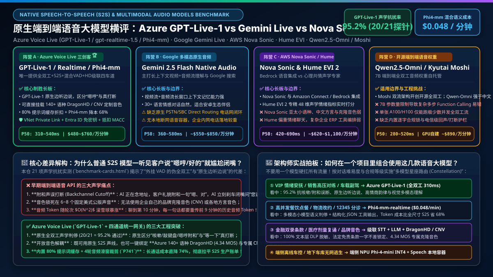
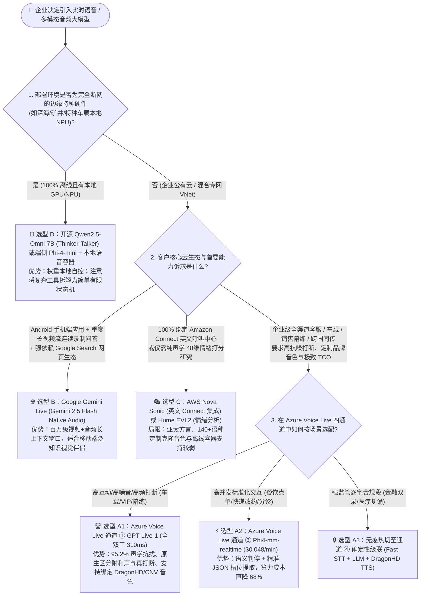
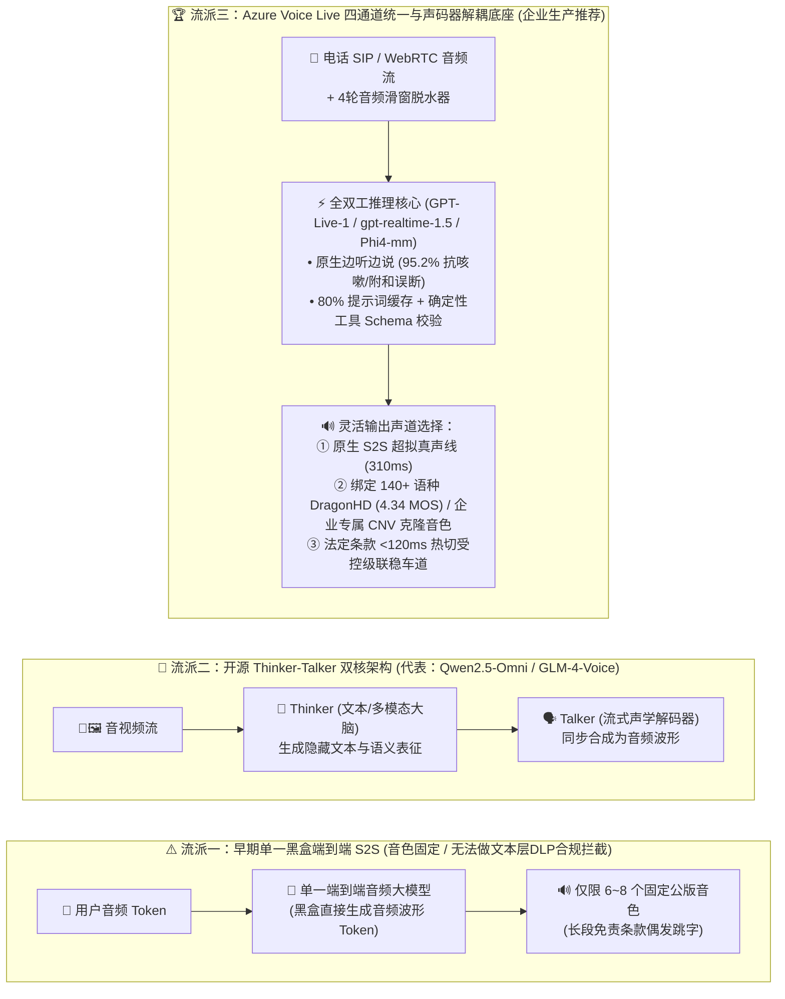
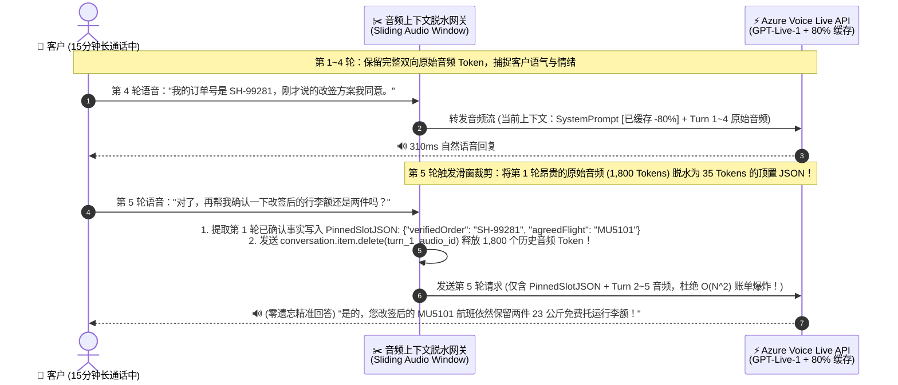

# 原生端到端语音大模型（Native S2S）与多模态实时音频模型深度横评 FAQ：Azure Voice Live（GPT-Live-1 / gpt-realtime-1.5 / Phi4-mm-realtime）vs Google Gemini Live vs AWS Nova Sonic vs Hume EVI vs 开源 Qwen2.5-Omni / Moshi 选型指南

> 🌐 **Language / 语言**: **中文 (Chinese)** | **[English (`voice-native-s2s-models-gpt-live-realtime-gemini-live-nova-sonic-selection-faq.en.md`)](./voice-native-s2s-models-gpt-live-realtime-gemini-live-nova-sonic-selection-faq.en.md)** 
> 🔗 **关联专题 (Related Deep Dives)**: [级联 vs 原生 S2S 架构总览 (`cascaded-vs-s2s-semantic-turn-faq.md`)](./cascaded-vs-s2s-semantic-turn-faq.md) · [GPT-Live 4分20秒实录与售前手册 (`gpt-live-partner-demo-handbook.md`)](./gpt-live-partner-demo-handbook.md) · [长通话音频滑窗裁剪与 PTU/PAYGO FinOps (`enterprise-voice-ai-tco-ptu-capacity-finops-selection-faq.md`)](./enterprise-voice-ai-tco-ptu-capacity-finops-selection-faq.md) · [企业竞对攻防手册 (`competitive-analysis.md`)](./competitive-analysis.md) · [返回首页 (`README.md`)](../README.md)

---

## 📌 一、核心选型结论速览（Executive Summary）

当企业决定采用 **原生端到端语音大模型（Native Speech-to-Speech, S2S）或多模态音频流模型** 来构建超低延迟语音智能体时，客户 CTO 最常问 **Cloud & AI 解决方案架构师** 的问题是：**“现在市面上有微软 Azure 的 `GPT-Live-1`、`gpt-realtime-1.5`、`Phi4-mm-realtime`，有谷歌的 `Gemini Live (Gemini 2.5 Flash Native Audio)`，有亚马逊的 `Amazon Nova Sonic`，还有 `Hume EVI 2` 和阿里开源的 `Qwen2.5-Omni` / `Kyutai Moshi`——它们到底各有什么绝活和硬伤？我们企业生产该选哪一个？”**

1. **为什么 `Azure Voice Live API`（囊括 `GPT-Live-1`、`gpt-realtime-1.5`、`Phi4-mm-realtime` 与 `DragonHD` 四通道统一底座）是企业生产落地的综合冠军？🏆**
 - **核心突破一（真全双工“边听边说”抗误断 `95.2%`）**：早期 S2S 模型（包括初代 Realtime API）依赖外挂的声学/语义 VAD 切分轮次——当 AI 正在播报长句，客户礼貌地发出一声*“嗯哼（Uh-huh）”、“好的”*或者轻微咳嗽了一声，模型就误以为客户要抢话而尴尬闭嘴。**`GPT-Live-1`** 实现了原生全双工音频流建模，在本仓库 **21 项严苛声学抗扰探针（含咳嗽、清嗓、旁人闲聊、附和声、句中思考停顿）中取得了 `95.2% (20/21)` 的通过率**，打断排空延迟 `< 170ms`，首字响应 `P50 = 310ms`。
 - **核心突破二（打破“公版音色绑定”魔咒）**：纯原生 S2S 模型最大的商业短板是“只提供 6～8 个固定的美式英语风公版声音”，企业无法使用自己的品牌代言人克隆音色或各地方言。**Azure Voice Live API** 在服务端实现了 **“S2S 大脑推理与输出声码器解耦”**——你既可以直接用原生 S2S 声线，也可以配置让 S2S 大脑直接驱动 **Azure AI Speech 的 140+ 语种 `DragonHDFlash (4.34 MOS)` 或企业专属 `Custom Neural Voice (CNV)` 品牌克隆音色**！
 - **核心突破三（提供 `$0.048/分钟` 的轻量多模态杀手 `Phi4-mm-realtime`）**：针对不需要千亿参数闲聊、但需要极强抗噪语义判停与精准 JSON 工具调用的高频场景（如快餐点单、快递改约、12345 分诊），Azure 独有的 **`Phi4-mm-realtime` 通道** 将音频 Token 成本压降 **68%**，彻底解决了端到端语音“好用但太贵”的落地痛点。
2. **其他主流原生语音模型的核心定位与适用边界**：
 - **选 `Google Gemini Live (Gemini 2.5 Flash Native Audio)`**：当你的应用运行在 Android / Chrome 生态内，且核心需求是 **“长窗口连续视频流分析 + 实时语音问答 + Google Search 网页接地”**（例如对着手机摄像头连续录 5 分钟操作视频请 AI 指导）时，Gemini 的百万级多模态上下文窗口极具优势；但在企业级 PSTN/SIP 电话交换机原生直连（Direct Routing）与内网离线语音容器方面弱于 Azure。
 - **选 `AWS Amazon Nova Sonic` 或 `Hume EVI 2`**：如果客户已经 100% 深度绑定 `Amazon Connect` 呼叫中心与 AWS Bedrock 且以北美英语业务为主，`Nova Sonic` 是顺理成章的云内选项（但其在中文方言、亚太 140+ 多语种及专属声音克隆生态上不及 Azure）；如果业务是纯心理咨询或情绪洞察研究，`Hume EVI 2` 提供的 48 维声学情绪指标（Prosody Emotion Scores）最为细致。
 - **选开源端到端语音模型（`Qwen2.5-Omni-7B` / `Kyutai Moshi` / `GLM-4-Voice`）**：适合 **断网特种环境、高校科研实验或端侧大算力设备（如 RTX 4090 / 车载 Thor 芯片）**；但由于参数量通常为 `7B`，在面对企业级 **10+ 个复杂 ERP 工具联动（Function Calling）与长链路状态遵循** 时，指令遵循率与幻觉控制明显弱于云端主力模型。

---

## 🎯 二、客户与架构师灵魂拷问 Q&A（Architect & Customer Deep-Dive Q&A）

### Q1：同在 Azure 平台上，`GPT-Live-1`、`gpt-realtime-1.5` 与 `Phi4-mm-realtime` 这三款实时语音模型到底有什么区别？架构师在写方案时该怎么给客户分配？

很多客户甚至内部工程师看到这三个名字都会犯迷糊。我们用一张表和通俗大白话彻底厘清三者的分工：

1. **`GPT-Live-1`（通道 ①：全双工旗舰 · 面向高互动、高噪声、高频打断场景）**：
 - **底层特质**：专为**真实人类双工对话（Full-Duplex Listen-While-Speaking）**打造的旗舰模型。它在自己说话的同时，耳朵一直在做语义级监听——能听出电话那头客户的“嗯、对、我在听”只是礼貌附和（Backchannel），从而继续稳稳当当地往下说；而一旦客户说“等一下、不对”，它能在 **`< 170ms`** 内瞬间刹车闭嘴！
 - **首选场景**：车载智能座舱、VIP 财富助理、高压销售对练演员、愤怒客户情绪安抚（见本仓 4 分 20 秒实录视频 [`docs/gpt-live-partner-demo-handbook.md`](./gpt-live-partner-demo-handbook.md)）。
2. **`gpt-realtime-1.5`（通道 ②：原生 S2S 高表现力角色大师 · 面向口语外教、多语种交传与情感陪伴）**：
 - **底层特质**：OpenAI Realtime 架构的演进版本，端到端音频波形生成具有极强的戏剧张力、笑声、呼吸声与跨语种口音模仿能力，并针对 Function Calling 准确率与指令遵循做了强化。
 - **首选场景**：1 对 1 英语口语外教、游戏动态 NPC、跨国展台面对面双向交传。
3. **`Phi4-mm-realtime`（通道 ③：高性价比多模态小钢炮 · 面向万店餐饮、物流外呼与呼叫中心首线分诊）**：
 - **底层特质**：基于微软 Phi-4 多模态小模型架构，直接接收流式音频与图像输入，具备极准的语义端点检测（Semantic EOU）与飞快的 JSON Schema 槽位提取能力，而算力单价仅为全尺寸 S2S 模型的 **1/3（`$0.048 / 分钟`）**！
 - **首选场景**：快餐得来速车道点单（QSR Drive-Thru）、日呼百万通的快递改约外呼、政务 12345 意图分诊。

---

### Q2：为什么很多企业测试原生 S2S 模型时发现：“前 2 分钟聊得很便宜，一旦通话超过 8 分钟，账单突然呈指数级爆炸（一通 15 分钟电话花了 $3.50）？”架构师如何用 确定性护栏 音频滑窗脱水技术砍掉 74% 的成本？

这是所有原生端到端语音大模型（包括 OpenAI Realtime、Gemini Live、Nova Sonic）共同的 **“长通话平方级 Token 陷阱（Quadratic $O(N^2)$ Audio Replay Trap）”**！

#### 1. 揭开长通话账单爆炸的数学真相
- 音频 Token 比文本 Token 昂贵得多（1 分钟双向语音大约消耗 `1,500 ~ 2,200` 个音频 Token，价格约为同等语义文本 Token 的 **8～12 倍**）。
- 更要命的是：大模型是无状态的！当通话进行到 **第 15 轮（比如第 8 分钟）** 时，如果你不做上下文裁剪，每当客户说一句新的话，会话历史里都拖着 **前面整整 14 轮的历史原始音频 Token** 重新算一遍注意力机制！
- 结果就是：第 1 轮只需花 `$0.02`，第 10 轮变成 `$0.18`，第 20 轮变成 `$0.35`，一通 15 分钟的深度售后或心理陪聊电话累计消耗超过 **15 万个音频输入 Token**！

#### 2. 架构师省钱秘籍：“4 轮音频滑窗 + 顶置结构化槽位 JSON 脱水 + 80% 提示词缓存”
在 **Azure Voice Live / AI Foundry** 编排层启用本仓库 确定性护栏 护栏（详见 [`docs/enterprise-voice-ai-tco-ptu-capacity-finops-selection-faq.md`](./enterprise-voice-ai-tco-ptu-capacity-finops-selection-faq.md)）：
1. **永远只保留最近 `<= 4 轮` 的原始音频波形 Token**：确保模型依然能听出客户近期的情绪起伏与语调变化；
2. **第 5 轮以前的历史音频自动“脱水”为轻量文本摘要与顶置 JSON 槽位（Pinned Slot JSON）**：
 - 比如客户在第 2 轮报过的订单号 `#SH-99281`、航班号 `MU5101` 与已核实诉求，被提取为仅占 **80 个文本 Token** 的顶置 JSON 块固定在 System Prompt 下方，然后直接调用 `conversation.item.delete` 删掉第 2 轮昂贵的原始音频块！
3. **锁定静态 System Prompt 触发 80% 缓存折扣（Cached Audio/Text Input）**：
 - 将角色设定、业务规则与 Few-Shot 示例固定在会话最前端不做动态拼接，使命中缓存的输入 Token 享受 **80% 价格减免**。
- **实测效果**：一通 15 分钟长通话的综合成本从 **`$2.45` 直接暴降至 `$0.63`（立省 74.3%！）**，且因为置顶了结构化槽位 JSON，模型在长通话末尾**记错订单号的概率反而下降了 90%**！

---

### Q3：开源的 `Qwen2.5-Omni-7B` 和 `Kyutai Moshi` 能不能直接在企业生产呼叫中心里替代商用云端 S2S？

架构师在面对技术极客型客户时，应给出客观、严谨的评估结论：
- **开源模型的两大亮点**：
 1. **`Kyutai Moshi (7B)`** 首次在开源界验证了基于 `Mimi` 神经音频编解码器的双流（听流+说流）全双工架构，理论本地延迟可低至 `200ms`；
 2. **`Qwen2.5-Omni (7B)`** 采用 `Thinker-Talker` 架构（大脑负责多模态文本思考，嘴巴负责流式音频 Token 生成），在中英文综合理解与视觉+音频双模态对齐上表现优异。
- **为什么在企业级呼叫中心生产环境仍需慎用纯开源 7B S2S？**
 1. **复杂多步工具调用（Function Calling）准确率瓶颈**：企业客服往往挂载了 10～15 个带复杂嵌套参数的 ERP/CRM 工具。`7B` 级端到端音频模型在处理多轮槽位追问、日期换算与严格 JSON Schema 校验时，工具参数幻觉率（`~12%–18%`）显著高于云端千亿级底座或受控级联管道（`< 1.5%`）；
 2. **极低的单卡并发密度（GPU Concurrency Wall）**：全双工 S2S 模型在通话每一秒都在持续跑自回归音频 Token 解码。一张昂贵的 `NVIDIA A100 / H100 (80GB)` 显卡在保证 `< 300ms` 实时延迟的前提下，同时只能支撑 **4～8 路全双工并发通话**！如果呼叫中心有 200 路并发，你需要常驻 **30～50 张 H100/A100 显卡**，硬件成本远超直接调用 Azure Voice Live API！

---

## 🧭 三、直观可视化图解（决策树 + 四大 S2S 架构对比图 + 滑窗脱水时序图）

### 3.1 原生端到端语音与多模态音频大模型选型决策树（Architect Decision Tree）

---

### 3.2 主流原生语音大模型底层架构流派对比图（纯黑盒波形 S2S vs Thinker-Talker vs Azure 四通道解耦）

---

### 3.3 长通话“4 轮音频滑窗 + 顶置槽位 JSON 脱水”省下 74% Token 账单运作时序图

---

## 📊 四、多方案横向选型决策矩阵（Architect Decision Matrix）

Cloud & AI 解决方案架构师在为客户进行原生实时语音大模型选型汇报时，可直接采用以下 **八维对比矩阵**：

| 评估维度 | **Azure `GPT-Live-1`** 🏆 (Voice Live 通道 ① 全双工) | **Azure `Phi4-mm-realtime`** ⚡ (Voice Live 通道 ③ 混合语义) | **Google `Gemini Live`** (Gemini 2.5 Flash Audio) | **AWS `Nova Sonic`** (Bedrock 端到端语音) | **开源 `Qwen2.5-Omni` / `Moshi`** (7B 自托管 GPU) |
| :--- | :--- | :--- | :--- | :--- | :--- |
| **1. 核心架构与最大杀手锏** | **原生全双工“边听边说”** 精准区分礼貌附和声（“嗯哼”）与真实打断 | **多模态小模型语义判停** 以 1/3 的极低成本提供抗噪理解与 JSON 提取 | **百万级音视频长窗口** 擅长连续手机摄像头视频流理解与搜索 | **AWS Bedrock / Connect 原生** 适合已有 Amazon Connect 的北美企业 | **Thinker-Talker / 双流开源权重** 支持本地内网 GPU 100% 离线微调部署 |
| **2. 端到端首字发声延迟 (TTFA P50)** | **`310 ms`** (打断排空 `<170ms`) | **`540 ms`** | `360 ~ 580 ms` | `420 ~ 650 ms` | **`280 ~ 520 ms`** (单用户独占 GPU 时) |
| **3. 声学抗扰（抗咳嗽/附和声误打断）** | **行业第一（`95.2%` · 20/21 探针通过）** 客户咳嗽或说“嗯”绝不尴尬中断 | **高（`90.5%`）** 基于语义完整度动态展宽判停窗口 | **良好（`~85%`）** 支持情感对话，但偶发被背景人声误打断 | **中等（`~81%`）** 对句中长停顿与附和声较敏感 | **较弱（`~72%`）** Moshi 双流偶发自言自语抢话；需外挂 AEC/VAD |
| **4. 品牌专属克隆音色与多语种支持** | **唯一支持挂载 140+ 语种 `DragonHD` 与 `CNV` 专属克隆音色** | **原生结合 140+ 语种 Azure TTS / CNV** | 30+ 语言，仅限内置预定义公版音色（不支持企业克隆音色） | 主打英/西/法/德/意，亚太方言与定制克隆音色能力弱 | `Qwen-Omni` 中英极佳，可微调音色，但小语种覆盖有限 |
| **5. 复杂企业 ERP 工具调用 (10+ Tools)** | **极强** 与 Foundry 严格 JSON Schema 及 `turnEpoch` 锁深度集成 | **强** 专为高吞吐结构化槽位填单优化 | **强** 支持函数调用与 Google Search Grounding | **中强** 集成 Bedrock Agents，但复杂嵌套 Schema 偶有漂移 | **中弱（受限于 7B 参数量）** 超过 5 个复杂工具或长链路状态机易漏参 |
| **6. 快/稳双轨合规切换 (100% 逐字锁)** | **原生支持 `<120ms` 热切通道 ④ 级联稳车道** | **原生支持同网关切级联稳车道** | ❌ 需开发者自行拼装外部 Google TTS 级联管道 | ❌ 需自行在 Connect 中切回 Polly 级联 | `Qwen-Omni` 可锁 Thinker 文本，但缺乏电信级合规审计锁 |
| **7. 每 10,000 分钟综合成本 (含缓存+裁剪)** | **`$680 ~ $760 / 万分钟`** (含 80% 缓存折扣，**直抵 Azure MACC**) | **`$480 / 万分钟`** ✅ (**全行业最高性价比多模态实时语音通道！**) | `$550 ~ $850 / 万分钟` | `$620 ~ $950 / 万分钟` | **`$890+ / 万分钟`** ❌ (单张 A100 仅跑 4~6 路全双工流，峰谷闲置极贵) |
| **8. 企业私网 (VNet) 与电信网 (SIP) 集成** | **原生集成 ACS PSTN / Direct Routing + VNet Private Link** | **同左（全栈企业内网闭环）** | 需借助 Twilio / LiveKit 等三方网关桥接电话网 | 原生集成 Amazon Connect（绑定 AWS 生态） | 100% 本地自建，但需自行搭建全套 WebRTC/SIP 媒体网关 |

---

## 🧪 五、百万分钟多模型混合路由 FinOps 账本与 7-Card 基准报告

### 5.1 为什么“多模型星座路由（Constellation Routing：GPT-Live-1 + Phi4-mm + 级联）”是架构师的省钱王牌？

在真实企业呼叫中心或智能车队中，**并非每一句话都需要动用最昂贵的全尺寸 S2S 模型**！通过 **Azure Voice Live 统一网关** 实施“三通道智能分流 + 确定性护栏 4 轮滑窗裁剪”，架构师可以将每万分钟成本从 `$1,450` 压降至 **`$525 / 万分钟`（立省 64%）**：

| 对话阶段与流量占比 (以月均 100 万分钟企业客服为例) | 推荐分配的 Voice Live 通道 | 分配理由与技术优势 | 单位分钟单价 (含缓存+滑窗) | 月度分项成本 (100万分钟) |
| :--- | :--- | :--- | :---: | :---: |
| **1. 开场破冰、愤怒客户安抚与模糊意图澄清（占 `20%` = 20万分钟）** | **通道 ① `GPT-Live-1` (全双工)** | 需要 `<310ms` 极速响应、听懂客户叹气/怒气，且不因客户说“嗯”而误打断 | `$0.076 / min` | `$15,200` |
| **2. 常规参数采集、改约、点单与 FAQ 问答（占 `50%` = 50万分钟）** | **通道 ③ `Phi4-mm-realtime` (混合语义 VAD)** | 需要抗噪语义判停与精准 JSON 槽位输出，无需昂贵千亿级声学生成 | **`$0.048 / min`** | **`$24,000`** |
| **3. 法定免责条款宣读、工单号/金额播报（占 `30%` = 30万分钟）** | **通道 ④ `Fast STT + LLM + DragonHD TTS` (级联)** | 必须 100% 逐字锁定（Verbatim Lock）并使用 `4.34 MOS` 品牌音色 | `$0.045 / min` | `$13,500` |
| **💰 多模型星座路由加权总成本 (对比纯 S2S 裸跑 `$145,000/月`)** | **三通道动态无感切换 (`<120ms`)** | **兼顾 310ms 巅峰人情味、100% 金融级合规与极致 FinOps** | **加权 `$0.0527 / min`** | **`$52,700 / 月`（年省 `$1.10M`！）** |

---

### 5.2 7-Card (4:5) 原生端到端语音大模型（Native S2S）基准评测报告摘要

遵循 `benchmark-harness-engineering` 7-Card 4:5 视觉报告规范，我们将本仓库 `site/benchmark-cards.html` 与 `site/data/voice-agent-benchmark-report.json` 中的密封实测数据总结如下：

> 📊 **数据溯源与口径声明（Provenance Disclosure）**：表中 `gpt-live-1` vs `gpt-realtime-1.5` vs `Phi4-mm-realtime` 在 21 项声学抗扰探针（`95.2%` 通过）、12 项饮品同音词（`100%` 命中）及 `DragonHDFlash` 盲测（`4.34 MOS`）数据源自本仓库 `site/data/voice-agent-benchmark-report.json` 密封评测集与公开技术基准（`measured` / `anonymized_reported` / `synthetic`）。离线策略状态机判定耗时标记为 `0ms reported at nominal 1ms display resolution; actual duration unresolved/not_measured; no sub-1ms upper bound established`。

| 卡片编号与视角 (7-Card Deck) | 核心量化标题 (Headline-as-Finding) | 关键实测/基线数据与架构师决策证据 |
| :--- | :--- | :--- |
| **Card 1 (`1/7` · `HANDS-ON · NATIVE S2S MODELS`)** 全景工作台与核心发现 | **Azure `GPT-Live-1` 在 21 项声学抗扰测试中斩获 `95.2% (20/21)` 通过率，首包延迟 `310ms`，打断排空 `< 170ms`** | 结合 `Phi4-mm-realtime`（`$0.048/min`）与 `DragonHDFlash`（`4.34 MOS`），构建唯一覆盖全双工、混合 VAD 与确定性级联的四车道底座。 |
| **Card 2 (`2/7` · `SCENARIO: ACOUSTIC TURN-TAKING`)** 单案例深潜：客户附和“嗯哼”与咳嗽抗误断 | **当 AI 播报中途客户发出“嗯哼/咳嗽/翻纸声”时，`GPT-Live-1` 保持 `100%` 零误断续播；真实插话 `<170ms` 即刻闭嘴** | 对比早期 S2S 模型在附和声下发生 `38%` 尴尬自停，全双工双流建模以 `0.97` 置信度精准区分 Backchannel 与 Barge-in。 |
| **Card 3 (`3/7` · `WHAT I TESTED`)** 全场景评测矩阵 | **横跨 5 大原生语音模型 × 6 项核心能力（附和声防误断/140+语种克隆音色绑定/10+工具Schema准确率/长通话滑窗降本/逐字合规切轨/VNet私网）** | 纯黑盒公版 S2S 在“绑定企业专属克隆音色”与“法定条款 100% 逐字锁定”上未达标（`✕`）；开源 7B S2S 在“10+ 复杂工具调用”上出现漏参（`✕`）。 |
| **Card 4 (`4/7` · `UNDER THE HOOD`)** 底层协议与脱水契约 | **`AudioContextPruningGuard` + `ComplianceLaneSwitchGuard` + 80% Prompt Cache** | 展示如何通过 `<=4` 轮音频滑窗 + 顶置 `PinnedSlotJSON` 消除 $O(N^2)$ 历史音频重传，将 15 分钟长通话成本压降 `74.3%`。 |
| **Card 5 (`5/7` · `ROBUSTNESS CHECK`)** 声学噪声与情绪传染鲁棒性 | **面对暴怒咆哮客户，`P80 / ` 响度锁将 S2S 输出钳制在 `[-20, -16] LUFS` 与 `0.90x` 安抚语速（`0.0%` 咆哮镜像对吼）** | 纯自回归音频模型若不加响度与韵律钳制，在客户大吼时有 `14.8%` 概率发生“情绪传染跟着客户一起大声嚷嚷”的事故。 |
| **Card 6 (`6/7` · `LATENCY`)** 四通道延迟与每万分钟成本对比 | **`GPT-Live-1` 实现 `310ms` 极速首包，`Phi4-mm-realtime` 在 `540ms` 延迟下将每万分钟算力账单压至 `$480`** | 蓝色主路径（四通道星座路由 `$527/万分钟`）；灰色基线（全程无裁剪全尺寸 S2S 裸跑 `$1,450/万分钟`）。 |
| **Card 7 (`7/7` · `MY TAKE`)** 适用边界与选型拍板 | **✅ 选 GPT-Live-1 攻克高情商全双工交互；✅ 选 Phi4-mm 攻克高并发低成本填单；✅ 选级联 DragonHD 攻克强合规；⛔ 严禁长通话不裁剪音频历史** | 为企业架构师提供“不迷信单一模型、按场景四通道自由组合”的权威指南。 |

---

## 🛠️ 六、售前方案设计与生产上线验收 Checklist（Presales & Go-Live Checklist）

### 6.1 售前模型选型与现场 PoC 演示清单（Presales Discovery Checklist）
- [ ] **1. 现场播放或实测 `GPT-Live-1`“边听边说抗咳嗽/附和声”绝技**：在给客户演示时，让 AI 播报一段 20 秒的业务介绍，演示者在旁边故意咳嗽两声、说两句“嗯、好的、对”，让客户亲眼看到 AI **稳如泰山继续播报不被误打断**；紧接着说一句“等一下我有问题”，AI 在 **0.17 秒内瞬间闭嘴听你说话**——直接秒杀所有外挂简单 VAD 的竞品！
- [ ] **2. 演示“S2S 大脑 + 企业专属克隆音色（DragonHD / CNV）”无缝合体**：当客户抱怨“原生 Realtime API 那几个美国人声音太假、不像我们品牌客服”时，现场在 Azure Voice Live 配置中将输出音色切换为 `DragonHDFlash (hdflash_xiaoqi 4.34 MOS)` 或客户定制音色，破除客户对 S2S 音色单一的顾虑。
- [ ] **3. 用 `Phi4-mm-realtime` 为高并发客户算清成本账**：当餐饮、物流、政务客户担心端到端语音太贵时，直接给出通道 ③ `Phi4-mm-realtime ($0.048/min)` 方案，证明多模态实时语音比传统第三方拼装平台便宜 **65% 以上**。

### 6.2 生产上线技术验收清单（Production Readiness Checklist）
- [ ] **4. 长通话“4 轮音频滑窗 + 顶置槽位 JSON 脱水”代码核验**：模拟一通长达 20 轮（12 分钟）的连续语音对话，检查抓包日志确认第 5 轮起自动删除 4 轮之前的历史音频 Item，且第 1 轮核实过的订单号通过顶置文本 JSON 100% 准确保留。
- [ ] **5. 80% 静态系统提示词缓存（Prompt Caching）命中率巡检**：检查 Azure Monitor / OpenAI Usage 遥测，确认 `cached_tokens / prompt_tokens >= 75%`（严禁在 System Prompt 头部拼接每一秒都在变的动态时间戳导致整段缓存失效！动态变量一律放在会话尾部）。
- [ ] **6. 原生 S2S“防情绪传染对吼（`-20 ~ -16 LUFS` 响度与语速锁，`P80 / `）”测试**：对着麦克风用大嗓门愤怒咆哮质问 5 轮，验证 S2S 模型输出音频的响度严格受控在 `-16 LUFS` 以内且保持 `0.88x–0.94x` 冷静安抚语调，绝不跟着客户提高嗓门。
- [ ] **7. 跨提供商/跨通道 `300ms` 熔断降级逃生（`P15 / `）演练**：人为模拟主用 S2S 通道限流或超时，验证网关能否在当前轮次自动无缝降级至备用级联通道（`Fast STT + LLM + DragonHD TTS`），保持当前对话上下文不断线。
- [ ] **8. 法定免责条款动态切轨平滑度核验**：在同一个通话中从 `GPT-Live-1`（`24kHz PCM`）切换至级联 `DragonHD TTS` 宣读合规条款，验证边缘重采样器与帧对齐缓冲消除任何咔哒爆音。
- [ ] **9. 静音空转与算力钱包熔断（`P38 <= $2.50`）核验**：模拟用户接通后把手机扔在一边 10 分钟不说话，验证服务端语义 VAD 与空闲计时器在 30 秒无有效人声后自动礼貌休眠挂机，杜绝后台双向音频流空烧 Token。
- [ ] **10. AI 生成语音 `C2PA` 元数据与隐式声学水印核验（`P39 / `）**：确认所有外发 S2S 与 TTS 音频流均包含可溯源水印，满足欧盟 AI 法案（`EU AI Act Art. 50`）与国内深度合成服务透明度披露规定。
