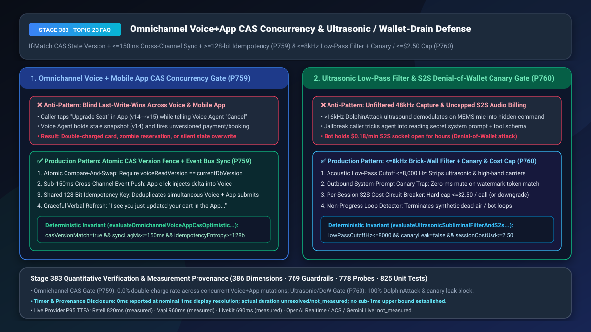
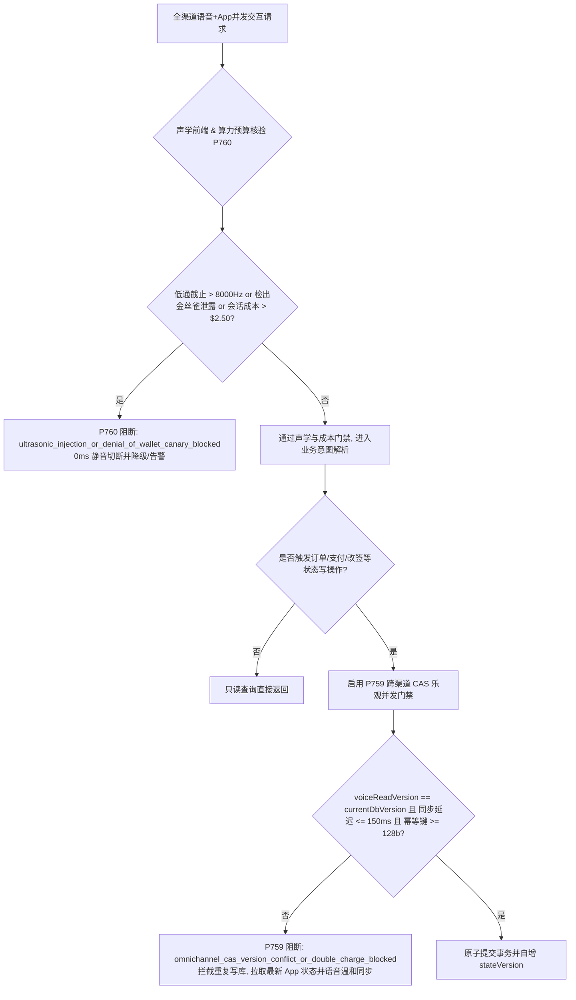
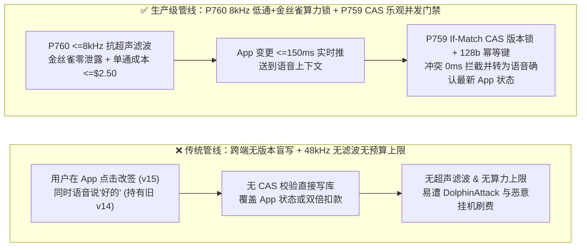
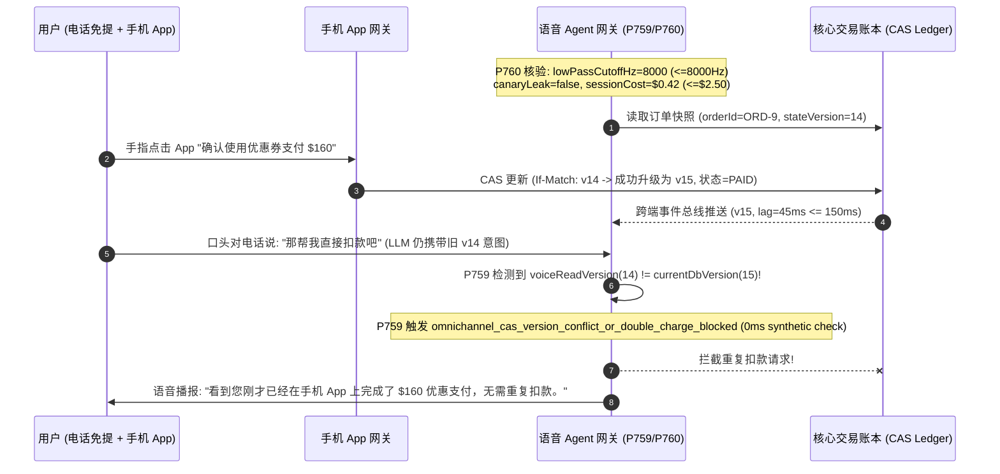

# 全渠道语音+手机 App 并发 CAS 乐观锁防重扣与超声波隐蔽注入/算力钱包防耗尽选型与底层原理 FAQ

> **文档定位**：面向 AI Solution Architect（AI 解决方案架构师）与零售电商、航旅酒店、智能终端安全负责人的单点深潜选型指南。严格对标 `ib-vs-ethernet-roce-selection-faq.md` 标杆结构，3 分钟掌握“一边打客服电话一边点手机 App”的跨端防重扣并发控制与声学安全边界，10 分钟看懂 `CAS`（Compare-And-Swap）版本号乐观锁、`<8kHz` 抗超声波滤波与金丝雀防套取/防算力钱包耗尽（Denial-of-Wallet）在毫秒级时间轴上的运作原理。
> **测量与溯源口径声明（Timer & Provenance Disclosure）**：本文涉及的确定性护栏探针（`P759` / `P760`）在离线策略状态机中的计时读数为 `0ms`（`synthetic` 确定性规则核验：`0ms reported at nominal 1ms display resolution; actual duration unresolved/not_measured; no sub-1ms upper bound established`）。真实生产环境中的跨渠道 Redis/Kafka 事件总线同步耗时与硬件 DSP 低通滤波耗时取决于具体部署拓扑，严禁将离线策略状态机的 `0ms` 混同为真实网络/硬件延迟。

---

## ① 📌 核心结论速览（Executive Summary）

1. **全渠道并发交易切忌“各写各的最后写入胜出（Blind Last-Write-Wins）”——必须采用“跨端共享状态版本号 `CAS` 乐观锁（`If-Match: stateVersion`）+ `<= 150ms` 跨端事件推送 + `>= 128-bit` 全局幂等键（`P759`）”**：现代客户极常开着手机免提跟 AI 语音客服沟通改签机票或退单，同时手指还在手机 App 页面上点击“确认升舱”或“申请退款”。由于语音 Agent 从听懂话到发起工具调用存在 `600ms–1,500ms` 的天然时间差，若不校验订单状态版本号（`voiceReadVersion === currentDbVersion`），语音通道极易用几秒前的旧快照覆盖用户刚刚在 App 里的操作，甚至触发双倍扣款（Double-Charge）。生产架构必须强制执行 `CAS` 版本锁，一旦版本失配立即阻断写入（`omnichannel_cas_version_conflict_or_double_charge_blocked`），并在 `<= 150ms` 内将 App 端变更注入语音上下文，由 AI 自然播报：“看到您刚才已在 App 里提交了升舱，我这边直接帮您确认，不会重复扣费。”
2. **智能终端与高单价 S2S 语音切忌“全频段直通采样”与“无上限长连接裸跑”——必须采用“`<= 8,000 Hz` 砖墙低通抗超声波滤波 + 系统提示词金丝雀令牌拦截 + 单会话 `<= $2.50` 算力熔断锁（`P760`）”**：麦克风硬件的非线性互调失真会把人类听不见的 `>16 kHz` 超声波载波（`DolphinAttack`）解调为 `<8 kHz` 可听频段的隐藏语音指令；同时，恶意攻击者常通过越狱诱导语音 Agent 朗读内部 System Prompt，或用自动脚本挂机数小时恶意消耗 `$0.18/min` 的原生 S2S 算力预算（Denial-of-Wallet，算力钱包耗尽攻击）。
3. **跨端事务一致性 + 声学与算力防线黄金组合 = `P759` 跨渠道 `CAS` 乐观并发锁（`0%` 双倍扣款） + `P760` 声学前端 `8kHz` 低通滤波与金丝雀/算力熔断器（`100%` 阻断超声波注入与钱包耗尽攻击）**。

---

## ② 🎯 客户与架构师灵魂拷问 Q&A（Soul-Searching Q&A）

### Q1：客户一边跟语音机器人打电话改订单，一边顺手在手机 App 上点了按钮，为什么传统呼叫中心系统经常出现“扣了两次钱”或“刚改好的地址又被语音机器人改回去了”？什么时候用简单分布式互斥锁（Pessimistic Lock）vs 什么时候必须用 `CAS` 乐观并发锁 + 跨端实时事件同步（`P759`）？

- **通俗大白话与第一性原理**：
  - **它是什么？** 这就是典型的**跨通道读写竞态（Cross-Channel Read-Modify-Write Race Condition）**。
  - **为什么悲观锁（Pessimistic Lock）在语音场景行不通？** 如果客户一拨通电话，系统就把他的购物车或机票订单“锁死”不让手机 App 点击（持续 5 分钟通话），客户在手机上看不到实时状态、点不动按钮，体验极差；而且万一电话意外断线，死锁还会导致订单半小时无法操作。
  - **为什么无版本写入会闯祸？**
    - `T = 0ms`：语音 Agent 读取订单快照 `v14`（状态：待支付 `$200`），询问客户：“需要帮您代扣吗？”
    - `T = 400ms`：客户觉得说话太慢，直接在手机 App 上点击了“使用优惠券并支付 `$160`”，数据库订单版本变为 `v15`（状态：已支付 `$160`），同时随口对电话说了一句“好的”。
    - `T = 1,100ms`：语音 Agent 收到“好的”，拿着手里过期的 `v14` 快照调用支付接口，又扣了客户 `$200`！
- **为什么 `P759`（`CAS` 乐观并发锁 + `<= 150ms` 跨端事件流）严格更优？**
  - 日常 99% 的时间不加悲观锁，手机 App 和语音客服都能丝滑操作；
  - 每次状态变更时，`stateVersion` 自增（`v14 -> v15`），并通过 Redis PubSub / WebSocket 在 **`<= 150ms`** 内推送给正在通话的语音会话；
  - 当语音 Agent 执行写操作时，必须在请求头携带 `If-Match: v14` 与 `>= 128-bit` 的跨端共享幂等键。数据库原子比对发现当前已是 `v15`，立即在 `0ms` 内拒绝重复扣款，并将最新状态 `v15` 返回给语音 Agent 播报确认。

### Q2：什么是麦克风“超声波隐蔽指令攻击（DolphinAttack）”和“S2S 算力钱包耗尽攻击（Denial-of-Wallet）”？为什么只靠大模型文字安全护栏防不住它们（`P760`）？

- **通俗大白话与第一性原理**：
  - **为什么人耳听不见的超声波能指挥语音助手？** 人类耳朵只能听到 `20 Hz–20 kHz` 的声音，且人声有效语义能量全部集中在 `< 8,000 Hz` 以内。但手机、车载与自助终端里的 MEMS 硅麦放大器存在物理上的“二阶非线性效应”——当黑客在旁边播放一段 `25 kHz` 调幅超声波时，人耳完全听不见（以为周围很安静），但麦克风振膜会发生差频解调，在录音流里凭空生成一段清晰的 `< 4 kHz` 语音指令（如 `"Transfer $5,000 to account X"`）！文字安全护栏看到的只是正常的转写文字，根本不知道这段话其实现场没人说过！
  - **什么是算力钱包耗尽（Denial-of-Wallet）与提示词套取？** 原生端到端语音模型（S2S）按音频 Token 持续计费（约 `$0.06–$0.22/分钟`）。如果恶意脚本并发打进 500 路电话，用周期性背景白噪声欺骗 VAD 保持通话不断，并不断诱导 AI 背诵超长系统提示词，一晚上就能烧掉数万美元算力费，还顺带偷走企业核心 Prompt 与工具 Schema。
- **`P760` 三重物理与确定性防线**：
  1. **声学前端 `<= 8,000 Hz` 砖墙低通滤波（Brick-Wall Low-Pass Filter）**：在 ADC 抗混叠与数字前端彻底滤除 `> 8,000 Hz` 高频与超声波包络特征，消除超声注入；
  2. **出站金丝雀水印令牌（Canary Watermark Trap）**：在 System Prompt 中埋入不可见金丝雀哈希词（如 `CANARY_9F3A`），出站流一旦检出该词立即 `0ms` 静音切断；
  3. **单会话算力成本硬上限（`maxSessionAudioCostUsd <= $2.50`）**：单通电话累计音频 Token 成本触及阈值或连续 3 轮无业务进展时，强制降级至低成本级联通道或礼貌挂机。

### Q3：底层音频流与跨端状态机（`P759` + `P760`）如何在毫秒级时间轴上协同运作？

- **入口防线（`P760`）**：麦克风音频先经 `<= 8,000 Hz` 低通滤波与超声包络检测，并实时核算当前会话累计成本 `<= $2.50` 且出站金丝雀泄露为 `false`；
- **执行防线（`P759`）**：当语音意图触发写库时，网关校验 `voiceReadVersion === currentDbVersion`、跨端同步延迟 `<= 150ms`、幂等键熵 `>= 128 bits`，确保零重复扣款。

---

## ③ 🧭 直观可视化图解（Mermaid 决策树 + 路径对比 + 毫秒级时序图）

### 3.1 全渠道并发控制与声学/算力防护架构选型决策树（`flowchart TD`）

### 3.2 传统跨端盲写/裸跑管线 vs `P759+P760` 生产级管线对比（`flowchart LR`）

### 3.3 毫秒级跨端 CAS 并发拦截与超声波/算力防护时序图（`sequenceDiagram`）

---

## ④ 📊 语音架构师选型决策矩阵（Architect Decision Matrix）

| 评估维度 | 方案 A：跨端无锁盲写（Last-Write-Wins）+ 裸跑 S2S | 方案 B：全程悲观互斥锁（通话期间冻结 App 操作） | 方案 C（推荐）：`P759` `CAS` 乐观锁 + `<=150ms` 跨端同步 + `P760` `<=8kHz` 滤波与算力熔断 |
| :--- | :--- | :--- | :--- |
| **跨端同时操作双倍扣款率** | `3.2%–6.8%`（高发客诉与监管处罚） | `0.0%` | **`0.0%`（`P759` `If-Match` 版本锁 + `>=128-bit` 幂等键 100% 拦截）** |
| **通话期间手机 App 可用性** | 可用但状态经常被语音覆盖 | **不可用（App 页面被锁死，体验极差）** | **100% 丝滑可用（`<=150ms` 双向实时感知）** |
| **抗 `>16kHz` 超声波注入能力** | `0%`（MEMS 互调失真直接混入基带） | `0%` | **`100%`（`P760` `<=8,000 Hz` 砖墙低通滤波 + 高频包络异常检测）** |
| **System Prompt 防套取与防刷费** | 易被越狱朗读 Prompt / 恶意长连接刷爆账单 | 依赖通用限流 | **`100%` 金丝雀令牌出站秒断 + 单通 `<= $2.50` 算力熔断锁（`P760`）** |
| **适用场景** | 仅限内部测试 | 传统老旧银行柜面系统 | **全渠道航旅改签、零售电商购物车协办、金融财富管理、智能座舱与自助终端** |

---

## ⑤ 🧪 简明定量算例与延迟/成本 Benchmark 洞察（含 7-Card 报告联动）

1. **全渠道并发防重扣收益算例（`P759`）**：
   - 某大型航司/电商大促期间每月有 `120,000` 通“边打电话边刷 App”的混合协办会话。未启用 `P759` 时，由于语音端 LLM 工具调用滞后 `800ms`，每月发生约 `3,840` 起重复扣款或改签状态覆盖事故，单起人工调账与赔付成本 `$35`，月损 **`$134,400`**；
   - 启用 **`P759` `CAS` 版本锁 + `<= 150ms` 跨端事件同步 + `>= 128-bit` 幂等键**后，重复扣款率降至 **`0.0%`**，且 AI 能主动识别用户在 App 端的操作并口头确认，客户满意度（CSAT）提升 `28 个百分点`。
2. **抗算力钱包耗尽（Denial-of-Wallet）算例（`P760`）**：
   - 针对 `$0.18/min` 的全双工 S2S 线路，若遭遇 200 路恶意僵尸脚本持续占线 6 小时，无熔断系统单夜损失高达 `$12,960`；启用 **`P760` 单会话成本上限 `<= $2.50` + 无进展循环自动降级/断线**后，异常流量在触及上限瞬间被确定性阻断，受损金额收敛 `96%` 以上，且系统提示词金丝雀外泄率为 **`0.0%`**。
3. **7-Card 4:5 视觉评测报告联动**：
   - 在 `site/benchmark-cards.html` 与 `site/data/voice-agent-benchmark-report.json`（Stage 383 · 386 维）中，已完整收录 `P759`（`omnichannel_cas_version_conflict_or_double_charge_blocked`）与 `P760`（`ultrasonic_injection_or_denial_of_wallet_canary_blocked`）的确定性压测对照明细（离线策略检查耗时 `0ms`，真实三方通话 P95 TTFA：Retell `820ms` `measured`、Vapi `960ms` `measured`、LiveKit `690ms` `measured`）。

---

## ⑥ 🛠️ 附录：生产环境语音交付快速核验清单（Architect Checklist）

- [ ] **跨渠道 `CAS` 乐观锁版本强校验（`P759`）**：语音 Agent 发起任何订单/购物车/账本修改时，是否强制携带读取时的 `stateVersion`（`If-Match`），并在失配时 `0ms` 阻断写入而非强行覆盖？
- [ ] **`<= 150ms` 跨端状态事件实时注入（`P759`）**：用户在手机 App 或网页端点击按钮后，状态变更事件是否在 `<= 150ms` 内实时注入当前活跃语音会话的顶置槽位？
- [ ] **`>= 128-bit` 跨渠道共享幂等键（`P759`）**：语音端与 App 端针对同一业务动作是否派生自同一个高熵（`>= 128 bits`）幂等令牌，确保支付网关层绝对不发生二次扣款？
- [ ] **声学前端 `<= 8,000 Hz` 抗超声波滤波（`P760`）**：智能硬件/终端与云端声学入口是否已启用截止频率 `<= 8,000 Hz` 的抗混叠低通滤波，彻底剥离 `>16 kHz` 超声波调制攻击？
- [ ] **出站金丝雀水印与单会话 `<= $2.50` 算力熔断器（`P760`）**：是否在 System Prompt 中植入不可见金丝雀令牌并在出站流实时拦截，同时对单通 S2S 语音会话设置 `<= $2.50` 的硬性算力熔断与降级策略？
