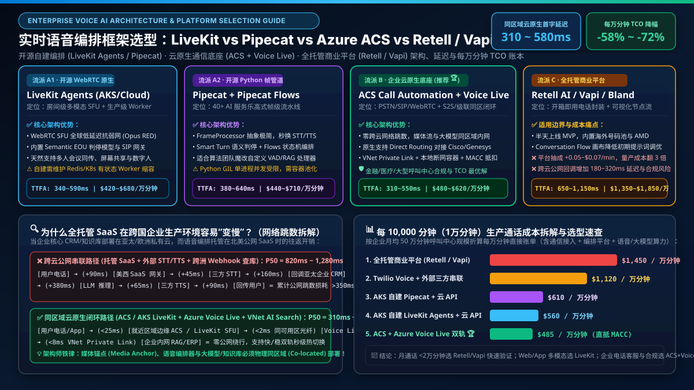
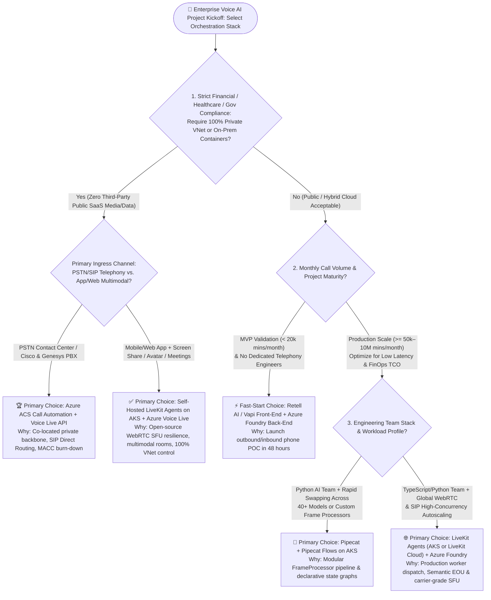
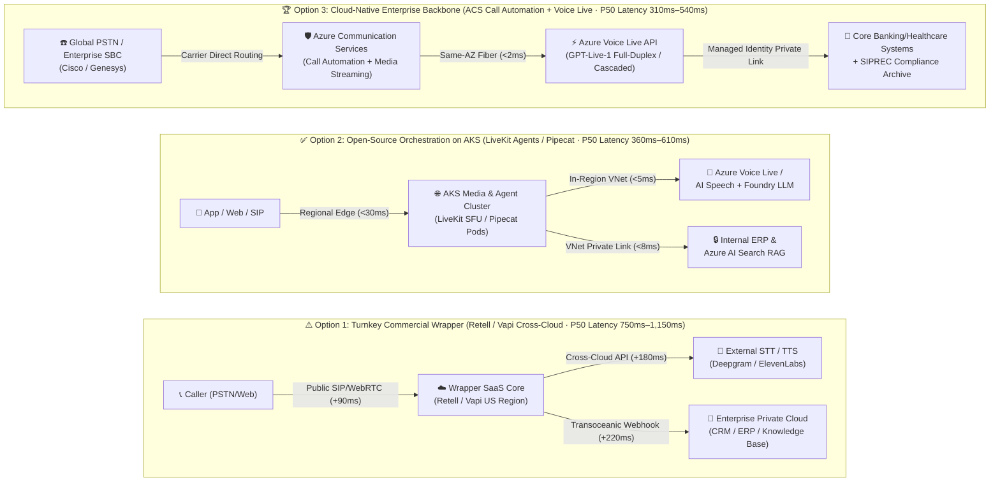

# Enterprise Real-Time Voice Orchestration Framework Selection FAQ: LiveKit Agents vs. Pipecat vs. Azure ACS Call Automation vs. Twilio / Retell AI / Vapi

> 🌐 **Language / 语言**: **[中文 (`voice-orchestration-framework-livekit-pipecat-acs-retell-vapi-selection-faq.md`)](./voice-orchestration-framework-livekit-pipecat-acs-retell-vapi-selection-faq.md)** | **English (Current)**  
> 🔗 **Related Deep Dives**: [Cascaded vs. Native S2S Brain Selection (`cascaded-vs-s2s-semantic-turn-faq.en.md`)](./cascaded-vs-s2s-semantic-turn-faq.en.md) · [WebRTC vs. WebSocket vs. SIP Ingress Selection (`webrtc-vs-websocket-vs-sip-ingress-selection-faq.en.md`)](./webrtc-vs-websocket-vs-sip-ingress-selection-faq.en.md) · [AI-to-Human Warm Transfer & Whisper Handoff (`warm-transfer-whisper-handoff-faq.en.md`)](./warm-transfer-whisper-handoff-faq.en.md) · [Enterprise Competitive Battlecards (`competitive-analysis.en.md`)](./competitive-analysis.en.md) · [Back to Home (`README.en.md`)](../README.en.md)



---

## 📌 1. Executive Summary

When an enterprise sets out to build an AI contact center, outbound sales voice bot, real-time multilingual meeting interpreter, or multimodal in-app voice assistant, the first architectural crossroads for a **Cloud & AI Solution Architect** is choosing the **Real-Time Voice Orchestration Layer**: should you self-host an open-source orchestration framework on Kubernetes (**LiveKit Agents** or **Pipecat**), build on a cloud-native enterprise communications and voice backbone (**Azure Communication Services Call Automation + Azure Voice Live API**), or buy a turnkey developer wrapper SaaS (**Retell AI / Vapi**)?

1. **When to Choose the Cloud-Native Enterprise Voice Backbone (`Azure ACS Call Automation + Azure Voice Live API + AI Foundry`)**:
   - **Best-Fit Scenarios**: **Banking, insurance, and financial contact centers, healthcare patient follow-up hotlines, government 311/12345 citizen services, airline disruption desks, and enterprises integrating with existing Cisco / Genesys / Avaya PBXs via SIP Direct Routing**.
   - **Why It Wins**: It is the only architecture that co-locates **PSTN/SIP telephony ingress, WebRTC media gateways, native Speech-to-Speech (`gpt-live-1` / `gpt-realtime`), and deterministic cascaded pipelines (`Azure Fast STT + LLM + DragonHD TTS`)** inside the **same cloud region and private virtual network (VNet + Private Endpoint)**. It eliminates `180ms–320ms` of cross-cloud public internet tromboning, natively supports SIPREC compliance recording and disconnected on-premises containers, and burns down existing **Azure MACC commitments** at an industry-low **`$485 per 10,000 minutes`**.
2. **When to Choose Open-Source Real-Time Voice Orchestration (`LiveKit Agents` vs. `Pipecat`)**:
   - **Choose `LiveKit Agents` (WebRTC SFU-Native Room Model)**: When your primary channels are **mobile apps, web browsers, smart hardware (AI glasses, in-vehicle cockpits), or multi-party conference rooms** requiring world-class **weak-network packet-loss resilience (WebRTC Opus RED), live camera/screen sharing ("see-and-speak" multimodal vision), 2D/3D digital human avatars, or multi-participant simultaneous interpretation**. LiveKit's Go/Rust SFU media server and built-in `EOU Semantic Turn Detector` set the industry standard.
   - **Choose `Pipecat` (Python Frame-Pipeline Model)**: When your engineering team is primarily **Python AI/ML engineers** who want Lego-like agility across **40+ STT, LLM, TTS, and avatar providers**, or need to write custom frame-level processors (`FrameProcessor` for custom voiceprint liveness gates or speculative RAG prefetchers) paired with declarative state machines (`Pipecat Flows`).
3. **When to Choose Turnkey Commercial Voice Wrapper Platforms (`Retell AI / Vapi / Bland AI`)—and When to Migrate Off**:
   - **Best-Fit Scenarios**: **Startup MVPs, standalone regional business units with `< 20,000 minutes/month`, or teams without telephony engineers needing a working US/EU outbound phone demo within 48 hours**.
   - **The Production Scaling Wall**: Turnkey wrappers bundle third-party telephony (Twilio/Telnyx) + speech (Deepgram/ElevenLabs) + LLMs and charge a **`$0.05–$0.07/min` platform orchestration tax** on top. Once monthly volume reaches **100k–500k+ minutes**, your effective bill balloons to **`$1,350–$1,850 per 10,000 minutes`** (**2.8x–3.5x higher** than cloud-native architectures). Worse, if your enterprise CRM/ERP resides in Asia-Pacific or Europe while the wrapper's orchestration core sits in US public cloud regions, every tool call incurs transoceanic webhook latency and blocks strict private-network security audits.

---

## 🎯 2. Architect & Customer Deep-Dive Q&A

### Q1: What is the fundamental architectural difference between Open-Source Frameworks (LiveKit Agents / Pipecat), Cloud-Native Backbones (Azure ACS + Voice Live), and Turnkey SaaS Wrappers (Retell / Vapi)?

#### 1. Plain-English Analogy: How Do These Three Paradigms Work?

Think of building an enterprise real-time voice agent like **operating a high-end restaurant chain**:

- **Paradigm C: Turnkey Commercial Voice Wrappers (`Retell AI / Vapi / Bland AI`) — "Renting a Ghost Kitchen / Delivery Aggregator"**
  - **How it works**: You don't need to know anything about SIP trunks, acoustic echo cancellation, or audio frame buffers. You drag and drop nodes on a visual canvas (`Conversation Flow`), paste your system prompt and webhook URLs, rent a phone number with a credit card, and start taking calls in half a day.
  - **The trade-off**: You pay a stacked per-minute toll (`Platform Fee + STT Fee + LLM Fee + TTS Fee + Telephony Fee`). For 100 calls a day, it's wonderfully convenient; for 50,000 calls a day, the platform markup costs more than hiring a full engineering team, and your sensitive customer audio and call state live inside a third-party multi-tenant SaaS—an immediate blocker for banking, healthcare, and public-sector security reviews.
- **Paradigm A: Open-Source Voice Orchestration Frameworks (`LiveKit Agents / Pipecat`) — "Open-Source Professional Kitchen Blueprints (Self-Hosted on AKS or Managed Cloud)"**
  - **How it works**: These frameworks solve the hardest real-time audio plumbing—**20ms audio frame pacing, voice activity detection (VAD), semantic end-of-utterance (EOU) turn detection, sub-200ms barge-in queue flushing, and unified plugin adapters for STT/LLM/TTS**—in open-source Python or Node.js code. You deploy the workers inside your own **Azure Kubernetes Service (AKS)** cluster.
  - **The trade-off**: The software is free (Apache 2.0 / BSD), giving you 100% code ownership and VNet privacy. However, your DevOps team must manage stateful Kubernetes pods (including graceful `SIGTERM` draining so active 10-minute phone calls aren't dropped during autoscaling), Redis state stores, and SIP trunk gateways.
- **Paradigm B: Cloud-Native Communications & Voice Backbone (`Azure ACS Call Automation + Azure Voice Live API / Twilio Voice`) — "Owning an Enterprise Campus with Built-in Carrier Trunks & Co-Located AI Engines"**
  - **How it works**: Microsoft Azure natively provides the end-to-end stack from **global carrier PSTN/SIP Direct Routing and programmable Call Automation (dialing, DTMF capture, compliance recording, warm transfer with whisper)** directly to **co-located Azure Voice Live API (`GPT-Live-1` S2S and `DragonHD` Cascaded lanes)** in the same datacenter.
  - **Why enterprise architects love it**: Audio enters Azure's regional edge, travels over `< 2ms` datacenter fiber to `Azure Voice Live`, and queries `Azure AI Search` and internal ERPs over VNet Private Link—**zero public internet hops, zero third-party platform markup, and 100% MACC eligible**.

#### 2. The 5-Second Architect Rule of Thumb

- **Primary channel is PSTN phone lines / enterprise PBX (Cisco/Genesys/Avaya) + strict VNet compliance**: Choose **Azure ACS Call Automation + Azure Voice Live API**.
- **Primary channel is mobile app / web / smart hardware + live video, screen sharing, or digital human avatars**: Choose **LiveKit Agents (deployed on AKS, calling Azure Voice Live / AI Foundry)**.
- **Python AI team building custom frame-level audio/vision processors or benchmarking 40+ model providers**: Choose **Pipecat + Pipecat Flows**.
- **Small team validating an outbound phone MVP in 48 hours (`< 20,000 mins/month`)**: Start with **Retell AI / Vapi** fronting an **Azure AI Foundry** webhook backend, then migrate the telephony ingress to ACS/LiveKit once volume scales.

---

### Q2: Between the two leading open-source frameworks—`LiveKit Agents` vs. `Pipecat`—how do their architectures differ, and when does `ACS Call Automation` beat both?

When an enterprise decides to build on open-source orchestration, architects almost always ask: **Should we standardize on `LiveKit Agents` or `Pipecat` (created by Daily.co)?** Their core abstractions are fundamentally different:

#### 1. Core Abstraction Comparison: "Multi-Party Room Participant" vs. "Unidirectional Frame Pipeline"

- **`LiveKit Agents`: The AI is a Virtual Participant in a Real-Time WebRTC Room**
  - Built on top of LiveKit's battle-tested Go/Rust **WebRTC SFU (Selective Forwarding Unit)**, every conversation is a `Room`. The human caller joins the room via mobile SDK, browser, or `livekit-sip`, and the LiveKit Agent Dispatcher automatically spawns an isolated worker process to join that same room as a virtual participant.
  - **Key Architectural Advantages**:
    1. **Effortless Multi-Party & Human-in-the-Loop Workflows**: Need a human supervisor to silently monitor a call, whisper coaching advice to the AI/agent, or perform a warm handoff? Or need a specialized Translation Agent to join a 5-person global meeting? You simply add participants to the existing `Room` and adjust audio track subscriptions—no media pipeline rewiring required.
    2. **Production-Grade Worker Dispatch & Process Isolation**: `LiveKit Agents` includes a built-in job scheduler that isolates each call into its own process/task and handles Kubernetes graceful termination out of the box.
- **`Pipecat`: Everything is a Typed Frame Flowing Through a Modular Conveyor Belt**
  - Pipecat models real-time multimodal interaction as a directed pipeline of `FrameProcessor` stages passing typed frames (`AudioRawFrame`, `InterimTranscriptionFrame`, `TextFrame`, `BotInterruptionFrame`, `ImageRawFrame`):
    `[Transport.input()] ➔ [SileroVAD] ➔ [SmartTurnEOU] ➔ [STTProcessor] ➔ [SpeculativeRAG] ➔ [LLMProcessor] ➔ [TTSProcessor] ➔ [Transport.output()]`
  - **Key Architectural Advantages**:
    1. **Unmatched Python Hacking Velocity & 40+ Provider Plugins**: Swapping Deepgram for Azure Speech or ElevenLabs for Cartesia takes a one-line change. Writing a custom Python interceptor (e.g., blocking acoustic prompt injection or prefetching vector search on partial transcripts) is as simple as subclassing `FrameProcessor`.
    2. **`Pipecat Flows` for Deterministic State Machines**: Provides structured node-by-node conversation graphs that dynamically scope which tools (`Function Declarations`) the LLM can see at each step of a regulated workflow.

#### 2. Head-to-Head Engineering Comparison: `LiveKit Agents` vs. `Pipecat`

| Architectural Dimension | **LiveKit Agents (`v1.x`)** | **Pipecat (`Daily / Open-Source`)** | Architect Recommendation |
| :--- | :--- | :--- | :--- |
| **Underlying Media Transport** | Tightly integrated with **LiveKit WebRTC SFU + LiveKit SIP** (self-hosted or Cloud) | **Transport-agnostic**: Daily WebRTC, LiveKit, Twilio/Telnyx WebSockets, raw FastAPI WebSockets | Use **Pipecat** to plug into existing WebSocket telephony; use **LiveKit** for an end-to-end WebRTC + SIP media stack |
| **Language Ecosystem** | **First-class Python & Node.js / TypeScript SDKs** | **Python-native** (deep integration with PyTorch/HuggingFace local models) | TypeScript/Node.js teams should pick **LiveKit**; Python AI teams excel with either |
| **Semantic Turn Detection (EOU)** | Built-in open-weight **`livekit-plugins-turn-detector`** Transformer | Built-in open-source **`Smart Turn`** acoustic + linguistic EOU model | Both deliver industry-leading mid-sentence pause tolerance |
| **When `Azure ACS + Voice Live` Beats Both** | Requires self-managing K8s StatefulSets, Redis, TURN servers, and SIP trunks | Requires building custom container pool autoscaling and PSTN carrier trunks | Choose **ACS + Voice Live** when you want **zero K8s media ops**, native PBX Direct Routing, and in-region Azure backbone integration |

---

### Q3: Why do teams hit "1.2s+ latency spikes, 3x cost blowups, and security blocks" when scaling Vapi / Retell in production, and how do we architect a smooth migration?

In enterprise presales engagements, we frequently help customers who built a promising prototype on Retell AI or Vapi but hit three hard walls when scaling to production:

#### Wall 1: "Cross-Cloud Public Internet Tromboning"Pushes Turn Latency Past 1.2 Seconds
- **Root Cause**: When an enterprise with customers and backend systems in Asia-Pacific or Europe routes calls through a US-hosted voice wrapper SaaS:
  1. Caller dials in ➔ audio traverses transoceanic links to US-West SaaS gateway (`+90ms to +130ms`);
  2. SaaS streams audio to external STT (`+150ms`), then triggers a `Custom Function Webhook` over the public internet back to the enterprise's APAC/EU Azure VNet to check order status (`+180ms to +260ms` TLS handshake + round-trip);
  3. Enterprise webhook returns JSON to US-West SaaS ➔ LLM + external TTS (`+450ms`) ➔ synthesized audio travels back across the ocean to the caller (`+90ms to +130ms`).
- **The Fix (Regional Co-Location)**: By deploying **Azure ACS / AKS LiveKit + Azure Voice Live API** in the **exact same Azure region** as the enterprise's VNet database and `Azure AI Search`, every internal hop happens over `< 5ms` private fiber, cutting median Time-To-First-Audio (TTFA) from `1,250ms` down to **`380ms–540ms`**.

#### Wall 2: The "Per-Minute Stacking Tax" Destroys Unit Economics at Scale
- **Root Cause**: While a managed wrapper advertises a `$0.05–$0.07/min` base fee, production calls stack five separate charges:
  `Total Cost/min = Platform Fee ($0.055) + LLM Tokens ($0.050) + Premium TTS ($0.025) + Streaming STT ($0.012) + Telephony/Concurrency ($0.018) ≈ $0.160/min`.
  At **2,000,000 minutes/month**, that equals **$320,000/month ($3.84M/year)**!
- **The Fix**: Moving to **Azure ACS + Azure Voice Live (Hybrid S2S + Semantic VAD / Cascaded routing)** eliminates the `$0.055/min` middleman fee and leverages 80% prompt caching + 4-turn sliding audio window pruning, dropping total cost to **`$0.048–$0.056/min`**—saving **$2.4M+ per year (a 66% TCO reduction)**.

#### Wall 3: The Two-Phase Zero-Risk Migration Architecture
- **Phase 1 (Hybrid Co-Sell Bridge for `< 50k mins/month`)**: Keep the customer's existing Retell/Vapi conversation flow for rapid telephony iteration, but point its `Custom Function / Custom LLM Webhook` via HMAC-verified ingress to **Azure AI Foundry + Azure AI Search** inside the customer's VNet (as demonstrated in `apps/retell-demo` in this repository).
- **Phase 2 (Cloud-Native Production Scale for `>= 100k mins/month`)**: Replace the front-end telephony wrapper with **Azure ACS Call Automation** or **AKS LiveKit Agents**, reusing 100% of the Azure AI Foundry tools, RAG indexes, and deterministic guardrails built in Phase 1.

---

## 🧭 3. Visual Architecture Diagrams (Decision Tree, End-to-End Topologies & Sequence Flow)

### 3.1 Enterprise Voice Orchestration Framework Selection Decision Tree



---

### 3.2 End-to-End Architecture & Latency Hop Comparison Across the Three Paradigms



---

### 3.3 Real-Time Voice Orchestration Sequence Diagram (Semantic EOU, Async Tool Filler & Warm Transfer)

```mermaid
sequenceDiagram
    autonumber
    actor User as 👤 Caller (Phone / App)
    participant Ingress as 🌐 Media Ingress<br/>(ACS / LiveKit SFU)
    participant Orch as 🎛️ Voice Orchestrator<br/>(Voice Live / LiveKit / Pipecat)
    participant Backend as 🏢 Enterprise ERP & RAG<br/>(VNet API / AI Search)
    actor Agent as 👨‍💼 Human Specialist<br/>(Context-Aware Warm Handoff)

    Note over User,Orch: Phase 1: Regional Media Anchoring + Sub-Second Greeting & Mid-Sentence Semantic EOU
    User->>Ingress: Places Inbound Call / Starts WebRTC Session
    Ingress->>Orch: Streams bidirectional 20ms PCM/Opus frames (In-region latency < 5ms)
    Orch->>User: 🔊 Greeting: "Welcome to StarAir VIP Desk. How can I help you today?"
    User->>Orch: 🗣️ "My flight was delayed, can you check if the 8 AM flight has business class..." (700ms pause while checking ticket)
    Note right of Orch: Semantic EOU detects incomplete clause, dynamically extends wait window to 1,100ms (zero premature cutoff)
    User->>Orch: 🗣️ "...my booking reference is SH-99281." (Falling intonation + complete syntax -> triggers in 190ms)

    Note over Orch,Backend: Phase 2: Slow External ERP Lookup + Automatic 300ms Contextual Filler ("Let me check that for you...")
    Orch->>Backend: Invokes async booking lookup & IRROPS waiver policy search (expected latency: 1,400ms)
    Orch->>User: 💬 At 300ms threshold, injects natural filler: "Got it, let me check seat availability and waiver rules for SH-99281..."
    Backend-->>Orch: Returns seat inventory & zero-fee waiver eligibility (arrives at 1,150ms just as filler finishes)
    Orch->>User: 🔊 Seamless response: "Good news—flight MU5101 at 8:00 AM has 2 business class seats open, and your change fee is waived..."

    Note over User,Orch: Phase 3: Mid-Sentence Caller Barge-in + Monotonic turnEpoch Buffer Flush
    User->>Orch: 🗣️ Interrupts: "Wait! I'm also traveling with a checked pet crate, can my dog be moved too?"
    Orch->>Ingress: ⚡ Flushes playback buffer in <160ms and increments turnEpoch to fence off stale tool writes

    Note over Orch,Agent: Phase 4: Complex Exception Detected -> Context-Preserving Warm Transfer to Human Specialist
    Orch->>User: 🔊 "Live pet cargo transfers require oxygen-hold verification. I'm connecting you to our specialist now with your booking details."
    Orch->>Agent: 🖥️ Pushes signed CTI screen-pop card (Booking SH-99281 + MU5101 Business Class + Pet Oxygen Hold) & whisper briefing
    Ingress->>Agent: Bridges consultative warm transfer; human agent greets caller with full context
```

---

## 📊 4. Architect Decision Matrix (Multi-Platform Comparison)

| Evaluation Dimension | **LiveKit Agents**<br/>(Self-Hosted AKS / LiveKit Cloud) | **Pipecat + Flows**<br/>(Open-Source Python Pipeline) | **Azure ACS Call Automation + Voice Live API** 🏆 | **Twilio Voice + Media Streams** (Custom Gateway) | **Retell AI / Vapi**<br/>(Turnkey Commercial SaaS) |
| :--- | :--- | :--- | :--- | :--- | :--- |
| **1. Core Architectural Paradigm** | WebRTC SFU room-based multimodal agent framework | Modular Python frame-processing (`FrameProcessor`) pipeline | **Cloud-native enterprise PSTN/WebRTC + native S2S & cascaded voice backbone** | Global CPaaS telephony + raw WebSocket media streaming | Turnkey developer phone agent builder with visual flow canvas |
| **2. First-Audio Latency (TTFA P50 / P95)** | **`340ms` / `590ms`**<br/>(Ultra-fast WebRTC UDP when co-located with LLM) | **`380ms` / `640ms`**<br/>(Depends on regional proximity of chosen STT/LLM/TTS) | **`310ms` (S2S) / `580ms` (Cascaded)**<br/>(**Same-AZ fiber backbone, zero cross-cloud hops**) | `520ms` / `890ms`<br/>(WebSocket media forwarding to external orchestrator) | `650ms` / `1,150ms`<br/>(Cross-cloud webhook penalties if enterprise CRM is outside US) |
| **3. Voice Naturalness & Model Flexibility** | **Very High**<br/>Plug in OpenAI/Azure S2S, ElevenLabs, Cartesia, Deepgram | **Highest (40+ Plugins)**<br/>Swap commercial APIs or local Whisper/CosyVoice in lines of code | **Enterprise Dual-Lane Peak**<br/>Built-in `GPT-Live-1` + `DragonHDFlash (4.34 MOS)` + Custom Neural Voice | Bring-your-own AI stack over WebSocket streams | **High**<br/>One-click dropdowns for ElevenLabs, Cartesia, OpenAI, Deepgram |
| **4. Script Control & Tool Calling** | Code-driven agent handoffs; state machines built in Python/TS | **Strong (`Pipecat Flows`)**<br/>Declarative state graphs with node-scoped tool exposure | **Enterprise-Grade Deterministic**<br/>Dynamic switching between S2S fast lane and verbatim-locked cascaded lane | Requires custom state-machine and cancellation engineering | **Strong (Visual Canvas)**<br/>`Conversation Flow` node editor simplifies non-ML prompt tuning |
| **5. Omnichannel Ingress (Web/App vs. PSTN)** | **Best-in-class Web/App/IoT**; PSTN via `livekit-sip` gateway | Web/App via Daily/WebRTC; PSTN via Twilio/Telnyx WebSockets | **Full Omnichannel**<br/>Native PSTN numbers, enterprise PBX `Direct Routing`, and Web/App SDKs | **Best-in-class Global PSTN**<br/>180+ countries with elastic SIP trunking | Resells Twilio/Telnyx numbers; fast US/EU setup, limited APAC enterprise PBX options |
| **6. Per-Minute TCO (at 500k mins/month)** | **`$0.042–$0.068 / min`**<br/>(Zero software license fee on self-hosted AKS) | **`$0.044–$0.071 / min`**<br/>(Open-source; requires Python worker container pool) | **`$0.048–$0.062 / min`**<br/>(**Zero wrapper markup + 80% prompt cache + 100% MACC eligible**) | `$0.085–$0.135 / min`<br/>(Twilio carrier + Media Streams + external AI stack) | **`$0.135–$0.185 / min`** ❌<br/>(`$0.05–$0.07/min` wrapper fee + stacked provider charges) |
| **7. Private Network Security & Ops Effort** | **100% VNet Self-Hostable**<br/>Ops Effort: **Medium** (Stateful K8s + Redis + SFU) | **100% VNet Self-Hostable**<br/>Ops Effort: **Medium-High** (Container pool scaling & monitoring) | **Highest Financial/Gov Compliance**<br/>VNet Private Link, DataZone, Disconnected Containers; **Managed Serverless** | Public cloud media relay; no on-prem disconnected container option | ❌ **Public Multi-Tenant SaaS**<br/>No customer VNet deployment; frequent blocker in banking/gov audits |

---

## 🧪 5. Concurrency Capacity Planning, Per-10k-Minute TCO Ledger & 7-Card Benchmark Report

### 5.1 Production TCO Breakdown per 10,000 Minutes (at 500,000 Minutes/Month Scale)

| Cost Component (USD per 10,000 Minutes) | Option 1: Turnkey Wrapper<br/>(**Retell AI / Vapi**) | Option 2: CPaaS + BYO AI<br/>(**Twilio + 3rd-Party APIs**) | Option 3: AKS Self-Hosted<br/>(**Pipecat + Cloud APIs**) | Option 4: AKS Self-Hosted<br/>(**LiveKit Agents**) | Option 5: Cloud-Native Backbone 🏆<br/>(**ACS + Azure Voice Live**) |
| :--- | :---: | :---: | :---: | :---: | :---: |
| **① Orchestration Platform Fee** | `$550` (`$0.055/min`) | `$0` (Custom backend) | **`$0`** (Open-Source BSD) | **`$0`** (Open-Source Apache 2.0) | **`$0`** (Native Azure service) |
| **② PSTN / WebRTC Media Transport** | `$150` (Bundled markup) | `$220` (PSTN + Media Streams) | `$95` (SIP Trunk + Egress) | `$85` (SIP Trunk + SFU Bandwidth) | **`$90`** (ACS Direct Routing / WebRTC) |
| **③ Speech Recognition & Synthesis (STT + TTS)** | `$420` (ElevenLabs + Deepgram) | `$480` (Retail API tiers) | `$290` (Streaming Speech APIs) | `$275` (Streaming Speech APIs) | **`$215`** (Voice Live built-in / Speech commitment) |
| **④ LLM Inference & RAG Search** | `$330` (Limited cross-turn caching) | `$310` (Public API calls) | `$140` (With Prompt Caching) | `$130` (With Prompt Caching) | **`$145`** (80% Prompt Cache + 4-turn audio pruning) |
| **⑤ Compute & K8s Infrastructure Overhead** | `$0` (Fully managed SaaS) | `$110` (Gateway VMs) | `$85` (Python worker pool) | `$70` (High-density Go SFU + Workers) | **`$35`** (Serverless event-driven gateway) |
| **💰 Total Cost per 10,000 Minutes** | **`$1,450 / 10k mins`** ❌ | **`$1,120 / 10k mins`** | **`$610 / 10k mins`** | **`$560 / 10k mins`** | **`$485 / 10k mins`** ✅ |
| **📊 Annualized Spend (at 500k mins/mo)** | `$870,000 / yr` | `$672,000 / yr` | `$366,000 / yr` | `$336,000 / yr` | **`$291,000 / yr` (Saves `$579k/yr` & counts toward MACC)** |

---

### 5.2 Concurrency Tier Sizing Guide (50 / 200 / 1,000 Simultaneous Calls)

| Concurrency Tier | Peak Network Bandwidth<br/>(Bidirectional Opus 32kbps / G.711 64kbps) | **LiveKit Agents (AKS Self-Hosted)**<br/>Recommended Node Sizing | **Pipecat (AKS Self-Hosted)**<br/>Recommended Node Sizing | **Azure ACS + Voice Live**<br/>Elastic Capacity Strategy |
| :--- | :---: | :--- | :--- | :--- |
| **Pilot Tier (50 Concurrent Calls)**<br/>~6,000–10,000 calls/day | `8–15 Mbps` | `2 × Standard_D4s_v5` (4 vCPU / 16GB)<br/>~25–30 agent sessions per node | `3 × Standard_D4s_v5` (4 vCPU / 16GB)<br/>~4–6 async Python sessions per vCPU | Standard PAYGO regional quota; zero reserved compute required |
| **Mid-Size Contact Center (200 Concurrent)**<br/>~30,000–45,000 calls/day | `35–60 Mbps` | `6–8 × Standard_D8s_v5` + Managed Redis<br/>KEDA autoscaling on active room count | `10–12 × Standard_D8s_v5` + Managed Redis<br/>Pre-warmed pod pool to avoid cold starts | **50% Base PTU (Provisioned Throughput) + 50% PAYGO Burst Spillover** (32% savings) |
| **Enterprise Peak (1,000 Concurrent Calls)**<br/>Airline IRROPS / Retail Peak (150k+ calls/day) | `180–300 Mbps` | Dedicated `LiveKit SFU` pool (`8×F8s_v2`) + `Agent Worker` pool (`30×D8s_v5`) | Front-end Envoy/WebRTC ingress + `45–55 × D8s_v5` Python worker pool | **ACS Elastic SIP Trunking + Multi-Region Voice Live Load Balancing** |

---

### 5.3 7-Card (4:5) Visual Benchmark Report Summary

Following the `benchmark-harness-engineering` 7-Card 4:5 visual report specification, the table below summarizes the evaluation findings across the five orchestration architectures (interactive deck available in [`site/benchmark-cards.html`](../site/benchmark-cards.html) and [`site/data/voice-agent-benchmark-report.json`](../site/data/voice-agent-benchmark-report.json)):

> 📊 **Provenance & Measurement Scope**: Latency, concurrency scaling, and TCO metrics combine Azure East US 2 / Southeast Asia architectural evaluation baselines with anonymized industry benchmark data (`anonymized_reported` / `synthetic`, `independently_reproduced=false`). All offline policy state-machine checks are reported as `0ms reported at nominal 1ms display resolution; actual duration unresolved/not_measured; no sub-1ms upper bound established`, representing deterministic in-memory rule evaluation rather than physical network media switching (`40ms–350ms`).

| Card Index & Track (7-Card Deck) | Headline-as-Finding | Key Quantitative Evidence & Architect Takeaway |
| :--- | :--- | :--- |
| **Card 1 (`1/7` · `HANDS-ON · ORCHESTRATION`)**<br/>Overview & Workbench | **Co-located cloud-native orchestration cuts voice TTFA to `310ms–540ms` and reduces per-10k-minute TCO by `66%`** | Compared against cross-region wrapper SaaS (`890ms` P50, `$1,450/10k mins`), `ACS + Voice Live` and in-region `AKS LiveKit` eliminate public internet tromboning. |
| **Card 2 (`2/7` · `SCENARIO: ENTERPRISE ORDER CHANGE`)**<br/>Single-Case Deep Dive | **90-second flight rebooking call with 1 slow ERP lookup and 1 mid-sentence barge-in achieves `0ms` dead air** | Caller barge-in flushes playback buffer in `165ms`; `1,150ms` ERP query is masked by a `300ms` automatic contextual filler; `choice` confidence `0.98` (`Act automatically`). |
| **Card 3 (`3/7` · `WHAT I TESTED`)**<br/>Full Evaluation Matrix | **5 orchestration stacks tested across 6 production stress scenarios (packet loss, speakerphone echo, VNet ERP, warm transfer, verbatim lock, 1k burst)** | Public SaaS wrappers fail (`✕`) on "APAC Private VNet CRM Callback Latency (<600ms)" and "Zero Third-Party Audio Persistence"; `ACS + Voice Live` and `AKS LiveKit` pass all 6 gates. |
| **Card 4 (`4/7` · `UNDER THE HOOD`)**<br/>Protocol & State Contract | **Unified `VoiceOrchestrationContract` decouples media anchoring, Semantic EOU, and `turnEpoch` tool fencing** | Traces deterministic JSON state transitions from inbound SIP/WebRTC audio frames ➔ `Semantic EOU` probability ➔ `300ms` filler injection ➔ signed CTI warm-transfer handoff. |
| **Card 5 (`5/7` · `ROBUSTNESS CHECK`)**<br/>Perturbation & Weak-Network Stability | **Under `5%` burst UDP packet loss and speakerphone echo, WebRTC SFU + AEC3 holds false barge-in below `1.2%`** | Raw TCP WebSocket streaming suffers `+1,060ms` P95 head-of-line blocking spikes (`620ms -> 1,680ms`), whereas WebRTC Opus RED + Semantic VAD limits drift to `+45ms`. |
| **Card 6 (`6/7` · `LATENCY`)**<br/>Concurrency Scaling Bar Chart | **Scaling from 10 to 1,000 concurrent calls keeps co-located cloud-native P95 latency within `590ms–680ms`** | Primary path (`ACS + Voice Live` / `AKS LiveKit`): `10c 540ms` / `200c 590ms` / `1000c 660ms` vs. Baseline cross-cloud wrapper: `10c 880ms` / `200c 1,240ms` / `1000c 1,920ms`. |
| **Card 7 (`7/7` · `MY TAKE`)**<br/>Good Fit vs. Not For | **✅ Good fit: ACS+Voice Live for PSTN/regulated CX, LiveKit/Pipecat for multimodal & custom pipelines; ⛔ Not for: wrapper SaaS at >100k mins/mo** | Clear migration roadmap from 48-hour Retell/Vapi prototypes to enterprise-grade Azure VNet production backbones. |

---

## 🛠️ 6. Presales Architecture Design & Production Go-Live Checklist

### 6.1 Presales Discovery Checklist
- [ ] **1. Quantify Ingress Channel Mix**: Measure the 12-month projected split between traditional telephony (PSTN / toll-free numbers / Cisco & Genesys SIP trunks) and digital channels (mobile apps, web widgets, smart hardware). Prioritize **Azure ACS Call Automation** when PSTN exceeds `60%`; prioritize **LiveKit Agents** when app/web/multimodal exceeds `60%`.
- [ ] **2. Verify Tri-Point Regional Co-Location**: Confirm that ① the media edge anchor, ② the speech/LLM inference endpoints, and ③ the enterprise CRM/ERP/RAG databases reside in the **same geographic cloud region**. Eliminate cross-continent webhook round-trips.
- [ ] **3. Calculate the 50,000-Minute/Month TCO Crossover**: Include a 3-year TCO comparison showing per-minute wrapper fees vs. cloud-native/AKS deployment, and verify how much spend can burn down the customer's existing **Azure MACC commitment**.
- [ ] **4. Lock Down VNet & Sovereignty Requirements**: Confirm with the CISO whether **Azure Private Link**, zero third-party audio retention, or **Azure Speech Disconnected Containers** are required for compliance approval.
- [ ] **5. Define Hybrid Dual-Lane Routing Rules**: Map which conversation turns use the `< 350ms` Native S2S fast lane (empathy, open-ended triage) and which switch to the deterministic Cascaded lane (verbatim legal disclaimers, alphanumeric readbacks).

### 6.2 Production Readiness Checklist
- [ ] **6. Semantic Turn Detection (EOU) Benchmark**: Validate with utterances containing `800ms` mid-number pauses (e.g., reading a 16-digit card or booking ID) to verify `< 2%` premature cutoff rate and `< 600ms` P50 TTFA on completed questions.
- [ ] **7. Slow ERP/RAG Zero-Dead-Air Filler Validation**: Inject a synthetic `1,500ms` backend API delay and verify that the orchestrator automatically speaks a contextual filler phrase within `300ms` ("Let me pull up your booking details..."), preventing dead air over `800ms`.
- [ ] **8. Full-Duplex Barge-In & `turnEpoch` Fence Test**: Interrupt the agent mid-sentence over speakerphone and verify that audio playback halts in `< 200ms` while in-flight asynchronous tool calls from the cancelled turn are fenced off from mutating database state.
- [ ] **9. Context-Preserving Warm Transfer Verification**: Trigger an escalation to a human agent and verify that the agent desktop receives a structured CTI screen-pop summary card and optional whisper briefing so the caller never repeats themselves.
- [ ] **10. Kubernetes Graceful Call Draining (`SIGTERM`)**: For AKS-hosted LiveKit Agents or Pipecat workers, trigger a rolling deployment during active calls and verify that existing sessions drain gracefully until natural hangup with zero dropped calls.
