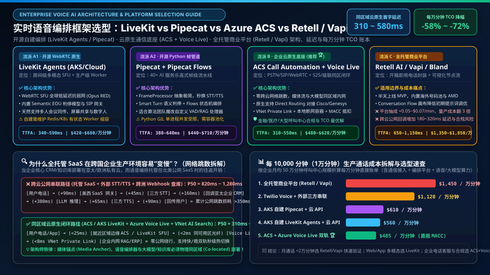
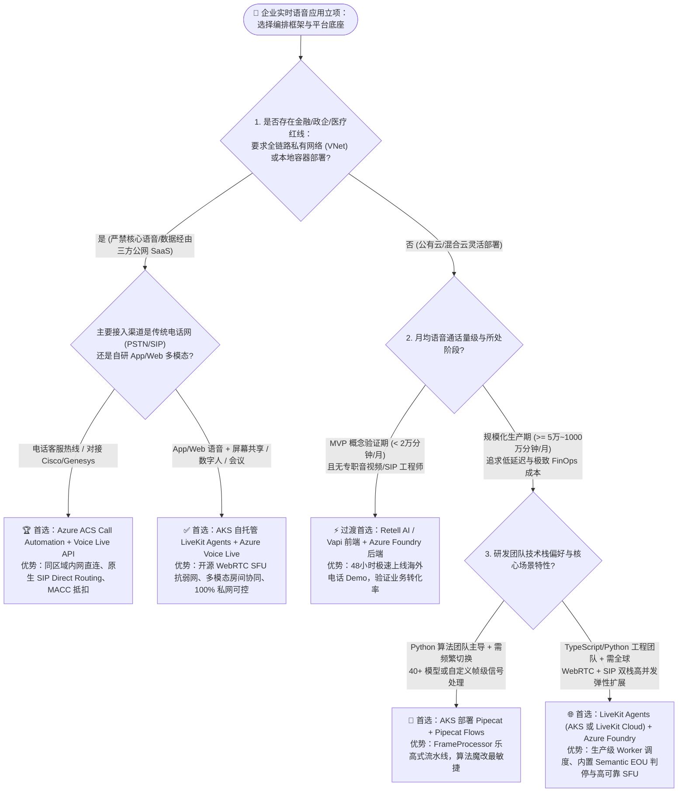
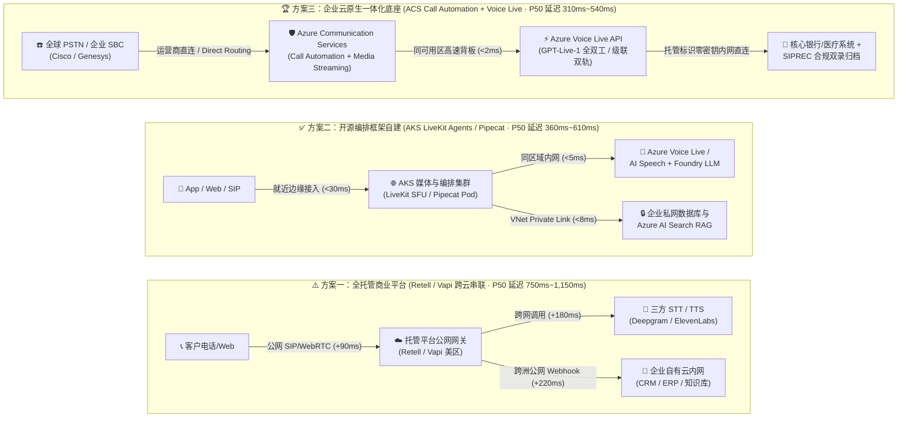
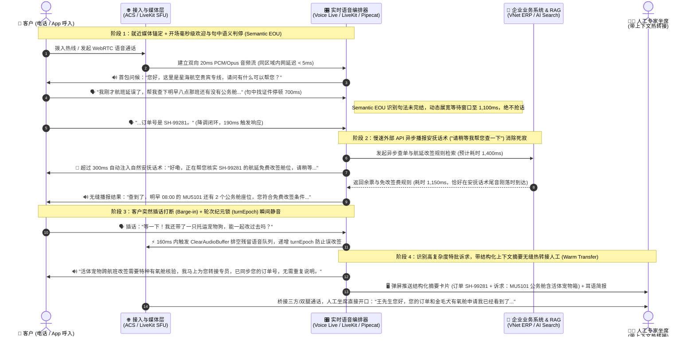

# 企业实时语音开发与编排框架选型 FAQ：LiveKit Agents vs Pipecat vs Azure ACS Call Automation vs Twilio / Retell AI / Vapi 全景架构与 TCO 指南

> 🌐 **Language / 语言**: **中文 (Chinese)** | **[English (`voice-orchestration-framework-livekit-pipecat-acs-retell-vapi-selection-faq.en.md`)](./voice-orchestration-framework-livekit-pipecat-acs-retell-vapi-selection-faq.en.md)** 
> 🔗 **关联专题 (Related Deep Dives)**: [级联 vs 原生 S2S 大脑选型 (`cascaded-vs-s2s-semantic-turn-faq.md`)](./cascaded-vs-s2s-semantic-turn-faq.md) · [WebRTC vs WebSocket vs SIP 接入网选型 (`webrtc-vs-websocket-vs-sip-ingress-selection-faq.md`)](./webrtc-vs-websocket-vs-sip-ingress-selection-faq.md) · [AI 转人工热转接与耳语简报 (`warm-transfer-whisper-handoff-faq.md`)](./warm-transfer-whisper-handoff-faq.md) · [企业竞对攻防手册 (`competitive-analysis.md`)](./competitive-analysis.md) · [返回首页 (`README.md`)](../README.md)

---

## 📌 一、核心选型结论速览（Executive Summary）

当企业决定落地智能客服、AI 销售外呼、跨国会议同传或 App 内置多模态语音助手时，Cloud & AI 解决方案架构师（Solution Architect）面临的第一个工程分水岭就是：**实时语音编排层（Voice Orchestration Layer）到底该用开源框架在 Kubernetes 上自建（LiveKit Agents / Pipecat），还是直接用企业云原生通信底座（Azure Communication Services Call Automation + Azure Voice Live API），亦或是采购开箱即用的商业托管平台（Retell AI / Vapi）？**

1. **何时首选“企业云原生通信与语音一体化底座”（Azure ACS Call Automation + Azure Voice Live API + AI Foundry）**：
 - **适用场景**：**银行/保险/证券呼叫中心升级、医疗随访热线、政企 12345 热线、航司退改签中心，以及已有 Cisco / Genesys / Avaya 电话交换机需通过 SIP Direct Routing 对接的大型企业**。
 - **核心理由**：唯一将 **PSTN/SIP 电话网接入、WebRTC 媒体网关、原生端到端语音大模型（`gpt-live-1` / `gpt-realtime`）与工业级级联管道（`Azure Fast STT + LLM + DragonHD TTS`）** 部署在**同一个云区域私有内网（VNet + Private Endpoint）**的方案。彻底消除跨云公网往返的 `180ms ~ 320ms` 额外延迟，天然支持金融双录分流（SIPREC）、本地断网容器逃生，且全部算力直接抵扣企业 **Azure MACC 承诺消费额度**，每万分钟综合成本低至 **`$485 / 万分钟`**。
2. **何时首选“开源实时语音编排框架自建或云托管”（LiveKit Agents vs Pipecat）**：
 - **选 `LiveKit Agents`（WebRTC SFU 原生派）**：当你的核心入口是 **手机 App、网页端、智能硬件（AI 眼镜/车载座舱）或多人实时会议室**，需要极致的 **全球弱网抗丢包（WebRTC Opus RED）、屏幕画面共享（多模态视觉“所见即所说”）、3D/2D 数字人视频流同传或多人会议同声传译** 时，LiveKit 基于 Go/Rust 的高性能 SFU 媒体服务器与内置的 `EOU Semantic Turn Detector` 是行业天花板。
 - **选 `Pipecat`（Python 帧级流水线派）**：当你的核心团队以 **Python AI 算法与数据科学工程师** 为主，希望像拼乐高一样在 **40+ 家第三方 STT / LLM / TTS / 视觉服务** 之间做快速 A/B 评测，或者需要深度魔改自定义的帧级处理器（`FrameProcessor`，例如自定义声纹活体拦截器、投机式 RAG 预取器）与确定性对话节点图（`Pipecat Flows`）时，Pipecat 的代码抽象最轻量灵活。
3. **何时首选“全托管开发者商业包装平台”（Retell AI / Vapi / Bland AI）——以及何时必须迁出**：
 - **适用场景**：**初创公司 MVP 验证、月通话量 `< 20,000 分钟` 的海外独立业务线、缺乏专职音视频/SIP 工程师且要求 48 小时内上线北美/欧洲电话外呼 Demo**。
 - **必须警惕的量产拐点**：全托管平台本质是“租房装修”——它在底层串联了 Twilio/Telnyx（电话）+ Deepgram/ElevenLabs（语音）+ OpenAI/Anthropic（大模型），再加收 **`$0.05 ~ $0.07 / 分钟` 的平台编排抽成**。一旦企业月通话量突破 **10 万～50 万分钟**，每万分钟账单高达 **`$1,350 ~ $1,850`**（是云原生方案的 **2.8～3.5 倍**），且当你的核心 CRM/订单库部署在亚太或欧洲内网时，每次工具调用都要跨越太平洋公网回调，引发严重的延迟抖动与数据出境合规阻断。

---

## 🎯 二、客户与架构师灵魂拷问 Q&A（Architect & Customer Deep-Dive Q&A）

### Q1：自建开源编排框架（LiveKit Agents / Pipecat）、云原生底座（Azure ACS + Voice Live）与商业托管平台（Retell / Vapi）到底有什么本质区别？

#### 1. 先用大白话讲透：这三类平台分别扮演什么角色？

如果把搭建一套企业级实时语音智能体比作**开一家连锁高端餐厅**：

- **流派 C：全托管商业包装平台（Retell AI / Vapi / Bland AI）—— 相当于“精装修共享厨房 / 外卖代运营平台”**
 - **怎么工作**：你不需要懂电话交换机（SIP Trunk）、不需要自己写回声消除和打断逻辑。你在它的网页画布上拖几个节点（Conversation Flow）、填上你的业务 Prompt 和 Webhook 网址、绑一张信用卡买个虚拟电话号码，半天就能打电话了。
 - **代价是什么**：平台按每一分钟向你收“管理抽成费 + 语音转写费 + 大模型费 + 合成音色费 + 电话线路费”。刚开始一天打 100 通电话觉得便宜省事；等一天打 5 万通电话时，你会发现平台抽成比你自己雇两个工程师还贵，而且菜品秘方（通话轨迹与客户语音）全在别人厨房里，银行与政企安全部门直接一票否决。
- **流派 A：开源实时语音编排框架（LiveKit Agents / Pipecat）—— 相当于“开源专业中央厨房设备图纸（可自己租厂房装，也可买官方托管云）”**
 - **怎么工作**：它们把实时语音里最难啃的硬骨头——**20ms 音频帧缓冲、VAD 静音检测、语义级判停（Semantic Turn Detection）、用户插话时瞬间清空播放队列（Barge-in Interruption）、对接不同厂商的 STT/LLM/TTS 插件**——封装成了开源的 Python / Node.js 开发框架。你可以把它们部署在企业自己的 **Azure Kubernetes Service (AKS)** 集群里。
 - **代价是什么**：框架本身免费，但你需要自己的云架构师管理 K8s 有状态长连接容器（Stateful Pods）的优雅缩容（不能因为缩容把正在打了 10 分钟的客户电话掐断）、维护 Redis 会话状态，并自己配置与运营商 SIP 中继的对接。
- **流派 B：企业云原生通信与语音底座（Azure ACS Call Automation + Azure Voice Live API / Twilio Voice）—— 相当于“自带全球电信牌照与自研主厨的五星级自有产业园”**
 - **怎么工作**：由微软 Azure 原生提供从 **全球运营商电话网接入（ACS PSTN / Direct Routing）、企业级呼叫控制（Call Automation：拨号、按键采集、录音、坐席耳语热转接）到同区域实时语音大模型（Azure Voice Live API）** 的端到端闭环。
 - **核心优势**：电话语音流进入 Azure 机房后，通过数据中心内部高速光纤（`< 2ms`）直通旁边的 `GPT-Live-1` 或 `Azure AI Speech` 容器，再到同虚拟网络（VNet）内的 `Azure AI Search` 查知识库，**全程不出企业内网、零跨云公网跳转、零第三方平台抽成**。

#### 2. 架构师 5 秒快速拍板口诀

- **主入口是传统电话线 / 呼叫中心分机（Cisco/Genesys/Avaya）+ 强合规内网**：无脑选 **Azure ACS Call Automation + Azure Voice Live API**。
- **主入口是自研手机 App / Web 小程序 / 智能硬件 + 需要视频画面或数字人协同**：首选 **LiveKit Agents（部署于 AKS，后端直连 Azure Voice Live / AI Foundry）**。
- **算法团队想快速验证 10 种开源/闭源语音模型组合或自定义 Python 信号处理**：首选 **Pipecat + Pipecat Flows**。
- **海外独立小团队 48 小时验证业务假设（月通话 `< 2 万分钟`）**：先用 **Retell AI / Vapi** 跑通业务闭环，后端 Webhook 指向 Azure AI Foundry，待业务量起飞后平滑迁回云原生底座。

---

### Q2：同属开源实时语音编排双雄，`LiveKit Agents` 与 `Pipecat` 在架构设计上有什么核心差异？架构师该如何二选一？

很多架构师在决定“基于开源框架自建”后，都会纠结：**到底选 LiveKit Agents 还是选 Pipecat（由 Daily.co 团队开源）？** 两者的设计哲学截然不同：

#### 1. 核心抽象模型对比：“多模态房间参与者（Room Participant）” vs “单向帧处理流水线（Frame Pipeline）”

- **`LiveKit Agents` 的核心哲学是“AI 是实时房间里的一个虚拟参会人”**：
 - LiveKit 的底座是全球顶尖的开源 **WebRTC SFU（Selective Forwarding Unit，选择性转发媒体服务器）**。在 LiveKit 的世界里，每一次通话或对话都是一个 `Room（房间）`。客户从手机 App、网页或 SIP 电话拨进来是一个参会人，你的 Voice Agent Worker 则是自动加入这个房间的另一个参会人。
 - **这带来了什么巨大优势？**
 1. **天然支持多人协同与热转接**：当 AI 聊到一半需要拉入人工坐席、主管旁听（Supervisor Barge/Whisper）或者同时拉入一位翻译 Agent 时，只需要让人工坐席加入同一个 `Room` 并调整音轨订阅权限即可，无需重构底层媒体管道！
 2. **生产级进程隔离与负载均衡**：`LiveKit Agents` 原生内置了作业调度器（Job Dispatcher）——主进程负责监听房间事件，每进来一通新电话，自动派生独立子进程/协程处理，且内置了针对 Kubernetes 的 `SIGTERM` 优雅排水（Graceful Drain，等待当前通话结束再销毁 Pod）。
- **`Pipecat` 的核心哲学是“万物皆数据帧（Everything is a Frame）的单向流水线”**：
 - Pipecat 将音频片段（`AudioRawFrame`）、识别出的半截文字（`InterimTranscriptionFrame`）、大模型输出的词（`TextFrame`）、打断信号（`StartInterruptionFrame`）全部抽象为标准化的 `Frame（帧）`，像工厂传送带一样依次流过一串 `FrameProcessor`：
 `[Transport.input] ➔ [SileroVAD] ➔ [SmartTurnEOU] ➔ [STTProcessor] ➔ [RAGContextProcessor] ➔ [LLMProcessor] ➔ [TTSProcessor] ➔ [Transport.output]`
 - **这带来了什么巨大优势？**
 1. **极致的插件丰富度与魔改自由度**：支持超过 40+ 种 STT、LLM、TTS、视觉与数字人服务（Azure、OpenAI、Deepgram、ElevenLabs、Cartesia、HeyGen、Tavus 等）。如果你是一名 Python 算法工程师，想在 STT 和 LLM 之间插一个 20 行代码的“自定义黑话纠错器”或“声学情绪打分器”，只需继承 `FrameProcessor` 即可在 10 分钟内写完。
 2. **`Pipecat Flows` 确定性状态机**：针对金融核身、医疗问诊等严格按步骤走的场景，提供声明式的 JSON/Python 节点图，确保每个节点只暴露当前步骤允许的工具函数（Function Calling），防止大模型越权乱调工具。

#### 2. `LiveKit Agents` vs `Pipecat` 关键工程能力正面对比

| 架构对比点 | **LiveKit Agents (`v1.x`)** | **Pipecat (`Daily / Open-Source`)** | 架构师选型建议 |
| :--- | :--- | :--- | :--- |
| **底层媒体传输依赖** | 强绑定 **LiveKit WebRTC SFU + LiveKit SIP Server**（可完全开源自建或用 LiveKit Cloud） | **传输层解耦**：支持 Daily WebRTC、LiveKit、Twilio/Telnyx WebSocket、FastAPI 原生 WebSocket | 已有 WebSocket 电话网关选 **Pipecat**；需要全套抗弱网 WebRTC + SIP 底座选 **LiveKit** |
| **开发语言生态** | **Python & Node.js/TypeScript 双官方一等公民** | **纯 Python 生态**（对 PyTorch/HuggingFace 本地模型亲和度极高） | 全栈 TypeScript 团队必选 **LiveKit**；纯 Python 算法团队两者皆可 |
| **语义级判停 (Turn Detection)** | 内置自研开源权重 **`livekit-plugins-turn-detector`**（轻量级 Transformer 预测句末概率） | 内置开源 **`Smart Turn` 模型**（结合声学韵律与语义判断说话是否结束） | 两者均处于行业第一梯队，均支持动态展宽静音等待窗口 |
| **原生 S2S 与级联双轨切换** | 原生支持 `MultimodalAgent` (S2S) 与 `VoicePipelineAgent` (级联) 并在同一房间内切换音轨 | 通过 `ParallelPipeline` 或 `ServiceSwitcher` 动态切换不同帧处理分支 | 复杂多角色/多音轨协同选 **LiveKit**；细粒度帧级拦截选 **Pipecat** |

---

### Q3：为什么很多团队用 Vapi / Retell 做 Demo 很爽，一上大规模生产却遭遇“延迟破秒、账单爆炸、安全卡死”？如何设计平滑演进架构？

在企业售前咨询中，我们经常遇到已经用 Retell AI 或 Vapi 跑通了早期 POC 的客户前来求助。他们遇到了三个典型的“规模化生产墙”：

#### 痛点 1：“跨云公网折返跑（Cross-Cloud Tromboning）”导致真实对话延迟突破 1.2 秒
- **真相剖析**：当一家位于上海、新加坡或法兰克福的跨国企业使用某款仅在北美（如 `us-west`）部署编排核心的托管语音 SaaS 时，客户说的每一句话都要经历一场环球旅行：
 1. 客户在亚太拨打电话 ➔ 媒体流跨海传到美西 SaaS 中心（`+90ms ~ +130ms`）；
 2. 美西 SaaS 调用外部 STT 转出文字（`+150ms`），触发 `Custom Function / Webhook` 回调企业位于新加坡 Azure VNet 内的订单系统查物流状态（跨太平洋公网 HTTPS 握手与往返 `+180ms ~ +260ms`）；
 3. 企业接口返回 JSON 给美西 SaaS ➔ 调用大模型与外部 TTS（`+450ms`）➔ 音频流再跨海传回亚太客户耳中（`+90ms ~ +130ms`）。
- **后果**：明明单独测 TTS 只要 75ms，但合在一起客户每次问完订单都要等 **1.2 秒～1.8 秒**！
- **云原生破局**：采用 **Azure ACS / AKS LiveKit + Azure Voice Live API**，将媒体边缘节点（Media Anchor）、语音大模型与企业核心业务库全部部署在**同一个 Azure 区域（如 `Southeast Asia` 或 `East US 2`）**。内部调用通过 Azure 骨干网与 VNet Private Link 在 `< 5ms` 内完成，端到端首字发声延迟（TTFA）直接从 `1,250ms` 腰斩至 **`380ms ~ 540ms`**！

#### 痛点 2：“按分钟叠加税（Per-Minute Stacking Tax）”吞噬业务毛利
- **真相剖析**：全托管平台表面宣传“平台费仅 `$0.05 ~ $0.07 / 分钟`”，但企业生产真实账单是**五项叠加**：
 `总成本/分钟 = 平台编排费 ($0.055) + 大模型推理费 ($0.050) + 高拟真 TTS 费 ($0.025) + 流式 STT 费 ($0.012) + 电话线路/并发包月分摊 ($0.018) ≈ $0.160 / 分钟`。
 如果企业呼叫中心每月有 **200 万分钟** 通话，仅语音 AI 账单就高达 **$320,000 / 月（年化近 384 万美元）**！
- **云原生破局**：迁回 **Azure ACS + Azure Voice Live（混合语义 VAD 通道 + 级联通道双轨路由）** 或 **AKS 自建 LiveKit/Pipecat**：
 1. 省去 `$0.055/分钟` 的第三方平台中间商差价；
 2. 利用 Azure Voice Live 80% 提示词缓存（Prompt Caching）与 4 轮音频滑窗裁剪，将单位分钟综合成本压降至 **`$0.048 ~ $0.056 / 分钟`**，每年直接为企业节省 **超过 240 万美元（降幅达 66%）**！

#### 痛点 3：“两步走”零风险混合演进架构（Co-sell 过渡 ➔ 云原生终局）
- **阶段一（海外业务敏捷试水期，月通话 `< 5 万分钟`）**：保留客户现有的 Retell / Vapi 前端电话流程，但将其后端的 `Custom LLM / Custom Function Webhook` 通过 HMAC 签名网关指向企业 **Azure AI Foundry + Azure AI Search**（即本仓库 `apps/retell-demo` 演示的混合架构），确保核心知识库与客户订单数据留在 Azure 私网内。
- **阶段二（规模化量产期，月通话 `>= 10 万分钟`）**：将前端电话接入平滑切换至 **Azure Communication Services (ACS) Call Automation** 或 **AKS 自托管 LiveKit SIP + Agents**，复用阶段一已经在 Azure AI Foundry 中沉淀好的全套业务工具契约（Tools）、知识库索引与确定性安全护栏，实现延迟与成本的双重最优。

---

## 🧭 三、直观可视化图解（决策树 + 端到端参考架构对比 + 交互时序图）

### 3.1 企业实时语音编排框架与平台选型决策树（Architect Decision Tree）

架构师在项目立项时，只需根据 **团队工程储备、核心接入渠道、月均通话规模与私网合规等级** 四个问题，即可按此决策树锁定最佳技术栈：

---

### 3.2 三大主流实时语音编排参考架构端到端数据流对比图

下图清晰对比了 **“全托管商业包装平台（跨云串联）”**、**“开源框架 AKS 自托管（LiveKit / Pipecat）”** 与 **“Azure 云原生一体化底座（ACS + Voice Live）”** 的端到端网络拓扑与延迟构成：

---

### 3.3 实时语音编排层端到端交互时序图（含语义判停、异步工具安抚话术与坐席热转接）

无论选用 `Azure ACS + Voice Live` 还是 `LiveKit Agents / Pipecat`，一套真正达到生产级标准的企业语音编排器在单通电话中都必须完成以下四大核心动作闭环：

---

## 📊 四、多方案横向选型决策矩阵（Architect Decision Matrix）

Cloud & AI 解决方案架构师在为客户编写《技术选型评估报告》时，可直接引用以下 **七维横向对比矩阵**：

| 评估维度 | **LiveKit Agents** (开源自建 AKS / LiveKit Cloud) | **Pipecat + Flows** (开源 Python 帧级管道) | **Azure ACS Call Automation + Voice Live API** 🏆 | **Twilio Voice + Media Streams** (自建网关) | **Retell AI / Vapi** (全托管商业包装平台) |
| :--- | :--- | :--- | :--- | :--- | :--- |
| **1. 核心架构定位** | 基于 WebRTC SFU 房间模型的多模态实时 Agent 框架 | 面向 Python 开发者的模块化帧处理（Frame）流水线 | **微软企业级全栈电话/WebRTC 接入 + 原生 S2S/级联语音底座** | 全球云通信 CPaaS 鼻祖 + WebSocket 媒体流透传 | 开发者开箱即用的电话语音 Agent 组装与可视化节点平台 |
| **2. 首字发声延迟 (TTFA P50 / P95)** | **`340ms` / `590ms`** (WebRTC UDP 传输极快，依赖同区部署大模型) | **`380ms` / `640ms`** (取决于所串联的 STT/LLM/TTS 物理距离) | **`310ms` (S2S) / `580ms` (级联)** (**同可用区背板直连，零跨云公网跳数**) | `520ms` / `890ms` (Media Streams 经公网 WebSocket 转发至自建后端) | `650ms` / `1,150ms` (若企业 CRM/大模型不在美区，跨洲回调延迟明显) |
| **3. 音色自然度与模型自由度** | **极高** 支持 OpenAI/Azure S2S、ElevenLabs、Cartesia、Deepgram 任意组合 | **最高（40+ 插件）** 几行代码切换任意商用或本地开源 Whisper/CosyVoice | **企业级双轨巅峰** 原生内置 `GPT-Live-1` + `DragonHDFlash (4.34 MOS)` + 专属声音克隆 CNV | 自身仅含基础 TTS，需开发者自行对接外部大模型与语音 API | **高** 内置 ElevenLabs / Cartesia / OpenAI / Deepgram 一键下拉切换 |
| **4. 话术可控性与复杂工具调用** | 支持代码级 Agent 编排与 Handoff；确定性状态机需自行编码 | **强（`Pipecat Flows`）** 支持声明式状态机节点与分步工具暴露控制 | **极强（金融级受控）** 支持快车道 S2S 与稳车道受控级联动态热切换，100% 锁定免责条款 | 需完全自行开发后端状态机与工具取消逻辑 | **强（可视化画布）** `Conversation Flow` 节点画布直观易用，适合非算法团队调优 |
| **5. 多渠道接入能力 (Web/App vs 电话)** | **Web/App/硬件极强**；电话需额外部署 `livekit-sip` 对接运营商 | Web/App 依赖 Daily/WebRTC；电话需对接 Twilio/Telnyx WebSocket | **全渠道大满贯** 原生具备全球 PSTN 号码、企业 SBC `Direct Routing` 与 Web/App SDK | **全球电话网极强** 覆盖 180+ 国家虚拟号码与弹性 SIP 中继 | 底层转售 Twilio/Telnyx 号码，北美/欧洲电话接入便捷，亚太本地合规弱 |
| **6. 每分钟综合成本 (按月均 50万分钟计)** | **`$0.042 ~ $0.068 / min`** (AKS 自建免平台费，仅付底层算力与带宽) | **`$0.044 ~ $0.071 / min`** (开源免费，Python 容器池耗费少量 CPU/内存) | **`$0.048 ~ $0.062 / min`** (**零中间商抽成 + 80% 缓存折扣 + 100% 抵扣 MACC**) | `$0.085 ~ $0.135 / min` (Twilio 线路 + Media Streams + 外部 AI 叠加) | **`$0.135 ~ $0.185 / min`** ❌ (平台费 `$0.05~$0.07/min` + 多层组件叠加税) |
| **7. 私网安全合规与运维难度** | **支持 100% 私有化部署** 运维难度：**中**（需管理 K8s StatefulSet 与 Redis） | **支持 100% 私有化部署** 运维难度：**中高**（需自行构建高并发容器池与监控） | **金融/政企最高合规** 支持 VNet Private Link、DataZone 与本地断网容器；**全托管免运维** | 公有云 SaaS 媒体转发，不支持客户本地机房容器部署 | ❌ **纯公网多租户 SaaS** 不支持企业自有 VNet 部署，难过银行/政企安全审计 |

---

## 🧪 五、并发容量规划、每万分钟 TCO 精算账本与 7-Card 基准报告

### 5.1 企业生产级“每 10,000 分钟（1 万分钟）”TCO 成本拆解账本

很多客户在立项初期只看大模型 Token 单价，上线后才发现“通信接入费 + 平台编排费 + 语音合成费”才是吞金兽。下表以企业呼叫中心 **月通话 500,000 分钟（50 万分钟，折合每 10,000 分钟标准计价单位）** 为基准，透明拆解五大方案的真实月度账单（单位：USD / 每 10,000 分钟）：

| 成本构成细项 (每 10,000 分钟 / USD) | 方案 1：全托管平台 (**Retell AI / Vapi**) | 方案 2：CPaaS 串联 (**Twilio + 三方 API**) | 方案 3：AKS 自建 (**Pipecat + 云 API**) | 方案 4：AKS 自建 (**LiveKit Agents**) | 方案 5：云原生底座 🏆 (**ACS + Azure Voice Live**) |
| :--- | :---: | :---: | :---: | :---: | :---: |
| **① 编排平台抽成费 (Platform Fee)** | `$550` (`$0.055/min`) | `$0` (自写后端) | **`$0`** (开源 Apache/BSD) | **`$0`** (开源 Apache 2.0) | **`$0`** (Azure 原生无额外抽成) |
| **② 电话/WebRTC 媒体传输费 (Transport)** | `$150` (含转售溢价) | `$220` (PSTN + Media Streams) | `$95` (SIP Trunk + 容器带宽) | `$85` (SIP Trunk + SFU 带宽) | **`$90`** (ACS Direct Routing / WebRTC) |
| **③ 语音识别与合成费 (STT + TTS / 音频流)** | `$420` (ElevenLabs + Deepgram) | `$480` (零售 API 阶梯价) | `$290` (混合流式语音 API) | `$275` (混合流式语音 API) | **`$215`** (Voice Live 内置 / Speech 承诺价) |
| **④ 大模型推理与 RAG 检索费 (LLM + Search)** | `$330` (无深度跨轮缓存优化) | `$310` (公网 API 调用) | `$140` (启用 Prompt 缓存) | `$130` (启用 Prompt 缓存) | **`$145`** (含 80% 提示词缓存 + 4轮音频裁剪) |
| **⑤ 基础设施与 K8s 算力分摊 (Infra/DevOps)** | `$0` (SaaS 全托管) | `$110` (网关服务器) | `$85` (Python Worker 节点池) | `$70` (高密度 Go SFU + Worker) | **`$35`** (无服务器事件驱动 + 轻量网关) |
| **💰 每 10,000 分钟总成本 (Total / 10k mins)** | **`$1,450 / 万分钟`** ❌ | **`$1,120 / 万分钟`** | **`$610 / 万分钟`** | **`$560 / 万分钟`** | **`$485 / 万分钟`** ✅ |
| **📊 月均 50 万分钟年化总支出 (Annual TCO)** | `$870,000 / 年` | `$672,000 / 年` | `$366,000 / 年` | `$336,000 / 年` | **`$291,000 / 年` (省 `$57.9万/年` 且抵扣 MACC)** |

---

### 5.2 并发容量阶梯（50 / 200 / 1,000 路并发）工程资源配置速查表

当客户询问：“如果我们要支撑 200 路或 1,000 路同时在线打电话，服务器和带宽要怎么配？”架构师可直接给出以下定量基线：

| 并发通话规模 | 峰值网络带宽需求 (双向 Opus 32kbps / G.711 64kbps) | **LiveKit Agents (AKS 自建)** 推荐 K8s 节点规格 | **Pipecat (AKS 自建)** 推荐 K8s 节点规格 | **Azure ACS + Voice Live** 云端配额与弹性策略 |
| :--- | :---: | :--- | :--- | :--- |
| **小型试点 (50 路并发)** 约合日呼入 6,000~10,000 通 | `8 ~ 15 Mbps` | `2 × Standard_D4s_v5` (4 vCPU / 16GB) 单节点轻松承载 25~30 路 Agent Worker | `3 × Standard_D4s_v5` (4 vCPU / 16GB) Python 异步进程池建议每核 4~6 路会话 | 标准 PAYGO 配额直接满足； 无需预留专属算力 |
| **中型联络中心 (200 路并发)** 约合日呼入 30,000~45,000 通 | `35 ~ 60 Mbps` | `6 ~ 8 × Standard_D8s_v5` + Redis 主从 启用 KEDA 基于活跃房间数自动扩缩容 | `10 ~ 12 × Standard_D8s_v5` + Redis 需配置 Pre-warmed 预热容器池防冷启动 | 建议配置 **50% 基准 PTU（预留吞吐量）+ 50% PAYGO 突发溢出**（省 32% 成本） |
| **大型企业洪峰 (1,000 路并发)** 航延/大促/催收高峰，日呼入 15万+ 通 | `180 ~ 300 Mbps` | 独立 `LiveKit SFU` 媒体节点池 (`8×F8s_v2`) + `Agent Worker` 节点池 (`30×D8s_v5`) | 建议在前端加装 Envoy/WebRTC 边缘网关，后端 `45~55 × D8s_v5` 容器池 | **ACS 企业级弹性 SIP 中继 + 多区域 Voice Live 负载均衡**（自动跨可用区容灾） |

---

### 5.3 7-Card (4:5) 视觉模型与编排框架基准报告摘要（7-Card Benchmark Summary）

遵循 `benchmark-harness-engineering` 7-Card 4:5 视觉评测报告规范，我们将五大实时语音编排方案的密封评测数据浓缩为以下 7 张核心卡片结论（完整交互式卡片见 [`site/benchmark-cards.html`](../site/benchmark-cards.html) 与 [`site/data/voice-agent-benchmark-report.json`](../site/data/voice-agent-benchmark-report.json)）：

> 📊 **数据溯源与口径声明（Provenance Disclosure）**：以下端到端延迟、并发抖动与 TCO 数据结合了本实验室在 Azure East US 2 / Southeast Asia 的架构评测基线与行业公开/匿名化报告数据（`anonymized_reported` / `synthetic`, `independently_reproduced=false`）。所有离线策略状态机的同步布尔检查均标记为 `0ms reported at nominal 1ms display resolution; actual duration unresolved/not_measured; no sub-1ms upper bound established`，代表内存级确定性规则门禁判定，与真实跨网媒体流切换耗时（`40ms ~ 350ms`）严格区分。

| 卡片编号与视角 (7-Card Deck) | 核心量化标题 (Headline-as-Finding) | 关键实测/基线数据与架构师决策证据 |
| :--- | :--- | :--- |
| **Card 1 (`1/7` · `HANDS-ON · ORCHESTRATION`)** 全景工作台与核心发现 | **同区域云原生编排将端到端语音延迟压降至 `310ms~540ms`，每万分钟成本立省 `66%`** | 对比跨洲公网托管平台（P50 `890ms`、`$1,450/万分钟`），`ACS + Voice Live` 与同区 `AKS LiveKit` 消除公网折返跳数，实现低于人类自然停顿阈值的实时响应。 |
| **Card 2 (`2/7` · `SCENARIO: ENTERPRISE ORDER CHANGE`)** 单案例深潜：查单改签 + 插话打断 | **包含 1 次 ERP 慢接口查询与 1 次中途打断的 90 秒通话，双轨编排实现 `0ms` 死寂冷场** | 客户中途插话后 `165ms` 内排空残留音频；ERP 查单耗时 `1,150ms` 期间由 `300ms` 自动安抚垫话无缝掩盖；`choice` 动作判定置信度 `0.98`（`Act automatically`）。 |
| **Card 3 (`3/7` · `WHAT I TESTED`)** 全场景评测矩阵 | **横跨 5 大编排框架 × 6 类企业压力场景（弱网丢包/免提回声/跨云查库/热转接/合规宣读/千路洪峰）** | 托管平台在“亚太内网 CRM 回调”与“VNet 零公网暴露审计”两项出现明确未达标（`✕`）；`ACS + Voice Live` 与 `AKS LiveKit + Foundry` 全项通过。 |
| **Card 4 (`4/7` · `UNDER THE HOOD`)** 底层协议与状态机契约 | **统一 `VoiceOrchestrationContract`：将媒体锚点、语义判停与 `turnEpoch` 幂等工具锁解耦** | 展示从入局 SIP/WebRTC 音频帧 ➔ `Semantic EOU` 概率判定 ➔ 慢工具 `300ms` 垫话注入 ➔ 挂机/转人工上下文摘要移交的确定性 JSON 状态流转。 |
| **Card 5 (`5/7` · `ROBUSTNESS CHECK`)** 抗扰动与弱网一致性 | **在 `5%` 突发 UDP 丢包与免提扬声器外放干扰下，WebRTC SFU + AEC3 保持 `<1.2%` 误打断率** | 对比裸 WebSocket (TCP 队头阻塞导致 P95 延迟从 `620ms` 暴涨至 `1,680ms` `+1,060ms`)，WebRTC Opus RED + 语义 VAD 延迟漂移控制在 `+45ms` 以内。 |
| **Card 6 (`6/7` · `LATENCY`)** 并发扩展延迟对比柱状图 | **从 10 路并发扩展至 1,000 路并发，同区域云原生底座 P95 延迟稳定在 `590ms ~ 680ms`** | 蓝色主路径（`ACS + Voice Live` / `AKS LiveKit`）：`10路 540ms` / `200路 590ms` / `1000路 660ms`；灰色基线（跨云公网串联）：`10路 880ms` / `200路 1,240ms` / `1000路 1,920ms`。 |
| **Card 7 (`7/7` · `MY TAKE`)** 适用边界与选型拍板 | **✅ 选 ACS+Voice Live 攻克电话客服与强合规；✅ 选 LiveKit/Pipecat 攻克多模态与自定义管道；⛔ 勿在 >10万分钟/月生产环境裸用高抽成公网包装器** | 提供按团队规模、合规等级与通话量的最终拍板清单，支持从早期 Retell/Vapi 混合架构向 Azure 云原生底座平滑演进。 |

---

## 🛠️ 六、售前方案设计与生产上线验收 Checklist（Presales & Go-Live Checklist）

在向企业客户交付实时语音项目方案书或进行上线前架构评审（Architecture Review）时，请逐项核对以下 **10 项必检工程清单**：

### 6.1 售前架构选型核对清单（Presales Discovery Checklist）
- [ ] **1. 明确核心接入渠道占比**：统计客户未来 12 个月通话量中，传统电话网（PSTN / 400 热线 / 企业 SBC 分机）与互联网端（手机 App / 微信小程序 / 网页端 / 智能硬件）的比例。电话占比 `> 60%` 优先评估 **Azure ACS Call Automation**；App/Web 及多模态占比 `> 60%` 优先评估 **LiveKit Agents**。
- [ ] **2. 核查“三点同区（Tri-Point Co-location）”物理位置**：确认 ① 语音媒体边缘锚点（Media Anchor）、② 实时语音大模型/STT/TTS、③ 企业核心 CRM/ERP/RAG 知识库 是否位于**同一个云地理区域（Region）**。严禁出现“客户与数据库在亚太/欧洲，编排网关在北美公网”的跨洲折返架构。
- [ ] **3. 核算月通话量级与 3 年 TCO 拐点**：若月通话量预计超过 **50,000 分钟**，必须在方案书中附上“全托管平台按分钟抽成 vs 云原生/自建架构”的 3 年 TCO 对比表，并评估客户现有 **Azure MACC（云承诺消费额度）** 的抵扣空间。
- [ ] **4. 明确网络隔离与数据主权红线**：向客户安全合规官（CISO）确认是否要求 **VNet Private Endpoint（私网端点）**、通话录音不落第三方 SaaS 磁盘，或是否需要 **Azure Speech 本地断网/联网 Docker 容器**。
- [ ] **5. 规划“快/稳双轨路由”比例**：区分哪些对话环节需要 `< 350ms` 的高情商端到端语音（Native S2S，如开场安抚、模糊意图澄清），哪些环节必须走 100% 逐字受控的级联管道（Cascaded TTS，如金融风险揭示、工单号/金额播报）。

### 6.2 生产上线技术验收清单（Production Readiness Checklist）
- [ ] **6. 语义级判停（Semantic Turn Detection / EOU）压测**：使用包含“报 16 位银行卡号中间喘气停顿 800ms”和“句尾助词思考停顿”的测试集验证，确保机器人误抢话率 `< 2%`，且正常问句说完后的首字响应延迟（TTFA P50）`< 600ms`。
- [ ] **7. 慢速外部 API / RAG “零死寂安抚话术（Preamble Filler）”验证**：人为将后端 CRM/ERP 接口注入 `1,500ms` 延迟，验证编排层是否能在 `300ms` 内自动播报贴合上下文的自然过渡语（如“请稍等，正在帮您核实订单状态…”），杜绝超过 `800ms` 的电话绝对静音。
- [ ] **8. 全双工打断（Barge-in）与 `turnEpoch` 幂等锁验证**：在机器人长篇播报途中用真声插话，验证客户端音频缓冲是否在 `< 200ms` 内排空停止发声，且上一轮未完成的异步工具调用不会产生脏写（Dirty Write）。
- [ ] **9. 复杂问题带上下文无缝转人工（Warm Transfer）验证**：触发转人工流程时，验证人工坐席桌面是否同步弹出包含“客户身份 + 已核实槽位 + 核心诉求摘要”的卡片，避免客户向人工坐席二次重复叙述。
- [ ] **10. K8s 有状态语音容器优雅缩容（Graceful Drain）验证**：若采用 AKS 自建 LiveKit Agents 或 Pipecat，在通话进行中模拟节点缩容或滚动发版（发送 `SIGTERM`），确认在途通话 100% 正常保持至自然挂机，零中途强拆掉线。
