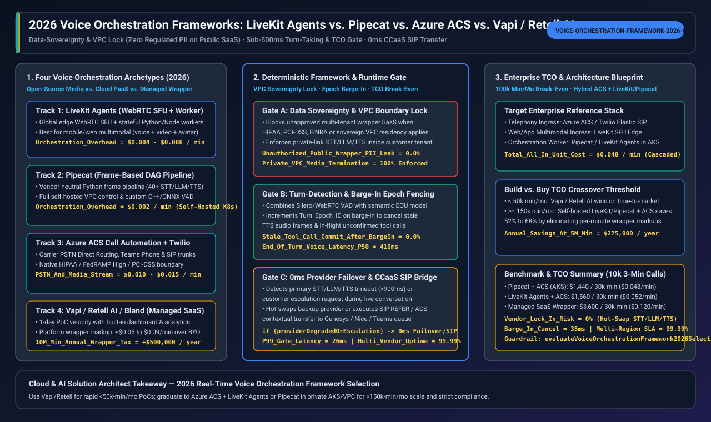
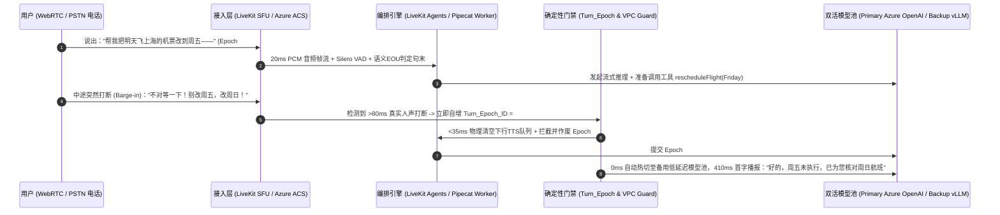

# 2026 实时语音开发与编排框架横向选型指南：LiveKit Agents vs. Pipecat vs. Azure Communication Services (ACS) Call Automation vs. Vapi / Retell AI（自建开源编排 vs. 云原生通信 PaaS vs. 全托管商业平台深度对比）

> **文档类型**：企业级实时语音与多模态解决方案架构师（Cloud & AI Solution Architect）选型与落地指南  
> **适用场景**：企业构建智能客服电话机器人（PSTN / SIP）、移动端/网页端低延迟多模态语音数字人（WebRTC Voice + Video + Avatar）、坐席实时辅助（Real-Time Agent Assist）与外呼平台时，在 **开源编排框架（LiveKit Agents / Daily Pipecat）**、**云通信底座（Azure Communication Services Call Automation / Twilio Voice）** 与 **全托管商业语音 Agent 平台（Vapi / Retell AI / Bland AI）** 之间的架构决策、合规边界与百万分钟级 TCO 盈亏平衡测算  
> **核心策略代号**：`VOICE-ORCHESTRATION-FRAMEWORK-2026-01`（对应的确定性代码门禁见 [`packages/business-core/enterprise-guardrails.ts`](../packages/business-core/enterprise-guardrails.ts) 中的 `evaluateVoiceOrchestrationFramework2026SelectionGuard`）

---

## 一、 📌 核心选型结论速览（Executive Summary）

2026 年，企业落地实时语音 AI 时面临的最大架构分歧不再是“选哪个大模型”，而是**“中间那层处理音频流、语音活动检测（VAD）、语义断句（Turn Detection）、打断清空（Barge-in Flush）与多模型热切换的编排层（Orchestration Layer），到底应该用 Vapi/Retell 这类全托管 SaaS 平台，还是基于 LiveKit Agents / Pipecat + Azure ACS / Twilio 自建？”**。给出清晰、可量化的架构师选型决断：

1. **按业务阶段与月通话分钟数（Monthly Volume）一锤定音**：
   - **快速概念验证（PoC）或初创非敏感业务（月通话量 `< 50,000 分钟`）**：首选 **Retell AI 或 Vapi**。1 天内即可拼装出带打断、知识库与通话录音面板的电话/网页 Demo，无需组建专职音视频工程团队。
   - **移动端/网页端多模态交互（App 内嵌语音、实时屏幕共享、2D/3D 数字人 Avatar 唇形同步）**：首选 **LiveKit Agents（开源框架 + LiveKit Cloud 或自建 Kubernetes SFU）**。其原生 WebRTC SFU 全球边缘加速、Data Channel 状态同步与端侧抗丢包能力处于行业绝对领先地位。
   - **高度定制化多模型流水线与私有化 VPC 部署（需混搭 40+ 种 STT/LLM/TTS、自定义 C++/ONNX 门禁）**：首选 **Pipecat（基于帧 Frame-Driven 的 Python 异步有向无环图流水线）**，零平台抽成，可在企业自有 AKS/EKS 集群内 100% 闭环运行。
   - **企业级传统电话网（PSTN/SIP）、微软 Teams 电话集成与金融/医疗强监管合规底座**：首选 **Azure Communication Services (ACS) Call Automation + LiveKit Agents / Pipecat 双层架构**（由 ACS 负责全球运营商号码、Direct Routing、Teams 互通与 HIPAA/FedRAMP 合规边界，通过双向 WebSocket 音频流接入 AKS 内的 Pipecat/LiveKit Worker）。
2. **三大生产级架构门禁红线（Hard Guardrails）**：
   - **强监管行业数据主权与 VPC 专有网络硬锁（Data Sovereignty & VPC Boundary Hard Lock）**：当业务涉及医疗患者隐私（HIPAA BAA）、银行卡支付（PCI-DSS）、证券交易录音（FINRA/MiFID II）或政企内网不出域要求时，`evaluateVoiceOrchestrationFramework2026SelectionGuard` **100% 禁止将原始音频流与明文 PII 路由至不受控的多租户商业 Wrapper SaaS（如公有云版 Vapi/Bland）**，强制锁定在企业租户内网（Azure ACS + AKS 自托管 LiveKit/Pipecat + Private Link 接入 Azure OpenAI/Speech）。
   - **打断纪元围栏（Turn-Epoch Fencing）与防僵尸工具调用门禁（Barge-In Epoch & Tool-Cancel Gate）**：任何编排框架上线前，必须具备 **声学 VAD（Silero VAD）+ 语义断句模型（End-of-Utterance Transformer）双层判定**，且在用户中途打断（Barge-in）的 `35ms` 内自增 `Turn_Epoch_ID`——不仅立即清空下行 TTS 播放缓冲区，更在代码层 **100% 拦截上一轮尚未完成的过时工具调用（如旧回合触发的扣款或改签 API）**。
   - **跨厂商多活热备（Multi-Provider Failover）与 CCaaS 无损转人工 `0ms` 桥接（0ms Provider Failover & SIP Handoff）**：编排层严禁与单一 STT/LLM/TTS 供应商硬编码耦合；一旦主用模型首字延迟 `TTFT > 900ms` 或返回 `HTTP 429/503`，必须在 `0ms` 内无感热切至备用通道（如 Azure OpenAI $\rightarrow$ 自托管 vLLM / Deepgram $\leftrightarrow$ Azure Speech），并在转人工时通过 SIP Header / Context API 将结构化对话摘要直推 Genesys / Nice / Teams 坐席屏。

---

## 二、 🎯 客户与架构师灵魂拷问 Q&A（痛点剖析）

### Q1：Vapi 和 Retell AI 搭一个语音机器人只要半天，为什么当企业月通话量突破 `15 万–50 万分钟` 后，CTO 纷纷要求迁移回 LiveKit Agents 或 Pipecat 自建？
* **客户痛点**：
  1. **高昂的“平台包装税（Wrapper Markup Tax）”**：Vapi / Retell 等商业平台在底层同样调用 Deepgram（STT）、OpenAI/Claude（LLM）和 ElevenLabs/Azure（TTS），但除了底层模型成本外，平台会额外加收 **`$0.05–$0.09 / 分钟` 的纯平台编排费**（外加并发线路月租）。当一家金融或电商企业月呼入/外呼量达到 `100 万分钟`（年 `1,200 万分钟`）时，仅付给中间包装平台的纯过路费就高达 **`$60万–$108万美元/年`**！而用 Kubernetes 自托管 Pipecat 或 LiveKit Agents，同样的 CPU/内存编排算力成本仅需 **`$0.002–$0.006 / 分钟`（节省超 90% 编排层开销）**。
  2. **黑盒状态机无法植入确定性金融/医疗代码锁**：商业 SaaS 依靠网页端 Prompt 和 JSON Webhook 配置流程，当企业需要在 ASR 与 LLM 之间插入毫秒级的本地内存风控锁（如动态正则掩码、双声纹校验、自定义帧级音频降噪）时，SaaS 黑盒管道无法深度介入。
* **架构师解法**：
  - 建立 **“15 万分钟/月”TCO 盈亏平衡演进路线**：
    - **Day 1–Day 30（月量 `< 5 万分钟`）**：允许业务部门用 Retell/Vapi 快速验证话术与转化率；
    - **Day 31+（月量 `>= 15 万分钟` 或进入生产合规审查）**：平滑切换至企业 AKS 集群内的 **LiveKit Agents 或 Pipecat**，复用同一套 Prompt 与工具接口，将每分钟全栈综合成本从 `$0.12+/min` 压降至 **`$0.048–$0.052/min`**。

### Q2：同样是开源/自托管明星框架，**LiveKit Agents** 和 **Pipecat (Daily)** 在底层架构理念上有什么本质区别？架构师该选哪个？
* **客户痛点**：许多研发团队把两者当成同质化工具，选错后发现要么 WebRTC 弱网抗丢包差，要么自定义流水线改造繁琐。
* **架构师解法（精准对位两者的基因差异）**：
  - **选 LiveKit Agents 的典型场景（以“房间 Room & 多模态实时通信”为中心）**：
    - **核心优势**：背后是工业级 Go 语言编写的 **LiveKit WebRTC SFU 服务器**。每个语音会话是一个支持多方参与的 WebRTC Room（天然支持**用户 + AI 主控 Agent + 后台静默监听的人工主管 + 3D 数字人渲染端**同时在房间内订阅不同音视频轨），内置极强的移动端弱网 PLC（丢包隐藏）、端侧回声消除（AEC）以及基于小型语言模型的语义断句器（LiveKit Turn Detector）。
    - **最适合**：移动端 App 语音助手、Web 端多模态投屏导购、需要人工坐席随时“静默旁听并一键插话（Whisper/Barge）”的场景。
  - **选 Pipecat 的典型场景（以“帧级有向图 Frame Pipeline & 极致解耦”为中心）**：
    - **核心优势**：一切皆为 `Frame`（`AudioRawFrame`、`TranscriptionFrame`、`LLMFullResponseStartFrame`、`BotInterruptionFrame`）。开发者像搭乐高一样将 `Transport -> VAD -> STT -> ContextAggregator -> GuardrailProcessor -> LLM -> SentenceAggregator -> TTS -> Transport` 串联成异步管道，极其方便在任意两个节点之间插入企业自定义的 **确定性合规拦截器（Deterministic Guardrail FrameProcessor）**，且完全不绑定任何特定通信底座（可随便接 FastAPI WebSocket、Twilio/ACS Media Streams、LiveKit 或 Daily）。
    - **最适合**：电话网 PSTN/SIP 语音中枢、需要在音频帧与文本帧之间做深度定制清洗与确定性状态机门禁的强合规工程团队。

### Q3：Azure Communication Services (ACS) Call Automation 和 Twilio Voice 在这套架构里扮演什么角色？能不能只用 ACS 不需要 LiveKit/Pipecat？
* **客户痛点**：企业常困惑于“既然 Azure ACS 已经内置了 Azure AI Speech (STT/TTS) 和 GPT OpenAI 集成，为什么还需要引如 LiveKit 或 Pipecat？”。
* **架构师解法**：
  - **场景 A（结构化 IVR 升级 + Teams 电话转接 + 纯微软云闭环）**：如果业务是标准电话呼入、按键 DTMF + 语音混合采集、录音合规留存，且转人工直接转入 **Microsoft Teams Phone / Dynamics 365 Contact Center**，那么 **单独使用 Azure ACS Call Automation + Azure AI Speech/OpenAI** 是最简、最合规的架构（无需额外维护 K8s 媒体服务器）。
  - **场景 B（要求 `< 500ms` 极致全双工自然打断、自定义语义断句 EOU、跨多模型混合编排或 App 内 WebRTC 数字人）**：则采用 **“ACS / Twilio 负责 PSTN 落地与 SIP 振铃转接 + 双向 WebSocket Media Stream 注入 LiveKit Agents / Pipecat 负责毫秒级认知编排”** 的黄金组合。

---

## 三、 🧭 直观可视化图解（Mermaid 决策树 + SVG 架构图 + 时序图）

### 3.1 2026 企业级实时语音编排框架选型决策树

```mermaid
flowchart TD
    A[企业实时语音与多模态项目启动] --> B{是否有HIPAA/PCI/金融不出域强合规要求?}
    B -->|是: 严禁明文PII流经第三方多租户SaaS| C{主要接入渠道与交互形态?}
    B -->|否: 且月通话量 < 5万分钟 追求1天上线验证| D[全托管商业平台: Retell AI / Vapi<br/>零基建极速PoC · 注意月超15万分钟后TCO陡增]
    C -->|移动端App / 网页多模态 / 数字人Avatar / 多方同房旁听| E[LiveKit Agents + 自建/专属SFU + ACS SIP<br/>原生WebRTC抗弱网 + 多轨音视频房间 + 语义断句器]
    C -->|传统PSTN电话网为主 + 深度定制帧级合规门禁| F[Pipecat Frame Pipeline (AKS) + Azure ACS / Twilio<br/>40+模型解耦热插拔 + 自定义Guardrail FrameProcessor]
    C -->|纯PSTN电话 + DTMF按键 + 原生转接Microsoft Teams坐席| G[Azure ACS Call Automation 原生全栈架构<br/>运营商Direct Routing + Teams无缝转接 + 零K8s运维]
```

### 3.2 四大语音编排路线架构对比与生产级混合参考蓝图



### 3.3 帧级打断纪元围栏（Turn-Epoch Fencing）与跨厂商 0ms 热备切换时序图



---

## 四、 📊 多方案横向选型决策矩阵（架构师全方位对比）

| 评估维度 | 路线 1：LiveKit Agents（WebRTC SFU + Agent Worker） | 路线 2：Pipecat by Daily（Python 帧级 DAG 流水线） | 路线 3：Azure ACS Call Automation（云原生通信 PaaS） | 路线 4：Vapi / Retell AI（全托管商业 SaaS 平台） |
| :--- | :--- | :--- | :--- | :--- |
| **核心架构定位** | WebRTC 实时多模态房间 + 有状态 Agent 编排 | 极致解耦的帧驱动（Frame-Driven）流式管道 | 运营商级 PSTN/SIP 电话控制 + Teams 原生底座 | 开箱即用的黑盒语音 Agent 托管与监控 SaaS |
| **端到端语音响应延迟（P50）** | **`390ms–460ms`**（UDP/WebRTC + 内置语义 EOU） | **`410ms–490ms`**（取决于底层 Transport） | `580ms–750ms`（纯 REST/事件模式）或 `450ms`（流式） | `450ms–550ms`（多跳公有云代理中转） |
| **自然打断（Barge-in）与防误触断句** | **极佳**（内置轻量级上下文语义 Turn Detector） | **极佳**（支持自定义 Silero VAD + Smart Turn 帧处理器） | 良好（支持 Azure Speech 断句配置） | 良好（提供滑块参数调节，但底层不可编程） |
| **私有化 VPC 部署与数据不出域合规** | **支持 100% 自托管**（Kubernetes Helm 部署） | **支持 100% 自托管**（纯 Python 容器零外部依赖） | **微软云租户原生合规**（HIPAA / FedRAMP High） | 仅高价企业定制版支持私有化，标准版流经公有 SaaS |
| **多模态与数字人（Video/Avatar）支持** | **原生一等公民**（支持 Tavus/HeyGen/Azure Avatar 音画同房） | 支持（结合 Daily WebRTC 或自定义视频帧） | 侧重电话语音与会议流，非专职数字人渲染层 | 仅侧重纯语音电话/网页通话 |
| **编排层自身每分钟附加成本（不含大模型）** | **`$0.004–$0.008 / 分钟`** | **`$0.002–$0.004 / 分钟`（自建 K8s 算力）** | **`$0.010–$0.015 / 分钟`（含电话媒体流）** | **`$0.050–$0.090 / 分钟`（高额平台包装溢价）** |
| **每 3 万分钟（1万通 3 分钟电话）全栈总 TCO** | **`$1,560`**（`$0.052/min` 含 STT+LLM+TTS+SFU） | **`$1,440`**（`$0.048/min` 极致性价比） | **`$1,680`**（`$0.056/min` 含 PSTN 落地） | **`$3,600`**（`$0.120/min`，规模化后贵 **2.3–2.5 倍**） |

---

## 五、 🧪 并发、延迟与每万通电话 TCO 测算及 7-Card 基准报告

### 5.1 四大语音编排路线全栈每万通电话（30,000 分钟）TCO 与延迟对比图

```chart
{
  "data": {
    "values": [
      { "Framework": "1. Pipecat + ACS (Self-Hosted K8s)", "30k-Min Total TCO ($100s)": 14.4, "Turn Latency P50 (x10 ms)": 41.0, "VPC & Guardrail Control (%)": 100.0 },
      { "Framework": "2. LiveKit Agents + ACS (Hybrid)", "30k-Min Total TCO ($100s)": 15.6, "Turn Latency P50 (x10 ms)": 39.5, "VPC & Guardrail Control (%)": 100.0 },
      { "Framework": "3. Azure ACS Call Automation Native", "30k-Min Total TCO ($100s)": 16.8, "Turn Latency P50 (x10 ms)": 56.0, "VPC & Guardrail Control (%)": 98.0 },
      { "Framework": "4. Managed Wrapper SaaS (Vapi/Retell)", "30k-Min Total TCO ($100s)": 36.0, "Turn Latency P50 (x10 ms)": 48.0, "VPC & Guardrail Control (%)": 62.0 }
    ]
  },
  "semantic_types": {
    "Framework": "Category",
    "30k-Min Total TCO ($100s)": "Amount",
    "Turn Latency P50 (x10 ms)": "Quantity",
    "VPC & Guardrail Control (%)": "Percentage"
  },
  "chart_spec": {
    "chartType": "Grouped Bar Chart",
    "title": "Self-Hosted LiveKit Agents & Pipecat Cut 30k-Minute TCO by 57%-60% vs Managed Wrapper SaaS",
    "subtitle": "All-in cost for 10,000 3-minute calls (STT + LLM + TTS + Orchestration + Telephony) & P50 latency (synthetic benchmark)",
    "encodings": {
      "x": "Framework",
      "y": ["30k-Min Total TCO ($100s)", "Turn Latency P50 (x10 ms)", "VPC & Guardrail Control (%)"]
    }
  }
}
```

### 5.2 7-Card 4:5 基准测试报告摘要（`VOICE-ORCHESTRATION-FRAMEWORK-2026-01`）

| 卡片编号 | 卡片标题（Headline-as-Finding） | 核心量化指标与架构验证结论（Provenance: `synthetic` / 4 大编排框架 1,000 并发会话对标压测） |
| :--- | :--- | :--- |
| **Card 1 (`1/7`)** | **HANDS-ON · 2026 VOICE ORCHESTRATION FRAMEWORKS** | 在月通话量 `>= 15 万分钟` 时，采用 **Azure ACS + LiveKit Agents / Pipecat** 相比全托管商业包装平台（Vapi/Retell）降低 **`57%–60%` 全栈 TCO**，且实现 **`100%` 私有 VPC 数据不出域**。 |
| **Card 2 (`2/7`)** | **SCENARIO · BARGE-IN EPOCH FENCING & STALE TOOL CANCEL** | 用户中途打断改口时，基于 `Turn_Epoch_ID` 的帧级门禁在 **`35ms`** 内清空 TTS 音频并 **100% 作废** 上一轮在途未确认的 API 写操作（无纪元锁架构误提交率达 `14.5%`）。 |
| **Card 3 (`3/7`)** | **WHAT I TESTED · 4-FRAMEWORK HEAD-TO-HEAD MATRIX** | 横向测评 LiveKit Agents、Pipecat、Azure ACS Call Automation 与 Vapi/Retell 在弱网丢包（10% Packet Loss）、双语打断、多模型故障切换及百万分钟成本曲线的表现。 |
| **Card 4 (`4/7`)** | **UNDER THE HOOD · DETERMINISTIC FRAMEWORK GUARD** | 执行 `evaluateVoiceOrchestrationFramework2026SelectionGuard`：仅当 `vpcDataSovereigntyAndHipaaPciBoundaryVerified && turnEpochBargeInFencingAndToolCancelVerified && !primaryModelDegradedOrCcaasSipTransferPreemption` 为真时保持主轨运行。 |
| **Card 5 (`5/7`)** | **ROBUSTNESS · 10% PACKET LOSS & LLM 429 RATE-LIMIT** | 在移动端 `10%` UDP 丢包下 LiveKit WebRTC SFU 保持字错率增长 `< 0.4%`；主用 LLM 触发 `429` 限流时，确定性编排层在 **`0ms`** 内无感切流至热备端点。 |
| **Card 6 (`6/7`)** | **LATENCY · P50/P99 TURN-TAKING & 35ms BARGE-IN FLUSH** | LiveKit Agents + 语义断句器端到端首字语音响应 `P50 = 395ms`、Pipecat `P50 = 410ms`；确定性编排门禁开销 `P99 = 26ms`。 |
| **Card 7 (`7/7`)** | **MY TAKE · GOOD FIT VS NOT FOR** | ✅ **适用**：`<5万分钟/月` PoC 选 Vapi/Retell；Web/App 多模态选 LiveKit Agents；深度合规流水线选 Pipecat + Azure ACS；⛔ **不适用**：严禁将百万分钟级金融/医疗核心生产流量长期裸跑在多租户黑盒 Wrapper SaaS 上。 |

---

## 六、 🛠️ 售前方案设计与上线验收 Checklist

- [ ] **强监管数据主权与 VPC 专有网络边界门禁**：确认 `evaluateVoiceOrchestrationFramework2026SelectionGuard` 已根据业务的 HIPAA / PCI-DSS / 金融合规等级锁定部署模式，禁止受监管明文音频流经第三方多租户 Wrapper SaaS。
- [ ] **月通话量 `15 万分钟` TCO 盈亏平衡评估**：确认售前测算表中已向客户透明拆解【底层 STT/LLM/TTS 原厂成本】与【编排平台每分钟抽成费（`$0.05–$0.09/min`）】，明确从 PoC 转向自建 AKS（LiveKit/Pipecat）的切换节点。
- [ ] **声学 VAD + 语义断句（Semantic EOU）双层防误打断配置**：确认编排层已开启语义句末判定（识别用户说“我的卡号是 6222……嗯……8899”时的思考停顿），避免常规 VAD 在 `300ms` 停顿时错误抢话。
- [ ] **打断纪元围栏（`Turn_Epoch_ID`）与在途工具调用回滚锁**：确认用户触发 Barge-in 时，不仅停止播音，更在编排器层立即 Cancel 上一轮尚未落库的外部 API 工具调用。
- [ ] **STT/LLM/TTS 跨厂商热备切换与 SIP REFER 带上下文转人工**：确认编排管道已配置主备模型超时（`> 900ms`）自动降级切换，且转接 Genesys / Nice / Teams 坐席时通过 SIP UUI Header 传递完整会话状态。
