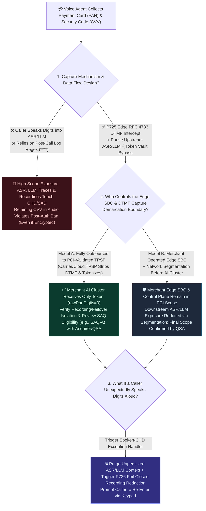
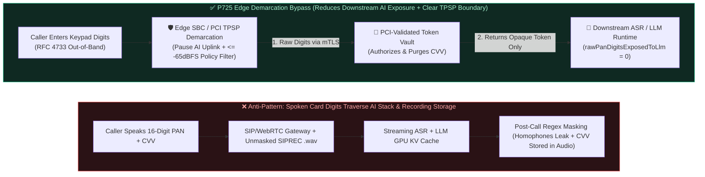

# Enterprise Voice Agent Telephone Payment Capture Bypass & PCI-DSS Scope Demarcation FAQ: How Does Edge RFC 4733 DTMF Intercept Reduce AI Component Exposure, and How Should Architects Evaluate SAQ Eligibility?

> **Target Audience**: AI Solution Architects, Contact Center Security Architects, Payment Compliance Leads, and QSA Liaison Engineers  
> **Standalone Single-Topic Scope**: This document is **Standalone Guide 6A (`Stage 366 · P725`)**, focusing specifically on **how Edge SBC/Media-Gateway `RFC 4733` Out-of-Band DTMF Intercept, Upstream ASR/LLM Audio Pause, and Token Vault Bypass (`P725`) reduce cardholder data exposure for downstream AI components, and how to evaluate PCI-DSS scope and SAQ eligibility using demarcation points**. For **Dual-Stream `SIPREC` Delayed Ring-Buffer Audio Redaction & Fail-Closed Archival (`P726`)**, see the companion standalone guide [`docs/siprec-pii-audio-redaction-faq.en.md`](./siprec-pii-audio-redaction-faq.en.md) (the two controls operate on distinct, composable boundaries and are not mutually exclusive substitutes).  
> **Verified Primary Guidance**: [PCI Security Standards Council (PCI SSC) — *Industry Guidance on Accepting Telephone Payments Securely*](https://blog.pcisecuritystandards.org/industry-guidance-on-accepting-telephone-payments-securely) (and its linked PCI SSC SIG Information Supplement *Protecting Telephone-Based Payment Card Data*) alongside [PCI-DSS v4.0 SAQ-A Eligibility Criteria (`PCI-DSS-v4-0-SAQ-A.pdf`)](https://www.pcisecuritystandards.org/documents/PCI-DSS-v4-0-SAQ-A.pdf) (requiring full outsourcing of all cardholder data functions to PCI-validated TPSPs with merchant systems never electronically storing, processing, or transmitting CHD/SAD; this repository's demo and offline policy checks are not a compliance certification).  
> **Language Versions**: [中文版](./voice-pci-dtmf-scope-faq.md) | [English Version](./voice-pci-dtmf-scope-faq.en.md)  
> **Visual Architecture Summary**: [`assets/svg/10-pci-dtmf-dual-stream-redaction-2026-11-08.svg`](../assets/svg/10-pci-dtmf-dual-stream-redaction-2026-11-08.svg)

---

## ① 📌 Executive Summary

1. **The Selection Boundary (Never Route Spoken PAN/SAD Into ASR/LLM or Rely on Post-Log Regex Masking vs. Edge `RFC 4733` DTMF Intercept + Token Vault Bypass `P725`)**:
   - **When collecting a 16-digit Primary Account Number (PAN) or Sensitive Authentication Data (SAD, such as 3/4-digit CVV2/CVC2/CID or PIN) over a voice call, do not ask callers to speak digits into ASR/LLM and do not rely on post-call text regex masking (`****`)—deploy Edge SBC/Media-Gateway `RFC 4733` Out-of-Band DTMF Intercept + Upstream ASR/LLM Pause + Token Vault Bypass (`P725`)**: This architecture is designed to prevent raw DTMF events, PAN, and SAD from reaching downstream ASR engines, LLM GPU KV caches, prompt traces, and application microservices, thereby reducing the cardholder data exposure of downstream AI components.
   - **Conditional PCI-DSS Scope & SAQ Eligibility Boundary (Protocol Bypass or Local Unit Tests Do Not Automatically Certify `SAQ-A` or Total Out-of-Scope Status)**: As the [PCI SSC Official Guidance on Accepting Telephone Payments Securely](https://blog.pcisecuritystandards.org/industry-guidance-on-accepting-telephone-payments-securely) explicitly warns, *"technologies are often implemented for the purpose of reducing PCI DSS scope without sufficient understanding of the impact to the payment environment. The implementation of such technologies needs to be carefully evaluated to determine the resultant impact to the security and scope of a particular environment."* A local test showing `rawPanDigitsExposedToLlm = 0` or `RFC 4733` stripping **does not automatically make an entire environment out of scope or guarantee `SAQ-A` eligibility**. Systems that terminate or process raw VoIP/DTMF/PAN/SAD (carrier trunks, edge SBCs, DTMF receivers, token vaults), call recording/tracing/failover paths, and connected systems that can impact the security of the telephone payment environment must be evaluated across clear **lines of demarcation**; whether an organization qualifies for `SAQ-A`, `SAQ-A-EP`, `SAQ-D`, or a Report on Compliance (RoC) requires verifying full outsourcing to PCI-DSS validated Third-Party Service Providers (TPSPs) and applicable v4.0 SAQ eligibility criteria with the **acquirer, payment brands, and Qualified Security Assessor (QSA)**.
2. **Absolute Post-Authorization Prohibition on Storing SAD (Even Encrypted) & Orthogonal Boundary with `SIPREC` Audio Redaction (`P726`)**:
   - **Never Store CVV/SAD After Authorization—Encryption Is Not an Exception**: Under PCI-DSS Requirement 3.3.1, Sensitive Authentication Data (CVV2/CVC2/CID, PIN) must **never be retained after authorization in any persistent or debug medium (`.wav` call recordings, ASR logs, LLM traces, or databases), even if encrypted**.
   - **Edge Capture Bypass (`P725`) and Delayed Recording Redaction (`P726`) Are Distinct, Composable Controls**: `P725` isolates the **upstream payment capture path** so keypad digits never enter ASR/LLM. By contrast, [`P726` (Dual-Stream SIPREC Ring-Buffer Audio Redaction)](./siprec-pii-audio-redaction-faq.en.md) only redacts the **delayed recording/archival fork** while the `0ms` real-time AI dialogue stream still flows to ASR/LLM. Therefore, **redacting `SIPREC` recordings alone does not sanitize ASR/LLM exposure**; architects should enforce `P725` for payment capture and layer `P726` to prevent unprompted spoken PII/CHD from persisting in archival storage.
3. **Nominal `1ms` Display Resolution & Offline Policy Check vs. Production Measurement Boundary**:
   - In this repository's deterministic guardrail suite, the `-65 dBFS` in-band tone suppression threshold and `rawPanDigitsExposedToLlm = 0` check in `P725` are **local `synthetic` engineering policy/configuration checks**, not fixed decibel numbers mandated by the PCI-DSS standard. Timer readings follow the strict provenance disclosure: **`0ms reported at nominal 1ms display resolution; actual duration unresolved/not_measured; no sub-1ms upper bound established` (offline `synthetic` policy checks do not establish a `sub-1ms` physical duration upper bound, do not measure live media/DSP latency, and do not constitute regulatory certification)**.
   - Live SBC DSP filtering, carrier SIP trunk jitter, and external PCI Token Vault HSM round-trip latency (typically `120ms–380ms` engineering budget) are explicitly marked **`not_measured`** in local unit tests; cited industry context figures are marked **`anonymized_reported` (`independently_reproduced=false`)**.


---

## ② 🎯 First-Principles & Plain-Language Architect Q&A (FAQ-Driven)

### Q1: Why shouldn't callers speak credit card numbers directly to a Voice Agent with regex `****` masking in the database, and why is storing encrypted CVV audio still a violation?

- **Plain-Language First Principle (Data Flow Exposure & the Absolute Ban on Post-Authorization SAD Storage)**:
  - **Why Post-Call Text Masking Fails to Contain Scope**: As highlighted in the [PCI SSC Guidance on Accepting Telephone Payments Securely](https://blog.pcisecuritystandards.org/industry-guidance-on-accepting-telephone-payments-securely), migrating from analog telephony to VoIP introduces multiple digital hops where account data can be exposed or recorded. Once a caller speaks a 16-digit PAN and 3-digit CVV into the microphone, plaintext audio frames and tokens traverse ingress load balancers, WebRTC/SIP media gateways, streaming ASR engines, LLM GPU KV caches, observability traces, and call recording buckets. Any system component that stores, processes, or transmits CHD/SAD—or connects to and can impact the security of those components—must be considered when evaluating PCI-DSS scope.
  - **Spoken Numbers Defeat Text Regexes**: Disfluencies, accents, and homophones frequently cause ASR to transcribe `"4111"` as `"for won... uh... double one"`, bypassing `\d{16}` text filters and leaking plaintext digits into LLM prompts.
  - **Encryption Does Not Permit Storing CVV/SAD After Authorization**: Teams often assume that encrypting `.wav` recordings with AES-256 makes spoken CVV retention compliant. Under PCI-DSS Req 3.3.1, **Sensitive Authentication Data (CVV2/CVC2/CID, PIN) must never be stored after authorization, even when encrypted**.

### Q2: How does Edge `RFC 4733` Out-of-Band DTMF Intercept + Token Vault Bypass (`P725`) work under the hood, and why must in-band tone bleed also be suppressed?

- **Plain-Language First Principle (Separating Keypad Signaling from Voice Media at the Demarcation Boundary)**:
  - When a caller presses keypad digits during a call, tones can travel as **In-Band Audio (`697Hz–1477Hz` dual-tone frequencies mixed into the voice stream)** or **Out-of-Band RTP Events (`RFC 4733` / `RFC 2833`, Payload Type `101`)**.
  - **Four-Step Isolation Flow in `P725`**:
    1. **Enter Payment Intercept Window**: When the Voice Agent prompts the caller to enter card digits via the keypad, the orchestrator signals the edge SBC/media gateway to activate `enter_payment_dtmf_intercept`.
    2. **Pause Upstream AI Audio & Clamp In-Band Tone Bleed**: The edge gateway mutes/pauses the upstream audio leg heading to ASR/LLM and applies a DSP notch filter to suppress any transient in-band DTMF tone bleed to the local policy budget of **`<= -65 dBFS`** (`synthetic` policy threshold).
    3. **Direct mTLS Exchange with a PCI-Validated Token Vault**: The edge gateway (or a PCI-validated TPSP DTMF capture boundary) collects the `RFC 4733` keypad events, transmits the PAN and one-time CVV over mTLS directly to the Token Vault, receives an opaque payment token (`tok_visa_9f8a_last4_4242`), and immediately zeroes its volatile keypad buffer.
    4. **Resume AI Dialogue with Zero PAN Digits**: Upstream audio resumes and only the opaque token (`rawPanDigitsExposedToLlm = 0`) is passed to the LLM to confirm payment completion.

### Q3: Does implementing `P725` automatically make our entire cloud environment `SAQ-A` eligible? What demarcation points must architects verify with QSAs and acquirers?

- **Plain-Language First Principle (Scope Reduction Requires Evaluating Demarcation Points, Connected Systems, and TPSP Outsourcing)**:
  - **Never claim that `RFC 4733` bypass or `rawPanDigitsExposedToLlm = 0` automatically certifies an entire environment as `SAQ-A` or 100% out of scope.**
  - Following the [PCI SSC Telephone Payment Guidance](https://blog.pcisecuritystandards.org/industry-guidance-on-accepting-telephone-payments-securely), architects must evaluate six concrete factors with their acquirer and QSA:
    1. **End-to-End Data Flows & Demarcation Points**: Identify exactly where raw voice/DTMF enters the carrier trunk, where `RFC 4733` packets are terminated/stripped, and where tokenization occurs.
    2. **Merchant-Hosted SBC vs. PCI-Validated TPSP Boundary**: If the merchant operates its own edge SBC/media gateway that receives raw DTMF/PAN, that edge tier handles account data and remains in PCI scope (even though downstream AI/LLM tiers have reduced exposure via network segmentation). Eligibility for **`SAQ-A`** requires, among other v4.0 criteria, that all cardholder data functions are completely outsourced to PCI-DSS validated third-party service providers (TPSPs) so merchant systems never receive, process, or transmit electronic account data.
    3. **Connected & Security-Impacting Systems**: Control-plane services that can toggle DTMF interception, modify SBC routing, or access edge memory can impact the security of the payment channel and must be assessed in scope.
    4. **Recording, Tracing, and Failover Paths**: Verify that `SIPREC` forks, packet captures (`pcap`), debug logs, and fallback IVR queues cannot capture raw payment audio/digits.
    5. **Shared Responsibility Matrix (`PCI-DSS Req 12.8`)**: Maintain current PCI-DSS Attestations of Compliance (AoCs) and written responsibility matrices for every carrier and TPSP in the call path.

---

## ③ 🧭 Visual Architecture Diagrams (Scope Evaluation Tree + Exposed vs. Demarcated Pipeline + Sequence Diagram)

### 3.1 Telephone Payment Capture & PCI Scope Demarcation Decision Tree (`flowchart TD`)



### 3.2 Full-Stack CHD Exposure vs. `P725` Demarcated Edge Token Bypass (`flowchart LR`)



### 3.3 Millisecond Sequence Diagram of `P725` Edge `RFC 4733` DTMF Intercept & Tokenization (`sequenceDiagram`)

```mermaid
sequenceDiagram
    autonumber
    participant Caller as Caller Endpoint (PSTN / VoIP)
    participant Edge as Edge SBC / TPSP Demarcation Point (P725)
    participant Vault as PCI-Validated Token Vault
    participant AI as Downstream Voice Agent (ASR + LLM + TTS)

    AI->>Caller: "Please enter your 16-digit card number and 3-digit security code on your keypad, followed by pound."
    AI->>Edge: Activate payment intercept window (enter_payment_dtmf_intercept)
    Note over Edge,AI: P725 Offline Policy Gate (0ms reported at nominal 1ms display resolution; actual duration unresolved/not_measured): Pause upstream audio to ASR/LLM & inject silence frames
    Caller->>Edge: Presses 16-digit PAN + 3-digit CVV + # (RFC 4733 Payload 101 + transient tone bleed)
    Edge->>Edge: Strip RFC 4733 events & clamp in-band tone bleed to <= -65 dBFS (local synthetic policy budget)
    Edge->>Vault: mTLS POST /v1/tokenize (PAN + one-time CVV)
    Vault-->>Edge: 200 OK (tok_visa_9f8a_last4_4242, CVV immediately destroyed post-auth)
    Edge->>Edge: Zero out volatile keypad buffer in edge RAM
    Edge->>AI: Resume upstream voice leg + emit token event (tok_visa_9f8a_last4_4242, rawPanDigits=0)
    AI->>Caller: "Your card ending in 4242 has been approved. Thank you!"
```

---

## ④ 📊 Voice Architect Selection Decision Matrix

| Evaluation Dimension | Option A: Spoken Card Digits + Post-Call Log Regex (`Spoken PAN`) | Option B: Merchant-Managed Edge SBC `RFC 4733` Bypass (`Self-Hosted Edge`) | Option C: PCI-Validated TPSP Edge `RFC 4733` Bypass + Token Vault (`P725`, Recommended) |
| :--- | :--- | :--- | :--- |
| **Primary Use Case** | ⛔ **Never use for payment card PAN/CVV collection** | Large financial enterprises operating PCI-audited telephony edges | **Enterprises seeking to minimize cardholder data exposure across cloud AI Voice Agents** |
| **End-to-End Payment Turn Latency** | Spoken digit readbacks/corrections add `15s–30s` friction | Deterministic `#` terminator; Vault RTT budget `120ms–380ms` (`not_measured`) | **Deterministic `#` terminator; Vault RTT budget `120ms–380ms` (`not_measured`) with zero readback loops** |
| **Barge-in & Keypad Handling** | Breathing pauses mid-card-number trigger false VAD cutoffs | Upstream ASR paused during payment window; listens for `RFC 4733` | **Upstream ASR paused during payment window; emits only masked digit-count progress events** |
| **Transcript / Audio Audit & Post-Auth SAD Ban** | ❌ High risk of plaintext PAN/CVV in `.wav` & LLM traces (encrypted CVV storage still violates PCI) | ✅ Zero PAN in downstream LLM (`rawPanDigits=0`), but merchant must audit edge SBC RAM/pcap | ✅ **PCI-validated TPSP handles raw digits & post-auth CVV destruction; downstream AI receives only tokens** |
| **PCI-DSS Scope & SAQ Assessment Impact** | ❌ Pulls ASR, LLM, logs, and recording storage into CDE assessment | 🛡️ Merchant edge SBC & control plane remain in scope; segmentation reduces downstream AI exposure | ✅ **Reduces downstream AI exposure; supports evaluating reduced-scope eligibility (e.g., `SAQ-A` criteria) with acquirer & QSA when fully outsourced to validated TPSPs** |
| **Blended Compliance & Operating TCO** | High annual full-stack audit & remediation overhead (`anonymized_reported`) | Moderate-to-High (merchant maintains PCI controls on edge SBCs) | **Optimal TCO (per-transaction TPSP tokenization + reduced compliance footprint on AI clusters)** |

---

## ⑤ 🧪 Quantitative Evaluation & 7-Card Benchmark Findings (Stage 366 · `P725`)

> **Provenance & Policy Budget Note**: Deterministic guardrail metrics below come from `evaluatePciDssSaqADtmfMediaBypassGate` (`P725`) in `packages/business-core/enterprise-guardrails.ts` and `tests/presales-portal.test.ts`. Note that **`<= -65 dBFS` in-band tone suppression and `rawPanDigitsExposedToLlm = 0` are local `synthetic` engineering policy budgets/assertions** (not statutory decibel numbers from PCI-DSS text) and do not replace formal QSA scope certification; live SBC DSP filtering and external PCI Vault HSM network RTTs are marked `not_measured`.

| Evaluation Metric / Probe | Spoken PAN / Unpaused ASR Baseline | `P725` Edge `RFC 4733` DTMF Bypass & ASR Pause Gate | Verification Status & Provenance |
| :--- | :--- | :--- | :--- |
| **Raw PAN Digits Exposed to Downstream LLM (`rawPanDigitsExposedToLlm`)** | `16` PAN digits + `3` CVV digits leaked to prompt | **Clamped to `0` digits (passes opaque `tok_visa_...` only)** | `deterministic_guardrail_verified` · `synthetic` |
| **In-Band DTMF Tone Bleed Policy Budget (`inbandDtmfToneBleedDb`)** | `-12 dBFS` to `-18 dBFS` (recoverable via spectrogram) | **Clamped to `<= -65 dBFS` local policy budget (+ upstream audio mute)** | `deterministic_guardrail_verified` · `synthetic` (local policy budget) |
| **Offline Policy Check Timer Reading (`Policy Gate Timer Reading`)** | Unprotected | **`0ms reported at nominal 1ms display resolution; actual duration unresolved/not_measured; no sub-1ms upper bound established`** | `synthetic` (offline policy logic check; not live DSP time) |
| **Live SBC Packet Stripping & PCI Token Vault HSM RTT** | Network-dependent | **`not_measured` (Production engineering budget: `120ms–380ms`)** | `not_measured` (zero fabricated coordinates) |

---

## ⑥ 🛠️ Appendix: Production Telephone Payment Scope & Launch Verification Checklist

- [ ] **1. Map End-to-End Data Flows & Demarcation Points (Per PCI SSC Telephone Payment Guidance)**: Have you documented all demarcation points across carrier trunks, edge SBCs, DTMF receivers, Token Vaults, recording forks, debug logs, failover paths, and connected systems that can impact payment security?
- [ ] **2. Upstream ASR/LLM Pause & `RFC 4733` Out-of-Band Intercept (`P725`)**: During the payment prompt window, does the edge gateway pause upstream audio to ASR/LLM, strip `RFC 4733` events, and clamp residual in-band tone bleed (e.g., `<= -65 dBFS` engineering budget) so `rawPanDigitsExposedToLlm = 0`?
- [ ] **3. Enforce Zero Post-Authorization Retention of SAD/CVV (Even Encrypted)**: Have you verified that `.wav` recordings, `pcap` traces, ASR transcripts, and crash dumps never retain CVV2/CVC2/PIN after authorization—with zero exceptions for encrypted storage (`PCI-DSS Req 3.3.1`)?
- [ ] **4. Layer Unprompted Spoken-CHD Exception Handling (`P725` + `P726` Composition)**: Because [`P726` (`SIPREC` delayed recording redaction)](./siprec-pii-audio-redaction-faq.en.md) does not sanitize the `0ms` real-time AI leg, if a caller blurts out card digits aloud, does the runtime immediately purge unpersisted ASR/LLM context, trigger `P726` fail-closed recording redaction, and redirect the caller to keypad entry?
- [ ] **5. Verify TPSP PCI AoCs, Req 12.8 Matrix & Formal Acquirer/QSA Scope Determination**: Have you collected valid PCI-DSS Attestations of Compliance (AoCs) and written Req 12.8 shared-responsibility matrices for all telephony/payment TPSPs, and confirmed applicable SAQ eligibility (`SAQ-A`, `SAQ-A-EP`, or `SAQ-D`/RoC) with your acquirer and QSA?
