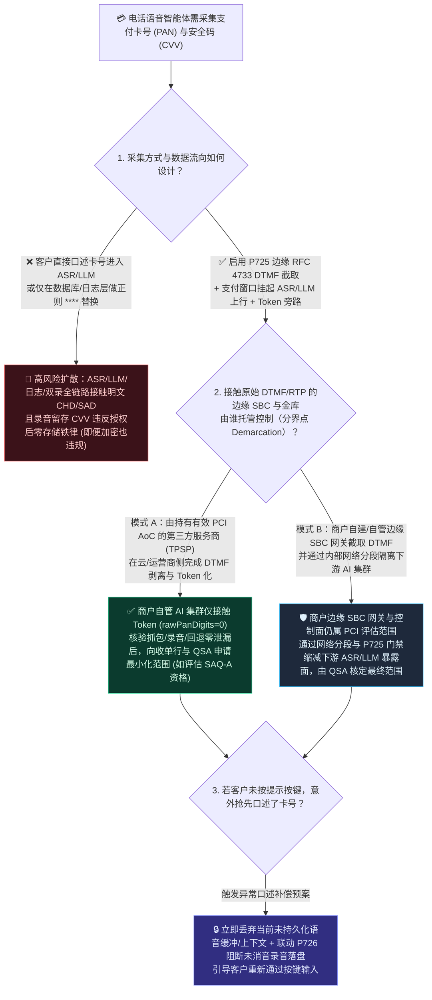
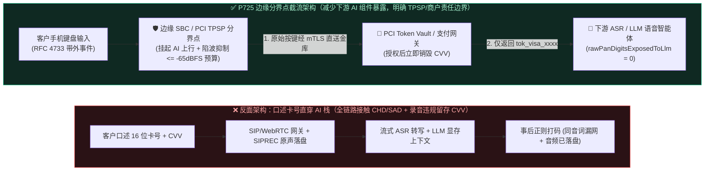
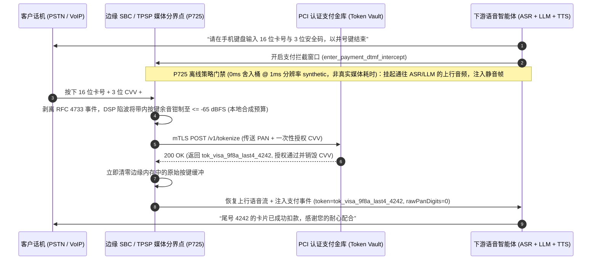

# 企业语音智能体电话支付采集旁路与 PCI-DSS 范围界定架构选型 FAQ：边缘 RFC 4733 DTMF 截流如何减少 AI 组件持卡人数据暴露？如何基于分界点（Demarcation Points）科学评估合规范围？

> **面向读者**：AI Solution Architect（AI 解决方案架构师）、金融/电商呼叫中心安全架构师、支付合规负责人、QSA 对接工程师  
> **独立单专题定位**：本篇为 **Round 6 拆分单专题 A（Stage 366 · P725）独立指南**，专门解答**“电话语音支付中如何通过边缘媒体网关 `RFC 4733` 带外 DTMF 截流、挂起 ASR/LLM 上行流与支付金库 Token 旁路来减少下游 AI 语音组件的持卡人数据暴露，以及如何依据 PCI SSC 官方电话支付指南科学界定系统范围与 SAQ 适用资格”**。关于**合规双录（`SIPREC`）中口述敏感信息的内存延迟环形缓冲消音与 Fail-Closed 归档机制（`P726`）**，请参阅独立姊妹篇 [`docs/siprec-pii-audio-redaction-faq.md`](./siprec-pii-audio-redaction-faq.md)（两者属于不同层面的可叠加保护控制，不可互相替代）。  
> **官方一手参考依据**：[PCI Security Standards Council (PCI SSC) — *Industry Guidance on Accepting Telephone Payments Securely*](https://blog.pcisecuritystandards.org/industry-guidance-on-accepting-telephone-payments-securely)（及其关联的 PCI SSC SIG 信息增补文件 *Protecting Telephone-Based Payment Card Data*）与 [PCI-DSS v4.0 SAQ-A 官方资格指南 (`PCI-DSS-v4-0-SAQ-A.pdf`)](https://www.pcisecuritystandards.org/documents/PCI-DSS-v4-0-SAQ-A.pdf)（明确要求全部持卡人数据职能完整外包给经 PCI 验证的第三方服务商 TPSP，且商户系统不以电子方式存储、处理或传输 CHD/SAD；本仓库演示与离线策略门禁不构成合规认证）。  
> **语言版本**：[中文版](./voice-pci-dtmf-scope-faq.md) | [English Version](./voice-pci-dtmf-scope-faq.en.md)  
> **可视化总结图**：[`assets/svg/10-pci-dtmf-dual-stream-redaction-2026-11-08.svg`](../assets/svg/10-pci-dtmf-dual-stream-redaction-2026-11-08.svg)

---

## ① 📌 核心结论速览（Executive Summary）

1. **选型分界线（严禁口述卡号直入 ASR/LLM 或仅靠事后日志打码 vs. 边缘网关 `RFC 4733` DTMF 截取 + 支付金库 Token 旁路 `P725`）**：
   - **在电话语音支付场景采集 16 位主账号（PAN）或敏感认证数据（SAD，如 3/4 位 CVV2/CVC2/CID、PIN）时，不应让客户对着实时语音大模型直接口述卡号，也不应仅依赖事后日志正则替换为 `****`；推荐采用“边缘 SBC/媒体网关 `RFC 4733` 带外 DTMF 截取 + 支付窗口暂停 ASR/LLM 上行音频 + PCI 认证金库（Token Vault）直接换取脱敏 Token（`P725` 护栏）”**：该架构的核心工程目标是**阻断原始 DTMF 按键流、明文 PAN 与 SAD 流入下游 ASR、LLM 推理显存、Prompt 追踪与业务微服务**，从而减少下游 AI 应用组件的数据暴露面。
   - **合规范围与 SAQ 资格的重要条件边界（严禁把协议旁路或本地测试等同于自动获得 `SAQ-A` 认证）**：正如 [PCI SSC 官方电话支付安全指南](https://blog.pcisecuritystandards.org/industry-guidance-on-accepting-telephone-payments-securely) 所强调，*“许多为缩减 PCI DSS 范围而引入的技术必须结合具体实现仔细评估其对特定环境安全与范围的实际影响（carefully evaluated to determine the resultant impact to the security and scope of a particular environment）”*。单靠 `RFC 4733` 截取或本地单测 `rawPanDigitsExposedToLlm = 0` **不能自动判定整个环境脱离 CDE（Out-of-Scope）或必然符合 `SAQ-A`**。接触原始语音/DTMF 的运营商中继、边缘 SBC/媒体网关、DTMF 解码器、录音分流器及连接或可影响支付通道安全的控制面系统仍需纳入范围评估；企业能否适用 `SAQ-A`、`SAQ-A-EP` 或 `SAQ-D`/RoC，必须满足全部持卡人数据职能完整外包给经 PCI DSS 验证的第三方服务商（TPSP）等前置资格条件，并由**收单机构（Acquirer）、卡组织（Payment Brands）与合格安全评估师（QSA）**按实际部署拓扑核定。
2. **敏感认证数据（SAD/CVV）的绝对存储禁令 vs. 与 `SIPREC` 录音消音（`P726`）的正交边界**：
   - **授权后严禁以任何形式存储 SAD（即使已加密也不例外）**：根据 PCI DSS 要求（Req 3.3.1），CVV2/CVC2/PIN 等敏感认证数据（SAD）在支付授权完成后**严禁存储于任何持久或调试介质（包括 `.wav` 通话录音、ASR 转写日志、LLM Trace 与数据库），即使经过高强度加密也绝无例外**。
   - **采集层旁路（`P725`）与归档层延迟消音（`P726`）是不同且可叠加的边界**：`P725` 在**边缘网关输入侧**拦截按键并暂停上行 AI 音频，防止卡号进入 ASR/LLM；而 [`P726`（SIPREC 延迟环形缓冲消音）](./siprec-pii-audio-redaction-faq.md)仅作用于**并联的合规录音归档支路**（其 `0ms` 实时 AI 对话支路依然会把客户口述音频送给 ASR/LLM）。因此，**仅做 `SIPREC` 录音消音绝不会自动净化 ASR/LLM 的数据暴露**；在支付场景中，必须以 `P725` 边缘采集旁路为主控防线，并以 `P726` 作为防范客户意外抢先口述敏感信息的录音归档补偿防线。
3. **本机计时分辨率（`1ms` 舍入桶）与离线策略状态机检查 vs. 生产环境实测边界（Provenance 说明）**：
   - 在本仓库确定性护栏测试中，`P725` 所采用的带内按键余音抑制阈值（`<= -65 dBFS`）与大模型暴露卡号位数（`0`）均为**本地工程策略配置/合成模型检查（`synthetic`）**，并非 PCI DSS 标准文本规定的法定分贝数值。本机计时器读数为 `0ms`（计时分辨率 `1ms`）**仅说明该离线内存策略/配置检查落在了低于计时器粒度/四舍五入的 `0ms` 舍入桶（`[0ms, 1ms)` Rounding Bucket）内，绝不能证明真实耗时 `<1ms`（更不能证明真实媒体/DSP 执行 `<1ms`），且离线 `synthetic` 策略不测量真实媒体端到端延迟，亦不构成法规或 QSA 合规认证**。
   - 真实生产环境中的 SBC DSP 滤波残余、运营商 SIP 中继抖动、以及第三方 PCI Token Vault HSM 网络往返耗时（工程预算通常 `120ms–380ms`）在本地单测中显式标注为 **`not_measured`**；行业背景参考数据标为 **`anonymized_reported`（`independently_reproduced=false`）**。

---

## ② 🎯 客户与架构师灵魂拷问 Q&A（FAQ-Driven，大白话 + 第一性原理）

### Q1：客户在电话里付款时，为什么不能直接口述信用卡号给语音智能体，再在日志落库前用正则把数字替换成 `****`？为什么“加密存储录音里的 CVV”依然违规？

- **通俗大白话与第一性原理（“数据流经之地即受控范围”与 SAD 零留存铁律）**：
  - 很多工程团队直觉认为：*“让客户直接对原生 Speech-to-Speech 模型或流式 STT 报卡号体验最好，只要我们在写数据库前把 16 位数字替换成 `****` 不就行了？”*
  - **为什么这在支付安全与合规评估中会引发严重的范围扩散（Scope Expansion）？**
    1. **明文流经内存与内网即影响合规边界**：根据 [PCI SSC 官方电话支付指南](https://blog.pcisecuritystandards.org/industry-guidance-on-accepting-telephone-payments-securely)，电话支付环境的风险评估涵盖人员、流程与整条技术链路（特别是从传统模拟线路迁移到 VoIP 后的网络传输、编解码与分流节点）。一旦客户口述卡号，明文音频帧与文本 Token 就流经了接入负载均衡、WebRTC/SIP 媒体网关、ASR 转写集群、LLM 推理 GPU 显存（KV Cache）、APM 调用链日志与对象存储。任何保存、处理或传输持卡人数据（CHD/SAD）、或虽不直接处理但与支付处理组件相连且可能影响其安全性的系统，都会被纳入 PCI DSS 评估范围考量。
    2. **口述同音字与断句极易绕过文本正则**：语音识别面对口音、停顿或吞音时，常把 `"4111"` 识别成 `"four one... uh... double one"` 或同音词，导致简单的 `\d{16}` 正则漏网，明文卡号直接进入大模型上下文。
    3. **CVV/PIN 等敏感认证数据（SAD）授权后“加密也不准存”**：许多团队误以为“只要把通话录音用 AES-256 加密存进 S3 就合规了”。事实上，PCI DSS 明确规定：**敏感认证数据（SAD，包含卡背面 3 位 CVV2/CVC2 及交易 PIN）在授权完成后严禁以任何形式存储，即便经过加密也绝对禁止留存**！一旦客户口述了 CVV 且被录进 `.wav` 录音文件，无论磁盘是否加密均构成严重违规。

### Q2：边缘网关 `RFC 4733` 带外 DTMF 截流 + Token Vault 旁路（`P725`）底层是怎么运作的？为什么还要防范“带内音频按键余音（In-Band Bleed）”？

- **通俗大白话与第一性原理（把按键变成独立信令包，并在边缘网关对 AI 彻底“捂耳朵”）**：
  - 当客户在手机拨号盘上按下数字键（如 `'4'`）时，电话网有两种传输方式：
    - **带内音频（In-Band Audio, G.711）**：直接把 `697Hz + 1209Hz` 的双音多频（DTMF）“哔哔”声混在说话声音里传过来。如果这段声音进了大模型或录音文件，任何人都可以通过频谱分析（FFT）反推出完整卡号。
    - **带外事件报文（Out-of-Band RTP Event, `RFC 4733` / `RFC 2833`）**：运营商网关把按键动作抽离成独立的 RTP 事件报文（Payload Type `101`，仅包含按键编码 `event=4` 与持续时长），与普通语音包分离。
  - **`P725` 边缘采集旁路的工作流（四步物理隔离）**：
    1. **进入支付状态机窗口**：当 AI 播报完“请在手机键盘输入卡号并按井号键结束”后，向边缘 SBC/媒体网关下发 `enter_payment_dtmf_intercept` 指令。
    2. **挂起上行 AI 音频流 + 深度压制带内按键余音**：边缘网关立即将通往 ASR/LLM 与常规录音支路的上行音频置为静音/舒适噪声（暂停转发），同时通过 DSP 陷波滤波器将可能泄漏在语音帧头部的带内 DTMF 瞬态余音衰减至本地工程预算阈值 **`<= -65 dBFS`**（`synthetic` 策略门禁）。
    3. **网关直连 PCI Token Vault 换取脱敏 Token**：边缘网关（或托管于经 PCI 验证的第三方电话支付服务商 TPSP 边界内的 DTMF 采集器）收集满 16 位 `RFC 4733` 事件与 3 位 CVV 后，通过独立 mTLS 通道直接提交给 PCI 支付金库（Token Vault / Payment Gateway），换回无敏感意义的支付令牌（如 `tok_visa_9f8a_last4_4242` 与 `auth_status=APPROVED`），并立即在网关内存清零原始按键缓冲。
    4. **恢复 AI 对话**：边缘网关恢复上行语音转发，仅将 `tok_visa_9f8a_last4_4242` 与尾号 `4242` 传给下游 LLM，使下游 LLM 上下文中的原始卡号位数始终为 `0`（`rawPanDigitsExposedToLlm = 0`）。

### Q3：上了 `P725` 边缘 DTMF 旁路之后，是不是就能直接宣称“整个公司 100% 免审直通 `SAQ-A`”？架构师在向客户和 QSA 汇报时必须核清哪些分界点（Demarcation Points）？

- **通俗大白话与第一性原理（缩减下游 AI 暴露面 ≠ 全系统自动免检，必须核验完整外包与责任分界）**：
  - **绝对不能在架构方案中硬编码“上了 DTMF 旁路就必然等于 `SAQ-A` 或全环境 100% Out-of-Scope”**！
  - 依据 [PCI SSC 官方电话支付安全指南](https://blog.pcisecuritystandards.org/industry-guidance-on-accepting-telephone-payments-securely)，电话支付缩减范围技术（Scope-Reduction Technologies）的效果取决于**具体部署架构、控制边界（Lines of Demarcation）与服务商责任划分**：
    1. **哪些组件仍在 PCI 范围内？** 任何终止、解密或接触原始语音/DTMF 报文的组件——包括边缘 SBC/媒体网关、RTP 代理、DTMF 截取服务、以及能够修改边缘网关路由策略或静音开关的控制面/鉴权服务（Connected / Security-Impacting Systems）——本身仍处于合规评估范围内。
    2. **自建边缘网关 vs. 托管给经认证的第三方支付/通信服务商（TPSP）**：
       - 如果边缘 SBC 与 DTMF 截取器部署在**商户自管服务器/VPC** 内，商户自身的边缘基础设施就接触了原始卡号流，通常无法满足 `SAQ-A`“商户系统完全不接收、不传输、不处理电子持卡人数据”的严苛前提，而需评估适用更完整的控制集（如 `SAQ-D` 或正式 RoC 审计，但仍可将已通过严格网络分段与零暴露隔离的下游 LLM 推理集群从核心 CDE 中缩减出来）。
       - 只有当电话支付采集、DTMF 剥离与支付授权**完整外包给持有有效 PCI DSS 合规证明（AoC）的第三方服务商（TPSP，如运营商级云托管 PCI 语音支付网关）**，商户环境仅接收脱敏 Token，且明确签署了 PCI DSS Req 12.8 责任分界矩阵、关闭了所有会录下支付片段的旁路录音/抓包/故障回退通道时，才具备向收单机构与 QSA 申请缩减范围（含评估 `SAQ-A` 资格）的工程基础。
    3. **最终裁定权归属**：适用何种 SAQ 类型及具体系统边界，必须由**商户的收单银行（Acquirer）、支付卡品牌（Payment Brands）及合格安全评估师（QSA）**依据当前生效的 PCI DSS v4.0 SAQ 资格条件核定。

---

## ③ 🧭 直观可视化图解（范围评估决策树 + 暴露路径 vs. 边缘分界架构 + 毫秒级交互时序图）

### 3.1 电话语音支付采集架构与 PCI 范围分界评估决策树（`flowchart TD`）

### 3.2 全链路明文暴露路径 vs. `P725` 边缘分界点（Demarcation Point）Token 旁路对比图（`flowchart LR`）

### 3.3 `P725` 边缘 `RFC 4733` DTMF 截取、ASR 挂起与支付金库 Token 交换时序图（`sequenceDiagram`）

---

## ④ 📊 语音架构师选型决策矩阵（Architect Decision Matrix）

| 评估维度 | 方案 A：客户口述卡号 + 事后日志正则打码 (`Spoken PAN + Log Regex`) | 方案 B：商户自管边缘 SBC `RFC 4733` 旁路 + 内部网络分段 (`Self-Hosted Edge Bypass`) | 方案 C：PCI 验证 TPSP 托管边缘 `RFC 4733` 旁路 + Token Vault (`P725` + TPSP 分界，推荐) |
| :--- | :--- | :--- | :--- |
| **核心适用场景** | ⛔ **严禁用于任何真实银行卡/CVV 采集** | 具备专职安全团队与自管 SBC 基础设施的大型金融机构 | **希望最大限度缩减下游 AI 语音集群合规负担的零售、航旅、电商与医疗客服** |
| **端到端交互延迟影响（TTFA / 支付耗时）** | 语音识别数字串常需多次反问纠错（耗时 `15s–30s`） | 按键采集确定的 `#` 号结束符，金库 RTT 预算约 `120ms–380ms`（`not_measured`） | **按键结束即刻返回 Token，金库 RTT 预算约 `120ms–380ms`（`not_measured`），零反问纠错** |
| **打断自然度与按键防误触体验** | 口述卡号中途喘气极易被 VAD 误判截断 | 支付窗口内挂起 ASR 语音判停，仅监听 `RFC 4733` 按键与超时回退 | **支付窗口内挂起 ASR 语音判停，仅向下游 AI 传递脱敏进度事件（如 `已输入 8/16 位`）** |
| **文本层/音频层合规审计与 CVV 零留存保护** | ❌ 极易在 `.wav` 录音与 LLM Trace 中残留明文 PAN 与 CVV（加密留存 CVV 仍违规） | ✅ 下游 AI 零明文（`rawPanDigits=0`），但需自行审计边缘 SBC 内存与抓包权限 | ✅ **由持牌 TPSP 承担原始按键采集与 CVV 瞬时核验销毁，下游 AI 仅接触 Token** |
| **PCI-DSS 范围与 SAQ 资格评估影响** | ❌ 全套 AI、ASR、LLM、日志与录音存储均纳入持卡人数据环境（CDE）评估 | 🛡️ 边缘 SBC 与控制面仍在范围内；通过严格分段可向 QSA 论证缩减下游 LLM 范围 | ✅ **在满足完整外包、无旁路录音/抓包泄漏及 Req 12.8 责任矩阵前提下，支持向收单行/QSA 申请最小化范围（如评估 `SAQ-A` 资格）** |
| **每分钟综合成本与合规审计 TCO** | 表面开发成本低，但全栈 PCI 审计与整改年化成本极高（`anonymized_reported`） | 中高（需维护自建 SBC 与边缘节点安全合规审计） | **最优 TCO（按需支付 TPSP 通道费，大幅减少下游 AI 算力集群的合规改造范围）** |

---

## ⑤ 🧪 简明定量实测与 7-Card Benchmark 核心发现（Stage 366 · `P725`）

> **数据来源与 Provenance 声明**：以下指标来自 `packages/business-core/enterprise-guardrails.ts` 中的 `evaluatePciDssSaqADtmfMediaBypassGate`（`P725`）及 `tests/presales-portal.test.ts` 封存评测数据。注意：**`-65 dBFS` 带内按键余音上限与 `0` 位 LLM 卡号暴露属于本仓库离线策略状态机的 `synthetic` 工程预算阈值**（并非 PCI DSS 法规条文直接规定的固定数字），且本地单测通过不代表自动获得生产环境 PCI 认证；真实 SBC 滤波与 PCI 金库 HSM 网络往返延迟标注为 `not_measured`。

| 评测探针 / 对比项 | 口述卡号 / 未挂起 ASR 基线 | `P725` 边缘 `RFC 4733` 截取与 Token 旁路门禁 | 验证状态与数据属性（Provenance） |
| :--- | :--- | :--- | :--- |
| **下游 LLM 暴露原始卡号位数 (`rawPanDigitsExposedToLlm`)** | `16` 位 PAN + `3` 位 CVV 明文进入 Prompt | **强制钳制为 `0` 位（仅传递 `tok_visa_...` 脱敏令牌）** | `deterministic_guardrail_verified` · `synthetic` |
| **带内 DTMF 按键音频泄漏衰减预算 (`inbandDtmfToneBleedDb`)** | `-12 dBFS ~ -18 dBFS`（频谱可轻易还原按键） | **本地工程策略钳制 `<= -65 dBFS`（结合上行静音阻断）** | `deterministic_guardrail_verified` · `synthetic`（工程策略预算） |
| **离线策略检查计时读数 (`Policy Gate Timer Reading`)** | 无支付窗口上行挂起门禁 | **`0ms`（位于 `1ms` 计时分辨率的四舍五入桶内，非真实 DSP 耗时）** | `synthetic`（仅表征离线配置检查落在 `1ms` 舍入桶） |
| **生产环境 SBC 报文剥离与 PCI 金库 Token 化 RTT** | 视外部网络与金库部署而定 | **`not_measured`（生产工程预算通常为 `120ms–380ms`）** | `not_measured`（严禁虚构线上实测值） |

---

## ⑥ 🛠️ 附录：生产环境电话语音支付范围界定与上线快速核验清单（Architect Checklist）

- [ ] **1. 绘制端到端数据流图并明确定义分界点（Demarcation Points，依据 PCI SSC 官方电话支付指南）**：是否已完整梳理从运营商 SIP 中继、边缘 SBC/媒体网关、DTMF 解码器、Token Vault 到下游 ASR/LLM、日志监控与故障回退（Failover）通道的完整数据流图，并识别出所有直接接触或可能影响支付通道安全的关联系统（Connected / Security-Impacting Systems）？
- [ ] **2. 支付窗口上行 AI 音频挂起与 `RFC 4733` 带外截取（`P725` 工程控制核验）**：在提示客户按键输入卡号/CVV 期间，边缘网关是否已强制挂起通往 ASR/LLM 的上行音频流、剥离 `RFC 4733` 事件并抑制带内按键余音（如采用 `<= -65 dBFS` 工程预算），确保下游大模型仅收到脱敏 Token（`rawPanDigitsExposedToLlm = 0`）？
- [ ] **3. 敏感认证数据（SAD/CVV/PIN）授权后零存储铁律核验（含加密存储排查）**：是否已彻底排查所有 `.wav` 录音桶、pcap 网络抓包、ASR 原始日志与崩溃转储，确保 CVV2/CVC2/PIN 在授权后**绝不以任何形式留存（明确禁止“已加密所以可以存 CVV”的错误豁免）**？
- [ ] **4. 客户意外抢先口述卡号時的联动补偿防线（`P725` + `P726` 叠加核验）**：由于单靠 [`P726`（SIPREC 录音延迟消音）](./siprec-pii-audio-redaction-faq.md)不会净化 `0ms` 实时 AI 对话流，当检测到客户未按提示按键而是直接口述卡号时，系统是否能立即丢弃当前未持久化的 ASR/LLM 上下文缓冲、联动 `P726` 阻断未消音录音落盘，并提示客户改用手机键盘输入？
- [ ] **5. 第三方服务商（TPSP）PCI AoC 与 SAQ 适用资格联合核定（Req 12.8 核验）**：是否已收集所有接触电话支付流的第三方通信/支付服务商当期有效的 PCI DSS 合规证明（AoC）与责任分界矩阵（Responsibility Matrix），并由**收单机构（Acquirer）、支付卡品牌与合格安全评估师（QSA）**按实际生产部署正式核定适用的 SAQ 类型（绝不单凭代码层测试自行宣告 `SAQ-A` 免审）？
