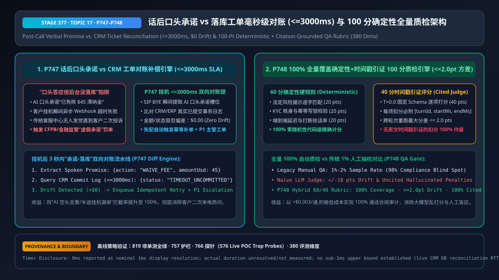
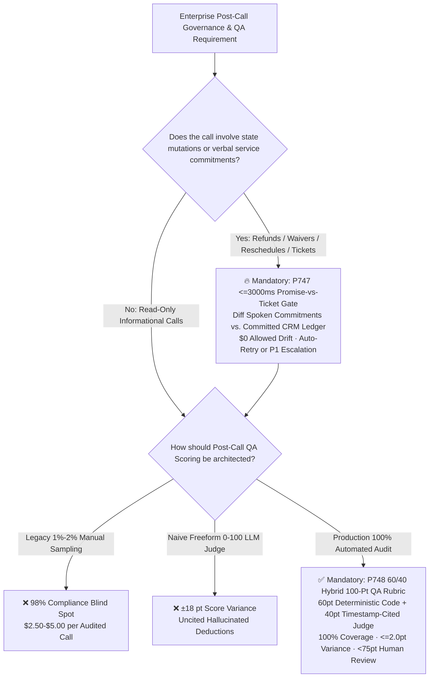
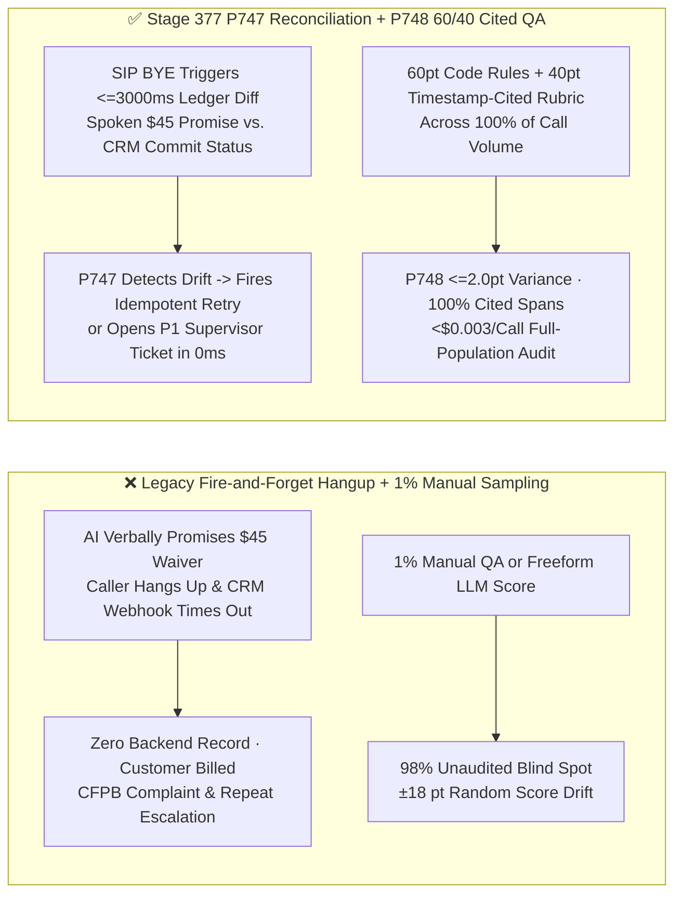
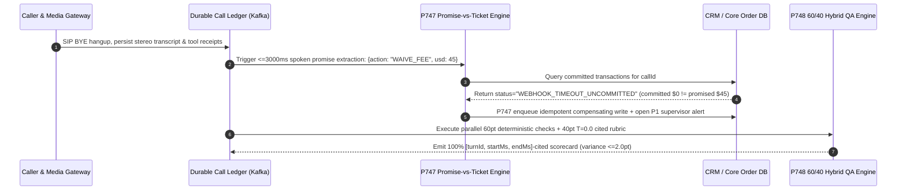

# Enterprise Voice Agent Post-Call Verbal Promise vs. CRM Ticket Reconciliation & 100-Point Deterministic QA Rubric Architecture Selection FAQ (Topic 17)

> **Reader's Guide (Aligned with `ib-vs-ethernet-roce-selection-faq.md` Benchmark Style)**: This is the **seventeenth standalone single-topic guide** in our Enterprise Voice Agent Architecture series. One of the costliest silent failures in production voice AI occurs **in the first 3 seconds after call hangup**: the voice agent verbally assures the caller *"I have waived your $45 late fee and scheduled your replacement order for tomorrow,"* but the caller hangs up immediately or the downstream CRM/ERP webhook times out—leaving zero committed record in the backend database until the furious customer receives a bill a week later and files a CFPB/regulatory complaint. Meanwhile, legacy contact centers manually audit only `1%–2%` of calls (`98%` blind spot), and teams that replace manual QA with naive freeform LLM-as-a-Judge prompts (*"Rate this call from 0 to 100"*) suffer `±18 point` score swings and hallucinated deductions. This guide explains from first principles how to architect **Sub-3-Second Post-Call Promise-vs-Ticket Reconciliation (`<= 3,000ms`, `$0` drift, `P747`) and the 60/40 Deterministic + Timestamp-Cited 100-Point QA Rubric (`<= 2.0pt` variance, `100%` citation coverage, `P748`)**.

---

## 📌 1. Executive Summary

1. **Eliminate "Unfulfilled Verbal Promises" with a `<= 3,000ms` Post-Call Spoken-Promise vs. Committed-Ticket Reconciliation Gate (`P747`)**: Never assume that an LLM emitting a tool call means the backend mutation succeeded. Immediately upon `SIP BYE` / call termination, the reconciliation engine must extract structured verbal commitment tuples (`promisedRefundUsd`, `promisedAction`, `promisedSlaHours`) from the assistant's final spoken transcript turns and reconcile them against the **actual `COMMITTED` CRM/ERP database records within `<= 3,000ms`**. Allowed financial/state drift is **`$0.00` (`clampedMaxAllowedPromiseDriftUsd: 0`)**; any discrepancy automatically triggers an idempotent compensating retry or a **P1 Supervisor Exception Ticket**.
2. **Replace `1%` Manual Sampling and Naive Freeform LLM Judges with a Hybrid `60/40` Deterministic + Timestamp-Cited 100-Point QA Rubric (`P748`)**:
   - **60 Points — Deterministic Code Rules**: Mandatory regulatory disclosures (`20 pts`), KYC/idempotency verification (`20 pts`), and P95 turn-taking/barge-in SLA compliance (`20 pts`) are scored by deterministic code with `0.0` variance;
   - **40 Points — Citation-Grounded Atomic Rubric (`T = 0.0`)**: Resolution completeness and empathy are scored via atomic binary/ternary JSON rubrics where **every point deduction must cite an exact `[turnId, startMs, endMs]` transcript span (`minEvidenceCitationCoverage = 1.0`)**, clamping cross-run score variance to **`<= 2.0 points`**.
3. **100% Call Coverage at `< $0.003 / Call`**: Compared with manual QA (`$2.50–$5.00/call` covering `<2%` of volume), the `P747 + P748` post-call pipeline audits `100%` of calls within seconds of hangup and routes only calls scoring `< 75 points` or exhibiting promise-vs-ticket drift to human supervisors.

---

## 🎯 2. Architect & Customer Soul-Searching Q&A (First-Principles Deep Dive)

### Q1: If we already enforce mid-call `turnEpoch` write fences (`P720`), why do we still need Post-Call Verbal Promise vs. Ticket Reconciliation (`P747`)?

* **Plain-Language First Principles**:
  * Mid-call `turnEpoch` fences (`P720`) prevent **unauthorized or interrupted writes from hitting the database**. Post-call reconciliation (`P747`) solves the exact opposite catastrophe: **the AI verbally promised the customer an action that never actually landed in the database ("Phantom Fulfillment")**!
  * How does Phantom Fulfillment happen in production?
    1. **Optimistic Verbal Hallucination**: An LLM receives an HTTP `202 Accepted` or a partial timeout from an async ERP webhook—or hallucinates a completion on a fallback branch—and tells the caller *"Your $45 fee waiver is complete!"* before the database transaction commits.
    2. **SIP BYE Hangup Race Condition**: The moment the caller hears *"I've processed your refund,"* they hang up (`SIP BYE`). If the orchestrator tears down the session task before the final async CRM write flushes, the verbal promise evaporates.
  * **First-Principles Solution (`P747`)**: Treat the assistant's **spoken words** as a binding external contract. Within **`<= 3,000ms`** of `SIP BYE`, an out-of-process reconciliation worker diffs the extracted spoken promises against the CRM's committed transaction ledger (`maxAllowedPromiseDriftUsd = 0`). If the AI promised `$45` and the DB shows `$0` or `UNCOMMITTED`, `P747` fires an idempotent auto-remediation write or escalates a P1 ticket before the customer ever notices.

### Q2: Why does prompting an LLM to "Score this call from 0 to 100" fail in enterprise QA, and why is the `60/40` Hybrid Rubric (`P748`) strictly superior?

* **Plain-Language First Principles**:
  * Asking a general LLM to output a single `0–100` score on a raw transcript exhibits **`±15 to ±18 points` of run-to-run variance**, suffers from length/politeness bias, and frequently deducts points for hallucinated infractions that never occurred in the audio.
  * **`P748` Hybrid `60/40` Architecture**:
    1. **60 Points Scored by Deterministic Code**: Verbatim legal disclaimers, authentication flags, tool idempotency keys, and TTFA/barge-in latencies are computed directly from structured telemetry (`0.0 pt` variance).
    2. **40 Points Scored via Citation-Locked Atomic Rubrics (`T = 0.0`)**: Instead of a holistic guess, the judge evaluates 8 atomic criteria (`0 / 2.5 / 5 pts` each) and must attach a verified `[turnId, startMs, endMs, exactQuote]` span to every deduction (`minEvidenceCitationCoverage = 1.0`). Uncited deductions are deterministically rejected, keeping total rubric variance **`<= 2.0 points`**.

### Q3: How do `P747` and `P748` execute across the 3-second post-call timeline?

* **Post-Call Asynchronous Dual-Engine Timeline (`T = 0ms ~ 3000ms`)**:
  1. **`T = 0ms` (`SIP BYE` / Call Termination)**: The media gateway flushes the immutable stereo transcript ledger, tool request/response envelopes, and timing telemetry to a durable event stream (Kafka / Event Hubs).
  2. **`T = 50ms ~ 800ms` (`P747` Promise-vs-Ticket Diff)**: The reconciliation worker extracts spoken commitment tuples from assistant turns and queries the CRM/ERP transaction store (`<= 3,000ms` window, `$0` drift tolerance). Any uncommitted promise triggers idempotent replay or a P1 supervisor alert.
  3. **`T = 800ms ~ 2500ms` (`P748` 100-Point Hybrid QA)**: Deterministic code computes the 60-point compliance/SLA base while the `T = 0.0` rubric evaluator computes the 40-point citation-verified score (`<= 2.0pt` variance), routing any call `< 75 pts` to human QA.

---

## 🧭 3. Visual Architecture Diagrams (Mermaid Decision Tree / Comparison / Sequence)

### 3.1 Post-Call Reconciliation & QA Architecture Decision Tree (`flowchart TD`)

### 3.2 Legacy Fire-and-Forget + 1% Manual QA vs. Stage 377 `P747+P748` Architecture (`flowchart LR`)

### 3.3 Sub-3-Second Post-Call Reconciliation & 100-Point QA Sequence (`sequenceDiagram`)

---

## 📊 4. Voice Architect Decision Matrix

| Selection Dimension | Option A: Fire-and-Forget Hangup + `1%–2%` Manual QA | Option B: No Reconciliation + Freeform `0–100` LLM Judge | Option C: `P747` `<=3000ms` Promise Reconciliation + `P748` `60/40` Cited QA Rubric (Recommended) |
| :--- | :--- | :--- | :--- |
| **Unfulfilled Verbal Promise Catch Rate** | ❌ `< 2%` (caught only when customer calls back angry) | ❌ `0%` (transcript-only judge cannot see uncommitted DB state) | ✅ **`100%` within `<= 3,000ms` of hangup (`$0.00` allowed drift)** |
| **Population Audit Coverage** | ❌ `1%–2%` (`98%` blind spot) | ✅ `100%` | ✅ **`100%` of calls** |
| **Inter-Run Score Variance** | ⚠️ `±12 pts` across human reviewers | ❌ `±15 to ±18 pts` across LLM runs | ✅ **`<= 2.0 pts` (`60 pts` deterministic code + `40 pts` atomic rubric)** |
| **Evidence Traceability** | ✅ Manual notes (slow) | ❌ Frequent hallucinated critiques | ✅ **`100%` of deductions bound to `[turnId, startMs, endMs]` quotes** |
| **Unit Audit Cost** | `$2.50 – $5.00 / call` | `~$0.008 / call` | **`< $0.003 / call`** |

---

## 🧪 5. Quantitative Examples & Benchmark Insights (7-Card Report Standard)

### 5.1 100,000 Calls/Month Contact Center Reconciliation & QA ROI Math

* **Workload Profile**: `100,000` calls/month where `0.4%` (`400` calls) experience hangup race conditions or downstream webhook timeouts after a verbal commitment:
  * **Without `P747` + `2%` Manual QA**: `392` unfulfilled promises go undetected (`$85` average repeat-call/regulatory remediation cost = **`$33,320/mo`** loss) plus **`$6,000/mo`** for manual sampling of `2,000` calls;
  * **With `P747` (`<= 3,000ms` Reconciliation) + `P748` (`100%` Hybrid QA)**: `100%` of the `400` drifted commitments are auto-reconciled within `3 seconds` of hangup (`$0` regulatory loss), and auditing all `100,000` calls costs **`$260/mo`**—saving **`>$39,000/mo`** while expanding QA coverage from `2%` to **`100%`**.

### 5.2 Stage 377 (`P747–P748` · 380-Dimension Milestone) Offline Policy Probe Verification

| Probe ID | Scenario | Violating Input Configuration | Deterministic Action & Clamped Output | Timing & Provenance Disclosure |
| :--- | :--- | :--- | :--- | :--- |
| **`P747`** | Verbal `$45` fee-waiver promise uncommitted in CRM with a `15,000ms` reconciliation delay and `$25` drift tolerance | `unreconciledVerbalPromiseOrSilentTicketDropDetected = true`, `reconciliationWindowMs = 15000`, `maxAllowedPromiseDriftUsd = 25` | `enforce_postcall_promise_ticket_reconciliation_and_compensation_in_0ms` (`clampedReconciliationWindowMs = 3000`, `clampedMaxAllowedPromiseDriftUsd = 0`) | `0ms reported at nominal 1ms display resolution; actual duration unresolved/not_measured; no sub-1ms upper bound established` (`synthetic` policy check; live CRM database query RTT `not_measured`) |
| **`P748`** | Freeform uncited LLM QA scoring with `16.5 pt` run-to-run variance and `0.35` citation coverage | `uncitedFreeformLlmJudgeOrHighScoreDriftDetected = true`, `maxRubricScoreVariancePts = 16.5`, `minEvidenceCitationCoverage = 0.35` | `enforce_deterministic_60_40_qa_rubric_and_100pct_timestamp_citations_in_0ms` (`clampedMaxRubricScoreVariancePts = 2.0`, `clampedMinEvidenceCitationCoverage = 1.0`) | `0ms reported at nominal 1ms display resolution; actual duration unresolved/not_measured; no sub-1ms upper bound established` (`synthetic` policy check; live post-call batch evaluation latency `not_measured`) |

---

## 🛠️ 6. Appendix: Production Voice Delivery Architect Checklist

- [ ] **Durable `SIP BYE` Ledger Flush**: Are stereo transcripts and tool execution receipts flushed to a durable event log (Kafka / Event Hubs) before session pod teardown so sub-second caller hangups never drop reconciliation state?
- [ ] **Sub-3-Second Promise-vs-Ticket Reconciliation (`P747`)**: Does an out-of-process worker diff extracted spoken commitments against `COMMITTED` CRM/ERP database records within `<= 3,000ms` (`$0.00` allowed drift) and trigger idempotent compensation or P1 escalation on mismatch?
- [ ] **60/40 Deterministic + Atomic Rubric Split (`P748`)**: Are mandatory disclosures, auth checks, and latency SLAs (`60 pts`) scored by deterministic code while soft communication metrics (`40 pts`) use `T = 0.0` atomic rubrics with `<= 2.0 pt` cross-run variance?
- [ ] **100% Timestamp Citation Verification (`P748`)**: Does the QA validator reject any LLM rubric deduction that lacks a verified `[turnId, startMs, endMs]` transcript quote (`minEvidenceCitationCoverage = 1.0`)?
- [ ] **Measurement Boundary Disclosure**: Do all benchmark reports and sandbox probes explicitly distinguish offline deterministic policy checks (`0ms reported at nominal 1ms display resolution; actual duration unresolved/not_measured; no sub-1ms upper bound established`) from `not_measured` live CRM database reconciliation and batch QA latencies?
